<!-- Файл собран автоматически из лекция/*.md скриптом build-tools/build.mjs; не редактировать вручную -->

# Хроническая сердечная недостаточность

## Паспорт лекции

**Табл. 1.** Паспорт лекции.

| Параметр | Содержание |
|---|---|
| Тема | Хроническая сердечная недостаточность (ХСН) |
| Область знания | Клиническая медицина: кардиология, внутренние болезни, клиническая фармакология; смежные области — патофизиология, молекулярная биология, генетика, нефрология, эндокринология, пульмонология, гериатрия, функциональная и лабораторная диагностика, кардиохирургия, реабилитация, профилактическая и паллиативная медицина, организация здравоохранения |
| Целевая аудитория | Студенты старших курсов (лечебное дело, педиатрия), клинические ординаторы по кардиологии и терапии, врачи-терапевты, врачи общей практики, кардиологи. Базовый уровень изложения рассчитан на студентов; вставки «Углубление» адресованы специалистам и пропускаются без потери связности |
| Предварительная подготовка | Анатомия, нормальная и патологическая физиология сердечно-сосудистой системы, пропедевтика внутренних болезней, основы фармакологии, ЭКГ и ЭхоКГ |
| Уровень сложности | Базово-продвинутый, с элементами экспертного анализа |
| Клинический фокус | ХСН у взрослых; особенности отдельных популяций; преемственность амбулаторной и стационарной помощи |
| Опорные документы | КР Минздрава России / РКО «Хроническая сердечная недостаточность» (2024, ID 156); КР ЕАК/НОИСН (2024); ESC 2021 и фокусное обновление 2023; AHA/ACC/HFSA 2022; ESC 2026 (материал для сопоставления); Второе универсальное определение СН (AHA/ACC/ESC/WHF, 2026) |
| Актуальность источников | Рекомендации ESC 2026 и Второе универсальное определение опубликованы в 2026 г.; их детали продолжают обсуждаться. Перед чтением лекции формулировки сверяются с первоисточником; российские рекомендации 2024 г. в ряде позиций расходятся с ESC 2026, и эти расхождения в тексте выделены явно |
| Условные обозначения | 📌 определение · 💡 интересный факт · ❗ типичная ошибка · 🔬 углубление · 📝 обобщение · ❓ контрольные вопросы · [🖼️ ВИЗУАЛИЗАЦИЯ] якорь иллюстрации · [⚠️ Требуется верификация] пометка о необходимости сверки с первоисточником |

**Цель лекции** — сформировать целостное, систематизированное представление о ХСН: от определения, этиологии и патофизиологии до классификации, диагностики, стратификации риска, лечения, профилактики и длительного наблюдения — как основу клинически обоснованного ведения пациентов по актуальным рекомендациям.

**Задачи лекции:** раскрыть современное определение и эпидемиологическую значимость ХСН; систематизировать причины, факторы риска и триггеры декомпенсации; объяснить гемодинамические, нейрогормональные и молекулярно-клеточные механизмы; сопоставить классификации; сформировать диагностический алгоритм и навык дифференциальной диагностики; освоить определение фенотипа, тяжести и прогноза; разобрать профилактику, немедикаментозную и медикаментозную терапию, включая четырёхкомпонентную («квадро-») терапию; охарактеризовать аппаратные, интервенционные и хирургические методы, механическую поддержку и трансплантацию; рассмотреть тактику при декомпенсации, коморбидности, в особых ситуациях и при продвинутой ХСН; описать реабилитацию, самоконтроль, диспансерное наблюдение и паллиативную помощь; обсудить дискуссионные вопросы и сформировать навык критической оценки доказательств.

**Ожидаемые результаты.** После лекции слушатель *будет знать* современное определение и кодирование ХСН, её причины и механизмы, классификации (Стражеско–Василенко, NYHA, стадии ACC/AHA и РКО, фенотипы по фракции выброса и их пересмотр в ESC 2026), основные группы препаратов и их доказательную базу, показания к ИКД, СРТ, механической поддержке и трансплантации, принципы профилактики и наблюдения. Слушатель *сможет* распознать симптомы и «красные флаги», составить план обследования, интерпретировать натрийуретические пептиды и ЭхоКГ, провести дифференциальную диагностику, сформулировать диагноз, назначить и титровать терапию с учётом фенотипа и коморбидности, определить показания к госпитализации и направлению в центр ХСН. Слушатель *будет способен* преемственно вести коморбидного пациента, оценивать место немедикаментозных, хирургических и паллиативных подходов и критически применять данные исследований к конкретному пациенту.

## 1. Введение

### 1.1. Актуальность темы

Хроническая сердечная недостаточность — закономерный финал большинства заболеваний сердца и одновременно самостоятельная клиническая проблема, с которой врач любой специальности сталкивается ежедневно. По оценке Европейского общества кардиологов (ESC), сердечной недостаточностью страдают 1–3 % взрослого населения, а среди людей старше 70 лет — более 10 %. В Российской Федерации, по данным эпидемиологической программы ЭПОХА, распространённость ХСН за двадцать лет наблюдения выросла с 6,1 до 8,2 %, годовая смертность при клинически выраженной ХСН достигает 12 %, а медиана дожития при III–IV функциональном классе составляет около 3,8 года. Такие показатели сопоставимы с прогнозом при распространённых злокачественных новообразованиях, однако в общественном сознании сердечная недостаточность по-прежнему воспринимается как «возрастная слабость сердца», а не как смертельно опасный синдром, поддающийся лечению.

Актуальность темы определяется и тем, что за последние тридцать лет ХСН превратилась из состояния с почти фатальным прогнозом в заболевание, течение которого можно изменить. Ингибиторы ренин-ангиотензин-альдостероновой системы, бета-адреноблокаторы, антагонисты минералокортикоидных рецепторов, ингибиторы натрий-глюкозного котранспортёра 2-го типа, ресинхронизирующая терапия и имплантируемые дефибрилляторы, механическая поддержка кровообращения и трансплантация сердца — каждый из этих методов доказанно продлевает жизнь. Разрыв между доказанными возможностями и реальной практикой остаётся главным резервом снижения смертности: по данным регистров, значительная часть пациентов не получает полной базисной терапии в целевых дозах.

### 1.2. Постановка проблемы

Проблема ХСН многослойна. Во-первых, это проблема диагностики: симптомы неспецифичны, а объективные признаки на ранних стадиях отсутствуют, поэтому диагноз часто ставится при первой госпитализации по поводу декомпенсации — то есть с опозданием на годы. Во-вторых, это проблема классификации: за пять лет вышли два универсальных определения сердечной недостаточности (2021 и 2026), рекомендации ESC 2021 с обновлением 2023 и новые рекомендации ESC 2026, которые отказались от категории «умеренно сниженной» фракции выброса и заменили термин «острая» сердечная недостаточность термином «декомпенсированная». Российские рекомендации 2024 года сохраняют трёхчленное деление по фракции выброса и собственную систему стадий. Врач должен ориентироваться в этих системах одновременно. В-третьих, это проблема лечения: эффективная терапия многокомпонентна, требует титрования, контроля функции почек и электролитов, учёта коморбидности и приверженности, а её внедрение сталкивается с терапевтической инерцией. Наконец, это проблема организации помощи: исход определяется не только назначениями, но и преемственностью между стационаром и поликлиникой, обучением пациента и наблюдением в «уязвимый» постгоспитальный период.

### 1.3. Обзор структуры лекции

Лекция построена как маршрут от понятий к действиям. Разделы 2–3 задают терминологию, историю и эпидемиологию. Разделы 4–5 раскрывают причины и механизмы — фундамент, без которого невозможно понять логику терапии. Раздел 6 систематизирует классификации, разделы 7–10 ведут от клинической картины к диагностике, дифференциальному диагнозу, формулировке диагноза и оценке прогноза. Разделы 11–18 посвящены лечению: профилактике, целям терапии, немедикаментозным мерам, базисной фармакотерапии ХСН со сниженной фракцией выброса, диуретикам, дополнительным препаратам, терапии при сохранённой и улучшенной фракции выброса и этиотропным подходам. Разделы 19–22 рассматривают коморбидность, особые группы, устройства и хирургию, декомпенсацию. Разделы 23–26 охватывают реабилитацию, длительное наблюдение, продвинутую ХСН и паллиативную помощь. Разделы 27–29 анализируют доказательную базу, дискуссионные вопросы и практическое применение; раздел 30 подводит итог. В конце даны глоссарий и перечень источников. Нумерация рисунков и таблиц сквозная; ссылки вида «см. рис. N» и «см. табл. N» отсылают к ним.

### 1.4. Мотивация слушателей

Обратите внимание: пациент с ХСН редко приходит к врачу с готовым диагнозом. Он приходит к терапевту с одышкой «из-за возраста», к пульмонологу с «бронхитом курильщика», к гастроэнтерологу с тяжестью в правом подреберье, к неврологу с ночными пробуждениями, к хирургу с отёками ног. Умение увидеть за разрозненными жалобами единый синдром и запустить простой, стандартизованный диагностический алгоритм (натрийуретические пептиды → эхокардиография → этиологический поиск) — навык, который сохраняет пациенту годы жизни. Вторая причина для мотивации — осязаемость результата: правильно подобранная четырёхкомпонентная терапия при ХСН со сниженной фракцией выброса снижает относительный риск смерти, по оценкам метаанализов и моделирования, более чем наполовину по сравнению с отсутствием терапии, и этот эффект врач первичного звена может обеспечить без высоких технологий.

### 1.5. Междисциплинарный характер проблемы

ХСН находится на пересечении дисциплин. Патофизиология объясняет нейрогормональную активацию и ремоделирование (Borovac et al., 2020; Schirone et al., 2017); молекулярная биология и генетика раскрывают наследственные кардиомиопатии и метаболические нарушения кардиомиоцита (D’Amato et al., 2025); нефрология — кардиоренальные взаимодействия; эндокринология — вклад сахарного диабета и ожирения; пульмонология — дифференциальную диагностику одышки и дыхательные нарушения во сне; гериатрия — старческую астению и полипрагмазию; функциональная и лабораторная диагностика — инструменты подтверждения диагноза; кардиохирургия и интервенционная кардиология — реваскуляризацию, клапанную коррекцию, устройства и механическую поддержку; медицинская реабилитация, профилактическая и паллиативная медицина, организация здравоохранения — долгосрочное ведение. Системно-биологический взгляд на ХСН (Louridas & Lourida, 2012) подчёркивает, что синдром нельзя свести к одной «поломке»: это сеть взаимосвязанных нарушений, и лечение направлено сразу на несколько её узлов.

### 1.6. Клинические и образовательные ориентиры

Образовательные ориентиры лекции сформулированы в паспорте (см. табл. 1). Если свести их к практическим результатам, то после лекции вы сможете:

1. распознать типичные и атипичные проявления ХСН, выделить «красные флаги» ухудшения и сформулировать диагностическую гипотезу;
2. составить минимальный и расширенный план обследования, интерпретировать BNP/NT-proBNP и данные ЭхоКГ с учётом факторов, искажающих результаты;
3. определить фенотип, стадию и функциональный класс, сформулировать развёрнутый диагноз по отечественным правилам и сопоставить его с международной терминологией;
4. назначить и титровать базисную терапию с учётом гемодинамики, функции почек, калия и коморбидности, спланировать мониторинг и распознать показания к госпитализации, аппаратному лечению и направлению в центр ХСН;
5. составить план профилактики, реабилитации, обучения пациента и диспансерного наблюдения, а также обсудить с пациентом цели лечения, включая паллиативный этап.

Клинический ориентир лекции — пациент в реальной системе здравоохранения: с коморбидностью, ограниченной доступностью отдельных препаратов и технологий, разной медицинской грамотностью и собственными предпочтениями. Поэтому наряду с «идеальными» алгоритмами мы будем обсуждать, что делать, когда идеал недостижим.

> 📝 **Обобщение.** ХСН — распространённый, прогностически тяжёлый и при этом управляемый синдром. Его проблемное поле включает позднюю диагностику, меняющиеся классификации, многокомпонентное лечение и организацию преемственной помощи. Лекция ведёт от терминологии и механизмов к диагностике, лечению и длительному ведению; каждый следующий раздел опирается на предыдущие. Главный вывод введения: результат лечения ХСН определяется не отдельной технологией, а последовательным выполнением доказанных шагов на всех уровнях помощи.

> ❓ **Контрольные вопросы**
>
> 1. Какова распространённость ХСН в мире и в Российской Федерации по данным, приведённым во введении?
> 2. Почему диагноз ХСН часто ставится с опозданием и какие дисциплины вовлечены в ведение пациента?
> 3. Как изменится тактика врача первичного звена, если он начнёт рассматривать одышку у пожилого пациента не как «возрастную норму», а как возможный симптом ХСН?

## 2. Определение, терминология и эволюция представлений о ХСН

### 2.1. Ключевые понятия

Точность терминологии при ХСН — не формальность: от того, назовём ли мы состояние «острой», «декомпенсированной» или «продвинутой» сердечной недостаточностью, зависят маршрут пациента, объём обследования и выбор терапии. Ниже введены понятия, которыми мы будем пользоваться на протяжении всей лекции.

#### 2.1.1. Сердечная недостаточность

> 📌 **Определение:** **сердечная недостаточность** (heart failure, HF; СН) — клинический синдром, характеризующийся настоящими или предшествующими симптомами (одышка, утомляемость, отёки) и/или признаками (повышение давления в яремных венах, хрипы в лёгких, периферические отёки), обусловленными структурным и/или функциональным нарушением сердца, которое приводит к снижению сердечного выброса и/или повышению давления наполнения в покое или при нагрузке и подтверждается повышением уровня натрийуретических пептидов и/или объективными признаками застоя.

Эта формулировка объединяет Универсальное определение 2021 года и определение российских клинических рекомендаций 2024 года. В ней важны три элемента: (1) СН — синдром, а не нозология; (2) обязательна причинная связь симптомов со структурным или функциональным поражением сердца; (3) требуется объективное подтверждение (натрийуретические пептиды, визуализация, признаки застоя), а не только жалобы.

#### 2.1.2. Хроническая сердечная недостаточность

**Хроническая сердечная недостаточность** (ХСН) — сердечная недостаточность с длительным течением, при которой симптомы и признаки существуют постоянно или рецидивируют, а пациент уже получает (или должен получать) длительную терапию. Пациента с ХСН, у которого симптомы и лечение не менялись как минимум в течение месяца, традиционно называют «стабильным». Термин «хроническая» противопоставляется не столько «острой», сколько впервые возникшей, ещё не леченной сердечной недостаточности.

#### 2.1.3. Острая сердечная недостаточность

**Острая сердечная недостаточность** (ОСН) в российских рекомендациях 2024 года определяется как опасное для жизни состояние, характеризующееся быстрым началом или резким ухудшением симптомов и признаков СН вплоть до отёка лёгких или кардиогенного шока, требующее неотложных лечебных мероприятий и, как правило, срочной госпитализации. Рекомендации ESC 2026 отказались от термина «острая» в пользу термина «декомпенсированная сердечная недостаточность», подчёркивая, что у большинства пациентов ухудшение развивается не внезапно, а в течение дней и недель (см. п. 2.4.5).

#### 2.1.4. Острая декомпенсация ХСН; декомпенсированная сердечная недостаточность

**Острая декомпенсация сердечной недостаточности** (ОДСН) — быстрое выраженное усугубление симптомов и признаков уже существующей ХСН. Это самая частая клиническая форма ухудшения: по данным европейских регистров, большинство госпитализаций с «острой» СН приходится именно на декомпенсацию хронической, а не на впервые возникшую СН. **Декомпенсированная сердечная недостаточность** (decompensated heart failure, DHF) в терминологии ESC 2026 — зонтичный термин для состояний, при которых нарастание симптомов и/или признаков СН достаточно выражено, чтобы потребовать неотложной помощи, независимо от скорости развития.

#### 2.1.5. Впервые выявленная сердечная недостаточность и сердечная недостаточность de novo

**Впервые выявленная СН** — диагноз, установленный впервые, независимо от давности симптомов (нередко пациент жил с нераспознанной ХСН годами). **СН de novo** — первое проявление СН у пациента без предшествующего анамнеза; она может быть острой (например, при инфаркте миокарда, фульминантном миокардите) или подострой (постепенное нарастание одышки при кардиомиопатии). Различие имеет значение для прогноза и объёма этиологического поиска: при СН de novo всегда требуется полное обследование для исключения обратимых причин.

#### 2.1.6. Бессимптомная дисфункция сердца и предстадия сердечной недостаточности

**Бессимптомная дисфункция левого желудочка** — снижение систолической и/или нарушение диастолической функции ЛЖ при отсутствии симптомов и признаков СН. В современной стадийной системе такие пациенты относятся к стадии B (pre-HF) по ACC/AHA и ESC 2026 и к **предстадии СН** по российской классификации: отсутствие симптомов и признаков ХСН в настоящем и прошлом при наличии структурного и/или функционального поражения сердца и/или повышения уровня натрийуретических пептидов. Выделение предстадии — практический инструмент профилактики: именно на этом этапе терапия способна предотвратить или отсрочить появление симптомов.

#### 2.1.7. Продвинутая (далеко зашедшая) сердечная недостаточность

> 📌 **Определение:** **продвинутая сердечная недостаточность** (advanced heart failure) по критериям Ассоциации сердечной недостаточности ESC (2018) требует одновременного наличия, несмотря на оптимальную терапию: (1) тяжёлых стойких симптомов (NYHA III–IV); (2) тяжёлой дисфункции сердца — ФВ ЛЖ ≤ 30 %, изолированной правожелудочковой недостаточности, неоперабельной клапанной или врождённой патологии либо стабильно высоких натрийуретических пептидов с тяжёлой диастолической дисфункцией; (3) эпизодов застоя, требовавших высоких доз внутривенных диуретиков, либо низкого выброса, требовавшего инотропов, либо злокачественных аритмий — с более чем одним незапланированным визитом или госпитализацией за 12 месяцев; (4) тяжёлого снижения переносимости нагрузки (невозможность нагрузки, дистанция 6-минутной ходьбы < 300 м или пиковое потребление кислорода < 12 мл/кг/мин) предположительно кардиального генеза.

Синонимы — «далеко зашедшая», «терминальная», «рефрактерная» СН, стадия D по ACC/AHA; в российской классификации 2023 года ей соответствует стадия 2. Распознавание продвинутой СН — сигнал к направлению в экспертный центр для оценки показаний к механической поддержке кровообращения и трансплантации (см. раздел 25).

#### 2.1.8. Систолическая и диастолическая дисфункция

**Систолическая дисфункция** — нарушение сократительной (насосной) функции желудочка, проявляющееся снижением фракции выброса, ударного объёма и скорости нарастания давления. **Диастолическая дисфункция** — нарушение расслабления и/или растяжимости (податливости) желудочка, из-за которого адекватное наполнение достигается только ценой повышения давления наполнения. Эти процессы редко существуют изолированно: при систолической дисфункции почти всегда есть диастолическая, а при «изолированной» диастолической нередко выявляется субклиническое снижение продольной деформации миокарда. Термины «систолическая» и «диастолическая ХСН» сохраняются в российских рекомендациях как описательные, но в классификации заменены фенотипами по фракции выброса.

#### 2.1.9. Фракция выброса левого желудочка

> 📌 **Определение:** **фракция выброса левого желудочка** (left ventricular ejection fraction, LVEF; ФВ ЛЖ) — доля конечно-диастолического объёма, изгоняемая за систолу:
>
> $$\mathrm{ФВ} = \frac{\mathrm{КДО} - \mathrm{КСО}}{\mathrm{КДО}} \times 100\,\%, \qquad (1)$$
>
> где КДО — конечно-диастолический объём (мл), КСО — конечно-систолический объём (мл).

Референсный метод в повседневной практике — двухмерная ЭхоКГ по биплановому методу дисков (Симпсона); при плохой визуализации используют контрастирование, трёхмерную ЭхоКГ или МРТ сердца. ФВ — не мера сократимости в строгом смысле: она зависит от пред- и постнагрузки, частоты ритма, наличия митральной регургитации (при тяжёлой регургитации «нормальная» ФВ скрывает дисфункцию). Воспроизводимость измерения ограничена: расхождения между исследователями могут достигать нескольких процентных пунктов, поэтому пограничные значения требуют повторной оценки, а решения об устройствах — подтверждения на фоне оптимальной терапии.

#### 2.1.10. Натрийуретические пептиды

**Натрийуретические пептиды** (natriuretic peptides, NP; НУП) — семейство гормонов, вырабатываемых кардиомиоцитами в ответ на растяжение стенки. Предсердный пептид (ANP) синтезируется преимущественно в предсердиях; **мозговой натрийуретический пептид** (B-type natriuretic peptide, BNP) — в желудочках: прогормон proBNP расщепляется на биологически активный BNP и неактивный N-концевой фрагмент **NT-proBNP** в эквимолярных количествах. BNP выводится через клиренс-рецепторы и расщепляется неприлизином (период полувыведения около 20 мин), NT-proBNP элиминируется преимущественно почками (период полувыведения дольше, порядка 1–2 ч), поэтому NT-proBNP сильнее зависит от функции почек и возраста. Физиологически НУП — антагонисты РААС: вызывают натрийурез, вазодилатацию, тормозят фиброз и гипертрофию. Клинически они служат главным инструментом исключения СН и мерой тяжести (см. раздел 8).

> 💡 **Интересный факт:** BNP получил название «мозгового» потому, что впервые был выделен в 1988 году из ткани головного мозга свиньи; лишь затем выяснилось, что его основной источник — желудочки сердца. Предсердный пептид был открыт раньше, в 1981 году, когда экстракт предсердий крысы вызвал у животных выраженный натрийурез, — так было экспериментально доказано, что сердце является эндокринным органом.

#### 2.1.11. Застой (congestion) и гиперволемия

**Застой** (congestion) — клиническое и/или гемодинамическое состояние повышенного давления наполнения желудочков с накоплением жидкости в лёгких и/или тканях большого круга. Выделяют **гемодинамический застой** (повышение давления наполнения, выявляемое инвазивно или по ЭхоКГ, нередко за дни и недели до симптомов) и **клинический застой** (отёки, хрипы, набухание шейных вен). **Гиперволемия** — увеличение общего объёма внеклеточной жидкости; она часто, но не всегда лежит в основе застоя: при «сосудистом» типе декомпенсации на фоне гипертензии жидкость перераспределяется в малый круг без существенного прироста общего объёма. Различие важно для выбора терапии: диуретики против вазодилататоров.

#### 2.1.12. Низкий сердечный выброс и гипоперфузия

**Синдром низкого выброса** — состояние, при котором сердечный выброс недостаточен для метаболических потребностей тканей. **Гипоперфузия** — его клинический эквивалент: холодные влажные конечности, снижение пульсового давления, олигурия, спутанность сознания, повышение лактата. Гипоперфузия не тождественна артериальной гипотонии: низкое давление может сочетаться с удовлетворительной перфузией, и наоборот. Инвазивно низкий выброс характеризуется сердечным индексом менее 2,2 л/мин/м².

#### 2.1.13. Компенсация, ремиссия и прогрессирование

**Компенсация** — состояние, при котором на фоне лечения и собственных адаптивных механизмов симптомы контролируются, а застой отсутствует. **Прогрессирование** — нарастание дисфункции и симптомов, несмотря на терапию. Второе универсальное определение (2026) формализует траектории: **улучшение** (ФВ выросла, но структурные или клинические отклонения сохраняются), **ремиссия** (ФВ нормализовалась, симптомы минимальны, биомаркеры стабильны, но риск рецидива сохраняется) и **выздоровление** (стойкая нормализация функции, структуры и биомаркеров без симптомов). Практический смысл различения: даже при ремиссии терапия, как правило, не отменяется (см. раздел 17).

#### 2.1.14. Кардиоренальный синдром

> 📌 **Определение:** **кардиоренальный синдром** (cardiorenal syndrome, CRS; КРС) — группа расстройств, при которых острая или хроническая дисфункция сердца вызывает дисфункцию почек или наоборот. По классификации Ronco выделяют пять типов: 1 — острый кардиоренальный (острая СН → острое повреждение почек); 2 — хронический кардиоренальный (ХСН → прогрессирующая ХБП); 3 — острый ренокардиальный; 4 — хронический ренокардиальный; 5 — вторичный, при системных заболеваниях (сепсис, амилоидоз, сахарный диабет).

Подробнее патофизиология и тактика рассмотрены в разделах 5, 10 и 19.

#### 2.1.15. Сердечная кахексия

**Сердечная кахексия** — непреднамеренная потеря не менее 5–6 % «сухой» (без отёков) массы тела за 6–12 месяцев у пациента с ХСН, отражающая системный катаболизм, воспаление, мальабсорбцию при застое в кишечнике и анорексию. Кахексия — независимый предиктор смерти и критерий продвинутой СН; её следует отличать от саркопении (потери мышечной массы и силы, возможной и без снижения веса) и от ожирения с саркопенией.

### 2.2. ХСН как клинический синдром и её нозологическая основа

ХСН — синдром, то есть совокупность симптомов и признаков, имеющая множество причин. Диагноз «ХСН» без указания причины неполон: он не позволяет выбрать этиотропное лечение (реваскуляризацию при ишемии, коррекцию порока, отмену кардиотоксичного препарата, специфическую терапию амилоидоза), оценить прогноз и провести семейный скрининг. Поэтому в клиническом диагнозе ХСН всегда занимает место осложнения основного заболевания (ИБС, гипертонической болезни, кардиомиопатии, порока), за исключением случаев, когда причину установить не удалось. Второе универсальное определение 2026 года закрепляет этот подход, предлагая универсальную классификацию причин СН, не зависящую от фракции выброса.

> ❗ **Типичная ошибка:** формулировка «ХСН неясного генеза» у пациента, которому не выполнены коронарография или КТ-ангиография, МРТ сердца, оценка на амилоидоз и генетическое консультирование. «Идиопатической» кардиомиопатия может называться только после исчерпания доступного этиологического поиска.

### 2.3. Соотношение терминов «недостаточность кровообращения» и «сердечная недостаточность»

Термин **«недостаточность кровообращения»** в отечественной школе (А. Л. Мясников, классификация Н. Д. Стражеско и В. Х. Василенко) обозначал состояние, при котором система кровообращения не обеспечивает потребности организма, и включал как сердечные, так и сосудистые формы. По сути он употреблялся как синоним ХСН, но только в нашей стране. Российские рекомендации 2024 года прямо указывают, что для замены термина «ХСН» он не рекомендован. В то же время стадии Стражеско–Василенко, исторически описанные для недостаточности кровообращения, продолжают использоваться для стадирования ХСН (см. раздел 6).

### 2.4. Исторические аспекты и эволюция терминологии

#### 2.4.1. Исторические этапы изучения ХСН

Описания водянки и удушья с набуханием вен встречаются с античности, однако научная история ХСН начинается с открытия кровообращения У. Гарвеем (1628). В 1785 году У. Уизеринг опубликовал труд о наперстянке, положив начало фармакотерапии «водянки сердечного происхождения». Физиологический фундамент заложили О. Франк (1895) и Э. Старлинг (1914–1918), описавшие зависимость силы сокращения от исходного растяжения волокон. В 1920–1930-е годы появились ртутные диуретики, в 1935 году на XII Всесоюзном съезде терапевтов принята классификация Стражеско–Василенко, разработанная при участии Г. Ф. Ланга. 1950–1960-е годы дали тиазиды и петлевые диуретики, 1967 год — первую трансплантацию сердца (К. Барнард, Кейптаун). Эпоха доказательной терапии открылась исследованием CONSENSUS (1987), показавшим снижение смертности при лечении эналаприлом; затем последовали SOLVD (1991), исследования бета-адреноблокаторов (1999–2001), спиронолактона (RALES, 1999), устройств (2002–2005), сакубитрила/валсартана (2014) и ингибиторов НГЛТ-2 (2019–2022).

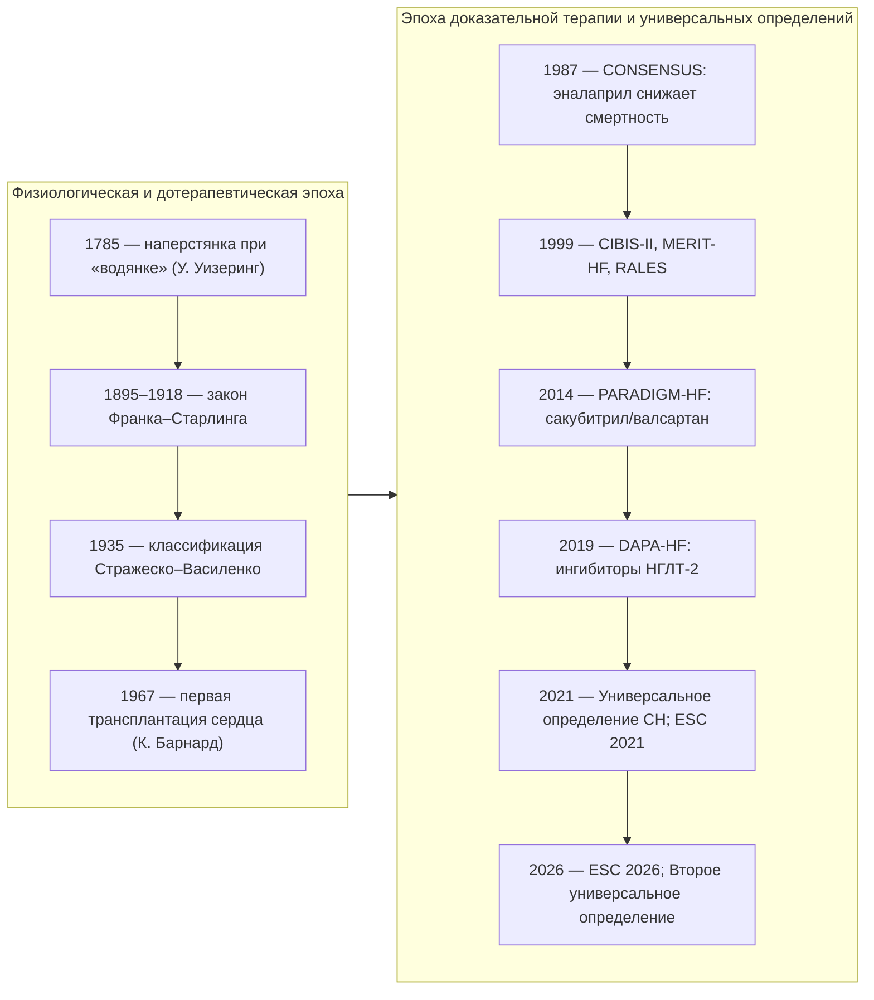

**Рис. 1.** Ключевые этапы изучения и лечения сердечной недостаточности. Схема читается сверху вниз внутри каждого столбца и слева направо между столбцами; указаны только события, положившие начало новому классу вмешательств или новой системе понятий.

#### 2.4.2. Смена концепций: гемодинамическая, нейрогормональная, биомеханическая модели

Представления о природе ХСН сменялись трижды (Patterson & Adams, 1996; Louridas & Lourida, 2012). **Гемодинамическая модель** (1960–1970-е) рассматривала ХСН как проблему «насоса и нагрузки» и породила терапию вазодилататорами и инотропами. **Нейрогормональная модель** (1980–1990-е) объяснила прогрессирование хронической активацией симпатоадреналовой системы и РААС и обосновала применение препаратов, которые с гемодинамической точки зрения выглядели парадоксально, — бета-адреноблокаторов. **Биомеханическая модель** (2000-е) объединила нейрогормональные и механические стимулы через понятие ремоделирования миокарда и расширила круг мишеней до клеточных и молекулярных процессов. Содержательно каждая модель разобрана в п. 5.7; здесь важно, что ни одна из них не отменила предыдущую: современная терапия одновременно разгружает сердце, блокирует нейрогормоны и влияет на ремоделирование.

#### 2.4.3. Универсальное определение сердечной недостаточности (2021)

В 2021 году Общество сердечной недостаточности Америки, Ассоциация сердечной недостаточности ESC и Японское общество СН опубликовали **Универсальное определение и классификацию СН** (Bozkurt et al., 2021). Документ ввёл: единое определение синдрома (см. п. 2.1.1); пересмотренные стадии — «риск СН» (A), «предстадия СН» (B), «симптомная СН» (C), «продвинутая СН» (D); классификацию по ФВ — ХСНснФВ (≤ 40 %), ХСНунФВ (41–49 %), ХСНсФВ (≥ 50 %) и новую категорию **ХСН с улучшенной ФВ** (исходная ФВ ≤ 40 %, прирост ≥ 10 пунктов, повторное значение > 40 %). Ключевой посыл — СН можно диагностировать до появления симптомов (стадии A и B) и, следовательно, предотвращать.

#### 2.4.4. Второе универсальное определение сердечной недостаточности (2026)

**Второе универсальное определение** (AHA/ACC/ESC/WHF при участии HFSA, HFA и JHFS, 2026) уточнило критерии стадий A–D, сместило акцент с жёстких порогов ФВ на фенотип, этиологию и течение. Фенотипы сгруппированы в клинически действенные категории — сниженная, сохранённая и улучшенная ФВ — без фиксированных числовых границ; ФВ ниже 50 % рассматривается как отклонение от нормы независимо от пола, возраста и этнической принадлежности. Введена универсальная классификация причин СН с учётом географических различий этиологии и описаны траектории течения — улучшение, ремиссия и выздоровление (см. п. 2.1.13). Документ подчёркивает, что внезапная смерть возможна на любом этапе континуума, поэтому наблюдение не прекращается и при улучшении.

#### 2.4.5. Терминология ESC 2026

Рекомендации ESC 2026, представленные на конгрессе в Мюнхене, внесли четыре терминологических изменения. Во-первых, упразднена категория ХСН с умеренно сниженной ФВ: **ХСНснФВ определяется как ФВ ЛЖ < 50 %**, ХСНсФВ — как ФВ ≥ 50 %. Во-вторых, официально приняты стадии A–D. В-третьих, термин «острая сердечная недостаточность» заменён на «декомпенсированная сердечная недостаточность». В-четвёртых, введена новая номенклатура лечения: **базовая (foundational) медикаментозная терапия** — препараты с наиболее сильными доказательствами снижения смертности и госпитализаций; **дополнительная медикаментозная терапия**; **интервенционная терапия, рекомендованная руководствами**. Для ХСНснФВ базовая терапия включает бета-адреноблокатор, ингибитор АПФ/АРНИ/БРА, антагонист минералокортикоидных рецепторов и ингибитор НГЛТ-2; для ХСНсФВ — ингибитор НГЛТ-2 и АМКР. Как подчёркивают комментаторы документа, расширение определения ХСНснФВ до < 50 % не означает автоматического расширения показаний к ИКД, СРТ или ивабрадину: пороги для отдельных вмешательств сохраняют собственную доказательную базу.

#### 2.4.6. Терминология российских рекомендаций

Российские клинические рекомендации 2024 года (одобрены Научно-практическим советом Минздрава России 12.09.2024) используют термины: **ХСНнФВ** (ФВ ≤ 40 %), **ХСНунФВ** (41–49 %), **ХСНсФВ** (≥ 50 %); «предстадия СН», «риск развития ХСН», «стадия 1» и «стадия 2» по классификации экспертов РКО 2023 года; функциональные классы NYHA; Шкалу оценки клинического состояния (ШОКС); термины «острая СН» и «острая декомпенсация СН». Обратите внимание на различие аббревиатур: в российских документах — ХСНнФВ (низкая/сниженная), в переводной литературе — ХСНснФВ; содержательно они совпадают. В данной лекции используется аббревиатура ХСНснФВ, кроме цитирования российских документов.

### 2.5. Кодирование по МКБ-10

#### 2.5.1. I50.0 — застойная сердечная недостаточность

Код применяется при ХСН с признаками застоя по большому кругу (отёки, гепатомегалия, асцит) или бивентрикулярной недостаточности; это наиболее часто используемый код при декомпенсации.

#### 2.5.2. I50.1 — левожелудочковая недостаточность

Код охватывает преимущественно левожелудочковую недостаточность с застоем в малом круге, включая сердечную астму и отёк лёгких кардиального генеза.

#### 2.5.3. I50.9 — сердечная недостаточность неуточнённая

Код используется, когда тип недостаточности не уточнён; при корректном обследовании его доля должна быть минимальной. В статистике смертности СН, как правило, не считается первоначальной причиной смерти: кодируется основное заболевание (например, I25 — хроническая ИБС), а СН указывается как осложнение. Это одна из причин занижения «видимого» вклада ХСН в смертность.

**Табл. 2.** Термины и коды МКБ-10, применяемые при ХСН.

| Термин | Суть | Документ-источник | Код МКБ-10 (при кодировании ХСН) |
|---|---|---|---|
| Сердечная недостаточность | Синдром с симптомами/признаками, вызванный поражением сердца и подтверждённый НУП/застоем | Универсальное определение 2021/2026; КР РФ 2024 | I50.0 / I50.1 / I50.9 |
| Предстадия СН (стадия B) | Структурное/функциональное поражение без симптомов | КР РФ 2024; ACC/AHA; ESC 2026 | Кодируется основное заболевание |
| Острая декомпенсация ХСН | Быстрое выраженное усугубление симптомов ХСН | КР РФ 2024 | I50.0 (чаще) |
| Декомпенсированная СН | Ухудшение, требующее неотложной помощи, любой скорости развития | ESC 2026 | I50.x по типу |
| Продвинутая СН (стадия D / стадия 2 РКО) | Тяжёлые симптомы и дисфункция, несмотря на оптимальную терапию | HFA ESC 2018; КР РФ 2024 | I50.x по типу |
| ХСН с улучшенной ФВ | Исходно ФВ ≤ 40 %, прирост ≥ 10 пунктов, повторно ≥ 40 % | Универсальное определение 2021; КР РФ 2024 | I50.x по типу |

### 2.6. Примеры и иллюстрации

#### 2.6.1. Примеры клинических формулировок определения

Пример 1. Пациент 68 лет, перенёс инфаркт миокарда, жалуется на одышку при подъёме на второй этаж, ФВ ЛЖ 32 %, NT-proBNP 1 450 пг/мл. Все элементы определения присутствуют: симптомы, структурное поражение, биомаркерное подтверждение — это симптомная ХСН со сниженной ФВ (стадия C / стадия 1 РКО).

Пример 2. Пациентка 74 лет с гипертонической болезнью, одышка при быстрой ходьбе, ФВ 62 %, индекс объёма левого предсердия 41 мл/м², E/e′ 15, NT-proBNP 480 пг/мл. Симптомы и признаки диастолической дисфункции с повышенным НУП при сохранённой ФВ — ХСН с сохранённой ФВ; одной лишь «нормальной» ФВ для исключения диагноза недостаточно.

Пример 3. Пациент 55 лет без жалоб, ФВ 38 % после миокардита, NT-proBNP 300 пг/мл. Симптомов нет, но есть дисфункция и повышенный биомаркер — предстадия СН (стадия B), требующая терапии для предотвращения симптомов.

#### 2.6.2. Клинические иллюстрации состояний континуума сердечной недостаточности

Континуум СН удобно представить как последовательность состояний с возможными переходами в обе стороны (см. рис. 2). Пациент с артериальной гипертензией и диабетом (стадия A) через гипертрофию ЛЖ и диастолическую дисфункцию (стадия B) приходит к симптомной ХСН (стадия C); декомпенсации — это обострения внутри стадии C; при неэффективности терапии наступает продвинутая СН (стадия D). На фоне лечения возможны улучшение ФВ и ремиссия, но возврат к стадии A невозможен: структурное поражение остаётся в анамнезе.

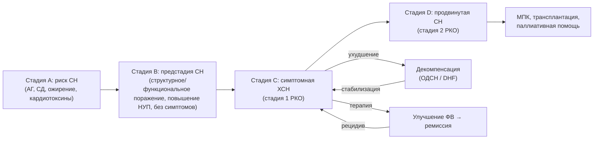

**Рис. 2.** Понятийная карта континуума сердечной недостаточности. Схема читается слева направо: стадии A–D отражают прогрессирование, стрелки «ухудшение/стабилизация» — эпизоды декомпенсации внутри стадии C, ветвь «улучшение ФВ → ремиссия» — обратимость под действием терапии с сохранением риска рецидива. МПК — механическая поддержка кровообращения.

> 🔬 **Углубление:** граница между ремиссией и выздоровлением при ХСН с улучшенной ФВ остаётся предметом исследований. В исследовании TRED-HF (Halliday et al., 2019) у пациентов с дилатационной кардиомиопатией и полностью восстановившейся функцией ЛЖ отмена терапии в течение шести месяцев приводила к рецидиву примерно у 40 % участников, тогда как при продолжении лечения рецидивов не было. Это указывает, что нормализация ФВ отражает ремиссию под контролем лекарств, а не излечение, и объясняет, почему Второе универсальное определение разделяет улучшение, ремиссию и выздоровление и требует стойкости нормализации структуры и биомаркеров для констатации последнего.

> 📝 **Обобщение.** Сердечная недостаточность — синдром с обязательным объективным подтверждением; ХСН, острая/декомпенсированная СН, СН de novo, предстадия и продвинутая СН — не разные болезни, а состояния одного континуума. За сорок лет терминология прошла путь от «недостаточности кровообращения» и гемодинамической модели к универсальным определениям 2021 и 2026 годов и к номенклатуре ESC 2026 (два фенотипа по ФВ, стадии A–D, «декомпенсированная» СН, «базовая терапия»). Российские рекомендации 2024 года сохраняют три фенотипа по ФВ и собственные стадии, и врач обязан владеть обеими системами. Эти понятия — язык, на котором далее будут описаны эпидемиология, механизмы, диагностика и лечение.

> ❓ **Контрольные вопросы**
>
> 1. Перечислите обязательные элементы современного определения сердечной недостаточности.
> 2. Чем «декомпенсированная сердечная недостаточность» в терминологии ESC 2026 отличается от «острой декомпенсации ХСН» в российских рекомендациях и почему был заменён термин?
> 3. Почему Второе универсальное определение (2026) отказалось от жёстких порогов фракции выброса и какие траектории течения оно описывает?
> 4. Пациент без жалоб имеет ФВ 38 % после перенесённого миокардита. К какой стадии его отнести по классификациям ACC/AHA и РКО и что это меняет в тактике?

## 3. Эпидемиология и медико-социальное значение

### 3.1. Распространённость

#### 3.1.1. В мире

По оценкам ESC (2021, 2026), сердечной недостаточностью страдают 1–3 % взрослого населения развитых стран; распространённость резко растёт с возрастом и превышает 10 % у лиц старше 70 лет. Глобальная оценка проекта «Глобальное бремя болезней» (GBD, 2017) — порядка 64 млн человек с СН в мире. Эти цифры относятся преимущественно к симптомной СН (стадия C–D); с учётом предстадии (стадия B) число людей со структурным поражением сердца в несколько раз больше. Сравнения между странами затруднены различиями в критериях диагностики, доступности ЭхоКГ и натрийуретических пептидов.

#### 3.1.2. В Российской Федерации

Основной источник отечественных данных — эпидемиологическая программа ЭПОХА (ЭПОХА-ХСН), стартовавшая в 1998 году в европейской части России. По её данным, приведённым в клинических рекомендациях 2024 года, распространённость ХСН в РФ за 20-летний период увеличилась с 6,1 до 8,2 %. Эти оценки выше западноевропейских отчасти из-за методологии (учёт I–II функциональных классов по клиническим критериям), отчасти из-за реального бремени артериальной гипертензии и ИБС. Согласно регистру по обращаемости в поликлиники, 78 % пациентов с ХСН имеют сохранённую ФВ ЛЖ, что придаёт проблеме ХСНсФВ в России особую медико-социальную значимость.

### 3.2. Заболеваемость и выявляемость

Заболеваемость (число новых случаев) СН в Европе оценивается порядка 3–5 случаев на 1 000 человеко-лет среди взрослых с резким ростом после 65 лет; возрастно-стандартизованная заболеваемость в ряде когорт стабилизировалась или снижается благодаря контролю гипертензии и лечению инфаркта, тогда как абсолютное число случаев растёт из-за старения населения. Выявляемость отстаёт от истинной заболеваемости: значительная доля пациентов диагностируется только при госпитализации по поводу декомпенсации, а предстадия выявляется редко, так как не сопровождается жалобами и не входит в рутинный скрининг.

### 3.3. Возрастная структура

Средний возраст пациента с ХСН в западных регистрах превышает 70 лет; в России он несколько ниже, что связано с более ранним развитием ИБС и меньшей продолжительностью жизни. Возраст определяет фенотип: у молодых преобладают ХСНснФВ и кардиомиопатии, у пожилых — ХСНсФВ с множественной коморбидностью. Пожизненный риск развития СН для человека 40 лет оценивается во Фремингемском исследовании примерно в 20 % (каждый пятый) независимо от пола.

### 3.4. Половые и гендерные особенности

Мужчины чаще заболевают ХСНснФВ ишемической природы и в более молодом возрасте; женщины — ХСНсФВ, в старшем возрасте, на фоне гипертензии, ожирения и диабета. Абсолютное число пациентов обоих полов сопоставимо из-за большей продолжительности жизни женщин. Женщины исторически недопредставлены в клинических исследованиях (обычно 20–30 % участников при ХСНснФВ), чаще сообщают о побочных эффектах и, по данным ряда анализов, могут получать пользу от некоторых препаратов при более высоких значениях ФВ (сакубитрил/валсартан в PARAGON-HF). Гендерные факторы — роль ухаживающего лица, доступ к помощи, приверженность — влияют на исходы независимо от биологии.

### 3.5. Географические и популяционные различия

Этиологическая структура СН различается по регионам: в Европе и Северной Америке доминируют ИБС и гипертензия; в странах Африки южнее Сахары — гипертензивное сердце, ревматические пороки, перипартальная и эндомиокардиальные кардиомиопатии; в Латинской Америке существенен вклад болезни Шагаса; в Азии — ревматические пороки и гипертензия при более молодом возрасте пациентов. Второе универсальное определение 2026 года впервые прямо фиксирует географическую вариабельность причин. Внутри страны различия определяются доступностью кардиологической помощи, уровнем доходов и распространённостью факторов риска.

### 3.6. Структура фенотипов и эпидемиология отдельных фенотипов

В популяционных когортах примерно половина пациентов с СН имеет сохранённую ФВ, и, по данным, цитируемым российскими рекомендациями, доля ХСНсФВ относительно ХСНснФВ увеличивается примерно на 1 % в год. На ХСНунФВ (41–49 %) приходится около 10–20 % случаев; среди них, как и при ХСНснФВ, преобладают мужчины и ИБС (50–60 %). ХСНсФВ — болезнь пожилых женщин с ожирением, гипертензией, диабетом, ХБП, ХОБЛ и анемией. Пятилетняя выживаемость при ХСНсФВ, по обсервационным данным, около 50 %, то есть прогноз не легче, чем при сниженной ФВ, хотя структура причин смерти иная: больше некардиоваскулярных смертей.

### 3.7. Госпитализации, повторные госпитализации и бремя для системы здравоохранения

СН — ведущая причина госпитализаций среди лиц старше 65 лет в развитых странах. Госпитализация по поводу декомпенсации — переломное событие: после неё риск повторной госпитализации в первые полгода превышает 50 % (данные для ХСНсФВ, приводимые российскими рекомендациями), а доля повторных госпитализаций в течение 30 дней в западных системах составляет порядка 20–25 %. Каждая декомпенсация сопровождается необратимым ухудшением функции миокарда и почек, поэтому число госпитализаций — не просто маркер, а фактор прогрессирования.

### 3.8. Прогноз, смертность, структура причин смерти и вклад ХСН в сердечно-сосудистую смертность

До 1990-х годов 60–70 % пациентов с ХСН умирали в течение 5 лет. Современная терапия улучшила прогноз, однако, по данным ЭПОХА-ХСН, в России средняя годовая смертность при ХСН I–IV ФК составляет 6 %, при клинически выраженной ХСН — 12 %; медиана времени дожития при I–II ФК — 8,4 года (95 % ДИ 7,8–9,1), при III–IV ФК — 3,8 года (95 % ДИ 3,4–4,2). По формулировке ESC (2026), менее 60 % пациентов живы через пять лет после установления диагноза. Причины смерти при ХСНснФВ: прогрессирующая насосная недостаточность и внезапная сердечная смерть (её доля выше при менее тяжёлых классах и снижается при NYHA IV, где преобладает смерть от насосной недостаточности); при ХСНсФВ до половины смертей некардиоваскулярные. Поскольку СН обычно кодируется как осложнение, а не первоначальная причина смерти, её реальный вклад в сердечно-сосудистую смертность статистика занижает.

### 3.9. Качество жизни и функциональные ограничения

ХСН снижает качество жизни сильнее большинства хронических заболеваний: одышка и утомляемость ограничивают самообслуживание, ночные симптомы нарушают сон, диуретики привязывают к туалету, госпитализации разрушают социальные связи. Опросники KCCQ и MLHFQ (см. раздел 10) показывают, что качество жизни — самостоятельная, значимая для пациента конечная точка, и улучшение на 5 баллов KCCQ считается клинически заметным.

### 3.10. Инвалидизация и утрата трудоспособности

ХСН — одна из ведущих причин стойкой утраты трудоспособности среди болезней системы кровообращения. Функциональный класс, частота госпитализаций, потребность в устройствах и коморбидность определяют группу инвалидности при медико-социальной экспертизе (подробнее — п. 24.12). У лиц трудоспособного возраста ХСН означает не только медицинские, но и экономические потери семьи.

### 3.11. Социально-экономическое бремя

Расходы на СН оцениваются в 1–2 % бюджетов здравоохранения развитых стран, и до двух третей этих расходов приходится на стационарную помощь. Отсюда следует экономическая логика современных рекомендаций: вложения в амбулаторную оптимизацию терапии, обучение и наблюдение окупаются снижением госпитализаций. Непрямые затраты — утрата трудоспособности пациента и ухаживающих — учитываются реже, но сопоставимы с прямыми.

### 3.12. Социальные детерминанты здоровья

Низкий доход, образование, одиночество, сельское проживание, ограниченная транспортная доступность, низкая медицинская грамотность связаны с более поздней диагностикой, худшей приверженностью, большей частотой госпитализаций и смертностью при ХСН независимо от тяжести заболевания. Второе универсальное определение 2026 года и рекомендации AHA/ACC/HFSA 2022 рассматривают оценку социальных детерминант как часть ведения пациента, а не как внешний фактор.

### 3.13. Тенденции и прогнозы

Ожидается дальнейший рост распространённости СН из-за старения населения, эпидемии ожирения и диабета и улучшения выживаемости после инфаркта и при самой СН; ESC (2026) прямо называет старение и ожирение драйверами «растущего глобального бремени». Одновременно меняется структура: доля ХСНсФВ и ХСН с улучшенной ФВ растёт, а доля «классической» дилатационной ХСНснФВ с тяжёлыми симптомами снижается там, где внедрена современная терапия.

### 3.14. Популяционные исследования и регистры; пример эпидемиологического наблюдения — программа ЭПОХА

Знания об эпидемиологии СН получены из нескольких типов источников: проспективных когорт (Фремингемское исследование, когорта округа Олмстед), популяционных программ с репрезентативной выборкой (ЭПОХА в России), госпитальных и амбулаторных регистров (ESC-HF-LT, национальные регистры Швеции, США). Программа ЭПОХА (руководитель — И. В. Фомин и соавт.) включала репрезентативную выборку населения европейской части России с повторными срезами на протяжении двадцати лет; она дала оценки распространённости по функциональным классам, структуру этиологии (доминирование гипертензии и ИБС), данные о смертности и медиане дожития, которые легли в основу российских рекомендаций. Её ограничения типичны для популяционных программ: клинические критерии ХСН на ранних этапах без повсеместной ЭхоКГ и НУП, что могло завышать распространённость лёгких классов.

### 3.15. Иллюстрации: динамика распространённости и госпитализаций; эпидемиологические профили

**Табл. 3.** Эпидемиологические профили ХСН: сопоставление оценок (по состоянию на 2024–2026 гг.).

| Показатель | Мир / Европа | Российская Федерация |
|---|---|---|
| Распространённость среди взрослых | 1–3 % (ESC); > 10 % после 70 лет | 6,1 % → 8,2 % за 20 лет наблюдения (ЭПОХА) |
| Абсолютная оценка | Около 64 млн человек (GBD, 2017) | [⚠️ Требуется верификация: актуальная абсолютная оценка числа пациентов по данным ЭПОХА/регистров] |
| Доля ХСНсФВ | Около половины случаев, растёт | 78 % по обращаемости в поликлиники |
| Годовая смертность | Зависит от тяжести; < 60 % живы через 5 лет после диагноза (ESC, 2026) | 6 % при I–IV ФК; 12 % при клинически выраженной ХСН |
| Медиана дожития | — | 8,4 года при I–II ФК; 3,8 года при III–IV ФК (ЭПОХА-ХСН) |
| Повторные госпитализации | Около 20–25 % в течение 30 дней (западные регистры) | > 50 % в первые 6 мес после выписки (данные для ХСНсФВ) |
| Ведущие причины | ИБС, АГ; региональные различия (ревматизм, Шагас, перипартальная КМП) | АГ и ИБС; их сочетание у половины пациентов |

[🖼️ ВИЗУАЛИЗАЦИЯ: инфографика «Динамика распространённости, госпитализаций и смертности от ХСН в мире и РФ» — два горизонтальных ряда: слева столбцы распространённости ХСН в РФ по срезам программы ЭПОХА (1998 → 2017), справа кривые выживаемости по функциональным классам с медианами дожития 8,4 и 3,8 года; подписать источники данных и год; график строится только по опубликованным значениям.]

> 💡 **Интересный факт:** Фремингемское исследование, начатое в 1948 году в небольшом городе штата Массачусетс, дало не только первые клинические критерии СН (критерии Макки и соавт., 1971), но и само понятие «фактор риска», без которого невозможно описать стадию A современной классификации.

> ❗ **Типичная ошибка:** сравнивать распространённость ХСН в России (6–8 %) и в Европе (1–3 %) как «в разы большую заболеваемость». Различие во многом методологическое: включение лёгких функциональных классов по клиническим критериям против подтверждённых инструментально случаев. Корректное сравнение требует одинаковых критериев и возрастной стандартизации.

> 📝 **Обобщение.** ХСН страдают 1–3 % взрослых в мире и, по отечественным данным, около 8 % населения России; распространённость растёт из-за старения, ожирения и улучшения выживаемости. Прогноз остаётся тяжёлым (годовая смертность при выраженной ХСН 12 %, менее 60 % пациентов живы через 5 лет), а госпитализации — главный источник затрат и фактор прогрессирования. Структура сдвигается к ХСНсФВ, особенно в амбулаторной практике. Эти данные объясняют, почему следующий раздел посвящён причинам и факторам риска: эпидемиология ХСН — это эпидемиология её причин.

> ❓ **Контрольные вопросы**
>
> 1. Какие показатели смертности и медианы дожития при ХСН получены в программе ЭПОХА-ХСН?
> 2. Почему доля ХСНсФВ в амбулаторной практике значительно выше, чем в стационарных регистрах?
> 3. Как изменение структуры причин смерти (внезапная смерть против насосной недостаточности) по мере утяжеления функционального класса должно влиять на приоритеты профилактики у конкретного пациента?

## 4. Этиология и факторы риска

### 4.1. Ключевые понятия

#### 4.1.1. Этиологический (причинный) фактор

**Этиологический фактор** — заболевание или воздействие, непосредственно вызывающее структурное или функциональное поражение сердца, которое приводит к СН (инфаркт миокарда, аортальный стеноз, антрациклины). Устранение причины может остановить прогрессирование или даже привести к восстановлению функции, поэтому этиологический поиск обязателен при каждом впервые установленном диагнозе.

#### 4.1.2. Фактор риска: модифицируемые и немодифицируемые

**Фактор риска** — состояние, статистически повышающее вероятность развития СН, но не являющееся её непосредственной причиной. Модифицируемые факторы (гипертензия, диабет, ожирение, курение, алкоголь, апноэ сна, малоподвижность) — мишени профилактики на стадии A; немодифицируемые (возраст, мужской пол для ХСНснФВ, семейный анамнез, генотип) определяют группы, нуждающиеся в скрининге. Граница условна: артериальная гипертензия одновременно фактор риска ИБС и самостоятельная причина гипертонического сердца.

#### 4.1.3. Триггер (пусковой фактор) декомпенсации

**Триггер декомпенсации** — событие, переводящее компенсированную ХСН в декомпенсацию (инфекция, аритмия, нарушение приёма препаратов, избыток соли). Триггер не создаёт болезнь, но определяет момент ухудшения; его выявление и устранение — первый шаг при каждой госпитализации (см. п. 4.4 и раздел 22).

### 4.2. Основные причины ХСН

В Российской Федерации, по данным рекомендаций 2024 года, основные причины ХСН — артериальная гипертензия и ИБС; их сочетание встречается у половины пациентов. ИБС является причиной систолической ХСН в двух третях случаев, часто в сочетании с диабетом и гипертензией; на пороки сердца приходится около 4,3 %, на миокардиты — 3,6 %. Сводка причин приведена в табл. 4; далее каждая группа разобрана отдельно.

**Табл. 4.** Основные причины ХСН по механизму поражения.

| Группа | Примеры | Преимущественный фенотип | Ключ к диагностике |
|---|---|---|---|
| Ишемическое поражение | Постинфарктный кардиосклероз, гибернация миокарда | ХСНснФВ (реже сФВ) | Анамнез ИМ, зоны акинеза, коронарография/КТ-ангиография |
| Перегрузка давлением | Артериальная гипертензия, аортальный стеноз | ХСНсФВ → снФВ на поздних этапах | ГЛЖ, градиент на клапане |
| Перегрузка объёмом | Митральная/аортальная регургитация, шунты, почечная недостаточность | Дилатация, снФВ | Допплер-ЭхоКГ |
| Кардиомиопатии | ДКМП, ГКМП, РКМП, АКМП, некомпактный миокард, такоцубо | Любой | Семейный анамнез, МРТ, генетика |
| Воспаление и инфекции | Миокардиты (вирусные, в т. ч. SARS-CoV-2; гигантоклеточный; эозинофильный), болезнь Шагаса, ВИЧ | снФВ | МРТ (критерии Lake Louise), биопсия |
| Аритмии | Тахикардиомиопатия, частая желудочковая экстрасистолия, брадиаритмии | снФВ, обратимая | Холтер, восстановление ФВ после контроля ритма |
| Врождённые пороки у взрослых | Тетрада Фалло после коррекции, системный ПЖ, Фонтен | Право- или бивентрикулярная | Анамнез, ЭхоКГ, МРТ |
| Лёгочная гипертензия, правые отделы | ЛАГ, ХТЭЛГ, ХОБЛ | Правожелудочковая | ЭхоКГ, катетеризация правых отделов |
| Перикард | Констриктивный перикардит, тампонада | «СН» с сохранной сократимостью | ЭхоКГ, КТ/МРТ, катетеризация |
| Эндокринные и метаболические | СД, ожирение, тиреотоксикоз/гипотиреоз, акромегалия, феохромоцитома | сФВ, реже снФВ | Гормональный профиль |
| Инфильтративные/накопления | Амилоидоз (ATTR, AL), гемохроматоз, саркоидоз, болезнь Фабри | сФВ/рестриктивный, снФВ при саркоидозе | Сцинтиграфия, МРТ (T1, T2*, ECV), ферменты, генетика |
| Токсические/ятрогенные | Алкоголь, кокаин, антрациклины, трастузумаб, ингибиторы контрольных точек, лучевая терапия | снФВ | Анамнез экспозиции, динамика ФВ/GLS |
| Высокий выброс | Анемия, тиреотоксикоз, артериовенозная фистула, бери-бери, болезнь Педжета, сепсис, цирроз | СН с высоким выбросом | Высокий сердечный индекс при симптомах застоя |
| Беременность | Перипартальная КМП | снФВ | Дебют в конце беременности/после родов |
| Генетические/семейные | Титин, ламин, десмосомные гены, саркомерные гены, TTR | Любой | Родословная, генетическое тестирование |

#### 4.2.1. Ишемическая болезнь сердца и постинфарктный кардиосклероз

ИБС — ведущая причина ХСНснФВ в России и мире. Механизмы: утрата кардиомиоцитов при инфаркте с рубцеванием и постинфарктным ремоделированием; хроническая гипоперфузия с «гибернацией» жизнеспособного миокарда; повторные эпизоды ишемии с «оглушением»; ишемическая митральная регургитация. Термин «ишемическая кардиомиопатия» применяют при дисфункции ЛЖ, вызванной многососудистым поражением или перенесённым инфарктом. Прогностически важно различать рубец и гибернирующий миокард (МРТ с контрастированием, стресс-ЭхоКГ, ПЭТ): только жизнеспособный миокард потенциально восстанавливает функцию после реваскуляризации.

#### 4.2.2. Артериальная гипертензия

Хроническая перегрузка давлением вызывает концентрическую гипертрофию ЛЖ, интерстициальный фиброз, нарушение расслабления и податливости — субстрат ХСНсФВ; присоединение ИБС, фибрилляции предсердий или декомпенсация гипертрофии ведут к дилатации и снижению ФВ. Гипертензия — самый частый фактор риска СН в популяции благодаря своей распространённости; длительный контроль АД снижает риск СН примерно наполовину, а интенсивный контроль (SPRINT) — ещё заметнее.

#### 4.2.3. Приобретённые клапанные пороки сердца

Аортальный стеноз (перегрузка давлением), аортальная и митральная регургитация (перегрузка объёмом), митральный стеноз (застой в малом круге при «интактном» ЛЖ), трикуспидальная регургитация (правожелудочковая недостаточность) — каждый порок формирует собственный гемодинамический профиль. Своевременная коррекция до необратимого ремоделирования — единственный способ предотвратить ХСН; поэтому при пороках СН рассматривают как показание к вмешательству, а не только как осложнение. Отдельная проблема — **вторичная (функциональная) митральная регургитация**, которая является следствием ремоделирования ЛЖ при ХСН и одновременно ускоряет его.

#### 4.2.4. Кардиомиопатии (первичные и вторичные, наследственные и приобретённые)

**Кардиомиопатии** — заболевания миокарда со структурными и функциональными нарушениями, не объяснимыми ИБС, гипертензией, пороками или врождёнными аномалиями. Классификация ESC 2023 года выделяет морфофункциональные фенотипы: дилатационный, гипертрофический, рестриктивный, аритмогенный правожелудочковый и недилатационный левожелудочковый.

**4.2.4.1. Дилатационная кардиомиопатия (ДКМП)** — дилатация и систолическая дисфункция ЛЖ (или обоих желудочков) без адекватной нагрузки или ИБС. Около 30–40 % случаев семейные; наиболее частые гены — титин (TTN, укороченные варианты), ламин A/C (LMNA), десмосомные гены, RBM20, FLNC, BAG3, PLN. Приобретённые причины — перенесённый миокардит, алкоголь, химиотерапия, перипартальный период; нередко генетическая предрасположенность реализуется под действием внешнего триггера.

**4.2.4.2. Гипертрофическая кардиомиопатия (ГКМП)** — гипертрофия ЛЖ (≥ 15 мм, ≥ 13 мм у родственников) без иной причины; чаще саркомерные мутации (MYBPC3, MYH7). СН развивается вследствие диастолической дисфункции, обструкции выносящего тракта, митральной регургитации, фибрилляции предсердий и, у меньшинства, «конечной стадии» с истончением стенок и снижением ФВ.

**4.2.4.3. Рестриктивная кардиомиопатия (РКМП)** — ригидные желудочки нормального или уменьшенного объёма с расширенными предсердиями; причины — амилоидоз, эндомиокардиальный фиброз, гиперэозинофильный синдром, болезни накопления, лучевое поражение, идиопатические формы. Главная дифференциальная задача — отличить от констриктивного перикардита, который излечим хирургически.

**4.2.4.4. Аритмогенная кардиомиопатия (АКМП)** — фиброзно-жировое замещение миокарда преимущественно ПЖ (возможно и ЛЖ) при мутациях десмосомных генов (PKP2, DSP, DSG2); проявляется желудочковыми аритмиями и внезапной смертью у молодых, а на поздних стадиях — право- или бивентрикулярной СН.

**4.2.4.5. Некомпактный миокард левого желудочка и другие специфические формы.** Выраженная трабекулярность с глубокими межтрабекулярными лакунами может быть вариантом строения, адаптацией (спортсмены, беременность) или проявлением кардиомиопатии; классификация ESC 2023 рассматривает некомпактность как фенотипический признак, а не самостоятельную нозологию. К специфическим формам относят также кардиомиопатии при нервно-мышечных заболеваниях (дистрофии Дюшенна, Беккера, миотоническая дистрофия) и митохондриальные.

**4.2.4.6. Кардиомиопатия такоцубо** — транзиторная дисфункция ЛЖ (чаще апикальное «баллонирование») после эмоционального или физического стресса, преимущественно у женщин в постменопаузе; имитирует инфаркт при интактных коронарных артериях; функция обычно восстанавливается за недели, но в острой фазе возможны отёк лёгких, шок и аритмии.

#### 4.2.5. Миокардиты и воспалительные заболевания миокарда; инфекционные причины, включая постковидное поражение

Миокардит — воспаление миокарда инфекционной (энтеровирусы, аденовирусы, парвовирус B19, герпесвирусы, SARS-CoV-2, ВИЧ, боррелии, трипаносомы), иммуноопосредованной (гигантоклеточный, эозинофильный, при системных заболеваниях, индуцированный ингибиторами контрольных точек) или токсической природы. Исходы — от полного выздоровления до воспалительной ДКМП. Поражение сердца при COVID-19 включает миокардит, микрососудистый тромбоз, такоцубо-подобные формы и декомпенсацию ранее существовавшей ХСН; клинически значимый постковидный миокардит встречается реже, чем предполагалось в начале пандемии, однако у части пациентов сохраняются признаки воспаления по данным МРТ.

#### 4.2.6. Тахиаритмии (тахикардиомиопатия), брадиаритмии и нарушения проводимости

Длительная тахикардия (фибрилляция/трепетание предсердий с высокой частотой, предсердная тахикардия, частая желудочковая экстрасистолия с бременем порядка 10–20 % и более) способна вызвать потенциально обратимую систолическую дисфункцию — **тахикардиомиопатию**; её диагностируют ретроспективно по восстановлению ФВ после контроля частоты или ритма. Брадиаритмии и АВ-блокады снижают выброс за счёт частоты, а длительная стимуляция правого желудочка вызывает диссинхронию и «пейсмейкер-индуцированную» кардиомиопатию. Блокада левой ножки сама по себе ухудшает механику ЛЖ — на этом основана ресинхронизирующая терапия.

#### 4.2.7. Врождённые пороки сердца у взрослых

Благодаря детской кардиохирургии до взрослого возраста доживает большинство пациентов с врождёнными пороками, и СН стала главной причиной их смерти. Особые ситуации: системный правый желудочек (после операции Мастарда/Сеннинга, корригированная транспозиция), кровообращение Фонтена (нет субпульмонального желудочка), остаточная лёгочная регургитация после коррекции тетрады Фалло, синдром Эйзенменгера. Стандартная терапия ХСН к этим пациентам экстраполируется с осторожностью; ведение — в специализированных центрах.

#### 4.2.8. Лёгочная гипертензия и заболевания правых отделов сердца

Правожелудочковая недостаточность развивается при перегрузке давлением (лёгочная артериальная гипертензия, хроническая тромбоэмболическая ЛГ, тяжёлые заболевания лёгких), перегрузке объёмом (трикуспидальная регургитация, дефект межпредсердной перегородки), инфаркте ПЖ и АКМП. Самая частая причина ЛГ — левосердечная недостаточность (ЛГ группы 2), поэтому при выявлении ЛГ сначала исключают патологию левых отделов.

#### 4.2.9. Заболевания перикарда

Констриктивный перикардит (после перикардита, кардиохирургии, лучевой терапии, туберкулёза) и тампонада ограничивают наполнение сердца при сохранной сократимости и имитируют правожелудочковую СН: набухание шейных вен, гепатомегалия, асцит, при констрикции — симптом Куссмауля. Распознавание важно, поскольку перикардэктомия излечивает констрикцию, а диуретики и вазодилататоры при тампонаде опасны.

#### 4.2.10. Эндокринные и метаболические причины

**4.2.10.1. Сахарный диабет** повышает риск СН вдвое у мужчин и в несколько раз у женщин (Фремингемские данные) через ИБС, гипертензию, ХБП и собственно диабетическую кардиомиопатию — фиброз, микроангиопатию, нарушение энергетического метаболизма кардиомиоцита. **4.2.10.2. Ожирение** увеличивает риск СН независимо от других факторов; механизмы — увеличение объёма циркулирующей крови, эпикардиальный жир, системное воспаление, апноэ сна; «ожирение-ассоциированная ХСНсФВ» выделена как отдельный фенотип. **4.2.10.3. Заболевания щитовидной железы**: тиреотоксикоз вызывает СН с высоким выбросом и тахиаритмии, гипотиреоз — брадикардию, перикардиальный выпот, снижение сократимости; амиодарон делает дисфункцию щитовидной железы частой у пациентов с ХСН. **4.2.10.4. Акромегалия и другие редкие эндокринопатии** (феохромоцитома с катехоламиновой кардиомиопатией, синдром Кушинга, первичный гиперальдостеронизм, дефицит гормона роста, гиперпаратиреоз) — редкие, но потенциально обратимые причины.

#### 4.2.11. Инфильтративные заболевания и болезни накопления

**4.2.11.1. Амилоидоз сердца** — отложение фибрилл лёгких цепей иммуноглобулинов (AL) или транстиретина (ATTR: наследственный ATTRv и «дикого типа» ATTRwt). ATTRwt-амилоидоз выявляется у заметной доли пожилых пациентов с ХСНсФВ и у пациентов с «парадоксальным» низкопоточным аортальным стенозом; неинвазивная диагностика сцинтиграфией с остеотропными препаратами изменила его эпидемиологию из «казуистики» в рутинную задачу (см. п. 8.12.3). **4.2.11.2. Гемохроматоз** (наследственный, HFE-ассоциированный, или вторичный при трансфузиях) — перегрузка железом с дилатационной или рестриктивной картиной, обратимой при раннем лечении. **4.2.11.3. Саркоидоз сердца** — гранулёматозное воспаление с АВ-блокадами, желудочковыми аритмиями и очаговой дисфункцией. **4.2.11.4. Болезнь Фабри и другие лизосомные болезни** — Х-сцепленный дефицит α-галактозидазы А с гипертрофией ЛЖ, короткой PR, ангиокератомами, нейропатической болью, протеинурией; болезнь Данона и гликогенозы также дают гипертрофический фенотип.

#### 4.2.12. Токсические и ятрогенные причины

**4.2.12.1. Алкоголь.** Алкогольная кардиомиопатия развивается при многолетнем употреблении больших доз (обычно называют более 80–90 г этанола в сутки в течение более 5 лет) и частично обратима при воздержании. **4.2.12.2. Наркотические и психоактивные вещества**: кокаин и амфетамины (ишемия, гипертензия, прямая кардиотоксичность), анаболические стероиды, «энергетики» в больших дозах. **4.2.12.3. Кардиотоксичная химиотерапия и таргетная терапия**: антрациклины (дозозависимая, преимущественно необратимая кардиомиопатия; риск растёт с кумулятивной дозой), трастузумаб и другие анти-HER2 препараты (чаще обратимая дисфункция), ингибиторы VEGF (гипертензия, дисфункция ЛЖ), ингибиторы протеасом (карфилзомиб), циклофосфамид в высоких дозах, ингибиторы иммунных контрольных точек (миокардит с высокой летальностью). **4.2.12.4. Лучевое поражение** грудной клетки — отсроченные на годы фиброз миокарда, констрикция, клапанные поражения, ускоренный коронарный атеросклероз. **4.2.12.5. Лекарственные средства**, способные вызвать или усугубить СН: НПВП и ингибиторы ЦОГ-2 (задержка натрия), тиазолидиндионы, недигидропиридиновые антагонисты кальция, антиаритмики I класса и дронедарон, некоторые противогрибковые (итраконазол), анти-TNF препараты при тяжёлой СН, клозапин (миокардит), гидроксихлорохин (кардиомиопатия при длительном приёме), миноксидил, минералокортикоидная активность глюкокортикоидов.

#### 4.2.13. Состояния с высоким сердечным выбросом (высоковыбросная сердечная недостаточность)

При анемии, тиреотоксикозе, артериовенозных фистулах (включая диализные), дефиците тиамина (бери-бери), болезни Педжета, сепсисе, циррозе печени, миеломе и ожирении симптомы застоя возникают при высоком сердечном выбросе: периферическая вазодилатация и шунтирование снижают эффективный артериальный объём, активируют РААС и ведут к задержке жидкости, а длительная перегрузка объёмом в итоге повреждает сам миокард. Лечение — устранение причины; стандартная вазодилатирующая терапия может ухудшить состояние.

#### 4.2.14. Беременность и перипартальная кардиомиопатия

**Перипартальная кардиомиопатия** — систолическая дисфункция (ФВ < 45 %) без иной причины, развивающаяся к концу беременности или в первые месяцы после родов. Распространённость сильно варьирует по регионам (наиболее высока в Нигерии и на Гаити); факторы риска — многоплодие, преэклампсия, возраст, африканское происхождение. Патогенез связывают с кардиотоксичным фрагментом пролактина (16 кДа) и дисбалансом ангиогенных факторов, что обосновывает исследование бромокриптина. Около половины пациенток восстанавливают функцию ЛЖ; рецидив при повторной беременности вероятен, особенно при неполном восстановлении.

#### 4.2.15. Генетические и семейные формы

Наследственную природу следует предполагать при ДКМП без явной причины, ГКМП, АКМП, рестриктивном фенотипе, ранней внезапной смерти или СН у родственников, сочетании кардиомиопатии с нарушениями проводимости, скелетной миопатией или внесердечными признаками (нейропатия и синдром запястного канала при ATTRv, ангиокератомы при болезни Фабри). Ламинопатии (LMNA) и некоторые десмосомные варианты (DSP, FLNC) отличаются высоким аритмическим риском, что меняет показания к ИКД. Генетическое тестирование пробанда и каскадный скрининг родственников — часть стандартного ведения (см. п. 8.12.2, 18.16).

#### 4.2.16. Многофакторная этиология

У большинства пожилых пациентов ХСН многофакторна: гипертензия, ИБС, диабет, ожирение, фибрилляция предсердий и ХБП действуют одновременно и усиливают друг друга. В таких случаях важно не искать «единственную причину», а выявить компоненты, поддающиеся коррекции (ишемия, аритмия, клапанная патология, анемия), и лечить фенотип в целом. Второе универсальное определение 2026 года предлагает классифицировать причины с учётом числа и типа действующих факторов именно для таких ситуаций.

### 4.3. Факторы риска и предрасполагающие состояния

#### 4.3.1. Сахарный диабет

Помимо прямой кардиомиопатии и ускоренного атеросклероза диабет ухудшает прогноз уже развившейся ХСН и осложняет терапию (гиперкалиемия, ХБП). Ингибиторы НГЛТ-2 и агонисты ГПП-1 сделали диабет первой областью, где профилактика СН стала самостоятельной целью лечения (см. раздел 11).

#### 4.3.2. Ожирение и метаболический синдром

Каждое увеличение индекса массы тела на 1 кг/м² сопровождается ростом риска СН порядка 5 % у мужчин и 7 % у женщин (Фремингемские данные, Kenchaiah et al., 2002). Ожирение также затрудняет диагностику: снижает уровень НУП, ухудшает визуализацию при ЭхоКГ и само вызывает одышку.

#### 4.3.3. Хроническая болезнь почек

ХБП и ХСН связаны двунаправленно: почечная дисфункция — фактор риска СН через гипертензию, анемию, перегрузку объёмом, уремические токсины и кальцификацию сосудов; ХСН вызывает ХБП через гипоперфузию и венозный застой (см. п. 5.5.6). Снижение рСКФ — один из сильнейших предикторов смерти при ХСН.

#### 4.3.4. Анемия и дефицит железа

Анемия усиливает нагрузку на сердце и ухудшает оксигенацию миокарда; дефицит железа даже без анемии снижает переносимость нагрузки за счёт нарушения митохондриального дыхания в скелетных мышцах и миокарде. Дефицит железа выявляется примерно у половины пациентов с ХСН и является самостоятельной терапевтической мишенью.

#### 4.3.5. Курение и злоупотребление алкоголем

Курение действует через ИБС, ХОБЛ и прямую эндотелиальную дисфункцию; тяжёлое употребление алкоголя — через алкогольную кардиомиопатию, гипертензию, фибрилляцию предсердий и дефицит тиамина. Умеренное употребление не защищает от СН: современные анализы не подтверждают «защитного» эффекта малых доз.

#### 4.3.6. Апноэ сна

Обструктивное апноэ вызывает ночную гипоксемию, выбросы катехоламинов, колебания внутригрудного давления и резистентную гипертензию; центральное апноэ с дыханием Чейна–Стокса — скорее следствие ХСН и маркер тяжести. Частота дыхательных нарушений во сне при ХСН достигает половины пациентов и более, большинство из них не диагностированы.

#### 4.3.7. Семейный анамнез и генетическая предрасположенность

Семейный анамнез кардиомиопатии, внезапной смерти до 50 лет, необъяснимой СН или имплантации устройств у родственников первой линии — показание к направлению пробанда и семьи на обследование. Полигенная предрасположенность влияет и на «обычные» формы: носители укороченных вариантов титина чаще развивают дисфункцию ЛЖ при химиотерапии, алкоголизации и в перипартальном периоде.

#### 4.3.8. Факторы риска предстадии

Переход от стадии A к стадии B отмечается появлением структурных или биохимических отклонений без симптомов: гипертрофии ЛЖ, дилатации камер, снижения ФВ или продольной деформации, диастолической дисфункции, клапанной патологии, а также повышения НУП или высокочувствительного тропонина у пациента с факторами риска. Выявление этих маркеров — задача скрининга (см. п. 11.2).

### 4.4. Триггеры декомпенсации

Триггеры декомпенсации и первоочередные действия при них обобщены в табл. 5; ниже — краткая характеристика каждого.

#### 4.4.1. Нарушение приверженности лечению

Пропуск диуретиков и базисных препаратов, самостоятельное снижение доз из-за побочных эффектов или стоимости, отмена при «хорошем самочувствии» — один из самых частых и предотвратимых триггеров. Выявляется только при доброжелательном, конкретном расспросе («сколько раз за неделю пропустили?»).

#### 4.4.2. Избыток соли и жидкости

Солёная пища (консервы, колбасы, сыры, полуфабрикаты, минеральная вода с высоким содержанием натрия), праздничные застолья, неконтролируемое питьё при жажде на фоне диуретиков ведут к задержке жидкости за несколько дней.

#### 4.4.3. Инфекции

Пневмония, грипп, COVID-19, инфекции мочевых путей и сепсис повышают потребность в кислороде, вызывают тахикардию, лихорадку, вазодилатацию и прямое повреждение миокарда; инфекции — частый триггер у пожилых, причём лихорадка может отсутствовать.

#### 4.4.4. Аритмии

Фибрилляция предсердий с высокой частотой лишает желудочки предсердной систолы и укорачивает диастолу; желудочковые тахикардии и брадиаритмии снижают выброс. Впервые возникшая ФП — классический триггер декомпенсации при ХСНсФВ и ГКМП.

#### 4.4.5. Ишемия и острый коронарный синдром

Инфаркт и нестабильная стенокардия ухудшают сократимость и могут вызывать острую митральную регургитацию или механические осложнения; у пациентов с ХСН ОКС нередко протекает без типичной боли, проявляясь нарастанием одышки.

#### 4.4.6. Неконтролируемая артериальная гипертензия

Резкое повышение постнагрузки ведёт к «сосудистому» типу декомпенсации — быстрому отёку лёгких при относительно сохранной сократимости и без выраженной гиперволемии; это самый частый механизм отёка лёгких при ХСНсФВ.

#### 4.4.7. Анемия и кровотечение

Снижение гемоглобина увеличивает сердечный выброс и частоту ритма, ухудшает оксигенацию миокарда; желудочно-кишечное кровотечение на фоне антикоагулянтов и антиагрегантов — типичная клиническая ситуация.

#### 4.4.8. Почечная дисфункция

Острое повреждение почек (обезвоживание, НПВП, контраст, обструкция) снижает ответ на диуретики и усиливает задержку натрия; прогрессирование ХБП требует пересмотра доз.

#### 4.4.9. Тромбоэмболия лёгочной артерии и респираторные заболевания

ТЭЛА вызывает острую перегрузку ПЖ и гипоксемию; обострение ХОБЛ и бронхиальной астмы — гипоксемию, тахикардию, применение бета-агонистов и глюкокортикоидов, задерживающих жидкость.

#### 4.4.10. Лекарственные триггеры

НПВП, глюкокортикоиды, тиазолидиндионы, недигидропиридиновые антагонисты кальция, антиаритмики I класса, дронедарон, прегабалин/габапентин (отёки), некоторые противоопухолевые препараты, чрезмерная инфузионная терапия в стационаре и даже избыточная доза бета-адреноблокатора при декомпенсации — все они способны спровоцировать ухудшение.

**Табл. 5.** Триггеры декомпенсации ХСН и первоочередные действия.

| Триггер | Как заподозрить | Первоочередное действие |
|---|---|---|
| Нарушение приверженности | Расспрос, упаковки, аптечные данные | Восстановить терапию, выяснить причину (побочные эффекты, стоимость), упростить схему |
| Избыток соли/жидкости | Пищевой анамнез, прибавка массы | Диета, коррекция диуретика, обучение |
| Инфекция | Лихорадка, кашель, лейкоцитоз, СРБ, прокальцитонин | Антимикробная терапия, вакцинация в дальнейшем |
| Аритмия | ЭКГ, мониторирование | Контроль частоты/ритма, антикоагуляция при ФП, кардиоверсия при нестабильности |
| ОКС | ЭКГ, тропонин, боль/эквиваленты | Экстренная реваскуляризация по показаниям |
| Гипертонический криз | АД, отёк лёгких при сохранной ФВ | Вазодилататоры, контроль АД |
| Анемия/кровотечение | Гемоглобин, мелена | Поиск источника, коррекция, пересмотр антитромботической терапии |
| Почечная дисфункция | Креатинин, диурез | Устранить нефротоксины, оценить волемию, скорректировать дозы |
| ТЭЛА / ХОБЛ | D-димер, КТ-ангиография, SpO₂, спирометрия | Антикоагуляция; бронхолитики, кислород по показаниям |
| Лекарства | Лекарственный анамнез, включая безрецептурные | Отмена провоцирующего препарата, лекарственная сверка |

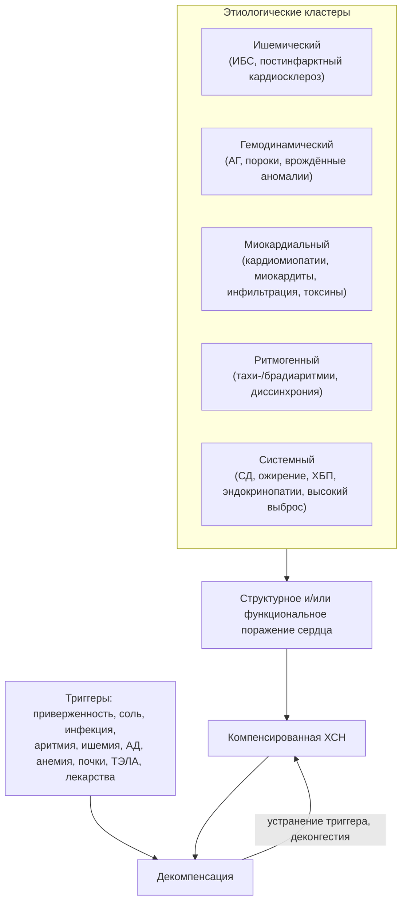

**Рис. 3.** Блок-схема «Этиологические кластеры и триггеры декомпенсации». Схема читается сверху вниз: пять групп причин формируют поражение сердца и компенсированную ХСН; триггеры переводят её в декомпенсацию, а устранение триггера и деконгестия возвращают к компенсации — как правило, на более низком функциональном уровне.

### 4.5. Примеры и иллюстрации

#### 4.5.1. Клинический случай ишемической кардиомиопатии

Мужчина 62 лет, курильщик, перенёс передний инфаркт миокарда 4 года назад (первичное ЧКВ выполнено через 6 часов от начала боли). Через 3 года появилась одышка при обычной нагрузке. ЭхоКГ: акинез верхушки и передней стенки, ФВ 30 %, аневризма верхушки, умеренная митральная регургитация. NT-proBNP 2 100 пг/мл. Коронарография: стент проходим, стеноз огибающей артерии 80 %. Этиология — ишемическая кардиомиопатия с постинфарктным ремоделированием; вопросы для решения — жизнеспособность миокарда в бассейне огибающей артерии (МРТ с контрастированием), показания к ИКД после оптимизации терапии, контроль факторов риска.

#### 4.5.2. Клинический случай гипертонического сердца

Женщина 71 года с 25-летним анамнезом нелеченой гипертензии, ожирением (ИМТ 34) и диабетом 2-го типа жалуется на одышку при подъёме на один пролёт и ночной кашель. АД 170/95 мм рт. ст. ЭхоКГ: концентрическая гипертрофия (индекс массы ЛЖ 128 г/м²), ФВ 60 %, E/e′ 16, индекс объёма ЛП 42 мл/м², СДЛА 42 мм рт. ст. NT-proBNP 560 пг/мл. Это ХСНсФВ гипертензивно-метаболического фенотипа; этиологический вклад — перегрузка давлением и системное воспаление при ожирении и диабете. Необходимо исключить амилоидоз (несоответствие вольтажа ЭКГ толщине стенок, синдром запястного канала в анамнезе) и ИБС.

#### 4.5.3. Пример этиологического разбора

Мужчина 45 лет с одышкой и ФВ 25 %, без гипертензии и ИБС по данным КТ-ангиографии. Этиологический разбор идёт по кластерам: токсический (употребляет 1–1,5 л крепкого пива ежедневно в течение 10 лет — вероятный вклад), ритмогенный (на Холтере — 22 % желудочковых экстрасистол — возможная тахикардиомиопатия), семейный (брат умер внезапно в 38 лет — показание к генетическому тестированию), воспалительный (МРТ: нет отёка, есть срединный фиброз перегородки — паттерн ДКМП). Вывод: многофакторная дилатационная кардиомиопатия с вероятной генетической основой и токсическим и аритмическим усугублением; план — полный отказ от алкоголя, подавление экстрасистолии (аблация), генетическое тестирование, базисная терапия, повторная ЭхоКГ через 3–6 месяцев.

#### 4.5.4. Иллюстрации этиологических вариантов; структура этиологии ХСН

[🖼️ ВИЗУАЛИЗАЦИЯ: круговая диаграмма структуры этиологии ХСН в Российской Федерации по данным программы ЭПОХА и регистров — доли артериальной гипертензии, ИБС, их сочетания, пороков сердца, кардиомиопатий и миокардитов; рядом — аналогичная диаграмма для европейского регистра ESC-HF-LT; подписать источники и годы; строить только по опубликованным значениям.]

> 💡 **Интересный факт:** первые ингибиторы НГЛТ-2 — потомки флоризина, вещества, выделенного в 1835 году из коры яблони; более века он использовался только как инструмент экспериментальной физиологии почек, а в XXI веке его производные стали препаратами, снижающими риск госпитализаций при ХСН независимо от наличия диабета.

> 🔬 **Углубление:** генетическая предрасположенность объясняет, почему одинаковая экспозиция даёт разные исходы. Носительство укороченных вариантов титина (TTNtv) встречается примерно у 1 % населения и само по себе нередко остаётся «молчащим», но при добавлении антрациклинов, алкоголя, беременности или тахиаритмии риск развития ДКМП многократно возрастает. Это модель «второго удара»: генотип задаёт уязвимость, внешний фактор реализует её. Практический вывод — у пациента с «токсической» или «перипартальной» кардиомиопатией полезно собрать семейный анамнез и рассмотреть генетическое тестирование, особенно при неполном восстановлении функции.

> 📝 **Обобщение.** Причины ХСН группируются в ишемический, гемодинамический, миокардиальный, ритмогенный и системный кластеры; в России доминируют гипертензия и ИБС, а у пожилых этиология многофакторна. Факторы риска действуют на стадии A и B, триггеры — внутри симптомной стадии. Знание причины определяет этиотропную терапию, прогноз и семейный скрининг, а знание триггеров — первые шаги при декомпенсации. В следующем разделе мы разберём, как эти причины через общие патофизиологические пути приводят к единому синдрому.

> ❓ **Контрольные вопросы**
>
> 1. Назовите основные причины ХСН в Российской Федерации и их примерное соотношение.
> 2. Чем этиологический фактор отличается от фактора риска и от триггера декомпенсации? Приведите примеры каждого.
> 3. Почему при обнаружении тахиаритмии у пациента со сниженной ФВ диагноз тахикардиомиопатии ставится лишь ретроспективно и что из этого следует для тактики?
> 4. У пациента с ХСН на фоне приёма ибупрофена по поводу артроза развилась декомпенсация. Опишите механизм и перечислите первоочередные действия.

## 5. Патогенез и патофизиология ХСН

### 5.1. Ключевые понятия

#### 5.1.1. Сердечный выброс и ударный объём

> 📌 **Определение:** **сердечный выброс** (cardiac output, CO; минутный объём) — объём крови, изгоняемый желудочком за минуту:
>
> $$CO = \mathrm{ЧСС} \times \mathrm{УО}, \qquad (2)$$
>
> где ЧСС — частота сердечных сокращений (мин⁻¹), УО — **ударный объём** (мл), равный разности конечно-диастолического и конечно-систолического объёмов.

В покое сердечный выброс взрослого составляет около 5 л/мин, сердечный индекс (выброс, отнесённый к площади поверхности тела) — 2,5–4 л/мин/м². Ударный объём определяется тремя факторами — преднагрузкой, постнагрузкой и сократимостью, а также синхронностью сокращения и состоянием клапанов. При ХСН компенсация сниженного ударного объёма достигается тахикардией — ценой укорочения диастолы и роста потребления кислорода.

#### 5.1.2. Преднагрузка и постнагрузка

**Преднагрузка** — степень растяжения волокон миокарда перед сокращением; её клинический эквивалент — конечно-диастолический объём или давление наполнения желудочка. **Постнагрузка** — сопротивление, которое желудочек преодолевает при изгнании; определяется артериальным давлением, сосудистым сопротивлением, жёсткостью аорты и, по закону Лапласа, геометрией самого желудочка:

$$\sigma = \frac{P \cdot r}{2h}, \qquad (3)$$

где σ — напряжение стенки, P — внутрижелудочковое давление, r — радиус полости, h — толщина стенки. Формула объясняет два важных следствия: дилатированный желудочек испытывает большее напряжение стенки при том же давлении (постнагрузка растёт «изнутри»), а гипертрофия стенки снижает напряжение — в этом адаптивный смысл гипертрофии при перегрузке давлением.

#### 5.1.3. Сократимость и расслабление миокарда

**Сократимость** (инотропизм) — способность миокарда развивать силу и скорость сокращения при заданных пред- и постнагрузке; инвазивный показатель — максимальная скорость нарастания давления (dP/dt max) и наклон конечно-систолического соотношения давление–объём. **Расслабление** (лузитропизм) — активный, энергозависимый процесс удаления кальция из цитозоля и диссоциации актомиозиновых мостиков; его замедление (удлинение постоянной времени τ) — самое раннее проявление диастолической дисфункции. Оба процесса зависят от кальциевого цикла, энергетического обеспечения и симпатической стимуляции.

#### 5.1.4. Закон (механизм) Франка–Старлинга

**Закон Франка–Старлинга**: в физиологических пределах сила сокращения растёт с увеличением исходного растяжения волокон (преднагрузки). Механизм — зависимая от длины саркомера чувствительность миофиламентов к кальцию и оптимизация перекрытия нитей. При ХСН кривая Франка–Старлинга смещается вниз и уплощается: прирост преднагрузки даёт всё меньший прирост выброса, а дальнейшее повышение давления наполнения ведёт лишь к застою. Этот механизм объясняет, почему при декомпенсации диуретики уменьшают застой, почти не снижая выброс, а при гиповолемии и у пациентов с рестриктивным наполнением даже небольшая дегидратация резко уменьшает выброс.

#### 5.1.5. Ремоделирование сердца

> 📌 **Определение:** **ремоделирование сердца** (cardiac remodeling) — совокупность изменений размеров, формы, массы, структуры и функции сердца в ответ на повреждение или перегрузку, реализуемых на уровне кардиомиоцитов, внеклеточного матрикса, сосудов и геометрии камер.

Ремоделирование начинается как адаптация (нормализация напряжения стенки), но при хронической нагрузке и нейрогормональной стимуляции становится дезадаптивным: желудочек дилатируется, принимает сферическую форму, нарастают фиброз и апоптоз, развивается функциональная митральная регургитация. Обратное ремоделирование под действием терапии — главная цель лечения ХСНснФВ и объективный маркер её эффективности.

#### 5.1.6. Нейрогормональная активация

**Нейрогормональная активация** — системная реакция на снижение выброса и эффективного артериального объёма крови, включающая симпатоадреналовую систему, РААС, вазопрессин, эндотелин и цитокины, а также контррегуляторные натрийуретические пептиды. Филогенетически она предназначена для выживания при кровопотере (вазоконстрикция, задержка натрия и воды, тахикардия), но при ХСН становится хронической и повреждающей.

#### 5.1.7. Диастолическая дисфункция и повышение давления наполнения

**Диастолическая дисфункция** — нарушение активного расслабления и/или пассивной податливости желудочка, при котором нормальное наполнение возможно только при повышенном давлении в предсердии. Повышенное давление наполнения передаётся на лёгочные вены и капилляры и является непосредственной причиной одышки; при нагрузке оно растёт быстрее, чем в норме, что объясняет «нагрузочную» одышку при нормальных показателях в покое.

#### 5.1.8. Перфузия органов

Перфузия органов определяется сердечным выбросом, перфузионным давлением (разность артериального и венозного давления) и локальной ауторегуляцией. При ХСН перфузия страдает дважды — из-за снижения выброса и из-за повышения венозного давления; второй механизм долго недооценивался, хотя для почек и печени он не менее важен, чем первый.

### 5.2. Гемодинамические механизмы

#### 5.2.1. Систолическая дисфункция

При утрате кардиомиоцитов (инфаркт, миокардит, токсины) или снижении их сократимости (кардиомиопатии) падает ударный объём, растёт конечно-систолический объём, а затем, по мере дилатации, и конечно-диастолический. Включаются компенсаторные механизмы: Франка–Старлинга (увеличение преднагрузки), тахикардия и нейрогормональная активация. Дилатация и повышенное напряжение стенки увеличивают потребность миокарда в кислороде и ведут к дальнейшей потере кардиомиоцитов — так формируется первый порочный круг.

#### 5.2.2. Диастолическая дисфункция

Нарушение расслабления связано с замедлением обратного захвата кальция саркоплазматическим ретикулумом (снижение активности SERCA2a, дефосфорилирование фосфоламбана) и энергетическим дефицитом; снижение податливости — с гипертрофией, фиброзом, инфильтрацией и изменением свойств титина. Выделяют три степени нарушения наполнения: замедленное расслабление, псевдонормализацию и рестрикцию; выраженность диастолических нарушений определяет симптоматику и прогноз при ХСНсФВ (см. п. 8.7.4).

#### 5.2.3. Желудочково-артериальное сопряжение

**Желудочково-артериальное сопряжение** описывает соответствие между эластичностью желудочка (Ees) и эффективной артериальной эластичностью (Ea). В норме отношение Ea/Ees близко к единице, что обеспечивает максимальную эффективность работы. При ХСНснФВ Ees падает, и сопряжение нарушается в сторону «жёсткой артериальной системы при слабом желудочке»; при ХСНсФВ растут и Ees, и Ea (жёсткие желудочек и артерии), из-за чего небольшие изменения объёма вызывают большие колебания давления — основа гипертонического отёка лёгких и, наоборот, гипотонии при избыточной дегидратации.

#### 5.2.4. Межжелудочковое взаимодействие; поражение правых отделов

Желудочки связаны общей перегородкой, перикардом и последовательным кровотоком. Дилатация ПЖ при лёгочной гипертензии смещает перегородку влево, ухудшая наполнение ЛЖ; в свою очередь, дисфункция ЛЖ повышает давление в лёгочных венах и постнагрузку ПЖ. Присоединение правожелудочковой недостаточности при левосердечной патологии — неблагоприятный прогностический рубеж: именно ПЖ определяет системный венозный застой, функцию почек и печени.

#### 5.2.5. Структурное ремоделирование левого и правого желудочков: концентрическая и эксцентрическая гипертрофия

При перегрузке давлением саркомеры добавляются параллельно — стенка утолщается без расширения полости (**концентрическое ремоделирование и гипертрофия**); при перегрузке объёмом саркомеры добавляются последовательно — полость расширяется при относительно тонкой стенке (**эксцентрическая гипертрофия**). Различия обобщены в табл. 6. Правый желудочек ремоделируется по тем же принципам, но из-за тонкой стенки хуже переносит перегрузку давлением и быстрее дилатируется.

**Табл. 6.** Концентрическое и эксцентрическое ремоделирование: сопоставление.

| Признак | Концентрическое | Эксцентрическое |
|---|---|---|
| Пусковой стимул | Перегрузка давлением (АГ, аортальный стеноз) | Перегрузка объёмом (регургитации), утрата миокарда (инфаркт) |
| Расположение новых саркомеров | Параллельно | Последовательно |
| Геометрия | Толстая стенка, малая/нормальная полость, относительная толщина стенки > 0,42 | Тонкая стенка, расширенная сферичная полость, относительная толщина ≤ 0,42 |
| Напряжение стенки по Лапласу | Нормализовано ценой гипертрофии | Повышено |
| Преимущественная дисфункция | Диастолическая | Систолическая |
| Типичный фенотип | ХСНсФВ | ХСНснФВ |
| Обратимость | Регресс при контроле АД, после коррекции стеноза | Обратное ремоделирование при нейрогормональной блокаде, СРТ |

#### 5.2.6. Ремоделирование предсердий

Хроническое повышение давления наполнения растягивает левое предсердие, вызывая его дилатацию, фиброз, снижение резервуарной и насосной функции и электрическое ремоделирование — субстрат фибрилляции предсердий. Расширение фиброзного кольца ведёт к «предсердной» функциональной митральной и трикуспидальной регургитации. Индекс объёма ЛП — надёжный интегральный маркер хронически повышенного давления наполнения, «гликированный гемоглобин диастолы».

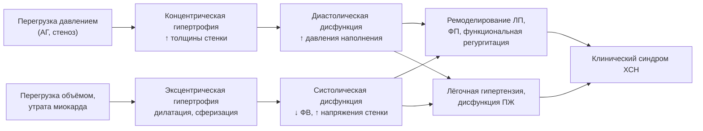

**Рис. 4.** Гемодинамические механизмы и пути ремоделирования. Схема читается слева направо: два типа перегрузки формируют разные геометрические варианты ремоделирования, которые через предсердное ремоделирование и вовлечение правых отделов сходятся в единый клинический синдром.

### 5.3. Нейрогормональные системы

#### 5.3.1. Симпатическая (симпатоадреналовая) нервная система

Снижение выброса через барорецепторы активирует симпатическую нервную систему (СНС): растут частота ритма и сократимость, суживаются артериолы и вены, стимулируется секреция ренина. Хроническая гиперактивация повреждает: норадреналин токсичен для кардиомиоцитов (перегрузка кальцием, апоптоз), вызывает десенситизацию и снижение плотности β1-рецепторов, усиливает аритмогенез, фиброз и инсулинорезистентность; уровень норадреналина плазмы коррелирует со смертностью (Borovac et al., 2020; Kassab et al., 2022). Активация СНС затрагивает и почечные симпатические нервы, усиливая реабсорбцию натрия и секрецию ренина, — отсюда интерес к ренальной денервации при ХСН (см. п. 28.17). Терапевтический ответ — бета-адреноблокаторы, которые при осторожном титровании восстанавливают чувствительность рецепторов и способствуют обратному ремоделированию.

#### 5.3.2. Ренин-ангиотензин-альдостероновая система

Снижение перфузии почек, симпатическая стимуляция и снижение доставки натрия к плотному пятну стимулируют секрецию ренина; ангиотензин II через рецепторы AT1 вызывает вазоконстрикцию, жажду, секрецию альдостерона и вазопрессина, гипертрофию кардиомиоцитов, пролиферацию фибробластов, оксидативный стресс и воспаление. Альдостерон, помимо задержки натрия и потери калия и магния, стимулирует фиброз миокарда и сосудов и дисфункцию эндотелия; его уровень при длительной блокаде АПФ «ускользает» из-под контроля, что обосновывает отдельное назначение антагонистов минералокортикоидных рецепторов. Тканевые РААС в миокарде и сосудах действуют паракринно, независимо от циркулирующей системы.

#### 5.3.3. Натрийуретические пептиды и система неприлизина

Натрийуретические пептиды — физиологические антагонисты РААС и СНС: через рецептор NPR-A и цГМФ они вызывают натрийурез, вазодилатацию, подавляют секрецию ренина и альдостерона, тормозят гипертрофию и фиброз. При ХСН их уровень высок, но эффект ослаблен («резистентность к НУП»): преобладают неактивные формы прогормона, снижена чувствительность рецепторов, пептиды быстро расщепляются **неприлизином** — нейтральной эндопептидазой, разрушающей также брадикинин, адреномедуллин и ангиотензин II. Ингибирование неприлизина повышает уровень защитных пептидов, но одновременно и ангиотензина II, поэтому эффективно только в комбинации с блокатором АТ1-рецепторов (сакубитрил/валсартан).

#### 5.3.4. Вазопрессин

Аргинин-вазопрессин (антидиуретический гормон) секретируется в ответ на неосмотические стимулы (снижение эффективного объёма, ангиотензин II) и через V2-рецепторы собирательных трубочек задерживает свободную воду, вызывая гипонатриемию разведения, а через V1a-рецепторы — вазоконстрикцию. Гипонатриемия — один из сильнейших предикторов неблагоприятного прогноза при ХСН; антагонист V2-рецепторов толваптан корригирует натрий, но не улучшил выживаемость в исследовании EVEREST.

#### 5.3.5. Эндотелин

Эндотелин-1 — мощный вазоконстриктор, продуцируемый эндотелием под влиянием ангиотензина II, гипоксии и цитокинов; он стимулирует гипертрофию, фиброз и ремоделирование лёгочных сосудов. Его уровень повышен пропорционально тяжести ХСН, однако антагонисты эндотелиновых рецепторов при ХСНснФВ не улучшили исходов (и ухудшали задержку жидкости), оставшись препаратами для лёгочной артериальной гипертензии.

**Табл. 7.** Нейрогормональные системы при ХСН: эффекты и фармакологические мишени.

| Система | Ключевые медиаторы | Краткосрочный «полезный» эффект | Долгосрочный повреждающий эффект | Терапевтическая мишень |
|---|---|---|---|---|
| Симпатоадреналовая | Норадреналин, адреналин | ↑ ЧСС, сократимости, АД | Токсичность для кардиомиоцитов, десенситизация β-рецепторов, аритмии, фиброз | Бета-адреноблокаторы; (ивабрадин — только ЧСС) |
| РААС | Ренин, ангиотензин II, альдостерон | Поддержание АД и объёма | Вазоконстрикция, задержка Na⁺, гипертрофия, фиброз, воспаление | иАПФ, БРА, АРНИ, АМКР (спиронолактон, эплеренон, финеренон) |
| Натрийуретические пептиды (контррегуляция) | ANP, BNP, CNP; неприлизин | Натрийурез, вазодилатация, антифиброз | Резистентность при ХСН | Ингибитор неприлизина в составе АРНИ |
| Вазопрессин | AVP (V1a, V2) | Сохранение воды | Гипонатриемия, вазоконстрикция | Ограничение жидкости; толваптан (симптоматически) |
| Эндотелин | Эндотелин-1 | Поддержание АД | Вазоконстрикция, ремоделирование | Нет при ХСН (антагонисты — при ЛАГ) |
| Цитокины и оксидативный стресс | TNF-α, IL-6, IL-1β, активные формы кислорода | Репарация после повреждения | Апоптоз, фиброз, кахексия, эндотелиальная дисфункция | Исследовательская стадия |
| Канальцевый транспорт Na⁺/глюкозы | НГЛТ-2 | — | Задержка Na⁺ и объёма (вторично) | Ингибиторы НГЛТ-2 (многокомпонентный механизм) |

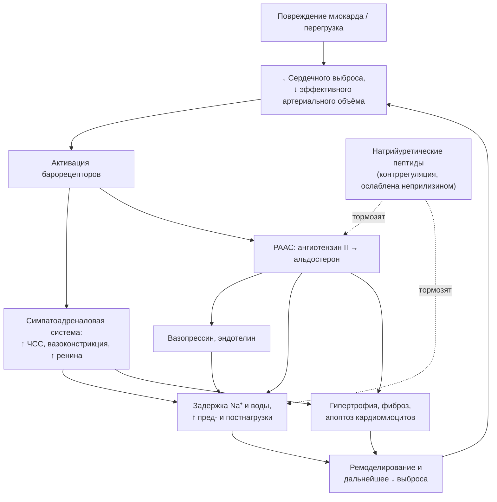

**Рис. 5.** Схема нейрогормонального каскада и «нейрогормональный порочный круг». Схема читается сверху вниз: снижение выброса запускает симпатоадреналовую систему и РААС, которые через задержку жидкости и прямое повреждение миокарда усиливают ремоделирование и ещё больше снижают выброс; пунктирные стрелки — контррегуляторное действие натрийуретических пептидов, ослабленное при ХСН.

### 5.4. Молекулярные и клеточные механизмы

#### 5.4.1. Молекулярные и клеточные механизмы ремоделирования миокарда

На клеточном уровне ремоделирование включает гипертрофию кардиомиоцитов с реактивацией «фетальной» программы генов (β-изоформа тяжёлых цепей миозина, предсердный и мозговой НУП), нарушение кальциевого цикла (снижение SERCA2a, «утечка» кальция через рианодиновые рецепторы), изменение цитоскелета и титина, десенситизацию β-адренорецепторов (через киназу GRK2), а также пролиферацию фибробластов и их превращение в миофибробласты (Schirone et al., 2017). Сигнальные пути — ангиотензин II/AT1, альдостерон/минералокортикоидный рецептор, TGF-β, кальциневрин/NFAT, MAPK, PI3K/Akt — взаимно усиливают друг друга, что объясняет недостаточность блокады какого-либо одного звена.

#### 5.4.2. Клеточный апоптоз

Апоптоз (программируемая гибель) кардиомиоцитов при ХСН протекает с низкой, но постоянной скоростью; поскольку взрослые кардиомиоциты практически не делятся, кумулятивная потеря клеток за годы существенна. Индукторы — норадреналин, ангиотензин II, TNF-α, оксидативный стресс, растяжение; наряду с апоптозом описаны некроз, некроптоз и нарушения аутофагии. Антиапоптотический эффект считается одним из механизмов пользы бета-адреноблокаторов и ингибиторов РААС.

#### 5.4.3. Фиброз миокарда (в том числе межуточный)

Различают **заместительный фиброз** (рубец на месте погибших кардиомиоцитов) и **реактивный межуточный (интерстициальный) и периваскулярный фиброз**, развивающийся без гибели клеток под действием альдостерона, ангиотензина II, TGF-β и механического напряжения. Фиброз увеличивает жёсткость желудочка, нарушает электрическое проведение (субстрат реентри), ухудшает диффузию кислорода и сдавливает капилляры. Его маркеры — объём внеклеточного пространства по МРТ, галектин-3, растворимый ST2.

#### 5.4.4. Микроциркуляторное русло миокарда

Гипертрофия без адекватного роста капилляров увеличивает диффузионное расстояние и снижает коронарный резерв; периваскулярный фиброз и дисфункция эндотелия ухудшают регуляцию кровотока. Микрососудистая дисфункция вызывает субэндокардиальную ишемию без стенозов эпикардиальных артерий и рассматривается как центральное звено ХСНсФВ.

#### 5.4.5. Оксидативный стресс и воспаление, включая системное микрососудистое воспаление

Активные формы кислорода образуются в митохондриях, НАДФН-оксидазах, ксантиноксидазе и разобщённой NO-синтазе; они повреждают белки кальциевого цикла, активируют металлопротеиназы матрикса, индуцируют апоптоз и гипертрофию и инактивируют оксид азота (D’Amato et al., 2025). Воспаление при ХСН имеет две формы: местное (после инфаркта, при миокардите) и системное низкоинтенсивное, поддерживаемое коморбидностью (ожирение, диабет, ХБП, ХОБЛ), застоем в кишечнике с транслокацией эндотоксина и нейрогормонами. Провоспалительные цитокины (TNF-α, IL-1β, IL-6) снижают сократимость, усиливают фиброз и катаболизм (кахексию); попытки прямой антицитокиновой терапии при ХСНснФВ не увенчались успехом, но антиоксидантные и противовоспалительные стратегии остаются активной областью исследований (см. п. 28.18).

#### 5.4.6. Эндотелиальная и микрососудистая дисфункция

Снижение биодоступности оксида азота нарушает вазодилатацию, повышает жёсткость сосудов и постнагрузку, способствует тромбозу и воспалению, а в миокарде — через снижение активности цГМФ-зависимой протеинкиназы G — ведёт к гипертрофии кардиомиоцитов и гипофосфорилированию титина с повышением его жёсткости. Эта цепочка — ядро парадигмы Паулюса и Чёпе (2013) для ХСНсФВ (см. п. 5.6.1).

#### 5.4.7. Митохондриальная дисфункция, нарушение энергетического метаболизма и энергетический дефицит кардиомиоцита

Сердце — самый энергозависимый орган: оно ежедневно синтезирует и расходует массу АТФ, многократно превышающую массу самого органа. При ХСН снижаются окислительная способность митохондрий и отношение фосфокреатин/АТФ, нарушается субстратная гибкость (переключение с окисления жирных кислот на глюкозу, позднее — дефицит и того и другого), возрастает продукция активных форм кислорода, нарушается митофагия и биогенез митохондрий. «Недостающая энергия» ограничивает и сокращение, и расслабление, и ионный транспорт. Таргетная митохондриальная терапия (кофакторы дыхательной цепи, стабилизаторы кардиолипина, модуляторы метаболизма, кетоновые тела) исследуется (Zhang et al., 2026 — по плану лекции; [⚠️ Требуется верификация: выходные данные источника]); частично митохондриальными эффектами объясняют пользу ингибиторов НГЛТ-2.

### 5.5. Системные последствия

#### 5.5.1. Почечные механизмы задержки натрия и воды

Почка «воспринимает» ХСН как гиповолемию: снижение перфузионного давления, симпатическая стимуляция и ангиотензин II усиливают реабсорбцию натрия в проксимальных канальцах (через ангиотензин II и повышение фильтрационной фракции), в петле Генле и в дистальном нефроне (альдостерон), а вазопрессин задерживает воду. Повышенное венозное давление дополнительно снижает фильтрацию через рост давления в интерстиции почки. Итог — положительный баланс натрия и воды при уже существующем застое; это объясняет, почему натрийуретический ответ на диуретики является центральным показателем деконгестии.

#### 5.5.2. Патогенез застоя в малом круге кровообращения

Повышение давления в левом предсердии передаётся на лёгочные вены и капилляры; когда гидростатическое давление превышает возможности лимфатического дренажа и онкотическое противодействие, жидкость выходит в интерстиций (интерстициальный отёк — одышка, линии Керли) и затем в альвеолы (альвеолярный отёк — хрипы, пенистая мокрота). При хроническом застое лимфатический резерв увеличивается, а альвеолярно-капиллярная мембрана утолщается, поэтому хронически высокие давления переносятся без отёка, но ценой снижения диффузионной способности и рестрикции. Быстрый подъём давления при гипертоническом кризе отёк вызывает даже при умеренных цифрах.

#### 5.5.3. Патогенез застоя в большом круге кровообращения

Правожелудочковая недостаточность и/или задержка жидкости повышают центральное венозное давление: набухают шейные вены, увеличивается печень (с болью от растяжения капсулы), появляются отёки в зависимых областях (голени у ходячих, крестец у лежачих), асцит, гидроторакс (чаще справа или двусторонний — плевральные вены дренируются в обе системы), отёк стенки кишечника с нарушением всасывания и транслокацией бактериальных продуктов. Венозная гипертензия — ключевой механизм кардиоренального и кардиогепатического повреждения.

#### 5.5.4. Синдром низкого выброса и органная гипоперфузия

При критическом снижении выброса перераспределение кровотока в пользу мозга и сердца оставляет кожу, мышцы, почки и кишечник в состоянии гипоперфузии: холодные конечности, олигурия, рост лактата и трансаминаз («шоковая печень»), спутанность сознания, снижение всасывания лекарств. Низкий выброс при высоком давлении наполнения («холодный и влажный» профиль) — самое неблагоприятное сочетание.

#### 5.5.5. Лёгочная гипертензия вследствие левосердечной недостаточности

Хроническая пассивная передача давления (**изолированная посткапиллярная ЛГ**) со временем дополняется ремоделированием лёгочных артериол с ростом лёгочного сосудистого сопротивления (**комбинированная пре- и посткапиллярная ЛГ**). По критериям ESC/ERS 2022, ЛГ определяется как среднее давление в лёгочной артерии > 20 мм рт. ст.; посткапиллярный компонент — как давление заклинивания > 15 мм рт. ст., прекапиллярный — как лёгочное сосудистое сопротивление > 2 ед. Вуда. Развитие прекапиллярного компонента ухудшает прогноз и ограничивает возможности трансплантации (см. п. 25.9).

#### 5.5.6. Кардиоренальные и кардиогепатические взаимодействия

Почка при ХСН страдает от гипоперфузии, венозного застоя, нейрогормонов, воспаления, диуретиков и контрастов; прогрессирующее снижение рСКФ, в свою очередь, усиливает задержку натрия, анемию, гиперкалиемию и ограничивает терапию — это **хронический кардиоренальный синдром** (тип 2 по Ronco; см. также разделы 10 и 19). Застойная печень проявляется повышением билирубина, щелочной фосфатазы и γ-глутамилтрансферазы, снижением альбумина и синтеза факторов свёртывания; длительный застой ведёт к «кардиальному фиброзу/циррозу». Печёночные показатели входят в прогностические модели, а их сочетание с почечными (индекс MELD-XI) используется при оценке кандидатов на механическую поддержку.

#### 5.5.7. Нарушения скелетной мускулатуры и дыхательной системы

Одышка и утомляемость при ХСН лишь частично объясняются гемодинамикой: в скелетных мышцах развивается миопатия — атрофия, сдвиг к быстрым гликолитическим волокнам, снижение плотности митохондрий и капилляров, инсулинорезистентность. Метаболические рецепторы мышц (эргорефлекс) при этом гиперактивны и усиливают вентиляцию и симпатический тонус. Слабость дыхательных мышц, рестриктивные изменения и утолщение альвеолярно-капиллярной мембраны снижают эффективность вентиляции (высокий наклон VE/VCO₂). Отсюда — обоснование физических тренировок как патогенетического, а не только «общеукрепляющего» метода.

#### 5.5.8. Аритмогенез и внезапная сердечная смерть

Субстрат желудочковых аритмий при ХСН — рубец и межуточный фиброз (реентри), триггеры — нарушения кальциевого цикла (поздние постдеполяризации), удлинение потенциала действия, электролитные сдвиги (гипокалиемия, гипомагниемия) и симпатическая активация. Внезапная сердечная смерть составляет значительную долю смертей при ХСНснФВ, причём её удельный вес выше при умеренных симптомах (NYHA II–III), тогда как при NYHA IV преобладает смерть от насосной недостаточности. Нейрогормональная блокада снижает риск внезапной смерти; имплантируемые дефибрилляторы прерывают уже возникшие аритмии.

### 5.6. Патофизиология отдельных фенотипов

#### 5.6.1. ХСН с сохранённой фракцией выброса: воспалительная и метаболическая концепции

Согласно концепции Паулюса и Чёпе (2013), коморбидность (ожирение, диабет, гипертензия, ХБП, ХОБЛ, возраст) поддерживает системное воспаление, которое вызывает дисфункцию эндотелия коронарных микрососудов, снижение биодоступности NO и активности цГМФ–протеинкиназы G в кардиомиоцитах; следствие — гипертрофия, гипофосфорилирование титина и жёсткость, а также периваскулярный фиброз. Эта модель объясняет, почему при ХСНсФВ первично поражается не «насос», а «наполнение», и почему эффективны воздействия на метаболический фон (ингибиторы НГЛТ-2, снижение массы тела). Метаболическая концепция дополняет картину: при ожирении увеличены объём плазмы, эпикардиальный жир с его паракринным действием и перикардиальное ограничение, что усиливает межжелудочковое взаимодействие и повышает давление наполнения при нагрузке. ХСНсФВ неоднородна: наряду с кардиометаболическим фенотипом выделяют пожилой фенотип с фибрилляцией предсердий и ЛГ, фенотип с ХБП и «инфильтративный» (амилоидоз), что объясняет разный ответ на терапию.

#### 5.6.2. Патофизиология улучшения фракции выброса

Улучшение ФВ отражает обратное ремоделирование: уменьшение объёмов ЛЖ, восстановление эллипсоидной формы, снижение функциональной митральной регургитации, частичную нормализацию кальциевого цикла и экспрессии генов, уменьшение фиброза. Оно наиболее вероятно при недавнем дебюте, неишемической этиологии (тахикардиомиопатия, перипартальная, алкогольная, стресс-индуцированная), отсутствии обширного рубца, у женщин и при полноценной терапии (бета-адреноблокаторы, АРНИ, СРТ). Однако на молекулярном уровне восстановление неполно: сохраняются изменения экспрессии генов и фиброз, поэтому состояние описывают как ремиссию, зависимую от продолжения лечения (см. п. 2.6.2, раздел 17).

### 5.7. Теории, модели и концепции

#### 5.7.1. Гемодинамическая модель

Модель 1960–1970-х годов: ХСН — следствие слабости насоса и избыточной нагрузки; лечение — инотропы, вазодилататоры, диуретики. Она объяснила симптомы, но не прогрессирование; её практический предел обозначили исследования оральных инотропов (милринон в PROMISE, 1991), которые улучшали гемодинамику, но повышали смертность.

#### 5.7.2. Нейрогормональная (нейрогуморальная) модель

Модель 1980–1990-х годов (сформулирована, в частности, М. Пэкером): прогрессирование ХСН определяется хронической активацией СНС и РААС, а не гемодинамикой как таковой. Она предсказала пользу иАПФ, бета-адреноблокаторов и антагонистов альдостерона и была подтверждена серией исследований, снизивших смертность. Её ограничение — «потолок» эффекта: добавление новых нейрогормональных блокаторов (антагонисты эндотелина, вазопрессина, цитокинов) пользы не принесло.

#### 5.7.3. Биомеханическая модель и модель ремоделирования миокарда

Модель 2000-х годов (Mann & Bristow, 2005) рассматривает ХСН как прогрессирующее ремоделирование, в котором нейрогормональные, механические (напряжение стенки), воспалительные и генетические стимулы интегрируются на уровне кардиомиоцита и матрикса. Она объясняет пользу устройств (СРТ, механическая разгрузка), предсказывает значение фиброза и подчёркивает, что терапия должна изменять структуру, а не только симптомы.

#### 5.7.4. Модель кардиоренального взаимодействия

Эта модель выдвигает почку в центр патогенеза задержки жидкости и прогрессирования: сердце и почка связаны гемодинамикой (перфузия и венозное давление), нейрогормонами, воспалением и анемией. Из неё выросли приоритет натрийуреза в лечении застоя и понимание того, что «ухудшение функции почек» при эффективной деконгестии не всегда опасно (см. раздел 15).

#### 5.7.5. Системно-биологический подход к ХСН

Системная биология описывает ХСН как сетевое заболевание: множество генетических, молекулярных, клеточных и органных узлов взаимодействуют нелинейно, и один и тот же фенотип может возникнуть из разных комбинаций нарушений (Louridas & Lourida, 2012). Подход обосновывает многокомпонентную терапию («четыре столпа» действуют на разные узлы сети) и фенотипирование, в том числе с помощью машинного обучения.

#### 5.7.6. Компенсаторные и дезадаптивные механизмы; концепция «порочного круга» прогрессирования

Все описанные механизмы начинаются как компенсация и заканчиваются как повреждение: тахикардия и вазоконстрикция поддерживают давление, но увеличивают нагрузку; задержка жидкости повышает преднагрузку, но ведёт к застою; гипертрофия нормализует напряжение стенки, но снижает податливость и перфузию; активация СНС и РААС поддерживает выброс, но убивает кардиомиоциты. Несколько порочных кругов замыкаются одновременно (см. рис. 6), поэтому прогрессирование продолжается и после устранения первичной причины — на этом основана идея пожизненной терапии даже при улучшении.

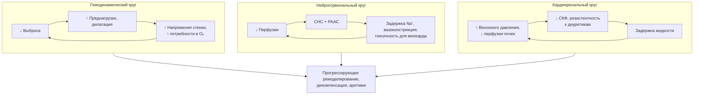

**Рис. 6.** Схемы порочных кругов и патогенетических циклов. Схема читается сверху вниз: три взаимосвязанных круга — гемодинамический, нейрогормональный и кардиоренальный — поддерживают друг друга и сходятся к прогрессирующему ремоделированию; терапия ХСН размыкает каждый из них в разных точках.

### 5.8. Примеры и иллюстрации

#### 5.8.1. Схема нейрогормонального каскада

Нейрогормональный каскад представлен на рис. 5. Клиническая иллюстрация: пациент с ФВ 25 % после инфаркта имеет тахикардию 100 в минуту, холодные конечности, АД 100/70 мм рт. ст., натрий 131 ммоль/л и отёки — это одновременные проявления активации СНС (тахикардия, вазоконстрикция), РААС (задержка натрия) и вазопрессина (гипонатриемия). Назначение бета-адреноблокатора «против тахикардии» без устранения застоя ухудшит состояние; правильная последовательность — деконгестия, затем нейрогормональная блокада с титрованием.

#### 5.8.2. Иллюстрация прогрессии ремоделирования миокарда

Пути ремоделирования показаны на рис. 4. Пример: у пациентки с аортальным стенозом годами существовала концентрическая гипертрофия с нормальной ФВ и одышкой при нагрузке (диастолическая дисфункция); после присоединения фибрилляции предсердий и эпизода декомпенсации ФВ снизилась до 40 % — переход от концентрического к смешанному ремоделированию с «истощением» компенсации, что является показанием к срочной коррекции порока.

#### 5.8.3. Схемы порочных кругов и патогенетических циклов

Порочные круги приведены на рис. 6. Точки их размыкания современной терапией: диуретики и ограничение натрия — кардиоренальный и гемодинамический круги; иАПФ/АРНИ, бета-адреноблокаторы, АМКР — нейрогормональный; ингибиторы НГЛТ-2 — почечный (натрийурез, снижение внутриклубочкового давления) и метаболический; СРТ и реваскуляризация — гемодинамический; физические тренировки — периферический (мышечный и вентиляционный).

> 💡 **Интересный факт:** идея применять бета-адреноблокаторы при сердечной недостаточности казалась в 1970-е годы еретической, поскольку противоречила гемодинамической модели; первые наблюдения Ф. Ваагстейна и соавт. (Гётеборг, 1975) у пациентов с дилатационной кардиомиопатией были встречены скептически, и лишь спустя четверть века крупные исследования подтвердили снижение смертности примерно на треть.

> ❗ **Типичная ошибка:** считать, что повышенный уровень натрийуретических пептидов «вреден» и его надо снижать. НУП — защитная контррегуляторная система; их уровень отражает степень гемодинамического стресса, а снижение на фоне терапии является следствием разгрузки сердца, а не целью само по себе (подробнее о «биомаркер-ориентированном ведении» — в п. 28.4).

> 🔬 **Углубление:** сакубитрил/валсартан иллюстрирует, как знание биохимии предопределяет дизайн препарата. Предшественник — омапатрилат, одновременно ингибировавший АПФ и неприлизин, — оказался эффективным, но вызывал ангионевротический отёк с неприемлемой частотой, поскольку оба фермента участвуют в деградации брадикинина. Сочетание ингибитора неприлизина с блокатором АТ1-рецепторов (а не с иАПФ) сохранило пользу и снизило риск отёка; по той же причине требуется 36-часовой перерыв при переходе с иАПФ на АРНИ, а совместное назначение АРНИ и иАПФ противопоказано.

> 📝 **Обобщение.** ХСН — результат взаимодействия гемодинамических нарушений (пред- и постнагрузка, сократимость, расслабление, сопряжение с артериальной системой), нейрогормональной активации (СНС, РААС, вазопрессин, эндотелин при ослабленной контррегуляции НУП), молекулярно-клеточных процессов (гипертрофия, апоптоз, фиброз, оксидативный стресс, микрососудистая и митохондриальная дисфункция) и системных последствий (задержка натрия, застой, гипоперфузия, кардиоренальные взаимодействия, миопатия, аритмогенез). Компенсаторные механизмы замыкаются в порочные круги, поэтому болезнь прогрессирует и после устранения причины. Главный вывод: каждый класс базисной терапии размыкает конкретный круг — это и есть логика многокомпонентного лечения, к классификации и диагностике которого мы переходим.

> ❓ **Контрольные вопросы**
>
> 1. Запишите формулы сердечного выброса и напряжения стенки по Лапласу и объясните, почему дилатация желудочка увеличивает постнагрузку.
> 2. Почему хроническая активация симпатоадреналовой системы и РААС, изначально компенсаторная, становится повреждающей? Назовите по три эффекта каждой системы.
> 3. Чем концентрическое ремоделирование отличается от эксцентрического по стимулу, геометрии и преимущественному типу дисфункции?
> 4. Как концепция Паулюса и Чёпе объясняет связь ожирения и диабета с ХСНсФВ, и какие терапевтические следствия из неё вытекают?
> 5. Пациент с ХСНснФВ и застоем получает бета-адреноблокатор в высокой дозе на фоне гипотонии и холодных конечностей. Какой порочный круг при этом усугубляется и как изменить тактику?

## 6. Классификации и фенотипы ХСН

### 6.1. Классификация по фракции выброса левого желудочка

#### 6.1.1. Принцип и обоснование разделения по фракции выброса

Фракция выброса остаётся главным классификационным признаком не потому, что она лучше всего описывает патофизиологию, а потому, что по ней формировались популяции крупных исследований: доказательства пользы нейрогормональной блокады и устройств получены при сниженной ФВ, а эффективность терапии при сохранённой ФВ подтверждена лишь для части классов. Таким образом, категория ФВ — это прежде всего инструмент выбора лечения, а также маркер различной этиологии, демографии и прогноза (см. п. 2.6.3).

#### 6.1.2. Категории фракции выброса в действующих документах

Категории по ФВ в российских и международных документах обобщены в табл. 8. В РКО 2024 используются три категории: ХСН с низкой (≤ 40 %), умеренно сниженной (41–49 %) и сохранённой (≥ 50 %) ФВ, при этом для двух последних диагноз требует объективных признаков структурного или функционального поражения сердца и/или повышения натрийуретических пептидов (критерии см. в п. 8.7.5). Отдельно выделена ХСН с улучшенной ФВ (п. 6.1.4).

**Табл. 8.** Категории ХСН по фракции выброса левого желудочка в основных документах (по состоянию на 2026 год).

| Категория | РКО 2024 | Универсальное определение 2021 / ESC 2021 | ESC 2026 | Второе универсальное определение 2026 |
|---|---|---|---|---|
| Сниженная ФВ | ХСНнФВ: ≤ 40 % | HFrEF: ≤ 40 % | HFrEF: < 50 % | HFrEF (жёсткие пороги не подчёркиваются) |
| Умеренно сниженная ФВ | ХСНунФВ: 41–49 % | HFmrEF: 41–49 % | Категория упразднена (включена в HFrEF) | Не выделяется |
| Сохранённая ФВ | ХСНсФВ: ≥ 50 % + объективные критерии | HFpEF: ≥ 50 % + объективные критерии | HFpEF: ≥ 50 % | HFpEF |
| Улучшенная ФВ | ХСН с улучшенной ФВ: исходно ≤ 40 %, прирост ≥ 10 п. п., повторно ≥ 40 % | HFimpEF: исходно ≤ 40 %, прирост ≥ 10 п. п., повторно > 40 % | Рекомендовано продолжать терапию после улучшения ФВ | HFimpEF: исходно сниженная, прирост ≥ 10 п. п., сейчас > 40 % |
| Сверхнормальная ФВ | Не выделяется | Обсуждается в литературе (> 65 %) | Не выделяется | Не выделяется |

#### 6.1.3. ХСН с низкой, умеренно сниженной и сохранённой фракцией выброса: ключевые различия

ХСНснФВ: преимущественно мужчины, ишемическая и дилатационная этиология, эксцентрическое ремоделирование, высокий риск внезапной смерти, наибольший арсенал доказанной терапии. ХСНсФВ: пожилые, чаще женщины, артериальная гипертензия, ожирение, диабет, фибрилляция предсердий, концентрическое ремоделирование, преобладание некардиальных причин смерти, эффективность доказана для ингибиторов НГЛТ-2 и АМКР. ХСНунФВ занимает промежуточное положение, но по этиологии (ИБС в 50–60 % случаев) и ответу на терапию ближе к ХСНснФВ, что и стало основанием для её упразднения в ESC 2026 (см. п. 6.1.6).

#### 6.1.4. ХСН с улучшенной фракцией выброса

> 📌 **Определение:** **ХСН с улучшенной ФВ** (по РКО 2024) — наличие в анамнезе ФВ ЛЖ ≤ 40 % с последующим абсолютным приростом ≥ 10 процентных пунктов и значением при повторном измерении ≥ 40 %; в универсальных определениях — > 40 %.

Это не «выздоровление», а ремиссия: при отмене терапии у значительной части пациентов происходит рецидив (TRED-HF), сохраняются молекулярные и структурные изменения, а риск событий остаётся выше популяционного. Пациент с улучшенной ФВ получает ту же терапию, что и при ХСНснФВ; вопрос о снижении интенсивности — предмет дискуссии (п. 28.14).

#### 6.1.5. ХСН со сверхнормальной фракцией выброса

ФВ > 65–70 % при наличии симптомов сердечной недостаточности встречается при выраженной концентрической гипертрофии с малой полостью (гипертрофическая кардиомиопатия, амилоидоз на ранних стадиях), а также при состояниях с высоким выбросом. В крупном регистровом анализе (Wehner et al., 2020) зависимость смертности от ФВ имела U-образную форму с минимумом около 60–65 %: сверхнормальная ФВ ассоциировалась с повышенной смертностью. Клиническое значение категории — напоминание, что «высокая ФВ» не исключает ХСН и может указывать на малый ударный объём при малой полости.

#### 6.1.6. Динамика фракции выброса и траектории; изменения ESC 2026

ФВ — не константа: она меняется под влиянием терапии, аритмий, ишемии, интеркуррентных заболеваний и естественного течения. Второе универсальное определение (2026) описывает траектории «улучшение — ремиссия — восстановление» и, напротив, прогрессирующее снижение. Рекомендации ESC 2026 упразднили категорию умеренно сниженной ФВ, расширив HFrEF до < 50 %, так как основные классы терапии продемонстрировали пользу во всём диапазоне ниже 50 %, а порог 40 % был исторически условным; одновременно сохранены прежние пороги ФВ для устройств (ИКД, СРТ) и ивабрадина, где доказательства получены при ФВ ≤ 35 %. Траектории показаны на рис. 7.

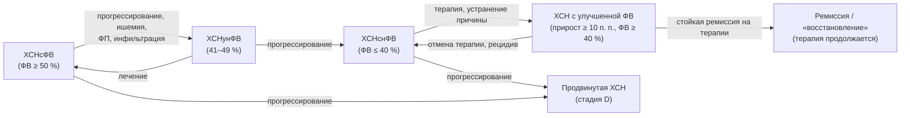

**Рис. 7.** Траектории изменения фракции выброса. Схема читается слева направо: ФВ может как улучшаться на фоне терапии (с риском рецидива при её отмене), так и снижаться при прогрессировании; категория ХСНунФВ в ESC 2026 объединена с ХСНснФВ.

### 6.2. Стадии и функциональные классы

#### 6.2.1. Классификация Н. Д. Стражеско и В. Х. Василенко

Классификация принята на XII Всесоюзном съезде терапевтов (1935) и впоследствии дополнена делением II стадии на IIА и IIБ (табл. 9). Она отражает стадийность процесса (стадия, в отличие от функционального класса, не может улучшиться) и до сих пор используется в формулировке диагноза в России; в РКО 2024 отмечено, что с учётом новых стадий 2023 года классификация Стражеско–Василенко сохраняется как историческая и клинически описательная.

**Табл. 9.** Стадии ХСН по Н. Д. Стражеско и В. Х. Василенко (с уточнениями ОССН 2002).

| Стадия | Характеристика |
|---|---|
| I (начальная) | Симптомы (одышка, сердцебиение, утомляемость) только при физической нагрузке; гемодинамика в покое не нарушена; бессимптомная дисфункция ЛЖ |
| IIА | Клинически выраженная стадия: умеренные нарушения гемодинамики в одном из кругов кровообращения; адаптивное ремоделирование |
| IIБ | Тяжёлая стадия: выраженные нарушения гемодинамики в обоих кругах; дезадаптивное ремоделирование |
| III (конечная, дистрофическая) | Тяжёлые нарушения гемодинамики и необратимые структурные изменения органов-мишеней (сердца, лёгких, сосудов, мозга, почек); финальная стадия ремоделирования |

#### 6.2.2. Стадии ACC/AHA (A, B, C, D) и их обновление 2022 года

Классификация ACC/AHA (2001, обновлена в 2022 году совместно с HFSA): **стадия A** — риск ХСН (гипертензия, диабет, ожирение, кардиотоксическая терапия, семейный анамнез) без структурных изменений и симптомов; **стадия B** — «пред-СН»: структурное заболевание сердца, повышенное давление наполнения или повышение натрийуретических пептидов без симптомов; **стадия C** — симптомная ХСН в настоящее время или в прошлом; **стадия D** — продвинутая ХСН с рефрактерными симптомами. Стадии однонаправленны (возврат невозможен), и для каждой определён набор вмешательств (раздел 11).

#### 6.2.3. Стадии ХСН по рекомендациям РКО 2023/2024 года

Российские эксперты в 2023 году предложили систему, близкую к ACC/AHA, но с собственной терминологией: **риск развития ХСН** (АГ, ожирение, ИБС, ФП, кардиомиопатии, диабет, ХБП, ХОБЛ, противоопухолевая терапия); **предстадия СН** — отсутствие симптомов когда-либо при наличии структурного и/или функционального поражения сердца и/или повышения натрийуретических пептидов; **стадия 1** — клинически выраженная ХСН (симптомы в настоящее время или в прошлом); **стадия 2** — продвинутая, клинически тяжёлая ХСН: тяжёлые симптомы и повторные госпитализации, несмотря на оптимальную терапию, или её непереносимость. Соотнесение систем приведено в табл. 10.

**Табл. 10.** Сопоставление систем стадирования ХСН.

| ACC/AHA 2022 | РКО 2023/2024 | Стражеско–Василенко (ориентировочно) | Содержание |
|---|---|---|---|
| A — риск | Риск развития ХСН | — | Факторы риска без поражения сердца |
| B — пред-СН | Предстадия СН | — (отчасти I стадия как «бессимптомная дисфункция») | Структурные/функциональные изменения или ↑ НУП без симптомов |
| C — симптомная | Стадия 1 | I–IIБ | Симптомы сейчас или в прошлом |
| D — продвинутая | Стадия 2 | IIБ–III | Рефрактерные симптомы, повторные госпитализации |

[⚠️ Требуется верификация: однозначное официальное соответствие стадий Стражеско–Василенко стадиям РКО 2023 не установлено; приведено ориентировочное соотнесение, основанное на содержательных определениях.]

#### 6.2.4. Функциональные классы NYHA

Классификация Нью-Йоркской ассоциации сердца (1928, многократно пересмотрена) оценивает переносимость нагрузки на момент осмотра; ФК может меняться в обе стороны (табл. 11). Её недостатки — субъективность и низкая воспроизводимость между врачами (особенно для II и III классов), поэтому её дополняют объективными тестами (6-минутная ходьба, пиковое потребление кислорода) и опросниками.

**Табл. 11.** Функциональные классы NYHA с ориентировочными объективными эквивалентами.

| ФК | Описание (в формулировке РКО 2024) | Тест 6-минутной ходьбы | Пиковое VO₂ (класс по Weber) |
|---|---|---|---|
| I | Ограничений физической активности нет; привычная нагрузка не вызывает симптомов; повышенная нагрузка может сопровождаться одышкой и замедленным восстановлением | 426–550 м | > 20 мл/кг/мин (A) |
| II | Незначительное ограничение: в покое симптомов нет, привычная активность вызывает утомляемость, одышку или сердцебиение | 301–425 м | 16–20 (B) |
| III | Заметное ограничение: в покое симптомов нет, нагрузка меньше привычной вызывает симптомы | 151–300 м | 10–16 (C) |
| IV | Невозможность выполнить какую-либо нагрузку без дискомфорта; симптомы в покое, усиливающиеся при минимальной активности | < 150 м | < 10 (D) |

Примечание: дистанция > 550 м соответствует отсутствию ХСН; значения ориентировочные и зависят от возраста, пола и сопутствующих заболеваний.

#### 6.2.5. Шкала оценки клинического состояния (ШОКС)

**ШОКС** (В. Ю. Мареев, 2000) — отечественная шкала из 10 клинических признаков (одышка; изменение массы тела за неделю; жалобы на перебои; положение в постели; шейные вены; хрипы в лёгких; ритм галопа; размеры печени; отёки; систолическое АД), каждый из которых оценивается от 0 до 1–3 баллов; максимум — 20 баллов (табл. 12). Шкала не требует оборудования, воспроизводима и чувствительна к динамике: её применяют при каждом визите и при оценке эффективности терапии. Ориентировочное соответствие: 0 баллов — отсутствие клинических признаков ХСН; ≤ 3 — ФК I; 4–6 — ФК II; 7–9 — ФК III; > 9 — ФК IV.

**Табл. 12.** Шкала оценки клинического состояния (ШОКС, модификация В. Ю. Мареева, 2000).

| Признак | 0 баллов | 1 балл | 2 балла | 3 балла |
|---|---|---|---|---|
| Одышка | Нет | При нагрузке | В покое | — |
| Изменение массы тела за неделю | Нет | Увеличилась | — | — |
| Перебои в работе сердца | Нет | Есть | — | — |
| Положение в постели | Горизонтально | С приподнятым изголовьем (две и более подушки) | Просыпается от удушья | Сидя |
| Набухшие шейные вены | Нет | Лёжа | Стоя | — |
| Хрипы в лёгких | Нет | Нижние отделы (до ⅓) | До лопаток (до ⅔) | Над всей поверхностью |
| Ритм галопа | Нет | Есть | — | — |
| Печень | Не увеличена | До 5 см | Более 5 см | — |
| Отёки | Нет | Пастозность | Отёки | Анасарка |
| Систолическое АД | > 120 мм рт. ст. | 100–120 | < 100 | — |

#### 6.2.6. Тест с 6-минутной ходьбой и кардиопульмональное нагрузочное тестирование как объективизация класса

Тест 6-минутной ходьбы прост, стандартизирован (коридор 30 м, без подбадривания) и прогностически значим: дистанция менее 300 м ассоциирована с худшей выживаемостью и входит в критерии продвинутой ХСН. Кардиопульмональное нагрузочное тестирование даёт пиковое потребление кислорода и вентиляционную эффективность (наклон VE/VCO₂) и является стандартом при отборе на трансплантацию (п. 8.9.4, 25.6).

#### 6.2.7. Классификация Killip и Forrester

Классификация **Killip** (1967) описывает тяжесть сердечной недостаточности при остром инфаркте миокарда по физикальным данным: I — нет признаков СН; II — влажные хрипы менее чем над половиной лёгочных полей, III тон; III — отёк лёгких; IV — кардиогенный шок. Классификация **Forrester** (1976) основана на инвазивной гемодинамике: сочетание сердечного индекса (порог 2,2 л/мин/м²) и давления заклинивания лёгочной артерии (порог 18 мм рт. ст.) даёт четыре класса — от нормального до «гипоперфузия + застой». Обе системы относятся к острым состояниям, но их логика лежит в основе клинических профилей (п. 6.3.1).

#### 6.2.8. Стадийность и функциональный класс: соотношение понятий

Стадия отражает структурную эволюцию болезни и однонаправленна; функциональный класс — текущее состояние и обратим. Поэтому пациент со стадией 1 (C) может иметь ФК I после успешного лечения, а пациент с продвинутой стадией в редких случаях временно улучшить класс до II–III. В диагнозе указывают обе характеристики (раздел 9).

#### 6.2.9. Классификация тяжести по шкалам INTERMACS

Профили **INTERMACS** (1–7) детализируют стадию D/стадию 2 от «критического кардиогенного шока» (профиль 1) и «прогрессирующего ухудшения на инотропах» (2) до «стабильности на инотропах» (3), «частых декомпенсаций» (4), «непереносимости нагрузки» (5), «ограничения при нагрузке» (6) и «продвинутого ФК III» (7). Шкала определяет срочность механической поддержки кровообращения и подробно обсуждается в п. 25.4.

#### 6.2.10. Сопоставление определений и классификаций в основных документах

Табл. 13 суммирует различия документов, с которыми встречается врач в 2026 году: Универсальные определения 2021 и 2026 годов, рекомендации ESC 2021/2023/2026 и РКО 2024.

**Табл. 13.** Сопоставление ключевых положений современных документов по ХСН (по состоянию на 2026 год).

| Положение | Универсальное определение 2021 | ESC 2021/2023 | РКО 2024 | ESC 2026 | Второе универсальное определение 2026 |
|---|---|---|---|---|---|
| Основа определения | Симптомы/признаки + объективное подтверждение (↑ НУП или застой) | Симптомы/признаки + структурно-функциональное нарушение | Симптомы/признаки + объективные доказательства дисфункции (в покое или при нагрузке) | Как в универсальном определении; категории по ФВ упрощены | Отход от жёстких порогов ФВ; траектории |
| Категории ФВ | ≤ 40 / 41–49 / ≥ 50 + HFimpEF | ≤ 40 / 41–49 / ≥ 50 | ≤ 40 / 41–49 / ≥ 50 + улучшенная | < 50 / ≥ 50 | HFrEF / HFpEF / HFimpEF |
| Стадии | A–D (at risk, pre-HF, HF, advanced) | Не акцентированы | Риск — предстадия — стадия 1 — стадия 2 | A–D приняты | A–D уточнены |
| Острое состояние | Острая СН | Острая СН (де ново / ОДХСН) | ОСН и ОДСН (разграничены) | «Декомпенсированная СН» (ДСН) | — |
| Терминология терапии | — | ОМТ, «четыре столпа» | Четырёхкомпонентная (квадро-) терапия | Фундаментальная (FMT) / дополнительная / интервенционная | — |

### 6.3. Гемодинамические профили и фенотипы

#### 6.3.1. Клинические гемодинамические профили («тёплый/холодный», «влажный/сухой»)

Профили Стивенсон (Nohria, Stevenson et al., 2003) основаны на двух осях прикроватной оценки: наличие застоя («влажный»: ортопноэ, набухание шейных вен, отёки, хрипы, гепатомегалия, III тон) и признаки гипоперфузии («холодный»: холодные конечности, узкое пульсовое давление, сонливость, гипотония, олигурия, рост лактата). Получаются четыре профиля (табл. 14), определяющие стартовую тактику при декомпенсации (раздел 22). Профиль «тёплый и влажный» — самый частый (около двух третей госпитализаций), «холодный и влажный» — самый опасный.

**Табл. 14.** Клинические гемодинамические профили и их терапевтические следствия.

| Профиль | Застой | Гипоперфузия | Доля госпитализаций (ориентировочно) | Ведущая тактика |
|---|---|---|---|---|
| A — «тёплый и сухой» | Нет | Нет | Небольшая | Компенсация; оптимизация базисной терапии, поиск иной причины симптомов |
| B — «тёплый и влажный» | Есть | Нет | Наибольшая | Диуретики ± вазодилататоры |
| C — «холодный и влажный» | Есть | Есть | Меньшинство, наихудший прогноз | Инотропы/вазопрессоры при необходимости, диуретики, рассмотреть механическую поддержку |
| L — «холодный и сухой» | Нет | Есть | Редко | Осторожная инфузия, инотропы; исключить передозировку диуретиков |

#### 6.3.2. Фенотипы по этиологии и ведущему синдрому

Помимо ФВ и стадии, в практике используют фенотипические характеристики: ишемическая/неишемическая; гипертензивное сердце; клапанная; «тахи-индуцированная»; инфильтративная (амилоид); правожелудочковая/бивентрикулярная; с высоким выбросом. Для ХСНсФВ описаны кластеры (кардиометаболический, пожилой с ФП и ЛГ, с ХБП), получаемые методами машинного обучения; их клиническое применение пока ограничено (п. 28.1).

#### 6.3.3. Фенотипы по течению: де ново, ухудшение хронической, стабильная, продвинутая

ESC выделяет впервые возникшую (де ново) сердечную недостаточность, ухудшение хронической (worsening HF — событие, требующее усиления терапии: госпитализация, внутривенные диуретики или неотложное обращение), стабильную хроническую и продвинутую. Эпизод ухудшения — переломный момент прогноза, после которого риск смерти и повторных госпитализаций резко возрастает (раздел 10).

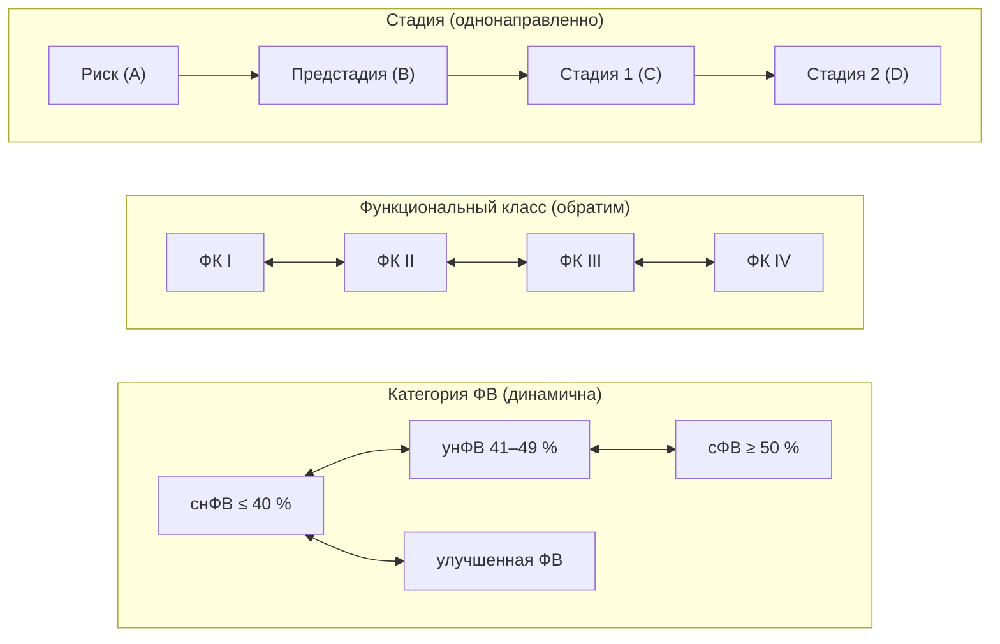

**Рис. 8.** Три оси характеристики пациента с ХСН: стадия, функциональный класс и категория фракции выброса. Схема читается слева направо: стадии движутся только вперёд, функциональный класс и категория ФВ могут меняться в обе стороны; полная характеристика пациента требует указания всех трёх осей.

### 6.4. Примеры и иллюстрации

#### 6.4.1. Пример одной пациентки в трёх системах

Женщина 68 лет с гипертонической болезнью, ожирением и фибрилляцией предсердий, одышкой при подъёме на один этаж, ФВ 58 %, индекс объёма ЛП 44 мл/м², NT-proBNP 900 пг/мл, без госпитализаций. Характеристика: ХСНсФВ; стадия C (ACC/AHA) = стадия 1 (РКО) = ориентировочно IIА по Стражеско–Василенко; ФК III NYHA; ШОКС, допустим, 5 баллов; профиль «тёплый и влажный» при наличии отёков. Полная формулировка — в разделе 9.

#### 6.4.2. Пример изменения категории ФВ

Мужчина 45 лет с тахикардиомиопатией на фоне непрерывно рецидивирующей предсердной тахикардии: ФВ 28 % при выявлении, через 6 месяцев после абляции и терапии — 52 %. Категория: ХСН с улучшенной ФВ (а не ХСНсФВ); базисная терапия продолжается, наблюдение с контролем ЭхоКГ.

> 💡 **Интересный факт:** классификация NYHA впервые была опубликована в 1928 году и первоначально предназначалась не для сердечной недостаточности, а для любых заболеваний сердца; спустя почти столетие она остаётся обязательным критерием включения в клинические исследования, хотя согласие между двумя врачами при отнесении пациента ко II или III классу, по данным ряда исследований, достигается лишь примерно в половине случаев.

> ❗ **Типичная ошибка:** писать в диагнозе «ХСН IIА, ФК II» пациенту, который был госпитализирован с анасаркой, но после лечения чувствует себя хорошо. Стадия не улучшается: если имелись выраженные нарушения в обоих кругах, стадия остаётся IIБ (стадия 1 или 2 по РКО), а изменившееся состояние отражается функциональным классом. Другая частая ошибка — «ХСН с сохранённой ФВ» у пациента с анамнезом ФВ 30 % и нынешней ФВ 50 %: это ХСН с улучшенной ФВ, и отмена терапии недопустима.

> 🔬 **Углубление:** решение ESC 2026 отказаться от категории HFmrEF опиралось на вторичные анализы исследований: в CHARM-Preserved, TOPCAT, PARAGON-HF и в объединённых анализах ингибиторов НГЛТ-2 (DELIVER + DAPA-HF, EMPEROR-Pooled) польза терапии при ФВ 41–49 % была сопоставима с таковой при ФВ ≤ 40 % и ослабевала лишь при ФВ выше 55–60 %. Для АМКР в объединённом анализе FINEARTS-HF с предшествующими исследованиями также показан эффект в широком диапазоне. При этом порог ФВ ≤ 35 % для ИКД и СРТ оставлен, поскольку доказательства устройств получены именно в этой популяции; поэтому новые категории не означают автоматического расширения показаний к устройствам.

> 📝 **Обобщение.** Современная характеристика пациента с ХСН строится по трём осям: категория ФВ (снФВ ≤ 40 %, унФВ 41–49 %, сФВ ≥ 50 % в РКО 2024; < 50 / ≥ 50 % в ESC 2026; отдельно — улучшенная ФВ), стадия (A–D или риск — предстадия — стадия 1 — стадия 2 по РКО; Стражеско–Василенко как историческая система) и функциональный класс (NYHA с объективизацией через ШОКС, тест 6-минутной ходьбы и КПНТ). Для острых ситуаций дополнительно используются гемодинамические профили Стивенсон, а для продвинутой ХСН — профили INTERMACS. Главный вывод: стадия отражает необратимую эволюцию, класс и ФВ — изменяемое состояние, и правильно выбранная категория напрямую определяет терапию.

> ❓ **Контрольные вопросы**
>
> 1. Назовите пороги ФВ для категорий ХСН по РКО 2024 и объясните, что изменилось в ESC 2026 и почему.
> 2. Сформулируйте критерии ХСН с улучшенной ФВ и объясните, почему это состояние не называют выздоровлением.
> 3. Чем стадия отличается от функционального класса? Приведите пример пациента со стадией 1 (C) и ФК I.
> 4. Перечислите признаки, оцениваемые по ШОКС, и укажите ориентировочное соответствие баллов функциональным классам.
> 5. Опишите четыре гемодинамических профиля Стивенсон и укажите, какой из них требует наиболее агрессивной тактики.

## 7. Клиническая картина

### 7.1. Симптомы

#### 7.1.1. Одышка и её варианты

**Одышка при нагрузке** — самый чувствительный (около 89 %), но малоспецифичный (около 51 %) симптом ХСН: она сопровождает болезни лёгких, анемию, ожирение, детренированность. Патофизиологически одышка связана с повышением давления в лёгочных капиллярах, снижением податливости лёгких, стимуляцией J-рецепторов, слабостью дыхательных мышц и гиперактивностью эргорефлекса (п. 5.5.7). Диагностическую ценность повышают специфические варианты. **Ортопноэ** — одышка в положении лёжа, вынуждающая спать с приподнятым изголовьем; возникает из-за перераспределения крови из нижних конечностей и брюшной полости в грудную клетку; специфичность около 89 %. **Пароксизмальная ночная одышка** — приступ удушья через 1–3 часа после засыпания, заставляющий сесть или встать; в отличие от ортопноэ, облегчение наступает не сразу. **Бендопноэ** (Thibodeau et al., 2014) — одышка в течение 30 секунд после наклона вперёд (при завязывании шнурков); отражает высокое давление наполнения и указывает на выраженный застой.

#### 7.1.2. Утомляемость и снижение переносимости нагрузки

Утомляемость, мышечная слабость и удлинённое восстановление после нагрузки обусловлены сниженным выбросом, миопатией скелетных мышц, анемией, дефицитом железа и нередко — избыточными дозами бета-адреноблокаторов или диуретиков. Пациенты часто приписывают их возрасту и не предъявляют активно, поэтому вопрос о том, что человек перестал делать за последний год, информативнее вопроса «есть ли слабость».

#### 7.1.3. Отёки, увеличение массы тела, абдоминальные симптомы

Периферические отёки при ХСН симметричны, располагаются в зависимых областях, усиливаются к вечеру, оставляют ямку при надавливании; появлению видимых отёков предшествует задержка 3–5 л жидкости, поэтому быстрый прирост массы тела (более 2 кг за 3 дня) — более ранний признак. Абдоминальные симптомы — тяжесть и боль в правом подреберье (растяжение капсулы печени), раннее насыщение, вздутие, снижение аппетита, тошнота — следствие венозного застоя в печени и кишечнике; они часто ошибочно трактуются как гастроэнтерологическая патология.

#### 7.1.4. Никтурия, кашель, другие симптомы

**Никтурия** объясняется улучшением почечной перфузии в горизонтальном положении ночью и реабсорбцией отёчной жидкости. **Ночной сухой кашель** — эквивалент застоя в малом круге (его надо отличать от кашля на иАПФ). К менее специфичным проявлениям относятся сердцебиение, головокружение, обмороки (аритмии, гипотония), депрессия, когнитивные нарушения, снижение массы тела вплоть до кахексии, свистящее дыхание («сердечная астма»), а также дыхание Чейна–Стокса во сне, о котором чаще сообщают родственники.

### 7.2. Физикальные признаки

#### 7.2.1. Признаки застоя в большом круге

**Набухание и пульсация яремных вен** при положении под 45° отражают повышение центрального венозного давления — это самый специфичный прикроватный признак повышенного давления в правом предсердии, который коррелирует и с давлением заклинивания лёгочной артерии (в отсутствие изолированной правожелудочковой патологии). **Гепатоюгулярный (абдоминоюгулярный) рефлюкс** — устойчивое набухание шейных вен при надавливании на живот в течение 10–15 секунд — повышает чувствительность исследования. **Гепатомегалия** (болезненная при остром застое, плотная при хроническом), **асцит**, **гидроторакс** (чаще двусторонний или правосторонний), **периферические отёки** (у лежачих — крестец и бёдра) завершают картину. При выраженном застое нередко отмечают пульсацию печени при трикуспидальной регургитации.

#### 7.2.2. Признаки застоя в малом круге

Влажные мелкопузырчатые незвонкие хрипы в нижних отделах лёгких, не исчезающие при покашливании, появляются при альвеолярном отёке; при хроническом застое они могут отсутствовать несмотря на высокое давление заклинивания благодаря усилению лимфодренажа. Притупление перкуторного звука и ослабление дыхания в нижних отделах указывают на плевральный выпот; свистящие хрипы возможны при отёке слизистой бронхов.

#### 7.2.3. Признаки со стороны сердца

**III тон (протодиастолический ритм галопа)** — низкочастотный звук в начале диастолы при быстром наполнении жёсткого или объёмно перегруженного желудочка; чувствительность низкая, но специфичность для ХСН близка к 99 %. IV тон отражает сокращение предсердия в ригидный желудочек. Смещение верхушечного толчка влево и вниз, его разлитой характер указывают на дилатацию ЛЖ; эпигастральная пульсация — на дилатацию ПЖ. Шумы функциональной митральной и трикуспидальной регургитации, акцент II тона над лёгочной артерией — следствия ремоделирования и ЛГ.

#### 7.2.4. Признаки низкого выброса и системные проявления

Тахикардия, малое пульсовое давление (пропорциональное пульсовое давление менее 25 % указывает на сердечный индекс менее 2,2 л/мин/м²), альтернирующий пульс (чередование сильных и слабых волн), холодные бледные или цианотичные конечности, замедленное наполнение капилляров, олигурия, сонливость или возбуждение — проявления гипоперфузии. Системные признаки длительной ХСН — саркопения и **сердечная кахексия** (непреднамеренная потеря ≥ 5–6 % массы тела за 6–12 месяцев без отёков), «застойная» желтуха, трофические изменения кожи голеней.

### 7.3. Диагностическая ценность симптомов и признаков

#### 7.3.1. Чувствительность и специфичность

Ни один симптом и признак не обладает одновременно высокой чувствительностью и специфичностью, поэтому клиническое подозрение всегда требует объективного подтверждения (табл. 15). Чувствительные симптомы (одышка) полезны для исключения ХСН при их отсутствии, специфичные признаки (III тон, набухание яремных вен, ортопноэ) — для подтверждения.

**Табл. 15.** Диагностическая ценность симптомов и признаков ХСН (ориентировочно, по данным метаанализа Mant и соавт., 2009).

| Симптом/признак | Чувствительность, % | Специфичность, % |
|---|---|---|
| Одышка при нагрузке | ≈ 89 | ≈ 51 |
| Ортопноэ | ≈ 44 | ≈ 89 |
| Пароксизмальная ночная одышка | ≈ 41 | ≈ 84 |
| Периферические отёки | ≈ 53 | ≈ 72 |
| Набухание яремных вен | ≈ 52 | ≈ 70 |
| Влажные хрипы | ≈ 51 | ≈ 81 |
| III тон | ≈ 11 | ≈ 99 |
| Гепатомегалия | ≈ 17 | ≈ 97 |

[⚠️ Требуется верификация: точные значения чувствительности и специфичности по отдельным признакам приведены округлённо и могут отличаться в зависимости от исследуемой популяции; в РКО 2024 приводятся чувствительность одышки 89 %, специфичность 51 %, специфичность ортопноэ 89 % и отёков 72 %.]

#### 7.3.2. Фрамингемские критерии

Классические критерии Фрамингемского исследования (McKee et al., 1971) требуют двух больших или одного большого и двух малых критериев (табл. 16). Они создавались для эпидемиологических целей и сегодня используются как учебный ориентир и исследовательский инструмент, а не как основа диагноза, поскольку не включают визуализацию и биомаркеры.

**Табл. 16.** Фрамингемские критерии сердечной недостаточности.

| Большие критерии | Малые критерии |
|---|---|
| Пароксизмальная ночная одышка или ортопноэ | Двусторонние отёки голеней |
| Набухание шейных вен | Ночной кашель |
| Влажные хрипы в лёгких | Одышка при обычной нагрузке |
| Кардиомегалия | Гепатомегалия |
| Острый отёк лёгких | Плевральный выпот |
| III тон (ритм галопа) | Тахикардия ≥ 120 в минуту |
| Повышение венозного давления > 16 см вод. ст. | Снижение жизненной ёмкости лёгких на ⅓ |
| Гепатоюгулярный рефлюкс | — |
| Потеря ≥ 4,5 кг за 5 дней в ответ на лечение (большой или малый критерий) | |

### 7.4. Клинические синдромы и варианты

#### 7.4.1. Лево- и правожелудочковая недостаточность

Левожелудочковая недостаточность проявляется преимущественно симптомами застоя в малом круге (одышка, ортопноэ, хрипы) и низкого выброса; правожелудочковая — застоем в большом круге (яремные вены, печень, отёки, асцит) при относительно «чистых» лёгких. У большинства пациентов с длительной ХСН имеется бивентрикулярная недостаточность; изолированная правожелудочковая требует исключения лёгочной гипертензии, патологии ПЖ (аритмогенная кардиомиопатия, инфаркт ПЖ), констриктивного перикардита и пороков трикуспидального клапана.

#### 7.4.2. ХСН с сохранённой и сниженной ФВ: клинические отличия

Клиническая картина не позволяет надёжно различить фенотипы по ФВ, однако при ХСНсФВ чаще наблюдаются одышка при нагрузке при скудных физикальных данных, гипертензия, ожирение, фибрилляция предсердий, эпизоды гипертонического отёка лёгких; при ХСНснФВ — признаки низкого выброса, кардиомегалия, III тон, функциональная митральная регургитация, желудочковые аритмии.

#### 7.4.3. Особенности у пожилых, женщин, пациентов с ожирением и коморбидностью

У пожилых доминируют неспецифические проявления: утомляемость, спутанность, снижение активности, падения, анорексия; одышку маскируют малоподвижность и когнитивные нарушения, а отёки — венозная недостаточность и блокаторы кальциевых каналов. У женщин чаще ХСНсФВ и более выраженные симптомы при той же ФВ. При ожирении затруднена оценка яремных вен и верхушечного толчка, уровень натрийуретических пептидов занижен, а одышка объясняется «весом». У пациентов с ХОБЛ симптомы перекрываются, и диагностика требует натрийуретических пептидов и ЭхоКГ.

#### 7.4.4. Атипичные и малосимптомные формы

Бессимптомная дисфункция ЛЖ (предстадия) выявляется случайно при ЭхоКГ или по натрийуретическим пептидам; «абдоминальная» форма имитирует болезнь печени или кишечника; «церебральная» (у пожилых) — деменцию; изолированный ночной кашель или свистящее дыхание направляют к пульмонологу. Настороженность в отношении ХСН у пациентов из групп риска — ключ к ранней диагностике.

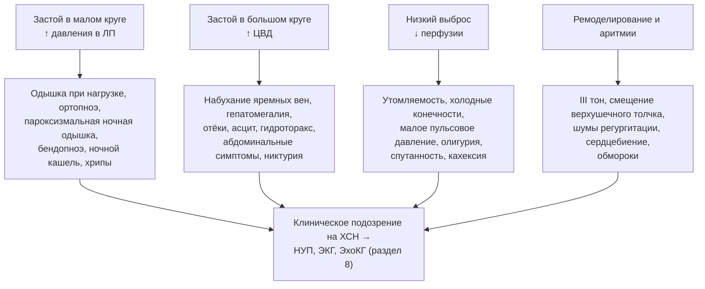

**Рис. 9.** Симптомы и признаки ХСН, сгруппированные по ведущему патофизиологическому механизму. Схема читается сверху вниз: четыре механизма дают четыре группы проявлений, которые в совокупности формируют клиническое подозрение, требующее объективного подтверждения.

### 7.5. Примеры и иллюстрации

#### 7.5.1. Клинический пример типичной картины

Мужчина 70 лет с инфарктом миокарда в анамнезе жалуется на одышку при ходьбе 100 м, сон на трёх подушках, пробуждения от удушья, отёки голеней к вечеру, прибавку 4 кг за две недели. Объективно: ЧСС 96, АД 110/80 мм рт. ст., яремные вены набухшие под 45°, положительный гепатоюгулярный рефлюкс, влажные хрипы в нижних отделах, III тон, печень +4 см, симметричные отёки до коленей. ШОКС — 9 баллов; профиль «тёплый и влажный»; по Фрамингему — пять больших критериев. Диагноз клинически очевиден; обследование направлено на уточнение ФВ, причины декомпенсации и этиологии.

#### 7.5.2. Клинический пример атипичной картины

Женщина 82 лет с гипертонией и фибрилляцией предсердий поступает с анорексией, тошнотой, потерей 5 кг, слабостью и спутанностью сознания; одышку отрицает (не ходит дальше комнаты). Объективно: яремные вены набухшие, печень +5 см, умеренный асцит, отёков нет (саркопения), в лёгких чисто. NT-proBNP 4 500 пг/мл, ЭхоКГ: ФВ 55 %, резко расширенные предсердия, выраженная трикуспидальная регургитация. Это правожелудочковый вариант ХСНсФВ с «абдоминальной» и «церебральной» маской; гастроэнтерологическое обследование было бы ошибкой первого шага.

> 💡 **Интересный факт:** термин «бендопноэ» был введён только в 2014 году исследователями из Юго-Западного медицинского центра Техасского университета; в их серии наблюдений симптом возникал в среднем через 8 секунд после наклона и ассоциировался с повышенным давлением наполнения правых и левых отделов сердца, особенно у пациентов с низким сердечным индексом.

> ❗ **Типичная ошибка:** исключать ХСН на основании «чистых лёгких» при аускультации. При хроническом повышении давления в лёгочных капиллярах компенсаторное усиление лимфодренажа предотвращает альвеолярный отёк, поэтому отсутствие хрипов не исключает тяжёлого застоя; напротив, двусторонние влажные хрипы у пожилого пациента могут быть проявлением пневмонии, фиброза или бронхита.

> 🔬 **Углубление:** оценка яремного венозного давления остаётся самым надёжным физикальным методом оценки давления наполнения. При положении под 45° верхняя точка пульсации вен более чем на 3 см выше угла грудины соответствует давлению в правом предсердии выше 8 мм рт. ст.; в исследовании Drazner и соавт. (2001) повышенное яремное давление и III тон у пациентов с ХСНснФВ были независимо связаны с риском госпитализации и смерти даже после учёта ФВ и симптомов. Ультразвуковая оценка нижней полой вены (диаметр > 21 мм с коллабированием < 50 %) и лёгочных B-линий дополняют, но не заменяют этот навык.

> 📝 **Обобщение.** Клиническая картина ХСН складывается из симптомов застоя в малом круге (одышка, ортопноэ, пароксизмальная ночная одышка, бендопноэ, кашель), застоя в большом круге (набухание яремных вен, гепатомегалия, отёки, асцит, абдоминальные симптомы), низкого выброса (утомляемость, холодные конечности, олигурия, спутанность) и признаков ремоделирования (III тон, смещение верхушечного толчка, шумы регургитации). Чувствительные симптомы позволяют исключать, специфичные признаки — подтверждать, но ни один не достаточен для диагноза; у пожилых, женщин, при ожирении и ХСНсФВ картина атипична. Главный вывод: клиническое подозрение — лишь первый шаг, за которым обязательно следует объективное подтверждение натрийуретическими пептидами и визуализацией.

> ❓ **Контрольные вопросы**
>
> 1. Чем патофизиологически различаются ортопноэ, пароксизмальная ночная одышка и бендопноэ?
> 2. Какие признаки ХСН обладают наибольшей специфичностью и почему их отсутствие не исключает диагноз?
> 3. Перечислите большие и малые Фрамингемские критерии и объясните, почему они не используются как единственная основа диагноза сегодня.
> 4. Как отличить клинически преимущественно правожелудочковую недостаточность от левожелудочковой и какие состояния следует исключить при изолированной правожелудочковой картине?
> 5. Опишите особенности клинической картины ХСН у пациента 85 лет с ожирением и ХОБЛ. Какие шаги позволят подтвердить или отвергнуть диагноз?

## 8. Диагностика ХСН

### 8.1. Общий алгоритм диагностики

#### 8.1.1. Диагностические критерии и логика подтверждения

Диагноз ХСН требует одновременного наличия: (1) характерных симптомов, (2) признаков (могут отсутствовать на ранних стадиях и на фоне терапии), (3) объективных доказательств структурной и/или функциональной дисфункции сердца и (4) при сомнениях — положительного ответа на терапию или данных нагрузочных и инвазивных методов. Натрийуретические пептиды играют роль «фильтра»: нормальный уровень при неострой симптоматике делает диагноз маловероятным и позволяет избежать ненужной ЭхоКГ; повышенный требует визуализации. Алгоритм ESC/РКО, дополненный положениями ESC 2026 (возраст-специфичные пороги NT-proBNP, альбуминурия в первичном обследовании), показан на рис. 10.

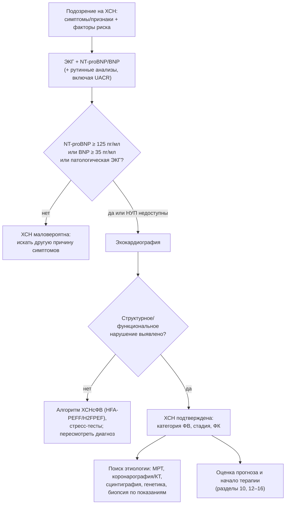

**Рис. 10.** Общий алгоритм диагностики ХСН при неостром начале симптомов. Схема читается сверху вниз: натрийуретические пептиды и ЭКГ служат фильтром перед эхокардиографией, которая подтверждает диагноз и определяет фенотип; далее следует этиологическая диагностика.

#### 8.1.2. Сбор анамнеза и физикальное обследование

Анамнез направлен на выявление этиологии (ИБС, гипертензия, пороки, кардиотоксическая терапия, алкоголь, семейный анамнез кардиомиопатий и внезапной смерти, беременность, системные заболевания), триггеров декомпенсации и коморбидности. Физикальное обследование структурировано по осям «застой — гипоперфузия» (п. 6.3.1), с обязательной оценкой яремного венозного давления, массы тела, АД в положении лёжа и стоя, ЧСС и ритма.

### 8.2. Электрокардиография

Полностью нормальная ЭКГ делает ХСН, особенно систолическую, маловероятной (отрицательная прогностическая ценность около 98 % для систолической дисфункции по данным РКО 2024). Диагностически значимые находки: патологические зубцы Q и рубцовые изменения (ишемическая этиология); признаки гипертрофии ЛЖ; блокада левой ножки пучка Гиса (QRS ≥ 150 мс определяет кандидатов на СРТ); фибрилляция предсердий; низкий вольтаж в сочетании с «гипертрофией» на ЭхоКГ и псевдоинфарктные зубцы (амилоидоз); нарушения атриовентрикулярной проводимости у молодых (саркоидоз, ламинопатии, болезнь Лайма); короткий PR с массивной гипертрофией (болезнь Фабри); частая желудочковая экстрасистолия (аритмогенная кардиомиопатия). Холтеровское мониторирование показано при подозрении на аритмии, для оценки нагрузки экстрасистолией и контроля частоты при ФП.

### 8.3. Лабораторные исследования

Базовый набор: общий анализ крови; креатинин с расчётом рСКФ; натрий, калий; глюкоза и HbA1c; липидный профиль; печёночные ферменты, билирубин, альбумин; ТТГ; ферритин и насыщение трансферрина (дефицит железа: ферритин < 100 мкг/л или 100–299 мкг/л при насыщении < 20 %); мочевая кислота; общий анализ мочи и альбумин-креатининовое отношение (UACR, включено в первичное обследование в ESC 2026). По показаниям — тропонин, креатинфосфокиназа, электрофорез и иммунофиксация белков сыворотки и мочи со свободными лёгкими цепями (амилоидоз), серологические тесты, ангиотензинпревращающий фермент (саркоидоз), тиамин. Лабораторные данные нужны не только для диагностики, но и для оценки безопасности терапии (калий, креатинин) и прогноза (натрий, альбумин, билирубин).

### 8.4. Натрийуретические пептиды

#### 8.4.1. Биология, типы и различия BNP и NT-proBNP

Кардиомиоциты желудочков в ответ на растяжение секретируют проBNP, расщепляющийся на биологически активный **BNP** (период полувыведения около 20 минут; клиренс неприлизином и рецепторами клиренса) и неактивный **NT-proBNP** (период полувыведения 1–2 часа; почечный клиренс). Поскольку сакубитрил ингибирует неприлизин, на фоне АРНИ уровень BNP повышается и теряет интерпретируемость, тогда как NT-proBNP снижается и остаётся пригодным для мониторинга.

#### 8.4.2. Диагностические пороги и факторы, влияющие на уровень

Для исключения ХСН при неостром начале используются пороги NT-proBNP < 125 пг/мл и BNP < 35 пг/мл; при остром начале — NT-proBNP < 300 и BNP < 100 пг/мл. Для подтверждения при остром начале применяют возраст-стратифицированные пороги NT-proBNP (> 450 пг/мл до 50 лет, > 900 — 50–75 лет, > 1 800 — старше 75 лет). ESC 2026 ввели возраст-специфичные диагностические пороги NT-proBNP и для неострой ситуации [⚠️ Требуется верификация: конкретные числовые значения новых порогов]. Факторы, влияющие на уровень, обобщены в табл. 17; наиболее важны возраст, фибрилляция предсердий, почечная недостаточность (повышают) и ожирение (снижает примерно на треть).

**Табл. 17.** Факторы, изменяющие уровень натрийуретических пептидов вне связи с тяжестью ХСН.

| Повышают уровень | Снижают уровень |
|---|---|
| Возраст, женский пол | Ожирение (≈ на 20–40 %) |
| Фибрилляция предсердий | Констриктивный перикардит (меньше растяжение) |
| ХБП (особенно для NT-proBNP) | Первые часы молниеносного отёка лёгких |
| Острый коронарный синдром, ТЭЛА, ЛГ, миокардит, гипертрофия ЛЖ | Сакубитрил/валсартан — снижает NT-proBNP (BNP, напротив, повышает) |
| Сепсис, анемия, тиреотоксикоз, цирроз с асцитом, инсульт | Генетические варианты (редко) |
| Состояния с высоким выбросом | — |

#### 8.4.3. Прогностическое значение и роль в мониторинге

Уровень НУП — один из сильнейших независимых предикторов смерти и госпитализаций при любой ФВ; снижение NT-proBNP на 30 % и более на фоне лечения декомпенсации ассоциировано с лучшим прогнозом. Стратегия титрования терапии «под контролем НУП» не превзошла стандартное ведение в исследовании GUIDE-IT (п. 28.4), однако динамика НУП остаётся полезным индикатором риска при выписке и амбулаторном наблюдении.

### 8.5. Рентгенография органов грудной клетки

Рентгенография выявляет кардиомегалию (кардиоторакальный индекс > 0,5), перераспределение кровотока в верхние доли, интерстициальный отёк (линии Керли B, перибронхиальные муфты), альвеолярный отёк («крылья бабочки»), плевральный выпот; нормальная рентгенограмма не исключает ХСН (особенно хроническую и ХСНсФВ). Главная ценность метода — выявление альтернативных или сопутствующих лёгочных причин одышки. Ультразвуковое исследование лёгких (B-линии ≥ 3 в двух и более межрёберьях с каждой стороны) превосходит рентгенографию в выявлении интерстициального отёка.

### 8.6. Эхокардиография

#### 8.6.1. Оценка систолической функции левого желудочка

ФВ ЛЖ измеряется биплановым методом дисков (Симпсона); при плохой визуализации используют контрастирование, при наличии — трёхмерную ЭхоКГ (точнее и воспроизводимее). Визуальная оценка допустима только опытным исследователем. **Глобальная продольная деформация** (GLS; норма по модулю обычно > 18–20 %) выявляет субклиническую дисфункцию при нормальной ФВ (кардиотоксичность, амилоидоз с «сохранением верхушки», ранние стадии ХСНсФВ) и имеет независимое прогностическое значение. Дополнительно оценивают объёмы ЛЖ, индекс сферичности, региональную сократимость (ишемическая этиология), наличие тромбов и аневризм.

#### 8.6.2. Оценка диастолической функции и давления наполнения

По алгоритму ASE/EACVI 2016 при сохранённой ФВ диастолическая дисфункция диагностируется при наличии более половины из четырёх признаков: септальная e′ < 7 см/с или латеральная e′ < 10 см/с; среднее E/e′ > 14; скорость трикуспидальной регургитации > 2,8 м/с; индекс объёма ЛП > 34 мл/м². При сниженной ФВ степень дисфункции и давление наполнения определяют по трансмитральному потоку: E/A ≤ 0,8 при E ≤ 50 см/с указывает на нормальное давление (I степень), E/A ≥ 2 — на рестрикцию (III степень), промежуточные значения требуют оценки E/e′, скорости ТР и объёма ЛП. Ключевые параметры суммированы в табл. 18.

**Табл. 18.** Основные эхокардиографические параметры при ХСН и их ориентировочные пороговые значения.

| Параметр | Что отражает | Ориентировочный порог патологии |
|---|---|---|
| ФВ ЛЖ (Симпсон, биплан) | Систолическая функция | ≤ 40 % — сниженная; 41–49 % — умеренно сниженная |
| GLS | Продольная систолическая функция | Модуль < 16–18 % |
| Индекс КДО ЛЖ | Дилатация | > 74 мл/м² (м), > 61 мл/м² (ж) |
| ИММЛЖ; относительная толщина стенки | Гипертрофия и геометрия | ≥ 115 г/м² (м), ≥ 95 г/м² (ж); ОТС > 0,42 — концентрическая |
| Индекс объёма ЛП | Хроническое давление наполнения | > 34 мл/м² (синусовый ритм), > 40 мл/м² (ФП) |
| E/e′ среднее | Давление наполнения ЛЖ | > 14 (патология); 9–14 — серая зона |
| e′ септальная/латеральная | Расслабление | < 7 / < 10 см/с |
| Скорость ТР; СДЛА | Лёгочная гипертензия | > 2,8 м/с; > 35 мм рт. ст. |
| TAPSE; S′ ПЖ; FAC | Функция ПЖ | < 17 мм; < 9,5 см/с; < 35 % |
| Нижняя полая вена | Давление в правом предсердии | > 21 мм и коллабирование < 50 % — ДПП ≈ 15 мм рт. ст. |

#### 8.6.3. Оценка правых отделов, клапанов и перикарда

Систематически оценивают размеры и функцию ПЖ (TAPSE, S′, фракция изменения площади, деформация свободной стенки), степень и механизм трикуспидальной и митральной регургитации (первичная или вторичная), стенозы, протезы, перикардиальный выпот и признаки констрикции (септальный «отскок», дыхательные колебания потоков, плетора нижней полой вены при нормальных размерах камер).

#### 8.6.4. Стресс-эхокардиография и чреспищеводная ЭхоКГ

Стресс-ЭхоКГ с физической нагрузкой или добутамином выявляет ишемию, жизнеспособность миокарда (сократительный резерв), оценивает динамику регургитации и давления в лёгочной артерии; **диастолический стресс-тест** (E/e′ ≥ 15 и/или скорость ТР > 3,4 м/с при нагрузке) используется в диагностике ХСНсФВ. Чреспищеводная ЭхоКГ нужна при неадекватном трансторакальном окне, оценке клапанов и протезов, тромбов ушка ЛП и для сопровождения транскатетерных вмешательств.

### 8.7. Магнитно-резонансная томография сердца

МРТ — референсный метод измерения объёмов, массы и ФВ обоих желудочков и единственный неинвазивный метод тканевой характеристики. **Позднее контрастирование гадолинием** различает ишемическое (субэндокардиальное или трансмуральное в бассейне коронарной артерии) и неишемическое повреждение (табл. 19); картирование **T1** и **объёма внеклеточного пространства** выявляет диффузный фиброз и амилоидную инфильтрацию (повышены) и болезнь Фабри (нативное T1 снижено); **T2** — отёк при миокардите; **T2\*** — перегрузку железом (< 20 мс). Показания: неясная этиология, плохое ультразвуковое окно, подозрение на инфильтративные, воспалительные и генетические кардиомиопатии, аритмогенную кардиомиопатию, оценка жизнеспособности перед реваскуляризацией. Ограничения: доступность, устройства (многие современные совместимы), клаустрофобия, аритмии, гадолиний при рСКФ < 30 мл/мин/1,73 м² (с осторожностью).

**Табл. 19.** Характерные паттерны позднего контрастирования гадолинием при различных причинах ХСН.

| Паттерн | Типичная причина |
|---|---|
| Субэндокардиальное/трансмуральное в бассейне артерии | Инфаркт миокарда (ишемическая кардиомиопатия) |
| Срединно-стеночная «полоска» в перегородке | Дилатационная кардиомиопатия, ламинопатии |
| Субэпикардиальное/пятнистое, латеральная стенка, перегородка | Миокардит, саркоидоз, аритмогенная кардиомиопатия, мышечные дистрофии |
| Диффузное субэндокардиальное/трансмуральное с нарушением «обнуления» миокарда | Амилоидоз |
| Базальная нижнелатеральная стенка | Болезнь Фабри |
| Точки прикрепления ПЖ, зоны гипертрофии | Гипертрофическая кардиомиопатия, лёгочная гипертензия |

### 8.8. Нагрузочные тесты

#### 8.8.1. Тест с 6-минутной ходьбой

Стандартизированный тест (коридор 30 м, без сопровождения, фиксируется дистанция, одышка по Боргу, сатурация) используется для объективизации ФК, динамического наблюдения и прогноза; дистанция < 300 м входит в критерии продвинутой ХСН, прирост > 30–50 м считается клинически значимым.

#### 8.8.2. Кардиопульмональное нагрузочное тестирование

КПНТ измеряет пиковое потребление кислорода (VO₂ peak), анаэробный порог, вентиляционную эффективность (наклон VE/VCO₂; > 35 — неблагоприятно), осцилляторное дыхание и дыхательный коэффициент (RER ≥ 1,05 подтверждает достаточное усилие). Показания: отбор на трансплантацию и механическую поддержку (VO₂ peak ≤ 12 мл/кг/мин на фоне бета-адреноблокатора или ≤ 14 без него — критерий направления), дифференциальная диагностика кардиальной и лёгочной одышки, назначение тренировок, экспертиза трудоспособности.

#### 8.8.3. Стресс-тесты на ишемию

Стресс-ЭхоКГ, перфузионная сцинтиграфия, стресс-МРТ и ПЭТ выявляют ишемию и жизнеспособность; выбор определяется доступностью и локальной экспертизой. Нагрузочная ЭКГ при ХСН малоинформативна из-за исходных изменений ЭКГ и ограниченной переносимости нагрузки.

### 8.9. Инвазивная диагностика

#### 8.9.1. Коронарная ангиография и КТ-коронарография

Коронарография показана при стенокардии, рефрактерной к терапии, при высокой претестовой вероятности ИБС у кандидатов на реваскуляризацию, при желудочковых аритмиях и остановке кровообращения; при низкой и промежуточной вероятности предпочтительна КТ-коронарография, которая надёжно исключает значимый стеноз. Решение о коронарографии всегда связано с вопросом, изменит ли результат тактику (раздел 21).

#### 8.9.2. Катетеризация правых отделов сердца

Измеряются давление в правом предсердии, лёгочной артерии, давление заклинивания, сердечный выброс (термодилюция, метод Фика), рассчитываются лёгочное сосудистое сопротивление и транспульмональный градиент. Показания: оценка ЛГ перед трансплантацией и имплантацией LVAD (обратимость при вазодилататорах), расхождение клинических и неинвазивных данных, рефрактерная декомпенсация, диагностика ХСНсФВ (давление заклинивания ≥ 15 мм рт. ст. в покое или ≥ 25 при нагрузке), подозрение на констрикцию и рестрикцию.

#### 8.9.3. Эндомиокардиальная биопсия

Биопсия показана, когда результат изменит лечение: при подозрении на гигантоклеточный, эозинофильный миокардит или саркоидоз (быстро прогрессирующая ХСН с нарушениями проводимости и желудочковыми аритмиями), для верификации амилоидоза при невозможности неинвазивной диагностики, при подозрении на отторжение трансплантата. Чувствительность зависит от очаговости процесса; осложнения (перфорация, тампонада) редки в опытных центрах.

### 8.10. Другие методы визуализации

**Сцинтиграфия с остеотропными препаратами** (⁹⁹ᵐTc-пирофосфат, DPD, HMDP) при захвате миокардом 2–3 степени по Perugini и отсутствии моноклонального белка (электрофорез и иммунофиксация сыворотки и мочи, свободные лёгкие цепи) позволяет диагностировать транстиретиновый амилоидоз без биопсии (критерии Gillmore et al., 2016). **ПЭТ с ¹⁸F-ФДГ** применяется для диагностики и мониторинга саркоидоза сердца и оценки жизнеспособности; **КТ сердца** — для коронарного кальция, анатомии перед вмешательствами, перикарда. **Исследование функции внешнего дыхания** и **полисомнография** нужны для оценки коморбидности и дифференциальной диагностики одышки.

### 8.11. Оценка прогноза и качества жизни на этапе диагностики

Уже при установлении диагноза оценивают прогностические маркеры (НУП, рСКФ, натрий, ФВ, ФК, дистанция 6-минутной ходьбы, частота госпитализаций) и качество жизни с помощью валидированных опросников — Канзасского (KCCQ) и Миннесотского (MLHFQ); они обсуждаются в разделе 10.

### 8.12. Диагностика ХСН с сохранённой фракцией выброса и особые диагностические ситуации

#### 8.12.1. Алгоритмы HFA-PEFF и H2FPEF

Поскольку при ХСНсФВ ФВ нормальна, диагноз строится на доказательстве повышенного давления наполнения. **HFA-PEFF** (Pieske et al., 2019) — четырёхшаговый алгоритм: P (претестовая оценка), E (эхокардиографическая и биомаркерная балльная система, табл. 20), F1 (функциональное тестирование — диастолический стресс-тест, при неопределённости — инвазивная гемодинамика с нагрузкой), F2 (этиологическая диагностика). **H2FPEF** (Reddy et al., 2018) — вероятностная шкала из шести легко доступных признаков (табл. 21). РКО 2024 предлагает собственный перечень объективных критериев (п. 2.4.6 и табл. 8): концентрическая гипертрофия, ИОЛП > 34 мл/м², E/e′ > 9, повышение НУП, СДЛА > 35 мм рт. ст. Схема диагностики представлена на рис. 11.

**Табл. 20.** Балльная система шага E алгоритма HFA-PEFF.

| Домен | Большие критерии (2 балла) | Малые критерии (1 балл) |
|---|---|---|
| Функциональный | Септальная e′ < 7 или латеральная e′ < 10 см/с; или среднее E/e′ ≥ 15; или скорость ТР > 2,8 м/с | Среднее E/e′ 9–14; или GLS по модулю < 16 % |
| Морфологический | ИОЛП > 34 мл/м²; или ИММЛЖ ≥ 149 (м) / ≥ 122 (ж) г/м² при ОТС > 0,42 | ИОЛП 29–34 мл/м²; или ИММЛЖ > 115 (м) / > 95 (ж) г/м²; или ОТС > 0,42; или толщина стенки ≥ 12 мм |
| Биомаркерный (синусовый ритм) | NT-proBNP > 220 или BNP > 80 пг/мл | NT-proBNP 125–220 или BNP 35–80 пг/мл |
| Биомаркерный (ФП) | NT-proBNP > 660 или BNP > 240 пг/мл | NT-proBNP 365–660 или BNP 105–240 пг/мл |

Интерпретация: ≥ 5 баллов — ХСНсФВ подтверждена; 2–4 балла — неопределённость, показан шаг F1; ≤ 1 балла — диагноз маловероятен. В каждом домене учитывается не более 2 баллов.

**Табл. 21.** Шкала H2FPEF.

| Признак | Критерий | Баллы |
|---|---|---|
| H — Heavy (ожирение) | ИМТ > 30 кг/м² | 2 |
| H — Hypertension | ≥ 2 антигипертензивных препарата | 1 |
| F — Fibrillation | Пароксизмальная или постоянная ФП | 3 |
| P — Pulmonary hypertension | СДЛА > 35 мм рт. ст. | 1 |
| E — Elder | Возраст > 60 лет | 1 |
| F — Filling pressure | E/e′ > 9 | 1 |

Интерпретация: 0–1 балл — низкая вероятность; 2–5 — промежуточная (нужны дополнительные тесты); 6–9 — высокая вероятность ХСНсФВ.

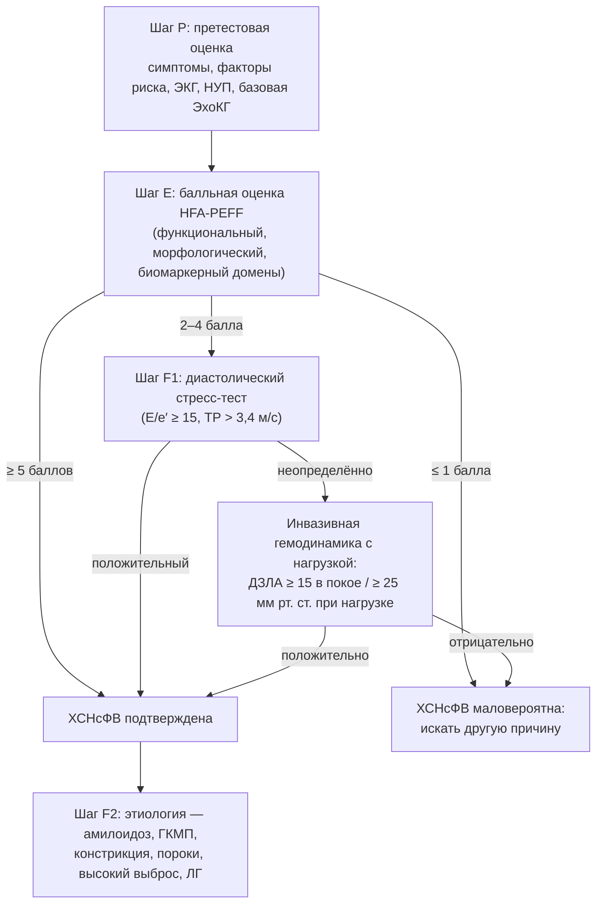

**Рис. 11.** Алгоритм диагностики ХСН с сохранённой фракцией выброса (по HFA-PEFF). Схема читается сверху вниз: после претестовой оценки балльная система либо подтверждает диагноз, либо направляет к функциональному тестированию; завершающий шаг — установление конкретной причины.

#### 8.12.2. Генетическое тестирование и семейный скрининг

Генетическое тестирование показано при дилатационной и недилатационной кардиомиопатии с семейным анамнезом, нарушениями проводимости или желудочковыми аритмиями (гены TTN, LMNA, FLNC, DSP, SCN5A, RBM20, BAG3, PLN и др.), при гипертрофической (MYH7, MYBPC3), аритмогенной кардиомиопатии и подозрении на наследственный транстиретиновый амилоидоз (TTR). Результат влияет на прогноз (ламинопатии и FLNC — высокий аритмический риск, ранние показания к ИКД), на выбор терапии (тафамидис при ATTR) и на каскадный скрининг родственников первой степени родства (ЭКГ, ЭхоКГ, при выявленном варианте — генетическое тестирование). Консультирование должно предшествовать тестированию.

#### 8.12.3. «Красные флаги» амилоидоза сердца

Амилоидоз следует заподозрить при: гипертрофии ЛЖ ≥ 12 мм без адекватной гипертензии; несоответствии толщины стенок и низкого вольтажа ЭКГ; псевдоинфарктных зубцах Q; «сохранении верхушки» на картах деформации; утолщении межпредсердной перегородки и клапанов, перикардиальном выпоте; двустороннем синдроме запястного канала, разрыве сухожилия бицепса, стенозе поясничного отдела позвоночника, полинейропатии, ортостатической гипотонии; непереносимости иАПФ и бета-адреноблокаторов; стойком повышении тропонина и НУП, непропорциональном тяжести; ХСНсФВ у мужчин старше 65 лет и низкопоточном аортальном стенозе у пожилых. Диагностика — сцинтиграфия с остеотропным препаратом плюс исключение моноклонального белка; при подозрении на AL-амилоидоз — гематологическое обследование и биопсия в срочном порядке.

### 8.13. Примеры и иллюстрации

#### 8.13.1. Пример применения алгоритма

Пациентка 74 лет с одышкой, гипертензией и ожирением: ЭКГ — гипертрофия ЛЖ, NT-proBNP 310 пг/мл, ЭхоКГ — ФВ 60 %, ИММЛЖ 118 г/м², ОТС 0,46, ИОЛП 36 мл/м², E/e′ 13, ТР 2,9 м/с. HFA-PEFF: функциональный домен — 2 балла (ТР > 2,8), морфологический — 2 (ИОЛП > 34), биомаркерный — 2 (NT-proBNP > 220 при синусовом ритме); итого 6 баллов — ХСНсФВ подтверждена. H2FPEF: ожирение 2 + гипертензия 1 + возраст 1 + E/e′ 1 = 5 баллов (промежуточная вероятность), что иллюстрирует различие шкал.

#### 8.13.2. Пример этиологической диагностики

Мужчина 58 лет, ФВ 30 %, без стенокардии, QRS 100 мс, атриовентрикулярная блокада I степени, отец умер внезапно в 50 лет. КТ-коронарография — без стенозов; МРТ — срединно-стеночное позднее контрастирование в перегородке; генетическое тестирование — патогенный вариант LMNA. Вывод: ламинопатия с высоким аритмическим риском — показание к ИКД независимо от ФВ по специальным критериям, каскадный скрининг детей и сибсов.

> 💡 **Интересный факт:** мозговой натрийуретический пептид получил своё название потому, что впервые был выделен в 1988 году японскими исследователями из мозга свиньи; лишь впоследствии выяснилось, что основным источником пептида у человека являются желудочки сердца, а не нервная ткань, однако название закрепилось.

> ❗ **Типичная ошибка:** интерпретировать NT-proBNP 400 пг/мл у пациента 80 лет с ФП и ХБП как доказательство ХСН, а 110 пг/мл у пациента с ИМТ 42 кг/м² — как её исключение. Возраст, ФП и ХБП повышают, а ожирение снижает уровень пептидов; результат следует соотносить с клиническим контекстом и подтверждать визуализацией. Вторая распространённая ошибка — исключение ХСНсФВ на основании «нормальной ЭхоКГ в покое»: диагноз требует целенаправленной оценки диастолической функции, объёма ЛП и, при неопределённости, нагрузочного тестирования.

> 🔬 **Углубление:** неинвазивная диагностика транстиретинового амилоидоза основана на работе Gillmore и соавт. (2016): в когорте более 1 200 пациентов захват остеотропного радиофармпрепарата 2–3 степени по Perugini в сочетании с отсутствием моноклонального белка имел специфичность и положительную прогностическую ценность, близкие к 100 %, для ATTR-амилоидоза сердца. Это изменило эпидемиологию: при систематическом скрининге ATTR-амилоидоз выявляется примерно у 10–15 % пожилых пациентов с ХСНсФВ и гипертрофией и у части пациентов с аортальным стенозом, а появление специфической терапии сделало такой поиск обязательным.

> 📝 **Обобщение.** Диагностика ХСН — последовательность: клиническое подозрение → ЭКГ и натрийуретические пептиды как фильтр (NT-proBNP < 125 / BNP < 35 пг/мл при неостром начале делают диагноз маловероятным с поправкой на возраст, ФП, ХБП и ожирение) → эхокардиография с оценкой ФВ, GLS, геометрии, диастолической функции, правых отделов и клапанов → при неопределённости алгоритмы ХСНсФВ (HFA-PEFF, H2FPEF, стресс-тесты, инвазивная гемодинамика) → этиологическая диагностика (МРТ с характеристикой ткани, коронарография или КТ, сцинтиграфия на амилоид, генетика, биопсия). Главный вывод: подтверждённый диагноз без установленной причины неполон, поскольку ряд причин ХСН имеет специфическое лечение.

> ❓ **Контрольные вопросы**
>
> 1. Опишите алгоритм диагностики ХСН при неостром начале и укажите пороги натрийуретических пептидов для исключения диагноза.
> 2. Какие факторы повышают и какие снижают уровень NT-proBNP, и почему на фоне сакубитрила/валсартана следует использовать именно NT-proBNP?
> 3. Перечислите четыре эхокардиографических критерия диастолической дисфункции по алгоритму 2016 года и критерии давления наполнения при сниженной ФВ.
> 4. Какие паттерны позднего контрастирования гадолинием соответствуют ишемической кардиомиопатии, ДКМП, миокардиту и амилоидозу?
> 5. Рассчитайте баллы HFA-PEFF и H2FPEF для пациента 66 лет с ИМТ 33 кг/м², на трёх антигипертензивных препаратах, с пароксизмальной ФП, E/e′ 12, ИОЛП 38 мл/м², NT-proBNP 500 пг/мл при синусовом ритме и сделайте вывод.

## 9. Дифференциальная диагностика и формулировка диагноза

### 9.1. Дифференциальная диагностика ведущих синдромов

#### 9.1.1. Дифференциальная диагностика одышки

Одышка — межпредметный симптом, и ХСН конкурирует с лёгочными, гематологическими, метаболическими и психогенными причинами (рис. 12). Ключевые разграничительные инструменты: натрийуретические пептиды (нормальный уровень при неострой одышке почти исключает кардиальную причину), ЭхоКГ, спирометрия и диффузионная способность лёгких, гемоглобин, ТТГ, КПНТ при неясном генезе (кардиальная одышка — низкий VO₂ peak с ранним анаэробным порогом и высоким наклоном VE/VCO₂ при сохранённом дыхательном резерве; лёгочная — исчерпание дыхательного резерва и десатурация). Следует помнить, что у пожилых одышка часто многофакторна: ХСН плюс ХОБЛ плюс анемия плюс детренированность.

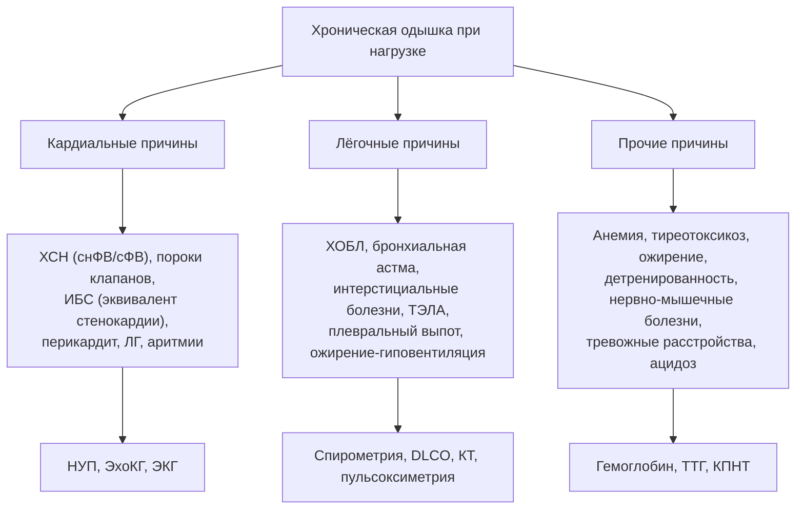

**Рис. 12.** Дифференциальная диагностика хронической одышки. Схема читается сверху вниз: три группы причин и соответствующие им ключевые методы разграничения; при многофакторной одышке у пожилых обследование ведётся параллельно по всем направлениям.

#### 9.1.2. Дифференциальная диагностика отёков

Двусторонние отёки голеней при ХСН следует отличать от отёков при хронической венозной недостаточности (асимметрия, трофические изменения, нормальное яремное давление), приёме дигидропиридиновых блокаторов кальциевых каналов, тиазолидиндионов, НПВП и глюкокортикоидов, при нефротическом синдроме (протеинурия, гипоальбуминемия, периорбитальные отёки), циррозе печени (асцит преобладает над отёками, признаки портальной гипертензии), гипотиреозе (плотные, не оставляющие ямки), лимфедеме, идиопатических циклических отёках. Решающие признаки кардиальных отёков — повышенное яремное венозное давление и повышенные натрийуретические пептиды.

#### 9.1.3. Состояния, имитирующие ХСН или сосуществующие с ней

**Констриктивный перикардит** даёт правожелудочковую картину при нормальной ФВ и нередко нормальных или умеренно повышенных НУП; **рестриктивная кардиомиопатия** (амилоидоз) — сходную клинику с иными ЭхоКГ-признаками (табл. 22). **Высоковыбросная недостаточность** (анемия, тиреотоксикоз, артериовенозные фистулы, бери-бери, болезнь Педжета, цирроз) проявляется застоем при повышенном выбросе и тёплых конечностях. **Лёгочная артериальная гипертензия** и **хроническая тромбоэмболическая ЛГ** вызывают правожелудочковую недостаточность без левосердечной патологии. **Тяжёлая ХБП** с гиперволемией и **нефротический синдром** имитируют застой; при них НУП повышены за счёт сниженного клиренса и объёмной перегрузки, что требует интегральной оценки.

**Табл. 22.** Дифференциальная диагностика констриктивного перикардита и рестриктивной кардиомиопатии.

| Признак | Констриктивный перикардит | Рестриктивная кардиомиопатия |
|---|---|---|
| Анамнез | Перикардит, облучение, кардиохирургия, туберкулёз | Амилоидоз, саркоидоз, гемохроматоз, болезни накопления, семейный анамнез |
| Толщина стенок ЛЖ | Нормальная | Увеличена (при инфильтрации) |
| Перикард | Утолщён/кальцинирован (КТ, МРТ) | Не изменён |
| Дыхательная вариабельность трансмитрального потока | > 25 % | Отсутствует |
| Движение перегородки | «Отскок», дыхательный сдвиг | Нормальное |
| e′ (тканевой допплер) | Нормальная или повышенная («парадокс кольца») | Резко снижена |
| НУП | Нормальные или умеренно повышены | Значительно повышены |
| Инвазивная гемодинамика | Выравнивание диастолических давлений, дискордантность ЛЖ/ПЖ при дыхании | Давление в ЛЖ > ПЖ, конкордантность |
| Лечение | Перикардэктомия | Лечение основного заболевания |

#### 9.1.4. Дифференциальная диагностика внутри синдрома ХСН

После подтверждения ХСН дифференциальная диагностика переходит на уровень этиологии: ишемическая и неишемическая кардиомиопатия, гипертоническое сердце и гипертрофическая кардиомиопатия, амилоидоз и гипертрофия иного генеза, миокардит и ДКМП, тахикардиомиопатия и первичная кардиомиопатия с аритмией, клапанный порок как причина или следствие (функциональная регургитация). Методология описана в разделе 8 и п. 18.1.

### 9.2. Формулировка диагноза

#### 9.2.1. Принципы построения диагноза

В российской практике ХСН указывается как осложнение основного заболевания (ИБС, гипертонической болезни, кардиомиопатии, порока), а не как самостоятельная нозология; исключение — ситуации, когда причину установить не удалось. В формулировке последовательно указывают: категорию ФВ (ХСНнФВ/ХСНунФВ/ХСНсФВ/с улучшенной ФВ), стадию (по РКО 2023: предстадия, 1-я, 2-я стадия; по традиции допустимо указание стадии по Стражеско–Василенко), функциональный класс NYHA, при необходимости — проявления (отёки, гидроторакс, асцит, анасарка), осложнения (ЛГ с ФК по ВОЗ, кардиоренальный синдром, кахексия), имплантированные устройства с датой (табл. 23).

**Табл. 23.** Структура формулировки диагноза и примеры (по РКО 2024).

| Элемент | Содержание | Примеры |
|---|---|---|
| Основное заболевание | Этиология ХСН | «ИБС: постинфарктный кардиосклероз (ИМ 2019)»; «Гипертоническая болезнь II стадии, риск 3»; «Семейная ДКМП» |
| Осложнение: ХСН | Категория ФВ + стадия + ФК (+ проявления) | «ХСНунФВ 1 стадия, 2 ФК»; «ХСНнФВ 2 стадия, 4 ФК, двусторонний гидроторакс, асцит, анасарка» |
| Сопутствующие осложнения | ЛГ, аритмии, кардиоренальный синдром | «ЛГ 1 ФК ВОЗ»; «Постоянная форма ФП» |
| Устройства/вмешательства | Тип и дата | «Имплантация СРТ-Д (2024)» |
| Предстадия | При бессимптомном поражении | «ГБ II ст., риск 3, ГЛЖ, диастолическая дисфункция, предстадия СН» |

#### 9.2.2. Указание фенотипа и динамики

При ХСН с улучшенной ФВ указывают исходную и текущую ФВ (например, «ХСН с улучшенной ФВ (ФВ 28 % в 2023 году, 48 % в 2026 году)»), поскольку это определяет продолжение терапии. При изменении ФК и стадии диагноз обновляется; стадия не пересматривается в сторону уменьшения.

#### 9.2.3. Кодирование по МКБ-10

Для статистического учёта используются коды I50.0 (застойная сердечная недостаточность), I50.1 (левожелудочковая недостаточность) и I50.9 (сердечная недостаточность неуточнённая); в качестве основного кода, как правило, указывается код причинного заболевания (I25, I11, I42 и др.), а ХСН кодируется как осложнение. Подробнее о кодировании и переходе на МКБ-11 — п. 2.5.

### 9.3. Примеры и иллюстрации

#### 9.3.1. Пример полной формулировки диагноза

«ИБС: постинфарктный кардиосклероз (передний ИМ с подъёмом сегмента ST, стентирование ПМЖВ 2022). Осложнения: ХСНнФВ (ФВ 32 %) 1 стадия, 3 ФК; функциональная митральная регургитация 2 степени; ЛГ 2 ФК ВОЗ; пароксизмальная форма ФП, CHA₂DS₂-VASc 4 балла. Сопутствующие: сахарный диабет 2-го типа; ХБП С3а А2.» Такая формулировка содержит этиологию, фенотип, стадию, класс, значимые осложнения и коморбидность, определяющие терапию.

#### 9.3.2. Пример дифференциально-диагностической задачи

Пациент 72 лет с одышкой, отёками, ФВ 62 %, толщиной стенок 15 мм, ИОЛП 45 мл/м², низким вольтажом QRS, синдромом запястного канала в анамнезе, NT-proBNP 3 000 пг/мл. Ключевая развилка — гипертоническое сердце против амилоидоза: несоответствие вольтажа и гипертрофии, внесердечные признаки и несоразмерно высокие НУП требуют сцинтиграфии с пирофосфатом и исключения моноклонального белка до постановки диагноза «гипертоническая болезнь с ХСНсФВ».

> 💡 **Интересный факт:** констриктивный перикардит исторически был преимущественно туберкулёзным («панцирное сердце»), а сегодня в развитых странах его ведущие причины — предшествующие кардиохирургические операции и лучевая терапия на средостение; при этом он остаётся одной из немногих форм «сердечной недостаточности», излечимых хирургически.

> ❗ **Типичная ошибка:** формулировка «ХСН» без указания категории ФВ, стадии и функционального класса или, напротив, «ХСН 0 стадии». Диагноз без фенотипа не позволяет выбрать терапию, а отсутствие симптомов при структурных изменениях обозначается термином «предстадия СН», а не нулевой стадией.

> 🔬 **Углубление:** разграничение констрикции и рестрикции при инвазивном исследовании основано на феномене желудочковой взаимозависимости: при констрикции ригидный перикард фиксирует общий объём сердца, поэтому на вдохе наполнение ПЖ увеличивается за счёт ЛЖ (дискордантные изменения систолического давления в желудочках), а при рестрикции оба желудочка реагируют на дыхание однонаправленно. Показатель «индекс систолической площади» (отношение площадей под кривыми давления ПЖ и ЛЖ на вдохе и выдохе > 1,1) обладает чувствительностью и специфичностью выше 90 % для констрикции по данным клиники Мэйо (Talreja et al., 2008).

> 📝 **Обобщение.** Дифференциальная диагностика ХСН ведётся на трёх уровнях: синдромном (одышка, отёки — лёгочные, почечные, печёночные, эндокринные и лекарственные причины), нозологическом (констрикция, рестрикция, высоковыбросные состояния, ЛГ, ХБП) и этиологическом (причина конкретной ХСН). Формулировка диагноза подчиняется правилу «основное заболевание → осложнение ХСН с категорией ФВ, стадией и ФК → проявления и осложнения → устройства», что обеспечивает преемственность лечения. Главный вывод: правильно сформулированный диагноз — это сжатый план лечения.

> ❓ **Контрольные вопросы**
>
> 1. Какие три исследования наиболее эффективно разграничивают кардиальную и лёгочную одышку и какие паттерны КПНТ характерны для каждой из них?
> 2. Перечислите пять эхокардиографических и гемодинамических признаков, отличающих констриктивный перикардит от рестриктивной кардиомиопатии.
> 3. Назовите лекарственные причины отёков голеней, которые могут имитировать декомпенсацию ХСН.
> 4. Составьте формулировку диагноза для пациента с гипертонической болезнью, ожирением, ФВ 56 %, ИОЛП 40 мл/м², NT-proBNP 700 пг/мл, одышкой при обычной нагрузке и двумя госпитализациями за год.
> 5. Почему термин «ХСН 0 стадии» некорректен и каким термином следует пользоваться?

## 10. Течение, осложнения и прогноз

### 10.1. Естественное течение

#### 10.1.1. Траектория заболевания

Течение ХСН нелинейно: периоды относительной стабильности прерываются эпизодами ухудшения, после каждого из которых функциональное состояние, как правило, не возвращается к исходному уровню, а риск смерти возрастает (рис. 13). В исходе развиваются продвинутая ХСН с рефрактерными симптомами, нарастающей органной дисфункцией и кахексией, либо наступает внезапная смерть на любом этапе — в том числе при умеренных симптомах. Траектория может быть изменена: при устранимой причине и полноценной терапии возможно длительное улучшение (ремиссия).

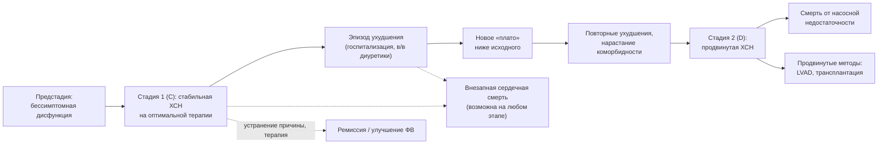

**Рис. 13.** Траектория течения ХСН. Схема читается слева направо: ступенчатое прогрессирование с эпизодами ухудшения, каждый из которых снижает функциональный уровень, при постоянном риске внезапной смерти; пунктирные стрелки обозначают альтернативные исходы — внезапную смерть и ремиссию.

#### 10.1.2. Эпизоды ухудшения как переломные точки

**Ухудшение ХСН** (worsening heart failure) определяется как усиление симптомов, потребовавшее госпитализации, внутривенной диуретической терапии или неотложного визита. В регистрах после первой госпитализации по поводу ХСН медиана выживаемости составляет около 2–3 лет; каждая последующая госпитализация сокращает её, а около 25 % пациентов повторно госпитализируются в течение 30 дней. Период 1–3 месяца после выписки («уязвимый период») характеризуется максимальным риском и требует раннего визита и интенсивной оптимизации терапии (разделы 22, 24).

#### 10.1.3. Фенотипы течения

Выделяют стабильное течение на фоне терапии, медленно прогрессирующее, быстро прогрессирующее (гигантоклеточный миокардит, AL-амилоидоз, ламинопатии), рецидивирующе-декомпенсирующее («частые посетители») и течение с ремиссией. У пациентов с ХСНсФВ прогрессирование определяется в большей степени коморбидностью, а смерть чаще наступает от некардиальных причин.

### 10.2. Осложнения

#### 10.2.1. Нарушения ритма и проводимости; внезапная сердечная смерть

Фибрилляция предсердий встречается у 30–50 % пациентов с ХСН и ухудшает прогноз (потеря предсердного вклада, тахисистолия, тромбоэмболии). Желудочковые тахиаритмии — главный механизм внезапной смерти, доля которой среди всех смертей при ХСНснФВ достигает трети–половины при NYHA II и уменьшается при NYHA IV, где преобладает насосная недостаточность; на фоне современной четырёхкомпонентной терапии годовая частота внезапной смерти снизилась примерно до 1 % и менее у стабильных пациентов (п. 21.1). Брадиаритмии и атриовентрикулярные блокады характерны для инфильтративных и генетических кардиомиопатий.

#### 10.2.2. Тромбоэмболические осложнения

Риск инсульта и системных эмболий повышен при ФП, тромбозе ЛЖ (аневризма, низкая ФВ после переднего инфаркта), тромбозе глубоких вен при гиподинамике и застое. Антикоагуляция показана при ФП (п. 19.4) и тромбе ЛЖ, но не при синусовом ритме без дополнительных показаний (исследования WARCEF, COMMANDER-HF).

#### 10.2.3. Кардиоренальный синдром

Сочетание ХСН и ХБП удваивает риск смерти; ухудшение функции почек при декомпенсации требует различения истинного повреждения и «псевдоухудшения» при эффективной деконгестии (раздел 15, п. 19.2). Стойкое снижение рСКФ ограничивает терапию, усиливает анемию и гиперкалиемию.

#### 10.2.4. Поражение печени, кахексия, анемия и дефицит железа, депрессия

Застойная гепатопатия ведёт к гипоальбуминемии и коагулопатии; **сердечная кахексия** (потеря ≥ 5–6 % массы тела за 6–12 месяцев) и саркопения — независимые предикторы смерти; анемия (у 30–40 %) и дефицит железа (до 50 %) ухудшают симптомы и прогноз; депрессия и когнитивные нарушения снижают приверженность и качество жизни (раздел 19).

#### 10.2.5. Другие осложнения

Лёгочная гипертензия и правожелудочковая недостаточность, плевральный выпот и асцит, застойная гастроэнтеропатия с мальабсорбцией, нарушения дыхания во сне, тромбозы и инфекции, обусловленные устройствами, и ятрогенные осложнения терапии (электролитные нарушения, гипотония, почечная дисфункция) дополняют спектр.

### 10.3. Прогноз и его предикторы

#### 10.3.1. Показатели выживаемости

Пятилетняя выживаемость после установления диагноза в популяционных исследованиях составляет около 50 %, что хуже, чем при многих злокачественных новообразованиях; в России медиана выживаемости при ФК I–II — около 8,4 года, при ФК III–IV — 3,8 года (ЭПОХА; раздел 3). У пациентов, получающих современную четырёхкомпонентную терапию, прогноз существенно лучше: в моделировании на основе данных исследований ожидаемый прирост выживаемости без событий достигает нескольких лет у молодых пациентов (Vaduganathan et al., 2020).

#### 10.3.2. Клинические, инструментальные и лабораторные предикторы

Главные предикторы обобщены в табл. 24. Прогностическая ценность отдельных показателей ограничена, поэтому используются многофакторные модели.

**Табл. 24.** Основные предикторы неблагоприятного прогноза при ХСН.

| Группа | Предикторы |
|---|---|
| Демографические | Пожилой возраст, мужской пол, низкий социально-экономический статус |
| Клинические | Высокий ФК NYHA, повторные госпитализации, низкое АД, тахикардия, III тон, кахексия, стойкий застой при выписке, непереносимость базисной терапии, частые разряды ИКД |
| Инструментальные | Низкая ФВ, большие объёмы ЛЖ, рестриктивное наполнение, дисфункция ПЖ, ЛГ, широкий QRS, фиброз на МРТ, дистанция 6-минутной ходьбы < 300 м, VO₂ peak < 12–14 мл/кг/мин, наклон VE/VCO₂ > 35 |
| Лабораторные | Высокие и не снижающиеся НУП, тропонин, гипонатриемия, снижение рСКФ, повышение мочевины, гипоальбуминемия, повышение билирубина, анемия, дефицит железа, высокий уровень растворимого ST2, галектина-3 |
| Коморбидность | Сахарный диабет, ХБП, ХОБЛ, депрессия, фибрилляция предсердий, онкологические заболевания |

#### 10.3.3. Причины смерти

При ХСНснФВ доминируют сердечно-сосудистые причины — прогрессирование насосной недостаточности и внезапная аритмическая смерть; при ХСНсФВ до 30–40 % смертей обусловлены некардиальными причинами (инфекции, онкология, почечная недостаточность), что объясняет меньший эффект кардиоцентричных вмешательств на общую смертность в этой группе.

### 10.4. Прогностические модели и шкалы

#### 10.4.1. MAGGIC, SHFM и другие шкалы

**MAGGIC** (Meta-Analysis Global Group in Chronic Heart Failure; Pocock et al., 2013) разработана на данных около 39 000 пациентов из 30 исследований и включает 13 переменных (возраст, пол, ФВ, ФК NYHA, систолическое АД, ИМТ, креатинин, диабет, ХОБЛ, курение, давность диагноза, приём бета-адреноблокатора и иАПФ/БРА), предсказывая смерть в течение 1 и 3 лет; применима при любой ФВ. **Сиэтлская модель (SHFM**; Levy et al., 2006) рассчитывает ожидаемую 1-, 2- и 5-летнюю выживаемость и влияние вмешательств (препаратов, устройств) на основе клинических, лабораторных данных и терапии; её недостаток — переоценка выживаемости у наиболее тяжёлых пациентов. Другие модели — BCN Bio-HF (с биомаркерами), 3C-HF, модели для декомпенсации (ADHERE, GWTG-HF, EHMRG) и для продвинутой ХСН (HFSS с VO₂ peak) — суммированы в табл. 25.

**Табл. 25.** Прогностические шкалы при ХСН.

| Шкала | Популяция | Переменные | Исход |
|---|---|---|---|
| MAGGIC | Хроническая ХСН, любая ФВ | 13 клинических и лабораторных | Смерть за 1 и 3 года |
| SHFM (Сиэтлская) | Хроническая ХСН, преимущественно снФВ | Клиника, лаборатория, терапия, устройства | Выживаемость 1–5 лет, эффект вмешательств |
| BCN Bio-HF | Амбулаторная ХСН | Клиника + NT-proBNP, тропонин, ST2 | Смерть 1–5 лет |
| HFSS | Кандидаты на трансплантацию | 7 переменных, включая VO₂ peak | Выживаемость без трансплантации |
| ADHERE, GWTG-HF, EHMRG | Декомпенсация | Мочевина, креатинин, АД, натрий и др. | Госпитальная/7–30-дневная смертность |
| INTERMACS (профили) | Продвинутая ХСН | Клиническая тяжесть | Исходы механической поддержки |

#### 10.4.2. Ограничения и практическое использование шкал

Шкалы дают популяционную вероятность, а не индивидуальное предсказание; они менее точны у пожилых с коморбидностью и не учитывают предпочтения пациента и динамику. Их обоснованное применение — стратификация для направления в центр продвинутой ХСН, обсуждение прогноза с пациентом, планирование паллиативной помощи, отбор в исследования.

### 10.5. Качество жизни и пациент-ориентированные исходы

**KCCQ** (Kansas City Cardiomyopathy Questionnaire; 23 вопроса, сокращённая версия KCCQ-12) оценивает симптомы, физические и социальные ограничения и качество жизни по шкале 0–100 (выше — лучше); изменение на 5 баллов считается минимально значимым, на 10 и 20 — умеренным и большим. **MLHFQ** (Minnesota Living with Heart Failure Questionnaire; 21 вопрос, 0–105 баллов, ниже — лучше) — исторически первый специфичный опросник; изменение на 5 баллов клинически значимо. Оба валидированы на русском языке и используются как конечные точки исследований и инструменты практического мониторинга; показатели KCCQ независимо предсказывают госпитализации и смерть.

### 10.6. Примеры и иллюстрации

#### 10.6.1. Пример расчёта по MAGGIC

Мужчина 72 лет, ФВ 30 %, NYHA III, АД 105 мм рт. ст., ИМТ 22 кг/м², креатинин 160 мкмоль/л, диабет, ХОБЛ, курит, диагноз более 18 месяцев, не получает бета-адреноблокатор, — набирает высокий балл, соответствующий годовой смертности, превышающей 20 %, что является основанием для направления в специализированный центр и обсуждения продвинутых методов и целей помощи.

#### 10.6.2. Пример динамики качества жизни

Пациентка с ХСНсФВ и ожирением: KCCQ-OS 48 баллов исходно; через 6 месяцев после начала дапаглифлозина, оптимизации диуретика и программы тренировок — 67 баллов (прирост 19 баллов — клинически выраженное улучшение), дистанция 6-минутной ходьбы увеличилась с 280 до 360 м.

> 💡 **Интересный факт:** в анализе Vaduganathan и соавт. (2020), объединившем данные EMPHASIS-HF, PARADIGM-HF и DAPA-HF, расчётный выигрыш комплексной четырёхкомпонентной терапии по сравнению с «классической» (иАПФ + бета-адреноблокатор) составил для 55-летнего пациента около 8 лет жизни без сердечно-сосудистой смерти и госпитализации по поводу ХСН, а для 80-летнего — около 2,5 лет.

> ❗ **Типичная ошибка:** считать, что улучшение самочувствия после выписки означает благоприятный прогноз, и откладывать оптимизацию терапии «до стабилизации». Первые 1–3 месяца после госпитализации — период максимального риска; именно в это время требуется наиболее активное титрование препаратов и наблюдение.

> 🔬 **Углубление:** систематические оценки показывают, что калибровка прогностических моделей при ХСН со временем ухудшается (так называемый «дрейф»): модели, построенные до эры АРНИ и ингибиторов НГЛТ-2, переоценивают риск у пациентов, получающих современную терапию, и недооценивают его у пожилых с множественной коморбидностью. Поэтому в ESC и РКО шкалы рекомендованы для стратификации и коммуникации, но не для автоматического отказа от вмешательств; перспективное направление — динамические модели, обновляющие прогноз по данным носимых устройств и повторных биомаркеров.

> 📝 **Обобщение.** ХСН течёт ступенчато: эпизоды ухудшения снижают функциональный уровень и резко повышают риск, внезапная смерть возможна на любом этапе, а исход определяется сочетанием насосной недостаточности, аритмий, кардиоренального синдрома, кахексии и коморбидности. Прогноз оценивается по совокупности клинических, инструментальных и лабораторных предикторов и многофакторным моделям (MAGGIC, SHFM), качество жизни — валидированными опросниками (KCCQ, MLHFQ). Главный вывод: прогноз модифицируем, и наибольший выигрыш даёт ранняя полноценная терапия, особенно в уязвимый период после госпитализации.

> ❓ **Контрольные вопросы**
>
> 1. Почему каждая госпитализация по поводу ХСН рассматривается как переломная точка течения заболевания?
> 2. Как меняется структура причин смерти при переходе от ФК II к ФК IV и от ХСНснФВ к ХСНсФВ?
> 3. Перечислите по три клинических, инструментальных и лабораторных предиктора неблагоприятного прогноза.
> 4. Какие переменные входят в шкалу MAGGIC и в каких ситуациях её применение обосновано?
> 5. Чем различаются опросники KCCQ и MLHFQ по направлению шкалы и какие изменения баллов считаются клинически значимыми?

## 11. Профилактика ХСН

### 11.1. Концепция и уровни профилактики

Профилактика ХСН строится по стадиям: на стадии A (риск) цель — предотвратить структурное поражение сердца; на стадии B (предстадия) — предотвратить появление симптомов; на стадиях C–D — предотвратить декомпенсации, прогрессирование и смерть (вторичная и третичная профилактика). Популяционная (примордиальная) профилактика — контроль массы тела, физическая активность, отказ от курения, снижение потребления соли и алкоголя — уменьшает распространённость факторов риска в целом. Соответствие стадий и вмешательств показано на рис. 14 и в табл. 26.

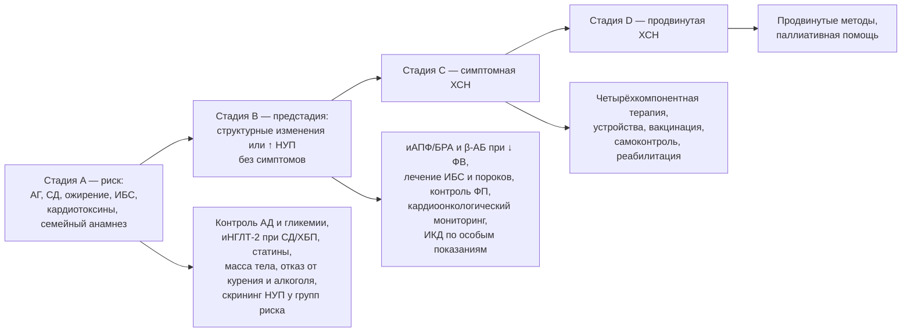

**Рис. 14.** Профилактические вмешательства по стадиям ХСН. Схема читается слева направо: каждая стадия имеет собственный набор мер, цель которых — предотвратить переход на следующую стадию.

### 11.2. Выявление групп риска и скрининг

#### 11.2.1. Группы риска

К группам риска относятся пациенты с артериальной гипертензией, сахарным диабетом, ожирением, ИБС, фибрилляцией предсердий, ХБП, ХОБЛ, перенёсшие кардиотоксичную противоопухолевую терапию, с семейным анамнезом кардиомиопатий, злоупотребляющие алкоголем, а также женщины с осложнённой беременностью (преэклампсия, гестационный диабет).

#### 11.2.2. Скрининг с использованием натрийуретических пептидов

В исследовании **STOP-HF** (Ledwidge et al., 2013) у пациентов с факторами риска измерение BNP и направление лиц с уровнем ≥ 50 пг/мл на ЭхоКГ и в специализированное наблюдение снизило частоту сочетанного исхода «бессимптомная дисфункция ЛЖ + ХСН» примерно на 40 %; в **PONTIAC** (Huelsmann et al., 2013) у пациентов с диабетом 2-го типа и NT-proBNP > 125 пг/мл интенсификация терапии ингибиторами РААС и бета-адреноблокаторами снизила частоту госпитализаций и смерти. На этом основании ESC и АНА/ACC допускают скрининг НУП в группах риска с последующей ЭхоКГ при повышенном уровне; в России подобный скрининг пока не включён в программы диспансеризации, однако ЭхоКГ при гипертензии и ИБС выявляет предстадию.

### 11.3. Вмешательства на стадии A

Контроль АД — наиболее эффективная мера: в исследовании **SPRINT** интенсивный контроль (цель систолического АД < 120 мм рт. ст.) снизил частоту ХСН примерно на 38 % по сравнению со стандартным. Среди классов препаратов диуретики, иАПФ/БРА и бета-адреноблокаторы предупреждают ХСН эффективнее, чем альфа-адреноблокаторы (доксазозин в ALLHAT увеличивал риск). При диабете 2-го типа ингибиторы НГЛТ-2 снижают риск госпитализации по поводу ХСН примерно на 30–35 % (EMPA-REG OUTCOME, CANVAS, DECLARE-TIMI 58), а агонисты рецепторов ГПП-1 влияют преимущественно на атеросклеротические события; напротив, тиазолидиндионы и саксаглиптин повышают риск ХСН и противопоказаны (п. 19.1). Статины снижают риск инфаркта и, следовательно, ишемической ХСН. Снижение массы тела, физическая активность (≥ 150 минут в неделю умеренной интенсивности), отказ от курения, ограничение алкоголя, лечение апноэ сна и своевременное лечение ИБС дополняют стратегию.

**Табл. 26.** Профилактические вмешательства на стадиях A и B и их доказательная основа.

| Вмешательство | Стадия | Ключевые доказательства | Ожидаемый эффект |
|---|---|---|---|
| Интенсивный контроль АД | A | SPRINT, метаанализы | Снижение риска ХСН на ≈ 30–40 % |
| Ингибиторы НГЛТ-2 при СД 2-го типа/ХБП | A | EMPA-REG OUTCOME, CANVAS, DECLARE, DAPA-CKD, EMPA-KIDNEY | Снижение госпитализаций по поводу ХСН на ≈ 30–35 % |
| Статины при высоком риске/ИБС | A | 4S, HPS и др. | Снижение инфаркта и ишемической ХСН |
| Снижение массы тела, физическая активность | A | Наблюдательные данные, SELECT (семаглутид) | Снижение риска ХСН и её событий |
| иАПФ/БРА при бессимптомной дисфункции ЛЖ | B | SOLVD-Prevention (эналаприл), SAVE (каптоприл), TRACE | Снижение развития симптомной ХСН и смертности после инфаркта |
| Бета-адреноблокаторы после инфаркта с ↓ ФВ | B | CAPRICORN (карведилол) | Снижение смертности |
| Своевременная коррекция пороков | B | Рекомендации по клапанным порокам | Предотвращение необратимого ремоделирования |
| Кардиоонкологический мониторинг | A/B | Рекомендации ESC по кардиоонкологии 2022 | Ранняя кардиопротекция |

### 11.4. Вмешательства на стадии B

При бессимптомной систолической дисфункции ЛЖ (ФВ ≤ 40 %) показаны иАПФ (или БРА при непереносимости) и, после инфаркта миокарда, бета-адреноблокаторы: в **SOLVD-Prevention** эналаприл снизил частоту развития симптомной ХСН и госпитализаций, в **SAVE** и **TRACE** иАПФ после инфаркта снизили смертность, в **CAPRICORN** карведилол снизил смертность после инфаркта с дисфункцией ЛЖ. Ингибиторы НГЛТ-2 обсуждаются и на стадии B, но прямых доказательств у бессимптомных пациентов без диабета недостаточно. ИКД для первичной профилактики у бессимптомных пациентов не показан (исключение — генетические кардиомиопатии с высоким аритмическим риском). Контроль частоты и ритма при ФП, реваскуляризация по показаниям, лечение гипертензии с регрессом гипертрофии и своевременное хирургическое лечение пороков предотвращают переход к симптомной стадии. Пациенты с предстадией нуждаются в наблюдении с повторной ЭхоКГ.

### 11.5. Профилактика кардиотоксичности и ХСН при особых воздействиях

Перед антрациклинами, трастузумабом, ингибиторами протеасом и другими кардиотоксичными препаратами проводится базовая оценка риска (ЭхоКГ с GLS, НУП, тропонин, факторы риска), а при высоком риске — кардиопротекция (иАПФ/БРА, бета-адреноблокаторы, статины; дексразоксан при высоких кумулятивных дозах антрациклинов, липосомальные формы) с мониторингом в процессе лечения (п. 20.5). Профилактика алкогольной и токсической кардиомиопатии сводится к отказу от воздействия; при беременности у женщин высокого риска — к наблюдению и планированию (п. 20.4).

### 11.6. Профилактика декомпенсаций у пациентов с установленной ХСН

Третичная профилактика включает полноценную базисную терапию, вакцинацию (против гриппа ежегодно, пневмококковой инфекции, COVID-19 — вакцинация против гриппа ассоциирована со снижением смертности и госпитализаций, рандомизированное исследование IVVE подтвердило снижение событий в сезоны активности гриппа), отказ от препаратов, провоцирующих задержку жидкости (НПВП, глюкокортикоиды, тиазолидиндионы), обучение самоконтролю (раздел 13), контроль коморбидности и структурированное наблюдение (раздел 24).

### 11.7. Примеры и иллюстрации

#### 11.7.1. Пример профилактики на стадии A

Мужчина 58 лет с гипертонией (150/95 мм рт. ст. на одном препарате), диабетом 2-го типа (HbA1c 8 %), ИМТ 33 кг/м², рСКФ 68 мл/мин/1,73 м², альбуминурия А2. Профилактическая стратегия: усиление антигипертензивной терапии до целевого АД < 130/80 мм рт. ст., добавление ингибитора НГЛТ-2 (снижение риска ХСН и прогрессирования ХБП), статин, программа снижения массы тела, ЭхоКГ и NT-proBNP для выявления предстадии.

#### 11.7.2. Пример профилактики на стадии B

Женщина 49 лет через 3 месяца после переднего инфаркта миокарда: ФВ 38 %, симптомов нет. Назначаются иАПФ (или АРНИ при соответствующих критериях), бета-адреноблокатор, статин, антиагреганты; обсуждается ингибитор НГЛТ-2; ЭхоКГ повторяется через 3 месяца для решения вопроса об ИКД при сохранении ФВ ≤ 35 % после оптимальной терапии (не ранее 40 дней после инфаркта и 90 дней после реваскуляризации).

> 💡 **Интересный факт:** в исследовании SPRINT эффект интенсивного контроля АД на частоту сердечной недостаточности оказался больше, чем на частоту инфаркта и инсульта, — именно предотвращённые случаи ХСН обеспечили значительную часть снижения комбинированной конечной точки, что подчёркивает гипертензию как главный модифицируемый фактор риска ХСН.

> ❗ **Типичная ошибка:** назначать пациенту с диабетом и высоким сердечно-сосудистым риском сахароснижающую терапию без учёта влияния на риск ХСН — например, тиазолидиндионы или саксаглиптин, увеличивающие частоту госпитализаций, вместо ингибиторов НГЛТ-2, которые её снижают.

> 🔬 **Углубление:** концепция «предстадии» и стратегия скрининга по НУП опираются на доказательства того, что бессимптомная дисфункция ЛЖ встречается не реже симптомной ХСН и несёт сопоставимый риск; в популяционных исследованиях (например, в округе Олмстед, США) бессимптомная систолическая дисфункция выявлялась примерно у 2 % взрослых, а диастолическая — ещё чаще. Экономическое моделирование по данным STOP-HF показало, что скрининг НУП с последующей ЭхоКГ у пациентов с факторами риска является затратно-эффективным, однако внедрение сдерживается организационными барьерами и необходимостью обеспечить дальнейшее ведение выявленных пациентов.

> 📝 **Обобщение.** Профилактика ХСН стадийна: на стадии A решающее значение имеют контроль АД (снижение риска ХСН на треть и более), ингибиторы НГЛТ-2 при диабете и ХБП, статины, масса тела и образ жизни; на стадии B — иАПФ/БРА и бета-адреноблокаторы при сниженной ФВ, лечение ИБС, пороков и ФП, кардиоонкологический мониторинг; на стадиях C–D — предотвращение декомпенсаций (терапия, вакцинация, самоконтроль, отказ от провоцирующих препаратов). Скрининг натрийуретических пептидов в группах риска с последующей ЭхоКГ снижает частоту развития ХСН. Главный вывод: большинство случаев ХСН предотвратимо, а предстадия — окно для вмешательства.

> ❓ **Контрольные вопросы**
>
> 1. Какие вмешательства на стадии A имеют наиболее убедительные доказательства снижения риска ХСН и каков их ориентировочный эффект?
> 2. Опишите дизайн и результат исследования STOP-HF и его значение для скрининга.
> 3. Какие препараты показаны пациенту с бессимптомной систолической дисфункцией ЛЖ после инфаркта миокарда и на основании каких исследований?
> 4. Какие сахароснижающие препараты увеличивают риск ХСН, а какие снижают?
> 5. Перечислите меры третичной профилактики (предотвращения декомпенсаций) у пациента с установленной ХСН.

## 12. Цели и принципы лечения ХСН

### 12.1. Цели лечения

#### 12.1.1. Иерархия целей

Цели лечения ХСН выстраиваются в иерархию: (1) снижение смертности — общей, сердечно-сосудистой и внезапной; (2) предотвращение госпитализаций и эпизодов ухудшения; (3) уменьшение симптомов, улучшение функционального состояния и качества жизни; (4) замедление или обращение ремоделирования и прогрессирования; (5) предупреждение и лечение осложнений и коморбидности; (6) на поздних стадиях — облегчение страданий и уважение предпочтений пациента. Цели не исключают друг друга: современная базисная терапия улучшает одновременно выживаемость, симптомы и качество жизни, тогда как симптоматические средства (диуретики, дигоксин) влияют на самочувствие и госпитализации, но не на смертность.

#### 12.1.2. Конечные точки исследований и их клиническое значение

В клинических исследованиях используют комбинированную первичную точку «сердечно-сосудистая смерть или госпитализация по поводу ХСН», общую смертность, повторные события (recurrent events), пациент-ориентированные исходы (KCCQ), суррогатные маркеры (NT-proBNP, ФВ, объёмы ЛЖ) и иерархические композитные показатели (выигрышное отношение, win ratio). Для практики важно различать эффект на смертность (доказан для четырёх классов при ХСНснФВ) и эффект на госпитализации и симптомы (доказан для большего числа вмешательств, включая терапию ХСНсФВ).

### 12.2. Принципы терапии

#### 12.2.1. Этиотропный, патогенетический и симптоматический подходы

Этиотропная терапия устраняет причину (реваскуляризация, коррекция порока, абляция тахиаритмии, отказ от токсина, специфическая терапия амилоидоза, лечение гипертиреоза); патогенетическая прерывает нейрогормональные и клеточные порочные круги (четыре базисных класса, устройства); симптоматическая устраняет застой и симптомы (диуретики, дигоксин, вазодилататоры). Полноценное лечение сочетает все три уровня; симптоматическая терапия без патогенетической — ошибка, патогенетическая без поиска причины — неполнота.

#### 12.2.2. Доказательность, фенотип-ориентированность и индивидуализация

Выбор вмешательств основан на рандомизированных исследованиях, стратифицированных по ФВ, стадии и этиологии (раздел 27); при этом рекомендации применяются к конкретному пациенту с учётом возраста, коморбидности, функции почек, АД, ЧСС, переносимости, ожидаемой продолжительности жизни и предпочтений. Классы рекомендаций и уровни доказательности, принятые в документах ESC и РКО, приведены в табл. 27.

**Табл. 27.** Классы рекомендаций и уровни доказательности (ESC) и их российские аналоги.

| Категория | Содержание | Российский аналог (РКО) |
|---|---|---|
| Класс I | Доказано/общепризнано: польза и эффективность — «рекомендуется» | Уровень убедительности рекомендаций (УУР) A |
| Класс IIa | Данные свидетельствуют в пользу — «следует рассмотреть» | УУР B |
| Класс IIb | Польза менее установлена — «можно рассмотреть» | УУР C |
| Класс III | Не полезно, может быть вредно — «не рекомендуется» | Указание «не рекомендуется» |
| Уровень A | Несколько РКИ или метаанализы | Уровень достоверности доказательств (УДД) 1–2 |
| Уровень B | Одно РКИ или крупные нерандомизированные исследования | УДД 2–3 |
| Уровень C | Консенсус экспертов, малые исследования, регистры | УДД 4–5 |

#### 12.2.3. Ранний старт и одновременность базисной терапии

Польза каждого из четырёх базисных классов при ХСНснФВ проявляется в течение первых недель (для ингибиторов НГЛТ-2 и АРНИ — в первые 30 дней), эффекты аддитивны и не зависят от последовательности назначения. Поэтому современный принцип — начинать все четыре класса в низких дозах быстро (в идеале до выписки из стационара) и титровать параллельно, а не последовательно доводить каждый препарат до целевой дозы перед добавлением следующего (п. 14.7). ESC 2026 рекомендуют повышение доз каждые 1–2 недели при переносимости.

#### 12.2.4. Комплексность и мультидисциплинарность

Лечение включает медикаментозную терапию, устройства и вмешательства, немедикаментозные меры, обучение, реабилитацию, лечение коморбидности, психосоциальную поддержку и, при необходимости, паллиативную помощь; его обеспечивает мультидисциплинарная команда (кардиолог, терапевт, медицинская сестра, реабилитолог, диетолог, фармацевт, психолог, при необходимости нефролог, эндокринолог, гериатр) с чётко организованной преемственностью между стационаром и амбулаторным звеном (раздел 24).

#### 12.2.5. Участие пациента и совместное принятие решений

Приверженность к сложной многокомпонентной терапии и самоконтроль невозможны без информированного участия пациента и семьи; решения о продвинутых методах и об ограничении вмешательств принимаются совместно с учётом ценностей пациента (разделы 13, 25, 26).

### 12.3. Структура терапии в зависимости от фенотипа

Общая схема принятия решений показана на рис. 15. При ХСНснФВ основу составляют четыре базисных класса (АРНИ/иАПФ, бета-адреноблокатор, АМКР, ингибитор НГЛТ-2) плюс диуретики при застое, далее — дополнительные препараты и устройства по показаниям. При ХСНсФВ фундаментальная терапия — ингибитор НГЛТ-2 и АМКР (ESC 2026), диуретики, лечение гипертензии, ожирения, ФП и иной коморбидности. При любой ФВ — этиотропное лечение, образование, реабилитация и структурированное наблюдение.

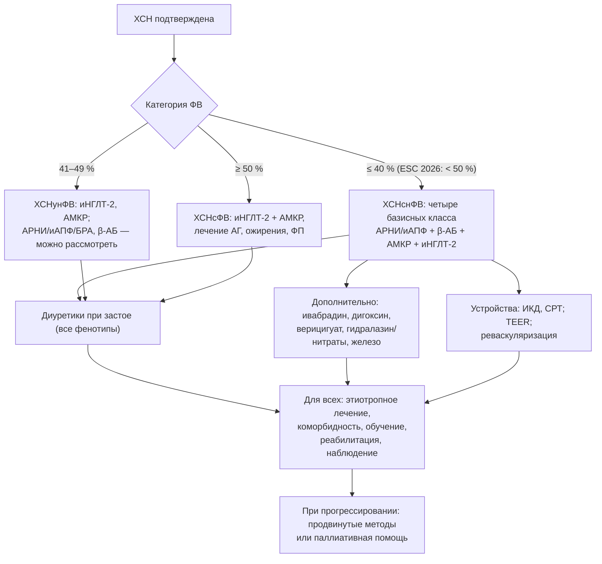

**Рис. 15.** Общая схема принятия решений при лечении ХСН. Схема читается сверху вниз: категория ФВ определяет состав базисной терапии, диуретики и общие меры применяются при любом фенотипе, а при прогрессировании рассматриваются продвинутые методы.

### 12.4. Принципы безопасности терапии

Назначение и титрование препаратов сопровождаются контролем АД, ЧСС, калия, креатинина и симптомов; небольшое повышение креатинина (до 30–50 %) и калия (до 5,5 ммоль/л) при старте ингибиторов РААС и АМКР допустимо и не требует отмены; гипотония без симптомов — не повод отменять терапию, а повод пересмотреть дозу диуретика и препараты, не влияющие на прогноз. Полипрагмазия и лекарственные взаимодействия у пожилых требуют регулярного пересмотра листа назначений (раздел 16, 20).

### 12.5. Примеры и иллюстрации

#### 12.5.1. Пример постановки целей

Пациент 60 лет с впервые выявленной ХСНснФВ (ФВ 25 %), NYHA III. Цели на 3 месяца: устранить застой; начать и довести до целевых или максимально переносимых доз четыре базисных класса; достичь ФК II; обучить самоконтролю; выполнить коронарографию и решить вопрос о реваскуляризации; через 3 месяца оптимальной терапии переоценить ФВ для решения об ИКД/СРТ.

#### 12.5.2. Пример индивидуализации

Пациентка 86 лет с ХСНсФВ, ХБП С4, когнитивными нарушениями и падениями: цели смещаются к контролю симптомов, предотвращению госпитализаций и безопасности — ингибитор НГЛТ-2 (с учётом рСКФ), осторожное дозирование диуретика, отказ от строгих целей АД, упрощение схемы приёма, вовлечение родственников.

> 💡 **Интересный факт:** в объединённом анализе EMPHASIS-HF, PARADIGM-HF и DAPA-HF (Vaduganathan et al., 2020) расчётное снижение относительного риска сердечно-сосудистой смерти или госпитализации при переходе от терапии «иАПФ + бета-адреноблокатор» к полной четырёхкомпонентной составило около 62 %, а общей смертности — около 47 %; подобный выигрыш не даёт ни одно отдельно взятое вмешательство в кардиологии.

> ❗ **Типичная ошибка:** откладывать назначение АМКР и ингибитора НГЛТ-2 «до достижения целевой дозы» иАПФ и бета-адреноблокатора. Последовательное титрование занимает полгода и более, за которые пациент не получает защитного эффекта двух классов; современная стратегия — одновременный старт низких доз всех четырёх классов.

> 🔬 **Углубление:** исследование **STRONG-HF** (2022) рандомизировало пациентов, госпитализированных с декомпенсацией, к стратегии быстрого титрования базисной терапии до 100 % целевых доз в течение 2 недель после выписки с четырьмя визитами и контролем НУП против обычного ведения; исследование было остановлено досрочно из-за снижения на 34 % частоты смерти или повторной госпитализации к 180-му дню и улучшения качества жизни при приемлемой частоте побочных эффектов. Результаты легли в основу рекомендаций ESC 2023/2026 о раннем интенсивном титровании и частых визитах в уязвимый период.

> 📝 **Обобщение.** Цели лечения ХСН — снижение смертности, предотвращение госпитализаций, улучшение симптомов и качества жизни, обращение ремоделирования, контроль осложнений и уважение предпочтений пациента; они достигаются сочетанием этиотропного, патогенетического и симптоматического подходов на основе доказательств с индивидуализацией. Ключевые принципы: ранний одновременный старт базисных классов с быстрым титрованием, фенотип-ориентированный выбор, мультидисциплинарность, безопасность и участие пациента. Главный вывод: отсрочка полноценной терапии — упущенная выгода, измеряемая годами жизни.

> ❓ **Контрольные вопросы**
>
> 1. Расположите цели лечения ХСН в порядке приоритета и укажите, какие классы препаратов влияют на каждую из них.
> 2. Чем различаются этиотропный, патогенетический и симптоматический подходы? Приведите примеры каждого.
> 3. Что означают класс рекомендаций IIa и уровень доказательности B?
> 4. Почему современные рекомендации отказались от последовательного титрования базисных препаратов в пользу одновременного старта?
> 5. Какие изменения лабораторных показателей при старте ингибиторов РААС допустимы и не требуют отмены препарата?

## 13. Немедикаментозное лечение и самоконтроль

### 13.1. Обучение пациента и самоконтроль

#### 13.1.1. Содержание обучения

Структурированное обучение (индивидуальное и групповое, в «школах ХСН», с печатными и цифровыми материалами) охватывает: природу заболевания и его течение; названия, назначение и побочные эффекты препаратов; ежедневное взвешивание и ведение дневника; распознавание ранних признаков декомпенсации; гибкий режим диуретиков; ограничение соли; физическую активность; препараты и ситуации, которых следует избегать; когда и к кому обращаться. Обучение повторяется при каждом визите и вовлекает членов семьи; его эффективность в снижении госпитализаций подтверждена метаанализами программ самопомощи (self-care).

#### 13.1.2. Ежедневное взвешивание и «правило светофора»

Пациент взвешивается ежедневно утром после туалета до завтрака в одной и той же одежде и действует по заранее согласованному плану (рис. 16): прибавка более 2 кг за 3 дня (или более 1–1,5 кг за сутки) либо нарастание одышки и отёков — сигнал к увеличению дозы диуретика по схеме и связи с медицинской сестрой или врачом; одышка в покое, обморок, боль в груди — повод для неотложной помощи. Гибкий режим диуретиков по весу и симптомам снижает частоту госпитализаций и является частью программ самоконтроля.

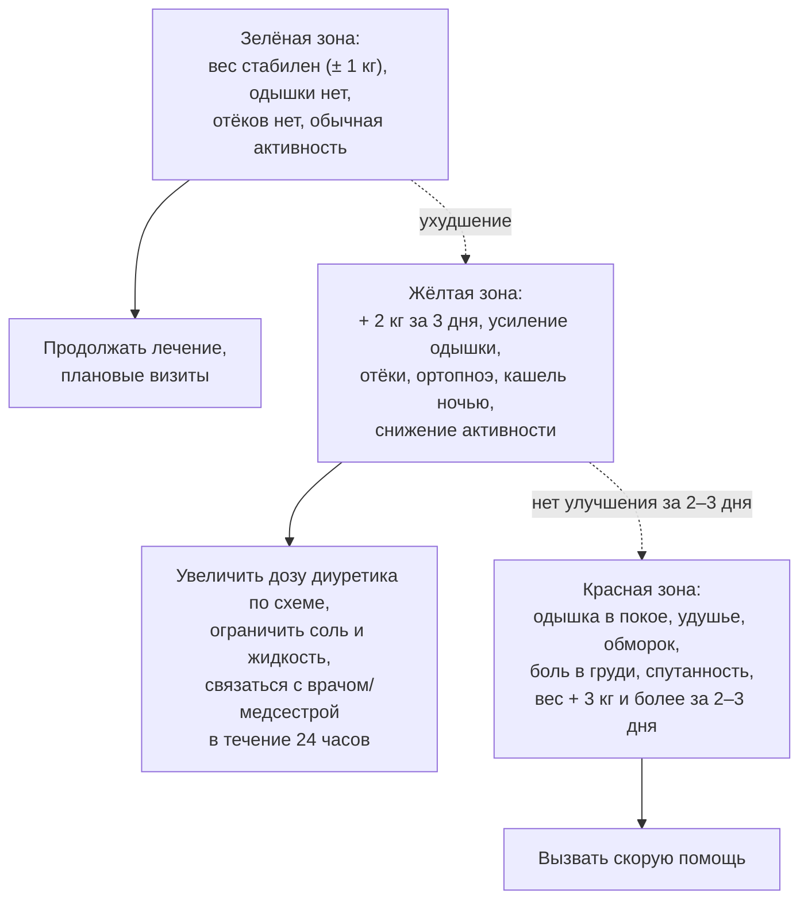

**Рис. 16.** «Правило светофора» для самоконтроля пациента с ХСН. Схема читается сверху вниз внутри каждой зоны: признаки зоны определяют действия; переход между зонами показан пунктиром.

#### 13.1.3. Приверженность

Приверженность к терапии при ХСН составляет в среднем 50–70 % и снижается с числом препаратов, стоимостью, побочными эффектами, депрессией и когнитивными нарушениями. Меры: упрощение схемы (комбинированные препараты, однократный приём), таблетницы и напоминания, участие фармацевта, обсуждение барьеров, вовлечение семьи, телемониторинг.

### 13.2. Диета и питьевой режим

#### 13.2.1. Ограничение натрия

Рекомендуется избегать избыточного потребления соли (более 5 г NaCl, то есть около 2 г натрия, в сутки) и скрытых источников натрия (полуфабрикаты, консервы, хлеб, сыры, соусы, шипучие таблетки). Жёсткое ограничение (< 1,5 г натрия) не доказало пользы: в исследовании **SODIUM-HF** (2022) снижение потребления натрия до менее 1 500 мг не уменьшило частоту смерти и госпитализаций, хотя несколько улучшило качество жизни и ФК. У пациентов с частыми декомпенсациями и резистентностью к диуретикам ограничение соли строже (п. 15.6).

#### 13.2.2. Жидкость

Рутинное ограничение жидкости у стабильных пациентов не требуется; ограничение до 1,5–2 л/сут обосновано при тяжёлой ХСН с застоем, гипонатриемии и резистентности к диуретикам. В жаркую погоду, при рвоте и диарее режим корректируется, чтобы избежать гиповолемии.

#### 13.2.3. Алкоголь, кофеин, питание

При алкогольной кардиомиопатии показана полная абстиненция; остальным — не более 1–2 стандартных доз в день с днями воздержания (многие эксперты рекомендуют минимизацию). Умеренное потребление кофе безопасно. Питание должно обеспечивать достаточное количество белка (1–1,2 г/кг, при кахексии больше) и калорий; средиземноморский и DASH-типы питания ассоциированы с меньшим риском ХСН. При кахексии — нутритивная поддержка, при ожирении с ХСНсФВ — снижение массы тела (п. 13.4). Коррекция дефицита витаминов (тиамин при длительном приёме петлевых диуретиков и алкоголе) и микроэлементов — по показаниям.

### 13.3. Физическая активность и тренировки

Регулярные аэробные тренировки умеренной интенсивности (ходьба, велоэргометр, 30–45 минут 3–5 раз в неделю с постепенным наращиванием) в сочетании с силовыми упражнениями низкой интенсивности и тренировкой дыхательных мышц рекомендованы всем стабильным пациентам (класс I): они улучшают переносимость нагрузки, качество жизни и снижают госпитализации (HF-ACTION, метаанализы ExTraMATCH). Тренировки противопоказаны при декомпенсации, нестабильной стенокардии, неконтролируемых аритмиях, активном миокардите, тяжёлом аортальном стенозе. Начало тренировок желательно в условиях реабилитационной программы (раздел 23).

### 13.4. Масса тела и ожирение

При ожирении (особенно при ХСНсФВ) снижение массы тела улучшает симптомы, переносимость нагрузки и уменьшает NT-proBNP; в исследованиях **STEP-HFpEF** и **SUMMIT** семаглутид и тирзепатид улучшали KCCQ и дистанцию ходьбы, а тирзепатид снижал частоту ухудшений ХСН, что отражено в ESC 2026 (класс IIa). При ХСНснФВ преднамеренное умеренное снижение массы тела допустимо, но непреднамеренная потеря массы — признак кахексии и неблагоприятный прогностический фактор («парадокс ожирения» объясняется, прежде всего, обратной причинностью). Бариатрическая хирургия обсуждается при морбидном ожирении.

### 13.5. Курение, сон, путешествия, сексуальная активность, вакцинация

Полный отказ от курения и других форм потребления никотина обязателен. При обструктивном апноэ сна показана CPAP-терапия; адаптивная сервовентиляция при центральном апноэ у пациентов с ХСНснФВ противопоказана (повышение смертности в SERVE-HF). Авиаперелёты допустимы для стабильных пациентов (ФК I–III); пребывание на высоте более 1 500–2 000 м и в жарком влажном климате требует осторожности; в поездку берут запас препаратов и выписку. Сексуальная активность безопасна при переносимости нагрузки 3–5 МЕТ (подъём на 2 этажа); ингибиторы ФДЭ-5 допустимы при отсутствии нитратов. Вакцинация против гриппа ежегодно, против пневмококковой инфекции и COVID-19 рекомендована всем пациентам.

### 13.6. Препараты и воздействия, которых следует избегать

Ряд широко используемых препаратов провоцирует декомпенсацию или противопоказан при ХСНснФВ (табл. 28); пациент должен быть информирован о необходимости согласовывать любые новые назначения, включая безрецептурные.

**Табл. 28.** Лекарственные средства, способные ухудшать течение ХСН.

| Группа | Препараты | Механизм/риск |
|---|---|---|
| НПВП и коксибы | Диклофенак, ибупрофен, целекоксиб и др. | Задержка натрия и воды, снижение эффекта диуретиков и иАПФ, ухудшение функции почек |
| Недигидропиридиновые блокаторы кальциевых каналов | Верапамил, дилтиазем | Отрицательный инотропный эффект при ХСНснФВ |
| Тиазолидиндионы | Пиоглитазон | Задержка жидкости |
| Ингибиторы ДПП-4 (отдельные) | Саксаглитин | Увеличение госпитализаций по поводу ХСН (SAVOR-TIMI 53) |
| Антиаритмики I класса, дронедарон | Флекаинид, пропафенон; дронедарон при ФК III–IV | Проаритмия, повышение смертности (CAST, ANDROMEDA) |
| Глюкокортикоиды, минералокортикоиды | Преднизолон, флудрокортизон | Задержка натрия |
| Трициклические антидепрессанты, некоторые нейролептики | Амитриптилин, клозапин | Аритмии, гипотония, миокардит (клозапин) |
| Противоопухолевые препараты | Антрациклины, трастузумаб, ингибиторы протеасом, некоторые ингибиторы тирозинкиназ | Кардиотоксичность |
| Прочие | Миноксидил, цилостазол, итраконазол, альфа-адреноблокаторы, прегабалин, шипучие формы с натрием, ряд БАД (солодка, эфедра) | Задержка жидкости, аритмии, гипотония |

### 13.7. Психосоциальная поддержка

Скрининг депрессии и тревоги (например, опросники PHQ-9, HADS), когнитивных нарушений, социальной изоляции и финансовых барьеров входит в стандарт ведения; когнитивно-поведенческая терапия и, при необходимости, селективные ингибиторы обратного захвата серотонина (сертралин, эсциталопрам — безопасны, но не влияют на прогноз) улучшают качество жизни и приверженность (п. 19.9).

### 13.8. Примеры и иллюстрации

#### 13.8.1. Пример плана самоконтроля

Пациент с ХСНснФВ получает письменный план: «сухой вес» 82 кг; ежедневное взвешивание; при весе ≥ 84 кг или нарастании одышки — дополнительно 40 мг фуросемида утром в течение 3 дней и звонок медсестре; при весе ≥ 85 кг, одышке в покое — скорая помощь; список запрещённых препаратов; дата следующего визита и телефон кабинета ХСН.

#### 13.8.2. Пример коррекции образа жизни

Пациентка 64 лет с ХСНсФВ и ИМТ 38 кг/м²: ограничение соли до 5 г, программа ходьбы 30 минут 5 раз в неделю с постепенным увеличением, снижение массы тела на 5–10 % за 6 месяцев (при доступности — агонист рецепторов ГПП-1), CPAP при подтверждённом апноэ сна, вакцинация, отказ от НПВП по поводу остеоартроза в пользу местных средств и парацетамола.

> 💡 **Интересный факт:** первым рандомизированным исследованием, показавшим снижение смертности при немедикаментозном вмешательстве у пациентов с ХСН, стало исследование Rich и соавт. (1995): мультидисциплинарная программа обучения, диетического консультирования и наблюдения медсестрой после выписки снизила повторные госпитализации пожилых пациентов на 44 % за 90 дней — задолго до появления большинства современных препаратов.

> ❗ **Типичная ошибка:** назначать всем пациентам с ХСН бессолевую диету и ограничение жидкости до 1 литра. Избыточно жёсткие ограничения не улучшают исходы (SODIUM-HF), снижают качество жизни и аппетит, способствуют кахексии и гипонатриемии у пожилых, а также подрывают доверие к остальным рекомендациям; ограничение жидкости обосновано лишь при гипонатриемии и тяжёлом застое.

> 🔬 **Углубление:** исследование **HF-ACTION** (2009; 2 331 пациент с ХСНснФВ) показало, что аэробные тренировки снижают скорректированный риск смерти или госпитализации на 11 % и улучшают качество жизни, причём эффект зависел от объёма выполненных тренировок; при этом приверженность к тренировкам в домашних условиях уже через год падала ниже половины рекомендованного объёма. Метаанализы (ExTraMATCH II) подтверждают улучшение переносимости нагрузки и качества жизни при любой ФВ, а появление высокоинтенсивных интервальных протоколов и дистанционных программ направлено на преодоление проблемы приверженности.

> 📝 **Обобщение.** Немедикаментозное лечение — не «дополнение», а условие эффективности терапии: структурированное обучение и самоконтроль (ежедневное взвешивание, «правило светофора», гибкий режим диуретиков), разумное ограничение соли без избыточных диетических запретов, регулярные физические тренировки, контроль массы тела (включая фармакологическое снижение при ХСНсФВ с ожирением), отказ от курения, лечение апноэ сна, вакцинация, избегание провоцирующих препаратов (НПВП, недигидропиридиновые антагонисты кальция, тиазолидиндионы и др.) и психосоциальная поддержка снижают частоту госпитализаций и улучшают качество жизни. Главный вывод: обученный и вовлечённый пациент — главный участник лечебной команды.

> ❓ **Контрольные вопросы**
>
> 1. Какие элементы должен включать письменный план самоконтроля пациента с ХСН?
> 2. Какую прибавку массы тела считают сигналом начинающейся декомпенсации и как пациент должен на неё реагировать?
> 3. Что показало исследование SODIUM-HF и как это изменило рекомендации по ограничению соли?
> 4. Перечислите пять групп препаратов, способных спровоцировать декомпенсацию, и объясните механизмы.
> 5. Каковы показания и противопоказания к физическим тренировкам при ХСН?

## 14. Базисная медикаментозная терапия ХСН со сниженной фракцией выброса

### 14.1. Концепция четырёхкомпонентной (фундаментальной) терапии

#### 14.1.1. Четыре класса и их мишени

Базисную терапию ХСНснФВ составляют четыре класса, каждый из которых снижает смертность и госпитализации независимо от остальных: (1) ингибиторы РААС — ангиотензиновых рецепторов и неприлизина ингибитор (АРНИ, предпочтительно) либо иАПФ, при непереносимости — БРА; (2) бета-адреноблокаторы; (3) антагонисты минералокортикоидных рецепторов (АМКР); (4) ингибиторы натрий-глюкозного котранспортёра 2-го типа (иНГЛТ-2). В ESC 2026 эта комбинация названа **фундаментальной медикаментозной терапией** (FMT), в РКО 2024 — четырёхкомпонентной (квадро-) терапией. Их патогенетические мишени различны и взаимодополняющи (рис. 17): они размыкают нейрогормональный, гемодинамический, кардиоренальный и метаболический порочные круги (п. 5.7.6).

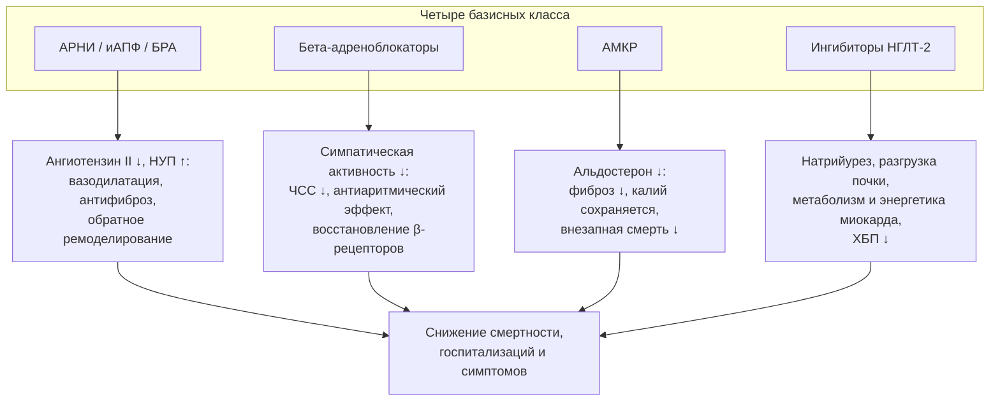

**Рис. 17.** Патогенетические мишени четырёх базисных классов терапии ХСНснФВ. Схема читается сверху вниз: каждый класс воздействует на собственное звено патогенеза, а их эффекты аддитивны.

#### 14.1.2. Доказательная база

Ключевые исследования суммированы в табл. 29; подробно их дизайн обсуждается в разделе 27.

**Табл. 29.** Ключевые рандомизированные исследования базисной терапии ХСНснФВ.

| Класс | Исследование (год) | Препарат | Основной результат |
|---|---|---|---|
| иАПФ | CONSENSUS (1987) | Эналаприл | Снижение смертности на 40 % за 6 мес при ФК IV |
| иАПФ | SOLVD-Treatment (1991) | Эналаприл | Снижение смертности на 16 % |
| БРА | CHARM-Alternative (2003), Val-HeFT (2001) | Кандесартан, валсартан | Снижение СС-смерти/госпитализаций при непереносимости иАПФ |
| АРНИ | PARADIGM-HF (2014) | Сакубитрил/валсартан vs эналаприл | Снижение СС-смерти/госпитализаций на 20 %, общей смертности на 16 % |
| β-АБ | CIBIS-II (1999) | Бисопролол | Снижение смертности на 34 % |
| β-АБ | MERIT-HF (1999) | Метопролол сукцинат | Снижение смертности на 34 % |
| β-АБ | COPERNICUS (2001) | Карведилол | Снижение смертности на 35 % при тяжёлой ХСН |
| β-АБ | SENIORS (2005) | Небиволол | Снижение смерти/СС-госпитализаций у пациентов ≥ 70 лет на 14 % |
| АМКР | RALES (1999) | Спиронолактон | Снижение смертности на 30 % при ФК III–IV |
| АМКР | EMPHASIS-HF (2011) | Эплеренон | Снижение СС-смерти/госпитализаций на 37 % при ФК II |
| иНГЛТ-2 | DAPA-HF (2019) | Дапаглифлозин | Снижение ухудшения ХСН/СС-смерти на 26 % |
| иНГЛТ-2 | EMPEROR-Reduced (2020) | Эмпаглифлозин | Снижение СС-смерти/госпитализаций на 25 % |

### 14.2. Ингибиторы ренин-ангиотензин-альдостероновой системы

#### 14.2.1. Ингибиторы АПФ и блокаторы рецепторов ангиотензина II

иАПФ снижают образование ангиотензина II и деградацию брадикинина, уменьшая вазоконстрикцию, задержку натрия, гипертрофию и фиброз. Они показаны всем пациентам с ХСНснФВ, если не назначен АРНИ; БРА — при непереносимости иАПФ (кашель, ангионевротический отёк) и АРНИ. Начинают с низких доз (табл. 30), удваивая каждые 1–2 недели до целевой или максимально переносимой; целевые дозы обеспечивают больший эффект на госпитализации (ATLAS). Противопоказания: ангионевротический отёк в анамнезе, двусторонний стеноз почечных артерий, беременность, калий > 5,5 ммоль/л, симптомная гипотония. Повышение креатинина до 50 % от исходного (или до 266 мкмоль/л) и калия до 5,5 ммоль/л допустимо.

#### 14.2.2. Ангиотензиновых рецепторов и неприлизина ингибитор (сакубитрил/валсартан)

Сакубитрил/валсартан сочетает блокаду АТ1-рецепторов с ингибированием неприлизина, повышая уровень натрийуретических пептидов, брадикинина и адреномедуллина (п. 5.3.3). В **PARADIGM-HF** он превзошёл эналаприл по снижению сердечно-сосудистой смерти и госпитализаций (на 20 %), общей смертности (на 16 %) и внезапной смерти; в **PIONEER-HF** инициация в стационаре после стабилизации была безопасной и снижала NT-proBNP быстрее. АРНИ рекомендован как предпочтительный ингибитор РААС, в том числе у пациентов, ранее не получавших иАПФ (de novo). Правила: отмена иАПФ за 36 часов до старта (риск ангионевротического отёка), стартовая доза 49/51 мг два раза в день (24/26 мг при систолическом АД 100–110 мм рт. ст., рСКФ < 30 мл/мин/1,73 м², у «наивных» и пожилых), целевая — 97/103 мг два раза в день; контроль BNP на фоне АРНИ не информативен (использовать NT-proBNP). Противопоказания — как для иАПФ, плюс совместное применение с иАПФ.

### 14.3. Бета-адреноблокаторы

Доказательства получены для четырёх препаратов: бисопролола, карведилола, метопролола сукцината замедленного высвобождения и небиволола (у пожилых); другие бета-адреноблокаторы (атенолол, метопролол тартрат) не доказали эффекта при ХСН и не должны использоваться как замена. Назначаются всем стабильным пациентам с ХСНснФВ, начиная с минимальной дозы с удвоением каждые 1–2 недели («начинать с малого, идти медленно»); в начале титрования возможно временное ухудшение самочувствия, которое не является основанием для отмены. Старт при декомпенсации с застоем откладывают до её устранения, но пациентам, уже получающим препарат, при декомпенсации без гипоперфузии терапию продолжают, при необходимости снизив дозу (отмена ухудшает прогноз). Противопоказания: кардиогенный шок, атриовентрикулярная блокада II–III степени без кардиостимулятора, синдром слабости синусового узла, симптомная брадикардия < 50 в минуту, тяжёлая бронхиальная астма (ХОБЛ не является противопоказанием; предпочтительны β1-селективные препараты). Польза не зависит от исходной ЧСС, но достигнутая ЧСС < 70 в минуту при синусовом ритме ассоциирована с лучшим прогнозом.

### 14.4. Антагонисты минералокортикоидных рецепторов

Спиронолактон (RALES) и эплеренон (EMPHASIS-HF, EPHESUS после инфаркта) снижают смертность, включая внезапную, и госпитализации; рекомендованы всем пациентам с ХСНснФВ при калии ≤ 5,0 ммоль/л и рСКФ ≥ 30 мл/мин/1,73 м². Начинают с 12,5–25 мг спиронолактона или 25 мг эплеренона, повышая до 25–50 мг через 4–8 недель; калий и креатинин контролируют через 1 и 4 недели после старта и каждого повышения дозы, затем через 8 и 12 недель, 6, 9 и 12 месяцев и далее каждые 4 месяца. При калии 5,5–5,9 ммоль/л дозу уменьшают вдвое, при ≥ 6,0 — отменяют до нормализации; калийсвязывающие препараты (патиромер, циркония циклосиликат натрия) позволяют продолжать АМКР при склонности к гиперкалиемии (DIAMOND). Гинекомастия и мастодиния (около 10 % при спиронолактоне) — повод для перехода на эплеренон. Финеренон (нестероидный АМКР) исследован при ХСН с ФВ ≥ 40 % (п. 17.3).

### 14.5. Ингибиторы натрий-глюкозного котранспортёра 2-го типа

Дапаглифлозин 10 мг и эмпаглифлозин 10 мг один раз в день снижали в **DAPA-HF** и **EMPEROR-Reduced** сердечно-сосудистую смерть и госпитализации примерно на 25 % независимо от наличия диабета, с эффектом уже в первый месяц; эффективны при рСКФ до 20–25 мл/мин/1,73 м² и замедляют снижение функции почек. Механизмы многокомпонентны: натрийурез и осмотический диурез с преимущественным уменьшением интерстициального объёма, снижение внутриклубочкового давления (тубулогломерулярная обратная связь), повышение гематокрита, улучшение энергетики миокарда (кетоны), снижение симпатической активности, воспаления, фиброза и активности Na⁺/H⁺-обменника. Титрования не требуется, что делает класс удобным для раннего старта, в том числе в стационаре (EMPULSE). Безопасность: обратимое начальное снижение рСКФ на 3–5 мл/мин, генитальные микотические инфекции, редко — эугликемический кетоацидоз (отменять при острых заболеваниях, голодании, перед операциями — «правила больного дня»), гиповолемия (при эуволемии уменьшить дозу петлевого диуретика); не применяются при диабете 1-го типа. Сотаглифлозин (ингибитор НГЛТ-1/2) показал эффективность при старте вскоре после декомпенсации у пациентов с диабетом (SOLOIST-WHF).

**Табл. 30.** Стартовые и целевые дозы базисных препаратов при ХСНснФВ (для взрослых; по данным РКО 2024 и ESC).

| Препарат | Стартовая доза | Целевая доза |
|---|---|---|
| Сакубитрил/валсартан | 49/51 мг × 2 (24/26 мг × 2 при АД 100–110, рСКФ < 30, у «наивных») | 97/103 мг × 2 |
| Эналаприл | 2,5 мг × 2 | 10–20 мг × 2 |
| Лизиноприл | 2,5–5 мг × 1 | 20–35 мг × 1 |
| Рамиприл | 2,5 мг × 1 | 10 мг × 1 (или 5 мг × 2) |
| Периндоприл | 2 мг × 1 | 8 мг × 1 |
| Каптоприл | 6,25 мг × 3 | 50 мг × 3 |
| Кандесартан | 4–8 мг × 1 | 32 мг × 1 |
| Валсартан | 40 мг × 2 | 160 мг × 2 |
| Лозартан | 50 мг × 1 | 150 мг × 1 |
| Бисопролол | 1,25 мг × 1 | 10 мг × 1 |
| Карведилол | 3,125 мг × 2 | 25 мг × 2 (50 мг × 2 при массе > 85 кг) |
| Метопролол сукцинат (CR/XL) | 12,5–25 мг × 1 | 200 мг × 1 |
| Небиволол | 1,25 мг × 1 | 10 мг × 1 |
| Спиронолактон | 12,5–25 мг × 1 | 25–50 мг × 1 |
| Эплеренон | 25 мг × 1 | 50 мг × 1 |
| Дапаглифлозин | 10 мг × 1 | 10 мг × 1 |
| Эмпаглифлозин | 10 мг × 1 | 10 мг × 1 |

### 14.6. Инициация, титрование и мониторинг

#### 14.6.1. Стратегия одновременного старта и быстрого титрования

Все четыре класса начинают в низких дозах в течение нескольких дней (в стационаре — после стабилизации гемодинамики и до выписки), затем титруют до целевых доз с визитами каждые 1–2 недели в течение первых 6–8 недель (рис. 18). Предложенная McMurray и Packer (2021) последовательность — бета-адреноблокатор и иНГЛТ-2, затем АРНИ, затем АМКР в течение четырёх недель — одна из возможных; порядок определяется профилем пациента: при гипотонии первыми назначают препараты с минимальным влиянием на АД (иНГЛТ-2, АМКР), при тахикардии — бета-адреноблокатор, при гиперкалиемии откладывают АМКР, при застое начинают с иНГЛТ-2 и диуретика. Стратегия быстрого титрования с контролем клиники и NT-proBNP подтверждена STRONG-HF (п. 12.2.3).

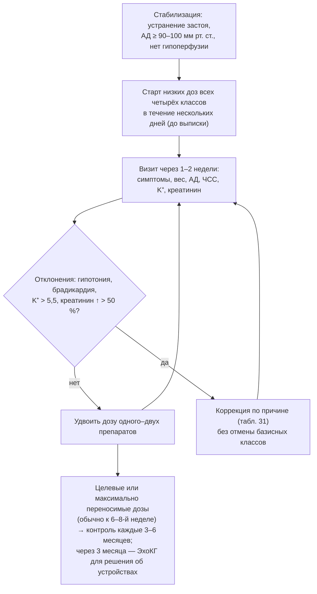

**Рис. 18.** Алгоритм титрования базисной терапии ХСНснФВ. Схема читается сверху вниз: после стабилизации все классы начинают в низких дозах и повышают каждые 1–2 недели, а отклонения параметров корригируются без отмены терапии (табл. 31).

**Табл. 31.** Тактика при отклонениях показателей во время титрования базисной терапии.

| Отклонение | Тактика |
|---|---|
| Гипотония без симптомов (САД 90–100 мм рт. ст.) | Продолжать терапию; при эуволемии уменьшить дозу диуретика; отменить препараты без влияния на прогноз (нитраты, блокаторы кальциевых каналов, альфа-адреноблокаторы); разнести приём препаратов по времени суток |
| Симптомная гипотония, головокружение | Исключить гиповолемию; временно снизить дозу ингибитора РААС или β-АБ (не обоих сразу); титровать медленнее |
| Калий 5,5–5,9 ммоль/л | Уменьшить дозу АМКР вдвое; исключить НПВП, калиевые добавки и заменители соли; рассмотреть калийсвязывающие препараты; повторить анализ через 1–2 недели |
| Калий ≥ 6,0 ммоль/л | Временно отменить АМКР (и при необходимости ингибитор РААС), найти причину, возобновить после нормализации |
| Повышение креатинина до 50 % от исходного (или до 266 мкмоль/л) | Допустимо; контроль через 1–2 недели; исключить дегидратацию и нефротоксины |
| Повышение креатинина > 50 % (или > 266 мкмоль/л; рСКФ < 25) | Уменьшить дозу ингибитора РААС/АМКР вдвое, исключить стеноз почечных артерий, обструкцию, НПВП |
| Брадикардия < 50 в минуту или АВ-блокада II–III степени | Снизить дозу β-АБ; отменить дигоксин, ивабрадин, другие брадикардитические средства; при сохранении — ЭКС (п. 21.3) |
| Усиление одышки, прибавка массы тела после старта β-АБ | Временно увеличить дозу диуретика; не отменять β-АБ; при необходимости вернуться к предыдущей дозе |
| Утомляемость в начале титрования β-АБ | Как правило, преходяща; разъяснить пациенту, титровать медленнее |

#### 14.6.2. Мониторинг

На каждом визите оценивают симптомы, массу тела, АД (в том числе ортостатически), ЧСС, калий, натрий, креатинин/рСКФ; NT-proBNP — при выписке и через 1–3 месяца. Через 3–6 месяцев оптимальной терапии повторяют ЭхоКГ: сохранение ФВ ≤ 35 % определяет показания к ИКД и СРТ (раздел 21), улучшение ФВ > 40 % переводит пациента в категорию улучшенной ФВ с продолжением терапии.

#### 14.6.3. Терапия в особых клинических ситуациях

При систолическом АД 90–100 мм рт. ст. без симптомов терапию продолжают, отдавая приоритет классам с меньшим гипотензивным эффектом; при ХБП С3б–4 используют иНГЛТ-2 (рСКФ ≥ 20), АРНИ (≥ 30, с осторожностью ниже), АМКР (≥ 30), бета-адреноблокаторы без ограничений; у пожилых титруют медленнее, но целевые дозы не менее важны; при декомпенсации базисную терапию продолжают (кроме случаев шока, тяжёлой гипотонии, гиперкалиемии и острого повреждения почек), а иНГЛТ-2 можно начинать в стационаре. Пациентам с ХСНунФВ назначение этих же классов можно рассмотреть (раздел 17), а в ESC 2026 они рекомендованы как FMT при любой ФВ < 50 %.

### 14.7. Примеры и иллюстрации

#### 14.7.1. Пример титрования

Мужчина 62 лет, ФВ 28 %, после устранения застоя: АД 118/74 мм рт. ст., ЧСС 92, калий 4,4 ммоль/л, рСКФ 62. День 1–3: дапаглифлозин 10 мг, бисопролол 1,25 мг, сакубитрил/валсартан 49/51 мг × 2, спиронолактон 12,5 мг; фуросемид 40 мг. Неделя 2: АД 108/70, ЧСС 80, калий 4,7 — бисопролол 2,5 мг, спиронолактон 25 мг. Неделя 4: АД 104/68, креатинин +15 % — сакубитрил/валсартан 97/103 мг × 2, фуросемид снижен до 20 мг. Неделя 6: ЧСС 72 — бисопролол 5 мг; неделя 8: бисопролол 7,5 мг. К 3 месяцам достигнуты целевые или максимально переносимые дозы; ЭхоКГ: ФВ 36 % — обсуждение ИКД при сохранении ФВ ≤ 35 % при повторной оценке.

#### 14.7.2. Пример решения проблемы гиперкалиемии

Пациентка с ХСНснФВ и ХБП С3б, калий 5,7 ммоль/л на фоне АРНИ и спиронолактона 25 мг: исключён приём НПВП и калийсодержащих заменителей соли, доза спиронолактона снижена до 12,5 мг, добавлен патиромер, продолжен иНГЛТ-2 (снижает риск гиперкалиемии); через 2 недели калий 4,9 ммоль/л — АМКР возвращён к 25 мг.

> 💡 **Интересный факт:** исследование CONSENSUS (1987) включило всего 253 пациента с ХСН IV класса и было остановлено досрочно: смертность за 6 месяцев в группе эналаприла была ниже на 40 %, а абсолютное снижение составило 18 процентных пунктов — один из крупнейших эффектов, когда-либо зарегистрированных для лекарственного препарата, что положило начало эпохе доказательной терапии ХСН.

> ❗ **Типичная ошибка:** отмена бета-адреноблокатора или ингибитора РААС при бессимптомной гипотонии (например, 95/60 мм рт. ст.) или при повышении креатинина на 20–30 %. Эти изменения ожидаемы и не ухудшают прогноз, тогда как отмена препаратов, снижающих смертность, его ухудшает; правильная тактика — уменьшить дозу диуретика при эуволемии, отменить препараты без прогностической пользы (нитраты, блокаторы кальциевых каналов, альфа-адреноблокаторы) и продолжить титрование.

> 🔬 **Углубление:** одной из гипотез эффекта иНГЛТ-2, не связанных с гликемией, является модуляция почечной обратной связи: восстановление доставки натрия к плотному пятну повышает тонус приносящей артериолы и снижает внутриклубочковую гипертензию, что проявляется начальным «провалом» рСКФ и долгосрочной нефропротекцией (DAPA-CKD, EMPA-KIDNEY). Кроме того, иНГЛТ-2 вызывают сдвиг к окислению кетоновых тел, повышают гематокрит (вероятно, за счёт восстановления продукции эритропоэтина перитубулярными клетками) и снижают активность кардиального Na⁺/H⁺-обменника, что уменьшает перегрузку кардиомиоцитов натрием и кальцием; суммарный эффект не воспроизводится ни одним другим диуретиком.

> 📝 **Обобщение.** Базисная терапия ХСНснФВ — четыре класса: АРНИ (предпочтительно) или иАПФ/БРА, бета-адреноблокатор (бисопролол, карведилол, метопролол сукцинат, небиволол), АМКР (спиронолактон, эплеренон) и иНГЛТ-2 (дапаглифлозин, эмпаглифлозин), каждый из которых снижает смертность и госпитализации; их начинают одновременно в низких дозах и быстро титруют до целевых с контролем АД, ЧСС, калия и креатинина, не отменяя при ожидаемых бессимптомных отклонениях. Главный вывод: полнота и дозы базисной терапии — главный модифицируемый детерминант прогноза при ХСНснФВ.

> ❓ **Контрольные вопросы**
>
> 1. Назовите четыре базисных класса терапии ХСНснФВ, по одному ключевому исследованию и ориентировочный эффект каждого.
> 2. Какие правила следует соблюдать при переводе пациента с иАПФ на сакубитрил/валсартан и почему?
> 3. Какие бета-адреноблокаторы доказали эффективность при ХСН, с каких доз их начинают и как титруют?
> 4. Опишите схему мониторинга калия и креатинина при назначении АМКР и тактику при калии 5,7 ммоль/л.
> 5. Перечислите механизмы действия ингибиторов НГЛТ-2 при ХСН и основные меры безопасности при их назначении.

## 15. Диуретическая терапия

### 15.1. Место диуретиков в лечении ХСН

Диуретики — единственный класс, быстро устраняющий симптомы и признаки застоя; они рекомендованы (класс I) всем пациентам с признаками задержки жидкости при любой ФВ. Их влияние на смертность в рандомизированных исследованиях не изучалось (отказ от диуретиков при застое неэтичен); сравнение торасемида и фуросемида (**TRANSFORM-HF**, 2023) не выявило различий в смертности. Цель — достичь и поддерживать **эуволемию** минимально эффективной дозой: избыточная дегидратация активирует нейрогормональные системы, снижает АД и функцию почек и препятствует титрованию базисной терапии, а недостаточная оставляет застой — главный предиктор повторных госпитализаций.

### 15.2. Классы диуретиков и точки их действия

Точки приложения диуретиков в нефроне представлены на рис. 19, характеристики — в табл. 32. **Петлевые диуретики** (фуросемид, торасемид, буметанид) блокируют котранспортёр Na⁺-K⁺-2Cl⁻ в толстом восходящем колене петли Генле, где реабсорбируется 20–25 % профильтрованного натрия, — это основа терапии застоя. **Тиазидные и тиазидоподобные** (гидрохлоротиазид, хлорталидон, индапамид, метолазон) блокируют Na⁺-Cl⁻-котранспортёр дистального канальца (5–8 % натрия); самостоятельно слабы при ХСН и сниженной СКФ, но потенцируют петлевые. **АМКР** и **амилорид** действуют в собирательных трубочках (2–3 % натрия), сберегая калий. **Ацетазоламид** ингибирует карбоангидразу проксимального канальца; **иНГЛТ-2** блокируют реабсорбцию натрия и глюкозы там же; **антагонисты вазопрессина** (толваптан) вызывают акварез без натрийуреза.

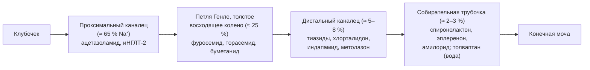

**Рис. 19.** Точки действия диуретиков в нефроне и доля реабсорбируемого натрия в каждом сегменте. Схема читается слева направо по ходу канальца: блокада нескольких сегментов одновременно («последовательная блокада нефрона») преодолевает компенсаторное усиление реабсорбции в нижележащих отделах.

**Табл. 32.** Основные диуретики при ХСН: дозы и фармакокинетические особенности.

| Препарат | Стартовая доза внутрь | Обычная поддерживающая/максимальная доза | Биодоступность, длительность действия | Примечания |
|---|---|---|---|---|
| Фуросемид | 20–40 мг | 40–240 мг/сут (в 1–2 приёма); при ХБП выше | 10–90 % (вариабельна, снижается при отёке кишечника); 4–6 ч | Эквивалент: 40 мг внутрь ≈ 20 мг в/в |
| Торасемид | 5–10 мг | 10–40 мг/сут (до 200 мг) | 80–100 %; 12–16 ч | 20 мг ≈ 40 мг фуросемида; антиальдостероновый эффект |
| Буметанид | 0,5–1 мг | 1–5 мг/сут | 80–100 %; 4–6 ч | 1 мг ≈ 40 мг фуросемида |
| Гидрохлоротиазид | 12,5–25 мг | 25–100 мг | Малоэффективен при рСКФ < 30 | Потенцирование петлевых |
| Хлорталидон | 12,5–25 мг | 25–100 мг | Длительное действие (24–72 ч) | Риск гипокалиемии, гипонатриемии |
| Индапамид | 1,5–2,5 мг | 2,5–5 мг | — | Метаболически нейтрален |
| Метолазон | 2,5 мг | 2,5–10 мг | Эффективен при низкой СКФ | Выраженные электролитные нарушения (в РФ не зарегистрирован) |
| Ацетазоламид | 250–500 мг (в/в в ADVOR) | 250–500 мг/сут, короткие курсы | — | Метаболический ацидоз; эффективен при алкалозе |
| Толваптан | 7,5–15 мг | 15–30 мг | — | Гипонатриемия; контроль скорости коррекции натрия |

### 15.3. Фармакология петлевых диуретиков

Петлевые диуретики — «пороговые» препараты: натрийурез начинается только при достижении пороговой концентрации в канальцевой жидкости (куда они секретируются органическими анионными транспортёрами), после чего эффект быстро достигает «потолка»; при ХСН и ХБП кривая доза–эффект смещена вправо и вниз, поэтому требуются большие дозы, а увеличение частоты приёма эффективнее, чем кратности превышения потолка. После окончания действия наступает **постдиуретическая задержка натрия** (ретенция), и при высоком потреблении соли суточный баланс остаётся положительным; при длительном применении развивается **феномен торможения** — гипертрофия дистальных канальцев с усиленной реабсорбцией. Отсюда вытекают правила: приём 2 раза в день для фуросемида при высоких дозах, ограничение соли, добавление тиазида при резистентности. Пероральная биодоступность фуросемида непостоянна и снижается при отёке стенки кишечника, что объясняет преимущество внутривенного введения при декомпенсации и торасемида при амбулаторной терапии.

### 15.4. Принципы дозирования и амбулаторного ведения

Дозу подбирают до достижения «сухого веса», затем снижают до минимальной, поддерживающей эуволемию; у части пациентов с улучшением на базисной терапии (особенно иНГЛТ-2 и АРНИ) диуретик удаётся отменить. Пациент обучается гибкому режиму по весу и симптомам (п. 13.1.2). Контроль электролитов и креатинина проводится через 1–2 недели после изменения дозы. Хроническое назначение высоких доз без переоценки застоя — частая причина гиповолемии, гипотонии и преренального повреждения почек.

### 15.5. Резистентность к диуретикам

#### 15.5.1. Определение и причины

> 📌 **Определение:** **резистентность к диуретикам** — неспособность достичь адекватной деконгестии несмотря на применение возрастающих доз петлевого диуретика (ориентир — отсутствие ответа на ≥ 80 мг фуросемида внутрь в сутки или эквивалент).

Причины и способы их устранения приведены в табл. 33. Среди них — неприверженность и избыток соли, НПВП, нарушение всасывания при застое в кишечнике, гипоальбуминемия, снижение СКФ и почечного кровотока, гипотония и низкий выброс, нейрогормональная активация, адаптация дистального нефрона, гипохлоремия (хлорид необходим для работы котранспортёров и регуляции ренина).

**Табл. 33.** Причины резистентности к диуретикам и подходы к их устранению.

| Причина | Решение |
|---|---|
| Неприверженность, избыточное потребление соли | Обучение, оценка суточной экскреции натрия, ограничение соли до < 5 г |
| НПВП, другие препараты, задерживающие натрий | Отмена |
| Нарушение всасывания (отёк кишечника) | Переход на в/в введение или торасемид |
| Недостаточная доза/частота | Удвоение дозы до достижения эффекта; приём 2 раза в день; в/в болюсы или инфузия |
| Снижение СКФ | Увеличение дозы петлевого диуретика (эффект требует более высокой концентрации в канальце) |
| Адаптация дистального нефрона | Добавление тиазида/метолазона или ацетазоламида (последовательная блокада) |
| Гипоальбуминемия, нефротический синдром | Коррекция причины; альбумин — ограниченные данные |
| Гипотония, низкий выброс | Инотропная поддержка, коррекция доз вазодилататоров |
| Гипохлоремический алкалоз | Ацетазоламид; восполнение хлорида |
| Истинно рефрактерный застой | Ультрафильтрация; оценка для продвинутых методов |

#### 15.5.2. Последовательная блокада нефрона и доказательные подходы

При недостаточном ответе на петлевой диуретик добавляют препарат с другой точкой действия. В **ADVOR** (2022) добавление ацетазоламида 500 мг в/в к петлевому диуретику при декомпенсации увеличило частоту успешной деконгестии на 3-й день (42 против 31 %) без влияния на смертность; в **CLOROTIC** (2023) добавление гидрохлоротиазида усиливало диурез и снижение веса ценой большей частоты ухудшения функции почек и гипокалиемии. иНГЛТ-2 усиливают натрийурез и позволяют снизить дозу петлевых диуретиков. Гипертонический раствор натрия хлорида в сочетании с высокими дозами фуросемида и ультрафильтрация остаются резервными методами (п. 22.6). Алгоритм ведения резистентного застоя представлен на рис. 20.

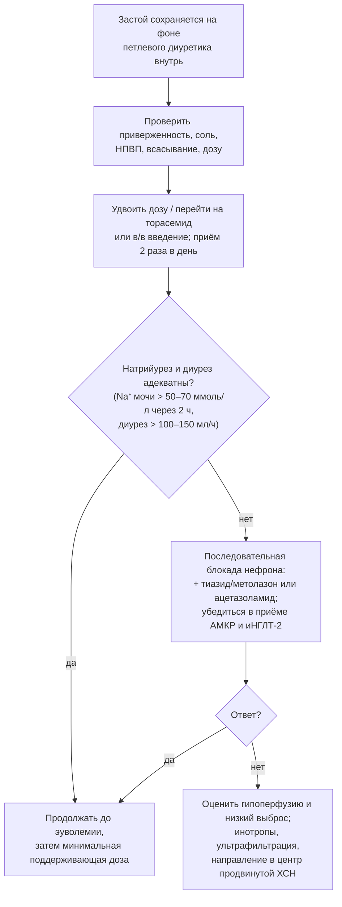

**Рис. 20.** Алгоритм действий при резистентности к диуретикам. Схема читается сверху вниз: сначала устраняются устранимые причины и оптимизируется петлевой диуретик, затем добавляются препараты с иной точкой действия, и лишь при неэффективности применяются резервные методы.

### 15.6. Контроль эффективности и безопасности

Эффективность оценивают по массе тела, диурезу, динамике симптомов и признаков застоя (яремное давление, отёки, B-линии), а при декомпенсации — по раннему натрийуретическому ответу: концентрация натрия в разовой порции мочи через 2 часа после введения диуретика > 50–70 ммоль/л и диурез > 100–150 мл/ч за первые 6 часов предсказывают успешную деконгестию (алгоритм HFA/ESC 2021). Побочные эффекты: гипокалиемия и гипомагниемия (аритмогенны; требуют восполнения), гипонатриемия (чаще тиазиды), гиперурикемия и подагра, метаболический алкалоз, гипотония, преренальное повышение креатинина, ототоксичность при быстром внутривенном введении высоких доз фуросемида, дислипидемия и гипергликемия при тиазидах. Небольшое повышение креатинина при эффективной деконгестии («псевдоухудшение») не ухудшает прогноз, в отличие от сохраняющегося застоя.

### 15.7. Примеры и иллюстрации

#### 15.7.1. Пример амбулаторной коррекции

Пациент с ХСНснФВ и прибавкой 3 кг за 4 дня, одышкой при малой нагрузке, отёками: фуросемид увеличен с 40 до 80 мг (в два приёма) на 3 дня, ограничена соль, через 3 дня вес вернулся к «сухому», доза снижена до 40 мг; калий 3,6 ммоль/л — назначен калий и проверена доза АМКР. Госпитализация предотвращена.

#### 15.7.2. Пример резистентности к диуретикам

Пациентка с ХСНсФВ, ХБП С3б, принимает ибупрофен по поводу артроза; фуросемид 120 мг внутрь без эффекта. Шаги: отмена ибупрофена, переход на торасемид 40 мг, добавление гидрохлоротиазида 25 мг под контролем электролитов, дапаглифлозин; через неделю вес снизился на 4 кг, креатинин вырос на 15 % при исчезновении отёков — расценено как допустимое, терапия продолжена с переходом на поддерживающие дозы.

> 💡 **Интересный факт:** торасемид, в отличие от фуросемида, частично блокирует эффекты альдостерона и в небольших исследованиях (TORIC) снижал фиброз миокарда и госпитализации, что породило многолетние ожидания его прогностического превосходства; однако прагматичное рандомизированное исследование TRANSFORM-HF (2 859 пациентов, 2023) не выявило различий в смертности между препаратами, подтвердив, что выбор петлевого диуретика определяется фармакокинетикой и удобством, а не влиянием на прогноз.

> ❗ **Типичная ошибка:** добавлять тиазид «для усиления» без увеличения дозы петлевого диуретика при сниженной СКФ или, наоборот, многократно повышать дозу фуросемида, не проверив приверженность, потребление соли и приём НПВП. Последовательная блокада нефрона эффективна лишь после достижения адекватной дозы петлевого диуретика и требует контроля калия и натрия каждые 1–3 дня.

> 🔬 **Углубление:** концепция «ранней оценки натрийуретического ответа» основана на том, что концентрация натрия в моче через 1–2 часа после болюса петлевого диуретика отражает достигнутую канальцевую концентрацию препарата и состояние нефрона: значение < 50–70 ммоль/л предсказывает недостаточный суточный натрийурез (< 100 ммоль) и неблагоприятные исходы (ter Maaten et al., 2015; Verbrugge). В исследовании **PUSH-AHF** (2023) стратегия, управляемая натрием мочи, увеличила натрийурез и диурез в первые сутки, хотя не повлияла на клинические исходы к 180 дню, что отражает сложность перевода физиологического маркёра в прогностическую пользу.

> 📝 **Обобщение.** Диуретики устраняют застой и улучшают симптомы при любой ФВ, но не влияют на смертность; основа терапии — петлевые диуретики (фуросемид, торасемид) в минимальной дозе, поддерживающей эуволемию, с гибким режимом по весу. Резистентность требует последовательного устранения причин (приверженность, соль, НПВП, всасывание, доза), затем последовательной блокады нефрона (тиазид, ацетазоламид) при обязательном приёме АМКР и иНГЛТ-2, а контроль эффективности строится на массе тела, клинике и раннем натрийуретическом ответе. Главный вывод: цель диуретической терапии — эуволемия, а не «максимальный диурез».

> ❓ **Контрольные вопросы**
>
> 1. Объясните понятия «пороговый препарат», «потолок эффекта», «постдиуретическая задержка натрия» и их практические следствия.
> 2. Сравните фуросемид и торасемид по биодоступности, длительности действия и влиянию на прогноз.
> 3. Перечислите причины резистентности к диуретикам и предложите последовательность действий при её выявлении.
> 4. Что такое последовательная блокада нефрона и какие исследования поддерживают применение ацетазоламида и гидрохлоротиазида?
> 5. По каким показателям оценивают эффективность диуретической терапии при декомпенсации и когда повышение креатинина не требует прекращения деконгестии?

## 16. Дополнительная фармакотерапия и безопасность лечения

### 16.1. Препараты второй линии при ХСНснФВ

#### 16.1.1. Ивабрадин

Ивабрадин селективно ингибирует If-ток синусового узла, снижая ЧСС без влияния на сократимость и АД. В **SHIFT** (2010) у пациентов с ХСНснФВ (ФВ ≤ 35 %), синусовым ритмом и ЧСС ≥ 70 в минуту на фоне максимально переносимой дозы бета-адреноблокатора он снизил частоту сердечно-сосудистой смерти или госпитализации на 18 % (за счёт госпитализаций). Показан при сохранении ЧСС ≥ 70 в минуту на синусовом ритме при целевой или максимальной переносимой дозе бета-адреноблокатора либо при его непереносимости; при ФП неэффективен. Доза 5 мг два раза в день с повышением до 7,5 мг (у пожилых — с 2,5 мг); побочные эффекты — брадикардия, фосфены, фибрилляция предсердий; противопоказан с сильными ингибиторами CYP3A4 (азолы, макролиды, верапамил, дилтиазем).

#### 16.1.2. Дигоксин и дигитоксин

Сердечные гликозиды ингибируют Na⁺/K⁺-АТФазу (положительный инотропный эффект), повышают тонус вагуса и снижают симпатическую активность. В **DIG** (1997) дигоксин не влиял на смертность, но снижал госпитализации по поводу ХСН; низкие концентрации (0,5–0,9 нг/мл) ассоциированы с лучшими исходами, высокие — с повышенной смертностью. Показания: сохранение симптомов при ХСНснФВ на фоне полной базисной терапии (ESC 2026 — класс IIa у отобранных пациентов), контроль частоты при ФП с ХСН в дополнение к бета-адреноблокатору. Доза 0,125–0,25 мг/сут (0,0625–0,125 мг у пожилых и при ХБП), контроль концентрации, калия, магния и функции почек. Исследование **DIGIT-HF** (дигитоксин при ХСНснФВ, 2025) [⚠️ Требуется верификация: окончательные результаты и величина эффекта]. Токсичность: тошнота, нарушения зрения, брадиаритмии и желудочковые аритмии, усиливающиеся при гипокалиемии; взаимодействия с амиодароном, верапамилом, дронедароном, ингибиторами P-гликопротеина (снижать дозу вдвое).

#### 16.1.3. Верицигуат

Верицигуат — стимулятор растворимой гуанилатциклазы, восстанавливающий сигнальный путь NO–цГМФ. В **VICTORIA** (2020) у пациентов с ХСНснФВ (ФВ < 45 %) после недавнего эпизода ухудшения он снизил частоту сердечно-сосудистой смерти или госпитализации на 10 % (абсолютно — 4,2 события на 100 пациенто-лет). Показан после недавней декомпенсации при сохранении симптомов на фоне базисной терапии (класс IIb). Доза 2,5 мг с удвоением каждые 2 недели до 10 мг; побочные эффекты — гипотония, анемия; противопоказан с другими стимуляторами гуанилатциклазы, нежелателен с ингибиторами ФДЭ-5 и нитратами. Исследование **VICTOR** (2025) у более стабильных пациентов [⚠️ Требуется верификация: результаты по первичной и вторичным конечным точкам].

#### 16.1.4. Гидралазин и изосорбида динитрат

Комбинация артериолярного вазодилататора и венозного донатора NO снижала смертность в V-HeFT I (1986) и в **A-HeFT** (2004) у афроамериканских пациентов (на 43 % в дополнение к стандартной терапии). Показания: непереносимость иАПФ/БРА/АРНИ (ангионевротический отёк, тяжёлая ХБП, гиперкалиемия) и сохранение симптомов у пациентов африканского происхождения на фоне базисной терапии. Доза от 37,5/20 мг три раза в день до 75/40 мг; ограничения — головная боль, гипотония, волчаночноподобный синдром, низкая приверженность при трёхкратном приёме.

### 16.2. Коррекция дефицита железа

Дефицит железа (ферритин < 100 мкг/л или 100–299 мкг/л при насыщении трансферрина < 20 %) встречается у половины пациентов с ХСН независимо от анемии и ухудшает симптомы и прогноз. Внутривенное железо (карбоксимальтозат — FAIR-HF, CONFIRM-HF, AFFIRM-AHF, HEART-FID; деризомальтозат — IRONMAN) улучшает симптомы, качество жизни и переносимость нагрузки (класс I) и по данным метаанализов снижает госпитализации по поводу ХСН (класс IIa). Пероральное железо неэффективно (IRONOUT-HF). Доза рассчитывается по массе тела и гемоглобину; контроль ферритина и насыщения трансферрина каждые 6–12 месяцев; при анемии дополнительно исключают кровопотерю и дефицит B12/фолата. Эритропоэз-стимулирующие препараты при анемии без ХБП не рекомендованы (RED-HF — увеличение тромбоэмболий).

### 16.3. Препараты с ограниченной или отсутствующей пользой при ХСН

**Табл. 34.** Препараты, не входящие в базисную терапию: доказательная база и позиция рекомендаций.

| Препарат/класс | Данные | Позиция |
|---|---|---|
| Омега-3 ПНЖК (1 г/сут) | GISSI-HF: небольшое снижение смертности и госпитализаций | Можно рассмотреть (IIb) |
| Статины | CORONA, GISSI-HF: без влияния на исходы ХСН | Не для лечения ХСН как таковой; продолжать при ИБС и атеросклерозе |
| Оральные антикоагулянты при синусовом ритме | WARCEF, COMMANDER-HF: нет пользы, больше кровотечений | Не рекомендованы без ФП, тромба ЛЖ, другого показания |
| Антиагреганты | Нет данных при ХСН без ИБС | Только при атеросклеротических показаниях |
| Амиодарон | SCD-HeFT: без влияния на смертность | Для контроля ритма при ФП/желудочковых аритмиях, не для профилактики внезапной смерти |
| Дронедарон, антиаритмики I класса | ANDROMEDA, CAST: повышение смертности | Противопоказаны при ХСНснФВ |
| Амлодипин, фелодипин | PRAISE, V-HeFT III: нейтральны | Допустимы для контроля АД/стенокардии при ХСНснФВ |
| Верапамил, дилтиазем | Отрицательный инотропизм | Противопоказаны при ХСНснФВ |
| Нитраты | Симптоматический эффект при стенокардии | Не влияют на прогноз (NEAT-HFpEF — ухудшение активности при ХСНсФВ) |
| Ингибиторы ФДЭ-5 | RELAX: без эффекта при ХСНсФВ | Не рекомендованы для лечения ХСН |
| Пероральные инотропы (милринон, флосекинан, веснаринон) | PROMISE, PROFILE: повышение смертности | Противопоказаны |
| Аллопуринол | EXACT-HF: без эффекта | Только для лечения подагры |
| Тиамин, коэнзим Q10, витамин D | Малые исследования, Q-SYMBIO (коэнзим Q10 — небольшое исследование с положительным результатом) | Недостаточно данных |
| Левосимендан интермиттирующий | LION-HEART, LevoRep: улучшение НУП/качества жизни | Можно рассмотреть при продвинутой ХСН (п. 25.7) |

### 16.4. Безопасность фармакотерапии

#### 16.4.1. Лекарственные взаимодействия

Наиболее значимые взаимодействия приведены в табл. 35. Общие правила: не комбинировать препараты с однонаправленным влиянием на калий без контроля; учитывать брадикардитический синергизм; корректировать дозы при снижении рСКФ; пересматривать лист назначений при каждом визите («депрескрайбинг» препаратов без доказанной пользы).

**Табл. 35.** Клинически значимые лекарственные взаимодействия при лечении ХСН.

| Комбинация | Риск | Тактика |
|---|---|---|
| иАПФ + АРНИ | Ангионевротический отёк | Противопоказана; перерыв 36 ч при переходе |
| Ингибитор РААС + АМКР + калийсберегающие/калий/НПВП/триметоприм | Гиперкалиемия | Контроль K⁺, отмена необязательных препаратов, калийсвязывающие средства |
| β-АБ + верапамил/дилтиазем, дигоксин, ивабрадин, амиодарон | Брадикардия, АВ-блокада | Избегать верапамила/дилтиазема; контроль ЧСС и ЭКГ |
| Дигоксин + амиодарон, верапамил, дронедарон, кларитромицин, циклоспорин | Повышение концентрации дигоксина | Снижение дозы дигоксина вдвое, контроль концентрации |
| иНГЛТ-2 + инсулин/препараты сульфонилмочевины | Гипогликемия | Снижение дозы сахароснижающих |
| иНГЛТ-2 + петлевой диуретик | Гиповолемия, гипотония | Уменьшить дозу диуретика при эуволемии |
| Ивабрадин + сильные ингибиторы CYP3A4 | Брадикардия | Противопоказание |
| Верицигуат + ингибиторы ФДЭ-5/нитраты/риоцигуат | Гипотония | Избегать |
| Диуретики + препараты, удлиняющие QT (антиаритмики, макролиды, антипсихотики) | Torsade de pointes при гипокалиемии/гипомагниемии | Контроль электролитов и QT |
| Ингибиторы РААС + НПВП + диуретики («тройной удар») | Острое повреждение почек | Отказ от НПВП |

#### 16.4.2. Дозирование при нарушении функции почек и печени

При рСКФ 30–59 мл/мин/1,73 м² базисная терапия применяется в полном объёме с более частым контролем; при 20–29 — иНГЛТ-2 (старт разрешён до 20–25), бета-адреноблокаторы, с осторожностью АРНИ/иАПФ и АМКР (последние, как правило, отменяются при < 30); дигоксин требует снижения дозы, петлевые диуретики — повышения. При печёночной недостаточности снижают дозы препаратов с печёночным метаболизмом (карведилол, торасемид, ивабрадин, верицигуат).

#### 16.4.3. Полипрагмазия и приверженность

Пациент с ХСН получает в среднем 7–10 препаратов; риск ошибок и взаимодействий растёт нелинейно. Инструменты: сверка назначений при каждом переходе между этапами помощи, участие клинического фармацевта, фиксированные комбинации, однократные режимы (торасемид, бисопролол, иНГЛТ-2, лизиноприл/рамиприл), письменный план приёма, упаковки по дням (п. 13.1.3).

### 16.5. Примеры и иллюстрации

#### 16.5.1. Пример применения препаратов второй линии

Пациент с ХСНснФВ, синусовый ритм, ЧСС 82 на 10 мг бисопролола (дальнейшее повышение невозможно из-за гипотонии), ФВ 30 %, недавняя госпитализация: добавлен ивабрадин 5 мг два раза в день (ЧСС через 2 недели — 66); с учётом недавнего ухудшения на фоне полной базисной терапии обсуждён верицигуат; выявлен дефицит железа (ферритин 60 мкг/л) — введён карбоксимальтозат железа с улучшением KCCQ на 12 баллов через 3 месяца.

#### 16.5.2. Пример опасного взаимодействия

Пациентка 79 лет с ХСНснФВ и ФП получает дигоксин 0,25 мг; по поводу пневмонии назначен кларитромицин; через 5 дней — тошнота, брадикардия 40 в минуту, желудочковая бигеминия, концентрация дигоксина 3,2 нг/мл, калий 3,3 ммоль/л. Токсичность вызвана взаимодействием с макролидом на фоне гипокалиемии и сниженной СКФ; лечение — отмена дигоксина, коррекция калия и магния, при угрожающих аритмиях — дигоксин-специфические антитела.

> 💡 **Интересный факт:** наперстянка применяется при «водянке» более двух столетий (У. Уизеринг, 1785), но её влияние на смертность было проверено в рандомизированном исследовании лишь в 1997 году: DIG включило почти 6 800 пациентов и показало нейтральный эффект на выживаемость при снижении госпитализаций — редкий случай, когда старейший препарат класса был оценён по современным стандартам спустя 200 лет после внедрения.

> ❗ **Типичная ошибка:** назначать ивабрадин пациенту с фибрилляцией предсердий «для урежения ритма» или добавлять его до достижения максимально переносимой дозы бета-адреноблокатора. Ивабрадин действует только на синусовый узел и при ФП бесполезен; при синусовом ритме он показан лишь при ЧСС ≥ 70 в минуту на фоне оптимизированной бета-блокады.

> 🔬 **Углубление:** железо при ХСН действует не только через гемоглобин: оно необходимо для работы ферментов дыхательной цепи и миоглобина, поэтому дефицит железа без анемии снижает окислительную способность скелетных мышц и миокарда (п. 5.4.7). Внутривенное введение предпочтительно, потому что при ХСН повышен уровень гепсидина, блокирующего всасывание железа в кишечнике и его высвобождение из депо, — именно этим объясняется неэффективность пероральных форм в IRONOUT-HF. Остаются открытыми вопросы о пороговых значениях ферритина (значение 100–299 мкг/л при насыщении ≥ 20 % может не отражать истинный дефицит) и о влиянии на смертность, не доказанном в отдельных исследованиях.

> 📝 **Обобщение.** Дополнительная терапия ХСНснФВ применяется поверх полной базисной: ивабрадин при синусовом ритме с ЧСС ≥ 70, дигоксин при сохранении симптомов и для контроля ФП, верицигуат после недавнего ухудшения, гидралазин/изосорбида динитрат при непереносимости ингибиторов РААС или у пациентов африканского происхождения, внутривенное железо при дефиците; ряд препаратов (омега-3, статины вне ИБС) имеют ограниченную пользу, а некоторые (дронедарон, антиаритмики I класса, верапамил/дилтиазем, пероральные инотропы, тиазолидиндионы) опасны. Безопасность обеспечивается контролем взаимодействий, дозированием по функции почек и борьбой с полипрагмазией. Главный вывод: каждое дополнительное назначение должно иметь конкретное показание и ожидаемую пользу.

> ❓ **Контрольные вопросы**
>
> 1. Сформулируйте показания к ивабрадину и объясните, почему он неэффективен при фибрилляции предсердий.
> 2. Каковы целевая концентрация дигоксина в крови, факторы, повышающие риск его токсичности, и признаки передозировки?
> 3. У какой категории пациентов изучался верицигуат и каков его эффект?
> 4. Дайте определение дефицита железа при ХСН и обоснуйте предпочтение внутривенного пути введения.
> 5. Перечислите пять клинически значимых лекарственных взаимодействий при ХСН и способы их предотвращения.

## 17. Лечение ХСН с умеренно сниженной, сохранённой и улучшенной фракцией выброса

### 17.1. ХСН с умеренно сниженной фракцией выброса

#### 17.1.1. Доказательная база

Специально спланированных исследований для ФВ 41–49 % не проводилось; данные получены из подгрупп и вторичных анализов: кандесартан в CHARM-Preserved, спиронолактон в TOPCAT (особенно у пациентов, включённых в Америке), сакубитрил/валсартан в PARAGON-HF (польза при ФВ ниже медианы 57 %), бета-адреноблокаторы в метаанализе индивидуальных данных (Cleland et al., 2018) при синусовом ритме снижали смертность у пациентов с ФВ 40–49 %. Ингибиторы НГЛТ-2 изучались проспективно в DELIVER и EMPEROR-Preserved (ФВ > 40 %) с эффектом, не зависящим от ФВ.

#### 17.1.2. Рекомендации

РКО 2024: иНГЛТ-2 рекомендованы (класс I); иАПФ/БРА/АРНИ, бета-адреноблокаторы и АМКР можно рассмотреть (IIb); диуретики — при застое. ESC 2026 устранили категорию, включив ФВ 41–49 % в HFrEF с полной фундаментальной терапией; ESC 2023 присвоили иНГЛТ-2 класс I, остальным классам — IIb. Практически пациенты с ХСНунФВ, большинство из которых имеют ИБС и ранее сниженную ФВ, лечатся как ХСНснФВ (рис. 15).

### 17.2. ХСН с сохранённой фракцией выброса

#### 17.2.1. История неудач и её причины

До 2021 года ни одно исследование не достигло первичной конечной точки: PEP-CHF (периндоприл), CHARM-Preserved (кандесартан), I-PRESERVE (ирбесартан), DIG-PEF (дигоксин), TOPCAT (спиронолактон), PARAGON-HF (сакубитрил/валсартан; граница статистической значимости), RELAX (силденафил), NEAT-HFpEF (изосорбида мононитрат — снижение активности) (табл. 36). Причины — неоднородность популяции, включение пациентов без истинной ХСН, преобладание некардиальных исходов, региональные различия качества исследований (в TOPCAT в России и Грузии частота событий и признаки приёма спиронолактона были аномально низкими).

**Табл. 36.** Ключевые исследования терапии ХСНсФВ.

| Исследование (год) | Препарат | Популяция | Результат |
|---|---|---|---|
| CHARM-Preserved (2003) | Кандесартан | ФВ > 40 % | Первичная точка не достигнута; меньше госпитализаций |
| PEP-CHF (2006) | Периндоприл | ≥ 70 лет, ФВ ≥ 40 % | Нейтральный |
| I-PRESERVE (2008) | Ирбесартан | ФВ ≥ 45 % | Нейтральный |
| TOPCAT (2014) | Спиронолактон | ФВ ≥ 45 % | Нейтральный в целом; польза в Америке и по госпитализациям |
| PARAGON-HF (2019) | Сакубитрил/валсартан vs валсартан | ФВ ≥ 45 % | Снижение на 13 % (p = 0,06); польза при ФВ ≤ 57 % и у женщин |
| EMPEROR-Preserved (2021) | Эмпаглифлозин | ФВ > 40 % | Снижение СС-смерти/госпитализаций на 21 % |
| DELIVER (2022) | Дапаглифлозин | ФВ > 40 % (включая улучшенную) | Снижение на 18 % |
| STEP-HFpEF (2023) | Семаглутид | ФВ ≥ 45 % + ожирение | Улучшение KCCQ, снижение массы тела, 6MWT, НУП |
| FINEARTS-HF (2024) | Финеренон | ФВ ≥ 40 % | Снижение СС-смерти и событий ухудшения ХСН на 16 % |
| SUMMIT (2024) | Тирзепатид | ФВ ≥ 50 % + ожирение | Снижение ухудшений ХСН/СС-смерти, улучшение KCCQ |
| SPIRRIT-HFpEF (2025) | Спиронолактон (регистровое РКИ) | ФВ ≥ 40 % | [⚠️ Требуется верификация: результаты по первичной конечной точке] |

#### 17.2.2. Современная фундаментальная терапия ХСНсФВ

Ингибиторы НГЛТ-2 (эмпаглифлозин, дапаглифлозин) — первый класс с доказанным снижением сердечно-сосудистой смерти или госпитализаций (класс I в ESC 2023, РКО 2024, ESC 2026), эффект реализуется преимущественно за счёт госпитализаций и проявляется в первые недели. АМКР: после FINEARTS-HF (финеренон) и анализа TOPCAT в ESC 2026 АМКР получили класс I при любой ФВ; в РКО 2024 спиронолактон можно рассмотреть для снижения госпитализаций. Сакубитрил/валсартан и БРА можно рассмотреть при ФВ ближе к 50 % и у женщин (IIb; одобрение FDA для ФВ «ниже нормы»). Семаглутид и тирзепатид рекомендованы (IIa в ESC 2026) при ХСНсФВ с ожирением для улучшения симптомов и снижения событий. Диуретики — при застое, с осторожностью: жёсткий малый желудочек чувствителен к гиповолемии. Схема терапии показана на рис. 21.

```mermaid
flowchart TD
    A["ХСНсФВ подтверждена<br/>(раздел 8); этиология уточнена"] --> S["Специфическая причина?<br/>амилоидоз, ГКМП, констрикция,<br/>пороки, высокий выброс"]
    S -->|"да"| ST["Специфическое лечение<br/>(тафамидис, мавакамтен, хирургия и др.)"]
    S -->|"нет"| F["Фундаментальная терапия:<br/>иНГЛТ-2 + АМКР (финеренон/спиронолактон)"]
    F --> D["Диуретики при застое<br/>(осторожно, минимальные дозы)"]
    F --> C["Коморбидность: АГ (цель < 130/80),<br/>ФП (контроль ритма/абляция),<br/>СД, ХБП, дефицит железа, апноэ сна"]
    F --> O["Ожирение: семаглутид/тирзепатид,<br/>снижение массы тела"]
    F --> R["Тренировки, реабилитация,<br/>обучение, вакцинация"]
    D --> M["Можно рассмотреть: АРНИ/БРА<br/>(ФВ ближе к 50 %, женщины);<br/>межпредсердный шунт — в исследованиях"]
```

**Рис. 21.** Алгоритм лечения ХСН с сохранённой фракцией выброса. Схема читается сверху вниз: после исключения причин, требующих специфической терапии, назначается фундаментальная терапия (иНГЛТ-2 и АМКР), дополняемая лечением застоя, коморбидности и ожирения.

#### 17.2.3. Лечение коморбидности как часть терапии ХСНсФВ

Контроль АД (целевое < 130/80 мм рт. ст. при переносимости; предпочтительны иНГЛТ-2, АМКР, БРА/АРНИ, диуретики), стратегия контроля ритма при ФП (катетерная абляция улучшает симптомы и, по данным наблюдений, исходы), лечение ИБС (реваскуляризация при стенокардии), коррекция дефицита железа (данные менее убедительны, чем при снФВ; FAIR-HFpEF — малое исследование с улучшением дистанции ходьбы), CPAP при апноэ сна, оптимальное лечение диабета (иНГЛТ-2, агонисты ГПП-1) и ХБП (иНГЛТ-2, финеренон) — неотъемлемые элементы терапии.

#### 17.2.4. Чего следует избегать

Избыточная диуретическая терапия и нитраты ухудшают переносимость нагрузки; бета-адреноблокаторы без отдельных показаний (ИБС, ФП) не улучшают исходов и могут снижать хронотропный резерв (их рутинное назначение при ХСНсФВ не рекомендовано); ингибиторы ФДЭ-5 неэффективны; верапамил/дилтиазем допустимы для контроля ЧСС при ФП, но без доказательств пользы.

### 17.3. ХСН с улучшенной фракцией выброса

#### 17.3.1. Принципы ведения

Улучшение ФВ — результат терапии, а не повод для её прекращения: в **TRED-HF** (2019) постепенная отмена терапии у пациентов с ДКМП и восстановленной ФВ привела к рецидиву у 44 % в течение 6 месяцев; ESC 2026 рекомендуют продолжать фундаментальную терапию после улучшения ФВ. Исключения — обратимые причины, устранённые радикально (например, тахикардиомиопатия после абляции, перипартальная кардиомиопатия через длительный срок), где допустима осторожная деэскалация под контролем ЭхоКГ и НУП; при генетических кардиомиопатиях отмена противопоказана.

#### 17.3.2. Устройства и наблюдение

Вопрос об ИКД у пациентов с улучшенной ФВ до имплантации решается индивидуально: при ФВ > 35 % первичная профилактика, как правило, не показана, если нет иных факторов риска (рубец, ламинопатия); при подошедшей замене генератора ИКД у пациентов с восстановленной ФВ риск сохраняется, и замена обычно рекомендуется. Наблюдение — клинический осмотр и НУП каждые 6 месяцев, ЭхоКГ ежегодно или при ухудшении; пациент информируется о характере ремиссии и необходимости приверженности.

### 17.4. Примеры и иллюстрации

#### 17.4.1. Пример лечения ХСНсФВ

Женщина 72 лет, ХСНсФВ (HFA-PEFF 6 баллов), АГ, ожирение (ИМТ 36), пароксизмальная ФП, СД 2-го типа, рСКФ 55: назначены эмпаглифлозин 10 мг, финеренон (или спиронолактон 25 мг), торасемид 5 мг при отёках, валсартан для контроля АД, апиксабан, семаглутид для снижения массы тела, программа тренировок; обсуждена абляция ФП. Через 6 месяцев: масса тела −9 кг, KCCQ +15 баллов, госпитализаций нет.

#### 17.4.2. Пример ведения улучшенной ФВ

Мужчина 50 лет с ДКМП: ФВ 25 % → 50 % через 18 месяцев на АРНИ, карведилоле, эплереноне, дапаглифлозине; просит отменить «лишние таблетки». Разъяснено понятие ремиссии, терапия продолжена в полном объёме; при желании уменьшить нагрузку препаратами возможна лишь отмена диуретика при эуволемии.

> 💡 **Интересный факт:** в TOPCAT пациенты, включённые в России и Грузии (почти половина выборки), имели частоту событий в несколько раз ниже, чем в Северной и Южной Америке, а у многих из них в крови не обнаруживался метаболит спиронолактона канренон, — этот эпизод стал хрестоматийным примером влияния качества проведения многоцентрового исследования на его результат и во многом определил современный интерес к регистровым рандомизированным исследованиям.

> ❗ **Типичная ошибка:** назначать при ХСНсФВ «стандартную тройку» — иАПФ, бета-адреноблокатор и спиронолактон — по аналогии с ХСНснФВ, не назначая иНГЛТ-2. Единственный класс с убедительными доказательствами снижения исходов при ХСНсФВ — ингибиторы НГЛТ-2 (с 2024–2026 годов — также АМКР), тогда как бета-адреноблокаторы без ИБС и ФП не улучшают, а иногда ухудшают переносимость нагрузки.

> 🔬 **Углубление:** объединённый анализ DELIVER и DAPA-HF (Jhund et al., 2022; более 11 000 пациентов) показал, что дапаглифлозин снижает сердечно-сосудистую смерть и госпитализации по поводу ХСН во всём диапазоне ФВ без значимой гетерогенности, а аналогичный анализ EMPEROR-Pooled выявил ослабление эффекта на госпитализации лишь при ФВ ≥ 65 %. Эти данные вместе с FINEARTS-HF стали основанием для парадигмы ESC 2026, в которой фундаментальная терапия определяется не столько порогом ФВ, сколько наличием синдрома ХСН; открытым остаётся вопрос, применимо ли это к бета-адреноблокаторам и АРНИ, для которых зависимость эффекта от ФВ выражена сильнее.

> 📝 **Обобщение.** При ХСНунФВ, большинство случаев которой близки по природе к ХСНснФВ, показаны иНГЛТ-2 (класс I) и могут применяться остальные базисные классы (ESC 2026 — полная фундаментальная терапия). При ХСНсФВ фундаментальную терапию составляют иНГЛТ-2 и АМКР, дополняемые диуретиками при застое, лечением гипертензии, ФП, диабета, ХБП, дефицита железа и ожирения (семаглутид, тирзепатид), тренировками и исключением специфических причин (амилоидоз, ГКМП). При улучшенной ФВ терапия продолжается пожизненно, поскольку речь идёт о ремиссии. Главный вывод: лечение ХСНсФВ стало доказательным, и его основа — метаболические и почечные механизмы, а не классическая нейрогормональная блокада.

> ❓ **Контрольные вопросы**
>
> 1. Почему рекомендации по ХСНунФВ опираются на вторичные анализы и как это отразилось в ESC 2026?
> 2. Перечислите исследования при ХСНсФВ, не достигшие первичной конечной точки, и назовите причины неудач.
> 3. Какие два класса составляют фундаментальную терапию ХСНсФВ по ESC 2026 и на каких исследованиях это основано?
> 4. Какие вмешательства при ХСНсФВ следует избегать и почему?
> 5. Что показало исследование TRED-HF и как оно определяет ведение пациентов с улучшенной ФВ?

## 18. Этиотропные и специфические подходы к лечению

### 18.1. Принцип этиологического поиска и лечения

Этиотропное лечение — единственная возможность не только замедлить, но и обратить ХСН; поэтому у каждого пациента причина должна быть установлена или аргументированно признана неустановленной (рис. 22). Диагностический поиск описан в разделе 8 (МРТ, коронарография или КТ, сцинтиграфия, генетика, биопсия); специфические вмешательства обобщены в табл. 37. Этиотропная терапия дополняет, а не заменяет базисную.

```mermaid
flowchart TD
    A["ХСН установлена: поиск причины"] --> B["ИБС?"]
    A --> C["Порок клапана?"]
    A --> D["Аритмия как причина?"]
    A --> E["Инфильтрация / воспаление /<br/>болезнь накопления?"]
    A --> F["Токсин, эндокринное, метаболическое,<br/>беременность, генетика?"]
    B --> B1["Реваскуляризация по показаниям,<br/>антиангинальная терапия"]
    C --> C1["Хирургическая/транскатетерная<br/>коррекция (TAVI, TEER, протезирование)"]
    D --> D1["Абляция ФП/ЖЭ/тахикардии,<br/>контроль частоты, СРТ при стимуляции ПЖ"]
    E --> E1["Тафамидис/акорамидис (ATTR), химиотерапия (AL),<br/>иммуносупрессия (гигантоклеточный миокардит,<br/>саркоидоз), ферментозамещение (Фабри), хелаторы"]
    F --> F1["Устранение токсина, коррекция гормонов,<br/>бромокриптин (ППКМП), мавакамтен (ГКМП),<br/>семейный скрининг"]
```

**Рис. 22.** Схема этиологического поиска и соответствующих этиотропных вмешательств. Схема читается сверху вниз: пять групп причин проверяются параллельно, и для каждой существует специфическое лечение, добавляемое к базисной терапии.

**Табл. 37.** Этиотропные и специфические вмешательства при ХСН.

| Причина | Вмешательство | Ключевые доказательства |
|---|---|---|
| Ишемическая кардиомиопатия | АКШ при многососудистом поражении и ФВ ≤ 35 %; ЧКВ — симптоматически | STICH/STICHES (АКШ: снижение смертности за 10 лет); REVIVED-BCIS2 (ЧКВ: без влияния на исходы) |
| Аортальный стеноз | TAVI/протезирование | Рекомендации по клапанным порокам; TAVI у пожилых и высокого риска |
| Вторичная митральная регургитация | Транскатетерная «край-в-край» пластика (TEER) при ФВ 20–50 %, тяжёлой МР на оптимальной терапии | COAPT (снижение госпитализаций и смертности); MITRA-FR (нейтрально; значение отбора) |
| ФП с ХСНснФВ | Катетерная абляция | CASTLE-AF (снижение смерти/госпитализаций), CASTLE-HTx |
| Частая желудочковая экстрасистолия (> 10–20 %) | Абляция | Наблюдательные серии: восстановление ФВ |
| Транстиретиновый амилоидоз | Тафамидис; акорамидис; вутрисиран/патисиран | ATTR-ACT (снижение смертности на 30 %); ATTRibute-CM; HELIOS-B |
| AL-амилоидоз | Химиотерапия (даратумумаб + CyBorD) | ANDROMEDA |
| Обструктивная ГКМП | Мавакамтен, афикамтен; септальная редукция | EXPLORER-HCM; SEQUOIA-HCM |
| Гигантоклеточный миокардит, саркоидоз | Иммуносупрессия (глюкокортикоиды ± цитостатики) | Регистры, консенсусы |
| Болезнь Фабри | Ферментозаместительная терапия, мигаластат | Наблюдательные исследования |
| Гемохроматоз | Кровопускания, хелаторы | Наблюдательные исследования |
| Алкогольная, кокаиновая, медикаментозная КМП | Отказ от воздействия | Наблюдательные исследования |
| Перипартальная кардиомиопатия | Стандартная терапия ХСН; бромокриптин (IIb) | Малые РКИ (Германия), регистр EURObservational |
| Тиреотоксикоз, феохромоцитома, акромегалия | Коррекция эндокринного нарушения | Клинические серии |
| Болезнь Шагаса | Антипаразитарная терапия при кардиомиопатии не улучшает исходов | BENEFIT |

### 18.2. Ишемическая болезнь сердца

У пациентов с ХСНснФВ и многососудистым поражением коронарных артерий аортокоронарное шунтирование в дополнение к медикаментозной терапии снизило общую смертность за 10 лет наблюдения (**STICHES**, 2016), тогда как плановое ЧКВ при стабильной ишемической кардиомиопатии не улучшило исходов (**REVIVED-BCIS2**, 2022); оценка жизнеспособности миокарда не предсказывала пользу реваскуляризации в подисследованиях. Решение принимает «сердечная команда» с учётом анатомии, диабета, сопутствующей патологии и ожидаемой продолжительности жизни; при стенокардии ЧКВ обосновано симптоматически (п. 21.6). Антиангинальная терапия: бета-адреноблокаторы, ивабрадин, нитраты, амлодипин, триметазидин, ранолазин (п. 19.5).

### 18.3. Клапанные пороки

При тяжёлом аортальном стенозе с дисфункцией ЛЖ вмешательство (TAVI или хирургическое протезирование) показано даже при низкопоточном низкоградиентном варианте после подтверждения тяжести стрессовой ЭхоКГ или кальциевым индексом; при первичной митральной регургитации — хирургическая пластика; при вторичной (функциональной) — сначала оптимальная медикаментозная и ресинхронизирующая терапия, затем TEER при сохранении тяжёлой регургитации у пациентов, отвечающих критериям COAPT (п. 21.5). Трикуспидальная регургитация всё чаще лечится транскатетерно (TRILUMINATE).

### 18.4. Аритмии как причина ХСН

**Тахикардиомиопатия** развивается при длительной тахисистолии (ФП, трепетание, предсердные тахикардии, частая экстрасистолия) и обратима при контроле частоты или устранении аритмии: при ФП с ХСНснФВ катетерная абляция снижала смертность и госпитализации в **CASTLE-AF** (2018) и улучшала исходы у кандидатов на трансплантацию в CASTLE-HTx (2023); при желудочковой экстрасистолии с нагрузкой > 10–20 % абляция восстанавливает ФВ. **Кардиомиопатия, индуцированная стимуляцией ПЖ**, корригируется переходом на СРТ или стимуляцию проводящей системы (п. 21.3).

### 18.5. Воспалительные и инфильтративные заболевания

При **гигантоклеточном миокардите** комбинированная иммуносупрессия (глюкокортикоиды, циклоспорин, при необходимости антитимоцитарный глобулин) изменила естественное течение, при котором без лечения большинство пациентов умирало или нуждалось в трансплантации в течение года; при **саркоидозе сердца** применяют глюкокортикоиды и стероидсберегающие препараты с контролем по ПЭТ; при **эозинофильном миокардите** — глюкокортикоиды и лечение причины; при лимфоцитарном миокардите иммуносупрессия показана лишь при вирус-негативной хронической воспалительной кардиомиопатии по данным биопсии. При **транстиретиновом амилоидозе** тафамидис (ATTR-ACT, 2018) снизил смертность и госпитализации, акорамидис (ATTRibute-CM, 2023) и вутрисиран (HELIOS-B, 2024) расширили выбор; при **AL-амилоидозе** основой является быстрая противоопухолевая терапия (даратумумаб с циклофосфамидом, бортезомибом и дексаметазоном). При амилоидозе бета-адреноблокаторы, иАПФ и блокаторы кальциевых каналов часто плохо переносятся, дигоксин требует осторожности, а основа симптоматического лечения — диуретики и АМКР; иНГЛТ-2 по наблюдательным данным безопасны.

### 18.6. Гипертрофическая кардиомиопатия

При обструктивной ГКМП с симптомами ингибиторы миозина (мавакамтен — EXPLORER-HCM, 2020; афикамтен — SEQUOIA-HCM, 2024) уменьшают градиент и улучшают переносимость нагрузки; при неэффективности — септальная миэктомия или алкогольная аблация в опытных центрах. Вазодилататоры, дегидратация и высокие дозы диуретиков усугубляют обструкцию. При ГКМП с «выгоранием» (переход к дилатации и снижению ФВ) лечение проводится как при ХСНснФВ.

### 18.7. Токсические, эндокринные, метаболические и перипартальная кардиомиопатии

Отказ от алкоголя при алкогольной кардиомиопатии приводит к улучшению ФВ более чем у половины пациентов; та же логика применима к кокаину, амфетаминам, анаболическим стероидам. Кардиотоксичность противоопухолевой терапии требует совместного ведения с онкологом (п. 20.5). Тиреотоксикоз, гипотиреоз, феохромоцитома, акромегалия, дефицит тиамина — обратимые причины, диагностируемые лабораторно. При болезни Фабри ферментозаместительная терапия и шапероны (мигаластат) замедляют прогрессирование при раннем начале; при гемохроматозе — кровопускания и хелаторы. При **перипартальной кардиомиопатии** наряду со стандартной терапией (с учётом беременности и лактации — п. 20.3) рассматривается бромокриптин (блокада пролактина, малые РКИ с улучшением ФВ) при обязательной антикоагуляции; восстановление ФВ наступает у 50–70 % в течение 6–12 месяцев, а риск рецидива при последующей беременности высок, особенно при неполном восстановлении.

### 18.8. Генетические кардиомиопатии и семейный скрининг

При выявленном патогенном варианте (ламинопатии, FLNC, DSP, PLN, TTN и др.) ведение включает стратификацию аритмического риска (ИКД при ламинопатии по специальным калькуляторам, независимо от ФВ), ограничение интенсивных нагрузок при аритмогенной кардиомиопатии, каскадный скрининг родственников и генетическое консультирование; специфическая генная терапия находится на стадии клинических исследований (п. 27.7).

### 18.9. Примеры и иллюстрации

#### 18.9.1. Пример обратимой этиологии

Мужчина 48 лет с ФВ 30 %, постоянной ФП с частотой 120–140 в минуту, без ИБС по КТ-коронарографии. После катетерной абляции ФП и 4 месяцев базисной терапии — синусовый ритм, ФВ 55 %: тахикардиомиопатия. Терапия продолжается, но прогноз определяется удержанием ритма.

#### 18.9.2. Пример специфической терапии

Мужчина 76 лет с ХСНсФВ, толщиной стенок 17 мм, низким вольтажом, синдромом запястного канала: сцинтиграфия с пирофосфатом — захват 3 степени, моноклональный белок не выявлен — ATTR-амилоидоз дикого типа. Отменены бета-адреноблокатор и амлодипин (гипотония), оставлены торасемид и спиронолактон, назначен тафамидис 61 мг; переносимость нагрузки улучшилась, госпитализаций за год не было.

> 💡 **Интересный факт:** исследование ATTR-ACT (2018) стало первым рандомизированным исследованием, показавшим снижение смертности при амилоидозе сердца; при этом кривые выживаемости расходились лишь через 18 месяцев, что отражает медленную природу заболевания и необходимость ранней диагностики — у пациентов с ФК III польза тафамидиса была существенно меньше, чем при ФК I–II.

> ❗ **Типичная ошибка:** назначать пациенту с «гипертонической» гипертрофией ЛЖ и ХСНсФВ стандартную терапию, не исключив амилоидоз, и годами наращивать дозы бета-адреноблокаторов и иАПФ при нарастающей гипотонии; непереносимость этих препаратов у пожилого пациента с гипертрофией — само по себе «красный флаг» инфильтративной кардиомиопатии.

> 🔬 **Углубление:** результаты REVIVED-BCIS2 (700 пациентов с ФВ ≤ 35 %, обширным поражением коронарных артерий и доказанной жизнеспособностью миокарда) не выявили пользы ЧКВ по сравнению с оптимальной медикаментозной терапией ни по смертности и госпитализациям, ни по ФВ через 12 месяцев, а подисследование показало, что объём жизнеспособного миокарда не предсказывал ответ на реваскуляризацию, тогда как объём рубца предсказывал прогноз. В сочетании с данными STICH, где виабилити-тестирование также не выделило пациентов, выигрывающих от АКШ, это подорвало парадигму «гибернирующего миокарда» как главного обоснования реваскуляризации при ишемической кардиомиопатии и сместило акцент на полноту медикаментозной терапии, прогностическую роль рубца и симптоматические показания.

> 📝 **Обобщение.** Этиотропное лечение добавляется к базисной терапии и способно обратить ХСН: АКШ при многососудистой ИБС, коррекция пороков (включая TAVI и TEER), абляция ФП и экстрасистолии при тахикардиомиопатии, иммуносупрессия при гигантоклеточном миокардите и саркоидозе, тафамидис/акорамидис/вутрисиран при ATTR-амилоидозе и химиотерапия при AL, ингибиторы миозина при обструктивной ГКМП, устранение токсинов и эндокринных причин, бромокриптин при перипартальной кардиомиопатии, стратификация риска и семейный скрининг при генетических формах. Главный вывод: отсутствие этиологического диагноза лишает пациента самых эффективных вмешательств.

> ❓ **Контрольные вопросы**
>
> 1. Сопоставьте результаты STICHES и REVIVED-BCIS2 и сформулируйте показания к реваскуляризации при ишемической кардиомиопатии.
> 2. При каких аритмиях ХСН обратима и какие вмешательства применяются?
> 3. Какие препараты доказали пользу при транстиретиновом амилоидозе сердца и какие стандартные препараты при нём плохо переносятся?
> 4. В каких формах миокардита показана иммуносупрессия?
> 5. Какие особенности имеет лечение перипартальной кардиомиопатии и как консультировать пациентку о последующих беременностях?

## 19. Коморбидность при ХСН

### 19.1. Сахарный диабет и ожирение

Диабет 2-го типа есть у 30–40 % пациентов с ХСН и ухудшает прогноз. Препараты выбора — ингибиторы НГЛТ-2 (снижают госпитализации и смерть при любой ФВ и являются одновременно базисной терапией ХСН); метформин безопасен при рСКФ ≥ 30 мл/мин/1,73 м² и не противопоказан при стабильной ХСН; агонисты рецепторов ГПП-1 нейтральны или полезны (при ХСНсФВ с ожирением — семаглутид, тирзепатид), но при ХСНснФВ малые исследования (FIGHT, LIVE) выявили тенденцию к увеличению событий, что требует осторожности; инсулин нейтрален; тиазолидиндионы и саксаглиптин противопоказаны (п. 11.3). Целевой HbA1c индивидуален (7–8 % у пожилых). Ожирение рассматривается как причинный фактор ХСНсФВ (п. 5.6.1) и мишень терапии (п. 13.4).

### 19.2. Хроническая болезнь почек и кардиоренальный синдром

ХБП (рСКФ < 60) имеется у 40–50 % пациентов; сердце и почки связаны взаимно усиливающимися механизмами (рис. 23; классификация Ronco — п. 2.4.5). Принципы: базисная терапия сохраняет пользу при ХБП и замедляет её прогрессирование (иНГЛТ-2 до рСКФ 20, финеренон при диабетической ХБП, АРНИ/иАПФ с контролем); «псевдоухудшение» функции почек при деконгестии не является поводом для прекращения терапии (п. 15.6); следует избегать НПВП, контрастов без подготовки, нефротоксичных антибиотиков; при рСКФ < 30 решения принимаются совместно с нефрологом (АМКР — осторожно или отмена, иНГЛТ-2 — продолжать, диуретики — высокие дозы); при диализе ХСН — ведущая причина смерти, а ультрафильтрация заменяет диуретики. Альбуминурия (UACR) — независимый маркер риска и мишень терапии (ESC 2026 включили её в первичное обследование).

```mermaid
flowchart LR
    H["ХСН: ↓ выброса,<br/>↑ венозного давления"] --> K1["↓ Перфузии почек,<br/>↑ почечного венозного давления"]
    K1 --> K2["↓ СКФ, активация РААС и СНС,<br/>задержка Na⁺ и воды"]
    K2 --> V["↑ Объёма, застой,<br/>резистентность к диуретикам"]
    V --> H
    K2 --> A["Анемия, гиперкалиемия,<br/>уремические токсины, ацидоз"]
    A --> H
    K2 --> L["Ограничение терапии ХСН<br/>(иРААС, АМКР)"]
    L --> H
    T["Терапия, размыкающая круг:<br/>иНГЛТ-2, финеренон, деконгестия,<br/>отказ от нефротоксинов, железо"] -.-> K2
```

**Рис. 23.** Кардиоренальный порочный круг. Схема читается слева направо: гемодинамические, нейрогормональные и метаболические связи между сердцем и почками взаимно усиливают друг друга, а ряд вмешательств размыкает круг одновременно с обеих сторон.

### 19.3. Анемия и дефицит железа

Дефицит железа и анемия ухудшают симптомы и прогноз; диагностика и внутривенное железо описаны в п. 16.2. Поиск причины анемии (кровопотеря, ХБП, дефицит B12/фолата, гемодилюция при застое, воспаление) обязателен; эритропоэз-стимулирующие препараты применяются только при ХБП по нефрологическим показаниям; трансфузии — при тяжёлой симптомной анемии.

### 19.4. Фибрилляция предсердий

ФП и ХСН взаимно провоцируют друг друга; ведение включает: (1) антикоагуляцию — прямые пероральные антикоагулянты предпочтительнее варфарина (кроме механических протезов и умеренного/тяжёлого митрального стеноза) при CHA₂DS₂-VASc ≥ 1 у мужчин и ≥ 2 у женщин (ХСН сама даёт 1 балл); (2) контроль частоты — бета-адреноблокаторы (при ХСНснФВ не снижают смертность при ФП по данным метаанализа, но остаются препаратами выбора для контроля ЧСС), дигоксин, при ХСНсФВ допустимы верапамил/дилтиазем; целевая ЧСС в покое < 100–110 в минуту; (3) контроль ритма — амиодарон (единственный безопасный антиаритмик при ХСНснФВ), электрическая кардиоверсия, катетерная абляция, которая у пациентов с ХСНснФВ снижала смертность и госпитализации (CASTLE-AF) и рекомендована при симптомной ФП и подозрении на тахикардиомиопатию (класс I/IIa); ранний контроль ритма улучшал исходы в EAST-AFNET 4; (4) абляцию АВ-узла с СРТ при невозможности контроля (APAF-CRT). Поиск триггеров (тиреотоксикоз, апноэ сна, алкоголь) обязателен.

### 19.5. Ишемическая болезнь сердца и стенокардия

При стенокардии первая линия — бета-адреноблокаторы; далее ивабрадин (синусовый ритм), нитраты короткого и длительного действия, амлодипин/фелодипин, триметазидин, ранолазин (с осторожностью); дилтиазем и верапамил противопоказаны при ХСНснФВ. Реваскуляризация — симптоматически при рефрактерной стенокардии и прогностически — АКШ при многососудистом поражении (п. 18.2). Антиагреганты и статины — по показаниям ИБС; при сочетании с ФП предпочтительна монотерапия антикоагулянтом после периода комбинированной терапии.

### 19.6. Артериальная гипертензия

Контроль АД — профилактика и часть лечения ХСН; при ХСНснФВ гипертензия редко сохраняется на фоне базисной терапии, при необходимости добавляют амлодипин или фелодипин (альфа-адреноблокаторы, моксонидин — MOXCON — и дилтиазем/верапамил не рекомендованы). При ХСНсФВ целевое АД < 130/80 мм рт. ст.; препараты выбора — иНГЛТ-2, АМКР, БРА/АРНИ, диуретики, при необходимости — амлодипин.

### 19.7. Заболевания лёгких

ХОБЛ встречается у 20–30 % пациентов и не является противопоказанием к кардиоселективным бета-адреноблокаторам (бисопролол, метопролол сукцинат, небиволол); при бронхиальной астме их назначение возможно под наблюдением с низких доз. Ингаляционные бронхолитики и глюкокортикоиды безопасны, пероральные глюкокортикоиды и теофиллин требуют осторожности. Спирометрия должна выполняться при эуволемии, поскольку застой даёт рестриктивные изменения. Лёгочная реабилитация и кардиореабилитация объединяются.

### 19.8. Нарушения дыхания во сне

Обструктивное апноэ встречается у трети пациентов и лечится CPAP (улучшение симптомов и АД, без доказанного влияния на смертность); центральное апноэ с дыханием Чейна–Стокса — маркер тяжести ХСН, при котором адаптивная сервовентиляция противопоказана при ФВ ≤ 45 % (SERVE-HF — повышение смертности), а стимуляция диафрагмального нерва улучшает показатели сна. Оптимизация терапии ХСН сама уменьшает центральное апноэ.

### 19.9. Депрессия, тревога и когнитивные нарушения

Депрессия выявляется у 20–40 % пациентов и независимо ухудшает прогноз и приверженность. Скрининг (PHQ-2/PHQ-9, HADS) должен быть рутинным; психотерапия (когнитивно-поведенческая) эффективна; СИОЗС (сертралин, эсциталопрам) безопасны, но в SADHART-CHF и MOOD-HF не улучшали прогноз; трициклические антидепрессанты противопоказаны. Когнитивные нарушения (у 25–50 %) требуют упрощения схем, вовлечения родственников и оценки дееспособности принимать решения.

### 19.10. Онкологические заболевания

ХСН и рак разделяют факторы риска и механизмы (воспаление, клональный гемопоэз); противоопухолевая терапия вызывает кардиотоксичность, а ХСН ограничивает онкологическое лечение. Кардиоонкологическое сопровождение (п. 20.5) включает оценку риска до терапии, мониторинг и раннюю кардиопротекцию; наличие ХСН не является абсолютным противопоказанием к противоопухолевому лечению.

### 19.11. Подагра, артриты и болевой синдром

Гиперурикемия и подагра часты (диуретики, ХБП); НПВП противопоказаны; при остром приступе — колхицин в низких дозах или короткие курсы глюкокортикоидов (с учётом задержки жидкости), для профилактики — аллопуринол (фебуксостат — с осторожностью после CARES). Для хронической боли — парацетамол, местные средства, физические методы; опиоиды и габапентиноиды — с осторожностью (задержка жидкости при прегабалине).

### 19.12. Старческая астения, саркопения и кахексия

Старческая астения (frailty) выявляется у 30–50 % пациентов и предсказывает исходы лучше возраста; её оценка (шкалы Fried, Clinical Frailty Scale) влияет на цели и интенсивность терапии. Саркопения и кахексия требуют нутритивной поддержки (белок 1,2–1,5 г/кг), силовых тренировок, коррекции депрессии и дефицитов; специфической фармакотерапии кахексии нет (п. 25.8).

### 19.13. Другие состояния

**Эректильная дисфункция** встречается у большинства мужчин с ХСН; ингибиторы ФДЭ-5 допустимы при отсутствии нитратов и гипотонии. **Заболевания щитовидной железы** (включая амиодарон-индуцированные) корригируются. **Заболевания печени** требуют коррекции доз и исключения застойного генеза. **Инфекции** — важнейший триггер декомпенсации; показана вакцинация (п. 13.5). Ключевые позиции обобщены в табл. 38.

**Табл. 38.** Ведение основных коморбидных состояний при ХСН: что предпочтительно и чего избегать.

| Коморбидность | Предпочтительно | Избегать |
|---|---|---|
| Сахарный диабет 2-го типа | иНГЛТ-2, метформин (рСКФ ≥ 30), агонисты ГПП-1 (особенно при ХСНсФВ с ожирением) | Пиоглитазон, саксаглиптин; агонисты ГПП-1 при ХСНснФВ — с осторожностью |
| ХБП | иНГЛТ-2, финеренон, продолжение иРААС под контролем, деконгестия | НПВП, контрасты без подготовки, отмена терапии при «псевдоухудшении» |
| ФП | ПОАК, β-АБ/дигоксин для контроля ЧСС, амиодарон, абляция | Антиаритмики I класса, дронедарон, верапамил/дилтиазем при снФВ |
| Стенокардия | β-АБ, ивабрадин, нитраты, амлодипин, триметазидин, АКШ по показаниям | Дилтиазем, верапамил |
| АГ | иНГЛТ-2, АМКР, АРНИ/БРА/иАПФ, диуретики, амлодипин | Альфа-адреноблокаторы, моксонидин, миноксидил |
| ХОБЛ/астма | Кардиоселективные β-АБ, ингаляционная терапия | Отказ от β-АБ из-за ХОБЛ; системные стероиды |
| Апноэ сна | CPAP при обструктивном | Адаптивная сервовентиляция при центральном апноэ и ФВ ≤ 45 % |
| Депрессия | Психотерапия, СИОЗС | Трициклические антидепрессанты |
| Подагра/боль | Колхицин, аллопуринол, парацетамол | НПВП, коксибы |
| Анемия/дефицит железа | Внутривенное железо, поиск причины | Эритропоэтины вне ХБП, пероральное железо как основа |

### 19.14. Примеры и иллюстрации

#### 19.14.1. Пример кардиоренального синдрома

Пациент с ХСНснФВ и ХБП С3б госпитализирован с анасаркой; на фоне внутривенного фуросемида креатинин вырос с 180 до 215 мкмоль/л при снижении веса на 6 кг и исчезновении застоя. Повышение креатинина на 19 % при эффективной деконгестии расценено как гемодинамическое; диуретики переведены на поддерживающую дозу, продолжены иНГЛТ-2 и АРНИ, через 2 недели креатинин — 190 мкмоль/л.

#### 19.14.2. Пример ведения ФП при ХСН

Женщина 66 лет с ХСНснФВ (ФВ 33 %) и персистирующей симптомной ФП: апиксабан 5 мг × 2, бисопролол, кардиоверсия после 3 недель антикоагуляции с удержанием ритма амиодароном; через 3 месяца рецидив — выполнена катетерная абляция, синусовый ритм удерживается, ФВ 45 %.

> 💡 **Интересный факт:** в исследовании CASTLE-AF (363 пациента с ХСНснФВ и ФП, 2018) катетерная абляция снизила комбинированную точку смерти или госпитализации по поводу ХСН на 38 %, а общую смертность — на 47 %, что сделало ФП одной из немногих коморбидностей, инвазивное лечение которой улучшает выживаемость при ХСН; результаты позже были поддержаны CASTLE-HTx у пациентов, направленных на трансплантацию сердца.

> ❗ **Типичная ошибка:** отменять бета-адреноблокатор у пациента с ХСНснФВ из-за диагноза ХОБЛ. Кардиоселективные бета-адреноблокаторы не ухудшают течение ХОБЛ и снижают смертность; отказ от них лишает пациента одного из наиболее эффективных классов терапии. Другая ошибка — прекращать иНГЛТ-2 и ингибиторы РААС при снижении рСКФ до 40–50 мл/мин/1,73 м², хотя именно при ХБП их нефро- и кардиопротективный эффект наиболее значим.

> 🔬 **Углубление:** концепция кардиоренального синдрома эволюционировала от «гипоперфузионной» модели к «венозной»: в исследовании ESCAPE и работах Mullens и соавт. (2009) центральное венозное давление предсказывало ухудшение функции почек лучше, чем сердечный индекс. Повышение венозного давления увеличивает давление в почечном интерстиции, окружённом ригидной капсулой, снижает трансгломерулярный градиент и активирует внутрипочечную РААС; одновременно застой в кишечнике усиливает воспаление и эндотоксинемию. Эта модель объясняет, почему адекватная деконгестия улучшает функцию почек в долгосрочной перспективе, несмотря на транзиторный рост креатинина, и почему интраабдоминальная гипертензия при асците — самостоятельная причина почечной дисфункции.

> 📝 **Обобщение.** Коморбидность — правило, а не исключение при ХСН: диабет (иНГЛТ-2, отказ от тиазолидиндионов), ХБП (продолжение терапии, нефропротекция, понимание «псевдоухудшения»), дефицит железа (внутривенное железо), ФП (антикоагуляция, контроль частоты, абляция), ИБС, гипертензия, ХОБЛ (кардиоселективные бета-адреноблокаторы), апноэ сна (CPAP, но не адаптивная сервовентиляция), депрессия и когнитивные нарушения, онкология, подагра, старческая астения и кахексия требуют интегрированного ведения, при котором терапия ХСН не отменяется из-за сопутствующей патологии, а адаптируется к ней. Главный вывод: лечение коморбидности — часть лечения ХСН, а не конкурирующая задача.

> ❓ **Контрольные вопросы**
>
> 1. Какие сахароснижающие препараты предпочтительны и какие противопоказаны при ХСН и почему?
> 2. Опишите механизмы кардиоренального порочного круга и назовите вмешательства, размыкающие его.
> 3. Какие стратегии контроля ритма и частоты при ФП у пациентов с ХСНснФВ имеют доказательства улучшения исходов?
> 4. Почему ХОБЛ не является противопоказанием к бета-адреноблокаторам, и какие препараты следует выбирать?
> 5. Какие особенности лечения депрессии, подагры и апноэ сна при ХСН вы знаете?

## 20. Особые группы пациентов

### 20.1. Пожилые пациенты и старческая астения

Медиана возраста пациентов с ХСН в развитых странах превышает 75 лет, тогда как в ключевых исследованиях средний возраст составлял 60–65 лет; тем не менее подгрупповые анализы (PARADIGM-HF, DAPA-HF, DELIVER, SENIORS) показывают сохранение относительной пользы базисной терапии у пожилых при большей абсолютной пользе из-за высокого исходного риска. Особенности: более медленное титрование с теми же целевыми дозами, контроль ортостатической гипотонии и падений, снижение дозы дигоксина, учёт когнитивных нарушений и полипрагмазии (регулярный «депрескрайбинг» препаратов без пользы: статины при ограниченной продолжительности жизни, нитраты, антигистаминные и т. п.), оценка старческой астении и социальной поддержки, смещение целей в сторону качества жизни при выраженной астении и деменции (п. 12.5.2). Возраст сам по себе не является противопоказанием к устройствам и даже к продвинутым методам при сохранном биологическом статусе.

### 20.2. Женщины

Женщины составляют половину пациентов с ХСН, но лишь 25–30 % участников исследований; у них преобладает ХСНсФВ, чаще встречаются гипертензивная, перипартальная, стресс-индуцированная и химиотерапевтическая этиология, выше распространённость симптомов и депрессии при той же ФВ. Ответ на терапию, как правило, не отличается; в PARAGON-HF сакубитрил/валсартан был эффективнее у женщин (возможно, за счёт более высокой «нормальной» ФВ). Данные BIOSTAT-CHF позволили предположить, что женщинам достаточно ~50 % целевых доз иАПФ/БРА и бета-адреноблокаторов, однако это наблюдательная гипотеза, не изменившая рекомендаций. Женщины реже получают ИКД и СРТ, хотя отвечают на СРТ лучше (меньшие размеры тела, чаще неишемическая этиология и блокада левой ножки).

### 20.3. Беременность, роды и перипартальная кардиомиопатия

#### 20.3.1. Планирование и ведение беременности при ХСН

Беременность увеличивает объём крови на 40–50 % и сердечный выброс на 30–50 %, что при ХСН несёт высокий риск декомпенсации, аритмий и смерти. Риск стратифицируется по модифицированной классификации ВОЗ (mWHO): ФВ < 30 % или ФК III–IV, перипартальная кардиомиопатия в анамнезе с остаточной дисфункцией — класс IV (беременность противопоказана). Ведение осуществляет мультидисциплинарная «команда беременности» с планированием сроков и способа родоразрешения (предпочтительны вагинальные роды с укороченным вторым периодом; кесарево сечение — по акушерским показаниям или при нестабильности). Препараты, безопасные и противопоказанные при беременности и лактации, приведены в табл. 39.

**Табл. 39.** Фармакотерапия ХСН при беременности и лактации.

| Препарат/класс | Беременность | Лактация |
|---|---|---|
| иАПФ, БРА, АРНИ | Противопоказаны (фетотоксичность, особенно во II–III триместрах) | Эналаприл, каптоприл допустимы при лактации |
| АМКР | Спиронолактон противопоказан (антиандрогенный эффект); эплеренон — недостаточно данных | Избегать |
| иНГЛТ-2 | Противопоказаны | Противопоказаны |
| Ивабрадин, верицигуат | Противопоказаны | Противопоказаны |
| Бета-адреноблокаторы | Метопролол, бисопролол допустимы (контроль роста плода, брадикардия новорождённого); атенолол — избегать | Метопролол, бисопролол допустимы |
| Петлевые диуретики | Фуросемид — при явном застое в минимальных дозах (риск снижения плацентарной перфузии) | Допустим |
| Гидралазин, нитраты | Допустимы (замена иАПФ для снижения постнагрузки) | Допустимы |
| Дигоксин | Допустим | Допустим |
| Низкомолекулярные гепарины | Препарат выбора для антикоагуляции | Допустимы |
| Варфарин | Эмбриопатия в I триместре; при механических протезах — индивидуально | Допустим |
| Прямые пероральные антикоагулянты | Противопоказаны | Противопоказаны |
| Амиодарон | Только по жизненным показаниям (гипотиреоз плода) | Избегать |

#### 20.3.2. Перипартальная кардиомиопатия

ППКМП (п. 4.1.9, 18.7) развивается в конце беременности или в первые месяцы после родов; лечение во время беременности — бета-адреноблокаторы, гидралазин/нитраты, диуретики, при необходимости дигоксин; после родов — полная базисная терапия (с учётом лактации), бромокриптин (в сочетании с антикоагуляцией) по решению команды, антикоагуляция при ФВ < 35 % в раннем послеродовом периоде (высокий риск тромбозов). При кардиогенном шоке избегают катехоламинов в высоких дозах (неблагоприятны при ППКМП), предпочитая левосимендан и раннюю механическую поддержку. Консультирование: при неполном восстановлении ФВ повторная беременность противопоказана; при полном — риск рецидива около 20 % и требуется наблюдение; контрацепция — без эстрогенов (внутриматочные системы, прогестиновые средства).

### 20.4. Дети и подростки

ХСН у детей отличается этиологией (врождённые пороки, кардиомиопатии, миокардиты, наследственные болезни обмена), клиникой (одышка при кормлении, задержка роста, потливость) и ограниченной доказательной базой: единственное крупное РКИ карведилола у детей было нейтральным, а рекомендации экстраполируют взрослые данные с весовым дозированием; иНГЛТ-2 и АРНИ изучались в педиатрических исследованиях (PANORAMA-HF). Ведение осуществляют детские кардиологи; переход во взрослую сеть требует структурированной передачи.

### 20.5. Онкологические пациенты и кардиотоксичность

**Кардиотоксичность, связанная с противоопухолевой терапией (CTRCD)**, по определению ESC 2022 включает симптомную ХСН и бессимптомную дисфункцию: снижение ФВ до < 50 % со снижением более чем на 10 процентных пунктов (умеренная) либо относительное снижение GLS > 15 % и/или повышение биомаркеров (лёгкая). Антрациклины вызывают дозозависимое необратимое повреждение (кумулятивная доза доксорубицина > 250 мг/м² — высокий риск), трастузумаб — чаще обратимую дисфункцию, ингибиторы иммунных контрольных точек — миокардит (летальность до 25–50 %), ингибиторы протеасом и некоторые ингибиторы тирозинкиназ — ХСН и гипертензию, лучевая терапия — отсроченные поражения клапанов, коронарных артерий и перикарда. Ведение: стратификация риска до лечения (HFA-ICOS), мониторинг ЭхоКГ/GLS и биомаркеров по графику, кардиопротекция при высоком риске (иАПФ/БРА, бета-адреноблокаторы, статины, дексразоксан), при развитии CTRCD — стандартная терапия ХСН и совместное решение о продолжении онкологического лечения (при умеренной бессимптомной дисфункции терапию часто продолжают под защитой кардиопрепаратов). Пациенты, пережившие рак, нуждаются в длительном наблюдении.

### 20.6. Пациенты с терминальной почечной недостаточностью и на диализе

У пациентов на диализе ХСН диагностируется и лечится в условиях ограниченных доказательств: НУП малоинформативны (высокие уровни), объём контролируется ультрафильтрацией и «сухим весом», бета-адреноблокаторы (карведилол — малое РКИ с пользой) и ингибиторы РААС применяются с контролем калия, иНГЛТ-2 не показаны (неэффективны при отсутствии фильтрации), АМКР изучались (ALCHEMIST, ACHIEVE — без пользы) и не рекомендуются рутинно, спиронолактон опасен гиперкалиемией. Артериовенозная фистула с высоким потоком может вызывать высоковыбросную недостаточность. ИКД у диализных пациентов менее эффективен из-за конкурирующих рисков (ICD2).

### 20.7. Взрослые с врождёнными пороками сердца

ХСН — ведущая причина смерти взрослых с врождёнными пороками (системный правый желудочек, единственный желудочек после операции Фонтена, тетрада Фалло с дисфункцией ПЖ). Доказательная база базисной терапии в этой группе скудна (исследования с валсартаном и бета-адреноблокаторами при системном ПЖ нейтральны), поэтому ведение осуществляется в специализированных центрах с акцентом на устранимые гемодинамические проблемы (резидуальные шунты, стенозы, регургитации), аритмии и своевременное направление на трансплантацию.

### 20.8. Пациенты с ВИЧ-инфекцией и другими инфекционными заболеваниями

У людей, живущих с ВИЧ, риск ХСН (особенно ХСНсФВ) повышен в 1,5–2 раза вследствие хронического воспаления, антиретровирусной терапии и коморбидности; диагностика и лечение стандартны с учётом взаимодействий (ритонавир и кобицистат повышают концентрации ивабрадина, дигоксина, статинов, ПОАК). Болезнь Шагаса в эндемичных регионах и у мигрантов — причина тяжёлой кардиомиопатии с аритмиями и аневризмой верхушки.

### 20.9. Периоперационное ведение при некардиальных операциях

ХСН — один из главных предикторов периоперационных осложнений; плановые операции откладывают до компенсации. Бета-адреноблокаторы и ивабрадин продолжают; иАПФ/АРНИ в день операции могут быть пропущены при риске гипотонии (решение индивидуально); АМКР и диуретики — утром операции обычно пропускают; иНГЛТ-2 отменяют за 3 дня до операции (кетоацидоз) и возобновляют после восстановления питания; оценка волемии, НУП и ЭхоКГ перед операцией высокого риска; интраоперационный мониторинг и ранний послеоперационный контроль баланса жидкости.

### 20.10. Примеры и иллюстрации

#### 20.10.1. Пример ведения пожилого пациента

Мужчина 88 лет с ХСНснФВ (ФВ 35 %), умеренной деменцией, падениями, рСКФ 35, живёт с дочерью. Тактика: иНГЛТ-2, низкие дозы бисопролола и АРНИ (24/26 мг) с медленным титрованием, спиронолактон 12,5 мг с контролем калия, торасемид по весу, отмена статина и доксазозина, упрощение схемы до двух приёмов, обучение дочери; от ИКД отказались после обсуждения (ограниченная ожидаемая польза, предпочтения семьи).

#### 20.10.2. Пример ведения беременной с кардиомиопатией

Женщина 31 года с ДКМП (ФВ 45 %, ФК I на терапии) планирует беременность: оценка mWHO II–III; до зачатия отменены АРНИ, спиронолактон и дапаглифлозин, оставлен метопролол, при необходимости добавлены гидралазин/нитраты; наблюдение каждые 4–6 недель с ЭхоКГ и НУП; роды в центре с кардиологической поддержкой; после родов — возврат полной терапии с учётом лактации и контрацепция без эстрогенов.

> 💡 **Интересный факт:** несмотря на то что средний возраст пациентов с ХСН в реальной практике около 75 лет, лишь немногие исследования целенаправленно изучали пожилых: SENIORS (небиволол, ≥ 70 лет) и подгруппы DELIVER и DAPA-HF показали, что у пациентов старше 75–80 лет относительная польза сохраняется, а абсолютное число предотвращённых событий выше, чем у молодых; при этом частота отмены препаратов из-за побочных эффектов существенно не возрастала.

> ❗ **Типичная ошибка:** продолжать приём иАПФ, АРНИ, АМКР и иНГЛТ-2 у женщины с ХСН, планирующей беременность или уже беременной. Эти классы фетотоксичны или не изучены; замена производится до зачатия (бета-адреноблокатор, гидралазин/нитраты, при необходимости диуретик) с совместным ведением кардиологом и акушером.

> 🔬 **Углубление:** определение CTRCD 2022 года впервые формализовало «лёгкую» кардиотоксичность по снижению GLS и повышению биомаркеров без снижения ФВ. Основание — исследование SUCCOUR (2021), в котором стратегия, управляемая GLS (назначение кардиопротекции при относительном снижении деформации > 12 %), предотвращала развитие дисфункции ЛЖ по сравнению с ведением по ФВ, хотя различий в ФВ через год не достигнуто. Клиническая логика: GLS снижается раньше ФВ, и раннее вмешательство (иАПФ + бета-адреноблокатор) позволяет завершить онкологическое лечение без перерывов; исследование также подчеркнуло высокую вариабельность измерений GLS между приборами, требующую выполнения серии измерений на одном оборудовании.

> 📝 **Обобщение.** Особые группы требуют адаптации, а не отказа от стандартов: у пожилых — медленное титрование, депрескрайбинг и учёт астении при сохранении целевых доз; у женщин — внимание к специфическим этиологиям и равный доступ к устройствам; при беременности — замена противопоказанных классов (иАПФ/БРА/АРНИ, АМКР, иНГЛТ-2, ивабрадин) безопасными и мультидисциплинарное ведение, при ППКМП — бромокриптин и антикоагуляция по решению команды; у детей, диализных пациентов, взрослых с врождёнными пороками и ВИЧ — ведение в специализированных центрах при скудной доказательной базе; у онкологических пациентов — стратификация, мониторинг GLS и ранняя кардиопротекция; периоперационно — продолжение бета-адреноблокаторов и временная отмена иНГЛТ-2. Главный вывод: особые группы недопредставлены в исследованиях, но не исключены из доказательной терапии.

> ❓ **Контрольные вопросы**
>
> 1. Какие особенности титрования и целеполагания характерны для пациентов старше 80 лет со старческой астенией?
> 2. Перечислите препараты, противопоказанные при беременности, и их безопасные замены.
> 3. Дайте определение кардиотоксичности (CTRCD) по ESC 2022 и опишите принципы кардиопротекции.
> 4. Почему ингибиторы НГЛТ-2 неэффективны у пациентов на диализе и какие классы при этом применимы?
> 5. Как изменить терапию ХСН перед плановой некардиальной операцией?

## 21. Имплантируемые устройства, интервенционное и хирургическое лечение

### 21.1. Имплантируемый кардиовертер-дефибриллятор

#### 21.1.1. Вторичная профилактика

ИКД рекомендован (класс I) пациентам, пережившим остановку кровообращения или гемодинамически значимую желудочковую тахикардию вне обратимой причины и первых 48 часов инфаркта, при ожидаемой продолжительности жизни с хорошим функциональным статусом более года (AVID, CIDS, CASH).

#### 21.1.2. Первичная профилактика

При ишемической кардиомиопатии с ФВ ≤ 35 % и ФК II–III, сохраняющимися после ≥ 3 месяцев оптимальной терапии, ИКД снижает смертность (MADIT-II, SCD-HeFT; класс I); имплантация не ранее 40 дней после инфаркта и 90 дней после реваскуляризации (DINAMIT, IRIS — ранняя имплантация без пользы). При неишемической кардиомиопатии после **DANISH** (2016; снижение внезапной смерти без влияния на общую смертность, польза у пациентов моложе 70 лет) класс рекомендации — IIa, с индивидуальной оценкой риска (фиброз на МРТ, генотип — ламинопатии, FLNC, DSP, синкопе). ИКД не показан при ФК IV без перспективы СРТ, трансплантации или LVAD. Носимый дефибриллятор (жилет) можно рассмотреть в период ожидания решения (VEST — нейтрально по первичной точке; IIb). Подкожный ИКД — альтернатива при отсутствии потребности в стимуляции и антитахикардитической терапии. Современная базисная терапия снизила частоту внезапной смерти, что оживило дискуссию о показаниях к ИКД (п. 28.9; исследование PROFID).

### 21.2. Сердечная ресинхронизирующая терапия

СРТ (бивентрикулярная стимуляция) устраняет механическую диссинхронию при нарушении внутрижелудочкового проведения, улучшая ФВ, симптомы и выживаемость (COMPANION, CARE-HF, MADIT-CRT, RAFT). Показания при синусовом ритме, ФВ ≤ 35 %, ФК II–IV на оптимальной терапии: блокада левой ножки с QRS ≥ 150 мс — класс I; блокада левой ножки с QRS 130–149 мс — IIa; морфология не блокады левой ножки с QRS ≥ 150 мс — IIa; 130–149 мс — IIb; QRS < 130 мс — противопоказана (EchoCRT — вред). При ФП СРТ показана при ФВ ≤ 35 %, QRS ≥ 130 мс и обеспечении почти 100 % бивентрикулярной стимуляции (при необходимости — абляция АВ-узла). При показаниях к постоянной желудочковой стимуляции и ФВ < 40 % предпочтительна СРТ (BLOCK-HF); при развитии дисфункции ЛЖ на фоне стимуляции ПЖ выполняют «апгрейд» (BUDAPEST-CRT). Выбор СРТ-Д или СРТ-П определяется показаниями к дефибрилляции, возрастом и коморбидностью. Предикторы ответа: блокада левой ножки, широкий QRS, женский пол, неишемическая этиология; около 30 % пациентов — «неответчики». Алгоритм выбора устройства показан на рис. 24, показания — в табл. 40.

```mermaid
flowchart TD
    A["ХСНснФВ, ФВ ≤ 35 %,<br/>ФК II–III (IV для СРТ)<br/>после ≥ 3 месяцев оптимальной терапии"] --> B{"QRS?"}
    B -->|"< 130 мс"| C{"Этиология"}
    C -->|"ишемическая"| C1["ИКД (класс I)"]
    C -->|"неишемическая"| C2["ИКД можно рассмотреть (IIa):<br/>возраст < 70, фиброз на МРТ,<br/>генотип высокого риска"]
    B -->|"≥ 130 мс"| D{"Морфология QRS"}
    D -->|"БЛНПГ ≥ 150 мс"| D1["СРТ (класс I),<br/>СРТ-Д или СРТ-П"]
    D -->|"БЛНПГ 130–149 мс<br/>или не-БЛНПГ ≥ 150 мс"| D2["СРТ (IIa)"]
    D -->|"не-БЛНПГ 130–149 мс"| D3["СРТ можно рассмотреть (IIb)"]
    A --> E{"Показания к постоянной<br/>желудочковой стимуляции?"}
    E -->|"да, ФВ < 40 %"| E1["СРТ или стимуляция проводящей системы"]
```

**Рис. 24.** Алгоритм выбора имплантируемого устройства при ХСНснФВ. Схема читается сверху вниз: после подтверждения сохранения ФВ ≤ 35 % на оптимальной терапии ширина и морфология QRS определяют выбор между ИКД и СРТ, а потребность в стимуляции — показание к СРТ независимо от QRS.

**Табл. 40.** Основные показания к ИКД и СРТ (ESC 2021/2023, РКО 2024).

| Ситуация | Устройство | Класс |
|---|---|---|
| Перенесённая остановка кровообращения/устойчивая ЖТ без обратимой причины | ИКД | I |
| Ишемическая КМП, ФВ ≤ 35 %, ФК II–III, ≥ 3 мес терапии, ≥ 40 дней после ИМ | ИКД | I |
| Неишемическая КМП, ФВ ≤ 35 %, ФК II–III | ИКД | IIa |
| Синусовый ритм, ФВ ≤ 35 %, БЛНПГ, QRS ≥ 150 мс | СРТ | I |
| Синусовый ритм, ФВ ≤ 35 %, БЛНПГ 130–149 мс или не-БЛНПГ ≥ 150 мс | СРТ | IIa |
| Не-БЛНПГ 130–149 мс | СРТ | IIb |
| QRS < 130 мс | СРТ | III (вред) |
| ФП, ФВ ≤ 35 %, QRS ≥ 130 мс, обеспечение бивентрикулярной стимуляции | СРТ | IIa |
| Показания к стимуляции при АВ-блокаде и ФВ < 40 % | СРТ | I |
| «Апгрейд» при дисфункции ЛЖ на фоне стимуляции ПЖ | СРТ | IIa |

### 21.3. Стимуляция проводящей системы сердца

Стимуляция пучка Гиса и области левой ножки (LBBAP) обеспечивает физиологическую активацию желудочков и рассматривается как альтернатива СРТ при неудаче имплантации коронарного синусового электрода и при показаниях к стимуляции с риском индуцированной кардиомиопатии; рандомизированные сравнения с бивентрикулярной стимуляцией (LBBP-RESYNC, малые исследования) показали сопоставимое или большее улучшение ФВ, крупные исследования исходов продолжаются (класс IIb). Брадиаритмии при ХСН лечатся по общим показаниям с предпочтением систем, минимизирующих стимуляцию ПЖ.

### 21.4. Катетерная абляция

Абляция ФП при ХСНснФВ улучшает исходы (CASTLE-AF; п. 19.4); абляция желудочковой тахикардии показана при рецидивирующих устойчивых ЖТ и частых разрядах ИКД, не контролируемых антиаритмиками (VANISH — абляция превосходила эскалацию антиаритмиков), и при «электрическом шторме»; абляция частой желудочковой экстрасистолии восстанавливает ФВ при экстрасистолической кардиомиопатии (п. 18.4). Абляция АВ-узла с СРТ — вариант при неконтролируемой ФП (APAF-CRT: снижение смертности у пациентов с узким QRS и постоянной ФП).

### 21.5. Транскатетерные клапанные вмешательства

**Транскатетерная пластика митрального клапана «край-в-край» (TEER)** при вторичной МР показана пациентам, соответствующим критериям COAPT (тяжёлая МР — эффективная площадь регургитации ≥ 30 мм²; ФВ 20–50 %; КСР ЛЖ ≤ 70 мм; ФК II–IV на оптимальной терапии и СРТ при показаниях; отсутствие тяжёлой ЛГ и дисфункции ПЖ): в COAPT (2018) снижались госпитализации (на 47 %) и смертность (на 38 %), тогда как в MITRA-FR с менее строгим отбором (меньшая регургитация при более дилатированном желудочке — «пропорциональная» МР) эффекта не было. ESC 2026 усилили рекомендации по TEER. **TAVI** при аортальном стенозе с дисфункцией ЛЖ выполняется в приоритетном порядке. **Транскатетерные вмешательства на трикуспидальном клапане** (TRILUMINATE, 2023) улучшают качество жизни при тяжёлой ТР.

### 21.6. Реваскуляризация и кардиохирургия

АКШ при многососудистом поражении и ФВ ≤ 35 % снижает смертность за 10 лет (STICHES) и рекомендовано (IIa–I в зависимости от анатомии и симптомов) при приемлемом хирургическом риске; ЧКВ — альтернатива при непригодности к операции и для симптоматического лечения (REVIVED-BCIS2 — без влияния на прогноз). Хирургическая реконструкция ЛЖ не улучшала исходов в STICH и выполняется лишь при больших аневризмах с тромбозом или аритмиями. Хирургия митрального клапана при вторичной МР изолированно не рекомендуется; при сочетании с АКШ — пластика при тяжёлой МР. Миэктомия при ГКМП, перикардэктомия при констрикции, коррекция врождённых пороков — этиотропные операции (раздел 18).

### 21.7. Имплантируемые системы мониторинга гемодинамики и другие устройства

**Мониторинг давления в лёгочной артерии** (CardioMEMS) позволяет корректировать терапию по давлению до появления симптомов: в CHAMPION (2011) госпитализации снизились на 37 %, в GUIDE-HF общий результат был нейтральным (с влиянием пандемии), в MONITOR-HF (2023) улучшились качество жизни и снизились госпитализации; в ESC — класс IIb при ФК III и недавней госпитализации. **Модуляция сердечной сократимости** (CCM; FIX-HF-5C) улучшает переносимость нагрузки при ФВ 25–45 % и узком QRS (IIb). **Активация барорефлекса** (BeAT-HF) улучшает симптомы и НУП (IIb). **Межпредсердные шунты** при ХСНсФВ не улучшили исходов в REDUCE LAP-HF II (возможная польза в подгруппе без латентной ЛГ) и остаются исследовательскими. **Стимуляция диафрагмального нерва** применяется при центральном апноэ. Сводка приведена в табл. 41.

**Табл. 41.** Устройства и вмешательства при ХСН: доказательная база и статус.

| Вмешательство | Ключевые исследования | Эффект | Статус |
|---|---|---|---|
| ИКД | MADIT-II, SCD-HeFT, DANISH | Снижение внезапной смерти; общей смертности — при ишемической КМП | I / IIa |
| СРТ | CARE-HF, COMPANION, MADIT-CRT, RAFT | Снижение смертности и госпитализаций, обратное ремоделирование | I–IIb по QRS |
| Абляция ФП | CASTLE-AF, CASTLE-HTx | Снижение смертности/госпитализаций | I/IIa |
| TEER при вторичной МР | COAPT (положительно), MITRA-FR (нейтрально) | Снижение госпитализаций и смертности при строгом отборе | I/IIa (усилено в ESC 2026) |
| АКШ при ишемической КМП | STICH/STICHES | Снижение смертности за 10 лет | I/IIa |
| ЧКВ при ишемической КМП | REVIVED-BCIS2 | Без влияния на исходы | Симптоматически |
| Мониторинг давления в ЛА | CHAMPION, GUIDE-HF, MONITOR-HF | Снижение госпитализаций (не во всех исследованиях) | IIb |
| Модуляция сократимости | FIX-HF-5, FIX-HF-5C | Улучшение переносимости нагрузки | IIb |
| Барорефлекторная активация | BeAT-HF | Улучшение симптомов, качества жизни | IIb |
| Межпредсердный шунт | REDUCE LAP-HF II | Нейтрально | Исследования |
| Стимуляция проводящей системы | LBBP-RESYNC, регистры | Сопоставимо с СРТ по ФВ | IIb; исследования исходов |

### 21.8. Примеры и иллюстрации

#### 21.8.1. Пример выбора устройства

Женщина 64 лет с неишемической ДКМП, ФВ 27 % после 4 месяцев четырёхкомпонентной терапии, ФК III, синусовый ритм, блокада левой ножки с QRS 162 мс, МРТ — срединно-стеночный фиброз. Решение: СРТ-Д (класс I для СРТ; дефибриллятор обоснован фиброзом и возрастом < 70 лет). Через 6 месяцев: ФВ 42 %, ФК II — «ответчик».

#### 21.8.2. Пример транскатетерного лечения клапана

Мужчина 71 года с ишемической КМП, ФВ 32 %, тяжёлой вторичной МР (эффективная площадь регургитации 40 мм², КСР ЛЖ 58 мм), ФК III на оптимальной терапии и СРТ, две госпитализации за год: соответствует критериям COAPT — выполнена TEER с уменьшением МР до лёгкой, ФК II, госпитализаций в течение года нет.

> 💡 **Интересный факт:** противоположные результаты COAPT и MITRA-FR, опубликованные в 2018 году с интервалом в несколько недель, породили концепцию «пропорциональной и непропорциональной митральной регургитации» (Grayburn, Packer): польза вмешательства ожидаема, когда тяжесть регургитации непропорционально велика относительно объёма ЛЖ (как в COAPT), и отсутствует, когда регургитация — лишь следствие дилатации желудочка (как в MITRA-FR), — редкий случай, когда расхождение двух исследований привело к появлению нового патофизиологического понятия.

> ❗ **Типичная ошибка:** имплантировать ИКД или СРТ сразу после установления диагноза ХСНснФВ, не дождавшись эффекта 3 месяцев оптимальной терапии, либо, напротив, годами откладывать решение у пациента, у которого ФВ остаётся ≤ 35 % при широкой блокаде левой ножки. У значительной части пациентов ФВ улучшается на терапии, что устраняет показания; при сохранении показаний отсрочка увеличивает риск внезапной смерти и упускает окно для обратного ремоделирования при СРТ.

> 🔬 **Углубление:** исследование DANISH (1 116 пациентов с неишемической ХСНснФВ, 58 % с СРТ) не выявило снижения общей смертности при ИКД (HR 0,87; p = 0,28) при снижении внезапной смерти вдвое; эффект зависел от возраста — у пациентов моложе 70 лет смертность снижалась, у более старших нет, поскольку конкурирующие некардиальные причины смерти уменьшали потенциальную пользу. Долгосрочное наблюдение (медиана 9,5 года) подтвердило эти результаты. В сочетании со снижением частоты внезапной смерти на фоне современной терапии (с ≈ 2,5 % в год в 1990-е до ≈ 1 % при четырёхкомпонентной терапии) это обосновывает индивидуализированный отбор на ИКД с учётом МРТ-фиброза, генетики и конкурирующих рисков, который проверяется в исследовании PROFID.

> 📝 **Обобщение.** Устройства и вмешательства применяются поверх оптимальной медикаментозной терапии после переоценки ФВ через ≥ 3 месяца: ИКД — для вторичной профилактики и первичной при ФВ ≤ 35 % (класс I при ишемической, IIa при неишемической КМП); СРТ — при ФВ ≤ 35 % и QRS ≥ 130 мс с максимальной пользой при блокаде левой ножки ≥ 150 мс и при показаниях к стимуляции; абляция ФП и ЖТ, TEER при непропорциональной вторичной МР (критерии COAPT), АКШ при многососудистой ИБС; мониторинг давления в лёгочной артерии, модуляция сократимости и барорефлекторная активация — дополнительные опции с ограниченными доказательствами. Главный вывод: правильный отбор пациентов определяет пользу устройств не меньше, чем сама технология.

> ❓ **Контрольные вопросы**
>
> 1. Сформулируйте показания к ИКД для первичной профилактики и объясните влияние исследования DANISH на рекомендации при неишемической КМП.
> 2. Как ширина и морфология QRS определяют класс рекомендации СРТ?
> 3. Перечислите критерии отбора на TEER по COAPT и объясните различие результатов COAPT и MITRA-FR.
> 4. Какие доказательства поддерживают АКШ, а какие ставят под сомнение ЧКВ при ишемической кардиомиопатии?
> 5. Какие устройства с классом IIb существуют для ХСН и каков механизм действия каждого?

## 22. Декомпенсация ХСН: диагностика и лечение

### 22.1. Терминология и клинические формы

> 📌 **Определение:** **острая декомпенсация ХСН (ОДХСН; в ESC 2026 — декомпенсированная сердечная недостаточность, ДСН)** — быстрое (часы–дни) или постепенное (недели) нарастание симптомов и признаков ХСН, требующее неотложной помощи, госпитализации или внутривенной терапии.

Выделяют впервые возникшую (де ново) острую СН и декомпенсацию хронической (70–80 % госпитализаций); по клинической картине — четыре формы: собственно декомпенсированная ХСН (постепенное нарастание застоя), острый отёк лёгких (быстрое развитие, часто при гипертензии и ХСНсФВ), изолированная правожелудочковая недостаточность и кардиогенный шок. Госпитальная летальность составляет 4–10 %, летальность в течение года после госпитализации — 20–30 %.

### 22.2. Триггеры и их устранение

Поиск триггера (п. 4.4, табл. 5) ведётся параллельно с лечением: острый коронарный синдром, гипертонический криз, аритмии (ФП с высокой частотой, ЖТ, брадиаритмии), механические причины (разрыв хорды, папиллярной мышцы, дисфункция протеза), ТЭЛА, инфекции, тампонада (мнемоника CHAMPIT), а также неприверженность, соль, НПВП, анемия, тиреотоксикоз, почечная недостаточность. Устранение триггера — часть лечения (реваскуляризация при ОКС, кардиоверсия при нестабильности, антибиотики при инфекции).

### 22.3. Оценка при поступлении

Последовательность: (1) оценка угрозы жизни — дыхательная недостаточность (SpO₂, частота дыхания, участие вспомогательных мышц), гипоперфузия/шок (АД, лактат, конечности, сознание, диурез), жизнеугрожающие аритмии; (2) клинический профиль по застою и перфузии (рис. 25); (3) подтверждение диагноза и триггера — ЭКГ, НУП (при остром начале NT-proBNP < 300 / BNP < 100 пг/мл делают диагноз маловероятным), тропонин, креатинин, электролиты, печёночные тесты, газы крови и лактат при тяжести, ТТГ, ферритин; рентгенография или УЗИ лёгких; ЭхоКГ — немедленно при нестабильности и подозрении на механическую причину, в остальных случаях в первые 48 часов.

```mermaid
flowchart TD
    A["Пациент с декомпенсацией"] --> B{"Застой?<br/>ортопноэ, яремные вены,<br/>отёки, хрипы, B-линии"}
    B -->|"нет"| C{"Гипоперфузия?"}
    B -->|"да"| D{"Гипоперфузия?<br/>холодные конечности, олигурия,<br/>лактат ↑, спутанность, низкое ПД"}
    C -->|"нет"| P1["Профиль A «тёплый и сухой»:<br/>оптимизация терапии,<br/>поиск другой причины симптомов"]
    C -->|"да"| P4["Профиль L «холодный и сухой»:<br/>осторожная инфузия,<br/>инотропы при необходимости"]
    D -->|"нет"| P2["Профиль B «тёплый и влажный»:<br/>в/в петлевые диуретики ± вазодилататоры"]
    D -->|"да"| P3["Профиль C «холодный и влажный»:<br/>инотропы ± вазопрессоры,<br/>диуретики после восстановления перфузии,<br/>рассмотреть МПК"]
```

**Рис. 25.** Гемодинамические профили при декомпенсации и стартовая тактика. Схема читается сверху вниз: последовательная оценка застоя и перфузии относит пациента к одному из четырёх профилей, каждому из которых соответствует своя начальная терапия.

### 22.4. Начальная терапия

#### 22.4.1. Кислород и респираторная поддержка

Кислород показан при SpO₂ < 90 % (гипероксия вредна); неинвазивная вентиляция (CPAP или BiPAP) — при дыхательной недостаточности с частотой дыхания > 25 в минуту и SpO₂ < 90 %, особенно при отёке лёгких (снижает потребность в интубации); интубация — при неэффективности и нарушении сознания. Положение сидя облегчает дыхание.

#### 22.4.2. Диуретики

Внутривенные петлевые диуретики — основа лечения застоя: стартовая доза — 20–40 мг фуросемида в/в у не получавших диуретики и не менее 1–2 суточных пероральных доз (в/в эквивалент) у получающих; болюсы и непрерывная инфузия эквивалентны (DOSE); через 2 и 6 часов оценивают ответ (натрий мочи > 50–70 ммоль/л, диурез > 100–150 мл/ч) и при недостаточном ответе удваивают дозу, затем добавляют второй диуретик (ацетазоламид — ADVOR, тиазид — CLOROTIC; п. 15.5.2). Целевой темп снижения веса — 0,5–1,5 кг/сут при условии стабильной гемодинамики; продолжают до эуволемии, после чего переходят на пероральный приём. Основные препараты и дозы приведены в табл. 42.

#### 22.4.3. Вазодилататоры

Нитроглицерин (в/в инфузия 10–200 мкг/мин) или изосорбида динитрат уменьшают пред- и постнагрузку и быстро облегчают симптомы при систолическом АД > 110 мм рт. ст., особенно при гипертоническом отёке лёгких; влияние на исходы не доказано (GALACTIC), противопоказаны при гипотонии, тяжёлом аортальном стенозе и после ингибиторов ФДЭ-5. Нитропруссид — при гипертензии с тяжёлой МР под инвазивным контролем.

#### 22.4.4. Инотропы и вазопрессоры

Показаны только при гипоперфузии (профили C и L), поскольку увеличивают потребление кислорода и аритмии: добутамин (2–20 мкг/кг/мин), левосимендан (0,05–0,2 мкг/кг/мин; предпочтителен на фоне бета-адреноблокаторов, вызывает гипотонию), милринон (0,375–0,75 мкг/кг/мин; ингибитор ФДЭ-3, не зависит от β-рецепторов; осторожно при ишемической КМП — OPTIME-CHF). Норадреналин — вазопрессор выбора при шоке (превосходит дофамин — SOAP II). Инотропы — «мост» к устранению причины, стабилизации или механической поддержке, не рутинная терапия (п. 25.7).

#### 22.4.5. Другие меры

Опиоиды рутинно не рекомендуются (угнетение дыхания, тошнота, возможное увеличение смертности); профилактика венозных тромбоэмболий — всем госпитализированным; базисная терапия продолжается (отмена или снижение — лишь при шоке, тяжёлой гипотонии, гиперкалиемии, остром повреждении почек), а иНГЛТ-2 можно начинать после стабилизации (EMPULSE — улучшение клинических исходов при старте в стационаре); контроль калия и магния; лечение триггера; ограничение натрия и жидкости при гипонатриемии; дигоксин — для контроля частоты при ФП.

**Табл. 42.** Основные препараты при декомпенсации ХСН.

| Препарат | Доза | Показание | Примечания |
|---|---|---|---|
| Фуросемид в/в | 20–40 мг болюс (или ≥ суточной пероральной дозы); далее по ответу; инфузия 5–40 мг/ч | Застой | Оценка натрия мочи через 2 ч и диуреза через 6 ч |
| Торасемид в/в | 10–20 мг и более | Застой | Эквивалент: 10 мг ≈ 20–40 мг фуросемида в/в [⚠️ Требуется верификация: точное соотношение для в/в форм] |
| Ацетазоламид в/в | 500 мг 1 раз в сутки до 3 дней | Недостаточный ответ на петлевой диуретик | ADVOR; контроль бикарбоната |
| Гидрохлоротиазид | 25–50 мг внутрь | Резистентность | Контроль калия, натрия |
| Нитроглицерин в/в | 10–20 мкг/мин, титрация до 200 мкг/мин | Застой при САД > 110 мм рт. ст., отёк лёгких | Головная боль, тахифилаксия |
| Добутамин | 2–20 мкг/кг/мин | Гипоперфузия | Тахикардия, аритмии; ослаблен на фоне β-АБ |
| Левосимендан | 0,05–0,2 мкг/кг/мин (24 ч), болюс обычно не вводят | Гипоперфузия, особенно на β-АБ | Гипотония; эффект до 7–10 дней |
| Милринон | 0,375–0,75 мкг/кг/мин | Гипоперфузия, ЛГ | Гипотония, аритмии; снижать дозу при ХБП |
| Норадреналин | 0,05–1 мкг/кг/мин | Кардиогенный шок | Вазопрессор выбора |
| Морфин | 2–4 мг в/в | Рефрактерная одышка, боль, паллиативно | Рутинно не рекомендован |

### 22.5. Кардиогенный шок

> 📌 **Определение:** **кардиогенный шок** — состояние критической гипоперфузии органов вследствие первичной дисфункции сердца: систолическое АД < 90 мм рт. ст. (или потребность в вазопрессорах) при адекватном объёме в сочетании с клиническими (холодные конечности, олигурия < 30 мл/ч, спутанность) и лабораторными (лактат > 2 ммоль/л) признаками гипоперфузии.

Тяжесть стадируют по SCAI (A — риск, B — начальная гипотония без гипоперфузии, C — классический шок, D — ухудшение на терапии, E — рефрактерный). Ведение: немедленная реваскуляризация инфаркт-связанной артерии при ОКС (без рутинного многососудистого ЧКВ — CULPRIT-SHOCK); норадреналин для поддержания перфузионного давления, добутамин/левосимендан для выброса; инвазивный мониторинг (артериальная линия, при неясности — катетеризация лёгочной артерии); механическая поддержка кровообращения по решению «шоковой команды»: внутриаортальная баллонная контрпульсация не улучшает выживаемость при инфаркте (IABP-SHOCK II), микроаксиальный насос Impella снизил смертность при шоке на фоне инфаркта с подъёмом ST (DanGer Shock, 2024) ценой осложнений, вено-артериальная ЭКМО при рутинном применении не улучшала исходы (ECLS-SHOCK), но остаётся опцией при рефрактерном шоке и остановке кровообращения как «мост» к решению. Ранняя оценка кандидатуры на долгосрочную поддержку и трансплантацию обязательна (раздел 25).

### 22.6. Ультрафильтрация и экстракорпоральные методы

Изолированная ультрафильтрация удаляет изотоническую жидкость без нейрогормональной активации, но в CARRESS-HF (2012) при кардиоренальном синдроме уступала ступенчатой фармакотерапии по функции почек при равном снижении веса и давала больше осложнений; в AVOID-HF (досрочно остановлено) отмечалась тенденция к меньшему числу повторных госпитализаций. Применяется при истинной рефрактерности к диуретикам, при неотложной необходимости удаления объёма (анурия, тяжёлая гиперкалиемия, уремия) и у диализных пациентов.

### 22.7. Критерии стабилизации, выписка и уязвимый период

Пациент готов к выписке при: достижении эуволемии (нет ортопноэ, яремное давление в норме, вес стабилен) и стабильной гемодинамике на пероральных диуретиках не менее 24 часов; начатой базисной терапии (все переносимые классы в стартовых дозах); снижении NT-proBNP ≥ 30 % от поступления (как ориентир); стабильной функции почек и калии; обучении пациента и семьи; назначенном визите через 7–14 дней (рис. 26). Период 1–3 месяца после выписки («уязвимый») требует интенсивного титрования и наблюдения (STRONG-HF; п. 12.2.3, 24.3). Сохраняющийся при выписке застой («остаточный застой») — главный предиктор повторной госпитализации.

```mermaid
flowchart TD
    A["Поступление: оценка угрозы жизни,<br/>профиль, триггер (CHAMPIT)"] --> B["Начальная терапия по профилю:<br/>O₂/НИВЛ, в/в диуретики,<br/>± вазодилататоры, ± инотропы"]
    B --> C["Оценка ответа через 2–6 ч:<br/>натрий мочи, диурез, симптомы"]
    C -->|"ответ недостаточен"| D["Удвоить дозу → комбинация диуретиков<br/>→ инотропы/УФ при гипоперфузии"]
    D --> C
    C -->|"ответ адекватен"| E["Продолжать до эуволемии;<br/>начать/продолжить базисную терапию,<br/>иНГЛТ-2 после стабилизации"]
    E --> F["Переход на пероральные диуретики ≥ 24 ч,<br/>NT-proBNP ↓ ≥ 30 %, обучение,<br/>план титрования"]
    F --> G["Выписка: визит через 7–14 дней,<br/>титрование каждые 1–2 недели,<br/>контроль NT-proBNP, K⁺, креатинина"]
```

**Рис. 26.** Алгоритм ведения пациента с декомпенсацией ХСН от поступления до выписки. Схема читается сверху вниз: ранняя оценка ответа на диуретик определяет эскалацию терапии, а выписка допускается только при достижении эуволемии и организованном раннем наблюдении.

### 22.8. Примеры и иллюстрации

#### 22.8.1. Пример «тёплого и влажного» профиля

Пациентка 74 лет с ХСНсФВ и ФП поступает с ортопноэ, отёками, АД 165/95, SpO₂ 91 %, NT-proBNP 4 800 пг/мл: кислород, фуросемид 80 мг в/в (дома принимала 40 мг внутрь), нитроглицерин в/в, контроль частоты ФП бисопрололом; натрий мочи через 2 часа — 95 ммоль/л, диурез 1,2 л за 6 часов; на 3-й день — эуволемия, перевод на торасемид 10 мг, начат эмпаглифлозин, визит через 10 дней.

#### 22.8.2. Пример кардиогенного шока

Мужчина 58 лет с передним ИМ с подъёмом ST, АД 80/50, лактат 4,5 ммоль/л, холодные конечности, олигурия (SCAI C): норадреналин, экстренное ЧКВ инфаркт-связанной артерии, добутамин, решение шоковой команды об имплантации микроаксиального насоса при отсутствии улучшения; после стабилизации — поэтапное начало базисной терапии и оценка ФВ через 40 дней.

> 💡 **Интересный факт:** исследование DOSE (2011) — одно из немногих рандомизированных исследований диуретиков — не выявило различий между болюсным и инфузионным введением фуросемида и между низкой и высокой дозой по глобальной оценке симптомов и функции почек, однако высокие дозы давали большее облегчение одышки и снижение веса при транзиторном повышении креатинина, что легло в основу рекомендации стартовать с дозы не ниже домашней пероральной.

> ❗ **Типичная ошибка:** отменять при декомпенсации всю базисную терапию «до стабилизации». Отмена бета-адреноблокаторов у пациентов без шока и гипоперфузии ассоциирована с повышением смертности (B-CONVINCED, регистры), а неназначение базисных классов до выписки — с их отсутствием и через год; при декомпенсации без гипотонии и гипоперфузии базисная терапия продолжается, а иНГЛТ-2 начинается в стационаре.

> 🔬 **Углубление:** исследование DanGer Shock (2024; 355 пациентов с инфарктом с подъёмом ST и кардиогенным шоком) стало первым, показавшим снижение 180-дневной смертности при механической поддержке микроаксиальным насосом (45,8 против 58,5 %) — ценой удвоения частоты тяжёлых кровотечений, ишемии конечностей и заместительной почечной терапии. Строгие критерии включения (исключены пациенты после остановки кровообращения с комой и с механическими осложнениями) ограничивают обобщение, а нейтральные результаты ECLS-SHOCK для ЭКМО подчёркивают, что выбор устройства, сроки и отбор пациентов важнее самого факта поддержки; концепция «шоковой команды» с протоколом ранней эскалации и оценкой по SCAI стала стандартом организации помощи.

> 📝 **Обобщение.** Декомпенсация ХСН требует последовательности: оценка угрозы жизни → профиль по застою и перфузии → поиск и устранение триггера (CHAMPIT) → терапия по профилю (кислород/НИВЛ, внутривенные петлевые диуретики с ранней оценкой натрийуретического ответа и эскалацией, вазодилататоры при гипертензии, инотропы и вазопрессоры только при гипоперфузии) → продолжение и начало базисной терапии → выписка при эуволемии с ранним визитом и быстрым титрованием. Кардиогенный шок ведётся шоковой командой с реваскуляризацией при ОКС и избирательным применением механической поддержки. Главный вывод: госпитализация — не только лечение эпизода, но и возможность перестроить долгосрочную терапию.

> ❓ **Контрольные вопросы**
>
> 1. Расшифруйте мнемонику CHAMPIT и укажите, какие триггеры требуют немедленного специфического лечения.
> 2. Как выбрать стартовую дозу внутривенного диуретика и по каким критериям оценить ответ через 2 и 6 часов?
> 3. При каких профилях показаны вазодилататоры, а при каких — инотропы, и почему инотропы не применяются рутинно?
> 4. Дайте определение кардиогенного шока, назовите стадии SCAI и сопоставьте результаты IABP-SHOCK II, DanGer Shock и ECLS-SHOCK.
> 5. Сформулируйте критерии готовности к выписке и план ведения в уязвимый период.

## 23. Реабилитация при ХСН

### 23.1. Определение, компоненты и цели

> 📌 **Определение:** **кардиореабилитация при ХСН** — комплексная мультидисциплинарная программа, включающая дозированные физические тренировки, обучение, психологическую поддержку, коррекцию факторов риска и питания, направленная на восстановление и поддержание функционального состояния, качества жизни и социальной активности пациента, а также на снижение частоты госпитализаций.

Физические тренировки — её ядро, но изолированные тренировки без обучения и коррекции терапии менее эффективны, чем комплексная программа. Цели: повышение переносимости нагрузки (пиковое VO₂, дистанция 6-минутной ходьбы), уменьшение симптомов, депрессии и тревоги, улучшение приверженности, возвращение к труду и социальной жизни.

### 23.2. Доказательная база

Тренировки при ХСНснФВ снижали риск госпитализаций и улучшали качество жизни в HF-ACTION (п. 13.3), метаанализ ExTraMATCH II и Кокрановский обзор (2019, более 5 000 пациентов) подтвердили снижение госпитализаций и улучшение качества жизни при любой ФВ без увеличения риска; при ХСНсФВ тренировки улучшают пиковое VO₂ и диастолическую функцию (Ex-DHF). Исследование **REHAB-HF** (2021) показало, что ранняя индивидуализированная программа физической реабилитации у пожилых пациентов, госпитализированных с декомпенсацией (средний возраст 73 года, высокая доля астении), значимо улучшает физическую функцию (шкала SPPB) и качество жизни, не увеличивая осложнений. Механизмы пользы — периферические (мышечная, эндотелиальная, вентиляционная адаптация), снижение симпатического тонуса и воспаления, частично — улучшение функции сердца (п. 5.5.7).

### 23.3. Показания и противопоказания

Реабилитация показана всем пациентам со стабильной ХСН любой ФВ и ФК I–III (при ФК IV — индивидуальные программы низкой интенсивности), после декомпенсации (начиная со стационарного этапа), после имплантации устройств, кардиохирургических вмешательств, LVAD и трансплантации. Абсолютные противопоказания к тренировкам: прогрессирующее ухудшение в последние 3–5 дней, нестабильная стенокардия, неконтролируемые аритмии, активный миокардит, тяжёлый аортальный стеноз, внутрисердечный тромб с риском эмболии, острые заболевания; относительные: прибавка веса > 1,8 кг за 1–3 дня, инотропная поддержка, тяжёлая ЛГ, сложные желудочковые аритмии при нагрузке.

### 23.4. Структура программы

Программа строится по принципу FITT (частота, интенсивность, время, тип) с индивидуальным подбором по результатам КПНТ или теста 6-минутной ходьбы (табл. 43; рис. 27). Аэробные тренировки умеренной интенсивности (40–60 % резерва VO₂ или ЧСС, 11–14 баллов по шкале Борга) — основа; высокоинтенсивные интервальные протоколы эффективны у отобранных пациентов (SMARTEX-HF — сопоставимо с умеренными); силовые тренировки (40–60 % одного максимального повторения, 10–15 повторений) предотвращают саркопению; тренировка дыхательных мышц (30 % максимального инспираторного давления) полезна при их слабости. Этапы: I — стационарный (мобилизация, дыхательные упражнения, ходьба), II — ранний амбулаторный под контролем (8–12 недель, 2–3 занятия в неделю), III — длительный самостоятельный с периодическим контролем.

**Табл. 43.** Параметры физических тренировок при ХСН (принцип FITT).

| Параметр | Аэробные тренировки | Силовые тренировки | Дыхательные тренировки |
|---|---|---|---|
| Частота | 3–5 раз в неделю | 2–3 раза в неделю | Ежедневно |
| Интенсивность | 40–60 % резерва VO₂/ЧСС (начало — 40 %), Борг 11–14; интервальные — до 85–95 % у отобранных | 30–40 % → 50–60 % одного максимального повторения | 30 % максимального инспираторного давления |
| Длительность | 10–15 мин → 30–45 мин (плюс разминка и заминка) | 1–3 подхода по 10–15 повторений, 8–10 групп мышц | 20–30 мин |
| Тип | Ходьба, велоэргометр, тредмил, плавание (при компенсации) | Эспандеры, тренажёры, собственный вес | Дыхательный тренажёр |
| Прогрессия | Сначала длительность, затем частота, затем интенсивность | Постепенное увеличение сопротивления | По переносимости |

```mermaid
flowchart LR
    S1["Этап I — стационар:<br/>мобилизация, дыхательная гимнастика,<br/>ходьба по палате/коридору,<br/>обучение"] --> S2["Этап II — амбулаторный под контролем<br/>(8–12 недель): КПНТ/6MWT,<br/>аэробные + силовые + дыхательные<br/>тренировки 2–3 раза в неделю,<br/>школа ХСН, психолог, диетолог"]
    S2 --> S3["Этап III — поддерживающий:<br/>самостоятельные тренировки<br/>3–5 раз в неделю, домашние<br/>и дистанционные программы,<br/>контроль каждые 3–6 месяцев"]
    S2 -.->|"ухудшение"| S1
    S3 -.->|"декомпенсация"| S1
```

**Рис. 27.** Этапы программы кардиореабилитации при ХСН. Схема читается слева направо: от стационарной мобилизации через контролируемый амбулаторный этап к длительным самостоятельным тренировкам; при ухудшении пациент возвращается на предыдущий этап.

### 23.5. Особые формы и организация

Домашние и дистанционные (телереабилитация) программы с носимыми датчиками сопоставимы по эффективности с центровыми у стабильных пациентов и повышают охват, который в большинстве стран не превышает 10–20 % нуждающихся. У пациентов со старческой астенией программа начинается с тренировки равновесия, силы и мобильности (REHAB-HF), у пациентов с LVAD и после трансплантации — по специальным протоколам. В России реабилитация организована в три этапа (стационарный, стационарный/дневной стационар реабилитационного отделения, амбулаторный) в системе ОМС; пациенты с ХСН включены в профиль «кардиореабилитация», однако доступность программ неравномерна.

### 23.6. Примеры и иллюстрации

#### 23.6.1. Пример программы

Мужчина 59 лет с ХСНснФВ (ФВ 33 %), ФК II после 3 месяцев терапии; КПНТ: VO₂ peak 15 мл/кг/мин, ЧСС на анаэробном пороге 105. Программа: велоэргометр 3 раза в неделю с ЧСС 95–110 (Борг 12–13) по 30 минут 12 недель, силовые упражнения 2 раза в неделю, дыхательный тренажёр ежедневно; через 12 недель VO₂ peak 18,5 мл/кг/мин, KCCQ +14 баллов; переход на самостоятельные тренировки с контролем через 3 месяца.

#### 23.6.2. Пример реабилитации пожилого пациента

Женщина 81 года после госпитализации с декомпенсацией ХСНсФВ, астения (SPPB 5 баллов): программа начата в стационаре с упражнений на равновесие и силу ног, продолжена дома с визитами инструктора; через 3 месяца SPPB 8 баллов, самостоятельная ходьба без опоры, повторных госпитализаций нет.

> 💡 **Интересный факт:** до 1980-х годов пациентам с сердечной недостаточностью предписывался постельный режим и запрет нагрузок; первые контролируемые исследования тренировок при ХСН (Sullivan и соавт., 1988; Coats и соавт., 1990) показали прирост пикового потребления кислорода на 20–25 % преимущественно за счёт периферических механизмов при неизменной функции сердца, что радикально изменило представления о роли мышц в формировании симптомов.

> ❗ **Типичная ошибка:** откладывать реабилитацию до «полного восстановления» и ограничивать пожилых пациентов постельным режимом в стационаре. Исследование REHAB-HF показало безопасность и пользу ранней мобилизации даже у пациентов с выраженной астенией; длительная иммобилизация ведёт к быстрой потере мышечной массы и функциональной зависимости.

> 🔬 **Углубление:** центральный парадокс тренировок при ХСН — их эффективность при минимальном влиянии на ФВ — объясняется эргорефлексом: метаболические рецепторы скелетных мышц (группа III/IV афферентов) при накоплении продуктов анаэробного метаболизма усиливают вентиляцию и симпатический тонус; детренированная мышца с низкой окислительной способностью активирует рефлекс при малых нагрузках, формируя одышку и утомляемость. Тренировки повышают плотность митохондрий и капилляров, долю медленных волокон и снижают активность эргорефлекса, что уменьшает наклон VE/VCO₂ и симпатическую активность; этим же объясняется польза локальных тренировок малых мышечных групп у пациентов с крайне низким резервом.

> 📝 **Обобщение.** Реабилитация — доказанный компонент лечения ХСН при любой ФВ: комплексная программа с аэробными, силовыми и дыхательными тренировками, обучением и психологической поддержкой повышает переносимость нагрузки и качество жизни и снижает госпитализации (HF-ACTION, ExTraMATCH II, REHAB-HF). Она начинается в стационаре, продолжается под контролем 8–12 недель и переходит в пожизненные самостоятельные тренировки; противопоказания ограничены нестабильными состояниями. Главный вывод: движение — лекарство, которое недодозируется чаще всего.

> ❓ **Контрольные вопросы**
>
> 1. Какие компоненты, помимо физических тренировок, входят в программу кардиореабилитации при ХСН?
> 2. Что показали исследования HF-ACTION и REHAB-HF?
> 3. Перечислите абсолютные противопоказания к физическим тренировкам при ХСН.
> 4. Опишите параметры FITT для аэробных тренировок у пациента с ФК II.
> 5. Почему тренировки улучшают симптомы при минимальном изменении ФВ?
