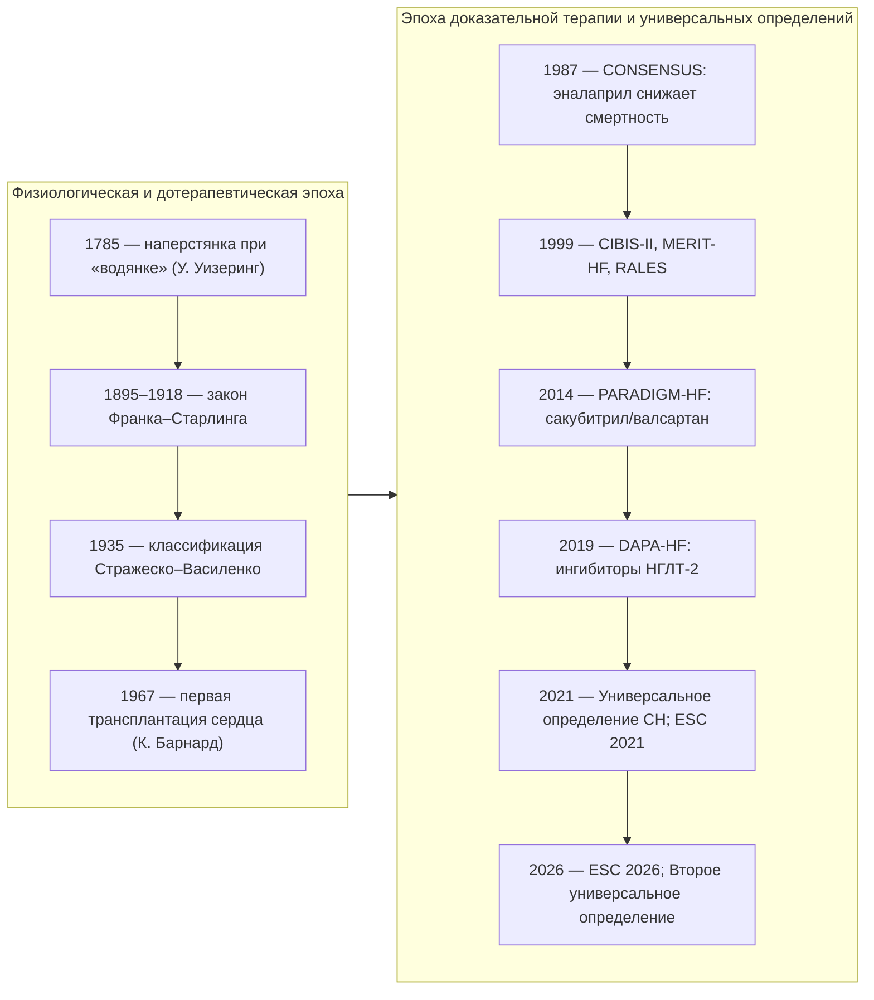
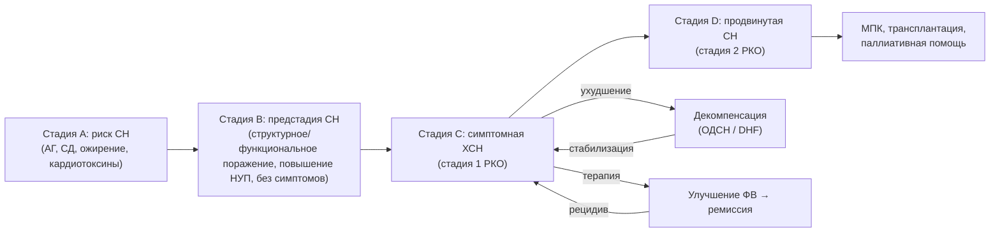
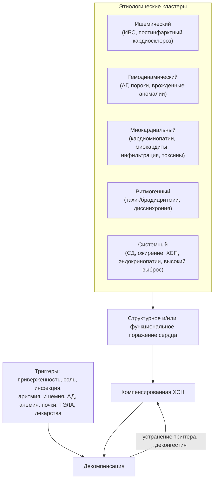
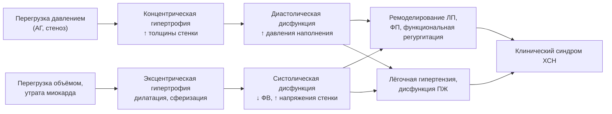
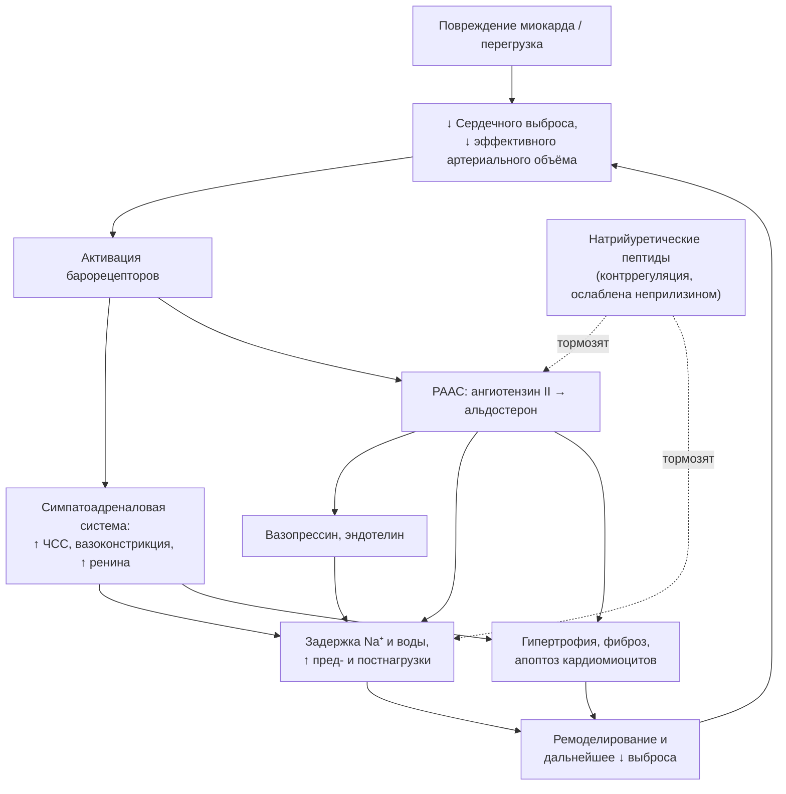
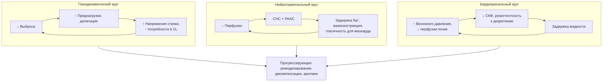
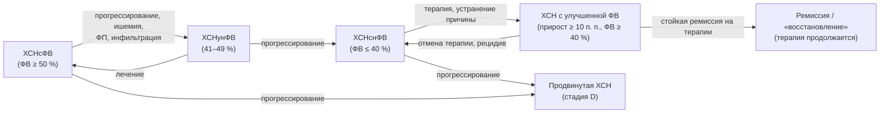
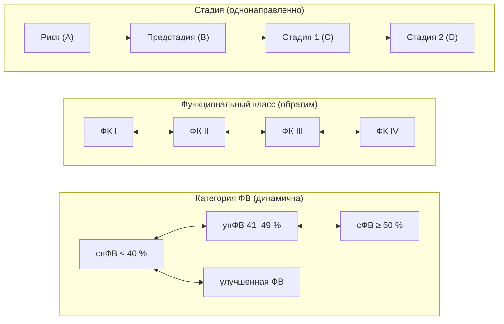

<!-- Файл собран автоматически из лекция/*.md скриптом build-tools/build.mjs; не редактировать вручную -->

# Хроническая сердечная недостаточность

## Паспорт лекции

**Табл. 1.** Паспорт лекции.

| Параметр | Содержание |
|---|---|
| Тема | Хроническая сердечная недостаточность (ХСН) |
| Область знания | Клиническая медицина: кардиология, внутренние болезни, клиническая фармакология; смежные области — патофизиология, молекулярная биология, генетика, нефрология, эндокринология, пульмонология, гериатрия, функциональная и лабораторная диагностика, кардиохирургия, реабилитация, профилактическая и паллиативная медицина, организация здравоохранения |
| Целевая аудитория | Студенты старших курсов (лечебное дело, педиатрия), клинические ординаторы по кардиологии и терапии, врачи-терапевты, врачи общей практики, кардиологи. Базовый уровень изложения рассчитан на студентов; вставки «Углубление» адресованы специалистам и пропускаются без потери связности |
| Предварительная подготовка | Анатомия, нормальная и патологическая физиология сердечно-сосудистой системы, пропедевтика внутренних болезней, основы фармакологии, ЭКГ и ЭхоКГ |
| Уровень сложности | Базово-продвинутый, с элементами экспертного анализа |
| Клинический фокус | ХСН у взрослых; особенности отдельных популяций; преемственность амбулаторной и стационарной помощи |
| Опорные документы | КР Минздрава России / РКО «Хроническая сердечная недостаточность» (2024, ID 156); КР ЕАК/НОИСН (2024); ESC 2021 и фокусное обновление 2023; AHA/ACC/HFSA 2022; ESC 2026 (материал для сопоставления); Второе универсальное определение СН (AHA/ACC/ESC/WHF, 2026) |
| Актуальность источников | Рекомендации ESC 2026 и Второе универсальное определение опубликованы в 2026 г.; их детали продолжают обсуждаться. Перед чтением лекции формулировки сверяются с первоисточником; российские рекомендации 2024 г. в ряде позиций расходятся с ESC 2026, и эти расхождения в тексте выделены явно |
| Условные обозначения | 📌 определение · 💡 интересный факт · ❗ типичная ошибка · 🔬 углубление · 📝 обобщение · ❓ контрольные вопросы · [🖼️ ВИЗУАЛИЗАЦИЯ] якорь иллюстрации · [⚠️ Требуется верификация] пометка о необходимости сверки с первоисточником |

**Цель лекции** — сформировать целостное, систематизированное представление о ХСН: от определения, этиологии и патофизиологии до классификации, диагностики, стратификации риска, лечения, профилактики и длительного наблюдения — как основу клинически обоснованного ведения пациентов по актуальным рекомендациям.

**Задачи лекции:** раскрыть современное определение и эпидемиологическую значимость ХСН; систематизировать причины, факторы риска и триггеры декомпенсации; объяснить гемодинамические, нейрогормональные и молекулярно-клеточные механизмы; сопоставить классификации; сформировать диагностический алгоритм и навык дифференциальной диагностики; освоить определение фенотипа, тяжести и прогноза; разобрать профилактику, немедикаментозную и медикаментозную терапию, включая четырёхкомпонентную («квадро-») терапию; охарактеризовать аппаратные, интервенционные и хирургические методы, механическую поддержку и трансплантацию; рассмотреть тактику при декомпенсации, коморбидности, в особых ситуациях и при продвинутой ХСН; описать реабилитацию, самоконтроль, диспансерное наблюдение и паллиативную помощь; обсудить дискуссионные вопросы и сформировать навык критической оценки доказательств.

**Ожидаемые результаты.** После лекции слушатель *будет знать* современное определение и кодирование ХСН, её причины и механизмы, классификации (Стражеско–Василенко, NYHA, стадии ACC/AHA и РКО, фенотипы по фракции выброса и их пересмотр в ESC 2026), основные группы препаратов и их доказательную базу, показания к ИКД, СРТ, механической поддержке и трансплантации, принципы профилактики и наблюдения. Слушатель *сможет* распознать симптомы и «красные флаги», составить план обследования, интерпретировать натрийуретические пептиды и ЭхоКГ, провести дифференциальную диагностику, сформулировать диагноз, назначить и титровать терапию с учётом фенотипа и коморбидности, определить показания к госпитализации и направлению в центр ХСН. Слушатель *будет способен* преемственно вести коморбидного пациента, оценивать место немедикаментозных, хирургических и паллиативных подходов и критически применять данные исследований к конкретному пациенту.

## 1. Введение

### 1.1. Актуальность темы

Хроническая сердечная недостаточность — закономерный финал большинства заболеваний сердца и одновременно самостоятельная клиническая проблема, с которой врач любой специальности сталкивается ежедневно. По оценке Европейского общества кардиологов (ESC), сердечной недостаточностью страдают 1–3 % взрослого населения, а среди людей старше 70 лет — более 10 %. В Российской Федерации, по данным эпидемиологической программы ЭПОХА, распространённость ХСН за двадцать лет наблюдения выросла с 6,1 до 8,2 %, годовая смертность при клинически выраженной ХСН достигает 12 %, а медиана дожития при III–IV функциональном классе составляет около 3,8 года. Такие показатели сопоставимы с прогнозом при распространённых злокачественных новообразованиях, однако в общественном сознании сердечная недостаточность по-прежнему воспринимается как «возрастная слабость сердца», а не как смертельно опасный синдром, поддающийся лечению.

Актуальность темы определяется и тем, что за последние тридцать лет ХСН превратилась из состояния с почти фатальным прогнозом в заболевание, течение которого можно изменить. Ингибиторы ренин-ангиотензин-альдостероновой системы, бета-адреноблокаторы, антагонисты минералокортикоидных рецепторов, ингибиторы натрий-глюкозного котранспортёра 2-го типа, ресинхронизирующая терапия и имплантируемые дефибрилляторы, механическая поддержка кровообращения и трансплантация сердца — каждый из этих методов доказанно продлевает жизнь. Разрыв между доказанными возможностями и реальной практикой остаётся главным резервом снижения смертности: по данным регистров, значительная часть пациентов не получает полной базисной терапии в целевых дозах.

### 1.2. Постановка проблемы

Проблема ХСН многослойна. Во-первых, это проблема диагностики: симптомы неспецифичны, а объективные признаки на ранних стадиях отсутствуют, поэтому диагноз часто ставится при первой госпитализации по поводу декомпенсации — то есть с опозданием на годы. Во-вторых, это проблема классификации: за пять лет вышли два универсальных определения сердечной недостаточности (2021 и 2026), рекомендации ESC 2021 с обновлением 2023 и новые рекомендации ESC 2026, которые отказались от категории «умеренно сниженной» фракции выброса и заменили термин «острая» сердечная недостаточность термином «декомпенсированная». Российские рекомендации 2024 года сохраняют трёхчленное деление по фракции выброса и собственную систему стадий. Врач должен ориентироваться в этих системах одновременно. В-третьих, это проблема лечения: эффективная терапия многокомпонентна, требует титрования, контроля функции почек и электролитов, учёта коморбидности и приверженности, а её внедрение сталкивается с терапевтической инерцией. Наконец, это проблема организации помощи: исход определяется не только назначениями, но и преемственностью между стационаром и поликлиникой, обучением пациента и наблюдением в «уязвимый» постгоспитальный период.

### 1.3. Обзор структуры лекции

Лекция построена как маршрут от понятий к действиям. Разделы 2–3 задают терминологию, историю и эпидемиологию. Разделы 4–5 раскрывают причины и механизмы — фундамент, без которого невозможно понять логику терапии. Раздел 6 систематизирует классификации, разделы 7–10 ведут от клинической картины к диагностике, дифференциальному диагнозу, формулировке диагноза и оценке прогноза. Разделы 11–18 посвящены лечению: профилактике, целям терапии, немедикаментозным мерам, базисной фармакотерапии ХСН со сниженной фракцией выброса, диуретикам, дополнительным препаратам, терапии при сохранённой и улучшенной фракции выброса и этиотропным подходам. Разделы 19–22 рассматривают коморбидность, особые группы, устройства и хирургию, декомпенсацию. Разделы 23–26 охватывают реабилитацию, длительное наблюдение, продвинутую ХСН и паллиативную помощь. Разделы 27–29 анализируют доказательную базу, дискуссионные вопросы и практическое применение; раздел 30 подводит итог. В конце даны глоссарий и перечень источников. Нумерация рисунков и таблиц сквозная; ссылки вида «см. рис. N» и «см. табл. N» отсылают к ним.

### 1.4. Мотивация слушателей

Обратите внимание: пациент с ХСН редко приходит к врачу с готовым диагнозом. Он приходит к терапевту с одышкой «из-за возраста», к пульмонологу с «бронхитом курильщика», к гастроэнтерологу с тяжестью в правом подреберье, к неврологу с ночными пробуждениями, к хирургу с отёками ног. Умение увидеть за разрозненными жалобами единый синдром и запустить простой, стандартизованный диагностический алгоритм (натрийуретические пептиды → эхокардиография → этиологический поиск) — навык, который сохраняет пациенту годы жизни. Вторая причина для мотивации — осязаемость результата: правильно подобранная четырёхкомпонентная терапия при ХСН со сниженной фракцией выброса снижает относительный риск смерти, по оценкам метаанализов и моделирования, более чем наполовину по сравнению с отсутствием терапии, и этот эффект врач первичного звена может обеспечить без высоких технологий.

### 1.5. Междисциплинарный характер проблемы

ХСН находится на пересечении дисциплин. Патофизиология объясняет нейрогормональную активацию и ремоделирование (Borovac et al., 2020; Schirone et al., 2017); молекулярная биология и генетика раскрывают наследственные кардиомиопатии и метаболические нарушения кардиомиоцита (D’Amato et al., 2025); нефрология — кардиоренальные взаимодействия; эндокринология — вклад сахарного диабета и ожирения; пульмонология — дифференциальную диагностику одышки и дыхательные нарушения во сне; гериатрия — старческую астению и полипрагмазию; функциональная и лабораторная диагностика — инструменты подтверждения диагноза; кардиохирургия и интервенционная кардиология — реваскуляризацию, клапанную коррекцию, устройства и механическую поддержку; медицинская реабилитация, профилактическая и паллиативная медицина, организация здравоохранения — долгосрочное ведение. Системно-биологический взгляд на ХСН (Louridas & Lourida, 2012) подчёркивает, что синдром нельзя свести к одной «поломке»: это сеть взаимосвязанных нарушений, и лечение направлено сразу на несколько её узлов.

### 1.6. Клинические и образовательные ориентиры

Образовательные ориентиры лекции сформулированы в паспорте (см. табл. 1). Если свести их к практическим результатам, то после лекции вы сможете:

1. распознать типичные и атипичные проявления ХСН, выделить «красные флаги» ухудшения и сформулировать диагностическую гипотезу;
2. составить минимальный и расширенный план обследования, интерпретировать BNP/NT-proBNP и данные ЭхоКГ с учётом факторов, искажающих результаты;
3. определить фенотип, стадию и функциональный класс, сформулировать развёрнутый диагноз по отечественным правилам и сопоставить его с международной терминологией;
4. назначить и титровать базисную терапию с учётом гемодинамики, функции почек, калия и коморбидности, спланировать мониторинг и распознать показания к госпитализации, аппаратному лечению и направлению в центр ХСН;
5. составить план профилактики, реабилитации, обучения пациента и диспансерного наблюдения, а также обсудить с пациентом цели лечения, включая паллиативный этап.

Клинический ориентир лекции — пациент в реальной системе здравоохранения: с коморбидностью, ограниченной доступностью отдельных препаратов и технологий, разной медицинской грамотностью и собственными предпочтениями. Поэтому наряду с «идеальными» алгоритмами мы будем обсуждать, что делать, когда идеал недостижим.

> 📝 **Обобщение.** ХСН — распространённый, прогностически тяжёлый и при этом управляемый синдром. Его проблемное поле включает позднюю диагностику, меняющиеся классификации, многокомпонентное лечение и организацию преемственной помощи. Лекция ведёт от терминологии и механизмов к диагностике, лечению и длительному ведению; каждый следующий раздел опирается на предыдущие. Главный вывод введения: результат лечения ХСН определяется не отдельной технологией, а последовательным выполнением доказанных шагов на всех уровнях помощи.

> ❓ **Контрольные вопросы**
>
> 1. Какова распространённость ХСН в мире и в Российской Федерации по данным, приведённым во введении?
> 2. Почему диагноз ХСН часто ставится с опозданием и какие дисциплины вовлечены в ведение пациента?
> 3. Как изменится тактика врача первичного звена, если он начнёт рассматривать одышку у пожилого пациента не как «возрастную норму», а как возможный симптом ХСН?

## 2. Определение, терминология и эволюция представлений о ХСН

### 2.1. Ключевые понятия

Точность терминологии при ХСН — не формальность: от того, назовём ли мы состояние «острой», «декомпенсированной» или «продвинутой» сердечной недостаточностью, зависят маршрут пациента, объём обследования и выбор терапии. Ниже введены понятия, которыми мы будем пользоваться на протяжении всей лекции.

#### 2.1.1. Сердечная недостаточность

> 📌 **Определение:** **сердечная недостаточность** (heart failure, HF; СН) — клинический синдром, характеризующийся настоящими или предшествующими симптомами (одышка, утомляемость, отёки) и/или признаками (повышение давления в яремных венах, хрипы в лёгких, периферические отёки), обусловленными структурным и/или функциональным нарушением сердца, которое приводит к снижению сердечного выброса и/или повышению давления наполнения в покое или при нагрузке и подтверждается повышением уровня натрийуретических пептидов и/или объективными признаками застоя.

Эта формулировка объединяет Универсальное определение 2021 года и определение российских клинических рекомендаций 2024 года. В ней важны три элемента: (1) СН — синдром, а не нозология; (2) обязательна причинная связь симптомов со структурным или функциональным поражением сердца; (3) требуется объективное подтверждение (натрийуретические пептиды, визуализация, признаки застоя), а не только жалобы.

#### 2.1.2. Хроническая сердечная недостаточность

**Хроническая сердечная недостаточность** (ХСН) — сердечная недостаточность с длительным течением, при которой симптомы и признаки существуют постоянно или рецидивируют, а пациент уже получает (или должен получать) длительную терапию. Пациента с ХСН, у которого симптомы и лечение не менялись как минимум в течение месяца, традиционно называют «стабильным». Термин «хроническая» противопоставляется не столько «острой», сколько впервые возникшей, ещё не леченной сердечной недостаточности.

#### 2.1.3. Острая сердечная недостаточность

**Острая сердечная недостаточность** (ОСН) в российских рекомендациях 2024 года определяется как опасное для жизни состояние, характеризующееся быстрым началом или резким ухудшением симптомов и признаков СН вплоть до отёка лёгких или кардиогенного шока, требующее неотложных лечебных мероприятий и, как правило, срочной госпитализации. Рекомендации ESC 2026 отказались от термина «острая» в пользу термина «декомпенсированная сердечная недостаточность», подчёркивая, что у большинства пациентов ухудшение развивается не внезапно, а в течение дней и недель (см. п. 2.4.5).

#### 2.1.4. Острая декомпенсация ХСН; декомпенсированная сердечная недостаточность

**Острая декомпенсация сердечной недостаточности** (ОДСН) — быстрое выраженное усугубление симптомов и признаков уже существующей ХСН. Это самая частая клиническая форма ухудшения: по данным европейских регистров, большинство госпитализаций с «острой» СН приходится именно на декомпенсацию хронической, а не на впервые возникшую СН. **Декомпенсированная сердечная недостаточность** (decompensated heart failure, DHF) в терминологии ESC 2026 — зонтичный термин для состояний, при которых нарастание симптомов и/или признаков СН достаточно выражено, чтобы потребовать неотложной помощи, независимо от скорости развития.

#### 2.1.5. Впервые выявленная сердечная недостаточность и сердечная недостаточность de novo

**Впервые выявленная СН** — диагноз, установленный впервые, независимо от давности симптомов (нередко пациент жил с нераспознанной ХСН годами). **СН de novo** — первое проявление СН у пациента без предшествующего анамнеза; она может быть острой (например, при инфаркте миокарда, фульминантном миокардите) или подострой (постепенное нарастание одышки при кардиомиопатии). Различие имеет значение для прогноза и объёма этиологического поиска: при СН de novo всегда требуется полное обследование для исключения обратимых причин.

#### 2.1.6. Бессимптомная дисфункция сердца и предстадия сердечной недостаточности

**Бессимптомная дисфункция левого желудочка** — снижение систолической и/или нарушение диастолической функции ЛЖ при отсутствии симптомов и признаков СН. В современной стадийной системе такие пациенты относятся к стадии B (pre-HF) по ACC/AHA и ESC 2026 и к **предстадии СН** по российской классификации: отсутствие симптомов и признаков ХСН в настоящем и прошлом при наличии структурного и/или функционального поражения сердца и/или повышения уровня натрийуретических пептидов. Выделение предстадии — практический инструмент профилактики: именно на этом этапе терапия способна предотвратить или отсрочить появление симптомов.

#### 2.1.7. Продвинутая (далеко зашедшая) сердечная недостаточность

> 📌 **Определение:** **продвинутая сердечная недостаточность** (advanced heart failure) по критериям Ассоциации сердечной недостаточности ESC (2018) требует одновременного наличия, несмотря на оптимальную терапию: (1) тяжёлых стойких симптомов (NYHA III–IV); (2) тяжёлой дисфункции сердца — ФВ ЛЖ ≤ 30 %, изолированной правожелудочковой недостаточности, неоперабельной клапанной или врождённой патологии либо стабильно высоких натрийуретических пептидов с тяжёлой диастолической дисфункцией; (3) эпизодов застоя, требовавших высоких доз внутривенных диуретиков, либо низкого выброса, требовавшего инотропов, либо злокачественных аритмий — с более чем одним незапланированным визитом или госпитализацией за 12 месяцев; (4) тяжёлого снижения переносимости нагрузки (невозможность нагрузки, дистанция 6-минутной ходьбы < 300 м или пиковое потребление кислорода < 12 мл/кг/мин) предположительно кардиального генеза.

Синонимы — «далеко зашедшая», «терминальная», «рефрактерная» СН, стадия D по ACC/AHA; в российской классификации 2023 года ей соответствует стадия 2. Распознавание продвинутой СН — сигнал к направлению в экспертный центр для оценки показаний к механической поддержке кровообращения и трансплантации (см. раздел 25).

#### 2.1.8. Систолическая и диастолическая дисфункция

**Систолическая дисфункция** — нарушение сократительной (насосной) функции желудочка, проявляющееся снижением фракции выброса, ударного объёма и скорости нарастания давления. **Диастолическая дисфункция** — нарушение расслабления и/или растяжимости (податливости) желудочка, из-за которого адекватное наполнение достигается только ценой повышения давления наполнения. Эти процессы редко существуют изолированно: при систолической дисфункции почти всегда есть диастолическая, а при «изолированной» диастолической нередко выявляется субклиническое снижение продольной деформации миокарда. Термины «систолическая» и «диастолическая ХСН» сохраняются в российских рекомендациях как описательные, но в классификации заменены фенотипами по фракции выброса.

#### 2.1.9. Фракция выброса левого желудочка

> 📌 **Определение:** **фракция выброса левого желудочка** (left ventricular ejection fraction, LVEF; ФВ ЛЖ) — доля конечно-диастолического объёма, изгоняемая за систолу:
>
> $$\mathrm{ФВ} = \frac{\mathrm{КДО} - \mathrm{КСО}}{\mathrm{КДО}} \times 100\,\%, \qquad (1)$$
>
> где КДО — конечно-диастолический объём (мл), КСО — конечно-систолический объём (мл).

Референсный метод в повседневной практике — двухмерная ЭхоКГ по биплановому методу дисков (Симпсона); при плохой визуализации используют контрастирование, трёхмерную ЭхоКГ или МРТ сердца. ФВ — не мера сократимости в строгом смысле: она зависит от пред- и постнагрузки, частоты ритма, наличия митральной регургитации (при тяжёлой регургитации «нормальная» ФВ скрывает дисфункцию). Воспроизводимость измерения ограничена: расхождения между исследователями могут достигать нескольких процентных пунктов, поэтому пограничные значения требуют повторной оценки, а решения об устройствах — подтверждения на фоне оптимальной терапии.

#### 2.1.10. Натрийуретические пептиды

**Натрийуретические пептиды** (natriuretic peptides, NP; НУП) — семейство гормонов, вырабатываемых кардиомиоцитами в ответ на растяжение стенки. Предсердный пептид (ANP) синтезируется преимущественно в предсердиях; **мозговой натрийуретический пептид** (B-type natriuretic peptide, BNP) — в желудочках: прогормон proBNP расщепляется на биологически активный BNP и неактивный N-концевой фрагмент **NT-proBNP** в эквимолярных количествах. BNP выводится через клиренс-рецепторы и расщепляется неприлизином (период полувыведения около 20 мин), NT-proBNP элиминируется преимущественно почками (период полувыведения дольше, порядка 1–2 ч), поэтому NT-proBNP сильнее зависит от функции почек и возраста. Физиологически НУП — антагонисты РААС: вызывают натрийурез, вазодилатацию, тормозят фиброз и гипертрофию. Клинически они служат главным инструментом исключения СН и мерой тяжести (см. раздел 8).

> 💡 **Интересный факт:** BNP получил название «мозгового» потому, что впервые был выделен в 1988 году из ткани головного мозга свиньи; лишь затем выяснилось, что его основной источник — желудочки сердца. Предсердный пептид был открыт раньше, в 1981 году, когда экстракт предсердий крысы вызвал у животных выраженный натрийурез, — так было экспериментально доказано, что сердце является эндокринным органом.

#### 2.1.11. Застой (congestion) и гиперволемия

**Застой** (congestion) — клиническое и/или гемодинамическое состояние повышенного давления наполнения желудочков с накоплением жидкости в лёгких и/или тканях большого круга. Выделяют **гемодинамический застой** (повышение давления наполнения, выявляемое инвазивно или по ЭхоКГ, нередко за дни и недели до симптомов) и **клинический застой** (отёки, хрипы, набухание шейных вен). **Гиперволемия** — увеличение общего объёма внеклеточной жидкости; она часто, но не всегда лежит в основе застоя: при «сосудистом» типе декомпенсации на фоне гипертензии жидкость перераспределяется в малый круг без существенного прироста общего объёма. Различие важно для выбора терапии: диуретики против вазодилататоров.

#### 2.1.12. Низкий сердечный выброс и гипоперфузия

**Синдром низкого выброса** — состояние, при котором сердечный выброс недостаточен для метаболических потребностей тканей. **Гипоперфузия** — его клинический эквивалент: холодные влажные конечности, снижение пульсового давления, олигурия, спутанность сознания, повышение лактата. Гипоперфузия не тождественна артериальной гипотонии: низкое давление может сочетаться с удовлетворительной перфузией, и наоборот. Инвазивно низкий выброс характеризуется сердечным индексом менее 2,2 л/мин/м².

#### 2.1.13. Компенсация, ремиссия и прогрессирование

**Компенсация** — состояние, при котором на фоне лечения и собственных адаптивных механизмов симптомы контролируются, а застой отсутствует. **Прогрессирование** — нарастание дисфункции и симптомов, несмотря на терапию. Второе универсальное определение (2026) формализует траектории: **улучшение** (ФВ выросла, но структурные или клинические отклонения сохраняются), **ремиссия** (ФВ нормализовалась, симптомы минимальны, биомаркеры стабильны, но риск рецидива сохраняется) и **выздоровление** (стойкая нормализация функции, структуры и биомаркеров без симптомов). Практический смысл различения: даже при ремиссии терапия, как правило, не отменяется (см. раздел 17).

#### 2.1.14. Кардиоренальный синдром

> 📌 **Определение:** **кардиоренальный синдром** (cardiorenal syndrome, CRS; КРС) — группа расстройств, при которых острая или хроническая дисфункция сердца вызывает дисфункцию почек или наоборот. По классификации Ronco выделяют пять типов: 1 — острый кардиоренальный (острая СН → острое повреждение почек); 2 — хронический кардиоренальный (ХСН → прогрессирующая ХБП); 3 — острый ренокардиальный; 4 — хронический ренокардиальный; 5 — вторичный, при системных заболеваниях (сепсис, амилоидоз, сахарный диабет).

Подробнее патофизиология и тактика рассмотрены в разделах 5, 10 и 19.

#### 2.1.15. Сердечная кахексия

**Сердечная кахексия** — непреднамеренная потеря не менее 5–6 % «сухой» (без отёков) массы тела за 6–12 месяцев у пациента с ХСН, отражающая системный катаболизм, воспаление, мальабсорбцию при застое в кишечнике и анорексию. Кахексия — независимый предиктор смерти и критерий продвинутой СН; её следует отличать от саркопении (потери мышечной массы и силы, возможной и без снижения веса) и от ожирения с саркопенией.

### 2.2. ХСН как клинический синдром и её нозологическая основа

ХСН — синдром, то есть совокупность симптомов и признаков, имеющая множество причин. Диагноз «ХСН» без указания причины неполон: он не позволяет выбрать этиотропное лечение (реваскуляризацию при ишемии, коррекцию порока, отмену кардиотоксичного препарата, специфическую терапию амилоидоза), оценить прогноз и провести семейный скрининг. Поэтому в клиническом диагнозе ХСН всегда занимает место осложнения основного заболевания (ИБС, гипертонической болезни, кардиомиопатии, порока), за исключением случаев, когда причину установить не удалось. Второе универсальное определение 2026 года закрепляет этот подход, предлагая универсальную классификацию причин СН, не зависящую от фракции выброса.

> ❗ **Типичная ошибка:** формулировка «ХСН неясного генеза» у пациента, которому не выполнены коронарография или КТ-ангиография, МРТ сердца, оценка на амилоидоз и генетическое консультирование. «Идиопатической» кардиомиопатия может называться только после исчерпания доступного этиологического поиска.

### 2.3. Соотношение терминов «недостаточность кровообращения» и «сердечная недостаточность»

Термин **«недостаточность кровообращения»** в отечественной школе (А. Л. Мясников, классификация Н. Д. Стражеско и В. Х. Василенко) обозначал состояние, при котором система кровообращения не обеспечивает потребности организма, и включал как сердечные, так и сосудистые формы. По сути он употреблялся как синоним ХСН, но только в нашей стране. Российские рекомендации 2024 года прямо указывают, что для замены термина «ХСН» он не рекомендован. В то же время стадии Стражеско–Василенко, исторически описанные для недостаточности кровообращения, продолжают использоваться для стадирования ХСН (см. раздел 6).

### 2.4. Исторические аспекты и эволюция терминологии

#### 2.4.1. Исторические этапы изучения ХСН

Описания водянки и удушья с набуханием вен встречаются с античности, однако научная история ХСН начинается с открытия кровообращения У. Гарвеем (1628). В 1785 году У. Уизеринг опубликовал труд о наперстянке, положив начало фармакотерапии «водянки сердечного происхождения». Физиологический фундамент заложили О. Франк (1895) и Э. Старлинг (1914–1918), описавшие зависимость силы сокращения от исходного растяжения волокон. В 1920–1930-е годы появились ртутные диуретики, в 1935 году на XII Всесоюзном съезде терапевтов принята классификация Стражеско–Василенко, разработанная при участии Г. Ф. Ланга. 1950–1960-е годы дали тиазиды и петлевые диуретики, 1967 год — первую трансплантацию сердца (К. Барнард, Кейптаун). Эпоха доказательной терапии открылась исследованием CONSENSUS (1987), показавшим снижение смертности при лечении эналаприлом; затем последовали SOLVD (1991), исследования бета-адреноблокаторов (1999–2001), спиронолактона (RALES, 1999), устройств (2002–2005), сакубитрила/валсартана (2014) и ингибиторов НГЛТ-2 (2019–2022).

**Рис. 1.** Ключевые этапы изучения и лечения сердечной недостаточности. Схема читается сверху вниз внутри каждого столбца и слева направо между столбцами; указаны только события, положившие начало новому классу вмешательств или новой системе понятий.

#### 2.4.2. Смена концепций: гемодинамическая, нейрогормональная, биомеханическая модели

Представления о природе ХСН сменялись трижды (Patterson & Adams, 1996; Louridas & Lourida, 2012). **Гемодинамическая модель** (1960–1970-е) рассматривала ХСН как проблему «насоса и нагрузки» и породила терапию вазодилататорами и инотропами. **Нейрогормональная модель** (1980–1990-е) объяснила прогрессирование хронической активацией симпатоадреналовой системы и РААС и обосновала применение препаратов, которые с гемодинамической точки зрения выглядели парадоксально, — бета-адреноблокаторов. **Биомеханическая модель** (2000-е) объединила нейрогормональные и механические стимулы через понятие ремоделирования миокарда и расширила круг мишеней до клеточных и молекулярных процессов. Содержательно каждая модель разобрана в п. 5.7; здесь важно, что ни одна из них не отменила предыдущую: современная терапия одновременно разгружает сердце, блокирует нейрогормоны и влияет на ремоделирование.

#### 2.4.3. Универсальное определение сердечной недостаточности (2021)

В 2021 году Общество сердечной недостаточности Америки, Ассоциация сердечной недостаточности ESC и Японское общество СН опубликовали **Универсальное определение и классификацию СН** (Bozkurt et al., 2021). Документ ввёл: единое определение синдрома (см. п. 2.1.1); пересмотренные стадии — «риск СН» (A), «предстадия СН» (B), «симптомная СН» (C), «продвинутая СН» (D); классификацию по ФВ — ХСНснФВ (≤ 40 %), ХСНунФВ (41–49 %), ХСНсФВ (≥ 50 %) и новую категорию **ХСН с улучшенной ФВ** (исходная ФВ ≤ 40 %, прирост ≥ 10 пунктов, повторное значение > 40 %). Ключевой посыл — СН можно диагностировать до появления симптомов (стадии A и B) и, следовательно, предотвращать.

#### 2.4.4. Второе универсальное определение сердечной недостаточности (2026)

**Второе универсальное определение** (AHA/ACC/ESC/WHF при участии HFSA, HFA и JHFS, 2026) уточнило критерии стадий A–D, сместило акцент с жёстких порогов ФВ на фенотип, этиологию и течение. Фенотипы сгруппированы в клинически действенные категории — сниженная, сохранённая и улучшенная ФВ — без фиксированных числовых границ; ФВ ниже 50 % рассматривается как отклонение от нормы независимо от пола, возраста и этнической принадлежности. Введена универсальная классификация причин СН с учётом географических различий этиологии и описаны траектории течения — улучшение, ремиссия и выздоровление (см. п. 2.1.13). Документ подчёркивает, что внезапная смерть возможна на любом этапе континуума, поэтому наблюдение не прекращается и при улучшении.

#### 2.4.5. Терминология ESC 2026

Рекомендации ESC 2026, представленные на конгрессе в Мюнхене, внесли четыре терминологических изменения. Во-первых, упразднена категория ХСН с умеренно сниженной ФВ: **ХСНснФВ определяется как ФВ ЛЖ < 50 %**, ХСНсФВ — как ФВ ≥ 50 %. Во-вторых, официально приняты стадии A–D. В-третьих, термин «острая сердечная недостаточность» заменён на «декомпенсированная сердечная недостаточность». В-четвёртых, введена новая номенклатура лечения: **базовая (foundational) медикаментозная терапия** — препараты с наиболее сильными доказательствами снижения смертности и госпитализаций; **дополнительная медикаментозная терапия**; **интервенционная терапия, рекомендованная руководствами**. Для ХСНснФВ базовая терапия включает бета-адреноблокатор, ингибитор АПФ/АРНИ/БРА, антагонист минералокортикоидных рецепторов и ингибитор НГЛТ-2; для ХСНсФВ — ингибитор НГЛТ-2 и АМКР. Как подчёркивают комментаторы документа, расширение определения ХСНснФВ до < 50 % не означает автоматического расширения показаний к ИКД, СРТ или ивабрадину: пороги для отдельных вмешательств сохраняют собственную доказательную базу.

#### 2.4.6. Терминология российских рекомендаций

Российские клинические рекомендации 2024 года (одобрены Научно-практическим советом Минздрава России 12.09.2024) используют термины: **ХСНнФВ** (ФВ ≤ 40 %), **ХСНунФВ** (41–49 %), **ХСНсФВ** (≥ 50 %); «предстадия СН», «риск развития ХСН», «стадия 1» и «стадия 2» по классификации экспертов РКО 2023 года; функциональные классы NYHA; Шкалу оценки клинического состояния (ШОКС); термины «острая СН» и «острая декомпенсация СН». Обратите внимание на различие аббревиатур: в российских документах — ХСНнФВ (низкая/сниженная), в переводной литературе — ХСНснФВ; содержательно они совпадают. В данной лекции используется аббревиатура ХСНснФВ, кроме цитирования российских документов.

### 2.5. Кодирование по МКБ-10

#### 2.5.1. I50.0 — застойная сердечная недостаточность

Код применяется при ХСН с признаками застоя по большому кругу (отёки, гепатомегалия, асцит) или бивентрикулярной недостаточности; это наиболее часто используемый код при декомпенсации.

#### 2.5.2. I50.1 — левожелудочковая недостаточность

Код охватывает преимущественно левожелудочковую недостаточность с застоем в малом круге, включая сердечную астму и отёк лёгких кардиального генеза.

#### 2.5.3. I50.9 — сердечная недостаточность неуточнённая

Код используется, когда тип недостаточности не уточнён; при корректном обследовании его доля должна быть минимальной. В статистике смертности СН, как правило, не считается первоначальной причиной смерти: кодируется основное заболевание (например, I25 — хроническая ИБС), а СН указывается как осложнение. Это одна из причин занижения «видимого» вклада ХСН в смертность.

**Табл. 2.** Термины и коды МКБ-10, применяемые при ХСН.

| Термин | Суть | Документ-источник | Код МКБ-10 (при кодировании ХСН) |
|---|---|---|---|
| Сердечная недостаточность | Синдром с симптомами/признаками, вызванный поражением сердца и подтверждённый НУП/застоем | Универсальное определение 2021/2026; КР РФ 2024 | I50.0 / I50.1 / I50.9 |
| Предстадия СН (стадия B) | Структурное/функциональное поражение без симптомов | КР РФ 2024; ACC/AHA; ESC 2026 | Кодируется основное заболевание |
| Острая декомпенсация ХСН | Быстрое выраженное усугубление симптомов ХСН | КР РФ 2024 | I50.0 (чаще) |
| Декомпенсированная СН | Ухудшение, требующее неотложной помощи, любой скорости развития | ESC 2026 | I50.x по типу |
| Продвинутая СН (стадия D / стадия 2 РКО) | Тяжёлые симптомы и дисфункция, несмотря на оптимальную терапию | HFA ESC 2018; КР РФ 2024 | I50.x по типу |
| ХСН с улучшенной ФВ | Исходно ФВ ≤ 40 %, прирост ≥ 10 пунктов, повторно ≥ 40 % | Универсальное определение 2021; КР РФ 2024 | I50.x по типу |

### 2.6. Примеры и иллюстрации

#### 2.6.1. Примеры клинических формулировок определения

Пример 1. Пациент 68 лет, перенёс инфаркт миокарда, жалуется на одышку при подъёме на второй этаж, ФВ ЛЖ 32 %, NT-proBNP 1 450 пг/мл. Все элементы определения присутствуют: симптомы, структурное поражение, биомаркерное подтверждение — это симптомная ХСН со сниженной ФВ (стадия C / стадия 1 РКО).

Пример 2. Пациентка 74 лет с гипертонической болезнью, одышка при быстрой ходьбе, ФВ 62 %, индекс объёма левого предсердия 41 мл/м², E/e′ 15, NT-proBNP 480 пг/мл. Симптомы и признаки диастолической дисфункции с повышенным НУП при сохранённой ФВ — ХСН с сохранённой ФВ; одной лишь «нормальной» ФВ для исключения диагноза недостаточно.

Пример 3. Пациент 55 лет без жалоб, ФВ 38 % после миокардита, NT-proBNP 300 пг/мл. Симптомов нет, но есть дисфункция и повышенный биомаркер — предстадия СН (стадия B), требующая терапии для предотвращения симптомов.

#### 2.6.2. Клинические иллюстрации состояний континуума сердечной недостаточности

Континуум СН удобно представить как последовательность состояний с возможными переходами в обе стороны (см. рис. 2). Пациент с артериальной гипертензией и диабетом (стадия A) через гипертрофию ЛЖ и диастолическую дисфункцию (стадия B) приходит к симптомной ХСН (стадия C); декомпенсации — это обострения внутри стадии C; при неэффективности терапии наступает продвинутая СН (стадия D). На фоне лечения возможны улучшение ФВ и ремиссия, но возврат к стадии A невозможен: структурное поражение остаётся в анамнезе.

**Рис. 2.** Понятийная карта континуума сердечной недостаточности. Схема читается слева направо: стадии A–D отражают прогрессирование, стрелки «ухудшение/стабилизация» — эпизоды декомпенсации внутри стадии C, ветвь «улучшение ФВ → ремиссия» — обратимость под действием терапии с сохранением риска рецидива. МПК — механическая поддержка кровообращения.

> 🔬 **Углубление:** граница между ремиссией и выздоровлением при ХСН с улучшенной ФВ остаётся предметом исследований. В исследовании TRED-HF (Halliday et al., 2019) у пациентов с дилатационной кардиомиопатией и полностью восстановившейся функцией ЛЖ отмена терапии в течение шести месяцев приводила к рецидиву примерно у 40 % участников, тогда как при продолжении лечения рецидивов не было. Это указывает, что нормализация ФВ отражает ремиссию под контролем лекарств, а не излечение, и объясняет, почему Второе универсальное определение разделяет улучшение, ремиссию и выздоровление и требует стойкости нормализации структуры и биомаркеров для констатации последнего.

> 📝 **Обобщение.** Сердечная недостаточность — синдром с обязательным объективным подтверждением; ХСН, острая/декомпенсированная СН, СН de novo, предстадия и продвинутая СН — не разные болезни, а состояния одного континуума. За сорок лет терминология прошла путь от «недостаточности кровообращения» и гемодинамической модели к универсальным определениям 2021 и 2026 годов и к номенклатуре ESC 2026 (два фенотипа по ФВ, стадии A–D, «декомпенсированная» СН, «базовая терапия»). Российские рекомендации 2024 года сохраняют три фенотипа по ФВ и собственные стадии, и врач обязан владеть обеими системами. Эти понятия — язык, на котором далее будут описаны эпидемиология, механизмы, диагностика и лечение.

> ❓ **Контрольные вопросы**
>
> 1. Перечислите обязательные элементы современного определения сердечной недостаточности.
> 2. Чем «декомпенсированная сердечная недостаточность» в терминологии ESC 2026 отличается от «острой декомпенсации ХСН» в российских рекомендациях и почему был заменён термин?
> 3. Почему Второе универсальное определение (2026) отказалось от жёстких порогов фракции выброса и какие траектории течения оно описывает?
> 4. Пациент без жалоб имеет ФВ 38 % после перенесённого миокардита. К какой стадии его отнести по классификациям ACC/AHA и РКО и что это меняет в тактике?

## 3. Эпидемиология и медико-социальное значение

### 3.1. Распространённость

#### 3.1.1. В мире

По оценкам ESC (2021, 2026), сердечной недостаточностью страдают 1–3 % взрослого населения развитых стран; распространённость резко растёт с возрастом и превышает 10 % у лиц старше 70 лет. Глобальная оценка проекта «Глобальное бремя болезней» (GBD, 2017) — порядка 64 млн человек с СН в мире. Эти цифры относятся преимущественно к симптомной СН (стадия C–D); с учётом предстадии (стадия B) число людей со структурным поражением сердца в несколько раз больше. Сравнения между странами затруднены различиями в критериях диагностики, доступности ЭхоКГ и натрийуретических пептидов.

#### 3.1.2. В Российской Федерации

Основной источник отечественных данных — эпидемиологическая программа ЭПОХА (ЭПОХА-ХСН), стартовавшая в 1998 году в европейской части России. По её данным, приведённым в клинических рекомендациях 2024 года, распространённость ХСН в РФ за 20-летний период увеличилась с 6,1 до 8,2 %. Эти оценки выше западноевропейских отчасти из-за методологии (учёт I–II функциональных классов по клиническим критериям), отчасти из-за реального бремени артериальной гипертензии и ИБС. Согласно регистру по обращаемости в поликлиники, 78 % пациентов с ХСН имеют сохранённую ФВ ЛЖ, что придаёт проблеме ХСНсФВ в России особую медико-социальную значимость.

### 3.2. Заболеваемость и выявляемость

Заболеваемость (число новых случаев) СН в Европе оценивается порядка 3–5 случаев на 1 000 человеко-лет среди взрослых с резким ростом после 65 лет; возрастно-стандартизованная заболеваемость в ряде когорт стабилизировалась или снижается благодаря контролю гипертензии и лечению инфаркта, тогда как абсолютное число случаев растёт из-за старения населения. Выявляемость отстаёт от истинной заболеваемости: значительная доля пациентов диагностируется только при госпитализации по поводу декомпенсации, а предстадия выявляется редко, так как не сопровождается жалобами и не входит в рутинный скрининг.

### 3.3. Возрастная структура

Средний возраст пациента с ХСН в западных регистрах превышает 70 лет; в России он несколько ниже, что связано с более ранним развитием ИБС и меньшей продолжительностью жизни. Возраст определяет фенотип: у молодых преобладают ХСНснФВ и кардиомиопатии, у пожилых — ХСНсФВ с множественной коморбидностью. Пожизненный риск развития СН для человека 40 лет оценивается во Фремингемском исследовании примерно в 20 % (каждый пятый) независимо от пола.

### 3.4. Половые и гендерные особенности

Мужчины чаще заболевают ХСНснФВ ишемической природы и в более молодом возрасте; женщины — ХСНсФВ, в старшем возрасте, на фоне гипертензии, ожирения и диабета. Абсолютное число пациентов обоих полов сопоставимо из-за большей продолжительности жизни женщин. Женщины исторически недопредставлены в клинических исследованиях (обычно 20–30 % участников при ХСНснФВ), чаще сообщают о побочных эффектах и, по данным ряда анализов, могут получать пользу от некоторых препаратов при более высоких значениях ФВ (сакубитрил/валсартан в PARAGON-HF). Гендерные факторы — роль ухаживающего лица, доступ к помощи, приверженность — влияют на исходы независимо от биологии.

### 3.5. Географические и популяционные различия

Этиологическая структура СН различается по регионам: в Европе и Северной Америке доминируют ИБС и гипертензия; в странах Африки южнее Сахары — гипертензивное сердце, ревматические пороки, перипартальная и эндомиокардиальные кардиомиопатии; в Латинской Америке существенен вклад болезни Шагаса; в Азии — ревматические пороки и гипертензия при более молодом возрасте пациентов. Второе универсальное определение 2026 года впервые прямо фиксирует географическую вариабельность причин. Внутри страны различия определяются доступностью кардиологической помощи, уровнем доходов и распространённостью факторов риска.

### 3.6. Структура фенотипов и эпидемиология отдельных фенотипов

В популяционных когортах примерно половина пациентов с СН имеет сохранённую ФВ, и, по данным, цитируемым российскими рекомендациями, доля ХСНсФВ относительно ХСНснФВ увеличивается примерно на 1 % в год. На ХСНунФВ (41–49 %) приходится около 10–20 % случаев; среди них, как и при ХСНснФВ, преобладают мужчины и ИБС (50–60 %). ХСНсФВ — болезнь пожилых женщин с ожирением, гипертензией, диабетом, ХБП, ХОБЛ и анемией. Пятилетняя выживаемость при ХСНсФВ, по обсервационным данным, около 50 %, то есть прогноз не легче, чем при сниженной ФВ, хотя структура причин смерти иная: больше некардиоваскулярных смертей.

### 3.7. Госпитализации, повторные госпитализации и бремя для системы здравоохранения

СН — ведущая причина госпитализаций среди лиц старше 65 лет в развитых странах. Госпитализация по поводу декомпенсации — переломное событие: после неё риск повторной госпитализации в первые полгода превышает 50 % (данные для ХСНсФВ, приводимые российскими рекомендациями), а доля повторных госпитализаций в течение 30 дней в западных системах составляет порядка 20–25 %. Каждая декомпенсация сопровождается необратимым ухудшением функции миокарда и почек, поэтому число госпитализаций — не просто маркер, а фактор прогрессирования.

### 3.8. Прогноз, смертность, структура причин смерти и вклад ХСН в сердечно-сосудистую смертность

До 1990-х годов 60–70 % пациентов с ХСН умирали в течение 5 лет. Современная терапия улучшила прогноз, однако, по данным ЭПОХА-ХСН, в России средняя годовая смертность при ХСН I–IV ФК составляет 6 %, при клинически выраженной ХСН — 12 %; медиана времени дожития при I–II ФК — 8,4 года (95 % ДИ 7,8–9,1), при III–IV ФК — 3,8 года (95 % ДИ 3,4–4,2). По формулировке ESC (2026), менее 60 % пациентов живы через пять лет после установления диагноза. Причины смерти при ХСНснФВ: прогрессирующая насосная недостаточность и внезапная сердечная смерть (её доля выше при менее тяжёлых классах и снижается при NYHA IV, где преобладает смерть от насосной недостаточности); при ХСНсФВ до половины смертей некардиоваскулярные. Поскольку СН обычно кодируется как осложнение, а не первоначальная причина смерти, её реальный вклад в сердечно-сосудистую смертность статистика занижает.

### 3.9. Качество жизни и функциональные ограничения

ХСН снижает качество жизни сильнее большинства хронических заболеваний: одышка и утомляемость ограничивают самообслуживание, ночные симптомы нарушают сон, диуретики привязывают к туалету, госпитализации разрушают социальные связи. Опросники KCCQ и MLHFQ (см. раздел 10) показывают, что качество жизни — самостоятельная, значимая для пациента конечная точка, и улучшение на 5 баллов KCCQ считается клинически заметным.

### 3.10. Инвалидизация и утрата трудоспособности

ХСН — одна из ведущих причин стойкой утраты трудоспособности среди болезней системы кровообращения. Функциональный класс, частота госпитализаций, потребность в устройствах и коморбидность определяют группу инвалидности при медико-социальной экспертизе (подробнее — п. 24.12). У лиц трудоспособного возраста ХСН означает не только медицинские, но и экономические потери семьи.

### 3.11. Социально-экономическое бремя

Расходы на СН оцениваются в 1–2 % бюджетов здравоохранения развитых стран, и до двух третей этих расходов приходится на стационарную помощь. Отсюда следует экономическая логика современных рекомендаций: вложения в амбулаторную оптимизацию терапии, обучение и наблюдение окупаются снижением госпитализаций. Непрямые затраты — утрата трудоспособности пациента и ухаживающих — учитываются реже, но сопоставимы с прямыми.

### 3.12. Социальные детерминанты здоровья

Низкий доход, образование, одиночество, сельское проживание, ограниченная транспортная доступность, низкая медицинская грамотность связаны с более поздней диагностикой, худшей приверженностью, большей частотой госпитализаций и смертностью при ХСН независимо от тяжести заболевания. Второе универсальное определение 2026 года и рекомендации AHA/ACC/HFSA 2022 рассматривают оценку социальных детерминант как часть ведения пациента, а не как внешний фактор.

### 3.13. Тенденции и прогнозы

Ожидается дальнейший рост распространённости СН из-за старения населения, эпидемии ожирения и диабета и улучшения выживаемости после инфаркта и при самой СН; ESC (2026) прямо называет старение и ожирение драйверами «растущего глобального бремени». Одновременно меняется структура: доля ХСНсФВ и ХСН с улучшенной ФВ растёт, а доля «классической» дилатационной ХСНснФВ с тяжёлыми симптомами снижается там, где внедрена современная терапия.

### 3.14. Популяционные исследования и регистры; пример эпидемиологического наблюдения — программа ЭПОХА

Знания об эпидемиологии СН получены из нескольких типов источников: проспективных когорт (Фремингемское исследование, когорта округа Олмстед), популяционных программ с репрезентативной выборкой (ЭПОХА в России), госпитальных и амбулаторных регистров (ESC-HF-LT, национальные регистры Швеции, США). Программа ЭПОХА (руководитель — И. В. Фомин и соавт.) включала репрезентативную выборку населения европейской части России с повторными срезами на протяжении двадцати лет; она дала оценки распространённости по функциональным классам, структуру этиологии (доминирование гипертензии и ИБС), данные о смертности и медиане дожития, которые легли в основу российских рекомендаций. Её ограничения типичны для популяционных программ: клинические критерии ХСН на ранних этапах без повсеместной ЭхоКГ и НУП, что могло завышать распространённость лёгких классов.

### 3.15. Иллюстрации: динамика распространённости и госпитализаций; эпидемиологические профили

**Табл. 3.** Эпидемиологические профили ХСН: сопоставление оценок (по состоянию на 2024–2026 гг.).

| Показатель | Мир / Европа | Российская Федерация |
|---|---|---|
| Распространённость среди взрослых | 1–3 % (ESC); > 10 % после 70 лет | 6,1 % → 8,2 % за 20 лет наблюдения (ЭПОХА) |
| Абсолютная оценка | Около 64 млн человек (GBD, 2017) | [⚠️ Требуется верификация: актуальная абсолютная оценка числа пациентов по данным ЭПОХА/регистров] |
| Доля ХСНсФВ | Около половины случаев, растёт | 78 % по обращаемости в поликлиники |
| Годовая смертность | Зависит от тяжести; < 60 % живы через 5 лет после диагноза (ESC, 2026) | 6 % при I–IV ФК; 12 % при клинически выраженной ХСН |
| Медиана дожития | — | 8,4 года при I–II ФК; 3,8 года при III–IV ФК (ЭПОХА-ХСН) |
| Повторные госпитализации | Около 20–25 % в течение 30 дней (западные регистры) | > 50 % в первые 6 мес после выписки (данные для ХСНсФВ) |
| Ведущие причины | ИБС, АГ; региональные различия (ревматизм, Шагас, перипартальная КМП) | АГ и ИБС; их сочетание у половины пациентов |

[🖼️ ВИЗУАЛИЗАЦИЯ: инфографика «Динамика распространённости, госпитализаций и смертности от ХСН в мире и РФ» — два горизонтальных ряда: слева столбцы распространённости ХСН в РФ по срезам программы ЭПОХА (1998 → 2017), справа кривые выживаемости по функциональным классам с медианами дожития 8,4 и 3,8 года; подписать источники данных и год; график строится только по опубликованным значениям.]

> 💡 **Интересный факт:** Фремингемское исследование, начатое в 1948 году в небольшом городе штата Массачусетс, дало не только первые клинические критерии СН (критерии Макки и соавт., 1971), но и само понятие «фактор риска», без которого невозможно описать стадию A современной классификации.

> ❗ **Типичная ошибка:** сравнивать распространённость ХСН в России (6–8 %) и в Европе (1–3 %) как «в разы большую заболеваемость». Различие во многом методологическое: включение лёгких функциональных классов по клиническим критериям против подтверждённых инструментально случаев. Корректное сравнение требует одинаковых критериев и возрастной стандартизации.

> 📝 **Обобщение.** ХСН страдают 1–3 % взрослых в мире и, по отечественным данным, около 8 % населения России; распространённость растёт из-за старения, ожирения и улучшения выживаемости. Прогноз остаётся тяжёлым (годовая смертность при выраженной ХСН 12 %, менее 60 % пациентов живы через 5 лет), а госпитализации — главный источник затрат и фактор прогрессирования. Структура сдвигается к ХСНсФВ, особенно в амбулаторной практике. Эти данные объясняют, почему следующий раздел посвящён причинам и факторам риска: эпидемиология ХСН — это эпидемиология её причин.

> ❓ **Контрольные вопросы**
>
> 1. Какие показатели смертности и медианы дожития при ХСН получены в программе ЭПОХА-ХСН?
> 2. Почему доля ХСНсФВ в амбулаторной практике значительно выше, чем в стационарных регистрах?
> 3. Как изменение структуры причин смерти (внезапная смерть против насосной недостаточности) по мере утяжеления функционального класса должно влиять на приоритеты профилактики у конкретного пациента?

## 4. Этиология и факторы риска

### 4.1. Ключевые понятия

#### 4.1.1. Этиологический (причинный) фактор

**Этиологический фактор** — заболевание или воздействие, непосредственно вызывающее структурное или функциональное поражение сердца, которое приводит к СН (инфаркт миокарда, аортальный стеноз, антрациклины). Устранение причины может остановить прогрессирование или даже привести к восстановлению функции, поэтому этиологический поиск обязателен при каждом впервые установленном диагнозе.

#### 4.1.2. Фактор риска: модифицируемые и немодифицируемые

**Фактор риска** — состояние, статистически повышающее вероятность развития СН, но не являющееся её непосредственной причиной. Модифицируемые факторы (гипертензия, диабет, ожирение, курение, алкоголь, апноэ сна, малоподвижность) — мишени профилактики на стадии A; немодифицируемые (возраст, мужской пол для ХСНснФВ, семейный анамнез, генотип) определяют группы, нуждающиеся в скрининге. Граница условна: артериальная гипертензия одновременно фактор риска ИБС и самостоятельная причина гипертонического сердца.

#### 4.1.3. Триггер (пусковой фактор) декомпенсации

**Триггер декомпенсации** — событие, переводящее компенсированную ХСН в декомпенсацию (инфекция, аритмия, нарушение приёма препаратов, избыток соли). Триггер не создаёт болезнь, но определяет момент ухудшения; его выявление и устранение — первый шаг при каждой госпитализации (см. п. 4.4 и раздел 22).

### 4.2. Основные причины ХСН

В Российской Федерации, по данным рекомендаций 2024 года, основные причины ХСН — артериальная гипертензия и ИБС; их сочетание встречается у половины пациентов. ИБС является причиной систолической ХСН в двух третях случаев, часто в сочетании с диабетом и гипертензией; на пороки сердца приходится около 4,3 %, на миокардиты — 3,6 %. Сводка причин приведена в табл. 4; далее каждая группа разобрана отдельно.

**Табл. 4.** Основные причины ХСН по механизму поражения.

| Группа | Примеры | Преимущественный фенотип | Ключ к диагностике |
|---|---|---|---|
| Ишемическое поражение | Постинфарктный кардиосклероз, гибернация миокарда | ХСНснФВ (реже сФВ) | Анамнез ИМ, зоны акинеза, коронарография/КТ-ангиография |
| Перегрузка давлением | Артериальная гипертензия, аортальный стеноз | ХСНсФВ → снФВ на поздних этапах | ГЛЖ, градиент на клапане |
| Перегрузка объёмом | Митральная/аортальная регургитация, шунты, почечная недостаточность | Дилатация, снФВ | Допплер-ЭхоКГ |
| Кардиомиопатии | ДКМП, ГКМП, РКМП, АКМП, некомпактный миокард, такоцубо | Любой | Семейный анамнез, МРТ, генетика |
| Воспаление и инфекции | Миокардиты (вирусные, в т. ч. SARS-CoV-2; гигантоклеточный; эозинофильный), болезнь Шагаса, ВИЧ | снФВ | МРТ (критерии Lake Louise), биопсия |
| Аритмии | Тахикардиомиопатия, частая желудочковая экстрасистолия, брадиаритмии | снФВ, обратимая | Холтер, восстановление ФВ после контроля ритма |
| Врождённые пороки у взрослых | Тетрада Фалло после коррекции, системный ПЖ, Фонтен | Право- или бивентрикулярная | Анамнез, ЭхоКГ, МРТ |
| Лёгочная гипертензия, правые отделы | ЛАГ, ХТЭЛГ, ХОБЛ | Правожелудочковая | ЭхоКГ, катетеризация правых отделов |
| Перикард | Констриктивный перикардит, тампонада | «СН» с сохранной сократимостью | ЭхоКГ, КТ/МРТ, катетеризация |
| Эндокринные и метаболические | СД, ожирение, тиреотоксикоз/гипотиреоз, акромегалия, феохромоцитома | сФВ, реже снФВ | Гормональный профиль |
| Инфильтративные/накопления | Амилоидоз (ATTR, AL), гемохроматоз, саркоидоз, болезнь Фабри | сФВ/рестриктивный, снФВ при саркоидозе | Сцинтиграфия, МРТ (T1, T2*, ECV), ферменты, генетика |
| Токсические/ятрогенные | Алкоголь, кокаин, антрациклины, трастузумаб, ингибиторы контрольных точек, лучевая терапия | снФВ | Анамнез экспозиции, динамика ФВ/GLS |
| Высокий выброс | Анемия, тиреотоксикоз, артериовенозная фистула, бери-бери, болезнь Педжета, сепсис, цирроз | СН с высоким выбросом | Высокий сердечный индекс при симптомах застоя |
| Беременность | Перипартальная КМП | снФВ | Дебют в конце беременности/после родов |
| Генетические/семейные | Титин, ламин, десмосомные гены, саркомерные гены, TTR | Любой | Родословная, генетическое тестирование |

#### 4.2.1. Ишемическая болезнь сердца и постинфарктный кардиосклероз

ИБС — ведущая причина ХСНснФВ в России и мире. Механизмы: утрата кардиомиоцитов при инфаркте с рубцеванием и постинфарктным ремоделированием; хроническая гипоперфузия с «гибернацией» жизнеспособного миокарда; повторные эпизоды ишемии с «оглушением»; ишемическая митральная регургитация. Термин «ишемическая кардиомиопатия» применяют при дисфункции ЛЖ, вызванной многососудистым поражением или перенесённым инфарктом. Прогностически важно различать рубец и гибернирующий миокард (МРТ с контрастированием, стресс-ЭхоКГ, ПЭТ): только жизнеспособный миокард потенциально восстанавливает функцию после реваскуляризации.

#### 4.2.2. Артериальная гипертензия

Хроническая перегрузка давлением вызывает концентрическую гипертрофию ЛЖ, интерстициальный фиброз, нарушение расслабления и податливости — субстрат ХСНсФВ; присоединение ИБС, фибрилляции предсердий или декомпенсация гипертрофии ведут к дилатации и снижению ФВ. Гипертензия — самый частый фактор риска СН в популяции благодаря своей распространённости; длительный контроль АД снижает риск СН примерно наполовину, а интенсивный контроль (SPRINT) — ещё заметнее.

#### 4.2.3. Приобретённые клапанные пороки сердца

Аортальный стеноз (перегрузка давлением), аортальная и митральная регургитация (перегрузка объёмом), митральный стеноз (застой в малом круге при «интактном» ЛЖ), трикуспидальная регургитация (правожелудочковая недостаточность) — каждый порок формирует собственный гемодинамический профиль. Своевременная коррекция до необратимого ремоделирования — единственный способ предотвратить ХСН; поэтому при пороках СН рассматривают как показание к вмешательству, а не только как осложнение. Отдельная проблема — **вторичная (функциональная) митральная регургитация**, которая является следствием ремоделирования ЛЖ при ХСН и одновременно ускоряет его.

#### 4.2.4. Кардиомиопатии (первичные и вторичные, наследственные и приобретённые)

**Кардиомиопатии** — заболевания миокарда со структурными и функциональными нарушениями, не объяснимыми ИБС, гипертензией, пороками или врождёнными аномалиями. Классификация ESC 2023 года выделяет морфофункциональные фенотипы: дилатационный, гипертрофический, рестриктивный, аритмогенный правожелудочковый и недилатационный левожелудочковый.

**4.2.4.1. Дилатационная кардиомиопатия (ДКМП)** — дилатация и систолическая дисфункция ЛЖ (или обоих желудочков) без адекватной нагрузки или ИБС. Около 30–40 % случаев семейные; наиболее частые гены — титин (TTN, укороченные варианты), ламин A/C (LMNA), десмосомные гены, RBM20, FLNC, BAG3, PLN. Приобретённые причины — перенесённый миокардит, алкоголь, химиотерапия, перипартальный период; нередко генетическая предрасположенность реализуется под действием внешнего триггера.

**4.2.4.2. Гипертрофическая кардиомиопатия (ГКМП)** — гипертрофия ЛЖ (≥ 15 мм, ≥ 13 мм у родственников) без иной причины; чаще саркомерные мутации (MYBPC3, MYH7). СН развивается вследствие диастолической дисфункции, обструкции выносящего тракта, митральной регургитации, фибрилляции предсердий и, у меньшинства, «конечной стадии» с истончением стенок и снижением ФВ.

**4.2.4.3. Рестриктивная кардиомиопатия (РКМП)** — ригидные желудочки нормального или уменьшенного объёма с расширенными предсердиями; причины — амилоидоз, эндомиокардиальный фиброз, гиперэозинофильный синдром, болезни накопления, лучевое поражение, идиопатические формы. Главная дифференциальная задача — отличить от констриктивного перикардита, который излечим хирургически.

**4.2.4.4. Аритмогенная кардиомиопатия (АКМП)** — фиброзно-жировое замещение миокарда преимущественно ПЖ (возможно и ЛЖ) при мутациях десмосомных генов (PKP2, DSP, DSG2); проявляется желудочковыми аритмиями и внезапной смертью у молодых, а на поздних стадиях — право- или бивентрикулярной СН.

**4.2.4.5. Некомпактный миокард левого желудочка и другие специфические формы.** Выраженная трабекулярность с глубокими межтрабекулярными лакунами может быть вариантом строения, адаптацией (спортсмены, беременность) или проявлением кардиомиопатии; классификация ESC 2023 рассматривает некомпактность как фенотипический признак, а не самостоятельную нозологию. К специфическим формам относят также кардиомиопатии при нервно-мышечных заболеваниях (дистрофии Дюшенна, Беккера, миотоническая дистрофия) и митохондриальные.

**4.2.4.6. Кардиомиопатия такоцубо** — транзиторная дисфункция ЛЖ (чаще апикальное «баллонирование») после эмоционального или физического стресса, преимущественно у женщин в постменопаузе; имитирует инфаркт при интактных коронарных артериях; функция обычно восстанавливается за недели, но в острой фазе возможны отёк лёгких, шок и аритмии.

#### 4.2.5. Миокардиты и воспалительные заболевания миокарда; инфекционные причины, включая постковидное поражение

Миокардит — воспаление миокарда инфекционной (энтеровирусы, аденовирусы, парвовирус B19, герпесвирусы, SARS-CoV-2, ВИЧ, боррелии, трипаносомы), иммуноопосредованной (гигантоклеточный, эозинофильный, при системных заболеваниях, индуцированный ингибиторами контрольных точек) или токсической природы. Исходы — от полного выздоровления до воспалительной ДКМП. Поражение сердца при COVID-19 включает миокардит, микрососудистый тромбоз, такоцубо-подобные формы и декомпенсацию ранее существовавшей ХСН; клинически значимый постковидный миокардит встречается реже, чем предполагалось в начале пандемии, однако у части пациентов сохраняются признаки воспаления по данным МРТ.

#### 4.2.6. Тахиаритмии (тахикардиомиопатия), брадиаритмии и нарушения проводимости

Длительная тахикардия (фибрилляция/трепетание предсердий с высокой частотой, предсердная тахикардия, частая желудочковая экстрасистолия с бременем порядка 10–20 % и более) способна вызвать потенциально обратимую систолическую дисфункцию — **тахикардиомиопатию**; её диагностируют ретроспективно по восстановлению ФВ после контроля частоты или ритма. Брадиаритмии и АВ-блокады снижают выброс за счёт частоты, а длительная стимуляция правого желудочка вызывает диссинхронию и «пейсмейкер-индуцированную» кардиомиопатию. Блокада левой ножки сама по себе ухудшает механику ЛЖ — на этом основана ресинхронизирующая терапия.

#### 4.2.7. Врождённые пороки сердца у взрослых

Благодаря детской кардиохирургии до взрослого возраста доживает большинство пациентов с врождёнными пороками, и СН стала главной причиной их смерти. Особые ситуации: системный правый желудочек (после операции Мастарда/Сеннинга, корригированная транспозиция), кровообращение Фонтена (нет субпульмонального желудочка), остаточная лёгочная регургитация после коррекции тетрады Фалло, синдром Эйзенменгера. Стандартная терапия ХСН к этим пациентам экстраполируется с осторожностью; ведение — в специализированных центрах.

#### 4.2.8. Лёгочная гипертензия и заболевания правых отделов сердца

Правожелудочковая недостаточность развивается при перегрузке давлением (лёгочная артериальная гипертензия, хроническая тромбоэмболическая ЛГ, тяжёлые заболевания лёгких), перегрузке объёмом (трикуспидальная регургитация, дефект межпредсердной перегородки), инфаркте ПЖ и АКМП. Самая частая причина ЛГ — левосердечная недостаточность (ЛГ группы 2), поэтому при выявлении ЛГ сначала исключают патологию левых отделов.

#### 4.2.9. Заболевания перикарда

Констриктивный перикардит (после перикардита, кардиохирургии, лучевой терапии, туберкулёза) и тампонада ограничивают наполнение сердца при сохранной сократимости и имитируют правожелудочковую СН: набухание шейных вен, гепатомегалия, асцит, при констрикции — симптом Куссмауля. Распознавание важно, поскольку перикардэктомия излечивает констрикцию, а диуретики и вазодилататоры при тампонаде опасны.

#### 4.2.10. Эндокринные и метаболические причины

**4.2.10.1. Сахарный диабет** повышает риск СН вдвое у мужчин и в несколько раз у женщин (Фремингемские данные) через ИБС, гипертензию, ХБП и собственно диабетическую кардиомиопатию — фиброз, микроангиопатию, нарушение энергетического метаболизма кардиомиоцита. **4.2.10.2. Ожирение** увеличивает риск СН независимо от других факторов; механизмы — увеличение объёма циркулирующей крови, эпикардиальный жир, системное воспаление, апноэ сна; «ожирение-ассоциированная ХСНсФВ» выделена как отдельный фенотип. **4.2.10.3. Заболевания щитовидной железы**: тиреотоксикоз вызывает СН с высоким выбросом и тахиаритмии, гипотиреоз — брадикардию, перикардиальный выпот, снижение сократимости; амиодарон делает дисфункцию щитовидной железы частой у пациентов с ХСН. **4.2.10.4. Акромегалия и другие редкие эндокринопатии** (феохромоцитома с катехоламиновой кардиомиопатией, синдром Кушинга, первичный гиперальдостеронизм, дефицит гормона роста, гиперпаратиреоз) — редкие, но потенциально обратимые причины.

#### 4.2.11. Инфильтративные заболевания и болезни накопления

**4.2.11.1. Амилоидоз сердца** — отложение фибрилл лёгких цепей иммуноглобулинов (AL) или транстиретина (ATTR: наследственный ATTRv и «дикого типа» ATTRwt). ATTRwt-амилоидоз выявляется у заметной доли пожилых пациентов с ХСНсФВ и у пациентов с «парадоксальным» низкопоточным аортальным стенозом; неинвазивная диагностика сцинтиграфией с остеотропными препаратами изменила его эпидемиологию из «казуистики» в рутинную задачу (см. п. 8.12.3). **4.2.11.2. Гемохроматоз** (наследственный, HFE-ассоциированный, или вторичный при трансфузиях) — перегрузка железом с дилатационной или рестриктивной картиной, обратимой при раннем лечении. **4.2.11.3. Саркоидоз сердца** — гранулёматозное воспаление с АВ-блокадами, желудочковыми аритмиями и очаговой дисфункцией. **4.2.11.4. Болезнь Фабри и другие лизосомные болезни** — Х-сцепленный дефицит α-галактозидазы А с гипертрофией ЛЖ, короткой PR, ангиокератомами, нейропатической болью, протеинурией; болезнь Данона и гликогенозы также дают гипертрофический фенотип.

#### 4.2.12. Токсические и ятрогенные причины

**4.2.12.1. Алкоголь.** Алкогольная кардиомиопатия развивается при многолетнем употреблении больших доз (обычно называют более 80–90 г этанола в сутки в течение более 5 лет) и частично обратима при воздержании. **4.2.12.2. Наркотические и психоактивные вещества**: кокаин и амфетамины (ишемия, гипертензия, прямая кардиотоксичность), анаболические стероиды, «энергетики» в больших дозах. **4.2.12.3. Кардиотоксичная химиотерапия и таргетная терапия**: антрациклины (дозозависимая, преимущественно необратимая кардиомиопатия; риск растёт с кумулятивной дозой), трастузумаб и другие анти-HER2 препараты (чаще обратимая дисфункция), ингибиторы VEGF (гипертензия, дисфункция ЛЖ), ингибиторы протеасом (карфилзомиб), циклофосфамид в высоких дозах, ингибиторы иммунных контрольных точек (миокардит с высокой летальностью). **4.2.12.4. Лучевое поражение** грудной клетки — отсроченные на годы фиброз миокарда, констрикция, клапанные поражения, ускоренный коронарный атеросклероз. **4.2.12.5. Лекарственные средства**, способные вызвать или усугубить СН: НПВП и ингибиторы ЦОГ-2 (задержка натрия), тиазолидиндионы, недигидропиридиновые антагонисты кальция, антиаритмики I класса и дронедарон, некоторые противогрибковые (итраконазол), анти-TNF препараты при тяжёлой СН, клозапин (миокардит), гидроксихлорохин (кардиомиопатия при длительном приёме), миноксидил, минералокортикоидная активность глюкокортикоидов.

#### 4.2.13. Состояния с высоким сердечным выбросом (высоковыбросная сердечная недостаточность)

При анемии, тиреотоксикозе, артериовенозных фистулах (включая диализные), дефиците тиамина (бери-бери), болезни Педжета, сепсисе, циррозе печени, миеломе и ожирении симптомы застоя возникают при высоком сердечном выбросе: периферическая вазодилатация и шунтирование снижают эффективный артериальный объём, активируют РААС и ведут к задержке жидкости, а длительная перегрузка объёмом в итоге повреждает сам миокард. Лечение — устранение причины; стандартная вазодилатирующая терапия может ухудшить состояние.

#### 4.2.14. Беременность и перипартальная кардиомиопатия

**Перипартальная кардиомиопатия** — систолическая дисфункция (ФВ < 45 %) без иной причины, развивающаяся к концу беременности или в первые месяцы после родов. Распространённость сильно варьирует по регионам (наиболее высока в Нигерии и на Гаити); факторы риска — многоплодие, преэклампсия, возраст, африканское происхождение. Патогенез связывают с кардиотоксичным фрагментом пролактина (16 кДа) и дисбалансом ангиогенных факторов, что обосновывает исследование бромокриптина. Около половины пациенток восстанавливают функцию ЛЖ; рецидив при повторной беременности вероятен, особенно при неполном восстановлении.

#### 4.2.15. Генетические и семейные формы

Наследственную природу следует предполагать при ДКМП без явной причины, ГКМП, АКМП, рестриктивном фенотипе, ранней внезапной смерти или СН у родственников, сочетании кардиомиопатии с нарушениями проводимости, скелетной миопатией или внесердечными признаками (нейропатия и синдром запястного канала при ATTRv, ангиокератомы при болезни Фабри). Ламинопатии (LMNA) и некоторые десмосомные варианты (DSP, FLNC) отличаются высоким аритмическим риском, что меняет показания к ИКД. Генетическое тестирование пробанда и каскадный скрининг родственников — часть стандартного ведения (см. п. 8.12.2, 18.16).

#### 4.2.16. Многофакторная этиология

У большинства пожилых пациентов ХСН многофакторна: гипертензия, ИБС, диабет, ожирение, фибрилляция предсердий и ХБП действуют одновременно и усиливают друг друга. В таких случаях важно не искать «единственную причину», а выявить компоненты, поддающиеся коррекции (ишемия, аритмия, клапанная патология, анемия), и лечить фенотип в целом. Второе универсальное определение 2026 года предлагает классифицировать причины с учётом числа и типа действующих факторов именно для таких ситуаций.

### 4.3. Факторы риска и предрасполагающие состояния

#### 4.3.1. Сахарный диабет

Помимо прямой кардиомиопатии и ускоренного атеросклероза диабет ухудшает прогноз уже развившейся ХСН и осложняет терапию (гиперкалиемия, ХБП). Ингибиторы НГЛТ-2 и агонисты ГПП-1 сделали диабет первой областью, где профилактика СН стала самостоятельной целью лечения (см. раздел 11).

#### 4.3.2. Ожирение и метаболический синдром

Каждое увеличение индекса массы тела на 1 кг/м² сопровождается ростом риска СН порядка 5 % у мужчин и 7 % у женщин (Фремингемские данные, Kenchaiah et al., 2002). Ожирение также затрудняет диагностику: снижает уровень НУП, ухудшает визуализацию при ЭхоКГ и само вызывает одышку.

#### 4.3.3. Хроническая болезнь почек

ХБП и ХСН связаны двунаправленно: почечная дисфункция — фактор риска СН через гипертензию, анемию, перегрузку объёмом, уремические токсины и кальцификацию сосудов; ХСН вызывает ХБП через гипоперфузию и венозный застой (см. п. 5.5.6). Снижение рСКФ — один из сильнейших предикторов смерти при ХСН.

#### 4.3.4. Анемия и дефицит железа

Анемия усиливает нагрузку на сердце и ухудшает оксигенацию миокарда; дефицит железа даже без анемии снижает переносимость нагрузки за счёт нарушения митохондриального дыхания в скелетных мышцах и миокарде. Дефицит железа выявляется примерно у половины пациентов с ХСН и является самостоятельной терапевтической мишенью.

#### 4.3.5. Курение и злоупотребление алкоголем

Курение действует через ИБС, ХОБЛ и прямую эндотелиальную дисфункцию; тяжёлое употребление алкоголя — через алкогольную кардиомиопатию, гипертензию, фибрилляцию предсердий и дефицит тиамина. Умеренное употребление не защищает от СН: современные анализы не подтверждают «защитного» эффекта малых доз.

#### 4.3.6. Апноэ сна

Обструктивное апноэ вызывает ночную гипоксемию, выбросы катехоламинов, колебания внутригрудного давления и резистентную гипертензию; центральное апноэ с дыханием Чейна–Стокса — скорее следствие ХСН и маркер тяжести. Частота дыхательных нарушений во сне при ХСН достигает половины пациентов и более, большинство из них не диагностированы.

#### 4.3.7. Семейный анамнез и генетическая предрасположенность

Семейный анамнез кардиомиопатии, внезапной смерти до 50 лет, необъяснимой СН или имплантации устройств у родственников первой линии — показание к направлению пробанда и семьи на обследование. Полигенная предрасположенность влияет и на «обычные» формы: носители укороченных вариантов титина чаще развивают дисфункцию ЛЖ при химиотерапии, алкоголизации и в перипартальном периоде.

#### 4.3.8. Факторы риска предстадии

Переход от стадии A к стадии B отмечается появлением структурных или биохимических отклонений без симптомов: гипертрофии ЛЖ, дилатации камер, снижения ФВ или продольной деформации, диастолической дисфункции, клапанной патологии, а также повышения НУП или высокочувствительного тропонина у пациента с факторами риска. Выявление этих маркеров — задача скрининга (см. п. 11.2).

### 4.4. Триггеры декомпенсации

Триггеры декомпенсации и первоочередные действия при них обобщены в табл. 5; ниже — краткая характеристика каждого.

#### 4.4.1. Нарушение приверженности лечению

Пропуск диуретиков и базисных препаратов, самостоятельное снижение доз из-за побочных эффектов или стоимости, отмена при «хорошем самочувствии» — один из самых частых и предотвратимых триггеров. Выявляется только при доброжелательном, конкретном расспросе («сколько раз за неделю пропустили?»).

#### 4.4.2. Избыток соли и жидкости

Солёная пища (консервы, колбасы, сыры, полуфабрикаты, минеральная вода с высоким содержанием натрия), праздничные застолья, неконтролируемое питьё при жажде на фоне диуретиков ведут к задержке жидкости за несколько дней.

#### 4.4.3. Инфекции

Пневмония, грипп, COVID-19, инфекции мочевых путей и сепсис повышают потребность в кислороде, вызывают тахикардию, лихорадку, вазодилатацию и прямое повреждение миокарда; инфекции — частый триггер у пожилых, причём лихорадка может отсутствовать.

#### 4.4.4. Аритмии

Фибрилляция предсердий с высокой частотой лишает желудочки предсердной систолы и укорачивает диастолу; желудочковые тахикардии и брадиаритмии снижают выброс. Впервые возникшая ФП — классический триггер декомпенсации при ХСНсФВ и ГКМП.

#### 4.4.5. Ишемия и острый коронарный синдром

Инфаркт и нестабильная стенокардия ухудшают сократимость и могут вызывать острую митральную регургитацию или механические осложнения; у пациентов с ХСН ОКС нередко протекает без типичной боли, проявляясь нарастанием одышки.

#### 4.4.6. Неконтролируемая артериальная гипертензия

Резкое повышение постнагрузки ведёт к «сосудистому» типу декомпенсации — быстрому отёку лёгких при относительно сохранной сократимости и без выраженной гиперволемии; это самый частый механизм отёка лёгких при ХСНсФВ.

#### 4.4.7. Анемия и кровотечение

Снижение гемоглобина увеличивает сердечный выброс и частоту ритма, ухудшает оксигенацию миокарда; желудочно-кишечное кровотечение на фоне антикоагулянтов и антиагрегантов — типичная клиническая ситуация.

#### 4.4.8. Почечная дисфункция

Острое повреждение почек (обезвоживание, НПВП, контраст, обструкция) снижает ответ на диуретики и усиливает задержку натрия; прогрессирование ХБП требует пересмотра доз.

#### 4.4.9. Тромбоэмболия лёгочной артерии и респираторные заболевания

ТЭЛА вызывает острую перегрузку ПЖ и гипоксемию; обострение ХОБЛ и бронхиальной астмы — гипоксемию, тахикардию, применение бета-агонистов и глюкокортикоидов, задерживающих жидкость.

#### 4.4.10. Лекарственные триггеры

НПВП, глюкокортикоиды, тиазолидиндионы, недигидропиридиновые антагонисты кальция, антиаритмики I класса, дронедарон, прегабалин/габапентин (отёки), некоторые противоопухолевые препараты, чрезмерная инфузионная терапия в стационаре и даже избыточная доза бета-адреноблокатора при декомпенсации — все они способны спровоцировать ухудшение.

**Табл. 5.** Триггеры декомпенсации ХСН и первоочередные действия.

| Триггер | Как заподозрить | Первоочередное действие |
|---|---|---|
| Нарушение приверженности | Расспрос, упаковки, аптечные данные | Восстановить терапию, выяснить причину (побочные эффекты, стоимость), упростить схему |
| Избыток соли/жидкости | Пищевой анамнез, прибавка массы | Диета, коррекция диуретика, обучение |
| Инфекция | Лихорадка, кашель, лейкоцитоз, СРБ, прокальцитонин | Антимикробная терапия, вакцинация в дальнейшем |
| Аритмия | ЭКГ, мониторирование | Контроль частоты/ритма, антикоагуляция при ФП, кардиоверсия при нестабильности |
| ОКС | ЭКГ, тропонин, боль/эквиваленты | Экстренная реваскуляризация по показаниям |
| Гипертонический криз | АД, отёк лёгких при сохранной ФВ | Вазодилататоры, контроль АД |
| Анемия/кровотечение | Гемоглобин, мелена | Поиск источника, коррекция, пересмотр антитромботической терапии |
| Почечная дисфункция | Креатинин, диурез | Устранить нефротоксины, оценить волемию, скорректировать дозы |
| ТЭЛА / ХОБЛ | D-димер, КТ-ангиография, SpO₂, спирометрия | Антикоагуляция; бронхолитики, кислород по показаниям |
| Лекарства | Лекарственный анамнез, включая безрецептурные | Отмена провоцирующего препарата, лекарственная сверка |

**Рис. 3.** Блок-схема «Этиологические кластеры и триггеры декомпенсации». Схема читается сверху вниз: пять групп причин формируют поражение сердца и компенсированную ХСН; триггеры переводят её в декомпенсацию, а устранение триггера и деконгестия возвращают к компенсации — как правило, на более низком функциональном уровне.

### 4.5. Примеры и иллюстрации

#### 4.5.1. Клинический случай ишемической кардиомиопатии

Мужчина 62 лет, курильщик, перенёс передний инфаркт миокарда 4 года назад (первичное ЧКВ выполнено через 6 часов от начала боли). Через 3 года появилась одышка при обычной нагрузке. ЭхоКГ: акинез верхушки и передней стенки, ФВ 30 %, аневризма верхушки, умеренная митральная регургитация. NT-proBNP 2 100 пг/мл. Коронарография: стент проходим, стеноз огибающей артерии 80 %. Этиология — ишемическая кардиомиопатия с постинфарктным ремоделированием; вопросы для решения — жизнеспособность миокарда в бассейне огибающей артерии (МРТ с контрастированием), показания к ИКД после оптимизации терапии, контроль факторов риска.

#### 4.5.2. Клинический случай гипертонического сердца

Женщина 71 года с 25-летним анамнезом нелеченой гипертензии, ожирением (ИМТ 34) и диабетом 2-го типа жалуется на одышку при подъёме на один пролёт и ночной кашель. АД 170/95 мм рт. ст. ЭхоКГ: концентрическая гипертрофия (индекс массы ЛЖ 128 г/м²), ФВ 60 %, E/e′ 16, индекс объёма ЛП 42 мл/м², СДЛА 42 мм рт. ст. NT-proBNP 560 пг/мл. Это ХСНсФВ гипертензивно-метаболического фенотипа; этиологический вклад — перегрузка давлением и системное воспаление при ожирении и диабете. Необходимо исключить амилоидоз (несоответствие вольтажа ЭКГ толщине стенок, синдром запястного канала в анамнезе) и ИБС.

#### 4.5.3. Пример этиологического разбора

Мужчина 45 лет с одышкой и ФВ 25 %, без гипертензии и ИБС по данным КТ-ангиографии. Этиологический разбор идёт по кластерам: токсический (употребляет 1–1,5 л крепкого пива ежедневно в течение 10 лет — вероятный вклад), ритмогенный (на Холтере — 22 % желудочковых экстрасистол — возможная тахикардиомиопатия), семейный (брат умер внезапно в 38 лет — показание к генетическому тестированию), воспалительный (МРТ: нет отёка, есть срединный фиброз перегородки — паттерн ДКМП). Вывод: многофакторная дилатационная кардиомиопатия с вероятной генетической основой и токсическим и аритмическим усугублением; план — полный отказ от алкоголя, подавление экстрасистолии (аблация), генетическое тестирование, базисная терапия, повторная ЭхоКГ через 3–6 месяцев.

#### 4.5.4. Иллюстрации этиологических вариантов; структура этиологии ХСН

[🖼️ ВИЗУАЛИЗАЦИЯ: круговая диаграмма структуры этиологии ХСН в Российской Федерации по данным программы ЭПОХА и регистров — доли артериальной гипертензии, ИБС, их сочетания, пороков сердца, кардиомиопатий и миокардитов; рядом — аналогичная диаграмма для европейского регистра ESC-HF-LT; подписать источники и годы; строить только по опубликованным значениям.]

> 💡 **Интересный факт:** первые ингибиторы НГЛТ-2 — потомки флоризина, вещества, выделенного в 1835 году из коры яблони; более века он использовался только как инструмент экспериментальной физиологии почек, а в XXI веке его производные стали препаратами, снижающими риск госпитализаций при ХСН независимо от наличия диабета.

> 🔬 **Углубление:** генетическая предрасположенность объясняет, почему одинаковая экспозиция даёт разные исходы. Носительство укороченных вариантов титина (TTNtv) встречается примерно у 1 % населения и само по себе нередко остаётся «молчащим», но при добавлении антрациклинов, алкоголя, беременности или тахиаритмии риск развития ДКМП многократно возрастает. Это модель «второго удара»: генотип задаёт уязвимость, внешний фактор реализует её. Практический вывод — у пациента с «токсической» или «перипартальной» кардиомиопатией полезно собрать семейный анамнез и рассмотреть генетическое тестирование, особенно при неполном восстановлении функции.

> 📝 **Обобщение.** Причины ХСН группируются в ишемический, гемодинамический, миокардиальный, ритмогенный и системный кластеры; в России доминируют гипертензия и ИБС, а у пожилых этиология многофакторна. Факторы риска действуют на стадии A и B, триггеры — внутри симптомной стадии. Знание причины определяет этиотропную терапию, прогноз и семейный скрининг, а знание триггеров — первые шаги при декомпенсации. В следующем разделе мы разберём, как эти причины через общие патофизиологические пути приводят к единому синдрому.

> ❓ **Контрольные вопросы**
>
> 1. Назовите основные причины ХСН в Российской Федерации и их примерное соотношение.
> 2. Чем этиологический фактор отличается от фактора риска и от триггера декомпенсации? Приведите примеры каждого.
> 3. Почему при обнаружении тахиаритмии у пациента со сниженной ФВ диагноз тахикардиомиопатии ставится лишь ретроспективно и что из этого следует для тактики?
> 4. У пациента с ХСН на фоне приёма ибупрофена по поводу артроза развилась декомпенсация. Опишите механизм и перечислите первоочередные действия.

## 5. Патогенез и патофизиология ХСН

### 5.1. Ключевые понятия

#### 5.1.1. Сердечный выброс и ударный объём

> 📌 **Определение:** **сердечный выброс** (cardiac output, CO; минутный объём) — объём крови, изгоняемый желудочком за минуту:
>
> $$CO = \mathrm{ЧСС} \times \mathrm{УО}, \qquad (2)$$
>
> где ЧСС — частота сердечных сокращений (мин⁻¹), УО — **ударный объём** (мл), равный разности конечно-диастолического и конечно-систолического объёмов.

В покое сердечный выброс взрослого составляет около 5 л/мин, сердечный индекс (выброс, отнесённый к площади поверхности тела) — 2,5–4 л/мин/м². Ударный объём определяется тремя факторами — преднагрузкой, постнагрузкой и сократимостью, а также синхронностью сокращения и состоянием клапанов. При ХСН компенсация сниженного ударного объёма достигается тахикардией — ценой укорочения диастолы и роста потребления кислорода.

#### 5.1.2. Преднагрузка и постнагрузка

**Преднагрузка** — степень растяжения волокон миокарда перед сокращением; её клинический эквивалент — конечно-диастолический объём или давление наполнения желудочка. **Постнагрузка** — сопротивление, которое желудочек преодолевает при изгнании; определяется артериальным давлением, сосудистым сопротивлением, жёсткостью аорты и, по закону Лапласа, геометрией самого желудочка:

$$\sigma = \frac{P \cdot r}{2h}, \qquad (3)$$

где σ — напряжение стенки, P — внутрижелудочковое давление, r — радиус полости, h — толщина стенки. Формула объясняет два важных следствия: дилатированный желудочек испытывает большее напряжение стенки при том же давлении (постнагрузка растёт «изнутри»), а гипертрофия стенки снижает напряжение — в этом адаптивный смысл гипертрофии при перегрузке давлением.

#### 5.1.3. Сократимость и расслабление миокарда

**Сократимость** (инотропизм) — способность миокарда развивать силу и скорость сокращения при заданных пред- и постнагрузке; инвазивный показатель — максимальная скорость нарастания давления (dP/dt max) и наклон конечно-систолического соотношения давление–объём. **Расслабление** (лузитропизм) — активный, энергозависимый процесс удаления кальция из цитозоля и диссоциации актомиозиновых мостиков; его замедление (удлинение постоянной времени τ) — самое раннее проявление диастолической дисфункции. Оба процесса зависят от кальциевого цикла, энергетического обеспечения и симпатической стимуляции.

#### 5.1.4. Закон (механизм) Франка–Старлинга

**Закон Франка–Старлинга**: в физиологических пределах сила сокращения растёт с увеличением исходного растяжения волокон (преднагрузки). Механизм — зависимая от длины саркомера чувствительность миофиламентов к кальцию и оптимизация перекрытия нитей. При ХСН кривая Франка–Старлинга смещается вниз и уплощается: прирост преднагрузки даёт всё меньший прирост выброса, а дальнейшее повышение давления наполнения ведёт лишь к застою. Этот механизм объясняет, почему при декомпенсации диуретики уменьшают застой, почти не снижая выброс, а при гиповолемии и у пациентов с рестриктивным наполнением даже небольшая дегидратация резко уменьшает выброс.

#### 5.1.5. Ремоделирование сердца

> 📌 **Определение:** **ремоделирование сердца** (cardiac remodeling) — совокупность изменений размеров, формы, массы, структуры и функции сердца в ответ на повреждение или перегрузку, реализуемых на уровне кардиомиоцитов, внеклеточного матрикса, сосудов и геометрии камер.

Ремоделирование начинается как адаптация (нормализация напряжения стенки), но при хронической нагрузке и нейрогормональной стимуляции становится дезадаптивным: желудочек дилатируется, принимает сферическую форму, нарастают фиброз и апоптоз, развивается функциональная митральная регургитация. Обратное ремоделирование под действием терапии — главная цель лечения ХСНснФВ и объективный маркер её эффективности.

#### 5.1.6. Нейрогормональная активация

**Нейрогормональная активация** — системная реакция на снижение выброса и эффективного артериального объёма крови, включающая симпатоадреналовую систему, РААС, вазопрессин, эндотелин и цитокины, а также контррегуляторные натрийуретические пептиды. Филогенетически она предназначена для выживания при кровопотере (вазоконстрикция, задержка натрия и воды, тахикардия), но при ХСН становится хронической и повреждающей.

#### 5.1.7. Диастолическая дисфункция и повышение давления наполнения

**Диастолическая дисфункция** — нарушение активного расслабления и/или пассивной податливости желудочка, при котором нормальное наполнение возможно только при повышенном давлении в предсердии. Повышенное давление наполнения передаётся на лёгочные вены и капилляры и является непосредственной причиной одышки; при нагрузке оно растёт быстрее, чем в норме, что объясняет «нагрузочную» одышку при нормальных показателях в покое.

#### 5.1.8. Перфузия органов

Перфузия органов определяется сердечным выбросом, перфузионным давлением (разность артериального и венозного давления) и локальной ауторегуляцией. При ХСН перфузия страдает дважды — из-за снижения выброса и из-за повышения венозного давления; второй механизм долго недооценивался, хотя для почек и печени он не менее важен, чем первый.

### 5.2. Гемодинамические механизмы

#### 5.2.1. Систолическая дисфункция

При утрате кардиомиоцитов (инфаркт, миокардит, токсины) или снижении их сократимости (кардиомиопатии) падает ударный объём, растёт конечно-систолический объём, а затем, по мере дилатации, и конечно-диастолический. Включаются компенсаторные механизмы: Франка–Старлинга (увеличение преднагрузки), тахикардия и нейрогормональная активация. Дилатация и повышенное напряжение стенки увеличивают потребность миокарда в кислороде и ведут к дальнейшей потере кардиомиоцитов — так формируется первый порочный круг.

#### 5.2.2. Диастолическая дисфункция

Нарушение расслабления связано с замедлением обратного захвата кальция саркоплазматическим ретикулумом (снижение активности SERCA2a, дефосфорилирование фосфоламбана) и энергетическим дефицитом; снижение податливости — с гипертрофией, фиброзом, инфильтрацией и изменением свойств титина. Выделяют три степени нарушения наполнения: замедленное расслабление, псевдонормализацию и рестрикцию; выраженность диастолических нарушений определяет симптоматику и прогноз при ХСНсФВ (см. п. 8.7.4).

#### 5.2.3. Желудочково-артериальное сопряжение

**Желудочково-артериальное сопряжение** описывает соответствие между эластичностью желудочка (Ees) и эффективной артериальной эластичностью (Ea). В норме отношение Ea/Ees близко к единице, что обеспечивает максимальную эффективность работы. При ХСНснФВ Ees падает, и сопряжение нарушается в сторону «жёсткой артериальной системы при слабом желудочке»; при ХСНсФВ растут и Ees, и Ea (жёсткие желудочек и артерии), из-за чего небольшие изменения объёма вызывают большие колебания давления — основа гипертонического отёка лёгких и, наоборот, гипотонии при избыточной дегидратации.

#### 5.2.4. Межжелудочковое взаимодействие; поражение правых отделов

Желудочки связаны общей перегородкой, перикардом и последовательным кровотоком. Дилатация ПЖ при лёгочной гипертензии смещает перегородку влево, ухудшая наполнение ЛЖ; в свою очередь, дисфункция ЛЖ повышает давление в лёгочных венах и постнагрузку ПЖ. Присоединение правожелудочковой недостаточности при левосердечной патологии — неблагоприятный прогностический рубеж: именно ПЖ определяет системный венозный застой, функцию почек и печени.

#### 5.2.5. Структурное ремоделирование левого и правого желудочков: концентрическая и эксцентрическая гипертрофия

При перегрузке давлением саркомеры добавляются параллельно — стенка утолщается без расширения полости (**концентрическое ремоделирование и гипертрофия**); при перегрузке объёмом саркомеры добавляются последовательно — полость расширяется при относительно тонкой стенке (**эксцентрическая гипертрофия**). Различия обобщены в табл. 6. Правый желудочек ремоделируется по тем же принципам, но из-за тонкой стенки хуже переносит перегрузку давлением и быстрее дилатируется.

**Табл. 6.** Концентрическое и эксцентрическое ремоделирование: сопоставление.

| Признак | Концентрическое | Эксцентрическое |
|---|---|---|
| Пусковой стимул | Перегрузка давлением (АГ, аортальный стеноз) | Перегрузка объёмом (регургитации), утрата миокарда (инфаркт) |
| Расположение новых саркомеров | Параллельно | Последовательно |
| Геометрия | Толстая стенка, малая/нормальная полость, относительная толщина стенки > 0,42 | Тонкая стенка, расширенная сферичная полость, относительная толщина ≤ 0,42 |
| Напряжение стенки по Лапласу | Нормализовано ценой гипертрофии | Повышено |
| Преимущественная дисфункция | Диастолическая | Систолическая |
| Типичный фенотип | ХСНсФВ | ХСНснФВ |
| Обратимость | Регресс при контроле АД, после коррекции стеноза | Обратное ремоделирование при нейрогормональной блокаде, СРТ |

#### 5.2.6. Ремоделирование предсердий

Хроническое повышение давления наполнения растягивает левое предсердие, вызывая его дилатацию, фиброз, снижение резервуарной и насосной функции и электрическое ремоделирование — субстрат фибрилляции предсердий. Расширение фиброзного кольца ведёт к «предсердной» функциональной митральной и трикуспидальной регургитации. Индекс объёма ЛП — надёжный интегральный маркер хронически повышенного давления наполнения, «гликированный гемоглобин диастолы».

**Рис. 4.** Гемодинамические механизмы и пути ремоделирования. Схема читается слева направо: два типа перегрузки формируют разные геометрические варианты ремоделирования, которые через предсердное ремоделирование и вовлечение правых отделов сходятся в единый клинический синдром.

### 5.3. Нейрогормональные системы

#### 5.3.1. Симпатическая (симпатоадреналовая) нервная система

Снижение выброса через барорецепторы активирует симпатическую нервную систему (СНС): растут частота ритма и сократимость, суживаются артериолы и вены, стимулируется секреция ренина. Хроническая гиперактивация повреждает: норадреналин токсичен для кардиомиоцитов (перегрузка кальцием, апоптоз), вызывает десенситизацию и снижение плотности β1-рецепторов, усиливает аритмогенез, фиброз и инсулинорезистентность; уровень норадреналина плазмы коррелирует со смертностью (Borovac et al., 2020; Kassab et al., 2022). Активация СНС затрагивает и почечные симпатические нервы, усиливая реабсорбцию натрия и секрецию ренина, — отсюда интерес к ренальной денервации при ХСН (см. п. 28.17). Терапевтический ответ — бета-адреноблокаторы, которые при осторожном титровании восстанавливают чувствительность рецепторов и способствуют обратному ремоделированию.

#### 5.3.2. Ренин-ангиотензин-альдостероновая система

Снижение перфузии почек, симпатическая стимуляция и снижение доставки натрия к плотному пятну стимулируют секрецию ренина; ангиотензин II через рецепторы AT1 вызывает вазоконстрикцию, жажду, секрецию альдостерона и вазопрессина, гипертрофию кардиомиоцитов, пролиферацию фибробластов, оксидативный стресс и воспаление. Альдостерон, помимо задержки натрия и потери калия и магния, стимулирует фиброз миокарда и сосудов и дисфункцию эндотелия; его уровень при длительной блокаде АПФ «ускользает» из-под контроля, что обосновывает отдельное назначение антагонистов минералокортикоидных рецепторов. Тканевые РААС в миокарде и сосудах действуют паракринно, независимо от циркулирующей системы.

#### 5.3.3. Натрийуретические пептиды и система неприлизина

Натрийуретические пептиды — физиологические антагонисты РААС и СНС: через рецептор NPR-A и цГМФ они вызывают натрийурез, вазодилатацию, подавляют секрецию ренина и альдостерона, тормозят гипертрофию и фиброз. При ХСН их уровень высок, но эффект ослаблен («резистентность к НУП»): преобладают неактивные формы прогормона, снижена чувствительность рецепторов, пептиды быстро расщепляются **неприлизином** — нейтральной эндопептидазой, разрушающей также брадикинин, адреномедуллин и ангиотензин II. Ингибирование неприлизина повышает уровень защитных пептидов, но одновременно и ангиотензина II, поэтому эффективно только в комбинации с блокатором АТ1-рецепторов (сакубитрил/валсартан).

#### 5.3.4. Вазопрессин

Аргинин-вазопрессин (антидиуретический гормон) секретируется в ответ на неосмотические стимулы (снижение эффективного объёма, ангиотензин II) и через V2-рецепторы собирательных трубочек задерживает свободную воду, вызывая гипонатриемию разведения, а через V1a-рецепторы — вазоконстрикцию. Гипонатриемия — один из сильнейших предикторов неблагоприятного прогноза при ХСН; антагонист V2-рецепторов толваптан корригирует натрий, но не улучшил выживаемость в исследовании EVEREST.

#### 5.3.5. Эндотелин

Эндотелин-1 — мощный вазоконстриктор, продуцируемый эндотелием под влиянием ангиотензина II, гипоксии и цитокинов; он стимулирует гипертрофию, фиброз и ремоделирование лёгочных сосудов. Его уровень повышен пропорционально тяжести ХСН, однако антагонисты эндотелиновых рецепторов при ХСНснФВ не улучшили исходов (и ухудшали задержку жидкости), оставшись препаратами для лёгочной артериальной гипертензии.

**Табл. 7.** Нейрогормональные системы при ХСН: эффекты и фармакологические мишени.

| Система | Ключевые медиаторы | Краткосрочный «полезный» эффект | Долгосрочный повреждающий эффект | Терапевтическая мишень |
|---|---|---|---|---|
| Симпатоадреналовая | Норадреналин, адреналин | ↑ ЧСС, сократимости, АД | Токсичность для кардиомиоцитов, десенситизация β-рецепторов, аритмии, фиброз | Бета-адреноблокаторы; (ивабрадин — только ЧСС) |
| РААС | Ренин, ангиотензин II, альдостерон | Поддержание АД и объёма | Вазоконстрикция, задержка Na⁺, гипертрофия, фиброз, воспаление | иАПФ, БРА, АРНИ, АМКР (спиронолактон, эплеренон, финеренон) |
| Натрийуретические пептиды (контррегуляция) | ANP, BNP, CNP; неприлизин | Натрийурез, вазодилатация, антифиброз | Резистентность при ХСН | Ингибитор неприлизина в составе АРНИ |
| Вазопрессин | AVP (V1a, V2) | Сохранение воды | Гипонатриемия, вазоконстрикция | Ограничение жидкости; толваптан (симптоматически) |
| Эндотелин | Эндотелин-1 | Поддержание АД | Вазоконстрикция, ремоделирование | Нет при ХСН (антагонисты — при ЛАГ) |
| Цитокины и оксидативный стресс | TNF-α, IL-6, IL-1β, активные формы кислорода | Репарация после повреждения | Апоптоз, фиброз, кахексия, эндотелиальная дисфункция | Исследовательская стадия |
| Канальцевый транспорт Na⁺/глюкозы | НГЛТ-2 | — | Задержка Na⁺ и объёма (вторично) | Ингибиторы НГЛТ-2 (многокомпонентный механизм) |

**Рис. 5.** Схема нейрогормонального каскада и «нейрогормональный порочный круг». Схема читается сверху вниз: снижение выброса запускает симпатоадреналовую систему и РААС, которые через задержку жидкости и прямое повреждение миокарда усиливают ремоделирование и ещё больше снижают выброс; пунктирные стрелки — контррегуляторное действие натрийуретических пептидов, ослабленное при ХСН.

### 5.4. Молекулярные и клеточные механизмы

#### 5.4.1. Молекулярные и клеточные механизмы ремоделирования миокарда

На клеточном уровне ремоделирование включает гипертрофию кардиомиоцитов с реактивацией «фетальной» программы генов (β-изоформа тяжёлых цепей миозина, предсердный и мозговой НУП), нарушение кальциевого цикла (снижение SERCA2a, «утечка» кальция через рианодиновые рецепторы), изменение цитоскелета и титина, десенситизацию β-адренорецепторов (через киназу GRK2), а также пролиферацию фибробластов и их превращение в миофибробласты (Schirone et al., 2017). Сигнальные пути — ангиотензин II/AT1, альдостерон/минералокортикоидный рецептор, TGF-β, кальциневрин/NFAT, MAPK, PI3K/Akt — взаимно усиливают друг друга, что объясняет недостаточность блокады какого-либо одного звена.

#### 5.4.2. Клеточный апоптоз

Апоптоз (программируемая гибель) кардиомиоцитов при ХСН протекает с низкой, но постоянной скоростью; поскольку взрослые кардиомиоциты практически не делятся, кумулятивная потеря клеток за годы существенна. Индукторы — норадреналин, ангиотензин II, TNF-α, оксидативный стресс, растяжение; наряду с апоптозом описаны некроз, некроптоз и нарушения аутофагии. Антиапоптотический эффект считается одним из механизмов пользы бета-адреноблокаторов и ингибиторов РААС.

#### 5.4.3. Фиброз миокарда (в том числе межуточный)

Различают **заместительный фиброз** (рубец на месте погибших кардиомиоцитов) и **реактивный межуточный (интерстициальный) и периваскулярный фиброз**, развивающийся без гибели клеток под действием альдостерона, ангиотензина II, TGF-β и механического напряжения. Фиброз увеличивает жёсткость желудочка, нарушает электрическое проведение (субстрат реентри), ухудшает диффузию кислорода и сдавливает капилляры. Его маркеры — объём внеклеточного пространства по МРТ, галектин-3, растворимый ST2.

#### 5.4.4. Микроциркуляторное русло миокарда

Гипертрофия без адекватного роста капилляров увеличивает диффузионное расстояние и снижает коронарный резерв; периваскулярный фиброз и дисфункция эндотелия ухудшают регуляцию кровотока. Микрососудистая дисфункция вызывает субэндокардиальную ишемию без стенозов эпикардиальных артерий и рассматривается как центральное звено ХСНсФВ.

#### 5.4.5. Оксидативный стресс и воспаление, включая системное микрососудистое воспаление

Активные формы кислорода образуются в митохондриях, НАДФН-оксидазах, ксантиноксидазе и разобщённой NO-синтазе; они повреждают белки кальциевого цикла, активируют металлопротеиназы матрикса, индуцируют апоптоз и гипертрофию и инактивируют оксид азота (D’Amato et al., 2025). Воспаление при ХСН имеет две формы: местное (после инфаркта, при миокардите) и системное низкоинтенсивное, поддерживаемое коморбидностью (ожирение, диабет, ХБП, ХОБЛ), застоем в кишечнике с транслокацией эндотоксина и нейрогормонами. Провоспалительные цитокины (TNF-α, IL-1β, IL-6) снижают сократимость, усиливают фиброз и катаболизм (кахексию); попытки прямой антицитокиновой терапии при ХСНснФВ не увенчались успехом, но антиоксидантные и противовоспалительные стратегии остаются активной областью исследований (см. п. 28.18).

#### 5.4.6. Эндотелиальная и микрососудистая дисфункция

Снижение биодоступности оксида азота нарушает вазодилатацию, повышает жёсткость сосудов и постнагрузку, способствует тромбозу и воспалению, а в миокарде — через снижение активности цГМФ-зависимой протеинкиназы G — ведёт к гипертрофии кардиомиоцитов и гипофосфорилированию титина с повышением его жёсткости. Эта цепочка — ядро парадигмы Паулюса и Чёпе (2013) для ХСНсФВ (см. п. 5.6.1).

#### 5.4.7. Митохондриальная дисфункция, нарушение энергетического метаболизма и энергетический дефицит кардиомиоцита

Сердце — самый энергозависимый орган: оно ежедневно синтезирует и расходует массу АТФ, многократно превышающую массу самого органа. При ХСН снижаются окислительная способность митохондрий и отношение фосфокреатин/АТФ, нарушается субстратная гибкость (переключение с окисления жирных кислот на глюкозу, позднее — дефицит и того и другого), возрастает продукция активных форм кислорода, нарушается митофагия и биогенез митохондрий. «Недостающая энергия» ограничивает и сокращение, и расслабление, и ионный транспорт. Таргетная митохондриальная терапия (кофакторы дыхательной цепи, стабилизаторы кардиолипина, модуляторы метаболизма, кетоновые тела) исследуется (Zhang et al., 2026 — по плану лекции; [⚠️ Требуется верификация: выходные данные источника]); частично митохондриальными эффектами объясняют пользу ингибиторов НГЛТ-2.

### 5.5. Системные последствия

#### 5.5.1. Почечные механизмы задержки натрия и воды

Почка «воспринимает» ХСН как гиповолемию: снижение перфузионного давления, симпатическая стимуляция и ангиотензин II усиливают реабсорбцию натрия в проксимальных канальцах (через ангиотензин II и повышение фильтрационной фракции), в петле Генле и в дистальном нефроне (альдостерон), а вазопрессин задерживает воду. Повышенное венозное давление дополнительно снижает фильтрацию через рост давления в интерстиции почки. Итог — положительный баланс натрия и воды при уже существующем застое; это объясняет, почему натрийуретический ответ на диуретики является центральным показателем деконгестии.

#### 5.5.2. Патогенез застоя в малом круге кровообращения

Повышение давления в левом предсердии передаётся на лёгочные вены и капилляры; когда гидростатическое давление превышает возможности лимфатического дренажа и онкотическое противодействие, жидкость выходит в интерстиций (интерстициальный отёк — одышка, линии Керли) и затем в альвеолы (альвеолярный отёк — хрипы, пенистая мокрота). При хроническом застое лимфатический резерв увеличивается, а альвеолярно-капиллярная мембрана утолщается, поэтому хронически высокие давления переносятся без отёка, но ценой снижения диффузионной способности и рестрикции. Быстрый подъём давления при гипертоническом кризе отёк вызывает даже при умеренных цифрах.

#### 5.5.3. Патогенез застоя в большом круге кровообращения

Правожелудочковая недостаточность и/или задержка жидкости повышают центральное венозное давление: набухают шейные вены, увеличивается печень (с болью от растяжения капсулы), появляются отёки в зависимых областях (голени у ходячих, крестец у лежачих), асцит, гидроторакс (чаще справа или двусторонний — плевральные вены дренируются в обе системы), отёк стенки кишечника с нарушением всасывания и транслокацией бактериальных продуктов. Венозная гипертензия — ключевой механизм кардиоренального и кардиогепатического повреждения.

#### 5.5.4. Синдром низкого выброса и органная гипоперфузия

При критическом снижении выброса перераспределение кровотока в пользу мозга и сердца оставляет кожу, мышцы, почки и кишечник в состоянии гипоперфузии: холодные конечности, олигурия, рост лактата и трансаминаз («шоковая печень»), спутанность сознания, снижение всасывания лекарств. Низкий выброс при высоком давлении наполнения («холодный и влажный» профиль) — самое неблагоприятное сочетание.

#### 5.5.5. Лёгочная гипертензия вследствие левосердечной недостаточности

Хроническая пассивная передача давления (**изолированная посткапиллярная ЛГ**) со временем дополняется ремоделированием лёгочных артериол с ростом лёгочного сосудистого сопротивления (**комбинированная пре- и посткапиллярная ЛГ**). По критериям ESC/ERS 2022, ЛГ определяется как среднее давление в лёгочной артерии > 20 мм рт. ст.; посткапиллярный компонент — как давление заклинивания > 15 мм рт. ст., прекапиллярный — как лёгочное сосудистое сопротивление > 2 ед. Вуда. Развитие прекапиллярного компонента ухудшает прогноз и ограничивает возможности трансплантации (см. п. 25.9).

#### 5.5.6. Кардиоренальные и кардиогепатические взаимодействия

Почка при ХСН страдает от гипоперфузии, венозного застоя, нейрогормонов, воспаления, диуретиков и контрастов; прогрессирующее снижение рСКФ, в свою очередь, усиливает задержку натрия, анемию, гиперкалиемию и ограничивает терапию — это **хронический кардиоренальный синдром** (тип 2 по Ronco; см. также разделы 10 и 19). Застойная печень проявляется повышением билирубина, щелочной фосфатазы и γ-глутамилтрансферазы, снижением альбумина и синтеза факторов свёртывания; длительный застой ведёт к «кардиальному фиброзу/циррозу». Печёночные показатели входят в прогностические модели, а их сочетание с почечными (индекс MELD-XI) используется при оценке кандидатов на механическую поддержку.

#### 5.5.7. Нарушения скелетной мускулатуры и дыхательной системы

Одышка и утомляемость при ХСН лишь частично объясняются гемодинамикой: в скелетных мышцах развивается миопатия — атрофия, сдвиг к быстрым гликолитическим волокнам, снижение плотности митохондрий и капилляров, инсулинорезистентность. Метаболические рецепторы мышц (эргорефлекс) при этом гиперактивны и усиливают вентиляцию и симпатический тонус. Слабость дыхательных мышц, рестриктивные изменения и утолщение альвеолярно-капиллярной мембраны снижают эффективность вентиляции (высокий наклон VE/VCO₂). Отсюда — обоснование физических тренировок как патогенетического, а не только «общеукрепляющего» метода.

#### 5.5.8. Аритмогенез и внезапная сердечная смерть

Субстрат желудочковых аритмий при ХСН — рубец и межуточный фиброз (реентри), триггеры — нарушения кальциевого цикла (поздние постдеполяризации), удлинение потенциала действия, электролитные сдвиги (гипокалиемия, гипомагниемия) и симпатическая активация. Внезапная сердечная смерть составляет значительную долю смертей при ХСНснФВ, причём её удельный вес выше при умеренных симптомах (NYHA II–III), тогда как при NYHA IV преобладает смерть от насосной недостаточности. Нейрогормональная блокада снижает риск внезапной смерти; имплантируемые дефибрилляторы прерывают уже возникшие аритмии.

### 5.6. Патофизиология отдельных фенотипов

#### 5.6.1. ХСН с сохранённой фракцией выброса: воспалительная и метаболическая концепции

Согласно концепции Паулюса и Чёпе (2013), коморбидность (ожирение, диабет, гипертензия, ХБП, ХОБЛ, возраст) поддерживает системное воспаление, которое вызывает дисфункцию эндотелия коронарных микрососудов, снижение биодоступности NO и активности цГМФ–протеинкиназы G в кардиомиоцитах; следствие — гипертрофия, гипофосфорилирование титина и жёсткость, а также периваскулярный фиброз. Эта модель объясняет, почему при ХСНсФВ первично поражается не «насос», а «наполнение», и почему эффективны воздействия на метаболический фон (ингибиторы НГЛТ-2, снижение массы тела). Метаболическая концепция дополняет картину: при ожирении увеличены объём плазмы, эпикардиальный жир с его паракринным действием и перикардиальное ограничение, что усиливает межжелудочковое взаимодействие и повышает давление наполнения при нагрузке. ХСНсФВ неоднородна: наряду с кардиометаболическим фенотипом выделяют пожилой фенотип с фибрилляцией предсердий и ЛГ, фенотип с ХБП и «инфильтративный» (амилоидоз), что объясняет разный ответ на терапию.

#### 5.6.2. Патофизиология улучшения фракции выброса

Улучшение ФВ отражает обратное ремоделирование: уменьшение объёмов ЛЖ, восстановление эллипсоидной формы, снижение функциональной митральной регургитации, частичную нормализацию кальциевого цикла и экспрессии генов, уменьшение фиброза. Оно наиболее вероятно при недавнем дебюте, неишемической этиологии (тахикардиомиопатия, перипартальная, алкогольная, стресс-индуцированная), отсутствии обширного рубца, у женщин и при полноценной терапии (бета-адреноблокаторы, АРНИ, СРТ). Однако на молекулярном уровне восстановление неполно: сохраняются изменения экспрессии генов и фиброз, поэтому состояние описывают как ремиссию, зависимую от продолжения лечения (см. п. 2.6.2, раздел 17).

### 5.7. Теории, модели и концепции

#### 5.7.1. Гемодинамическая модель

Модель 1960–1970-х годов: ХСН — следствие слабости насоса и избыточной нагрузки; лечение — инотропы, вазодилататоры, диуретики. Она объяснила симптомы, но не прогрессирование; её практический предел обозначили исследования оральных инотропов (милринон в PROMISE, 1991), которые улучшали гемодинамику, но повышали смертность.

#### 5.7.2. Нейрогормональная (нейрогуморальная) модель

Модель 1980–1990-х годов (сформулирована, в частности, М. Пэкером): прогрессирование ХСН определяется хронической активацией СНС и РААС, а не гемодинамикой как таковой. Она предсказала пользу иАПФ, бета-адреноблокаторов и антагонистов альдостерона и была подтверждена серией исследований, снизивших смертность. Её ограничение — «потолок» эффекта: добавление новых нейрогормональных блокаторов (антагонисты эндотелина, вазопрессина, цитокинов) пользы не принесло.

#### 5.7.3. Биомеханическая модель и модель ремоделирования миокарда

Модель 2000-х годов (Mann & Bristow, 2005) рассматривает ХСН как прогрессирующее ремоделирование, в котором нейрогормональные, механические (напряжение стенки), воспалительные и генетические стимулы интегрируются на уровне кардиомиоцита и матрикса. Она объясняет пользу устройств (СРТ, механическая разгрузка), предсказывает значение фиброза и подчёркивает, что терапия должна изменять структуру, а не только симптомы.

#### 5.7.4. Модель кардиоренального взаимодействия

Эта модель выдвигает почку в центр патогенеза задержки жидкости и прогрессирования: сердце и почка связаны гемодинамикой (перфузия и венозное давление), нейрогормонами, воспалением и анемией. Из неё выросли приоритет натрийуреза в лечении застоя и понимание того, что «ухудшение функции почек» при эффективной деконгестии не всегда опасно (см. раздел 15).

#### 5.7.5. Системно-биологический подход к ХСН

Системная биология описывает ХСН как сетевое заболевание: множество генетических, молекулярных, клеточных и органных узлов взаимодействуют нелинейно, и один и тот же фенотип может возникнуть из разных комбинаций нарушений (Louridas & Lourida, 2012). Подход обосновывает многокомпонентную терапию («четыре столпа» действуют на разные узлы сети) и фенотипирование, в том числе с помощью машинного обучения.

#### 5.7.6. Компенсаторные и дезадаптивные механизмы; концепция «порочного круга» прогрессирования

Все описанные механизмы начинаются как компенсация и заканчиваются как повреждение: тахикардия и вазоконстрикция поддерживают давление, но увеличивают нагрузку; задержка жидкости повышает преднагрузку, но ведёт к застою; гипертрофия нормализует напряжение стенки, но снижает податливость и перфузию; активация СНС и РААС поддерживает выброс, но убивает кардиомиоциты. Несколько порочных кругов замыкаются одновременно (см. рис. 6), поэтому прогрессирование продолжается и после устранения первичной причины — на этом основана идея пожизненной терапии даже при улучшении.

**Рис. 6.** Схемы порочных кругов и патогенетических циклов. Схема читается сверху вниз: три взаимосвязанных круга — гемодинамический, нейрогормональный и кардиоренальный — поддерживают друг друга и сходятся к прогрессирующему ремоделированию; терапия ХСН размыкает каждый из них в разных точках.

### 5.8. Примеры и иллюстрации

#### 5.8.1. Схема нейрогормонального каскада

Нейрогормональный каскад представлен на рис. 5. Клиническая иллюстрация: пациент с ФВ 25 % после инфаркта имеет тахикардию 100 в минуту, холодные конечности, АД 100/70 мм рт. ст., натрий 131 ммоль/л и отёки — это одновременные проявления активации СНС (тахикардия, вазоконстрикция), РААС (задержка натрия) и вазопрессина (гипонатриемия). Назначение бета-адреноблокатора «против тахикардии» без устранения застоя ухудшит состояние; правильная последовательность — деконгестия, затем нейрогормональная блокада с титрованием.

#### 5.8.2. Иллюстрация прогрессии ремоделирования миокарда

Пути ремоделирования показаны на рис. 4. Пример: у пациентки с аортальным стенозом годами существовала концентрическая гипертрофия с нормальной ФВ и одышкой при нагрузке (диастолическая дисфункция); после присоединения фибрилляции предсердий и эпизода декомпенсации ФВ снизилась до 40 % — переход от концентрического к смешанному ремоделированию с «истощением» компенсации, что является показанием к срочной коррекции порока.

#### 5.8.3. Схемы порочных кругов и патогенетических циклов

Порочные круги приведены на рис. 6. Точки их размыкания современной терапией: диуретики и ограничение натрия — кардиоренальный и гемодинамический круги; иАПФ/АРНИ, бета-адреноблокаторы, АМКР — нейрогормональный; ингибиторы НГЛТ-2 — почечный (натрийурез, снижение внутриклубочкового давления) и метаболический; СРТ и реваскуляризация — гемодинамический; физические тренировки — периферический (мышечный и вентиляционный).

> 💡 **Интересный факт:** идея применять бета-адреноблокаторы при сердечной недостаточности казалась в 1970-е годы еретической, поскольку противоречила гемодинамической модели; первые наблюдения Ф. Ваагстейна и соавт. (Гётеборг, 1975) у пациентов с дилатационной кардиомиопатией были встречены скептически, и лишь спустя четверть века крупные исследования подтвердили снижение смертности примерно на треть.

> ❗ **Типичная ошибка:** считать, что повышенный уровень натрийуретических пептидов «вреден» и его надо снижать. НУП — защитная контррегуляторная система; их уровень отражает степень гемодинамического стресса, а снижение на фоне терапии является следствием разгрузки сердца, а не целью само по себе (подробнее о «биомаркер-ориентированном ведении» — в п. 28.4).

> 🔬 **Углубление:** сакубитрил/валсартан иллюстрирует, как знание биохимии предопределяет дизайн препарата. Предшественник — омапатрилат, одновременно ингибировавший АПФ и неприлизин, — оказался эффективным, но вызывал ангионевротический отёк с неприемлемой частотой, поскольку оба фермента участвуют в деградации брадикинина. Сочетание ингибитора неприлизина с блокатором АТ1-рецепторов (а не с иАПФ) сохранило пользу и снизило риск отёка; по той же причине требуется 36-часовой перерыв при переходе с иАПФ на АРНИ, а совместное назначение АРНИ и иАПФ противопоказано.

> 📝 **Обобщение.** ХСН — результат взаимодействия гемодинамических нарушений (пред- и постнагрузка, сократимость, расслабление, сопряжение с артериальной системой), нейрогормональной активации (СНС, РААС, вазопрессин, эндотелин при ослабленной контррегуляции НУП), молекулярно-клеточных процессов (гипертрофия, апоптоз, фиброз, оксидативный стресс, микрососудистая и митохондриальная дисфункция) и системных последствий (задержка натрия, застой, гипоперфузия, кардиоренальные взаимодействия, миопатия, аритмогенез). Компенсаторные механизмы замыкаются в порочные круги, поэтому болезнь прогрессирует и после устранения причины. Главный вывод: каждый класс базисной терапии размыкает конкретный круг — это и есть логика многокомпонентного лечения, к классификации и диагностике которого мы переходим.

> ❓ **Контрольные вопросы**
>
> 1. Запишите формулы сердечного выброса и напряжения стенки по Лапласу и объясните, почему дилатация желудочка увеличивает постнагрузку.
> 2. Почему хроническая активация симпатоадреналовой системы и РААС, изначально компенсаторная, становится повреждающей? Назовите по три эффекта каждой системы.
> 3. Чем концентрическое ремоделирование отличается от эксцентрического по стимулу, геометрии и преимущественному типу дисфункции?
> 4. Как концепция Паулюса и Чёпе объясняет связь ожирения и диабета с ХСНсФВ, и какие терапевтические следствия из неё вытекают?
> 5. Пациент с ХСНснФВ и застоем получает бета-адреноблокатор в высокой дозе на фоне гипотонии и холодных конечностей. Какой порочный круг при этом усугубляется и как изменить тактику?

## 6. Классификации и фенотипы ХСН

### 6.1. Классификация по фракции выброса левого желудочка

#### 6.1.1. Принцип и обоснование разделения по фракции выброса

Фракция выброса остаётся главным классификационным признаком не потому, что она лучше всего описывает патофизиологию, а потому, что по ней формировались популяции крупных исследований: доказательства пользы нейрогормональной блокады и устройств получены при сниженной ФВ, а эффективность терапии при сохранённой ФВ подтверждена лишь для части классов. Таким образом, категория ФВ — это прежде всего инструмент выбора лечения, а также маркер различной этиологии, демографии и прогноза (см. п. 2.6.3).

#### 6.1.2. Категории фракции выброса в действующих документах

Категории по ФВ в российских и международных документах обобщены в табл. 8. В РКО 2024 используются три категории: ХСН с низкой (≤ 40 %), умеренно сниженной (41–49 %) и сохранённой (≥ 50 %) ФВ, при этом для двух последних диагноз требует объективных признаков структурного или функционального поражения сердца и/или повышения натрийуретических пептидов (критерии см. в п. 8.7.5). Отдельно выделена ХСН с улучшенной ФВ (п. 6.1.4).

**Табл. 8.** Категории ХСН по фракции выброса левого желудочка в основных документах (по состоянию на 2026 год).

| Категория | РКО 2024 | Универсальное определение 2021 / ESC 2021 | ESC 2026 | Второе универсальное определение 2026 |
|---|---|---|---|---|
| Сниженная ФВ | ХСНнФВ: ≤ 40 % | HFrEF: ≤ 40 % | HFrEF: < 50 % | HFrEF (жёсткие пороги не подчёркиваются) |
| Умеренно сниженная ФВ | ХСНунФВ: 41–49 % | HFmrEF: 41–49 % | Категория упразднена (включена в HFrEF) | Не выделяется |
| Сохранённая ФВ | ХСНсФВ: ≥ 50 % + объективные критерии | HFpEF: ≥ 50 % + объективные критерии | HFpEF: ≥ 50 % | HFpEF |
| Улучшенная ФВ | ХСН с улучшенной ФВ: исходно ≤ 40 %, прирост ≥ 10 п. п., повторно ≥ 40 % | HFimpEF: исходно ≤ 40 %, прирост ≥ 10 п. п., повторно > 40 % | Рекомендовано продолжать терапию после улучшения ФВ | HFimpEF: исходно сниженная, прирост ≥ 10 п. п., сейчас > 40 % |
| Сверхнормальная ФВ | Не выделяется | Обсуждается в литературе (> 65 %) | Не выделяется | Не выделяется |

#### 6.1.3. ХСН с низкой, умеренно сниженной и сохранённой фракцией выброса: ключевые различия

ХСНснФВ: преимущественно мужчины, ишемическая и дилатационная этиология, эксцентрическое ремоделирование, высокий риск внезапной смерти, наибольший арсенал доказанной терапии. ХСНсФВ: пожилые, чаще женщины, артериальная гипертензия, ожирение, диабет, фибрилляция предсердий, концентрическое ремоделирование, преобладание некардиальных причин смерти, эффективность доказана для ингибиторов НГЛТ-2 и АМКР. ХСНунФВ занимает промежуточное положение, но по этиологии (ИБС в 50–60 % случаев) и ответу на терапию ближе к ХСНснФВ, что и стало основанием для её упразднения в ESC 2026 (см. п. 6.1.6).

#### 6.1.4. ХСН с улучшенной фракцией выброса

> 📌 **Определение:** **ХСН с улучшенной ФВ** (по РКО 2024) — наличие в анамнезе ФВ ЛЖ ≤ 40 % с последующим абсолютным приростом ≥ 10 процентных пунктов и значением при повторном измерении ≥ 40 %; в универсальных определениях — > 40 %.

Это не «выздоровление», а ремиссия: при отмене терапии у значительной части пациентов происходит рецидив (TRED-HF), сохраняются молекулярные и структурные изменения, а риск событий остаётся выше популяционного. Пациент с улучшенной ФВ получает ту же терапию, что и при ХСНснФВ; вопрос о снижении интенсивности — предмет дискуссии (п. 28.14).

#### 6.1.5. ХСН со сверхнормальной фракцией выброса

ФВ > 65–70 % при наличии симптомов сердечной недостаточности встречается при выраженной концентрической гипертрофии с малой полостью (гипертрофическая кардиомиопатия, амилоидоз на ранних стадиях), а также при состояниях с высоким выбросом. В крупном регистровом анализе (Wehner et al., 2020) зависимость смертности от ФВ имела U-образную форму с минимумом около 60–65 %: сверхнормальная ФВ ассоциировалась с повышенной смертностью. Клиническое значение категории — напоминание, что «высокая ФВ» не исключает ХСН и может указывать на малый ударный объём при малой полости.

#### 6.1.6. Динамика фракции выброса и траектории; изменения ESC 2026

ФВ — не константа: она меняется под влиянием терапии, аритмий, ишемии, интеркуррентных заболеваний и естественного течения. Второе универсальное определение (2026) описывает траектории «улучшение — ремиссия — восстановление» и, напротив, прогрессирующее снижение. Рекомендации ESC 2026 упразднили категорию умеренно сниженной ФВ, расширив HFrEF до < 50 %, так как основные классы терапии продемонстрировали пользу во всём диапазоне ниже 50 %, а порог 40 % был исторически условным; одновременно сохранены прежние пороги ФВ для устройств (ИКД, СРТ) и ивабрадина, где доказательства получены при ФВ ≤ 35 %. Траектории показаны на рис. 7.

**Рис. 7.** Траектории изменения фракции выброса. Схема читается слева направо: ФВ может как улучшаться на фоне терапии (с риском рецидива при её отмене), так и снижаться при прогрессировании; категория ХСНунФВ в ESC 2026 объединена с ХСНснФВ.

### 6.2. Стадии и функциональные классы

#### 6.2.1. Классификация Н. Д. Стражеско и В. Х. Василенко

Классификация принята на XII Всесоюзном съезде терапевтов (1935) и впоследствии дополнена делением II стадии на IIА и IIБ (табл. 9). Она отражает стадийность процесса (стадия, в отличие от функционального класса, не может улучшиться) и до сих пор используется в формулировке диагноза в России; в РКО 2024 отмечено, что с учётом новых стадий 2023 года классификация Стражеско–Василенко сохраняется как историческая и клинически описательная.

**Табл. 9.** Стадии ХСН по Н. Д. Стражеско и В. Х. Василенко (с уточнениями ОССН 2002).

| Стадия | Характеристика |
|---|---|
| I (начальная) | Симптомы (одышка, сердцебиение, утомляемость) только при физической нагрузке; гемодинамика в покое не нарушена; бессимптомная дисфункция ЛЖ |
| IIА | Клинически выраженная стадия: умеренные нарушения гемодинамики в одном из кругов кровообращения; адаптивное ремоделирование |
| IIБ | Тяжёлая стадия: выраженные нарушения гемодинамики в обоих кругах; дезадаптивное ремоделирование |
| III (конечная, дистрофическая) | Тяжёлые нарушения гемодинамики и необратимые структурные изменения органов-мишеней (сердца, лёгких, сосудов, мозга, почек); финальная стадия ремоделирования |

#### 6.2.2. Стадии ACC/AHA (A, B, C, D) и их обновление 2022 года

Классификация ACC/AHA (2001, обновлена в 2022 году совместно с HFSA): **стадия A** — риск ХСН (гипертензия, диабет, ожирение, кардиотоксическая терапия, семейный анамнез) без структурных изменений и симптомов; **стадия B** — «пред-СН»: структурное заболевание сердца, повышенное давление наполнения или повышение натрийуретических пептидов без симптомов; **стадия C** — симптомная ХСН в настоящее время или в прошлом; **стадия D** — продвинутая ХСН с рефрактерными симптомами. Стадии однонаправленны (возврат невозможен), и для каждой определён набор вмешательств (раздел 11).

#### 6.2.3. Стадии ХСН по рекомендациям РКО 2023/2024 года

Российские эксперты в 2023 году предложили систему, близкую к ACC/AHA, но с собственной терминологией: **риск развития ХСН** (АГ, ожирение, ИБС, ФП, кардиомиопатии, диабет, ХБП, ХОБЛ, противоопухолевая терапия); **предстадия СН** — отсутствие симптомов когда-либо при наличии структурного и/или функционального поражения сердца и/или повышения натрийуретических пептидов; **стадия 1** — клинически выраженная ХСН (симптомы в настоящее время или в прошлом); **стадия 2** — продвинутая, клинически тяжёлая ХСН: тяжёлые симптомы и повторные госпитализации, несмотря на оптимальную терапию, или её непереносимость. Соотнесение систем приведено в табл. 10.

**Табл. 10.** Сопоставление систем стадирования ХСН.

| ACC/AHA 2022 | РКО 2023/2024 | Стражеско–Василенко (ориентировочно) | Содержание |
|---|---|---|---|
| A — риск | Риск развития ХСН | — | Факторы риска без поражения сердца |
| B — пред-СН | Предстадия СН | — (отчасти I стадия как «бессимптомная дисфункция») | Структурные/функциональные изменения или ↑ НУП без симптомов |
| C — симптомная | Стадия 1 | I–IIБ | Симптомы сейчас или в прошлом |
| D — продвинутая | Стадия 2 | IIБ–III | Рефрактерные симптомы, повторные госпитализации |

[⚠️ Требуется верификация: однозначное официальное соответствие стадий Стражеско–Василенко стадиям РКО 2023 не установлено; приведено ориентировочное соотнесение, основанное на содержательных определениях.]

#### 6.2.4. Функциональные классы NYHA

Классификация Нью-Йоркской ассоциации сердца (1928, многократно пересмотрена) оценивает переносимость нагрузки на момент осмотра; ФК может меняться в обе стороны (табл. 11). Её недостатки — субъективность и низкая воспроизводимость между врачами (особенно для II и III классов), поэтому её дополняют объективными тестами (6-минутная ходьба, пиковое потребление кислорода) и опросниками.

**Табл. 11.** Функциональные классы NYHA с ориентировочными объективными эквивалентами.

| ФК | Описание (в формулировке РКО 2024) | Тест 6-минутной ходьбы | Пиковое VO₂ (класс по Weber) |
|---|---|---|---|
| I | Ограничений физической активности нет; привычная нагрузка не вызывает симптомов; повышенная нагрузка может сопровождаться одышкой и замедленным восстановлением | 426–550 м | > 20 мл/кг/мин (A) |
| II | Незначительное ограничение: в покое симптомов нет, привычная активность вызывает утомляемость, одышку или сердцебиение | 301–425 м | 16–20 (B) |
| III | Заметное ограничение: в покое симптомов нет, нагрузка меньше привычной вызывает симптомы | 151–300 м | 10–16 (C) |
| IV | Невозможность выполнить какую-либо нагрузку без дискомфорта; симптомы в покое, усиливающиеся при минимальной активности | < 150 м | < 10 (D) |

Примечание: дистанция > 550 м соответствует отсутствию ХСН; значения ориентировочные и зависят от возраста, пола и сопутствующих заболеваний.

#### 6.2.5. Шкала оценки клинического состояния (ШОКС)

**ШОКС** (В. Ю. Мареев, 2000) — отечественная шкала из 10 клинических признаков (одышка; изменение массы тела за неделю; жалобы на перебои; положение в постели; шейные вены; хрипы в лёгких; ритм галопа; размеры печени; отёки; систолическое АД), каждый из которых оценивается от 0 до 1–3 баллов; максимум — 20 баллов (табл. 12). Шкала не требует оборудования, воспроизводима и чувствительна к динамике: её применяют при каждом визите и при оценке эффективности терапии. Ориентировочное соответствие: 0 баллов — отсутствие клинических признаков ХСН; ≤ 3 — ФК I; 4–6 — ФК II; 7–9 — ФК III; > 9 — ФК IV.

**Табл. 12.** Шкала оценки клинического состояния (ШОКС, модификация В. Ю. Мареева, 2000).

| Признак | 0 баллов | 1 балл | 2 балла | 3 балла |
|---|---|---|---|---|
| Одышка | Нет | При нагрузке | В покое | — |
| Изменение массы тела за неделю | Нет | Увеличилась | — | — |
| Перебои в работе сердца | Нет | Есть | — | — |
| Положение в постели | Горизонтально | С приподнятым изголовьем (две и более подушки) | Просыпается от удушья | Сидя |
| Набухшие шейные вены | Нет | Лёжа | Стоя | — |
| Хрипы в лёгких | Нет | Нижние отделы (до ⅓) | До лопаток (до ⅔) | Над всей поверхностью |
| Ритм галопа | Нет | Есть | — | — |
| Печень | Не увеличена | До 5 см | Более 5 см | — |
| Отёки | Нет | Пастозность | Отёки | Анасарка |
| Систолическое АД | > 120 мм рт. ст. | 100–120 | < 100 | — |

#### 6.2.6. Тест с 6-минутной ходьбой и кардиопульмональное нагрузочное тестирование как объективизация класса

Тест 6-минутной ходьбы прост, стандартизирован (коридор 30 м, без подбадривания) и прогностически значим: дистанция менее 300 м ассоциирована с худшей выживаемостью и входит в критерии продвинутой ХСН. Кардиопульмональное нагрузочное тестирование даёт пиковое потребление кислорода и вентиляционную эффективность (наклон VE/VCO₂) и является стандартом при отборе на трансплантацию (п. 8.9.4, 25.6).

#### 6.2.7. Классификация Killip и Forrester

Классификация **Killip** (1967) описывает тяжесть сердечной недостаточности при остром инфаркте миокарда по физикальным данным: I — нет признаков СН; II — влажные хрипы менее чем над половиной лёгочных полей, III тон; III — отёк лёгких; IV — кардиогенный шок. Классификация **Forrester** (1976) основана на инвазивной гемодинамике: сочетание сердечного индекса (порог 2,2 л/мин/м²) и давления заклинивания лёгочной артерии (порог 18 мм рт. ст.) даёт четыре класса — от нормального до «гипоперфузия + застой». Обе системы относятся к острым состояниям, но их логика лежит в основе клинических профилей (п. 6.3.1).

#### 6.2.8. Стадийность и функциональный класс: соотношение понятий

Стадия отражает структурную эволюцию болезни и однонаправленна; функциональный класс — текущее состояние и обратим. Поэтому пациент со стадией 1 (C) может иметь ФК I после успешного лечения, а пациент с продвинутой стадией в редких случаях временно улучшить класс до II–III. В диагнозе указывают обе характеристики (раздел 9).

#### 6.2.9. Классификация тяжести по шкалам INTERMACS

Профили **INTERMACS** (1–7) детализируют стадию D/стадию 2 от «критического кардиогенного шока» (профиль 1) и «прогрессирующего ухудшения на инотропах» (2) до «стабильности на инотропах» (3), «частых декомпенсаций» (4), «непереносимости нагрузки» (5), «ограничения при нагрузке» (6) и «продвинутого ФК III» (7). Шкала определяет срочность механической поддержки кровообращения и подробно обсуждается в п. 25.4.

#### 6.2.10. Сопоставление определений и классификаций в основных документах

Табл. 13 суммирует различия документов, с которыми встречается врач в 2026 году: Универсальные определения 2021 и 2026 годов, рекомендации ESC 2021/2023/2026 и РКО 2024.

**Табл. 13.** Сопоставление ключевых положений современных документов по ХСН (по состоянию на 2026 год).

| Положение | Универсальное определение 2021 | ESC 2021/2023 | РКО 2024 | ESC 2026 | Второе универсальное определение 2026 |
|---|---|---|---|---|---|
| Основа определения | Симптомы/признаки + объективное подтверждение (↑ НУП или застой) | Симптомы/признаки + структурно-функциональное нарушение | Симптомы/признаки + объективные доказательства дисфункции (в покое или при нагрузке) | Как в универсальном определении; категории по ФВ упрощены | Отход от жёстких порогов ФВ; траектории |
| Категории ФВ | ≤ 40 / 41–49 / ≥ 50 + HFimpEF | ≤ 40 / 41–49 / ≥ 50 | ≤ 40 / 41–49 / ≥ 50 + улучшенная | < 50 / ≥ 50 | HFrEF / HFpEF / HFimpEF |
| Стадии | A–D (at risk, pre-HF, HF, advanced) | Не акцентированы | Риск — предстадия — стадия 1 — стадия 2 | A–D приняты | A–D уточнены |
| Острое состояние | Острая СН | Острая СН (де ново / ОДХСН) | ОСН и ОДСН (разграничены) | «Декомпенсированная СН» (ДСН) | — |
| Терминология терапии | — | ОМТ, «четыре столпа» | Четырёхкомпонентная (квадро-) терапия | Фундаментальная (FMT) / дополнительная / интервенционная | — |

### 6.3. Гемодинамические профили и фенотипы

#### 6.3.1. Клинические гемодинамические профили («тёплый/холодный», «влажный/сухой»)

Профили Стивенсон (Nohria, Stevenson et al., 2003) основаны на двух осях прикроватной оценки: наличие застоя («влажный»: ортопноэ, набухание шейных вен, отёки, хрипы, гепатомегалия, III тон) и признаки гипоперфузии («холодный»: холодные конечности, узкое пульсовое давление, сонливость, гипотония, олигурия, рост лактата). Получаются четыре профиля (табл. 14), определяющие стартовую тактику при декомпенсации (раздел 22). Профиль «тёплый и влажный» — самый частый (около двух третей госпитализаций), «холодный и влажный» — самый опасный.

**Табл. 14.** Клинические гемодинамические профили и их терапевтические следствия.

| Профиль | Застой | Гипоперфузия | Доля госпитализаций (ориентировочно) | Ведущая тактика |
|---|---|---|---|---|
| A — «тёплый и сухой» | Нет | Нет | Небольшая | Компенсация; оптимизация базисной терапии, поиск иной причины симптомов |
| B — «тёплый и влажный» | Есть | Нет | Наибольшая | Диуретики ± вазодилататоры |
| C — «холодный и влажный» | Есть | Есть | Меньшинство, наихудший прогноз | Инотропы/вазопрессоры при необходимости, диуретики, рассмотреть механическую поддержку |
| L — «холодный и сухой» | Нет | Есть | Редко | Осторожная инфузия, инотропы; исключить передозировку диуретиков |

#### 6.3.2. Фенотипы по этиологии и ведущему синдрому

Помимо ФВ и стадии, в практике используют фенотипические характеристики: ишемическая/неишемическая; гипертензивное сердце; клапанная; «тахи-индуцированная»; инфильтративная (амилоид); правожелудочковая/бивентрикулярная; с высоким выбросом. Для ХСНсФВ описаны кластеры (кардиометаболический, пожилой с ФП и ЛГ, с ХБП), получаемые методами машинного обучения; их клиническое применение пока ограничено (п. 28.1).

#### 6.3.3. Фенотипы по течению: де ново, ухудшение хронической, стабильная, продвинутая

ESC выделяет впервые возникшую (де ново) сердечную недостаточность, ухудшение хронической (worsening HF — событие, требующее усиления терапии: госпитализация, внутривенные диуретики или неотложное обращение), стабильную хроническую и продвинутую. Эпизод ухудшения — переломный момент прогноза, после которого риск смерти и повторных госпитализаций резко возрастает (раздел 10).

**Рис. 8.** Три оси характеристики пациента с ХСН: стадия, функциональный класс и категория фракции выброса. Схема читается слева направо: стадии движутся только вперёд, функциональный класс и категория ФВ могут меняться в обе стороны; полная характеристика пациента требует указания всех трёх осей.

### 6.4. Примеры и иллюстрации

#### 6.4.1. Пример одной пациентки в трёх системах

Женщина 68 лет с гипертонической болезнью, ожирением и фибрилляцией предсердий, одышкой при подъёме на один этаж, ФВ 58 %, индекс объёма ЛП 44 мл/м², NT-proBNP 900 пг/мл, без госпитализаций. Характеристика: ХСНсФВ; стадия C (ACC/AHA) = стадия 1 (РКО) = ориентировочно IIА по Стражеско–Василенко; ФК III NYHA; ШОКС, допустим, 5 баллов; профиль «тёплый и влажный» при наличии отёков. Полная формулировка — в разделе 9.

#### 6.4.2. Пример изменения категории ФВ

Мужчина 45 лет с тахикардиомиопатией на фоне непрерывно рецидивирующей предсердной тахикардии: ФВ 28 % при выявлении, через 6 месяцев после абляции и терапии — 52 %. Категория: ХСН с улучшенной ФВ (а не ХСНсФВ); базисная терапия продолжается, наблюдение с контролем ЭхоКГ.

> 💡 **Интересный факт:** классификация NYHA впервые была опубликована в 1928 году и первоначально предназначалась не для сердечной недостаточности, а для любых заболеваний сердца; спустя почти столетие она остаётся обязательным критерием включения в клинические исследования, хотя согласие между двумя врачами при отнесении пациента ко II или III классу, по данным ряда исследований, достигается лишь примерно в половине случаев.

> ❗ **Типичная ошибка:** писать в диагнозе «ХСН IIА, ФК II» пациенту, который был госпитализирован с анасаркой, но после лечения чувствует себя хорошо. Стадия не улучшается: если имелись выраженные нарушения в обоих кругах, стадия остаётся IIБ (стадия 1 или 2 по РКО), а изменившееся состояние отражается функциональным классом. Другая частая ошибка — «ХСН с сохранённой ФВ» у пациента с анамнезом ФВ 30 % и нынешней ФВ 50 %: это ХСН с улучшенной ФВ, и отмена терапии недопустима.

> 🔬 **Углубление:** решение ESC 2026 отказаться от категории HFmrEF опиралось на вторичные анализы исследований: в CHARM-Preserved, TOPCAT, PARAGON-HF и в объединённых анализах ингибиторов НГЛТ-2 (DELIVER + DAPA-HF, EMPEROR-Pooled) польза терапии при ФВ 41–49 % была сопоставима с таковой при ФВ ≤ 40 % и ослабевала лишь при ФВ выше 55–60 %. Для АМКР в объединённом анализе FINEARTS-HF с предшествующими исследованиями также показан эффект в широком диапазоне. При этом порог ФВ ≤ 35 % для ИКД и СРТ оставлен, поскольку доказательства устройств получены именно в этой популяции; поэтому новые категории не означают автоматического расширения показаний к устройствам.

> 📝 **Обобщение.** Современная характеристика пациента с ХСН строится по трём осям: категория ФВ (снФВ ≤ 40 %, унФВ 41–49 %, сФВ ≥ 50 % в РКО 2024; < 50 / ≥ 50 % в ESC 2026; отдельно — улучшенная ФВ), стадия (A–D или риск — предстадия — стадия 1 — стадия 2 по РКО; Стражеско–Василенко как историческая система) и функциональный класс (NYHA с объективизацией через ШОКС, тест 6-минутной ходьбы и КПНТ). Для острых ситуаций дополнительно используются гемодинамические профили Стивенсон, а для продвинутой ХСН — профили INTERMACS. Главный вывод: стадия отражает необратимую эволюцию, класс и ФВ — изменяемое состояние, и правильно выбранная категория напрямую определяет терапию.

> ❓ **Контрольные вопросы**
>
> 1. Назовите пороги ФВ для категорий ХСН по РКО 2024 и объясните, что изменилось в ESC 2026 и почему.
> 2. Сформулируйте критерии ХСН с улучшенной ФВ и объясните, почему это состояние не называют выздоровлением.
> 3. Чем стадия отличается от функционального класса? Приведите пример пациента со стадией 1 (C) и ФК I.
> 4. Перечислите признаки, оцениваемые по ШОКС, и укажите ориентировочное соответствие баллов функциональным классам.
> 5. Опишите четыре гемодинамических профиля Стивенсон и укажите, какой из них требует наиболее агрессивной тактики.
