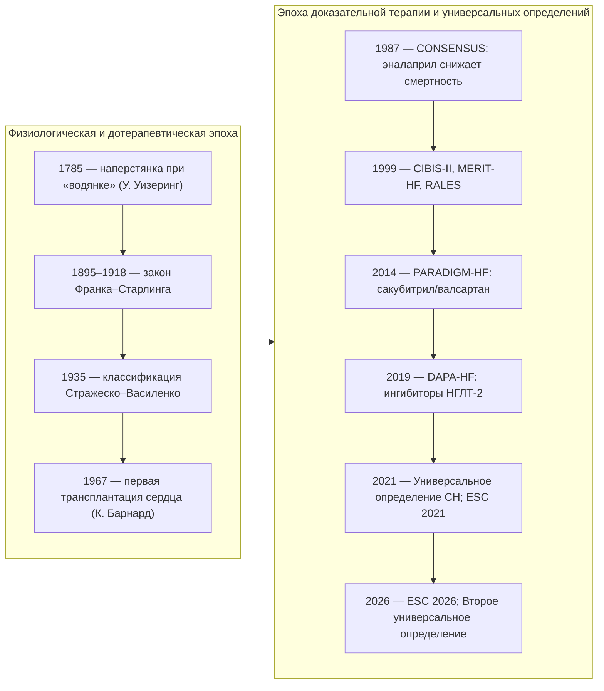
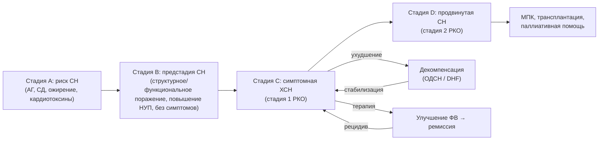

## 2. Определение, терминология и эволюция представлений о ХСН

### 2.1. Ключевые понятия

Точность терминологии при ХСН — не формальность: от того, назовём ли мы состояние «острой», «декомпенсированной» или «продвинутой» сердечной недостаточностью, зависят маршрут пациента, объём обследования и выбор терапии. Ниже введены понятия, которыми мы будем пользоваться на протяжении всей лекции.

#### 2.1.1. Сердечная недостаточность

> 📌 **Определение:** **сердечная недостаточность** (heart failure, HF; СН) — клинический синдром, характеризующийся настоящими или предшествующими симптомами (одышка, утомляемость, отёки) и/или признаками (повышение давления в яремных венах, хрипы в лёгких, периферические отёки), обусловленными структурным и/или функциональным нарушением сердца, которое приводит к снижению сердечного выброса и/или повышению давления наполнения в покое или при нагрузке и подтверждается повышением уровня натрийуретических пептидов и/или объективными признаками застоя.

Эта формулировка объединяет Универсальное определение 2021 года и определение российских клинических рекомендаций 2024 года. В ней важны три элемента: (1) СН — синдром, а не нозология; (2) обязательна причинная связь симптомов со структурным или функциональным поражением сердца; (3) требуется объективное подтверждение (натрийуретические пептиды, визуализация, признаки застоя), а не только жалобы.

#### 2.1.2. Хроническая сердечная недостаточность

**Хроническая сердечная недостаточность** (ХСН) — сердечная недостаточность с длительным течением, при которой симптомы и признаки существуют постоянно или рецидивируют, а пациент уже получает (или должен получать) длительную терапию. Пациента с ХСН, у которого симптомы и лечение не менялись как минимум в течение месяца, традиционно называют «стабильным». Термин «хроническая» противопоставляется не столько «острой», сколько впервые возникшей, ещё не леченной сердечной недостаточности.

#### 2.1.3. Острая сердечная недостаточность

**Острая сердечная недостаточность** (ОСН) в российских рекомендациях 2024 года определяется как опасное для жизни состояние, характеризующееся быстрым началом или резким ухудшением симптомов и признаков СН вплоть до отёка лёгких или кардиогенного шока, требующее неотложных лечебных мероприятий и, как правило, срочной госпитализации. Рекомендации ESC 2026 отказались от термина «острая» в пользу термина «декомпенсированная сердечная недостаточность», подчёркивая, что у большинства пациентов ухудшение развивается не внезапно, а в течение дней и недель (см. п. 2.4.5).

#### 2.1.4. Острая декомпенсация ХСН; декомпенсированная сердечная недостаточность

**Острая декомпенсация сердечной недостаточности** (ОДСН) — быстрое выраженное усугубление симптомов и признаков уже существующей ХСН. Это самая частая клиническая форма ухудшения: по данным европейских регистров, большинство госпитализаций с «острой» СН приходится именно на декомпенсацию хронической, а не на впервые возникшую СН. **Декомпенсированная сердечная недостаточность** (decompensated heart failure, DHF) в терминологии ESC 2026 — зонтичный термин для состояний, при которых нарастание симптомов и/или признаков СН достаточно выражено, чтобы потребовать неотложной помощи, независимо от скорости развития.

#### 2.1.5. Впервые выявленная сердечная недостаточность и сердечная недостаточность de novo

**Впервые выявленная СН** — диагноз, установленный впервые, независимо от давности симптомов (нередко пациент жил с нераспознанной ХСН годами). **СН de novo** — первое проявление СН у пациента без предшествующего анамнеза; она может быть острой (например, при инфаркте миокарда, фульминантном миокардите) или подострой (постепенное нарастание одышки при кардиомиопатии). Различие имеет значение для прогноза и объёма этиологического поиска: при СН de novo всегда требуется полное обследование для исключения обратимых причин.

#### 2.1.6. Бессимптомная дисфункция сердца и предстадия сердечной недостаточности

**Бессимптомная дисфункция левого желудочка** — снижение систолической и/или нарушение диастолической функции ЛЖ при отсутствии симптомов и признаков СН. В современной стадийной системе такие пациенты относятся к стадии B (pre-HF) по ACC/AHA и ESC 2026 и к **предстадии СН** по российской классификации: отсутствие симптомов и признаков ХСН в настоящем и прошлом при наличии структурного и/или функционального поражения сердца и/или повышения уровня натрийуретических пептидов. Выделение предстадии — практический инструмент профилактики: именно на этом этапе терапия способна предотвратить или отсрочить появление симптомов.

#### 2.1.7. Продвинутая (далеко зашедшая) сердечная недостаточность

> 📌 **Определение:** **продвинутая сердечная недостаточность** (advanced heart failure) по критериям Ассоциации сердечной недостаточности ESC (2018) требует одновременного наличия, несмотря на оптимальную терапию: (1) тяжёлых стойких симптомов (NYHA III–IV); (2) тяжёлой дисфункции сердца — ФВ ЛЖ ≤ 30 %, изолированной правожелудочковой недостаточности, неоперабельной клапанной или врождённой патологии либо стабильно высоких натрийуретических пептидов с тяжёлой диастолической дисфункцией; (3) эпизодов застоя, требовавших высоких доз внутривенных диуретиков, либо низкого выброса, требовавшего инотропов, либо злокачественных аритмий — с более чем одним незапланированным визитом или госпитализацией за 12 месяцев; (4) тяжёлого снижения переносимости нагрузки (невозможность нагрузки, дистанция 6-минутной ходьбы < 300 м или пиковое потребление кислорода < 12 мл/кг/мин) предположительно кардиального генеза.

Синонимы — «далеко зашедшая», «терминальная», «рефрактерная» СН, стадия D по ACC/AHA; в российской классификации 2023 года ей соответствует стадия 2. Распознавание продвинутой СН — сигнал к направлению в экспертный центр для оценки показаний к механической поддержке кровообращения и трансплантации (см. раздел 25).

#### 2.1.8. Систолическая и диастолическая дисфункция

**Систолическая дисфункция** — нарушение сократительной (насосной) функции желудочка, проявляющееся снижением фракции выброса, ударного объёма и скорости нарастания давления. **Диастолическая дисфункция** — нарушение расслабления и/или растяжимости (податливости) желудочка, из-за которого адекватное наполнение достигается только ценой повышения давления наполнения. Эти процессы редко существуют изолированно: при систолической дисфункции почти всегда есть диастолическая, а при «изолированной» диастолической нередко выявляется субклиническое снижение продольной деформации миокарда. Термины «систолическая» и «диастолическая ХСН» сохраняются в российских рекомендациях как описательные, но в классификации заменены фенотипами по фракции выброса.

#### 2.1.9. Фракция выброса левого желудочка

> 📌 **Определение:** **фракция выброса левого желудочка** (left ventricular ejection fraction, LVEF; ФВ ЛЖ) — доля конечно-диастолического объёма, изгоняемая за систолу:
>
> $$\mathrm{ФВ} = \frac{\mathrm{КДО} - \mathrm{КСО}}{\mathrm{КДО}} \times 100\,\%, \qquad (1)$$
>
> где КДО — конечно-диастолический объём (мл), КСО — конечно-систолический объём (мл).

Референсный метод в повседневной практике — двухмерная ЭхоКГ по биплановому методу дисков (Симпсона); при плохой визуализации используют контрастирование, трёхмерную ЭхоКГ или МРТ сердца. ФВ — не мера сократимости в строгом смысле: она зависит от пред- и постнагрузки, частоты ритма, наличия митральной регургитации (при тяжёлой регургитации «нормальная» ФВ скрывает дисфункцию). Воспроизводимость измерения ограничена: расхождения между исследователями могут достигать нескольких процентных пунктов, поэтому пограничные значения требуют повторной оценки, а решения об устройствах — подтверждения на фоне оптимальной терапии.

#### 2.1.10. Натрийуретические пептиды

**Натрийуретические пептиды** (natriuretic peptides, NP; НУП) — семейство гормонов, вырабатываемых кардиомиоцитами в ответ на растяжение стенки. Предсердный пептид (ANP) синтезируется преимущественно в предсердиях; **мозговой натрийуретический пептид** (B-type natriuretic peptide, BNP) — в желудочках: прогормон proBNP расщепляется на биологически активный BNP и неактивный N-концевой фрагмент **NT-proBNP** в эквимолярных количествах. BNP выводится через клиренс-рецепторы и расщепляется неприлизином (период полувыведения около 20 мин), NT-proBNP элиминируется преимущественно почками (период полувыведения дольше, порядка 1–2 ч), поэтому NT-proBNP сильнее зависит от функции почек и возраста. Физиологически НУП — антагонисты РААС: вызывают натрийурез, вазодилатацию, тормозят фиброз и гипертрофию. Клинически они служат главным инструментом исключения СН и мерой тяжести (см. раздел 8).

> 💡 **Интересный факт:** BNP получил название «мозгового» потому, что впервые был выделен в 1988 году из ткани головного мозга свиньи; лишь затем выяснилось, что его основной источник — желудочки сердца. Предсердный пептид был открыт раньше, в 1981 году, когда экстракт предсердий крысы вызвал у животных выраженный натрийурез, — так было экспериментально доказано, что сердце является эндокринным органом.

#### 2.1.11. Застой (congestion) и гиперволемия

**Застой** (congestion) — клиническое и/или гемодинамическое состояние повышенного давления наполнения желудочков с накоплением жидкости в лёгких и/или тканях большого круга. Выделяют **гемодинамический застой** (повышение давления наполнения, выявляемое инвазивно или по ЭхоКГ, нередко за дни и недели до симптомов) и **клинический застой** (отёки, хрипы, набухание шейных вен). **Гиперволемия** — увеличение общего объёма внеклеточной жидкости; она часто, но не всегда лежит в основе застоя: при «сосудистом» типе декомпенсации на фоне гипертензии жидкость перераспределяется в малый круг без существенного прироста общего объёма. Различие важно для выбора терапии: диуретики против вазодилататоров.

#### 2.1.12. Низкий сердечный выброс и гипоперфузия

**Синдром низкого выброса** — состояние, при котором сердечный выброс недостаточен для метаболических потребностей тканей. **Гипоперфузия** — его клинический эквивалент: холодные влажные конечности, снижение пульсового давления, олигурия, спутанность сознания, повышение лактата. Гипоперфузия не тождественна артериальной гипотонии: низкое давление может сочетаться с удовлетворительной перфузией, и наоборот. Инвазивно низкий выброс характеризуется сердечным индексом менее 2,2 л/мин/м².

#### 2.1.13. Компенсация, ремиссия и прогрессирование

**Компенсация** — состояние, при котором на фоне лечения и собственных адаптивных механизмов симптомы контролируются, а застой отсутствует. **Прогрессирование** — нарастание дисфункции и симптомов, несмотря на терапию. Второе универсальное определение (2026) формализует траектории: **улучшение** (ФВ выросла, но структурные или клинические отклонения сохраняются), **ремиссия** (ФВ нормализовалась, симптомы минимальны, биомаркеры стабильны, но риск рецидива сохраняется) и **выздоровление** (стойкая нормализация функции, структуры и биомаркеров без симптомов). Практический смысл различения: даже при ремиссии терапия, как правило, не отменяется (см. раздел 17).

#### 2.1.14. Кардиоренальный синдром

> 📌 **Определение:** **кардиоренальный синдром** (cardiorenal syndrome, CRS; КРС) — группа расстройств, при которых острая или хроническая дисфункция сердца вызывает дисфункцию почек или наоборот. По классификации Ronco выделяют пять типов: 1 — острый кардиоренальный (острая СН → острое повреждение почек); 2 — хронический кардиоренальный (ХСН → прогрессирующая ХБП); 3 — острый ренокардиальный; 4 — хронический ренокардиальный; 5 — вторичный, при системных заболеваниях (сепсис, амилоидоз, сахарный диабет).

Подробнее патофизиология и тактика рассмотрены в разделах 5, 10 и 19.

#### 2.1.15. Сердечная кахексия

**Сердечная кахексия** — непреднамеренная потеря не менее 5–6 % «сухой» (без отёков) массы тела за 6–12 месяцев у пациента с ХСН, отражающая системный катаболизм, воспаление, мальабсорбцию при застое в кишечнике и анорексию. Кахексия — независимый предиктор смерти и критерий продвинутой СН; её следует отличать от саркопении (потери мышечной массы и силы, возможной и без снижения веса) и от ожирения с саркопенией.

### 2.2. ХСН как клинический синдром и её нозологическая основа

ХСН — синдром, то есть совокупность симптомов и признаков, имеющая множество причин. Диагноз «ХСН» без указания причины неполон: он не позволяет выбрать этиотропное лечение (реваскуляризацию при ишемии, коррекцию порока, отмену кардиотоксичного препарата, специфическую терапию амилоидоза), оценить прогноз и провести семейный скрининг. Поэтому в клиническом диагнозе ХСН всегда занимает место осложнения основного заболевания (ИБС, гипертонической болезни, кардиомиопатии, порока), за исключением случаев, когда причину установить не удалось. Второе универсальное определение 2026 года закрепляет этот подход, предлагая универсальную классификацию причин СН, не зависящую от фракции выброса.

> ❗ **Типичная ошибка:** формулировка «ХСН неясного генеза» у пациента, которому не выполнены коронарография или КТ-ангиография, МРТ сердца, оценка на амилоидоз и генетическое консультирование. «Идиопатической» кардиомиопатия может называться только после исчерпания доступного этиологического поиска.

### 2.3. Соотношение терминов «недостаточность кровообращения» и «сердечная недостаточность»

Термин **«недостаточность кровообращения»** в отечественной школе (А. Л. Мясников, классификация Н. Д. Стражеско и В. Х. Василенко) обозначал состояние, при котором система кровообращения не обеспечивает потребности организма, и включал как сердечные, так и сосудистые формы. По сути он употреблялся как синоним ХСН, но только в нашей стране. Российские рекомендации 2024 года прямо указывают, что для замены термина «ХСН» он не рекомендован. В то же время стадии Стражеско–Василенко, исторически описанные для недостаточности кровообращения, продолжают использоваться для стадирования ХСН (см. раздел 6).

### 2.4. Исторические аспекты и эволюция терминологии

#### 2.4.1. Исторические этапы изучения ХСН

Описания водянки и удушья с набуханием вен встречаются с античности, однако научная история ХСН начинается с открытия кровообращения У. Гарвеем (1628). В 1785 году У. Уизеринг опубликовал труд о наперстянке, положив начало фармакотерапии «водянки сердечного происхождения». Физиологический фундамент заложили О. Франк (1895) и Э. Старлинг (1914–1918), описавшие зависимость силы сокращения от исходного растяжения волокон. В 1920–1930-е годы появились ртутные диуретики, в 1935 году на XII Всесоюзном съезде терапевтов принята классификация Стражеско–Василенко, разработанная при участии Г. Ф. Ланга. 1950–1960-е годы дали тиазиды и петлевые диуретики, 1967 год — первую трансплантацию сердца (К. Барнард, Кейптаун). Эпоха доказательной терапии открылась исследованием CONSENSUS (1987), показавшим снижение смертности при лечении эналаприлом; затем последовали SOLVD (1991), исследования бета-адреноблокаторов (1999–2001), спиронолактона (RALES, 1999), устройств (2002–2005), сакубитрила/валсартана (2014) и ингибиторов НГЛТ-2 (2019–2022). Хронология ключевых этапов представлена на рис. 1.

**Рис. 1.** Ключевые этапы изучения и лечения сердечной недостаточности. Схема читается сверху вниз внутри каждого столбца и слева направо между столбцами; указаны только события, положившие начало новому классу вмешательств или новой системе понятий.

#### 2.4.2. Смена концепций: гемодинамическая, нейрогормональная, биомеханическая модели

Представления о природе ХСН сменялись трижды (Patterson & Adams, 1996; Louridas & Lourida, 2012). **Гемодинамическая модель** (1960–1970-е) рассматривала ХСН как проблему «насоса и нагрузки» и породила терапию вазодилататорами и инотропами. **Нейрогормональная модель** (1980–1990-е) объяснила прогрессирование хронической активацией симпатоадреналовой системы и РААС и обосновала применение препаратов, которые с гемодинамической точки зрения выглядели парадоксально, — бета-адреноблокаторов. **Биомеханическая модель** (2000-е) объединила нейрогормональные и механические стимулы через понятие ремоделирования миокарда и расширила круг мишеней до клеточных и молекулярных процессов. Содержательно каждая модель разобрана в п. 5.7; здесь важно, что ни одна из них не отменила предыдущую: современная терапия одновременно разгружает сердце, блокирует нейрогормоны и влияет на ремоделирование.

#### 2.4.3. Универсальное определение сердечной недостаточности (2021)

В 2021 году Общество сердечной недостаточности Америки, Ассоциация сердечной недостаточности ESC и Японское общество СН опубликовали **Универсальное определение и классификацию СН** (Bozkurt et al., 2021). Документ ввёл: единое определение синдрома (см. п. 2.1.1); пересмотренные стадии — «риск СН» (A), «предстадия СН» (B), «симптомная СН» (C), «продвинутая СН» (D); классификацию по ФВ — ХСНснФВ (≤ 40 %), ХСНунФВ (41–49 %), ХСНсФВ (≥ 50 %) и новую категорию **ХСН с улучшенной ФВ** (исходная ФВ ≤ 40 %, прирост ≥ 10 пунктов, повторное значение > 40 %). Ключевой посыл — СН можно диагностировать до появления симптомов (стадии A и B) и, следовательно, предотвращать.

#### 2.4.4. Второе универсальное определение сердечной недостаточности (2026)

**Второе универсальное определение** (AHA/ACC/ESC/WHF при участии HFSA, HFA и JHFS, 2026) уточнило критерии стадий A–D, сместило акцент с жёстких порогов ФВ на фенотип, этиологию и течение. Фенотипы сгруппированы в клинически действенные категории — сниженная, сохранённая и улучшенная ФВ — без фиксированных числовых границ; ФВ ниже 50 % рассматривается как отклонение от нормы независимо от пола, возраста и этнической принадлежности. Введена универсальная классификация причин СН с учётом географических различий этиологии и описаны траектории течения — улучшение, ремиссия и выздоровление (см. п. 2.1.13). Документ подчёркивает, что внезапная смерть возможна на любом этапе континуума, поэтому наблюдение не прекращается и при улучшении.

#### 2.4.5. Терминология ESC 2026

Рекомендации ESC 2026, представленные на конгрессе в Мюнхене, внесли четыре терминологических изменения. Во-первых, упразднена категория ХСН с умеренно сниженной ФВ: **ХСНснФВ определяется как ФВ ЛЖ < 50 %**, ХСНсФВ — как ФВ ≥ 50 %. Во-вторых, официально приняты стадии A–D. В-третьих, термин «острая сердечная недостаточность» заменён на «декомпенсированная сердечная недостаточность». В-четвёртых, введена новая номенклатура лечения: **базовая (foundational) медикаментозная терапия** — препараты с наиболее сильными доказательствами снижения смертности и госпитализаций; **дополнительная медикаментозная терапия**; **интервенционная терапия, рекомендованная руководствами**. Для ХСНснФВ базовая терапия включает бета-адреноблокатор, ингибитор АПФ/АРНИ/БРА, антагонист минералокортикоидных рецепторов и ингибитор НГЛТ-2; для ХСНсФВ — ингибитор НГЛТ-2 и АМКР. Как подчёркивают комментаторы документа, расширение определения ХСНснФВ до < 50 % не означает автоматического расширения показаний к ИКД, СРТ или ивабрадину: пороги для отдельных вмешательств сохраняют собственную доказательную базу.

#### 2.4.6. Терминология российских рекомендаций

Российские клинические рекомендации 2024 года (одобрены Научно-практическим советом Минздрава России 12.09.2024) используют термины: **ХСНнФВ** (ФВ ≤ 40 %), **ХСНунФВ** (41–49 %), **ХСНсФВ** (≥ 50 %); «предстадия СН», «риск развития ХСН», «стадия 1» и «стадия 2» по классификации экспертов РКО 2023 года; функциональные классы NYHA; Шкалу оценки клинического состояния (ШОКС); термины «острая СН» и «острая декомпенсация СН». Обратите внимание на различие аббревиатур: в российских документах — ХСНнФВ (низкая/сниженная), в переводной литературе — ХСНснФВ; содержательно они совпадают. В данной лекции используется аббревиатура ХСНснФВ, кроме цитирования российских документов.

### 2.5. Кодирование по МКБ-10

#### 2.5.1. I50.0 — застойная сердечная недостаточность

Код применяется при ХСН с признаками застоя по большому кругу (отёки, гепатомегалия, асцит) или бивентрикулярной недостаточности; это наиболее часто используемый код при декомпенсации.

#### 2.5.2. I50.1 — левожелудочковая недостаточность

Код охватывает преимущественно левожелудочковую недостаточность с застоем в малом круге, включая сердечную астму и отёк лёгких кардиального генеза.

#### 2.5.3. I50.9 — сердечная недостаточность неуточнённая

Код используется, когда тип недостаточности не уточнён; при корректном обследовании его доля должна быть минимальной. В статистике смертности СН, как правило, не считается первоначальной причиной смерти: кодируется основное заболевание (например, I25 — хроническая ИБС), а СН указывается как осложнение. Это одна из причин занижения «видимого» вклада ХСН в смертность. Термины и коды сведены в табл. 2.

**Табл. 2.** Термины и коды МКБ-10, применяемые при ХСН.

| Термин | Суть | Документ-источник | Код МКБ-10 (при кодировании ХСН) |
|---|---|---|---|
| Сердечная недостаточность | Синдром с симптомами/признаками, вызванный поражением сердца и подтверждённый НУП/застоем | Универсальное определение 2021/2026; КР РФ 2024 | I50.0 / I50.1 / I50.9 |
| Предстадия СН (стадия B) | Структурное/функциональное поражение без симптомов | КР РФ 2024; ACC/AHA; ESC 2026 | Кодируется основное заболевание |
| Острая декомпенсация ХСН | Быстрое выраженное усугубление симптомов ХСН | КР РФ 2024 | I50.0 (чаще) |
| Декомпенсированная СН | Ухудшение, требующее неотложной помощи, любой скорости развития | ESC 2026 | I50.x по типу |
| Продвинутая СН (стадия D / стадия 2 РКО) | Тяжёлые симптомы и дисфункция, несмотря на оптимальную терапию | HFA ESC 2018; КР РФ 2024 | I50.x по типу |
| ХСН с улучшенной ФВ | Исходно ФВ ≤ 40 %, прирост ≥ 10 пунктов, повторно ≥ 40 % | Универсальное определение 2021; КР РФ 2024 | I50.x по типу |

### 2.6. Примеры и иллюстрации

#### 2.6.1. Примеры клинических формулировок определения

Пример 1. Пациент 68 лет, перенёс инфаркт миокарда, жалуется на одышку при подъёме на второй этаж, ФВ ЛЖ 32 %, NT-proBNP 1 450 пг/мл. Все элементы определения присутствуют: симптомы, структурное поражение, биомаркерное подтверждение — это симптомная ХСН со сниженной ФВ (стадия C / стадия 1 РКО).

Пример 2. Пациентка 74 лет с гипертонической болезнью, одышка при быстрой ходьбе, ФВ 62 %, индекс объёма левого предсердия 41 мл/м², E/e′ 15, NT-proBNP 480 пг/мл. Симптомы и признаки диастолической дисфункции с повышенным НУП при сохранённой ФВ — ХСН с сохранённой ФВ; одной лишь «нормальной» ФВ для исключения диагноза недостаточно.

Пример 3. Пациент 55 лет без жалоб, ФВ 38 % после миокардита, NT-proBNP 300 пг/мл. Симптомов нет, но есть дисфункция и повышенный биомаркер — предстадия СН (стадия B), требующая терапии для предотвращения симптомов.

#### 2.6.2. Клинические иллюстрации состояний континуума сердечной недостаточности

Континуум СН удобно представить как последовательность состояний с возможными переходами в обе стороны (см. рис. 2). Пациент с артериальной гипертензией и диабетом (стадия A) через гипертрофию ЛЖ и диастолическую дисфункцию (стадия B) приходит к симптомной ХСН (стадия C); декомпенсации — это обострения внутри стадии C; при неэффективности терапии наступает продвинутая СН (стадия D). На фоне лечения возможны улучшение ФВ и ремиссия, но возврат к стадии A невозможен: структурное поражение остаётся в анамнезе.

**Рис. 2.** Понятийная карта континуума сердечной недостаточности. Схема читается слева направо: стадии A–D отражают прогрессирование, стрелки «ухудшение/стабилизация» — эпизоды декомпенсации внутри стадии C, ветвь «улучшение ФВ → ремиссия» — обратимость под действием терапии с сохранением риска рецидива. МПК — механическая поддержка кровообращения.

> 🔬 **Углубление:** граница между ремиссией и выздоровлением при ХСН с улучшенной ФВ остаётся предметом исследований. В исследовании TRED-HF (Halliday et al., 2019) у пациентов с дилатационной кардиомиопатией и полностью восстановившейся функцией ЛЖ отмена терапии в течение шести месяцев приводила к рецидиву примерно у 40 % участников, тогда как при продолжении лечения рецидивов не было. Это указывает, что нормализация ФВ отражает ремиссию под контролем лекарств, а не излечение, и объясняет, почему Второе универсальное определение разделяет улучшение, ремиссию и выздоровление и требует стойкости нормализации структуры и биомаркеров для констатации последнего.

> 📝 **Обобщение.** Сердечная недостаточность — синдром с обязательным объективным подтверждением; ХСН, острая/декомпенсированная СН, СН de novo, предстадия и продвинутая СН — не разные болезни, а состояния одного континуума. За сорок лет терминология прошла путь от «недостаточности кровообращения» и гемодинамической модели к универсальным определениям 2021 и 2026 годов и к номенклатуре ESC 2026 (два фенотипа по ФВ, стадии A–D, «декомпенсированная» СН, «базовая терапия»). Российские рекомендации 2024 года сохраняют три фенотипа по ФВ и собственные стадии, и врач обязан владеть обеими системами. Эти понятия — язык, на котором далее будут описаны эпидемиология, механизмы, диагностика и лечение.

> ❓ **Контрольные вопросы**
>
> 1. Перечислите обязательные элементы современного определения сердечной недостаточности.
> 2. Чем «декомпенсированная сердечная недостаточность» в терминологии ESC 2026 отличается от «острой декомпенсации ХСН» в российских рекомендациях и почему был заменён термин?
> 3. Почему Второе универсальное определение (2026) отказалось от жёстких порогов фракции выброса и какие траектории течения оно описывает?
> 4. Пациент без жалоб имеет ФВ 38 % после перенесённого миокардита. К какой стадии его отнести по классификациям ACC/AHA и РКО и что это меняет в тактике?
