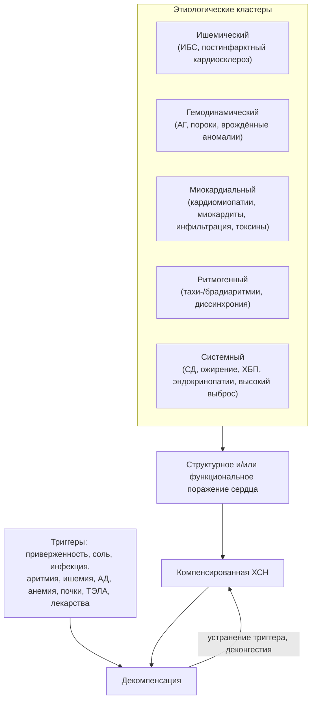

## 4. Этиология и факторы риска

### 4.1. Ключевые понятия

#### 4.1.1. Этиологический (причинный) фактор

**Этиологический фактор** — заболевание или воздействие, непосредственно вызывающее структурное или функциональное поражение сердца, которое приводит к СН (инфаркт миокарда, аортальный стеноз, антрациклины). Устранение причины может остановить прогрессирование или даже привести к восстановлению функции, поэтому этиологический поиск обязателен при каждом впервые установленном диагнозе.

#### 4.1.2. Фактор риска: модифицируемые и немодифицируемые

**Фактор риска** — состояние, статистически повышающее вероятность развития СН, но не являющееся её непосредственной причиной. Модифицируемые факторы (гипертензия, диабет, ожирение, курение, алкоголь, апноэ сна, малоподвижность) — мишени профилактики на стадии A; немодифицируемые (возраст, мужской пол для ХСНснФВ, семейный анамнез, генотип) определяют группы, нуждающиеся в скрининге. Граница условна: артериальная гипертензия одновременно фактор риска ИБС и самостоятельная причина гипертонического сердца.

#### 4.1.3. Триггер (пусковой фактор) декомпенсации

**Триггер декомпенсации** — событие, переводящее компенсированную ХСН в декомпенсацию (инфекция, аритмия, нарушение приёма препаратов, избыток соли). Триггер не создаёт болезнь, но определяет момент ухудшения; его выявление и устранение — первый шаг при каждой госпитализации (см. п. 4.4 и раздел 22).

### 4.2. Основные причины ХСН

В Российской Федерации, по данным рекомендаций 2024 года, основные причины ХСН — артериальная гипертензия и ИБС; их сочетание встречается у половины пациентов. ИБС является причиной систолической ХСН в двух третях случаев, часто в сочетании с диабетом и гипертензией; на пороки сердца приходится около 4,3 %, на миокардиты — 3,6 %. Сводка причин приведена в табл. 4; далее каждая группа разобрана отдельно.

**Табл. 4.** Основные причины ХСН по механизму поражения.

| Группа | Примеры | Преимущественный фенотип | Ключ к диагностике |
|---|---|---|---|
| Ишемическое поражение | Постинфарктный кардиосклероз, гибернация миокарда | ХСНснФВ (реже сФВ) | Анамнез ИМ, зоны акинеза, коронарография/КТ-ангиография |
| Перегрузка давлением | Артериальная гипертензия, аортальный стеноз | ХСНсФВ → снФВ на поздних этапах | ГЛЖ, градиент на клапане |
| Перегрузка объёмом | Митральная/аортальная регургитация, шунты, почечная недостаточность | Дилатация, снФВ | Допплер-ЭхоКГ |
| Кардиомиопатии | ДКМП, ГКМП, РКМП, АКМП, некомпактный миокард, такоцубо | Любой | Семейный анамнез, МРТ, генетика |
| Воспаление и инфекции | Миокардиты (вирусные, в т. ч. SARS-CoV-2; гигантоклеточный; эозинофильный), болезнь Шагаса, ВИЧ | снФВ | МРТ (критерии Lake Louise), биопсия |
| Аритмии | Тахикардиомиопатия, частая желудочковая экстрасистолия, брадиаритмии | снФВ, обратимая | Холтер, восстановление ФВ после контроля ритма |
| Врождённые пороки у взрослых | Тетрада Фалло после коррекции, системный ПЖ, Фонтен | Право- или бивентрикулярная | Анамнез, ЭхоКГ, МРТ |
| Лёгочная гипертензия, правые отделы | ЛАГ, ХТЭЛГ, ХОБЛ | Правожелудочковая | ЭхоКГ, катетеризация правых отделов |
| Перикард | Констриктивный перикардит, тампонада | «СН» с сохранной сократимостью | ЭхоКГ, КТ/МРТ, катетеризация |
| Эндокринные и метаболические | СД, ожирение, тиреотоксикоз/гипотиреоз, акромегалия, феохромоцитома | сФВ, реже снФВ | Гормональный профиль |
| Инфильтративные/накопления | Амилоидоз (ATTR, AL), гемохроматоз, саркоидоз, болезнь Фабри | сФВ/рестриктивный, снФВ при саркоидозе | Сцинтиграфия, МРТ (T1, T2*, ECV), ферменты, генетика |
| Токсические/ятрогенные | Алкоголь, кокаин, антрациклины, трастузумаб, ингибиторы контрольных точек, лучевая терапия | снФВ | Анамнез экспозиции, динамика ФВ/GLS |
| Высокий выброс | Анемия, тиреотоксикоз, артериовенозная фистула, бери-бери, болезнь Педжета, сепсис, цирроз | СН с высоким выбросом | Высокий сердечный индекс при симптомах застоя |
| Беременность | Перипартальная КМП | снФВ | Дебют в конце беременности/после родов |
| Генетические/семейные | Титин, ламин, десмосомные гены, саркомерные гены, TTR | Любой | Родословная, генетическое тестирование |

#### 4.2.1. Ишемическая болезнь сердца и постинфарктный кардиосклероз

ИБС — ведущая причина ХСНснФВ в России и мире. Механизмы: утрата кардиомиоцитов при инфаркте с рубцеванием и постинфарктным ремоделированием; хроническая гипоперфузия с «гибернацией» жизнеспособного миокарда; повторные эпизоды ишемии с «оглушением»; ишемическая митральная регургитация. Термин «ишемическая кардиомиопатия» применяют при дисфункции ЛЖ, вызванной многососудистым поражением или перенесённым инфарктом. Прогностически важно различать рубец и гибернирующий миокард (МРТ с контрастированием, стресс-ЭхоКГ, ПЭТ): только жизнеспособный миокард потенциально восстанавливает функцию после реваскуляризации.

#### 4.2.2. Артериальная гипертензия

Хроническая перегрузка давлением вызывает концентрическую гипертрофию ЛЖ, интерстициальный фиброз, нарушение расслабления и податливости — субстрат ХСНсФВ; присоединение ИБС, фибрилляции предсердий или декомпенсация гипертрофии ведут к дилатации и снижению ФВ. Гипертензия — самый частый фактор риска СН в популяции благодаря своей распространённости; длительный контроль АД снижает риск СН примерно наполовину, а интенсивный контроль (SPRINT) — ещё заметнее.

#### 4.2.3. Приобретённые клапанные пороки сердца

Аортальный стеноз (перегрузка давлением), аортальная и митральная регургитация (перегрузка объёмом), митральный стеноз (застой в малом круге при «интактном» ЛЖ), трикуспидальная регургитация (правожелудочковая недостаточность) — каждый порок формирует собственный гемодинамический профиль. Своевременная коррекция до необратимого ремоделирования — единственный способ предотвратить ХСН; поэтому при пороках СН рассматривают как показание к вмешательству, а не только как осложнение. Отдельная проблема — **вторичная (функциональная) митральная регургитация**, которая является следствием ремоделирования ЛЖ при ХСН и одновременно ускоряет его.

#### 4.2.4. Кардиомиопатии (первичные и вторичные, наследственные и приобретённые)

**Кардиомиопатии** — заболевания миокарда со структурными и функциональными нарушениями, не объяснимыми ИБС, гипертензией, пороками или врождёнными аномалиями. Классификация ESC 2023 года выделяет морфофункциональные фенотипы: дилатационный, гипертрофический, рестриктивный, аритмогенный правожелудочковый и недилатационный левожелудочковый.

**4.2.4.1. Дилатационная кардиомиопатия (ДКМП)** — дилатация и систолическая дисфункция ЛЖ (или обоих желудочков) без адекватной нагрузки или ИБС. Около 30–40 % случаев семейные; наиболее частые гены — титин (TTN, укороченные варианты), ламин A/C (LMNA), десмосомные гены, RBM20, FLNC, BAG3, PLN. Приобретённые причины — перенесённый миокардит, алкоголь, химиотерапия, перипартальный период; нередко генетическая предрасположенность реализуется под действием внешнего триггера.

**4.2.4.2. Гипертрофическая кардиомиопатия (ГКМП)** — гипертрофия ЛЖ (≥ 15 мм, ≥ 13 мм у родственников) без иной причины; чаще саркомерные мутации (MYBPC3, MYH7). СН развивается вследствие диастолической дисфункции, обструкции выносящего тракта, митральной регургитации, фибрилляции предсердий и, у меньшинства, «конечной стадии» с истончением стенок и снижением ФВ.

**4.2.4.3. Рестриктивная кардиомиопатия (РКМП)** — ригидные желудочки нормального или уменьшенного объёма с расширенными предсердиями; причины — амилоидоз, эндомиокардиальный фиброз, гиперэозинофильный синдром, болезни накопления, лучевое поражение, идиопатические формы. Главная дифференциальная задача — отличить от констриктивного перикардита, который излечим хирургически.

**4.2.4.4. Аритмогенная кардиомиопатия (АКМП)** — фиброзно-жировое замещение миокарда преимущественно ПЖ (возможно и ЛЖ) при мутациях десмосомных генов (PKP2, DSP, DSG2); проявляется желудочковыми аритмиями и внезапной смертью у молодых, а на поздних стадиях — право- или бивентрикулярной СН.

**4.2.4.5. Некомпактный миокард левого желудочка и другие специфические формы.** Выраженная трабекулярность с глубокими межтрабекулярными лакунами может быть вариантом строения, адаптацией (спортсмены, беременность) или проявлением кардиомиопатии; классификация ESC 2023 рассматривает некомпактность как фенотипический признак, а не самостоятельную нозологию. К специфическим формам относят также кардиомиопатии при нервно-мышечных заболеваниях (дистрофии Дюшенна, Беккера, миотоническая дистрофия) и митохондриальные.

**4.2.4.6. Кардиомиопатия такоцубо** — транзиторная дисфункция ЛЖ (чаще апикальное «баллонирование») после эмоционального или физического стресса, преимущественно у женщин в постменопаузе; имитирует инфаркт при интактных коронарных артериях; функция обычно восстанавливается за недели, но в острой фазе возможны отёк лёгких, шок и аритмии.

#### 4.2.5. Миокардиты и воспалительные заболевания миокарда; инфекционные причины, включая постковидное поражение

Миокардит — воспаление миокарда инфекционной (энтеровирусы, аденовирусы, парвовирус B19, герпесвирусы, SARS-CoV-2, ВИЧ, боррелии, трипаносомы), иммуноопосредованной (гигантоклеточный, эозинофильный, при системных заболеваниях, индуцированный ингибиторами контрольных точек) или токсической природы. Исходы — от полного выздоровления до воспалительной ДКМП. Поражение сердца при COVID-19 включает миокардит, микрососудистый тромбоз, такоцубо-подобные формы и декомпенсацию ранее существовавшей ХСН; клинически значимый постковидный миокардит встречается реже, чем предполагалось в начале пандемии, однако у части пациентов сохраняются признаки воспаления по данным МРТ.

#### 4.2.6. Тахиаритмии (тахикардиомиопатия), брадиаритмии и нарушения проводимости

Длительная тахикардия (фибрилляция/трепетание предсердий с высокой частотой, предсердная тахикардия, частая желудочковая экстрасистолия с бременем порядка 10–20 % и более) способна вызвать потенциально обратимую систолическую дисфункцию — **тахикардиомиопатию**; её диагностируют ретроспективно по восстановлению ФВ после контроля частоты или ритма. Брадиаритмии и АВ-блокады снижают выброс за счёт частоты, а длительная стимуляция правого желудочка вызывает диссинхронию и «пейсмейкер-индуцированную» кардиомиопатию. Блокада левой ножки сама по себе ухудшает механику ЛЖ — на этом основана ресинхронизирующая терапия.

#### 4.2.7. Врождённые пороки сердца у взрослых

Благодаря детской кардиохирургии до взрослого возраста доживает большинство пациентов с врождёнными пороками, и СН стала главной причиной их смерти. Особые ситуации: системный правый желудочек (после операции Мастарда/Сеннинга, корригированная транспозиция), кровообращение Фонтена (нет субпульмонального желудочка), остаточная лёгочная регургитация после коррекции тетрады Фалло, синдром Эйзенменгера. Стандартная терапия ХСН к этим пациентам экстраполируется с осторожностью; ведение — в специализированных центрах.

#### 4.2.8. Лёгочная гипертензия и заболевания правых отделов сердца

Правожелудочковая недостаточность развивается при перегрузке давлением (лёгочная артериальная гипертензия, хроническая тромбоэмболическая ЛГ, тяжёлые заболевания лёгких), перегрузке объёмом (трикуспидальная регургитация, дефект межпредсердной перегородки), инфаркте ПЖ и АКМП. Самая частая причина ЛГ — левосердечная недостаточность (ЛГ группы 2), поэтому при выявлении ЛГ сначала исключают патологию левых отделов.

#### 4.2.9. Заболевания перикарда

Констриктивный перикардит (после перикардита, кардиохирургии, лучевой терапии, туберкулёза) и тампонада ограничивают наполнение сердца при сохранной сократимости и имитируют правожелудочковую СН: набухание шейных вен, гепатомегалия, асцит, при констрикции — симптом Куссмауля. Распознавание важно, поскольку перикардэктомия излечивает констрикцию, а диуретики и вазодилататоры при тампонаде опасны.

#### 4.2.10. Эндокринные и метаболические причины

**4.2.10.1. Сахарный диабет** повышает риск СН вдвое у мужчин и в несколько раз у женщин (Фремингемские данные) через ИБС, гипертензию, ХБП и собственно диабетическую кардиомиопатию — фиброз, микроангиопатию, нарушение энергетического метаболизма кардиомиоцита. **4.2.10.2. Ожирение** увеличивает риск СН независимо от других факторов; механизмы — увеличение объёма циркулирующей крови, эпикардиальный жир, системное воспаление, апноэ сна; «ожирение-ассоциированная ХСНсФВ» выделена как отдельный фенотип. **4.2.10.3. Заболевания щитовидной железы**: тиреотоксикоз вызывает СН с высоким выбросом и тахиаритмии, гипотиреоз — брадикардию, перикардиальный выпот, снижение сократимости; амиодарон делает дисфункцию щитовидной железы частой у пациентов с ХСН. **4.2.10.4. Акромегалия и другие редкие эндокринопатии** (феохромоцитома с катехоламиновой кардиомиопатией, синдром Кушинга, первичный гиперальдостеронизм, дефицит гормона роста, гиперпаратиреоз) — редкие, но потенциально обратимые причины.

#### 4.2.11. Инфильтративные заболевания и болезни накопления

**4.2.11.1. Амилоидоз сердца** — отложение фибрилл лёгких цепей иммуноглобулинов (AL) или транстиретина (ATTR: наследственный ATTRv и «дикого типа» ATTRwt). ATTRwt-амилоидоз выявляется у заметной доли пожилых пациентов с ХСНсФВ и у пациентов с «парадоксальным» низкопоточным аортальным стенозом; неинвазивная диагностика сцинтиграфией с остеотропными препаратами изменила его эпидемиологию из «казуистики» в рутинную задачу (см. п. 8.12.3). **4.2.11.2. Гемохроматоз** (наследственный, HFE-ассоциированный, или вторичный при трансфузиях) — перегрузка железом с дилатационной или рестриктивной картиной, обратимой при раннем лечении. **4.2.11.3. Саркоидоз сердца** — гранулёматозное воспаление с АВ-блокадами, желудочковыми аритмиями и очаговой дисфункцией. **4.2.11.4. Болезнь Фабри и другие лизосомные болезни** — Х-сцепленный дефицит α-галактозидазы А с гипертрофией ЛЖ, короткой PR, ангиокератомами, нейропатической болью, протеинурией; болезнь Данона и гликогенозы также дают гипертрофический фенотип.

#### 4.2.12. Токсические и ятрогенные причины

**4.2.12.1. Алкоголь.** Алкогольная кардиомиопатия развивается при многолетнем употреблении больших доз (обычно называют более 80–90 г этанола в сутки в течение более 5 лет) и частично обратима при воздержании. **4.2.12.2. Наркотические и психоактивные вещества**: кокаин и амфетамины (ишемия, гипертензия, прямая кардиотоксичность), анаболические стероиды, «энергетики» в больших дозах. **4.2.12.3. Кардиотоксичная химиотерапия и таргетная терапия**: антрациклины (дозозависимая, преимущественно необратимая кардиомиопатия; риск растёт с кумулятивной дозой), трастузумаб и другие анти-HER2 препараты (чаще обратимая дисфункция), ингибиторы VEGF (гипертензия, дисфункция ЛЖ), ингибиторы протеасом (карфилзомиб), циклофосфамид в высоких дозах, ингибиторы иммунных контрольных точек (миокардит с высокой летальностью). **4.2.12.4. Лучевое поражение** грудной клетки — отсроченные на годы фиброз миокарда, констрикция, клапанные поражения, ускоренный коронарный атеросклероз. **4.2.12.5. Лекарственные средства**, способные вызвать или усугубить СН: НПВП и ингибиторы ЦОГ-2 (задержка натрия), тиазолидиндионы, недигидропиридиновые антагонисты кальция, антиаритмики I класса и дронедарон, некоторые противогрибковые (итраконазол), анти-TNF препараты при тяжёлой СН, клозапин (миокардит), гидроксихлорохин (кардиомиопатия при длительном приёме), миноксидил, минералокортикоидная активность глюкокортикоидов.

#### 4.2.13. Состояния с высоким сердечным выбросом (высоковыбросная сердечная недостаточность)

При анемии, тиреотоксикозе, артериовенозных фистулах (включая диализные), дефиците тиамина (бери-бери), болезни Педжета, сепсисе, циррозе печени, миеломе и ожирении симптомы застоя возникают при высоком сердечном выбросе: периферическая вазодилатация и шунтирование снижают эффективный артериальный объём, активируют РААС и ведут к задержке жидкости, а длительная перегрузка объёмом в итоге повреждает сам миокард. Лечение — устранение причины; стандартная вазодилатирующая терапия может ухудшить состояние.

#### 4.2.14. Беременность и перипартальная кардиомиопатия

**Перипартальная кардиомиопатия** — систолическая дисфункция (ФВ < 45 %) без иной причины, развивающаяся к концу беременности или в первые месяцы после родов. Распространённость сильно варьирует по регионам (наиболее высока в Нигерии и на Гаити); факторы риска — многоплодие, преэклампсия, возраст, африканское происхождение. Патогенез связывают с кардиотоксичным фрагментом пролактина (16 кДа) и дисбалансом ангиогенных факторов, что обосновывает исследование бромокриптина. Около половины пациенток восстанавливают функцию ЛЖ; рецидив при повторной беременности вероятен, особенно при неполном восстановлении.

#### 4.2.15. Генетические и семейные формы

Наследственную природу следует предполагать при ДКМП без явной причины, ГКМП, АКМП, рестриктивном фенотипе, ранней внезапной смерти или СН у родственников, сочетании кардиомиопатии с нарушениями проводимости, скелетной миопатией или внесердечными признаками (нейропатия и синдром запястного канала при ATTRv, ангиокератомы при болезни Фабри). Ламинопатии (LMNA) и некоторые десмосомные варианты (DSP, FLNC) отличаются высоким аритмическим риском, что меняет показания к ИКД. Генетическое тестирование пробанда и каскадный скрининг родственников — часть стандартного ведения (см. п. 8.12.2, 18.16).

#### 4.2.16. Многофакторная этиология

У большинства пожилых пациентов ХСН многофакторна: гипертензия, ИБС, диабет, ожирение, фибрилляция предсердий и ХБП действуют одновременно и усиливают друг друга. В таких случаях важно не искать «единственную причину», а выявить компоненты, поддающиеся коррекции (ишемия, аритмия, клапанная патология, анемия), и лечить фенотип в целом. Второе универсальное определение 2026 года предлагает классифицировать причины с учётом числа и типа действующих факторов именно для таких ситуаций.

### 4.3. Факторы риска и предрасполагающие состояния

#### 4.3.1. Сахарный диабет

Помимо прямой кардиомиопатии и ускоренного атеросклероза диабет ухудшает прогноз уже развившейся ХСН и осложняет терапию (гиперкалиемия, ХБП). Ингибиторы НГЛТ-2 и агонисты ГПП-1 сделали диабет первой областью, где профилактика СН стала самостоятельной целью лечения (см. раздел 11).

#### 4.3.2. Ожирение и метаболический синдром

Каждое увеличение индекса массы тела на 1 кг/м² сопровождается ростом риска СН порядка 5 % у мужчин и 7 % у женщин (Фремингемские данные, Kenchaiah et al., 2002). Ожирение также затрудняет диагностику: снижает уровень НУП, ухудшает визуализацию при ЭхоКГ и само вызывает одышку.

#### 4.3.3. Хроническая болезнь почек

ХБП и ХСН связаны двунаправленно: почечная дисфункция — фактор риска СН через гипертензию, анемию, перегрузку объёмом, уремические токсины и кальцификацию сосудов; ХСН вызывает ХБП через гипоперфузию и венозный застой (см. п. 5.5.6). Снижение рСКФ — один из сильнейших предикторов смерти при ХСН.

#### 4.3.4. Анемия и дефицит железа

Анемия усиливает нагрузку на сердце и ухудшает оксигенацию миокарда; дефицит железа даже без анемии снижает переносимость нагрузки за счёт нарушения митохондриального дыхания в скелетных мышцах и миокарде. Дефицит железа выявляется примерно у половины пациентов с ХСН и является самостоятельной терапевтической мишенью.

#### 4.3.5. Курение и злоупотребление алкоголем

Курение действует через ИБС, ХОБЛ и прямую эндотелиальную дисфункцию; тяжёлое употребление алкоголя — через алкогольную кардиомиопатию, гипертензию, фибрилляцию предсердий и дефицит тиамина. Умеренное употребление не защищает от СН: современные анализы не подтверждают «защитного» эффекта малых доз.

#### 4.3.6. Апноэ сна

Обструктивное апноэ вызывает ночную гипоксемию, выбросы катехоламинов, колебания внутригрудного давления и резистентную гипертензию; центральное апноэ с дыханием Чейна–Стокса — скорее следствие ХСН и маркер тяжести. Частота дыхательных нарушений во сне при ХСН достигает половины пациентов и более, большинство из них не диагностированы.

#### 4.3.7. Семейный анамнез и генетическая предрасположенность

Семейный анамнез кардиомиопатии, внезапной смерти до 50 лет, необъяснимой СН или имплантации устройств у родственников первой линии — показание к направлению пробанда и семьи на обследование. Полигенная предрасположенность влияет и на «обычные» формы: носители укороченных вариантов титина чаще развивают дисфункцию ЛЖ при химиотерапии, алкоголизации и в перипартальном периоде.

#### 4.3.8. Факторы риска предстадии

Переход от стадии A к стадии B отмечается появлением структурных или биохимических отклонений без симптомов: гипертрофии ЛЖ, дилатации камер, снижения ФВ или продольной деформации, диастолической дисфункции, клапанной патологии, а также повышения НУП или высокочувствительного тропонина у пациента с факторами риска. Выявление этих маркеров — задача скрининга (см. п. 11.2).

### 4.4. Триггеры декомпенсации

Триггеры декомпенсации и первоочередные действия при них обобщены в табл. 5; ниже — краткая характеристика каждого.

#### 4.4.1. Нарушение приверженности лечению

Пропуск диуретиков и базисных препаратов, самостоятельное снижение доз из-за побочных эффектов или стоимости, отмена при «хорошем самочувствии» — один из самых частых и предотвратимых триггеров. Выявляется только при доброжелательном, конкретном расспросе («сколько раз за неделю пропустили?»).

#### 4.4.2. Избыток соли и жидкости

Солёная пища (консервы, колбасы, сыры, полуфабрикаты, минеральная вода с высоким содержанием натрия), праздничные застолья, неконтролируемое питьё при жажде на фоне диуретиков ведут к задержке жидкости за несколько дней.

#### 4.4.3. Инфекции

Пневмония, грипп, COVID-19, инфекции мочевых путей и сепсис повышают потребность в кислороде, вызывают тахикардию, лихорадку, вазодилатацию и прямое повреждение миокарда; инфекции — частый триггер у пожилых, причём лихорадка может отсутствовать.

#### 4.4.4. Аритмии

Фибрилляция предсердий с высокой частотой лишает желудочки предсердной систолы и укорачивает диастолу; желудочковые тахикардии и брадиаритмии снижают выброс. Впервые возникшая ФП — классический триггер декомпенсации при ХСНсФВ и ГКМП.

#### 4.4.5. Ишемия и острый коронарный синдром

Инфаркт и нестабильная стенокардия ухудшают сократимость и могут вызывать острую митральную регургитацию или механические осложнения; у пациентов с ХСН ОКС нередко протекает без типичной боли, проявляясь нарастанием одышки.

#### 4.4.6. Неконтролируемая артериальная гипертензия

Резкое повышение постнагрузки ведёт к «сосудистому» типу декомпенсации — быстрому отёку лёгких при относительно сохранной сократимости и без выраженной гиперволемии; это самый частый механизм отёка лёгких при ХСНсФВ.

#### 4.4.7. Анемия и кровотечение

Снижение гемоглобина увеличивает сердечный выброс и частоту ритма, ухудшает оксигенацию миокарда; желудочно-кишечное кровотечение на фоне антикоагулянтов и антиагрегантов — типичная клиническая ситуация.

#### 4.4.8. Почечная дисфункция

Острое повреждение почек (обезвоживание, НПВП, контраст, обструкция) снижает ответ на диуретики и усиливает задержку натрия; прогрессирование ХБП требует пересмотра доз.

#### 4.4.9. Тромбоэмболия лёгочной артерии и респираторные заболевания

ТЭЛА вызывает острую перегрузку ПЖ и гипоксемию; обострение ХОБЛ и бронхиальной астмы — гипоксемию, тахикардию, применение бета-агонистов и глюкокортикоидов, задерживающих жидкость.

#### 4.4.10. Лекарственные триггеры

НПВП, глюкокортикоиды, тиазолидиндионы, недигидропиридиновые антагонисты кальция, антиаритмики I класса, дронедарон, прегабалин/габапентин (отёки), некоторые противоопухолевые препараты, чрезмерная инфузионная терапия в стационаре и даже избыточная доза бета-адреноблокатора при декомпенсации — все они способны спровоцировать ухудшение.

**Табл. 5.** Триггеры декомпенсации ХСН и первоочередные действия.

| Триггер | Как заподозрить | Первоочередное действие |
|---|---|---|
| Нарушение приверженности | Расспрос, упаковки, аптечные данные | Восстановить терапию, выяснить причину (побочные эффекты, стоимость), упростить схему |
| Избыток соли/жидкости | Пищевой анамнез, прибавка массы | Диета, коррекция диуретика, обучение |
| Инфекция | Лихорадка, кашель, лейкоцитоз, СРБ, прокальцитонин | Антимикробная терапия, вакцинация в дальнейшем |
| Аритмия | ЭКГ, мониторирование | Контроль частоты/ритма, антикоагуляция при ФП, кардиоверсия при нестабильности |
| ОКС | ЭКГ, тропонин, боль/эквиваленты | Экстренная реваскуляризация по показаниям |
| Гипертонический криз | АД, отёк лёгких при сохранной ФВ | Вазодилататоры, контроль АД |
| Анемия/кровотечение | Гемоглобин, мелена | Поиск источника, коррекция, пересмотр антитромботической терапии |
| Почечная дисфункция | Креатинин, диурез | Устранить нефротоксины, оценить волемию, скорректировать дозы |
| ТЭЛА / ХОБЛ | D-димер, КТ-ангиография, SpO₂, спирометрия | Антикоагуляция; бронхолитики, кислород по показаниям |
| Лекарства | Лекарственный анамнез, включая безрецептурные | Отмена провоцирующего препарата, лекарственная сверка |

**Рис. 3.** Блок-схема «Этиологические кластеры и триггеры декомпенсации». Схема читается сверху вниз: пять групп причин формируют поражение сердца и компенсированную ХСН; триггеры переводят её в декомпенсацию, а устранение триггера и деконгестия возвращают к компенсации — как правило, на более низком функциональном уровне.

### 4.5. Примеры и иллюстрации

#### 4.5.1. Клинический случай ишемической кардиомиопатии

Мужчина 62 лет, курильщик, перенёс передний инфаркт миокарда 4 года назад (первичное ЧКВ выполнено через 6 часов от начала боли). Через 3 года появилась одышка при обычной нагрузке. ЭхоКГ: акинез верхушки и передней стенки, ФВ 30 %, аневризма верхушки, умеренная митральная регургитация. NT-proBNP 2 100 пг/мл. Коронарография: стент проходим, стеноз огибающей артерии 80 %. Этиология — ишемическая кардиомиопатия с постинфарктным ремоделированием; вопросы для решения — жизнеспособность миокарда в бассейне огибающей артерии (МРТ с контрастированием), показания к ИКД после оптимизации терапии, контроль факторов риска.

#### 4.5.2. Клинический случай гипертонического сердца

Женщина 71 года с 25-летним анамнезом нелеченой гипертензии, ожирением (ИМТ 34) и диабетом 2-го типа жалуется на одышку при подъёме на один пролёт и ночной кашель. АД 170/95 мм рт. ст. ЭхоКГ: концентрическая гипертрофия (индекс массы ЛЖ 128 г/м²), ФВ 60 %, E/e′ 16, индекс объёма ЛП 42 мл/м², СДЛА 42 мм рт. ст. NT-proBNP 560 пг/мл. Это ХСНсФВ гипертензивно-метаболического фенотипа; этиологический вклад — перегрузка давлением и системное воспаление при ожирении и диабете. Необходимо исключить амилоидоз (несоответствие вольтажа ЭКГ толщине стенок, синдром запястного канала в анамнезе) и ИБС.

#### 4.5.3. Пример этиологического разбора

Мужчина 45 лет с одышкой и ФВ 25 %, без гипертензии и ИБС по данным КТ-ангиографии. Этиологический разбор идёт по кластерам: токсический (употребляет 1–1,5 л крепкого пива ежедневно в течение 10 лет — вероятный вклад), ритмогенный (на Холтере — 22 % желудочковых экстрасистол — возможная тахикардиомиопатия), семейный (брат умер внезапно в 38 лет — показание к генетическому тестированию), воспалительный (МРТ: нет отёка, есть срединный фиброз перегородки — паттерн ДКМП). Вывод: многофакторная дилатационная кардиомиопатия с вероятной генетической основой и токсическим и аритмическим усугублением; план — полный отказ от алкоголя, подавление экстрасистолии (аблация), генетическое тестирование, базисная терапия, повторная ЭхоКГ через 3–6 месяцев.

#### 4.5.4. Иллюстрации этиологических вариантов; структура этиологии ХСН

[🖼️ ВИЗУАЛИЗАЦИЯ: круговая диаграмма структуры этиологии ХСН в Российской Федерации по данным программы ЭПОХА и регистров — доли артериальной гипертензии, ИБС, их сочетания, пороков сердца, кардиомиопатий и миокардитов; рядом — аналогичная диаграмма для европейского регистра ESC-HF-LT; подписать источники и годы; строить только по опубликованным значениям.]

> 💡 **Интересный факт:** первые ингибиторы НГЛТ-2 — потомки флоризина, вещества, выделенного в 1835 году из коры яблони; более века он использовался только как инструмент экспериментальной физиологии почек, а в XXI веке его производные стали препаратами, снижающими риск госпитализаций при ХСН независимо от наличия диабета.

> 🔬 **Углубление:** генетическая предрасположенность объясняет, почему одинаковая экспозиция даёт разные исходы. Носительство укороченных вариантов титина (TTNtv) встречается примерно у 1 % населения и само по себе нередко остаётся «молчащим», но при добавлении антрациклинов, алкоголя, беременности или тахиаритмии риск развития ДКМП многократно возрастает. Это модель «второго удара»: генотип задаёт уязвимость, внешний фактор реализует её. Практический вывод — у пациента с «токсической» или «перипартальной» кардиомиопатией полезно собрать семейный анамнез и рассмотреть генетическое тестирование, особенно при неполном восстановлении функции.

> 📝 **Обобщение.** Причины ХСН группируются в ишемический, гемодинамический, миокардиальный, ритмогенный и системный кластеры; в России доминируют гипертензия и ИБС, а у пожилых этиология многофакторна. Факторы риска действуют на стадии A и B, триггеры — внутри симптомной стадии. Знание причины определяет этиотропную терапию, прогноз и семейный скрининг, а знание триггеров — первые шаги при декомпенсации. В следующем разделе мы разберём, как эти причины через общие патофизиологические пути приводят к единому синдрому.

> ❓ **Контрольные вопросы**
>
> 1. Назовите основные причины ХСН в Российской Федерации и их примерное соотношение.
> 2. Чем этиологический фактор отличается от фактора риска и от триггера декомпенсации? Приведите примеры каждого.
> 3. Почему при обнаружении тахиаритмии у пациента со сниженной ФВ диагноз тахикардиомиопатии ставится лишь ретроспективно и что из этого следует для тактики?
> 4. У пациента с ХСН на фоне приёма ибупрофена по поводу артроза развилась декомпенсация. Опишите механизм и перечислите первоочередные действия.
