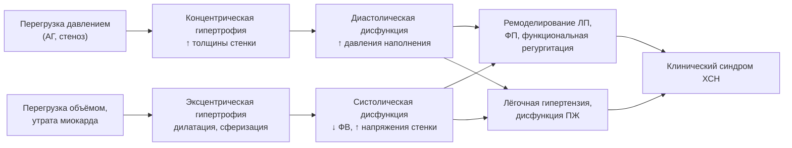
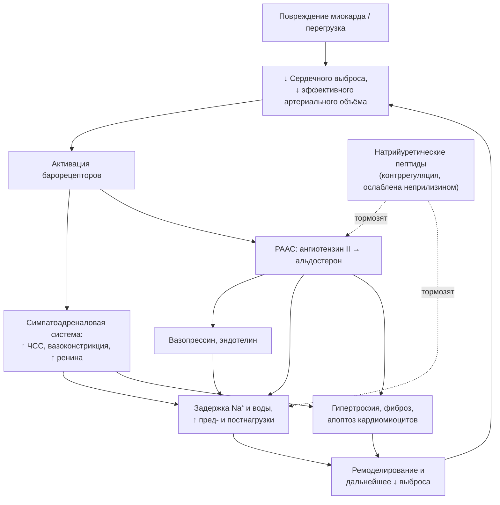
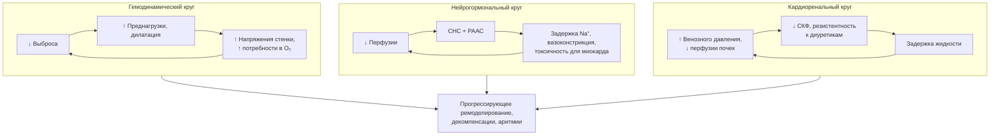

## 5. Патогенез и патофизиология ХСН

### 5.1. Ключевые понятия

#### 5.1.1. Сердечный выброс и ударный объём

> 📌 **Определение:** **сердечный выброс** (cardiac output, CO; минутный объём) — объём крови, изгоняемый желудочком за минуту:
>
> $$CO = \mathrm{ЧСС} \times \mathrm{УО}, \qquad (2)$$
>
> где ЧСС — частота сердечных сокращений (мин⁻¹), УО — **ударный объём** (мл), равный разности конечно-диастолического и конечно-систолического объёмов.

В покое сердечный выброс взрослого составляет около 5 л/мин, сердечный индекс (выброс, отнесённый к площади поверхности тела) — 2,5–4 л/мин/м². Ударный объём определяется тремя факторами — преднагрузкой, постнагрузкой и сократимостью, а также синхронностью сокращения и состоянием клапанов. При ХСН компенсация сниженного ударного объёма достигается тахикардией — ценой укорочения диастолы и роста потребления кислорода.

#### 5.1.2. Преднагрузка и постнагрузка

**Преднагрузка** — степень растяжения волокон миокарда перед сокращением; её клинический эквивалент — конечно-диастолический объём или давление наполнения желудочка. **Постнагрузка** — сопротивление, которое желудочек преодолевает при изгнании; определяется артериальным давлением, сосудистым сопротивлением, жёсткостью аорты и, по закону Лапласа, геометрией самого желудочка:

$$\sigma = \frac{P \cdot r}{2h}, \qquad (3)$$

где σ — напряжение стенки, P — внутрижелудочковое давление, r — радиус полости, h — толщина стенки. Формула объясняет два важных следствия: дилатированный желудочек испытывает большее напряжение стенки при том же давлении (постнагрузка растёт «изнутри»), а гипертрофия стенки снижает напряжение — в этом адаптивный смысл гипертрофии при перегрузке давлением.

#### 5.1.3. Сократимость и расслабление миокарда

**Сократимость** (инотропизм) — способность миокарда развивать силу и скорость сокращения при заданных пред- и постнагрузке; инвазивный показатель — максимальная скорость нарастания давления (dP/dt max) и наклон конечно-систолического соотношения давление–объём. **Расслабление** (лузитропизм) — активный, энергозависимый процесс удаления кальция из цитозоля и диссоциации актомиозиновых мостиков; его замедление (удлинение постоянной времени τ) — самое раннее проявление диастолической дисфункции. Оба процесса зависят от кальциевого цикла, энергетического обеспечения и симпатической стимуляции.

#### 5.1.4. Закон (механизм) Франка–Старлинга

**Закон Франка–Старлинга**: в физиологических пределах сила сокращения растёт с увеличением исходного растяжения волокон (преднагрузки). Механизм — зависимая от длины саркомера чувствительность миофиламентов к кальцию и оптимизация перекрытия нитей. При ХСН кривая Франка–Старлинга смещается вниз и уплощается: прирост преднагрузки даёт всё меньший прирост выброса, а дальнейшее повышение давления наполнения ведёт лишь к застою. Этот механизм объясняет, почему при декомпенсации диуретики уменьшают застой, почти не снижая выброс, а при гиповолемии и у пациентов с рестриктивным наполнением даже небольшая дегидратация резко уменьшает выброс.

#### 5.1.5. Ремоделирование сердца

> 📌 **Определение:** **ремоделирование сердца** (cardiac remodeling) — совокупность изменений размеров, формы, массы, структуры и функции сердца в ответ на повреждение или перегрузку, реализуемых на уровне кардиомиоцитов, внеклеточного матрикса, сосудов и геометрии камер.

Ремоделирование начинается как адаптация (нормализация напряжения стенки), но при хронической нагрузке и нейрогормональной стимуляции становится дезадаптивным: желудочек дилатируется, принимает сферическую форму, нарастают фиброз и апоптоз, развивается функциональная митральная регургитация. Обратное ремоделирование под действием терапии — главная цель лечения ХСНснФВ и объективный маркер её эффективности.

#### 5.1.6. Нейрогормональная активация

**Нейрогормональная активация** — системная реакция на снижение выброса и эффективного артериального объёма крови, включающая симпатоадреналовую систему, РААС, вазопрессин, эндотелин и цитокины, а также контррегуляторные натрийуретические пептиды. Филогенетически она предназначена для выживания при кровопотере (вазоконстрикция, задержка натрия и воды, тахикардия), но при ХСН становится хронической и повреждающей.

#### 5.1.7. Диастолическая дисфункция и повышение давления наполнения

**Диастолическая дисфункция** — нарушение активного расслабления и/или пассивной податливости желудочка, при котором нормальное наполнение возможно только при повышенном давлении в предсердии. Повышенное давление наполнения передаётся на лёгочные вены и капилляры и является непосредственной причиной одышки; при нагрузке оно растёт быстрее, чем в норме, что объясняет «нагрузочную» одышку при нормальных показателях в покое.

#### 5.1.8. Перфузия органов

Перфузия органов определяется сердечным выбросом, перфузионным давлением (разность артериального и венозного давления) и локальной ауторегуляцией. При ХСН перфузия страдает дважды — из-за снижения выброса и из-за повышения венозного давления; второй механизм долго недооценивался, хотя для почек и печени он не менее важен, чем первый.

### 5.2. Гемодинамические механизмы

#### 5.2.1. Систолическая дисфункция

При утрате кардиомиоцитов (инфаркт, миокардит, токсины) или снижении их сократимости (кардиомиопатии) падает ударный объём, растёт конечно-систолический объём, а затем, по мере дилатации, и конечно-диастолический. Включаются компенсаторные механизмы: Франка–Старлинга (увеличение преднагрузки), тахикардия и нейрогормональная активация. Дилатация и повышенное напряжение стенки увеличивают потребность миокарда в кислороде и ведут к дальнейшей потере кардиомиоцитов — так формируется первый порочный круг.

#### 5.2.2. Диастолическая дисфункция

Нарушение расслабления связано с замедлением обратного захвата кальция саркоплазматическим ретикулумом (снижение активности SERCA2a, дефосфорилирование фосфоламбана) и энергетическим дефицитом; снижение податливости — с гипертрофией, фиброзом, инфильтрацией и изменением свойств титина. Выделяют три степени нарушения наполнения: замедленное расслабление, псевдонормализацию и рестрикцию; выраженность диастолических нарушений определяет симптоматику и прогноз при ХСНсФВ (см. п. 8.6.2).

#### 5.2.3. Желудочково-артериальное сопряжение

**Желудочково-артериальное сопряжение** описывает соответствие между эластичностью желудочка (Ees) и эффективной артериальной эластичностью (Ea). В норме отношение Ea/Ees близко к единице, что обеспечивает максимальную эффективность работы. При ХСНснФВ Ees падает, и сопряжение нарушается в сторону «жёсткой артериальной системы при слабом желудочке»; при ХСНсФВ растут и Ees, и Ea (жёсткие желудочек и артерии), из-за чего небольшие изменения объёма вызывают большие колебания давления — основа гипертонического отёка лёгких и, наоборот, гипотонии при избыточной дегидратации.

#### 5.2.4. Межжелудочковое взаимодействие; поражение правых отделов

Желудочки связаны общей перегородкой, перикардом и последовательным кровотоком. Дилатация ПЖ при лёгочной гипертензии смещает перегородку влево, ухудшая наполнение ЛЖ; в свою очередь, дисфункция ЛЖ повышает давление в лёгочных венах и постнагрузку ПЖ. Присоединение правожелудочковой недостаточности при левосердечной патологии — неблагоприятный прогностический рубеж: именно ПЖ определяет системный венозный застой, функцию почек и печени.

#### 5.2.5. Структурное ремоделирование левого и правого желудочков: концентрическая и эксцентрическая гипертрофия

При перегрузке давлением саркомеры добавляются параллельно — стенка утолщается без расширения полости (**концентрическое ремоделирование и гипертрофия**); при перегрузке объёмом саркомеры добавляются последовательно — полость расширяется при относительно тонкой стенке (**эксцентрическая гипертрофия**). Различия обобщены в табл. 6. Правый желудочек ремоделируется по тем же принципам, но из-за тонкой стенки хуже переносит перегрузку давлением и быстрее дилатируется.

**Табл. 6.** Концентрическое и эксцентрическое ремоделирование: сопоставление.

| Признак | Концентрическое | Эксцентрическое |
|---|---|---|
| Пусковой стимул | Перегрузка давлением (АГ, аортальный стеноз) | Перегрузка объёмом (регургитации), утрата миокарда (инфаркт) |
| Расположение новых саркомеров | Параллельно | Последовательно |
| Геометрия | Толстая стенка, малая/нормальная полость, относительная толщина стенки > 0,42 | Тонкая стенка, расширенная сферичная полость, относительная толщина ≤ 0,42 |
| Напряжение стенки по Лапласу | Нормализовано ценой гипертрофии | Повышено |
| Преимущественная дисфункция | Диастолическая | Систолическая |
| Типичный фенотип | ХСНсФВ | ХСНснФВ |
| Обратимость | Регресс при контроле АД, после коррекции стеноза | Обратное ремоделирование при нейрогормональной блокаде, СРТ |

#### 5.2.6. Ремоделирование предсердий

Хроническое повышение давления наполнения растягивает левое предсердие, вызывая его дилатацию, фиброз, снижение резервуарной и насосной функции и электрическое ремоделирование — субстрат фибрилляции предсердий. Расширение фиброзного кольца ведёт к «предсердной» функциональной митральной и трикуспидальной регургитации. Индекс объёма ЛП — надёжный интегральный маркер хронически повышенного давления наполнения, «гликированный гемоглобин диастолы».

**Рис. 4.** Гемодинамические механизмы и пути ремоделирования. Схема читается слева направо: два типа перегрузки формируют разные геометрические варианты ремоделирования, которые через предсердное ремоделирование и вовлечение правых отделов сходятся в единый клинический синдром.

### 5.3. Нейрогормональные системы

#### 5.3.1. Симпатическая (симпатоадреналовая) нервная система

Снижение выброса через барорецепторы активирует симпатическую нервную систему (СНС): растут частота ритма и сократимость, суживаются артериолы и вены, стимулируется секреция ренина. Хроническая гиперактивация повреждает: норадреналин токсичен для кардиомиоцитов (перегрузка кальцием, апоптоз), вызывает десенситизацию и снижение плотности β1-рецепторов, усиливает аритмогенез, фиброз и инсулинорезистентность; уровень норадреналина плазмы коррелирует со смертностью (Borovac et al., 2020). Активация СНС затрагивает и почечные симпатические нервы, усиливая реабсорбцию натрия и секрецию ренина, — отсюда интерес к ренальной денервации при ХСН (см. п. 28.17). Терапевтический ответ — бета-адреноблокаторы, которые при осторожном титровании восстанавливают чувствительность рецепторов и способствуют обратному ремоделированию.

#### 5.3.2. Ренин-ангиотензин-альдостероновая система

Снижение перфузии почек, симпатическая стимуляция и снижение доставки натрия к плотному пятну стимулируют секрецию ренина; ангиотензин II через рецепторы AT1 вызывает вазоконстрикцию, жажду, секрецию альдостерона и вазопрессина, гипертрофию кардиомиоцитов, пролиферацию фибробластов, оксидативный стресс и воспаление. Альдостерон, помимо задержки натрия и потери калия и магния, стимулирует фиброз миокарда и сосудов и дисфункцию эндотелия; его уровень при длительной блокаде АПФ «ускользает» из-под контроля, что обосновывает отдельное назначение антагонистов минералокортикоидных рецепторов. Тканевые РААС в миокарде и сосудах действуют паракринно, независимо от циркулирующей системы.

#### 5.3.3. Натрийуретические пептиды и система неприлизина

Натрийуретические пептиды — физиологические антагонисты РААС и СНС: через рецептор NPR-A и цГМФ они вызывают натрийурез, вазодилатацию, подавляют секрецию ренина и альдостерона, тормозят гипертрофию и фиброз. При ХСН их уровень высок, но эффект ослаблен («резистентность к НУП»): преобладают неактивные формы прогормона, снижена чувствительность рецепторов, пептиды быстро расщепляются **неприлизином** — нейтральной эндопептидазой, разрушающей также брадикинин, адреномедуллин и ангиотензин II. Ингибирование неприлизина повышает уровень защитных пептидов, но одновременно и ангиотензина II, поэтому эффективно только в комбинации с блокатором АТ1-рецепторов (сакубитрил/валсартан).

#### 5.3.4. Вазопрессин

Аргинин-вазопрессин (антидиуретический гормон) секретируется в ответ на неосмотические стимулы (снижение эффективного объёма, ангиотензин II) и через V2-рецепторы собирательных трубочек задерживает свободную воду, вызывая гипонатриемию разведения, а через V1a-рецепторы — вазоконстрикцию. Гипонатриемия — один из сильнейших предикторов неблагоприятного прогноза при ХСН; антагонист V2-рецепторов толваптан корригирует натрий, но не улучшил выживаемость в исследовании EVEREST.

#### 5.3.5. Эндотелин

Эндотелин-1 — мощный вазоконстриктор, продуцируемый эндотелием под влиянием ангиотензина II, гипоксии и цитокинов; он стимулирует гипертрофию, фиброз и ремоделирование лёгочных сосудов. Его уровень повышен пропорционально тяжести ХСН, однако антагонисты эндотелиновых рецепторов при ХСНснФВ не улучшили исходов (и ухудшали задержку жидкости), оставшись препаратами для лёгочной артериальной гипертензии. Эффекты нейрогормональных систем и точки их блокады сведены в табл. 7.

**Табл. 7.** Нейрогормональные системы при ХСН: эффекты и фармакологические мишени.

| Система | Ключевые медиаторы | Краткосрочный «полезный» эффект | Долгосрочный повреждающий эффект | Терапевтическая мишень |
|---|---|---|---|---|
| Симпатоадреналовая | Норадреналин, адреналин | ↑ ЧСС, сократимости, АД | Токсичность для кардиомиоцитов, десенситизация β-рецепторов, аритмии, фиброз | Бета-адреноблокаторы; (ивабрадин — только ЧСС) |
| РААС | Ренин, ангиотензин II, альдостерон | Поддержание АД и объёма | Вазоконстрикция, задержка Na⁺, гипертрофия, фиброз, воспаление | иАПФ, БРА, АРНИ, АМКР (спиронолактон, эплеренон, финеренон) |
| Натрийуретические пептиды (контррегуляция) | ANP, BNP, CNP; неприлизин | Натрийурез, вазодилатация, антифиброз | Резистентность при ХСН | Ингибитор неприлизина в составе АРНИ |
| Вазопрессин | AVP (V1a, V2) | Сохранение воды | Гипонатриемия, вазоконстрикция | Ограничение жидкости; толваптан (симптоматически) |
| Эндотелин | Эндотелин-1 | Поддержание АД | Вазоконстрикция, ремоделирование | Нет при ХСН (антагонисты — при ЛАГ) |
| Цитокины и оксидативный стресс | TNF-α, IL-6, IL-1β, активные формы кислорода | Репарация после повреждения | Апоптоз, фиброз, кахексия, эндотелиальная дисфункция | Исследовательская стадия |
| Канальцевый транспорт Na⁺/глюкозы | НГЛТ-2 | — | Задержка Na⁺ и объёма (вторично) | Ингибиторы НГЛТ-2 (многокомпонентный механизм) |

**Рис. 5.** Схема нейрогормонального каскада и «нейрогормональный порочный круг». Схема читается сверху вниз: снижение выброса запускает симпатоадреналовую систему и РААС, которые через задержку жидкости и прямое повреждение миокарда усиливают ремоделирование и ещё больше снижают выброс; пунктирные стрелки — контррегуляторное действие натрийуретических пептидов, ослабленное при ХСН.

### 5.4. Молекулярные и клеточные механизмы

#### 5.4.1. Молекулярные и клеточные механизмы ремоделирования миокарда

На клеточном уровне ремоделирование включает гипертрофию кардиомиоцитов с реактивацией «фетальной» программы генов (β-изоформа тяжёлых цепей миозина, предсердный и мозговой НУП), нарушение кальциевого цикла (снижение SERCA2a, «утечка» кальция через рианодиновые рецепторы), изменение цитоскелета и титина, десенситизацию β-адренорецепторов (через киназу GRK2), а также пролиферацию фибробластов и их превращение в миофибробласты (Schirone et al., 2017). Сигнальные пути — ангиотензин II/AT1, альдостерон/минералокортикоидный рецептор, TGF-β, кальциневрин/NFAT, MAPK, PI3K/Akt — взаимно усиливают друг друга, что объясняет недостаточность блокады какого-либо одного звена.

#### 5.4.2. Клеточный апоптоз

Апоптоз (программируемая гибель) кардиомиоцитов при ХСН протекает с низкой, но постоянной скоростью; поскольку взрослые кардиомиоциты практически не делятся, кумулятивная потеря клеток за годы существенна. Индукторы — норадреналин, ангиотензин II, TNF-α, оксидативный стресс, растяжение; наряду с апоптозом описаны некроз, некроптоз и нарушения аутофагии. Антиапоптотический эффект считается одним из механизмов пользы бета-адреноблокаторов и ингибиторов РААС.

#### 5.4.3. Фиброз миокарда (в том числе межуточный)

Различают **заместительный фиброз** (рубец на месте погибших кардиомиоцитов) и **реактивный межуточный (интерстициальный) и периваскулярный фиброз**, развивающийся без гибели клеток под действием альдостерона, ангиотензина II, TGF-β и механического напряжения. Фиброз увеличивает жёсткость желудочка, нарушает электрическое проведение (субстрат реентри), ухудшает диффузию кислорода и сдавливает капилляры. Его маркеры — объём внеклеточного пространства по МРТ, галектин-3, растворимый ST2.

#### 5.4.4. Микроциркуляторное русло миокарда

Гипертрофия без адекватного роста капилляров увеличивает диффузионное расстояние и снижает коронарный резерв; периваскулярный фиброз и дисфункция эндотелия ухудшают регуляцию кровотока. Микрососудистая дисфункция вызывает субэндокардиальную ишемию без стенозов эпикардиальных артерий и рассматривается как центральное звено ХСНсФВ.

#### 5.4.5. Оксидативный стресс и воспаление, включая системное микрососудистое воспаление

Активные формы кислорода образуются в митохондриях, НАДФН-оксидазах, ксантиноксидазе и разобщённой NO-синтазе; они повреждают белки кальциевого цикла, активируют металлопротеиназы матрикса, индуцируют апоптоз и гипертрофию и инактивируют оксид азота (D’Amato et al., 2025). Воспаление при ХСН имеет две формы: местное (после инфаркта, при миокардите) и системное низкоинтенсивное, поддерживаемое коморбидностью (ожирение, диабет, ХБП, ХОБЛ), застоем в кишечнике с транслокацией эндотоксина и нейрогормонами. Провоспалительные цитокины (TNF-α, IL-1β, IL-6) снижают сократимость, усиливают фиброз и катаболизм (кахексию); попытки прямой антицитокиновой терапии при ХСНснФВ не увенчались успехом, но антиоксидантные и противовоспалительные стратегии остаются активной областью исследований (см. п. 28.18).

#### 5.4.6. Эндотелиальная и микрососудистая дисфункция

Снижение биодоступности оксида азота нарушает вазодилатацию, повышает жёсткость сосудов и постнагрузку, способствует тромбозу и воспалению, а в миокарде — через снижение активности цГМФ-зависимой протеинкиназы G — ведёт к гипертрофии кардиомиоцитов и гипофосфорилированию титина с повышением его жёсткости. Эта цепочка — ядро парадигмы Паулюса и Чёпе (2013) для ХСНсФВ (см. п. 5.6.1).

#### 5.4.7. Митохондриальная дисфункция, нарушение энергетического метаболизма и энергетический дефицит кардиомиоцита

Сердце — самый энергозависимый орган: оно ежедневно синтезирует и расходует массу АТФ, многократно превышающую массу самого органа. При ХСН снижаются окислительная способность митохондрий и отношение фосфокреатин/АТФ, нарушается субстратная гибкость (переключение с окисления жирных кислот на глюкозу, позднее — дефицит и того и другого), возрастает продукция активных форм кислорода, нарушается митофагия и биогенез митохондрий. «Недостающая энергия» ограничивает и сокращение, и расслабление, и ионный транспорт. Таргетная митохондриальная терапия (кофакторы дыхательной цепи, стабилизаторы кардиолипина, модуляторы метаболизма, кетоновые тела) исследуется (Zhang et al., 2026 — по плану лекции; [⚠️ Требуется верификация: выходные данные источника]); частично митохондриальными эффектами объясняют пользу ингибиторов НГЛТ-2.

### 5.5. Системные последствия

#### 5.5.1. Почечные механизмы задержки натрия и воды

Почка «воспринимает» ХСН как гиповолемию: снижение перфузионного давления, симпатическая стимуляция и ангиотензин II усиливают реабсорбцию натрия в проксимальных канальцах (через ангиотензин II и повышение фильтрационной фракции), в петле Генле и в дистальном нефроне (альдостерон), а вазопрессин задерживает воду. Повышенное венозное давление дополнительно снижает фильтрацию через рост давления в интерстиции почки. Итог — положительный баланс натрия и воды при уже существующем застое; это объясняет, почему натрийуретический ответ на диуретики является центральным показателем деконгестии.

#### 5.5.2. Патогенез застоя в малом круге кровообращения

Повышение давления в левом предсердии передаётся на лёгочные вены и капилляры; когда гидростатическое давление превышает возможности лимфатического дренажа и онкотическое противодействие, жидкость выходит в интерстиций (интерстициальный отёк — одышка, линии Керли) и затем в альвеолы (альвеолярный отёк — хрипы, пенистая мокрота). При хроническом застое лимфатический резерв увеличивается, а альвеолярно-капиллярная мембрана утолщается, поэтому хронически высокие давления переносятся без отёка, но ценой снижения диффузионной способности и рестрикции. Быстрый подъём давления при гипертоническом кризе отёк вызывает даже при умеренных цифрах.

#### 5.5.3. Патогенез застоя в большом круге кровообращения

Правожелудочковая недостаточность и/или задержка жидкости повышают центральное венозное давление: набухают шейные вены, увеличивается печень (с болью от растяжения капсулы), появляются отёки в зависимых областях (голени у ходячих, крестец у лежачих), асцит, гидроторакс (чаще справа или двусторонний — плевральные вены дренируются в обе системы), отёк стенки кишечника с нарушением всасывания и транслокацией бактериальных продуктов. Венозная гипертензия — ключевой механизм кардиоренального и кардиогепатического повреждения.

#### 5.5.4. Синдром низкого выброса и органная гипоперфузия

При критическом снижении выброса перераспределение кровотока в пользу мозга и сердца оставляет кожу, мышцы, почки и кишечник в состоянии гипоперфузии: холодные конечности, олигурия, рост лактата и трансаминаз («шоковая печень»), спутанность сознания, снижение всасывания лекарств. Низкий выброс при высоком давлении наполнения («холодный и влажный» профиль) — самое неблагоприятное сочетание.

#### 5.5.5. Лёгочная гипертензия вследствие левосердечной недостаточности

Хроническая пассивная передача давления (**изолированная посткапиллярная ЛГ**) со временем дополняется ремоделированием лёгочных артериол с ростом лёгочного сосудистого сопротивления (**комбинированная пре- и посткапиллярная ЛГ**). По критериям ESC/ERS 2022, ЛГ определяется как среднее давление в лёгочной артерии > 20 мм рт. ст.; посткапиллярный компонент — как давление заклинивания > 15 мм рт. ст., прекапиллярный — как лёгочное сосудистое сопротивление > 2 ед. Вуда. Развитие прекапиллярного компонента ухудшает прогноз и ограничивает возможности трансплантации (см. п. 25.9).

#### 5.5.6. Кардиоренальные и кардиогепатические взаимодействия

Почка при ХСН страдает от гипоперфузии, венозного застоя, нейрогормонов, воспаления, диуретиков и контрастов; прогрессирующее снижение рСКФ, в свою очередь, усиливает задержку натрия, анемию, гиперкалиемию и ограничивает терапию — это **хронический кардиоренальный синдром** (тип 2 по Ronco; см. также разделы 10 и 19). Застойная печень проявляется повышением билирубина, щелочной фосфатазы и γ-глутамилтрансферазы, снижением альбумина и синтеза факторов свёртывания; длительный застой ведёт к «кардиальному фиброзу/циррозу». Печёночные показатели входят в прогностические модели, а их сочетание с почечными (индекс MELD-XI) используется при оценке кандидатов на механическую поддержку.

#### 5.5.7. Нарушения скелетной мускулатуры и дыхательной системы

Одышка и утомляемость при ХСН лишь частично объясняются гемодинамикой: в скелетных мышцах развивается миопатия — атрофия, сдвиг к быстрым гликолитическим волокнам, снижение плотности митохондрий и капилляров, инсулинорезистентность. Метаболические рецепторы мышц (эргорефлекс) при этом гиперактивны и усиливают вентиляцию и симпатический тонус. Слабость дыхательных мышц, рестриктивные изменения и утолщение альвеолярно-капиллярной мембраны снижают эффективность вентиляции (высокий наклон VE/VCO₂). Отсюда — обоснование физических тренировок как патогенетического, а не только «общеукрепляющего» метода.

#### 5.5.8. Аритмогенез и внезапная сердечная смерть

Субстрат желудочковых аритмий при ХСН — рубец и межуточный фиброз (реентри), триггеры — нарушения кальциевого цикла (поздние постдеполяризации), удлинение потенциала действия, электролитные сдвиги (гипокалиемия, гипомагниемия) и симпатическая активация. Внезапная сердечная смерть составляет значительную долю смертей при ХСНснФВ, причём её удельный вес выше при умеренных симптомах (NYHA II–III), тогда как при NYHA IV преобладает смерть от насосной недостаточности. Нейрогормональная блокада снижает риск внезапной смерти; имплантируемые дефибрилляторы прерывают уже возникшие аритмии.

### 5.6. Патофизиология отдельных фенотипов

#### 5.6.1. ХСН с сохранённой фракцией выброса: воспалительная и метаболическая концепции

Согласно концепции Паулюса и Чёпе (2013), коморбидность (ожирение, диабет, гипертензия, ХБП, ХОБЛ, возраст) поддерживает системное воспаление, которое вызывает дисфункцию эндотелия коронарных микрососудов, снижение биодоступности NO и активности цГМФ–протеинкиназы G в кардиомиоцитах; следствие — гипертрофия, гипофосфорилирование титина и жёсткость, а также периваскулярный фиброз. Эта модель объясняет, почему при ХСНсФВ первично поражается не «насос», а «наполнение», и почему эффективны воздействия на метаболический фон (ингибиторы НГЛТ-2, снижение массы тела). Метаболическая концепция дополняет картину: при ожирении увеличены объём плазмы, эпикардиальный жир с его паракринным действием и перикардиальное ограничение, что усиливает межжелудочковое взаимодействие и повышает давление наполнения при нагрузке. ХСНсФВ неоднородна: наряду с кардиометаболическим фенотипом выделяют пожилой фенотип с фибрилляцией предсердий и ЛГ, фенотип с ХБП и «инфильтративный» (амилоидоз), что объясняет разный ответ на терапию.

#### 5.6.2. Патофизиология улучшения фракции выброса

Улучшение ФВ отражает обратное ремоделирование: уменьшение объёмов ЛЖ, восстановление эллипсоидной формы, снижение функциональной митральной регургитации, частичную нормализацию кальциевого цикла и экспрессии генов, уменьшение фиброза. Оно наиболее вероятно при недавнем дебюте, неишемической этиологии (тахикардиомиопатия, перипартальная, алкогольная, стресс-индуцированная), отсутствии обширного рубца, у женщин и при полноценной терапии (бета-адреноблокаторы, АРНИ, СРТ). Однако на молекулярном уровне восстановление неполно: сохраняются изменения экспрессии генов и фиброз, поэтому состояние описывают как ремиссию, зависимую от продолжения лечения (см. п. 2.6.2, раздел 17).

### 5.7. Теории, модели и концепции

#### 5.7.1. Гемодинамическая модель

Модель 1960–1970-х годов: ХСН — следствие слабости насоса и избыточной нагрузки; лечение — инотропы, вазодилататоры, диуретики. Она объяснила симптомы, но не прогрессирование; её практический предел обозначили исследования оральных инотропов (милринон в PROMISE, 1991), которые улучшали гемодинамику, но повышали смертность.

#### 5.7.2. Нейрогормональная (нейрогуморальная) модель

Модель 1980–1990-х годов (сформулирована, в частности, М. Пэкером): прогрессирование ХСН определяется хронической активацией СНС и РААС, а не гемодинамикой как таковой. Она предсказала пользу иАПФ, бета-адреноблокаторов и антагонистов альдостерона и была подтверждена серией исследований, снизивших смертность. Её ограничение — «потолок» эффекта: добавление новых нейрогормональных блокаторов (антагонисты эндотелина, вазопрессина, цитокинов) пользы не принесло.

#### 5.7.3. Биомеханическая модель и модель ремоделирования миокарда

Модель 2000-х годов (Mann & Bristow, 2005) рассматривает ХСН как прогрессирующее ремоделирование, в котором нейрогормональные, механические (напряжение стенки), воспалительные и генетические стимулы интегрируются на уровне кардиомиоцита и матрикса. Она объясняет пользу устройств (СРТ, механическая разгрузка), предсказывает значение фиброза и подчёркивает, что терапия должна изменять структуру, а не только симптомы.

#### 5.7.4. Модель кардиоренального взаимодействия

Эта модель выдвигает почку в центр патогенеза задержки жидкости и прогрессирования: сердце и почка связаны гемодинамикой (перфузия и венозное давление), нейрогормонами, воспалением и анемией. Из неё выросли приоритет натрийуреза в лечении застоя и понимание того, что «ухудшение функции почек» при эффективной деконгестии не всегда опасно (см. раздел 15).

#### 5.7.5. Системно-биологический подход к ХСН

Системная биология описывает ХСН как сетевое заболевание: множество генетических, молекулярных, клеточных и органных узлов взаимодействуют нелинейно, и один и тот же фенотип может возникнуть из разных комбинаций нарушений (Louridas & Lourida, 2012). Подход обосновывает многокомпонентную терапию («четыре столпа» действуют на разные узлы сети) и фенотипирование, в том числе с помощью машинного обучения.

#### 5.7.6. Компенсаторные и дезадаптивные механизмы; концепция «порочного круга» прогрессирования

Все описанные механизмы начинаются как компенсация и заканчиваются как повреждение: тахикардия и вазоконстрикция поддерживают давление, но увеличивают нагрузку; задержка жидкости повышает преднагрузку, но ведёт к застою; гипертрофия нормализует напряжение стенки, но снижает податливость и перфузию; активация СНС и РААС поддерживает выброс, но убивает кардиомиоциты. Несколько порочных кругов замыкаются одновременно (см. рис. 6), поэтому прогрессирование продолжается и после устранения первичной причины — на этом основана идея пожизненной терапии даже при улучшении.

**Рис. 6.** Схемы порочных кругов и патогенетических циклов. Схема читается сверху вниз: три взаимосвязанных круга — гемодинамический, нейрогормональный и кардиоренальный — поддерживают друг друга и сходятся к прогрессирующему ремоделированию; терапия ХСН размыкает каждый из них в разных точках.

### 5.8. Примеры и иллюстрации

#### 5.8.1. Схема нейрогормонального каскада

Нейрогормональный каскад представлен на рис. 5. Клиническая иллюстрация: пациент с ФВ 25 % после инфаркта имеет тахикардию 100 в минуту, холодные конечности, АД 100/70 мм рт. ст., натрий 131 ммоль/л и отёки — это одновременные проявления активации СНС (тахикардия, вазоконстрикция), РААС (задержка натрия) и вазопрессина (гипонатриемия). Назначение бета-адреноблокатора «против тахикардии» без устранения застоя ухудшит состояние; правильная последовательность — деконгестия, затем нейрогормональная блокада с титрованием.

#### 5.8.2. Иллюстрация прогрессии ремоделирования миокарда

Пути ремоделирования показаны на рис. 4. Пример: у пациентки с аортальным стенозом годами существовала концентрическая гипертрофия с нормальной ФВ и одышкой при нагрузке (диастолическая дисфункция); после присоединения фибрилляции предсердий и эпизода декомпенсации ФВ снизилась до 40 % — переход от концентрического к смешанному ремоделированию с «истощением» компенсации, что является показанием к срочной коррекции порока.

#### 5.8.3. Схемы порочных кругов и патогенетических циклов

Порочные круги приведены на рис. 6. Точки их размыкания современной терапией: диуретики и ограничение натрия — кардиоренальный и гемодинамический круги; иАПФ/АРНИ, бета-адреноблокаторы, АМКР — нейрогормональный; ингибиторы НГЛТ-2 — почечный (натрийурез, снижение внутриклубочкового давления) и метаболический; СРТ и реваскуляризация — гемодинамический; физические тренировки — периферический (мышечный и вентиляционный).

> 💡 **Интересный факт:** идея применять бета-адреноблокаторы при сердечной недостаточности казалась в 1970-е годы еретической, поскольку противоречила гемодинамической модели; первые наблюдения Ф. Ваагстейна и соавт. (Гётеборг, 1975) у пациентов с дилатационной кардиомиопатией были встречены скептически, и лишь спустя четверть века крупные исследования подтвердили снижение смертности примерно на треть.

> ❗ **Типичная ошибка:** считать, что повышенный уровень натрийуретических пептидов «вреден» и его надо снижать. НУП — защитная контррегуляторная система; их уровень отражает степень гемодинамического стресса, а снижение на фоне терапии является следствием разгрузки сердца, а не целью само по себе (подробнее о «биомаркер-ориентированном ведении» — в п. 28.4).

> 🔬 **Углубление:** сакубитрил/валсартан иллюстрирует, как знание биохимии предопределяет дизайн препарата. Предшественник — омапатрилат, одновременно ингибировавший АПФ и неприлизин, — оказался эффективным, но вызывал ангионевротический отёк с неприемлемой частотой, поскольку оба фермента участвуют в деградации брадикинина. Сочетание ингибитора неприлизина с блокатором АТ1-рецепторов (а не с иАПФ) сохранило пользу и снизило риск отёка; по той же причине требуется 36-часовой перерыв при переходе с иАПФ на АРНИ, а совместное назначение АРНИ и иАПФ противопоказано.

> 📝 **Обобщение.** ХСН — результат взаимодействия гемодинамических нарушений (пред- и постнагрузка, сократимость, расслабление, сопряжение с артериальной системой), нейрогормональной активации (СНС, РААС, вазопрессин, эндотелин при ослабленной контррегуляции НУП), молекулярно-клеточных процессов (гипертрофия, апоптоз, фиброз, оксидативный стресс, микрососудистая и митохондриальная дисфункция) и системных последствий (задержка натрия, застой, гипоперфузия, кардиоренальные взаимодействия, миопатия, аритмогенез). Компенсаторные механизмы замыкаются в порочные круги, поэтому болезнь прогрессирует и после устранения причины. Главный вывод: каждый класс базисной терапии размыкает конкретный круг — это и есть логика многокомпонентного лечения, к классификации и диагностике которого мы переходим.

> ❓ **Контрольные вопросы**
>
> 1. Запишите формулы сердечного выброса и напряжения стенки по Лапласу и объясните, почему дилатация желудочка увеличивает постнагрузку.
> 2. Почему хроническая активация симпатоадреналовой системы и РААС, изначально компенсаторная, становится повреждающей? Назовите по три эффекта каждой системы.
> 3. Чем концентрическое ремоделирование отличается от эксцентрического по стимулу, геометрии и преимущественному типу дисфункции?
> 4. Как концепция Паулюса и Чёпе объясняет связь ожирения и диабета с ХСНсФВ, и какие терапевтические следствия из неё вытекают?
> 5. Пациент с ХСНснФВ и застоем получает бета-адреноблокатор в высокой дозе на фоне гипотонии и холодных конечностей. Какой порочный круг при этом усугубляется и как изменить тактику?
