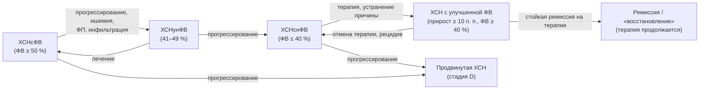
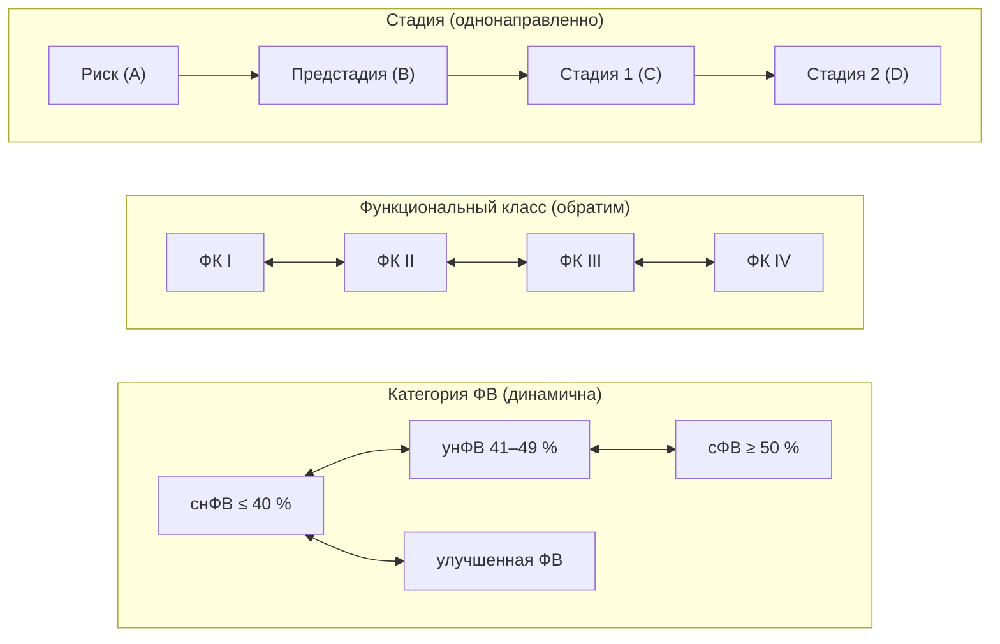

## 6. Классификации и фенотипы ХСН

### 6.1. Классификация по фракции выброса левого желудочка

#### 6.1.1. Принцип и обоснование разделения по фракции выброса

Фракция выброса остаётся главным классификационным признаком не потому, что она лучше всего описывает патофизиологию, а потому, что по ней формировались популяции крупных исследований: доказательства пользы нейрогормональной блокады и устройств получены при сниженной ФВ, а эффективность терапии при сохранённой ФВ подтверждена лишь для части классов. Таким образом, категория ФВ — это прежде всего инструмент выбора лечения, а также маркер различной этиологии, демографии и прогноза (см. п. 2.6.3).

#### 6.1.2. Категории фракции выброса в действующих документах

Категории по ФВ в российских и международных документах обобщены в табл. 8. В РКО 2024 используются три категории: ХСН с низкой (≤ 40 %), умеренно сниженной (41–49 %) и сохранённой (≥ 50 %) ФВ, при этом для двух последних диагноз требует объективных признаков структурного или функционального поражения сердца и/или повышения натрийуретических пептидов (критерии см. в п. 8.7.5). Отдельно выделена ХСН с улучшенной ФВ (п. 6.1.4).

**Табл. 8.** Категории ХСН по фракции выброса левого желудочка в основных документах (по состоянию на 2026 год).

| Категория | РКО 2024 | Универсальное определение 2021 / ESC 2021 | ESC 2026 | Второе универсальное определение 2026 |
|---|---|---|---|---|
| Сниженная ФВ | ХСНнФВ: ≤ 40 % | HFrEF: ≤ 40 % | HFrEF: < 50 % | HFrEF (жёсткие пороги не подчёркиваются) |
| Умеренно сниженная ФВ | ХСНунФВ: 41–49 % | HFmrEF: 41–49 % | Категория упразднена (включена в HFrEF) | Не выделяется |
| Сохранённая ФВ | ХСНсФВ: ≥ 50 % + объективные критерии | HFpEF: ≥ 50 % + объективные критерии | HFpEF: ≥ 50 % | HFpEF |
| Улучшенная ФВ | ХСН с улучшенной ФВ: исходно ≤ 40 %, прирост ≥ 10 п. п., повторно ≥ 40 % | HFimpEF: исходно ≤ 40 %, прирост ≥ 10 п. п., повторно > 40 % | Рекомендовано продолжать терапию после улучшения ФВ | HFimpEF: исходно сниженная, прирост ≥ 10 п. п., сейчас > 40 % |
| Сверхнормальная ФВ | Не выделяется | Обсуждается в литературе (> 65 %) | Не выделяется | Не выделяется |

#### 6.1.3. ХСН с низкой, умеренно сниженной и сохранённой фракцией выброса: ключевые различия

ХСНснФВ: преимущественно мужчины, ишемическая и дилатационная этиология, эксцентрическое ремоделирование, высокий риск внезапной смерти, наибольший арсенал доказанной терапии. ХСНсФВ: пожилые, чаще женщины, артериальная гипертензия, ожирение, диабет, фибрилляция предсердий, концентрическое ремоделирование, преобладание некардиальных причин смерти, эффективность доказана для ингибиторов НГЛТ-2 и АМКР. ХСНунФВ занимает промежуточное положение, но по этиологии (ИБС в 50–60 % случаев) и ответу на терапию ближе к ХСНснФВ, что и стало основанием для её упразднения в ESC 2026 (см. п. 6.1.6).

#### 6.1.4. ХСН с улучшенной фракцией выброса

> 📌 **Определение:** **ХСН с улучшенной ФВ** (по РКО 2024) — наличие в анамнезе ФВ ЛЖ ≤ 40 % с последующим абсолютным приростом ≥ 10 процентных пунктов и значением при повторном измерении ≥ 40 %; в универсальных определениях — > 40 %.

Это не «выздоровление», а ремиссия: при отмене терапии у значительной части пациентов происходит рецидив (TRED-HF), сохраняются молекулярные и структурные изменения, а риск событий остаётся выше популяционного. Пациент с улучшенной ФВ получает ту же терапию, что и при ХСНснФВ; вопрос о снижении интенсивности — предмет дискуссии (п. 28.14).

#### 6.1.5. ХСН со сверхнормальной фракцией выброса

ФВ > 65–70 % при наличии симптомов сердечной недостаточности встречается при выраженной концентрической гипертрофии с малой полостью (гипертрофическая кардиомиопатия, амилоидоз на ранних стадиях), а также при состояниях с высоким выбросом. В крупном регистровом анализе (Wehner et al., 2020) зависимость смертности от ФВ имела U-образную форму с минимумом около 60–65 %: сверхнормальная ФВ ассоциировалась с повышенной смертностью. Клиническое значение категории — напоминание, что «высокая ФВ» не исключает ХСН и может указывать на малый ударный объём при малой полости.

#### 6.1.6. Динамика фракции выброса и траектории; изменения ESC 2026

ФВ — не константа: она меняется под влиянием терапии, аритмий, ишемии, интеркуррентных заболеваний и естественного течения. Второе универсальное определение (2026) описывает траектории «улучшение — ремиссия — восстановление» и, напротив, прогрессирующее снижение. Рекомендации ESC 2026 упразднили категорию умеренно сниженной ФВ, расширив HFrEF до < 50 %, так как основные классы терапии продемонстрировали пользу во всём диапазоне ниже 50 %, а порог 40 % был исторически условным; одновременно сохранены прежние пороги ФВ для устройств (ИКД, СРТ) и ивабрадина, где доказательства получены при ФВ ≤ 35 %. Траектории показаны на рис. 7.

**Рис. 7.** Траектории изменения фракции выброса. Схема читается слева направо: ФВ может как улучшаться на фоне терапии (с риском рецидива при её отмене), так и снижаться при прогрессировании; категория ХСНунФВ в ESC 2026 объединена с ХСНснФВ.

### 6.2. Стадии и функциональные классы

#### 6.2.1. Классификация Н. Д. Стражеско и В. Х. Василенко

Классификация принята на XII Всесоюзном съезде терапевтов (1935) и впоследствии дополнена делением II стадии на IIА и IIБ (табл. 9). Она отражает стадийность процесса (стадия, в отличие от функционального класса, не может улучшиться) и до сих пор используется в формулировке диагноза в России; в РКО 2024 отмечено, что с учётом новых стадий 2023 года классификация Стражеско–Василенко сохраняется как историческая и клинически описательная.

**Табл. 9.** Стадии ХСН по Н. Д. Стражеско и В. Х. Василенко (с уточнениями ОССН 2002).

| Стадия | Характеристика |
|---|---|
| I (начальная) | Симптомы (одышка, сердцебиение, утомляемость) только при физической нагрузке; гемодинамика в покое не нарушена; бессимптомная дисфункция ЛЖ |
| IIА | Клинически выраженная стадия: умеренные нарушения гемодинамики в одном из кругов кровообращения; адаптивное ремоделирование |
| IIБ | Тяжёлая стадия: выраженные нарушения гемодинамики в обоих кругах; дезадаптивное ремоделирование |
| III (конечная, дистрофическая) | Тяжёлые нарушения гемодинамики и необратимые структурные изменения органов-мишеней (сердца, лёгких, сосудов, мозга, почек); финальная стадия ремоделирования |

#### 6.2.2. Стадии ACC/AHA (A, B, C, D) и их обновление 2022 года

Классификация ACC/AHA (2001, обновлена в 2022 году совместно с HFSA): **стадия A** — риск ХСН (гипертензия, диабет, ожирение, кардиотоксическая терапия, семейный анамнез) без структурных изменений и симптомов; **стадия B** — «пред-СН»: структурное заболевание сердца, повышенное давление наполнения или повышение натрийуретических пептидов без симптомов; **стадия C** — симптомная ХСН в настоящее время или в прошлом; **стадия D** — продвинутая ХСН с рефрактерными симптомами. Стадии однонаправленны (возврат невозможен), и для каждой определён набор вмешательств (раздел 11).

#### 6.2.3. Стадии ХСН по рекомендациям РКО 2023/2024 года

Российские эксперты в 2023 году предложили систему, близкую к ACC/AHA, но с собственной терминологией: **риск развития ХСН** (АГ, ожирение, ИБС, ФП, кардиомиопатии, диабет, ХБП, ХОБЛ, противоопухолевая терапия); **предстадия СН** — отсутствие симптомов когда-либо при наличии структурного и/или функционального поражения сердца и/или повышения натрийуретических пептидов; **стадия 1** — клинически выраженная ХСН (симптомы в настоящее время или в прошлом); **стадия 2** — продвинутая, клинически тяжёлая ХСН: тяжёлые симптомы и повторные госпитализации, несмотря на оптимальную терапию, или её непереносимость. Соотнесение систем приведено в табл. 10.

**Табл. 10.** Сопоставление систем стадирования ХСН.

| ACC/AHA 2022 | РКО 2023/2024 | Стражеско–Василенко (ориентировочно) | Содержание |
|---|---|---|---|
| A — риск | Риск развития ХСН | — | Факторы риска без поражения сердца |
| B — пред-СН | Предстадия СН | — (отчасти I стадия как «бессимптомная дисфункция») | Структурные/функциональные изменения или ↑ НУП без симптомов |
| C — симптомная | Стадия 1 | I–IIБ | Симптомы сейчас или в прошлом |
| D — продвинутая | Стадия 2 | IIБ–III | Рефрактерные симптомы, повторные госпитализации |

[⚠️ Требуется верификация: однозначное официальное соответствие стадий Стражеско–Василенко стадиям РКО 2023 не установлено; приведено ориентировочное соотнесение, основанное на содержательных определениях.]

#### 6.2.4. Функциональные классы NYHA

Классификация Нью-Йоркской ассоциации сердца (1928, многократно пересмотрена) оценивает переносимость нагрузки на момент осмотра; ФК может меняться в обе стороны (табл. 11). Её недостатки — субъективность и низкая воспроизводимость между врачами (особенно для II и III классов), поэтому её дополняют объективными тестами (6-минутная ходьба, пиковое потребление кислорода) и опросниками.

**Табл. 11.** Функциональные классы NYHA с ориентировочными объективными эквивалентами.

| ФК | Описание (в формулировке РКО 2024) | Тест 6-минутной ходьбы | Пиковое VO₂ (класс по Weber) |
|---|---|---|---|
| I | Ограничений физической активности нет; привычная нагрузка не вызывает симптомов; повышенная нагрузка может сопровождаться одышкой и замедленным восстановлением | 426–550 м | > 20 мл/кг/мин (A) |
| II | Незначительное ограничение: в покое симптомов нет, привычная активность вызывает утомляемость, одышку или сердцебиение | 301–425 м | 16–20 (B) |
| III | Заметное ограничение: в покое симптомов нет, нагрузка меньше привычной вызывает симптомы | 151–300 м | 10–16 (C) |
| IV | Невозможность выполнить какую-либо нагрузку без дискомфорта; симптомы в покое, усиливающиеся при минимальной активности | < 150 м | < 10 (D) |

Примечание: дистанция > 550 м соответствует отсутствию ХСН; значения ориентировочные и зависят от возраста, пола и сопутствующих заболеваний.

#### 6.2.5. Шкала оценки клинического состояния (ШОКС)

**ШОКС** (В. Ю. Мареев, 2000) — отечественная шкала из 10 клинических признаков (одышка; изменение массы тела за неделю; жалобы на перебои; положение в постели; шейные вены; хрипы в лёгких; ритм галопа; размеры печени; отёки; систолическое АД), каждый из которых оценивается от 0 до 1–3 баллов; максимум — 20 баллов (табл. 12). Шкала не требует оборудования, воспроизводима и чувствительна к динамике: её применяют при каждом визите и при оценке эффективности терапии. Ориентировочное соответствие: 0 баллов — отсутствие клинических признаков ХСН; ≤ 3 — ФК I; 4–6 — ФК II; 7–9 — ФК III; > 9 — ФК IV.

**Табл. 12.** Шкала оценки клинического состояния (ШОКС, модификация В. Ю. Мареева, 2000).

| Признак | 0 баллов | 1 балл | 2 балла | 3 балла |
|---|---|---|---|---|
| Одышка | Нет | При нагрузке | В покое | — |
| Изменение массы тела за неделю | Нет | Увеличилась | — | — |
| Перебои в работе сердца | Нет | Есть | — | — |
| Положение в постели | Горизонтально | С приподнятым изголовьем (две и более подушки) | Просыпается от удушья | Сидя |
| Набухшие шейные вены | Нет | Лёжа | Стоя | — |
| Хрипы в лёгких | Нет | Нижние отделы (до ⅓) | До лопаток (до ⅔) | Над всей поверхностью |
| Ритм галопа | Нет | Есть | — | — |
| Печень | Не увеличена | До 5 см | Более 5 см | — |
| Отёки | Нет | Пастозность | Отёки | Анасарка |
| Систолическое АД | > 120 мм рт. ст. | 100–120 | < 100 | — |

#### 6.2.6. Тест с 6-минутной ходьбой и кардиопульмональное нагрузочное тестирование как объективизация класса

Тест 6-минутной ходьбы прост, стандартизирован (коридор 30 м, без подбадривания) и прогностически значим: дистанция менее 300 м ассоциирована с худшей выживаемостью и входит в критерии продвинутой ХСН. Кардиопульмональное нагрузочное тестирование даёт пиковое потребление кислорода и вентиляционную эффективность (наклон VE/VCO₂) и является стандартом при отборе на трансплантацию (п. 8.9.4, 25.6).

#### 6.2.7. Классификация Killip и Forrester

Классификация **Killip** (1967) описывает тяжесть сердечной недостаточности при остром инфаркте миокарда по физикальным данным: I — нет признаков СН; II — влажные хрипы менее чем над половиной лёгочных полей, III тон; III — отёк лёгких; IV — кардиогенный шок. Классификация **Forrester** (1976) основана на инвазивной гемодинамике: сочетание сердечного индекса (порог 2,2 л/мин/м²) и давления заклинивания лёгочной артерии (порог 18 мм рт. ст.) даёт четыре класса — от нормального до «гипоперфузия + застой». Обе системы относятся к острым состояниям, но их логика лежит в основе клинических профилей (п. 6.3.1).

#### 6.2.8. Стадийность и функциональный класс: соотношение понятий

Стадия отражает структурную эволюцию болезни и однонаправленна; функциональный класс — текущее состояние и обратим. Поэтому пациент со стадией 1 (C) может иметь ФК I после успешного лечения, а пациент с продвинутой стадией в редких случаях временно улучшить класс до II–III. В диагнозе указывают обе характеристики (раздел 9).

#### 6.2.9. Классификация тяжести по шкалам INTERMACS

Профили **INTERMACS** (1–7) детализируют стадию D/стадию 2 от «критического кардиогенного шока» (профиль 1) и «прогрессирующего ухудшения на инотропах» (2) до «стабильности на инотропах» (3), «частых декомпенсаций» (4), «непереносимости нагрузки» (5), «ограничения при нагрузке» (6) и «продвинутого ФК III» (7). Шкала определяет срочность механической поддержки кровообращения и подробно обсуждается в п. 25.4.

#### 6.2.10. Сопоставление определений и классификаций в основных документах

Табл. 13 суммирует различия документов, с которыми встречается врач в 2026 году: Универсальные определения 2021 и 2026 годов, рекомендации ESC 2021/2023/2026 и РКО 2024.

**Табл. 13.** Сопоставление ключевых положений современных документов по ХСН (по состоянию на 2026 год).

| Положение | Универсальное определение 2021 | ESC 2021/2023 | РКО 2024 | ESC 2026 | Второе универсальное определение 2026 |
|---|---|---|---|---|---|
| Основа определения | Симптомы/признаки + объективное подтверждение (↑ НУП или застой) | Симптомы/признаки + структурно-функциональное нарушение | Симптомы/признаки + объективные доказательства дисфункции (в покое или при нагрузке) | Как в универсальном определении; категории по ФВ упрощены | Отход от жёстких порогов ФВ; траектории |
| Категории ФВ | ≤ 40 / 41–49 / ≥ 50 + HFimpEF | ≤ 40 / 41–49 / ≥ 50 | ≤ 40 / 41–49 / ≥ 50 + улучшенная | < 50 / ≥ 50 | HFrEF / HFpEF / HFimpEF |
| Стадии | A–D (at risk, pre-HF, HF, advanced) | Не акцентированы | Риск — предстадия — стадия 1 — стадия 2 | A–D приняты | A–D уточнены |
| Острое состояние | Острая СН | Острая СН (де ново / ОДХСН) | ОСН и ОДСН (разграничены) | «Декомпенсированная СН» (ДСН) | — |
| Терминология терапии | — | ОМТ, «четыре столпа» | Четырёхкомпонентная (квадро-) терапия | Фундаментальная (FMT) / дополнительная / интервенционная | — |

### 6.3. Гемодинамические профили и фенотипы

#### 6.3.1. Клинические гемодинамические профили («тёплый/холодный», «влажный/сухой»)

Профили Стивенсон (Nohria, Stevenson et al., 2003) основаны на двух осях прикроватной оценки: наличие застоя («влажный»: ортопноэ, набухание шейных вен, отёки, хрипы, гепатомегалия, III тон) и признаки гипоперфузии («холодный»: холодные конечности, узкое пульсовое давление, сонливость, гипотония, олигурия, рост лактата). Получаются четыре профиля (табл. 14), определяющие стартовую тактику при декомпенсации (раздел 22). Профиль «тёплый и влажный» — самый частый (около двух третей госпитализаций), «холодный и влажный» — самый опасный.

**Табл. 14.** Клинические гемодинамические профили и их терапевтические следствия.

| Профиль | Застой | Гипоперфузия | Доля госпитализаций (ориентировочно) | Ведущая тактика |
|---|---|---|---|---|
| A — «тёплый и сухой» | Нет | Нет | Небольшая | Компенсация; оптимизация базисной терапии, поиск иной причины симптомов |
| B — «тёплый и влажный» | Есть | Нет | Наибольшая | Диуретики ± вазодилататоры |
| C — «холодный и влажный» | Есть | Есть | Меньшинство, наихудший прогноз | Инотропы/вазопрессоры при необходимости, диуретики, рассмотреть механическую поддержку |
| L — «холодный и сухой» | Нет | Есть | Редко | Осторожная инфузия, инотропы; исключить передозировку диуретиков |

#### 6.3.2. Фенотипы по этиологии и ведущему синдрому

Помимо ФВ и стадии, в практике используют фенотипические характеристики: ишемическая/неишемическая; гипертензивное сердце; клапанная; «тахи-индуцированная»; инфильтративная (амилоид); правожелудочковая/бивентрикулярная; с высоким выбросом. Для ХСНсФВ описаны кластеры (кардиометаболический, пожилой с ФП и ЛГ, с ХБП), получаемые методами машинного обучения; их клиническое применение пока ограничено (п. 28.1).

#### 6.3.3. Фенотипы по течению: де ново, ухудшение хронической, стабильная, продвинутая

ESC выделяет впервые возникшую (де ново) сердечную недостаточность, ухудшение хронической (worsening HF — событие, требующее усиления терапии: госпитализация, внутривенные диуретики или неотложное обращение), стабильную хроническую и продвинутую. Эпизод ухудшения — переломный момент прогноза, после которого риск смерти и повторных госпитализаций резко возрастает (раздел 10).

**Рис. 8.** Три оси характеристики пациента с ХСН: стадия, функциональный класс и категория фракции выброса. Схема читается слева направо: стадии движутся только вперёд, функциональный класс и категория ФВ могут меняться в обе стороны; полная характеристика пациента требует указания всех трёх осей.

### 6.4. Примеры и иллюстрации

#### 6.4.1. Пример одной пациентки в трёх системах

Женщина 68 лет с гипертонической болезнью, ожирением и фибрилляцией предсердий, одышкой при подъёме на один этаж, ФВ 58 %, индекс объёма ЛП 44 мл/м², NT-proBNP 900 пг/мл, без госпитализаций. Характеристика: ХСНсФВ; стадия C (ACC/AHA) = стадия 1 (РКО) = ориентировочно IIА по Стражеско–Василенко; ФК III NYHA; ШОКС, допустим, 5 баллов; профиль «тёплый и влажный» при наличии отёков. Полная формулировка — в разделе 9.

#### 6.4.2. Пример изменения категории ФВ

Мужчина 45 лет с тахикардиомиопатией на фоне непрерывно рецидивирующей предсердной тахикардии: ФВ 28 % при выявлении, через 6 месяцев после абляции и терапии — 52 %. Категория: ХСН с улучшенной ФВ (а не ХСНсФВ); базисная терапия продолжается, наблюдение с контролем ЭхоКГ.

> 💡 **Интересный факт:** классификация NYHA впервые была опубликована в 1928 году и первоначально предназначалась не для сердечной недостаточности, а для любых заболеваний сердца; спустя почти столетие она остаётся обязательным критерием включения в клинические исследования, хотя согласие между двумя врачами при отнесении пациента ко II или III классу, по данным ряда исследований, достигается лишь примерно в половине случаев.

> ❗ **Типичная ошибка:** писать в диагнозе «ХСН IIА, ФК II» пациенту, который был госпитализирован с анасаркой, но после лечения чувствует себя хорошо. Стадия не улучшается: если имелись выраженные нарушения в обоих кругах, стадия остаётся IIБ (стадия 1 или 2 по РКО), а изменившееся состояние отражается функциональным классом. Другая частая ошибка — «ХСН с сохранённой ФВ» у пациента с анамнезом ФВ 30 % и нынешней ФВ 50 %: это ХСН с улучшенной ФВ, и отмена терапии недопустима.

> 🔬 **Углубление:** решение ESC 2026 отказаться от категории HFmrEF опиралось на вторичные анализы исследований: в CHARM-Preserved, TOPCAT, PARAGON-HF и в объединённых анализах ингибиторов НГЛТ-2 (DELIVER + DAPA-HF, EMPEROR-Pooled) польза терапии при ФВ 41–49 % была сопоставима с таковой при ФВ ≤ 40 % и ослабевала лишь при ФВ выше 55–60 %. Для АМКР в объединённом анализе FINEARTS-HF с предшествующими исследованиями также показан эффект в широком диапазоне. При этом порог ФВ ≤ 35 % для ИКД и СРТ оставлен, поскольку доказательства устройств получены именно в этой популяции; поэтому новые категории не означают автоматического расширения показаний к устройствам.

> 📝 **Обобщение.** Современная характеристика пациента с ХСН строится по трём осям: категория ФВ (снФВ ≤ 40 %, унФВ 41–49 %, сФВ ≥ 50 % в РКО 2024; < 50 / ≥ 50 % в ESC 2026; отдельно — улучшенная ФВ), стадия (A–D или риск — предстадия — стадия 1 — стадия 2 по РКО; Стражеско–Василенко как историческая система) и функциональный класс (NYHA с объективизацией через ШОКС, тест 6-минутной ходьбы и КПНТ). Для острых ситуаций дополнительно используются гемодинамические профили Стивенсон, а для продвинутой ХСН — профили INTERMACS. Главный вывод: стадия отражает необратимую эволюцию, класс и ФВ — изменяемое состояние, и правильно выбранная категория напрямую определяет терапию.

> ❓ **Контрольные вопросы**
>
> 1. Назовите пороги ФВ для категорий ХСН по РКО 2024 и объясните, что изменилось в ESC 2026 и почему.
> 2. Сформулируйте критерии ХСН с улучшенной ФВ и объясните, почему это состояние не называют выздоровлением.
> 3. Чем стадия отличается от функционального класса? Приведите пример пациента со стадией 1 (C) и ФК I.
> 4. Перечислите признаки, оцениваемые по ШОКС, и укажите ориентировочное соответствие баллов функциональным классам.
> 5. Опишите четыре гемодинамических профиля Стивенсон и укажите, какой из них требует наиболее агрессивной тактики.
