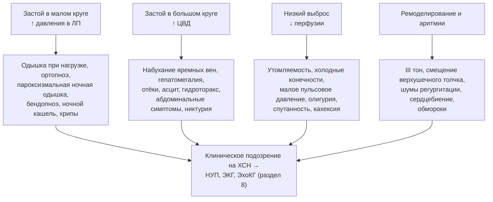

## 7. Клиническая картина

### 7.1. Симптомы

#### 7.1.1. Одышка и её варианты

**Одышка при нагрузке** — самый чувствительный (около 89 %), но малоспецифичный (около 51 %) симптом ХСН: она сопровождает болезни лёгких, анемию, ожирение, детренированность. Патофизиологически одышка связана с повышением давления в лёгочных капиллярах, снижением податливости лёгких, стимуляцией J-рецепторов, слабостью дыхательных мышц и гиперактивностью эргорефлекса (п. 5.5.7). Диагностическую ценность повышают специфические варианты. **Ортопноэ** — одышка в положении лёжа, вынуждающая спать с приподнятым изголовьем; возникает из-за перераспределения крови из нижних конечностей и брюшной полости в грудную клетку; специфичность около 89 %. **Пароксизмальная ночная одышка** — приступ удушья через 1–3 часа после засыпания, заставляющий сесть или встать; в отличие от ортопноэ, облегчение наступает не сразу. **Бендопноэ** (Thibodeau et al., 2014) — одышка в течение 30 секунд после наклона вперёд (при завязывании шнурков); отражает высокое давление наполнения и указывает на выраженный застой.

#### 7.1.2. Утомляемость и снижение переносимости нагрузки

Утомляемость, мышечная слабость и удлинённое восстановление после нагрузки обусловлены сниженным выбросом, миопатией скелетных мышц, анемией, дефицитом железа и нередко — избыточными дозами бета-адреноблокаторов или диуретиков. Пациенты часто приписывают их возрасту и не предъявляют активно, поэтому вопрос о том, что человек перестал делать за последний год, информативнее вопроса «есть ли слабость».

#### 7.1.3. Отёки, увеличение массы тела, абдоминальные симптомы

Периферические отёки при ХСН симметричны, располагаются в зависимых областях, усиливаются к вечеру, оставляют ямку при надавливании; появлению видимых отёков предшествует задержка 3–5 л жидкости, поэтому быстрый прирост массы тела (более 2 кг за 3 дня) — более ранний признак. Абдоминальные симптомы — тяжесть и боль в правом подреберье (растяжение капсулы печени), раннее насыщение, вздутие, снижение аппетита, тошнота — следствие венозного застоя в печени и кишечнике; они часто ошибочно трактуются как гастроэнтерологическая патология.

#### 7.1.4. Никтурия, кашель, другие симптомы

**Никтурия** объясняется улучшением почечной перфузии в горизонтальном положении ночью и реабсорбцией отёчной жидкости. **Ночной сухой кашель** — эквивалент застоя в малом круге (его надо отличать от кашля на иАПФ). К менее специфичным проявлениям относятся сердцебиение, головокружение, обмороки (аритмии, гипотония), депрессия, когнитивные нарушения, снижение массы тела вплоть до кахексии, свистящее дыхание («сердечная астма»), а также дыхание Чейна–Стокса во сне, о котором чаще сообщают родственники.

### 7.2. Физикальные признаки

#### 7.2.1. Признаки застоя в большом круге

**Набухание и пульсация яремных вен** при положении под 45° отражают повышение центрального венозного давления — это самый специфичный прикроватный признак повышенного давления в правом предсердии, который коррелирует и с давлением заклинивания лёгочной артерии (в отсутствие изолированной правожелудочковой патологии). **Гепатоюгулярный (абдоминоюгулярный) рефлюкс** — устойчивое набухание шейных вен при надавливании на живот в течение 10–15 секунд — повышает чувствительность исследования. **Гепатомегалия** (болезненная при остром застое, плотная при хроническом), **асцит**, **гидроторакс** (чаще двусторонний или правосторонний), **периферические отёки** (у лежачих — крестец и бёдра) завершают картину. При выраженном застое нередко отмечают пульсацию печени при трикуспидальной регургитации.

#### 7.2.2. Признаки застоя в малом круге

Влажные мелкопузырчатые незвонкие хрипы в нижних отделах лёгких, не исчезающие при покашливании, появляются при альвеолярном отёке; при хроническом застое они могут отсутствовать несмотря на высокое давление заклинивания благодаря усилению лимфодренажа. Притупление перкуторного звука и ослабление дыхания в нижних отделах указывают на плевральный выпот; свистящие хрипы возможны при отёке слизистой бронхов.

#### 7.2.3. Признаки со стороны сердца

**III тон (протодиастолический ритм галопа)** — низкочастотный звук в начале диастолы при быстром наполнении жёсткого или объёмно перегруженного желудочка; чувствительность низкая, но специфичность для ХСН близка к 99 %. IV тон отражает сокращение предсердия в ригидный желудочек. Смещение верхушечного толчка влево и вниз, его разлитой характер указывают на дилатацию ЛЖ; эпигастральная пульсация — на дилатацию ПЖ. Шумы функциональной митральной и трикуспидальной регургитации, акцент II тона над лёгочной артерией — следствия ремоделирования и ЛГ.

#### 7.2.4. Признаки низкого выброса и системные проявления

Тахикардия, малое пульсовое давление (пропорциональное пульсовое давление менее 25 % указывает на сердечный индекс менее 2,2 л/мин/м²), альтернирующий пульс (чередование сильных и слабых волн), холодные бледные или цианотичные конечности, замедленное наполнение капилляров, олигурия, сонливость или возбуждение — проявления гипоперфузии. Системные признаки длительной ХСН — саркопения и **сердечная кахексия** (непреднамеренная потеря ≥ 5–6 % массы тела за 6–12 месяцев без отёков), «застойная» желтуха, трофические изменения кожи голеней.

### 7.3. Диагностическая ценность симптомов и признаков

#### 7.3.1. Чувствительность и специфичность

Ни один симптом и признак не обладает одновременно высокой чувствительностью и специфичностью, поэтому клиническое подозрение всегда требует объективного подтверждения (табл. 15). Чувствительные симптомы (одышка) полезны для исключения ХСН при их отсутствии, специфичные признаки (III тон, набухание яремных вен, ортопноэ) — для подтверждения.

**Табл. 15.** Диагностическая ценность симптомов и признаков ХСН (ориентировочно, по данным метаанализа Mant и соавт., 2009).

| Симптом/признак | Чувствительность, % | Специфичность, % |
|---|---|---|
| Одышка при нагрузке | ≈ 89 | ≈ 51 |
| Ортопноэ | ≈ 44 | ≈ 89 |
| Пароксизмальная ночная одышка | ≈ 41 | ≈ 84 |
| Периферические отёки | ≈ 53 | ≈ 72 |
| Набухание яремных вен | ≈ 52 | ≈ 70 |
| Влажные хрипы | ≈ 51 | ≈ 81 |
| III тон | ≈ 11 | ≈ 99 |
| Гепатомегалия | ≈ 17 | ≈ 97 |

[⚠️ Требуется верификация: точные значения чувствительности и специфичности по отдельным признакам приведены округлённо и могут отличаться в зависимости от исследуемой популяции; в РКО 2024 приводятся чувствительность одышки 89 %, специфичность 51 %, специфичность ортопноэ 89 % и отёков 72 %.]

#### 7.3.2. Фрамингемские критерии

Классические критерии Фрамингемского исследования (McKee et al., 1971) требуют двух больших или одного большого и двух малых критериев (табл. 16). Они создавались для эпидемиологических целей и сегодня используются как учебный ориентир и исследовательский инструмент, а не как основа диагноза, поскольку не включают визуализацию и биомаркеры.

**Табл. 16.** Фрамингемские критерии сердечной недостаточности.

| Большие критерии | Малые критерии |
|---|---|
| Пароксизмальная ночная одышка или ортопноэ | Двусторонние отёки голеней |
| Набухание шейных вен | Ночной кашель |
| Влажные хрипы в лёгких | Одышка при обычной нагрузке |
| Кардиомегалия | Гепатомегалия |
| Острый отёк лёгких | Плевральный выпот |
| III тон (ритм галопа) | Тахикардия ≥ 120 в минуту |
| Повышение венозного давления > 16 см вод. ст. | Снижение жизненной ёмкости лёгких на ⅓ |
| Гепатоюгулярный рефлюкс | — |
| Потеря ≥ 4,5 кг за 5 дней в ответ на лечение (большой или малый критерий) | |

### 7.4. Клинические синдромы и варианты

#### 7.4.1. Лево- и правожелудочковая недостаточность

Левожелудочковая недостаточность проявляется преимущественно симптомами застоя в малом круге (одышка, ортопноэ, хрипы) и низкого выброса; правожелудочковая — застоем в большом круге (яремные вены, печень, отёки, асцит) при относительно «чистых» лёгких. У большинства пациентов с длительной ХСН имеется бивентрикулярная недостаточность; изолированная правожелудочковая требует исключения лёгочной гипертензии, патологии ПЖ (аритмогенная кардиомиопатия, инфаркт ПЖ), констриктивного перикардита и пороков трикуспидального клапана.

#### 7.4.2. ХСН с сохранённой и сниженной ФВ: клинические отличия

Клиническая картина не позволяет надёжно различить фенотипы по ФВ, однако при ХСНсФВ чаще наблюдаются одышка при нагрузке при скудных физикальных данных, гипертензия, ожирение, фибрилляция предсердий, эпизоды гипертонического отёка лёгких; при ХСНснФВ — признаки низкого выброса, кардиомегалия, III тон, функциональная митральная регургитация, желудочковые аритмии.

#### 7.4.3. Особенности у пожилых, женщин, пациентов с ожирением и коморбидностью

У пожилых доминируют неспецифические проявления: утомляемость, спутанность, снижение активности, падения, анорексия; одышку маскируют малоподвижность и когнитивные нарушения, а отёки — венозная недостаточность и блокаторы кальциевых каналов. У женщин чаще ХСНсФВ и более выраженные симптомы при той же ФВ. При ожирении затруднена оценка яремных вен и верхушечного толчка, уровень натрийуретических пептидов занижен, а одышка объясняется «весом». У пациентов с ХОБЛ симптомы перекрываются, и диагностика требует натрийуретических пептидов и ЭхоКГ.

#### 7.4.4. Атипичные и малосимптомные формы

Бессимптомная дисфункция ЛЖ (предстадия) выявляется случайно при ЭхоКГ или по натрийуретическим пептидам; «абдоминальная» форма имитирует болезнь печени или кишечника; «церебральная» (у пожилых) — деменцию; изолированный ночной кашель или свистящее дыхание направляют к пульмонологу. Настороженность в отношении ХСН у пациентов из групп риска — ключ к ранней диагностике.

**Рис. 9.** Симптомы и признаки ХСН, сгруппированные по ведущему патофизиологическому механизму. Схема читается сверху вниз: четыре механизма дают четыре группы проявлений, которые в совокупности формируют клиническое подозрение, требующее объективного подтверждения.

### 7.5. Примеры и иллюстрации

#### 7.5.1. Клинический пример типичной картины

Мужчина 70 лет с инфарктом миокарда в анамнезе жалуется на одышку при ходьбе 100 м, сон на трёх подушках, пробуждения от удушья, отёки голеней к вечеру, прибавку 4 кг за две недели. Объективно: ЧСС 96, АД 110/80 мм рт. ст., яремные вены набухшие под 45°, положительный гепатоюгулярный рефлюкс, влажные хрипы в нижних отделах, III тон, печень +4 см, симметричные отёки до коленей. ШОКС — 9 баллов; профиль «тёплый и влажный»; по Фрамингему — пять больших критериев. Диагноз клинически очевиден; обследование направлено на уточнение ФВ, причины декомпенсации и этиологии.

#### 7.5.2. Клинический пример атипичной картины

Женщина 82 лет с гипертонией и фибрилляцией предсердий поступает с анорексией, тошнотой, потерей 5 кг, слабостью и спутанностью сознания; одышку отрицает (не ходит дальше комнаты). Объективно: яремные вены набухшие, печень +5 см, умеренный асцит, отёков нет (саркопения), в лёгких чисто. NT-proBNP 4 500 пг/мл, ЭхоКГ: ФВ 55 %, резко расширенные предсердия, выраженная трикуспидальная регургитация. Это правожелудочковый вариант ХСНсФВ с «абдоминальной» и «церебральной» маской; гастроэнтерологическое обследование было бы ошибкой первого шага.

> 💡 **Интересный факт:** термин «бендопноэ» был введён только в 2014 году исследователями из Юго-Западного медицинского центра Техасского университета; в их серии наблюдений симптом возникал в среднем через 8 секунд после наклона и ассоциировался с повышенным давлением наполнения правых и левых отделов сердца, особенно у пациентов с низким сердечным индексом.

> ❗ **Типичная ошибка:** исключать ХСН на основании «чистых лёгких» при аускультации. При хроническом повышении давления в лёгочных капиллярах компенсаторное усиление лимфодренажа предотвращает альвеолярный отёк, поэтому отсутствие хрипов не исключает тяжёлого застоя; напротив, двусторонние влажные хрипы у пожилого пациента могут быть проявлением пневмонии, фиброза или бронхита.

> 🔬 **Углубление:** оценка яремного венозного давления остаётся самым надёжным физикальным методом оценки давления наполнения. При положении под 45° верхняя точка пульсации вен более чем на 3 см выше угла грудины соответствует давлению в правом предсердии выше 8 мм рт. ст.; в исследовании Drazner и соавт. (2001) повышенное яремное давление и III тон у пациентов с ХСНснФВ были независимо связаны с риском госпитализации и смерти даже после учёта ФВ и симптомов. Ультразвуковая оценка нижней полой вены (диаметр > 21 мм с коллабированием < 50 %) и лёгочных B-линий дополняют, но не заменяют этот навык.

> 📝 **Обобщение.** Клиническая картина ХСН складывается из симптомов застоя в малом круге (одышка, ортопноэ, пароксизмальная ночная одышка, бендопноэ, кашель), застоя в большом круге (набухание яремных вен, гепатомегалия, отёки, асцит, абдоминальные симптомы), низкого выброса (утомляемость, холодные конечности, олигурия, спутанность) и признаков ремоделирования (III тон, смещение верхушечного толчка, шумы регургитации). Чувствительные симптомы позволяют исключать, специфичные признаки — подтверждать, но ни один не достаточен для диагноза; у пожилых, женщин, при ожирении и ХСНсФВ картина атипична. Главный вывод: клиническое подозрение — лишь первый шаг, за которым обязательно следует объективное подтверждение натрийуретическими пептидами и визуализацией.

> ❓ **Контрольные вопросы**
>
> 1. Чем патофизиологически различаются ортопноэ, пароксизмальная ночная одышка и бендопноэ?
> 2. Какие признаки ХСН обладают наибольшей специфичностью и почему их отсутствие не исключает диагноз?
> 3. Перечислите большие и малые Фрамингемские критерии и объясните, почему они не используются как единственная основа диагноза сегодня.
> 4. Как отличить клинически преимущественно правожелудочковую недостаточность от левожелудочковой и какие состояния следует исключить при изолированной правожелудочковой картине?
> 5. Опишите особенности клинической картины ХСН у пациента 85 лет с ожирением и ХОБЛ. Какие шаги позволят подтвердить или отвергнуть диагноз?
