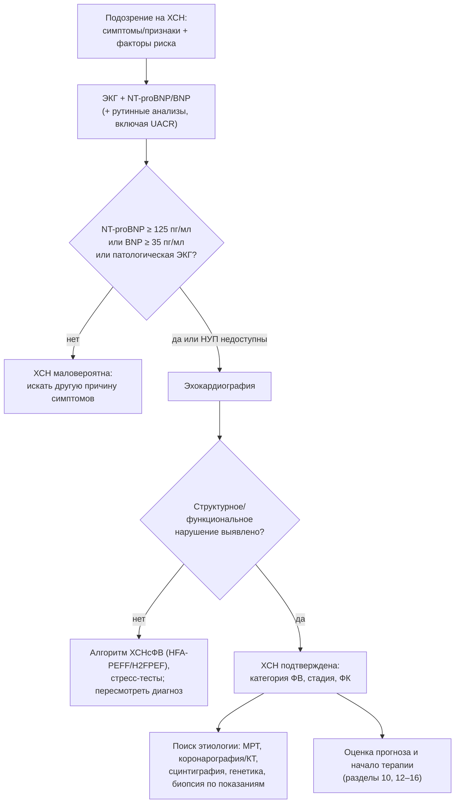
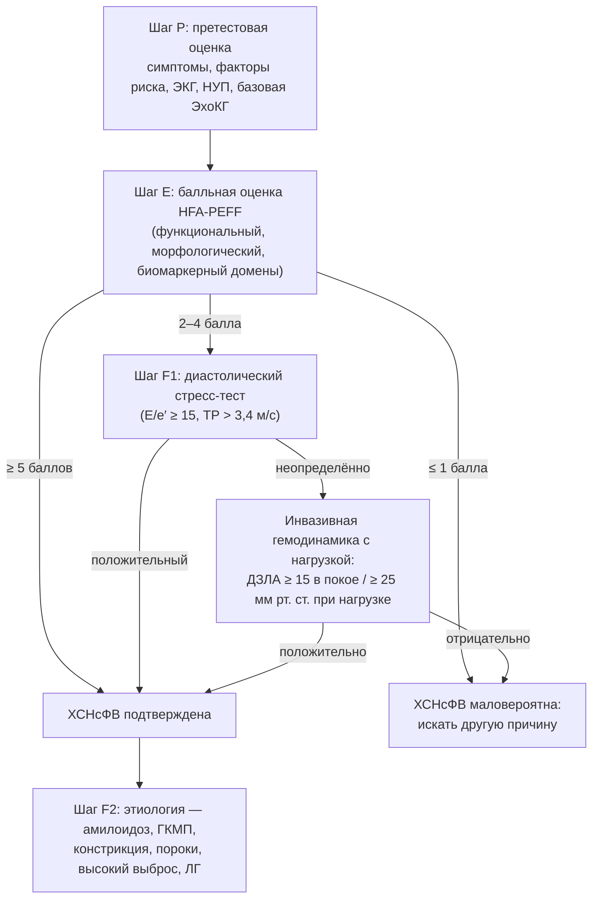

## 8. Диагностика ХСН

### 8.1. Общий алгоритм диагностики

#### 8.1.1. Диагностические критерии и логика подтверждения

Диагноз ХСН требует одновременного наличия: (1) характерных симптомов, (2) признаков (могут отсутствовать на ранних стадиях и на фоне терапии), (3) объективных доказательств структурной и/или функциональной дисфункции сердца и (4) при сомнениях — положительного ответа на терапию или данных нагрузочных и инвазивных методов. Натрийуретические пептиды играют роль «фильтра»: нормальный уровень при неострой симптоматике делает диагноз маловероятным и позволяет избежать ненужной ЭхоКГ; повышенный требует визуализации. Алгоритм ESC/РКО, дополненный положениями ESC 2026 (возраст-специфичные пороги NT-proBNP, альбуминурия в первичном обследовании), показан на рис. 10.

**Рис. 10.** Общий алгоритм диагностики ХСН при неостром начале симптомов. Схема читается сверху вниз: натрийуретические пептиды и ЭКГ служат фильтром перед эхокардиографией, которая подтверждает диагноз и определяет фенотип; далее следует этиологическая диагностика.

#### 8.1.2. Сбор анамнеза и физикальное обследование

Анамнез направлен на выявление этиологии (ИБС, гипертензия, пороки, кардиотоксическая терапия, алкоголь, семейный анамнез кардиомиопатий и внезапной смерти, беременность, системные заболевания), триггеров декомпенсации и коморбидности. Физикальное обследование структурировано по осям «застой — гипоперфузия» (п. 6.3.1), с обязательной оценкой яремного венозного давления, массы тела, АД в положении лёжа и стоя, ЧСС и ритма.

### 8.2. Электрокардиография

Полностью нормальная ЭКГ делает ХСН, особенно систолическую, маловероятной (отрицательная прогностическая ценность около 98 % для систолической дисфункции по данным РКО 2024). Диагностически значимые находки: патологические зубцы Q и рубцовые изменения (ишемическая этиология); признаки гипертрофии ЛЖ; блокада левой ножки пучка Гиса (QRS ≥ 150 мс определяет кандидатов на СРТ); фибрилляция предсердий; низкий вольтаж в сочетании с «гипертрофией» на ЭхоКГ и псевдоинфарктные зубцы (амилоидоз); нарушения атриовентрикулярной проводимости у молодых (саркоидоз, ламинопатии, болезнь Лайма); короткий PR с массивной гипертрофией (болезнь Фабри); частая желудочковая экстрасистолия (аритмогенная кардиомиопатия). Холтеровское мониторирование показано при подозрении на аритмии, для оценки нагрузки экстрасистолией и контроля частоты при ФП.

### 8.3. Лабораторные исследования

Базовый набор: общий анализ крови; креатинин с расчётом рСКФ; натрий, калий; глюкоза и HbA1c; липидный профиль; печёночные ферменты, билирубин, альбумин; ТТГ; ферритин и насыщение трансферрина (дефицит железа: ферритин < 100 мкг/л или 100–299 мкг/л при насыщении < 20 %); мочевая кислота; общий анализ мочи и альбумин-креатининовое отношение (UACR, включено в первичное обследование в ESC 2026). По показаниям — тропонин, креатинфосфокиназа, электрофорез и иммунофиксация белков сыворотки и мочи со свободными лёгкими цепями (амилоидоз), серологические тесты, ангиотензинпревращающий фермент (саркоидоз), тиамин. Лабораторные данные нужны не только для диагностики, но и для оценки безопасности терапии (калий, креатинин) и прогноза (натрий, альбумин, билирубин).

### 8.4. Натрийуретические пептиды

#### 8.4.1. Биология, типы и различия BNP и NT-proBNP

Кардиомиоциты желудочков в ответ на растяжение секретируют проBNP, расщепляющийся на биологически активный **BNP** (период полувыведения около 20 минут; клиренс неприлизином и рецепторами клиренса) и неактивный **NT-proBNP** (период полувыведения 1–2 часа; почечный клиренс). Поскольку сакубитрил ингибирует неприлизин, на фоне АРНИ уровень BNP повышается и теряет интерпретируемость, тогда как NT-proBNP снижается и остаётся пригодным для мониторинга.

#### 8.4.2. Диагностические пороги и факторы, влияющие на уровень

Для исключения ХСН при неостром начале используются пороги NT-proBNP < 125 пг/мл и BNP < 35 пг/мл; при остром начале — NT-proBNP < 300 и BNP < 100 пг/мл. Для подтверждения при остром начале применяют возраст-стратифицированные пороги NT-proBNP (> 450 пг/мл до 50 лет, > 900 — 50–75 лет, > 1 800 — старше 75 лет). ESC 2026 ввели возраст-специфичные диагностические пороги NT-proBNP и для неострой ситуации [⚠️ Требуется верификация: конкретные числовые значения новых порогов]. Факторы, влияющие на уровень, обобщены в табл. 17; наиболее важны возраст, фибрилляция предсердий, почечная недостаточность (повышают) и ожирение (снижает примерно на треть).

**Табл. 17.** Факторы, изменяющие уровень натрийуретических пептидов вне связи с тяжестью ХСН.

| Повышают уровень | Снижают уровень |
|---|---|
| Возраст, женский пол | Ожирение (≈ на 20–40 %) |
| Фибрилляция предсердий | Констриктивный перикардит (меньше растяжение) |
| ХБП (особенно для NT-proBNP) | Первые часы молниеносного отёка лёгких |
| Острый коронарный синдром, ТЭЛА, ЛГ, миокардит, гипертрофия ЛЖ | Сакубитрил/валсартан — снижает NT-proBNP (BNP, напротив, повышает) |
| Сепсис, анемия, тиреотоксикоз, цирроз с асцитом, инсульт | Генетические варианты (редко) |
| Состояния с высоким выбросом | — |

#### 8.4.3. Прогностическое значение и роль в мониторинге

Уровень НУП — один из сильнейших независимых предикторов смерти и госпитализаций при любой ФВ; снижение NT-proBNP на 30 % и более на фоне лечения декомпенсации ассоциировано с лучшим прогнозом. Стратегия титрования терапии «под контролем НУП» не превзошла стандартное ведение в исследовании GUIDE-IT (п. 28.4), однако динамика НУП остаётся полезным индикатором риска при выписке и амбулаторном наблюдении.

### 8.5. Рентгенография органов грудной клетки

Рентгенография выявляет кардиомегалию (кардиоторакальный индекс > 0,5), перераспределение кровотока в верхние доли, интерстициальный отёк (линии Керли B, перибронхиальные муфты), альвеолярный отёк («крылья бабочки»), плевральный выпот; нормальная рентгенограмма не исключает ХСН (особенно хроническую и ХСНсФВ). Главная ценность метода — выявление альтернативных или сопутствующих лёгочных причин одышки. Ультразвуковое исследование лёгких (B-линии ≥ 3 в двух и более межрёберьях с каждой стороны) превосходит рентгенографию в выявлении интерстициального отёка.

### 8.6. Эхокардиография

#### 8.6.1. Оценка систолической функции левого желудочка

ФВ ЛЖ измеряется биплановым методом дисков (Симпсона); при плохой визуализации используют контрастирование, при наличии — трёхмерную ЭхоКГ (точнее и воспроизводимее). Визуальная оценка допустима только опытным исследователем. **Глобальная продольная деформация** (GLS; норма по модулю обычно > 18–20 %) выявляет субклиническую дисфункцию при нормальной ФВ (кардиотоксичность, амилоидоз с «сохранением верхушки», ранние стадии ХСНсФВ) и имеет независимое прогностическое значение. Дополнительно оценивают объёмы ЛЖ, индекс сферичности, региональную сократимость (ишемическая этиология), наличие тромбов и аневризм.

#### 8.6.2. Оценка диастолической функции и давления наполнения

По алгоритму ASE/EACVI 2016 при сохранённой ФВ диастолическая дисфункция диагностируется при наличии более половины из четырёх признаков: септальная e′ < 7 см/с или латеральная e′ < 10 см/с; среднее E/e′ > 14; скорость трикуспидальной регургитации > 2,8 м/с; индекс объёма ЛП > 34 мл/м². При сниженной ФВ степень дисфункции и давление наполнения определяют по трансмитральному потоку: E/A ≤ 0,8 при E ≤ 50 см/с указывает на нормальное давление (I степень), E/A ≥ 2 — на рестрикцию (III степень), промежуточные значения требуют оценки E/e′, скорости ТР и объёма ЛП. Ключевые параметры суммированы в табл. 18.

**Табл. 18.** Основные эхокардиографические параметры при ХСН и их ориентировочные пороговые значения.

| Параметр | Что отражает | Ориентировочный порог патологии |
|---|---|---|
| ФВ ЛЖ (Симпсон, биплан) | Систолическая функция | ≤ 40 % — сниженная; 41–49 % — умеренно сниженная |
| GLS | Продольная систолическая функция | Модуль < 16–18 % |
| Индекс КДО ЛЖ | Дилатация | > 74 мл/м² (м), > 61 мл/м² (ж) |
| ИММЛЖ; относительная толщина стенки | Гипертрофия и геометрия | ≥ 115 г/м² (м), ≥ 95 г/м² (ж); ОТС > 0,42 — концентрическая |
| Индекс объёма ЛП | Хроническое давление наполнения | > 34 мл/м² (синусовый ритм), > 40 мл/м² (ФП) |
| E/e′ среднее | Давление наполнения ЛЖ | > 14 (патология); 9–14 — серая зона |
| e′ септальная/латеральная | Расслабление | < 7 / < 10 см/с |
| Скорость ТР; СДЛА | Лёгочная гипертензия | > 2,8 м/с; > 35 мм рт. ст. |
| TAPSE; S′ ПЖ; FAC | Функция ПЖ | < 17 мм; < 9,5 см/с; < 35 % |
| Нижняя полая вена | Давление в правом предсердии | > 21 мм и коллабирование < 50 % — ДПП ≈ 15 мм рт. ст. |

#### 8.6.3. Оценка правых отделов, клапанов и перикарда

Систематически оценивают размеры и функцию ПЖ (TAPSE, S′, фракция изменения площади, деформация свободной стенки), степень и механизм трикуспидальной и митральной регургитации (первичная или вторичная), стенозы, протезы, перикардиальный выпот и признаки констрикции (септальный «отскок», дыхательные колебания потоков, плетора нижней полой вены при нормальных размерах камер).

#### 8.6.4. Стресс-эхокардиография и чреспищеводная ЭхоКГ

Стресс-ЭхоКГ с физической нагрузкой или добутамином выявляет ишемию, жизнеспособность миокарда (сократительный резерв), оценивает динамику регургитации и давления в лёгочной артерии; **диастолический стресс-тест** (E/e′ ≥ 15 и/или скорость ТР > 3,4 м/с при нагрузке) используется в диагностике ХСНсФВ. Чреспищеводная ЭхоКГ нужна при неадекватном трансторакальном окне, оценке клапанов и протезов, тромбов ушка ЛП и для сопровождения транскатетерных вмешательств.

### 8.7. Магнитно-резонансная томография сердца

МРТ — референсный метод измерения объёмов, массы и ФВ обоих желудочков и единственный неинвазивный метод тканевой характеристики. **Позднее контрастирование гадолинием** различает ишемическое (субэндокардиальное или трансмуральное в бассейне коронарной артерии) и неишемическое повреждение (табл. 19); картирование **T1** и **объёма внеклеточного пространства** выявляет диффузный фиброз и амилоидную инфильтрацию (повышены) и болезнь Фабри (нативное T1 снижено); **T2** — отёк при миокардите; **T2\*** — перегрузку железом (< 20 мс). Показания: неясная этиология, плохое ультразвуковое окно, подозрение на инфильтративные, воспалительные и генетические кардиомиопатии, аритмогенную кардиомиопатию, оценка жизнеспособности перед реваскуляризацией. Ограничения: доступность, устройства (многие современные совместимы), клаустрофобия, аритмии, гадолиний при рСКФ < 30 мл/мин/1,73 м² (с осторожностью).

**Табл. 19.** Характерные паттерны позднего контрастирования гадолинием при различных причинах ХСН.

| Паттерн | Типичная причина |
|---|---|
| Субэндокардиальное/трансмуральное в бассейне артерии | Инфаркт миокарда (ишемическая кардиомиопатия) |
| Срединно-стеночная «полоска» в перегородке | Дилатационная кардиомиопатия, ламинопатии |
| Субэпикардиальное/пятнистое, латеральная стенка, перегородка | Миокардит, саркоидоз, аритмогенная кардиомиопатия, мышечные дистрофии |
| Диффузное субэндокардиальное/трансмуральное с нарушением «обнуления» миокарда | Амилоидоз |
| Базальная нижнелатеральная стенка | Болезнь Фабри |
| Точки прикрепления ПЖ, зоны гипертрофии | Гипертрофическая кардиомиопатия, лёгочная гипертензия |

### 8.8. Нагрузочные тесты

#### 8.8.1. Тест с 6-минутной ходьбой

Стандартизированный тест (коридор 30 м, без сопровождения, фиксируется дистанция, одышка по Боргу, сатурация) используется для объективизации ФК, динамического наблюдения и прогноза; дистанция < 300 м входит в критерии продвинутой ХСН, прирост > 30–50 м считается клинически значимым.

#### 8.8.2. Кардиопульмональное нагрузочное тестирование

КПНТ измеряет пиковое потребление кислорода (VO₂ peak), анаэробный порог, вентиляционную эффективность (наклон VE/VCO₂; > 35 — неблагоприятно), осцилляторное дыхание и дыхательный коэффициент (RER ≥ 1,05 подтверждает достаточное усилие). Показания: отбор на трансплантацию и механическую поддержку (VO₂ peak ≤ 12 мл/кг/мин на фоне бета-адреноблокатора или ≤ 14 без него — критерий направления), дифференциальная диагностика кардиальной и лёгочной одышки, назначение тренировок, экспертиза трудоспособности.

#### 8.8.3. Стресс-тесты на ишемию

Стресс-ЭхоКГ, перфузионная сцинтиграфия, стресс-МРТ и ПЭТ выявляют ишемию и жизнеспособность; выбор определяется доступностью и локальной экспертизой. Нагрузочная ЭКГ при ХСН малоинформативна из-за исходных изменений ЭКГ и ограниченной переносимости нагрузки.

### 8.9. Инвазивная диагностика

#### 8.9.1. Коронарная ангиография и КТ-коронарография

Коронарография показана при стенокардии, рефрактерной к терапии, при высокой претестовой вероятности ИБС у кандидатов на реваскуляризацию, при желудочковых аритмиях и остановке кровообращения; при низкой и промежуточной вероятности предпочтительна КТ-коронарография, которая надёжно исключает значимый стеноз. Решение о коронарографии всегда связано с вопросом, изменит ли результат тактику (раздел 21).

#### 8.9.2. Катетеризация правых отделов сердца

Измеряются давление в правом предсердии, лёгочной артерии, давление заклинивания, сердечный выброс (термодилюция, метод Фика), рассчитываются лёгочное сосудистое сопротивление и транспульмональный градиент. Показания: оценка ЛГ перед трансплантацией и имплантацией LVAD (обратимость при вазодилататорах), расхождение клинических и неинвазивных данных, рефрактерная декомпенсация, диагностика ХСНсФВ (давление заклинивания ≥ 15 мм рт. ст. в покое или ≥ 25 при нагрузке), подозрение на констрикцию и рестрикцию.

#### 8.9.3. Эндомиокардиальная биопсия

Биопсия показана, когда результат изменит лечение: при подозрении на гигантоклеточный, эозинофильный миокардит или саркоидоз (быстро прогрессирующая ХСН с нарушениями проводимости и желудочковыми аритмиями), для верификации амилоидоза при невозможности неинвазивной диагностики, при подозрении на отторжение трансплантата. Чувствительность зависит от очаговости процесса; осложнения (перфорация, тампонада) редки в опытных центрах.

### 8.10. Другие методы визуализации

**Сцинтиграфия с остеотропными препаратами** (⁹⁹ᵐTc-пирофосфат, DPD, HMDP) при захвате миокардом 2–3 степени по Perugini и отсутствии моноклонального белка (электрофорез и иммунофиксация сыворотки и мочи, свободные лёгкие цепи) позволяет диагностировать транстиретиновый амилоидоз без биопсии (критерии Gillmore et al., 2016). **ПЭТ с ¹⁸F-ФДГ** применяется для диагностики и мониторинга саркоидоза сердца и оценки жизнеспособности; **КТ сердца** — для коронарного кальция, анатомии перед вмешательствами, перикарда. **Исследование функции внешнего дыхания** и **полисомнография** нужны для оценки коморбидности и дифференциальной диагностики одышки.

### 8.11. Оценка прогноза и качества жизни на этапе диагностики

Уже при установлении диагноза оценивают прогностические маркеры (НУП, рСКФ, натрий, ФВ, ФК, дистанция 6-минутной ходьбы, частота госпитализаций) и качество жизни с помощью валидированных опросников — Канзасского (KCCQ) и Миннесотского (MLHFQ); они обсуждаются в разделе 10.

### 8.12. Диагностика ХСН с сохранённой фракцией выброса и особые диагностические ситуации

#### 8.12.1. Алгоритмы HFA-PEFF и H2FPEF

Поскольку при ХСНсФВ ФВ нормальна, диагноз строится на доказательстве повышенного давления наполнения. **HFA-PEFF** (Pieske et al., 2019) — четырёхшаговый алгоритм: P (претестовая оценка), E (эхокардиографическая и биомаркерная балльная система, табл. 20), F1 (функциональное тестирование — диастолический стресс-тест, при неопределённости — инвазивная гемодинамика с нагрузкой), F2 (этиологическая диагностика). **H2FPEF** (Reddy et al., 2018) — вероятностная шкала из шести легко доступных признаков (табл. 21). РКО 2024 предлагает собственный перечень объективных критериев (п. 2.4.6 и табл. 8): концентрическая гипертрофия, ИОЛП > 34 мл/м², E/e′ > 9, повышение НУП, СДЛА > 35 мм рт. ст. Схема диагностики представлена на рис. 11.

**Табл. 20.** Балльная система шага E алгоритма HFA-PEFF.

| Домен | Большие критерии (2 балла) | Малые критерии (1 балл) |
|---|---|---|
| Функциональный | Септальная e′ < 7 или латеральная e′ < 10 см/с; или среднее E/e′ ≥ 15; или скорость ТР > 2,8 м/с | Среднее E/e′ 9–14; или GLS по модулю < 16 % |
| Морфологический | ИОЛП > 34 мл/м²; или ИММЛЖ ≥ 149 (м) / ≥ 122 (ж) г/м² при ОТС > 0,42 | ИОЛП 29–34 мл/м²; или ИММЛЖ > 115 (м) / > 95 (ж) г/м²; или ОТС > 0,42; или толщина стенки ≥ 12 мм |
| Биомаркерный (синусовый ритм) | NT-proBNP > 220 или BNP > 80 пг/мл | NT-proBNP 125–220 или BNP 35–80 пг/мл |
| Биомаркерный (ФП) | NT-proBNP > 660 или BNP > 240 пг/мл | NT-proBNP 365–660 или BNP 105–240 пг/мл |

Интерпретация: ≥ 5 баллов — ХСНсФВ подтверждена; 2–4 балла — неопределённость, показан шаг F1; ≤ 1 балла — диагноз маловероятен. В каждом домене учитывается не более 2 баллов.

**Табл. 21.** Шкала H2FPEF.

| Признак | Критерий | Баллы |
|---|---|---|
| H — Heavy (ожирение) | ИМТ > 30 кг/м² | 2 |
| H — Hypertension | ≥ 2 антигипертензивных препарата | 1 |
| F — Fibrillation | Пароксизмальная или постоянная ФП | 3 |
| P — Pulmonary hypertension | СДЛА > 35 мм рт. ст. | 1 |
| E — Elder | Возраст > 60 лет | 1 |
| F — Filling pressure | E/e′ > 9 | 1 |

Интерпретация: 0–1 балл — низкая вероятность; 2–5 — промежуточная (нужны дополнительные тесты); 6–9 — высокая вероятность ХСНсФВ.

**Рис. 11.** Алгоритм диагностики ХСН с сохранённой фракцией выброса (по HFA-PEFF). Схема читается сверху вниз: после претестовой оценки балльная система либо подтверждает диагноз, либо направляет к функциональному тестированию; завершающий шаг — установление конкретной причины.

#### 8.12.2. Генетическое тестирование и семейный скрининг

Генетическое тестирование показано при дилатационной и недилатационной кардиомиопатии с семейным анамнезом, нарушениями проводимости или желудочковыми аритмиями (гены TTN, LMNA, FLNC, DSP, SCN5A, RBM20, BAG3, PLN и др.), при гипертрофической (MYH7, MYBPC3), аритмогенной кардиомиопатии и подозрении на наследственный транстиретиновый амилоидоз (TTR). Результат влияет на прогноз (ламинопатии и FLNC — высокий аритмический риск, ранние показания к ИКД), на выбор терапии (тафамидис при ATTR) и на каскадный скрининг родственников первой степени родства (ЭКГ, ЭхоКГ, при выявленном варианте — генетическое тестирование). Консультирование должно предшествовать тестированию.

#### 8.12.3. «Красные флаги» амилоидоза сердца

Амилоидоз следует заподозрить при: гипертрофии ЛЖ ≥ 12 мм без адекватной гипертензии; несоответствии толщины стенок и низкого вольтажа ЭКГ; псевдоинфарктных зубцах Q; «сохранении верхушки» на картах деформации; утолщении межпредсердной перегородки и клапанов, перикардиальном выпоте; двустороннем синдроме запястного канала, разрыве сухожилия бицепса, стенозе поясничного отдела позвоночника, полинейропатии, ортостатической гипотонии; непереносимости иАПФ и бета-адреноблокаторов; стойком повышении тропонина и НУП, непропорциональном тяжести; ХСНсФВ у мужчин старше 65 лет и низкопоточном аортальном стенозе у пожилых. Диагностика — сцинтиграфия с остеотропным препаратом плюс исключение моноклонального белка; при подозрении на AL-амилоидоз — гематологическое обследование и биопсия в срочном порядке.

### 8.13. Примеры и иллюстрации

#### 8.13.1. Пример применения алгоритма

Пациентка 74 лет с одышкой, гипертензией и ожирением: ЭКГ — гипертрофия ЛЖ, NT-proBNP 310 пг/мл, ЭхоКГ — ФВ 60 %, ИММЛЖ 118 г/м², ОТС 0,46, ИОЛП 36 мл/м², E/e′ 13, ТР 2,9 м/с. HFA-PEFF: функциональный домен — 2 балла (ТР > 2,8), морфологический — 2 (ИОЛП > 34), биомаркерный — 2 (NT-proBNP > 220 при синусовом ритме); итого 6 баллов — ХСНсФВ подтверждена. H2FPEF: ожирение 2 + гипертензия 1 + возраст 1 + E/e′ 1 = 5 баллов (промежуточная вероятность), что иллюстрирует различие шкал.

#### 8.13.2. Пример этиологической диагностики

Мужчина 58 лет, ФВ 30 %, без стенокардии, QRS 100 мс, атриовентрикулярная блокада I степени, отец умер внезапно в 50 лет. КТ-коронарография — без стенозов; МРТ — срединно-стеночное позднее контрастирование в перегородке; генетическое тестирование — патогенный вариант LMNA. Вывод: ламинопатия с высоким аритмическим риском — показание к ИКД независимо от ФВ по специальным критериям, каскадный скрининг детей и сибсов.

> 💡 **Интересный факт:** мозговой натрийуретический пептид получил своё название потому, что впервые был выделен в 1988 году японскими исследователями из мозга свиньи; лишь впоследствии выяснилось, что основным источником пептида у человека являются желудочки сердца, а не нервная ткань, однако название закрепилось.

> ❗ **Типичная ошибка:** интерпретировать NT-proBNP 400 пг/мл у пациента 80 лет с ФП и ХБП как доказательство ХСН, а 110 пг/мл у пациента с ИМТ 42 кг/м² — как её исключение. Возраст, ФП и ХБП повышают, а ожирение снижает уровень пептидов; результат следует соотносить с клиническим контекстом и подтверждать визуализацией. Вторая распространённая ошибка — исключение ХСНсФВ на основании «нормальной ЭхоКГ в покое»: диагноз требует целенаправленной оценки диастолической функции, объёма ЛП и, при неопределённости, нагрузочного тестирования.

> 🔬 **Углубление:** неинвазивная диагностика транстиретинового амилоидоза основана на работе Gillmore и соавт. (2016): в когорте более 1 200 пациентов захват остеотропного радиофармпрепарата 2–3 степени по Perugini в сочетании с отсутствием моноклонального белка имел специфичность и положительную прогностическую ценность, близкие к 100 %, для ATTR-амилоидоза сердца. Это изменило эпидемиологию: при систематическом скрининге ATTR-амилоидоз выявляется примерно у 10–15 % пожилых пациентов с ХСНсФВ и гипертрофией и у части пациентов с аортальным стенозом, а появление специфической терапии сделало такой поиск обязательным.

> 📝 **Обобщение.** Диагностика ХСН — последовательность: клиническое подозрение → ЭКГ и натрийуретические пептиды как фильтр (NT-proBNP < 125 / BNP < 35 пг/мл при неостром начале делают диагноз маловероятным с поправкой на возраст, ФП, ХБП и ожирение) → эхокардиография с оценкой ФВ, GLS, геометрии, диастолической функции, правых отделов и клапанов → при неопределённости алгоритмы ХСНсФВ (HFA-PEFF, H2FPEF, стресс-тесты, инвазивная гемодинамика) → этиологическая диагностика (МРТ с характеристикой ткани, коронарография или КТ, сцинтиграфия на амилоид, генетика, биопсия). Главный вывод: подтверждённый диагноз без установленной причины неполон, поскольку ряд причин ХСН имеет специфическое лечение.

> ❓ **Контрольные вопросы**
>
> 1. Опишите алгоритм диагностики ХСН при неостром начале и укажите пороги натрийуретических пептидов для исключения диагноза.
> 2. Какие факторы повышают и какие снижают уровень NT-proBNP, и почему на фоне сакубитрила/валсартана следует использовать именно NT-proBNP?
> 3. Перечислите четыре эхокардиографических критерия диастолической дисфункции по алгоритму 2016 года и критерии давления наполнения при сниженной ФВ.
> 4. Какие паттерны позднего контрастирования гадолинием соответствуют ишемической кардиомиопатии, ДКМП, миокардиту и амилоидозу?
> 5. Рассчитайте баллы HFA-PEFF и H2FPEF для пациента 66 лет с ИМТ 33 кг/м², на трёх антигипертензивных препаратах, с пароксизмальной ФП, E/e′ 12, ИОЛП 38 мл/м², NT-proBNP 500 пг/мл при синусовом ритме и сделайте вывод.
