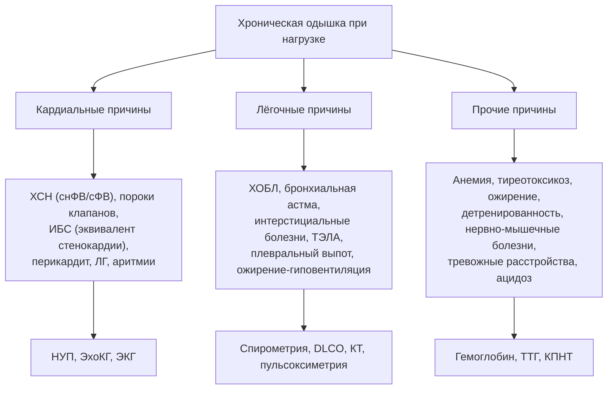

## 9. Дифференциальная диагностика и формулировка диагноза

### 9.1. Дифференциальная диагностика ведущих синдромов

#### 9.1.1. Дифференциальная диагностика одышки

Одышка — межпредметный симптом, и ХСН конкурирует с лёгочными, гематологическими, метаболическими и психогенными причинами (рис. 12). Ключевые разграничительные инструменты: натрийуретические пептиды (нормальный уровень при неострой одышке почти исключает кардиальную причину), ЭхоКГ, спирометрия и диффузионная способность лёгких, гемоглобин, ТТГ, КПНТ при неясном генезе (кардиальная одышка — низкий VO₂ peak с ранним анаэробным порогом и высоким наклоном VE/VCO₂ при сохранённом дыхательном резерве; лёгочная — исчерпание дыхательного резерва и десатурация). Следует помнить, что у пожилых одышка часто многофакторна: ХСН плюс ХОБЛ плюс анемия плюс детренированность.

**Рис. 12.** Дифференциальная диагностика хронической одышки. Схема читается сверху вниз: три группы причин и соответствующие им ключевые методы разграничения; при многофакторной одышке у пожилых обследование ведётся параллельно по всем направлениям.

#### 9.1.2. Дифференциальная диагностика отёков

Двусторонние отёки голеней при ХСН следует отличать от отёков при хронической венозной недостаточности (асимметрия, трофические изменения, нормальное яремное давление), приёме дигидропиридиновых блокаторов кальциевых каналов, тиазолидиндионов, НПВП и глюкокортикоидов, при нефротическом синдроме (протеинурия, гипоальбуминемия, периорбитальные отёки), циррозе печени (асцит преобладает над отёками, признаки портальной гипертензии), гипотиреозе (плотные, не оставляющие ямки), лимфедеме, идиопатических циклических отёках. Решающие признаки кардиальных отёков — повышенное яремное венозное давление и повышенные натрийуретические пептиды.

#### 9.1.3. Состояния, имитирующие ХСН или сосуществующие с ней

**Констриктивный перикардит** даёт правожелудочковую картину при нормальной ФВ и нередко нормальных или умеренно повышенных НУП; **рестриктивная кардиомиопатия** (амилоидоз) — сходную клинику с иными ЭхоКГ-признаками (табл. 22). **Высоковыбросная недостаточность** (анемия, тиреотоксикоз, артериовенозные фистулы, бери-бери, болезнь Педжета, цирроз) проявляется застоем при повышенном выбросе и тёплых конечностях. **Лёгочная артериальная гипертензия** и **хроническая тромбоэмболическая ЛГ** вызывают правожелудочковую недостаточность без левосердечной патологии. **Тяжёлая ХБП** с гиперволемией и **нефротический синдром** имитируют застой; при них НУП повышены за счёт сниженного клиренса и объёмной перегрузки, что требует интегральной оценки.

**Табл. 22.** Дифференциальная диагностика констриктивного перикардита и рестриктивной кардиомиопатии.

| Признак | Констриктивный перикардит | Рестриктивная кардиомиопатия |
|---|---|---|
| Анамнез | Перикардит, облучение, кардиохирургия, туберкулёз | Амилоидоз, саркоидоз, гемохроматоз, болезни накопления, семейный анамнез |
| Толщина стенок ЛЖ | Нормальная | Увеличена (при инфильтрации) |
| Перикард | Утолщён/кальцинирован (КТ, МРТ) | Не изменён |
| Дыхательная вариабельность трансмитрального потока | > 25 % | Отсутствует |
| Движение перегородки | «Отскок», дыхательный сдвиг | Нормальное |
| e′ (тканевой допплер) | Нормальная или повышенная («парадокс кольца») | Резко снижена |
| НУП | Нормальные или умеренно повышены | Значительно повышены |
| Инвазивная гемодинамика | Выравнивание диастолических давлений, дискордантность ЛЖ/ПЖ при дыхании | Давление в ЛЖ > ПЖ, конкордантность |
| Лечение | Перикардэктомия | Лечение основного заболевания |

#### 9.1.4. Дифференциальная диагностика внутри синдрома ХСН

После подтверждения ХСН дифференциальная диагностика переходит на уровень этиологии: ишемическая и неишемическая кардиомиопатия, гипертоническое сердце и гипертрофическая кардиомиопатия, амилоидоз и гипертрофия иного генеза, миокардит и ДКМП, тахикардиомиопатия и первичная кардиомиопатия с аритмией, клапанный порок как причина или следствие (функциональная регургитация). Методология описана в разделе 8 и п. 18.1.

### 9.2. Формулировка диагноза

#### 9.2.1. Принципы построения диагноза

В российской практике ХСН указывается как осложнение основного заболевания (ИБС, гипертонической болезни, кардиомиопатии, порока), а не как самостоятельная нозология; исключение — ситуации, когда причину установить не удалось. В формулировке последовательно указывают: категорию ФВ (ХСНнФВ/ХСНунФВ/ХСНсФВ/с улучшенной ФВ), стадию (по РКО 2023: предстадия, 1-я, 2-я стадия; по традиции допустимо указание стадии по Стражеско–Василенко), функциональный класс NYHA, при необходимости — проявления (отёки, гидроторакс, асцит, анасарка), осложнения (ЛГ с ФК по ВОЗ, кардиоренальный синдром, кахексия), имплантированные устройства с датой (табл. 23).

**Табл. 23.** Структура формулировки диагноза и примеры (по РКО 2024).

| Элемент | Содержание | Примеры |
|---|---|---|
| Основное заболевание | Этиология ХСН | «ИБС: постинфарктный кардиосклероз (ИМ 2019)»; «Гипертоническая болезнь II стадии, риск 3»; «Семейная ДКМП» |
| Осложнение: ХСН | Категория ФВ + стадия + ФК (+ проявления) | «ХСНунФВ 1 стадия, 2 ФК»; «ХСНнФВ 2 стадия, 4 ФК, двусторонний гидроторакс, асцит, анасарка» |
| Сопутствующие осложнения | ЛГ, аритмии, кардиоренальный синдром | «ЛГ 1 ФК ВОЗ»; «Постоянная форма ФП» |
| Устройства/вмешательства | Тип и дата | «Имплантация СРТ-Д (2024)» |
| Предстадия | При бессимптомном поражении | «ГБ II ст., риск 3, ГЛЖ, диастолическая дисфункция, предстадия СН» |

#### 9.2.2. Указание фенотипа и динамики

При ХСН с улучшенной ФВ указывают исходную и текущую ФВ (например, «ХСН с улучшенной ФВ (ФВ 28 % в 2023 году, 48 % в 2026 году)»), поскольку это определяет продолжение терапии. При изменении ФК и стадии диагноз обновляется; стадия не пересматривается в сторону уменьшения.

#### 9.2.3. Кодирование по МКБ-10

Для статистического учёта используются коды I50.0 (застойная сердечная недостаточность), I50.1 (левожелудочковая недостаточность) и I50.9 (сердечная недостаточность неуточнённая); в качестве основного кода, как правило, указывается код причинного заболевания (I25, I11, I42 и др.), а ХСН кодируется как осложнение. Подробнее о кодировании и переходе на МКБ-11 — п. 2.5.

### 9.3. Примеры и иллюстрации

#### 9.3.1. Пример полной формулировки диагноза

«ИБС: постинфарктный кардиосклероз (передний ИМ с подъёмом сегмента ST, стентирование ПМЖВ 2022). Осложнения: ХСНнФВ (ФВ 32 %) 1 стадия, 3 ФК; функциональная митральная регургитация 2 степени; ЛГ 2 ФК ВОЗ; пароксизмальная форма ФП, CHA₂DS₂-VASc 4 балла. Сопутствующие: сахарный диабет 2-го типа; ХБП С3а А2.» Такая формулировка содержит этиологию, фенотип, стадию, класс, значимые осложнения и коморбидность, определяющие терапию.

#### 9.3.2. Пример дифференциально-диагностической задачи

Пациент 72 лет с одышкой, отёками, ФВ 62 %, толщиной стенок 15 мм, ИОЛП 45 мл/м², низким вольтажом QRS, синдромом запястного канала в анамнезе, NT-proBNP 3 000 пг/мл. Ключевая развилка — гипертоническое сердце против амилоидоза: несоответствие вольтажа и гипертрофии, внесердечные признаки и несоразмерно высокие НУП требуют сцинтиграфии с пирофосфатом и исключения моноклонального белка до постановки диагноза «гипертоническая болезнь с ХСНсФВ».

> 💡 **Интересный факт:** констриктивный перикардит исторически был преимущественно туберкулёзным («панцирное сердце»), а сегодня в развитых странах его ведущие причины — предшествующие кардиохирургические операции и лучевая терапия на средостение; при этом он остаётся одной из немногих форм «сердечной недостаточности», излечимых хирургически.

> ❗ **Типичная ошибка:** формулировка «ХСН» без указания категории ФВ, стадии и функционального класса или, напротив, «ХСН 0 стадии». Диагноз без фенотипа не позволяет выбрать терапию, а отсутствие симптомов при структурных изменениях обозначается термином «предстадия СН», а не нулевой стадией.

> 🔬 **Углубление:** разграничение констрикции и рестрикции при инвазивном исследовании основано на феномене желудочковой взаимозависимости: при констрикции ригидный перикард фиксирует общий объём сердца, поэтому на вдохе наполнение ПЖ увеличивается за счёт ЛЖ (дискордантные изменения систолического давления в желудочках), а при рестрикции оба желудочка реагируют на дыхание однонаправленно. Показатель «индекс систолической площади» (отношение площадей под кривыми давления ПЖ и ЛЖ на вдохе и выдохе > 1,1) обладает чувствительностью и специфичностью выше 90 % для констрикции по данным клиники Мэйо (Talreja et al., 2008).

> 📝 **Обобщение.** Дифференциальная диагностика ХСН ведётся на трёх уровнях: синдромном (одышка, отёки — лёгочные, почечные, печёночные, эндокринные и лекарственные причины), нозологическом (констрикция, рестрикция, высоковыбросные состояния, ЛГ, ХБП) и этиологическом (причина конкретной ХСН). Формулировка диагноза подчиняется правилу «основное заболевание → осложнение ХСН с категорией ФВ, стадией и ФК → проявления и осложнения → устройства», что обеспечивает преемственность лечения. Главный вывод: правильно сформулированный диагноз — это сжатый план лечения.

> ❓ **Контрольные вопросы**
>
> 1. Какие три исследования наиболее эффективно разграничивают кардиальную и лёгочную одышку и какие паттерны КПНТ характерны для каждой из них?
> 2. Перечислите пять эхокардиографических и гемодинамических признаков, отличающих констриктивный перикардит от рестриктивной кардиомиопатии.
> 3. Назовите лекарственные причины отёков голеней, которые могут имитировать декомпенсацию ХСН.
> 4. Составьте формулировку диагноза для пациента с гипертонической болезнью, ожирением, ФВ 56 %, ИОЛП 40 мл/м², NT-proBNP 700 пг/мл, одышкой при обычной нагрузке и двумя госпитализациями за год.
> 5. Почему термин «ХСН 0 стадии» некорректен и каким термином следует пользоваться?
