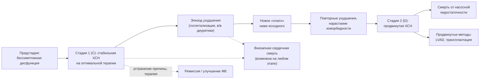

## 10. Течение, осложнения и прогноз

### 10.1. Естественное течение

#### 10.1.1. Траектория заболевания

Течение ХСН нелинейно: периоды относительной стабильности прерываются эпизодами ухудшения, после каждого из которых функциональное состояние, как правило, не возвращается к исходному уровню, а риск смерти возрастает (рис. 13). В исходе развиваются продвинутая ХСН с рефрактерными симптомами, нарастающей органной дисфункцией и кахексией, либо наступает внезапная смерть на любом этапе — в том числе при умеренных симптомах. Траектория может быть изменена: при устранимой причине и полноценной терапии возможно длительное улучшение (ремиссия).

**Рис. 13.** Траектория течения ХСН. Схема читается слева направо: ступенчатое прогрессирование с эпизодами ухудшения, каждый из которых снижает функциональный уровень, при постоянном риске внезапной смерти; пунктирные стрелки обозначают альтернативные исходы — внезапную смерть и ремиссию.

#### 10.1.2. Эпизоды ухудшения как переломные точки

**Ухудшение ХСН** (worsening heart failure) определяется как усиление симптомов, потребовавшее госпитализации, внутривенной диуретической терапии или неотложного визита. В регистрах после первой госпитализации по поводу ХСН медиана выживаемости составляет около 2–3 лет; каждая последующая госпитализация сокращает её, а около 25 % пациентов повторно госпитализируются в течение 30 дней. Период 1–3 месяца после выписки («уязвимый период») характеризуется максимальным риском и требует раннего визита и интенсивной оптимизации терапии (разделы 22, 24).

#### 10.1.3. Фенотипы течения

Выделяют стабильное течение на фоне терапии, медленно прогрессирующее, быстро прогрессирующее (гигантоклеточный миокардит, AL-амилоидоз, ламинопатии), рецидивирующе-декомпенсирующее («частые посетители») и течение с ремиссией. У пациентов с ХСНсФВ прогрессирование определяется в большей степени коморбидностью, а смерть чаще наступает от некардиальных причин.

### 10.2. Осложнения

#### 10.2.1. Нарушения ритма и проводимости; внезапная сердечная смерть

Фибрилляция предсердий встречается у 30–50 % пациентов с ХСН и ухудшает прогноз (потеря предсердного вклада, тахисистолия, тромбоэмболии). Желудочковые тахиаритмии — главный механизм внезапной смерти, доля которой среди всех смертей при ХСНснФВ достигает трети–половины при NYHA II и уменьшается при NYHA IV, где преобладает насосная недостаточность; на фоне современной четырёхкомпонентной терапии годовая частота внезапной смерти снизилась примерно до 1 % и менее у стабильных пациентов (п. 21.1). Брадиаритмии и атриовентрикулярные блокады характерны для инфильтративных и генетических кардиомиопатий.

#### 10.2.2. Тромбоэмболические осложнения

Риск инсульта и системных эмболий повышен при ФП, тромбозе ЛЖ (аневризма, низкая ФВ после переднего инфаркта), тромбозе глубоких вен при гиподинамике и застое. Антикоагуляция показана при ФП (п. 19.4) и тромбе ЛЖ, но не при синусовом ритме без дополнительных показаний (исследования WARCEF, COMMANDER-HF).

#### 10.2.3. Кардиоренальный синдром

Сочетание ХСН и ХБП удваивает риск смерти; ухудшение функции почек при декомпенсации требует различения истинного повреждения и «псевдоухудшения» при эффективной деконгестии (раздел 15, п. 19.2). Стойкое снижение рСКФ ограничивает терапию, усиливает анемию и гиперкалиемию.

#### 10.2.4. Поражение печени, кахексия, анемия и дефицит железа, депрессия

Застойная гепатопатия ведёт к гипоальбуминемии и коагулопатии; **сердечная кахексия** (потеря ≥ 5–6 % массы тела за 6–12 месяцев) и саркопения — независимые предикторы смерти; анемия (у 30–40 %) и дефицит железа (до 50 %) ухудшают симптомы и прогноз; депрессия и когнитивные нарушения снижают приверженность и качество жизни (раздел 19).

#### 10.2.5. Другие осложнения

Лёгочная гипертензия и правожелудочковая недостаточность, плевральный выпот и асцит, застойная гастроэнтеропатия с мальабсорбцией, нарушения дыхания во сне, тромбозы и инфекции, обусловленные устройствами, и ятрогенные осложнения терапии (электролитные нарушения, гипотония, почечная дисфункция) дополняют спектр.

### 10.3. Прогноз и его предикторы

#### 10.3.1. Показатели выживаемости

Пятилетняя выживаемость после установления диагноза в популяционных исследованиях составляет около 50 %, что хуже, чем при многих злокачественных новообразованиях; в России медиана выживаемости при ФК I–II — около 8,4 года, при ФК III–IV — 3,8 года (ЭПОХА; раздел 3). У пациентов, получающих современную четырёхкомпонентную терапию, прогноз существенно лучше: в моделировании на основе данных исследований ожидаемый прирост выживаемости без событий достигает нескольких лет у молодых пациентов (Vaduganathan et al., 2020).

#### 10.3.2. Клинические, инструментальные и лабораторные предикторы

Главные предикторы обобщены в табл. 24. Прогностическая ценность отдельных показателей ограничена, поэтому используются многофакторные модели.

**Табл. 24.** Основные предикторы неблагоприятного прогноза при ХСН.

| Группа | Предикторы |
|---|---|
| Демографические | Пожилой возраст, мужской пол, низкий социально-экономический статус |
| Клинические | Высокий ФК NYHA, повторные госпитализации, низкое АД, тахикардия, III тон, кахексия, стойкий застой при выписке, непереносимость базисной терапии, частые разряды ИКД |
| Инструментальные | Низкая ФВ, большие объёмы ЛЖ, рестриктивное наполнение, дисфункция ПЖ, ЛГ, широкий QRS, фиброз на МРТ, дистанция 6-минутной ходьбы < 300 м, VO₂ peak < 12–14 мл/кг/мин, наклон VE/VCO₂ > 35 |
| Лабораторные | Высокие и не снижающиеся НУП, тропонин, гипонатриемия, снижение рСКФ, повышение мочевины, гипоальбуминемия, повышение билирубина, анемия, дефицит железа, высокий уровень растворимого ST2, галектина-3 |
| Коморбидность | Сахарный диабет, ХБП, ХОБЛ, депрессия, фибрилляция предсердий, онкологические заболевания |

#### 10.3.3. Причины смерти

При ХСНснФВ доминируют сердечно-сосудистые причины — прогрессирование насосной недостаточности и внезапная аритмическая смерть; при ХСНсФВ до 30–40 % смертей обусловлены некардиальными причинами (инфекции, онкология, почечная недостаточность), что объясняет меньший эффект кардиоцентричных вмешательств на общую смертность в этой группе.

### 10.4. Прогностические модели и шкалы

#### 10.4.1. MAGGIC, SHFM и другие шкалы

**MAGGIC** (Meta-Analysis Global Group in Chronic Heart Failure; Pocock et al., 2013) разработана на данных около 39 000 пациентов из 30 исследований и включает 13 переменных (возраст, пол, ФВ, ФК NYHA, систолическое АД, ИМТ, креатинин, диабет, ХОБЛ, курение, давность диагноза, приём бета-адреноблокатора и иАПФ/БРА), предсказывая смерть в течение 1 и 3 лет; применима при любой ФВ. **Сиэтлская модель (SHFM**; Levy et al., 2006) рассчитывает ожидаемую 1-, 2- и 5-летнюю выживаемость и влияние вмешательств (препаратов, устройств) на основе клинических, лабораторных данных и терапии; её недостаток — переоценка выживаемости у наиболее тяжёлых пациентов. Другие модели — BCN Bio-HF (с биомаркерами), 3C-HF, модели для декомпенсации (ADHERE, GWTG-HF, EHMRG) и для продвинутой ХСН (HFSS с VO₂ peak) — суммированы в табл. 25.

**Табл. 25.** Прогностические шкалы при ХСН.

| Шкала | Популяция | Переменные | Исход |
|---|---|---|---|
| MAGGIC | Хроническая ХСН, любая ФВ | 13 клинических и лабораторных | Смерть за 1 и 3 года |
| SHFM (Сиэтлская) | Хроническая ХСН, преимущественно снФВ | Клиника, лаборатория, терапия, устройства | Выживаемость 1–5 лет, эффект вмешательств |
| BCN Bio-HF | Амбулаторная ХСН | Клиника + NT-proBNP, тропонин, ST2 | Смерть 1–5 лет |
| HFSS | Кандидаты на трансплантацию | 7 переменных, включая VO₂ peak | Выживаемость без трансплантации |
| ADHERE, GWTG-HF, EHMRG | Декомпенсация | Мочевина, креатинин, АД, натрий и др. | Госпитальная/7–30-дневная смертность |
| INTERMACS (профили) | Продвинутая ХСН | Клиническая тяжесть | Исходы механической поддержки |

#### 10.4.2. Ограничения и практическое использование шкал

Шкалы дают популяционную вероятность, а не индивидуальное предсказание; они менее точны у пожилых с коморбидностью и не учитывают предпочтения пациента и динамику. Их обоснованное применение — стратификация для направления в центр продвинутой ХСН, обсуждение прогноза с пациентом, планирование паллиативной помощи, отбор в исследования.

### 10.5. Качество жизни и пациент-ориентированные исходы

**KCCQ** (Kansas City Cardiomyopathy Questionnaire; 23 вопроса, сокращённая версия KCCQ-12) оценивает симптомы, физические и социальные ограничения и качество жизни по шкале 0–100 (выше — лучше); изменение на 5 баллов считается минимально значимым, на 10 и 20 — умеренным и большим. **MLHFQ** (Minnesota Living with Heart Failure Questionnaire; 21 вопрос, 0–105 баллов, ниже — лучше) — исторически первый специфичный опросник; изменение на 5 баллов клинически значимо. Оба валидированы на русском языке и используются как конечные точки исследований и инструменты практического мониторинга; показатели KCCQ независимо предсказывают госпитализации и смерть.

### 10.6. Примеры и иллюстрации

#### 10.6.1. Пример расчёта по MAGGIC

Мужчина 72 лет, ФВ 30 %, NYHA III, АД 105 мм рт. ст., ИМТ 22 кг/м², креатинин 160 мкмоль/л, диабет, ХОБЛ, курит, диагноз более 18 месяцев, не получает бета-адреноблокатор, — набирает высокий балл, соответствующий годовой смертности, превышающей 20 %, что является основанием для направления в специализированный центр и обсуждения продвинутых методов и целей помощи.

#### 10.6.2. Пример динамики качества жизни

Пациентка с ХСНсФВ и ожирением: KCCQ-OS 48 баллов исходно; через 6 месяцев после начала дапаглифлозина, оптимизации диуретика и программы тренировок — 67 баллов (прирост 19 баллов — клинически выраженное улучшение), дистанция 6-минутной ходьбы увеличилась с 280 до 360 м.

> 💡 **Интересный факт:** в анализе Vaduganathan и соавт. (2020), объединившем данные EMPHASIS-HF, PARADIGM-HF и DAPA-HF, расчётный выигрыш комплексной четырёхкомпонентной терапии по сравнению с «классической» (иАПФ + бета-адреноблокатор) составил для 55-летнего пациента около 8 лет жизни без сердечно-сосудистой смерти и госпитализации по поводу ХСН, а для 80-летнего — около 2,5 лет.

> ❗ **Типичная ошибка:** считать, что улучшение самочувствия после выписки означает благоприятный прогноз, и откладывать оптимизацию терапии «до стабилизации». Первые 1–3 месяца после госпитализации — период максимального риска; именно в это время требуется наиболее активное титрование препаратов и наблюдение.

> 🔬 **Углубление:** систематические оценки показывают, что калибровка прогностических моделей при ХСН со временем ухудшается (так называемый «дрейф»): модели, построенные до эры АРНИ и ингибиторов НГЛТ-2, переоценивают риск у пациентов, получающих современную терапию, и недооценивают его у пожилых с множественной коморбидностью. Поэтому в ESC и РКО шкалы рекомендованы для стратификации и коммуникации, но не для автоматического отказа от вмешательств; перспективное направление — динамические модели, обновляющие прогноз по данным носимых устройств и повторных биомаркеров.

> 📝 **Обобщение.** ХСН течёт ступенчато: эпизоды ухудшения снижают функциональный уровень и резко повышают риск, внезапная смерть возможна на любом этапе, а исход определяется сочетанием насосной недостаточности, аритмий, кардиоренального синдрома, кахексии и коморбидности. Прогноз оценивается по совокупности клинических, инструментальных и лабораторных предикторов и многофакторным моделям (MAGGIC, SHFM), качество жизни — валидированными опросниками (KCCQ, MLHFQ). Главный вывод: прогноз модифицируем, и наибольший выигрыш даёт ранняя полноценная терапия, особенно в уязвимый период после госпитализации.

> ❓ **Контрольные вопросы**
>
> 1. Почему каждая госпитализация по поводу ХСН рассматривается как переломная точка течения заболевания?
> 2. Как меняется структура причин смерти при переходе от ФК II к ФК IV и от ХСНснФВ к ХСНсФВ?
> 3. Перечислите по три клинических, инструментальных и лабораторных предиктора неблагоприятного прогноза.
> 4. Какие переменные входят в шкалу MAGGIC и в каких ситуациях её применение обосновано?
> 5. Чем различаются опросники KCCQ и MLHFQ по направлению шкалы и какие изменения баллов считаются клинически значимыми?
