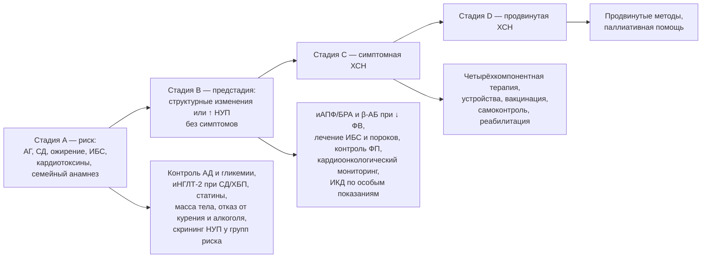

## 11. Профилактика ХСН

### 11.1. Концепция и уровни профилактики

Профилактика ХСН строится по стадиям: на стадии A (риск) цель — предотвратить структурное поражение сердца; на стадии B (предстадия) — предотвратить появление симптомов; на стадиях C–D — предотвратить декомпенсации, прогрессирование и смерть (вторичная и третичная профилактика). Популяционная (примордиальная) профилактика — контроль массы тела, физическая активность, отказ от курения, снижение потребления соли и алкоголя — уменьшает распространённость факторов риска в целом. Соответствие стадий и вмешательств показано на рис. 14 и в табл. 26.

**Рис. 14.** Профилактические вмешательства по стадиям ХСН. Схема читается слева направо: каждая стадия имеет собственный набор мер, цель которых — предотвратить переход на следующую стадию.

### 11.2. Выявление групп риска и скрининг

#### 11.2.1. Группы риска

К группам риска относятся пациенты с артериальной гипертензией, сахарным диабетом, ожирением, ИБС, фибрилляцией предсердий, ХБП, ХОБЛ, перенёсшие кардиотоксичную противоопухолевую терапию, с семейным анамнезом кардиомиопатий, злоупотребляющие алкоголем, а также женщины с осложнённой беременностью (преэклампсия, гестационный диабет).

#### 11.2.2. Скрининг с использованием натрийуретических пептидов

В исследовании **STOP-HF** (Ledwidge et al., 2013) у пациентов с факторами риска измерение BNP и направление лиц с уровнем ≥ 50 пг/мл на ЭхоКГ и в специализированное наблюдение снизило частоту сочетанного исхода «бессимптомная дисфункция ЛЖ + ХСН» примерно на 40 %; в **PONTIAC** (Huelsmann et al., 2013) у пациентов с диабетом 2-го типа и NT-proBNP > 125 пг/мл интенсификация терапии ингибиторами РААС и бета-адреноблокаторами снизила частоту госпитализаций и смерти. На этом основании ESC и АНА/ACC допускают скрининг НУП в группах риска с последующей ЭхоКГ при повышенном уровне; в России подобный скрининг пока не включён в программы диспансеризации, однако ЭхоКГ при гипертензии и ИБС выявляет предстадию.

### 11.3. Вмешательства на стадии A

Контроль АД — наиболее эффективная мера: в исследовании **SPRINT** интенсивный контроль (цель систолического АД < 120 мм рт. ст.) снизил частоту ХСН примерно на 38 % по сравнению со стандартным. Среди классов препаратов диуретики, иАПФ/БРА и бета-адреноблокаторы предупреждают ХСН эффективнее, чем альфа-адреноблокаторы (доксазозин в ALLHAT увеличивал риск). При диабете 2-го типа ингибиторы НГЛТ-2 снижают риск госпитализации по поводу ХСН примерно на 30–35 % (EMPA-REG OUTCOME, CANVAS, DECLARE-TIMI 58), а агонисты рецепторов ГПП-1 влияют преимущественно на атеросклеротические события; напротив, тиазолидиндионы и саксаглиптин повышают риск ХСН и противопоказаны (п. 19.1). Статины снижают риск инфаркта и, следовательно, ишемической ХСН. Снижение массы тела, физическая активность (≥ 150 минут в неделю умеренной интенсивности), отказ от курения, ограничение алкоголя, лечение апноэ сна и своевременное лечение ИБС дополняют стратегию.

**Табл. 26.** Профилактические вмешательства на стадиях A и B и их доказательная основа.

| Вмешательство | Стадия | Ключевые доказательства | Ожидаемый эффект |
|---|---|---|---|
| Интенсивный контроль АД | A | SPRINT, метаанализы | Снижение риска ХСН на ≈ 30–40 % |
| Ингибиторы НГЛТ-2 при СД 2-го типа/ХБП | A | EMPA-REG OUTCOME, CANVAS, DECLARE, DAPA-CKD, EMPA-KIDNEY | Снижение госпитализаций по поводу ХСН на ≈ 30–35 % |
| Статины при высоком риске/ИБС | A | 4S, HPS и др. | Снижение инфаркта и ишемической ХСН |
| Снижение массы тела, физическая активность | A | Наблюдательные данные, SELECT (семаглутид) | Снижение риска ХСН и её событий |
| иАПФ/БРА при бессимптомной дисфункции ЛЖ | B | SOLVD-Prevention (эналаприл), SAVE (каптоприл), TRACE | Снижение развития симптомной ХСН и смертности после инфаркта |
| Бета-адреноблокаторы после инфаркта с ↓ ФВ | B | CAPRICORN (карведилол) | Снижение смертности |
| Своевременная коррекция пороков | B | Рекомендации по клапанным порокам | Предотвращение необратимого ремоделирования |
| Кардиоонкологический мониторинг | A/B | Рекомендации ESC по кардиоонкологии 2022 | Ранняя кардиопротекция |

### 11.4. Вмешательства на стадии B

При бессимптомной систолической дисфункции ЛЖ (ФВ ≤ 40 %) показаны иАПФ (или БРА при непереносимости) и, после инфаркта миокарда, бета-адреноблокаторы: в **SOLVD-Prevention** эналаприл снизил частоту развития симптомной ХСН и госпитализаций, в **SAVE** и **TRACE** иАПФ после инфаркта снизили смертность, в **CAPRICORN** карведилол снизил смертность после инфаркта с дисфункцией ЛЖ. Ингибиторы НГЛТ-2 обсуждаются и на стадии B, но прямых доказательств у бессимптомных пациентов без диабета недостаточно. ИКД для первичной профилактики у бессимптомных пациентов не показан (исключение — генетические кардиомиопатии с высоким аритмическим риском). Контроль частоты и ритма при ФП, реваскуляризация по показаниям, лечение гипертензии с регрессом гипертрофии и своевременное хирургическое лечение пороков предотвращают переход к симптомной стадии. Пациенты с предстадией нуждаются в наблюдении с повторной ЭхоКГ.

### 11.5. Профилактика кардиотоксичности и ХСН при особых воздействиях

Перед антрациклинами, трастузумабом, ингибиторами протеасом и другими кардиотоксичными препаратами проводится базовая оценка риска (ЭхоКГ с GLS, НУП, тропонин, факторы риска), а при высоком риске — кардиопротекция (иАПФ/БРА, бета-адреноблокаторы, статины; дексразоксан при высоких кумулятивных дозах антрациклинов, липосомальные формы) с мониторингом в процессе лечения (п. 20.5). Профилактика алкогольной и токсической кардиомиопатии сводится к отказу от воздействия; при беременности у женщин высокого риска — к наблюдению и планированию (п. 20.4).

### 11.6. Профилактика декомпенсаций у пациентов с установленной ХСН

Третичная профилактика включает полноценную базисную терапию, вакцинацию (против гриппа ежегодно, пневмококковой инфекции, COVID-19 — вакцинация против гриппа ассоциирована со снижением смертности и госпитализаций, рандомизированное исследование IVVE подтвердило снижение событий в сезоны активности гриппа), отказ от препаратов, провоцирующих задержку жидкости (НПВП, глюкокортикоиды, тиазолидиндионы), обучение самоконтролю (раздел 13), контроль коморбидности и структурированное наблюдение (раздел 24).

### 11.7. Примеры и иллюстрации

#### 11.7.1. Пример профилактики на стадии A

Мужчина 58 лет с гипертонией (150/95 мм рт. ст. на одном препарате), диабетом 2-го типа (HbA1c 8 %), ИМТ 33 кг/м², рСКФ 68 мл/мин/1,73 м², альбуминурия А2. Профилактическая стратегия: усиление антигипертензивной терапии до целевого АД < 130/80 мм рт. ст., добавление ингибитора НГЛТ-2 (снижение риска ХСН и прогрессирования ХБП), статин, программа снижения массы тела, ЭхоКГ и NT-proBNP для выявления предстадии.

#### 11.7.2. Пример профилактики на стадии B

Женщина 49 лет через 3 месяца после переднего инфаркта миокарда: ФВ 38 %, симптомов нет. Назначаются иАПФ (или АРНИ при соответствующих критериях), бета-адреноблокатор, статин, антиагреганты; обсуждается ингибитор НГЛТ-2; ЭхоКГ повторяется через 3 месяца для решения вопроса об ИКД при сохранении ФВ ≤ 35 % после оптимальной терапии (не ранее 40 дней после инфаркта и 90 дней после реваскуляризации).

> 💡 **Интересный факт:** в исследовании SPRINT эффект интенсивного контроля АД на частоту сердечной недостаточности оказался больше, чем на частоту инфаркта и инсульта, — именно предотвращённые случаи ХСН обеспечили значительную часть снижения комбинированной конечной точки, что подчёркивает гипертензию как главный модифицируемый фактор риска ХСН.

> ❗ **Типичная ошибка:** назначать пациенту с диабетом и высоким сердечно-сосудистым риском сахароснижающую терапию без учёта влияния на риск ХСН — например, тиазолидиндионы или саксаглиптин, увеличивающие частоту госпитализаций, вместо ингибиторов НГЛТ-2, которые её снижают.

> 🔬 **Углубление:** концепция «предстадии» и стратегия скрининга по НУП опираются на доказательства того, что бессимптомная дисфункция ЛЖ встречается не реже симптомной ХСН и несёт сопоставимый риск; в популяционных исследованиях (например, в округе Олмстед, США) бессимптомная систолическая дисфункция выявлялась примерно у 2 % взрослых, а диастолическая — ещё чаще. Экономическое моделирование по данным STOP-HF показало, что скрининг НУП с последующей ЭхоКГ у пациентов с факторами риска является затратно-эффективным, однако внедрение сдерживается организационными барьерами и необходимостью обеспечить дальнейшее ведение выявленных пациентов.

> 📝 **Обобщение.** Профилактика ХСН стадийна: на стадии A решающее значение имеют контроль АД (снижение риска ХСН на треть и более), ингибиторы НГЛТ-2 при диабете и ХБП, статины, масса тела и образ жизни; на стадии B — иАПФ/БРА и бета-адреноблокаторы при сниженной ФВ, лечение ИБС, пороков и ФП, кардиоонкологический мониторинг; на стадиях C–D — предотвращение декомпенсаций (терапия, вакцинация, самоконтроль, отказ от провоцирующих препаратов). Скрининг натрийуретических пептидов в группах риска с последующей ЭхоКГ снижает частоту развития ХСН. Главный вывод: большинство случаев ХСН предотвратимо, а предстадия — окно для вмешательства.

> ❓ **Контрольные вопросы**
>
> 1. Какие вмешательства на стадии A имеют наиболее убедительные доказательства снижения риска ХСН и каков их ориентировочный эффект?
> 2. Опишите дизайн и результат исследования STOP-HF и его значение для скрининга.
> 3. Какие препараты показаны пациенту с бессимптомной систолической дисфункцией ЛЖ после инфаркта миокарда и на основании каких исследований?
> 4. Какие сахароснижающие препараты увеличивают риск ХСН, а какие снижают?
> 5. Перечислите меры третичной профилактики (предотвращения декомпенсаций) у пациента с установленной ХСН.
