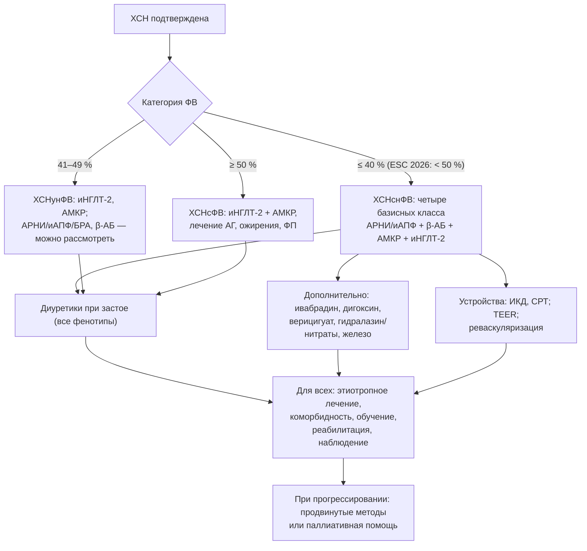

## 12. Цели и принципы лечения ХСН

### 12.1. Цели лечения

#### 12.1.1. Иерархия целей

Цели лечения ХСН выстраиваются в иерархию: (1) снижение смертности — общей, сердечно-сосудистой и внезапной; (2) предотвращение госпитализаций и эпизодов ухудшения; (3) уменьшение симптомов, улучшение функционального состояния и качества жизни; (4) замедление или обращение ремоделирования и прогрессирования; (5) предупреждение и лечение осложнений и коморбидности; (6) на поздних стадиях — облегчение страданий и уважение предпочтений пациента. Цели не исключают друг друга: современная базисная терапия улучшает одновременно выживаемость, симптомы и качество жизни, тогда как симптоматические средства (диуретики, дигоксин) влияют на самочувствие и госпитализации, но не на смертность.

#### 12.1.2. Конечные точки исследований и их клиническое значение

В клинических исследованиях используют комбинированную первичную точку «сердечно-сосудистая смерть или госпитализация по поводу ХСН», общую смертность, повторные события (recurrent events), пациент-ориентированные исходы (KCCQ), суррогатные маркеры (NT-proBNP, ФВ, объёмы ЛЖ) и иерархические композитные показатели (выигрышное отношение, win ratio). Для практики важно различать эффект на смертность (доказан для четырёх классов при ХСНснФВ) и эффект на госпитализации и симптомы (доказан для большего числа вмешательств, включая терапию ХСНсФВ).

### 12.2. Принципы терапии

#### 12.2.1. Этиотропный, патогенетический и симптоматический подходы

Этиотропная терапия устраняет причину (реваскуляризация, коррекция порока, абляция тахиаритмии, отказ от токсина, специфическая терапия амилоидоза, лечение гипертиреоза); патогенетическая прерывает нейрогормональные и клеточные порочные круги (четыре базисных класса, устройства); симптоматическая устраняет застой и симптомы (диуретики, дигоксин, вазодилататоры). Полноценное лечение сочетает все три уровня; симптоматическая терапия без патогенетической — ошибка, патогенетическая без поиска причины — неполнота.

#### 12.2.2. Доказательность, фенотип-ориентированность и индивидуализация

Выбор вмешательств основан на рандомизированных исследованиях, стратифицированных по ФВ, стадии и этиологии (раздел 27); при этом рекомендации применяются к конкретному пациенту с учётом возраста, коморбидности, функции почек, АД, ЧСС, переносимости, ожидаемой продолжительности жизни и предпочтений. Классы рекомендаций и уровни доказательности, принятые в документах ESC и РКО, приведены в табл. 27.

**Табл. 27.** Классы рекомендаций и уровни доказательности (ESC) и их российские аналоги.

| Категория | Содержание | Российский аналог (РКО) |
|---|---|---|
| Класс I | Доказано/общепризнано: польза и эффективность — «рекомендуется» | Уровень убедительности рекомендаций (УУР) A |
| Класс IIa | Данные свидетельствуют в пользу — «следует рассмотреть» | УУР B |
| Класс IIb | Польза менее установлена — «можно рассмотреть» | УУР C |
| Класс III | Не полезно, может быть вредно — «не рекомендуется» | Указание «не рекомендуется» |
| Уровень A | Несколько РКИ или метаанализы | Уровень достоверности доказательств (УДД) 1–2 |
| Уровень B | Одно РКИ или крупные нерандомизированные исследования | УДД 2–3 |
| Уровень C | Консенсус экспертов, малые исследования, регистры | УДД 4–5 |

#### 12.2.3. Ранний старт и одновременность базисной терапии

Польза каждого из четырёх базисных классов при ХСНснФВ проявляется в течение первых недель (для ингибиторов НГЛТ-2 и АРНИ — в первые 30 дней), эффекты аддитивны и не зависят от последовательности назначения. Поэтому современный принцип — начинать все четыре класса в низких дозах быстро (в идеале до выписки из стационара) и титровать параллельно, а не последовательно доводить каждый препарат до целевой дозы перед добавлением следующего (п. 14.6.1). ESC 2026 рекомендуют повышение доз каждые 1–2 недели при переносимости.

#### 12.2.4. Комплексность и мультидисциплинарность

Лечение включает медикаментозную терапию, устройства и вмешательства, немедикаментозные меры, обучение, реабилитацию, лечение коморбидности, психосоциальную поддержку и, при необходимости, паллиативную помощь; его обеспечивает мультидисциплинарная команда (кардиолог, терапевт, медицинская сестра, реабилитолог, диетолог, фармацевт, психолог, при необходимости нефролог, эндокринолог, гериатр) с чётко организованной преемственностью между стационаром и амбулаторным звеном (раздел 24).

#### 12.2.5. Участие пациента и совместное принятие решений

Приверженность к сложной многокомпонентной терапии и самоконтроль невозможны без информированного участия пациента и семьи; решения о продвинутых методах и об ограничении вмешательств принимаются совместно с учётом ценностей пациента (разделы 13, 25, 26).

### 12.3. Структура терапии в зависимости от фенотипа

Общая схема принятия решений показана на рис. 15. При ХСНснФВ основу составляют четыре базисных класса (АРНИ/иАПФ, бета-адреноблокатор, АМКР, ингибитор НГЛТ-2) плюс диуретики при застое, далее — дополнительные препараты и устройства по показаниям. При ХСНсФВ фундаментальная терапия — ингибитор НГЛТ-2 и АМКР (ESC 2026), диуретики, лечение гипертензии, ожирения, ФП и иной коморбидности. При любой ФВ — этиотропное лечение, образование, реабилитация и структурированное наблюдение.

**Рис. 15.** Общая схема принятия решений при лечении ХСН. Схема читается сверху вниз: категория ФВ определяет состав базисной терапии, диуретики и общие меры применяются при любом фенотипе, а при прогрессировании рассматриваются продвинутые методы.

### 12.4. Принципы безопасности терапии

Назначение и титрование препаратов сопровождаются контролем АД, ЧСС, калия, креатинина и симптомов; небольшое повышение креатинина (до 30–50 %) и калия (до 5,5 ммоль/л) при старте ингибиторов РААС и АМКР допустимо и не требует отмены; гипотония без симптомов — не повод отменять терапию, а повод пересмотреть дозу диуретика и препараты, не влияющие на прогноз. Полипрагмазия и лекарственные взаимодействия у пожилых требуют регулярного пересмотра листа назначений (раздел 16, 20).

### 12.5. Примеры и иллюстрации

#### 12.5.1. Пример постановки целей

Пациент 60 лет с впервые выявленной ХСНснФВ (ФВ 25 %), NYHA III. Цели на 3 месяца: устранить застой; начать и довести до целевых или максимально переносимых доз четыре базисных класса; достичь ФК II; обучить самоконтролю; выполнить коронарографию и решить вопрос о реваскуляризации; через 3 месяца оптимальной терапии переоценить ФВ для решения об ИКД/СРТ.

#### 12.5.2. Пример индивидуализации

Пациентка 86 лет с ХСНсФВ, ХБП С4, когнитивными нарушениями и падениями: цели смещаются к контролю симптомов, предотвращению госпитализаций и безопасности — ингибитор НГЛТ-2 (с учётом рСКФ), осторожное дозирование диуретика, отказ от строгих целей АД, упрощение схемы приёма, вовлечение родственников.

> 💡 **Интересный факт:** в объединённом анализе EMPHASIS-HF, PARADIGM-HF и DAPA-HF (Vaduganathan et al., 2020) расчётное снижение относительного риска сердечно-сосудистой смерти или госпитализации при переходе от терапии «иАПФ + бета-адреноблокатор» к полной четырёхкомпонентной составило около 62 %, а общей смертности — около 47 %; подобный выигрыш не даёт ни одно отдельно взятое вмешательство в кардиологии.

> ❗ **Типичная ошибка:** откладывать назначение АМКР и ингибитора НГЛТ-2 «до достижения целевой дозы» иАПФ и бета-адреноблокатора. Последовательное титрование занимает полгода и более, за которые пациент не получает защитного эффекта двух классов; современная стратегия — одновременный старт низких доз всех четырёх классов.

> 🔬 **Углубление:** исследование **STRONG-HF** (2022) рандомизировало пациентов, госпитализированных с декомпенсацией, к стратегии быстрого титрования базисной терапии до 100 % целевых доз в течение 2 недель после выписки с четырьмя визитами и контролем НУП против обычного ведения; исследование было остановлено досрочно из-за снижения на 34 % частоты смерти или повторной госпитализации к 180-му дню и улучшения качества жизни при приемлемой частоте побочных эффектов. Результаты легли в основу рекомендаций ESC 2023/2026 о раннем интенсивном титровании и частых визитах в уязвимый период.

> 📝 **Обобщение.** Цели лечения ХСН — снижение смертности, предотвращение госпитализаций, улучшение симптомов и качества жизни, обращение ремоделирования, контроль осложнений и уважение предпочтений пациента; они достигаются сочетанием этиотропного, патогенетического и симптоматического подходов на основе доказательств с индивидуализацией. Ключевые принципы: ранний одновременный старт базисных классов с быстрым титрованием, фенотип-ориентированный выбор, мультидисциплинарность, безопасность и участие пациента. Главный вывод: отсрочка полноценной терапии — упущенная выгода, измеряемая годами жизни.

> ❓ **Контрольные вопросы**
>
> 1. Расположите цели лечения ХСН в порядке приоритета и укажите, какие классы препаратов влияют на каждую из них.
> 2. Чем различаются этиотропный, патогенетический и симптоматический подходы? Приведите примеры каждого.
> 3. Что означают класс рекомендаций IIa и уровень доказательности B?
> 4. Почему современные рекомендации отказались от последовательного титрования базисных препаратов в пользу одновременного старта?
> 5. Какие изменения лабораторных показателей при старте ингибиторов РААС допустимы и не требуют отмены препарата?
