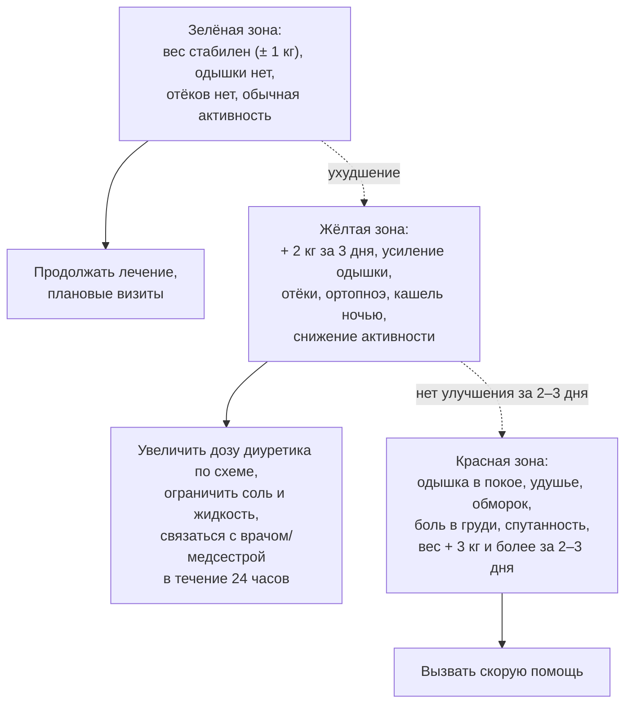

## 13. Немедикаментозное лечение и самоконтроль

### 13.1. Обучение пациента и самоконтроль

#### 13.1.1. Содержание обучения

Структурированное обучение (индивидуальное и групповое, в «школах ХСН», с печатными и цифровыми материалами) охватывает: природу заболевания и его течение; названия, назначение и побочные эффекты препаратов; ежедневное взвешивание и ведение дневника; распознавание ранних признаков декомпенсации; гибкий режим диуретиков; ограничение соли; физическую активность; препараты и ситуации, которых следует избегать; когда и к кому обращаться. Обучение повторяется при каждом визите и вовлекает членов семьи; его эффективность в снижении госпитализаций подтверждена метаанализами программ самопомощи (self-care).

#### 13.1.2. Ежедневное взвешивание и «правило светофора»

Пациент взвешивается ежедневно утром после туалета до завтрака в одной и той же одежде и действует по заранее согласованному плану (рис. 16): прибавка более 2 кг за 3 дня (или более 1–1,5 кг за сутки) либо нарастание одышки и отёков — сигнал к увеличению дозы диуретика по схеме и связи с медицинской сестрой или врачом; одышка в покое, обморок, боль в груди — повод для неотложной помощи. Гибкий режим диуретиков по весу и симптомам снижает частоту госпитализаций и является частью программ самоконтроля.

**Рис. 16.** «Правило светофора» для самоконтроля пациента с ХСН. Схема читается сверху вниз внутри каждой зоны: признаки зоны определяют действия; переход между зонами показан пунктиром.

#### 13.1.3. Приверженность

Приверженность к терапии при ХСН составляет в среднем 50–70 % и снижается с числом препаратов, стоимостью, побочными эффектами, депрессией и когнитивными нарушениями. Меры: упрощение схемы (комбинированные препараты, однократный приём), таблетницы и напоминания, участие фармацевта, обсуждение барьеров, вовлечение семьи, телемониторинг.

### 13.2. Диета и питьевой режим

#### 13.2.1. Ограничение натрия

Рекомендуется избегать избыточного потребления соли (более 5 г NaCl, то есть около 2 г натрия, в сутки) и скрытых источников натрия (полуфабрикаты, консервы, хлеб, сыры, соусы, шипучие таблетки). Жёсткое ограничение (< 1,5 г натрия) не доказало пользы: в исследовании **SODIUM-HF** (2022) снижение потребления натрия до менее 1 500 мг не уменьшило частоту смерти и госпитализаций, хотя несколько улучшило качество жизни и ФК. У пациентов с частыми декомпенсациями и резистентностью к диуретикам ограничение соли строже (п. 15.6).

#### 13.2.2. Жидкость

Рутинное ограничение жидкости у стабильных пациентов не требуется; ограничение до 1,5–2 л/сут обосновано при тяжёлой ХСН с застоем, гипонатриемии и резистентности к диуретикам. В жаркую погоду, при рвоте и диарее режим корректируется, чтобы избежать гиповолемии.

#### 13.2.3. Алкоголь, кофеин, питание

При алкогольной кардиомиопатии показана полная абстиненция; остальным — не более 1–2 стандартных доз в день с днями воздержания (многие эксперты рекомендуют минимизацию). Умеренное потребление кофе безопасно. Питание должно обеспечивать достаточное количество белка (1–1,2 г/кг, при кахексии больше) и калорий; средиземноморский и DASH-типы питания ассоциированы с меньшим риском ХСН. При кахексии — нутритивная поддержка, при ожирении с ХСНсФВ — снижение массы тела (п. 13.4). Коррекция дефицита витаминов (тиамин при длительном приёме петлевых диуретиков и алкоголе) и микроэлементов — по показаниям.

### 13.3. Физическая активность и тренировки

Регулярные аэробные тренировки умеренной интенсивности (ходьба, велоэргометр, 30–45 минут 3–5 раз в неделю с постепенным наращиванием) в сочетании с силовыми упражнениями низкой интенсивности и тренировкой дыхательных мышц рекомендованы всем стабильным пациентам (класс I): они улучшают переносимость нагрузки, качество жизни и снижают госпитализации (HF-ACTION, метаанализы ExTraMATCH). Тренировки противопоказаны при декомпенсации, нестабильной стенокардии, неконтролируемых аритмиях, активном миокардите, тяжёлом аортальном стенозе. Начало тренировок желательно в условиях реабилитационной программы (раздел 23).

### 13.4. Масса тела и ожирение

При ожирении (особенно при ХСНсФВ) снижение массы тела улучшает симптомы, переносимость нагрузки и уменьшает NT-proBNP; в исследованиях **STEP-HFpEF** и **SUMMIT** семаглутид и тирзепатид улучшали KCCQ и дистанцию ходьбы, а тирзепатид снижал частоту ухудшений ХСН, что отражено в ESC 2026 (класс IIa). При ХСНснФВ преднамеренное умеренное снижение массы тела допустимо, но непреднамеренная потеря массы — признак кахексии и неблагоприятный прогностический фактор («парадокс ожирения» объясняется, прежде всего, обратной причинностью). Бариатрическая хирургия обсуждается при морбидном ожирении.

### 13.5. Курение, сон, путешествия, сексуальная активность, вакцинация

Полный отказ от курения и других форм потребления никотина обязателен. При обструктивном апноэ сна показана CPAP-терапия; адаптивная сервовентиляция при центральном апноэ у пациентов с ХСНснФВ противопоказана (повышение смертности в SERVE-HF). Авиаперелёты допустимы для стабильных пациентов (ФК I–III); пребывание на высоте более 1 500–2 000 м и в жарком влажном климате требует осторожности; в поездку берут запас препаратов и выписку. Сексуальная активность безопасна при переносимости нагрузки 3–5 МЕТ (подъём на 2 этажа); ингибиторы ФДЭ-5 допустимы при отсутствии нитратов. Вакцинация против гриппа ежегодно, против пневмококковой инфекции и COVID-19 рекомендована всем пациентам.

### 13.6. Препараты и воздействия, которых следует избегать

Ряд широко используемых препаратов провоцирует декомпенсацию или противопоказан при ХСНснФВ (табл. 28); пациент должен быть информирован о необходимости согласовывать любые новые назначения, включая безрецептурные.

**Табл. 28.** Лекарственные средства, способные ухудшать течение ХСН.

| Группа | Препараты | Механизм/риск |
|---|---|---|
| НПВП и коксибы | Диклофенак, ибупрофен, целекоксиб и др. | Задержка натрия и воды, снижение эффекта диуретиков и иАПФ, ухудшение функции почек |
| Недигидропиридиновые блокаторы кальциевых каналов | Верапамил, дилтиазем | Отрицательный инотропный эффект при ХСНснФВ |
| Тиазолидиндионы | Пиоглитазон | Задержка жидкости |
| Ингибиторы ДПП-4 (отдельные) | Саксаглитин | Увеличение госпитализаций по поводу ХСН (SAVOR-TIMI 53) |
| Антиаритмики I класса, дронедарон | Флекаинид, пропафенон; дронедарон при ФК III–IV | Проаритмия, повышение смертности (CAST, ANDROMEDA) |
| Глюкокортикоиды, минералокортикоиды | Преднизолон, флудрокортизон | Задержка натрия |
| Трициклические антидепрессанты, некоторые нейролептики | Амитриптилин, клозапин | Аритмии, гипотония, миокардит (клозапин) |
| Противоопухолевые препараты | Антрациклины, трастузумаб, ингибиторы протеасом, некоторые ингибиторы тирозинкиназ | Кардиотоксичность |
| Прочие | Миноксидил, цилостазол, итраконазол, альфа-адреноблокаторы, прегабалин, шипучие формы с натрием, ряд БАД (солодка, эфедра) | Задержка жидкости, аритмии, гипотония |

### 13.7. Психосоциальная поддержка

Скрининг депрессии и тревоги (например, опросники PHQ-9, HADS), когнитивных нарушений, социальной изоляции и финансовых барьеров входит в стандарт ведения; когнитивно-поведенческая терапия и, при необходимости, селективные ингибиторы обратного захвата серотонина (сертралин, эсциталопрам — безопасны, но не влияют на прогноз) улучшают качество жизни и приверженность (п. 19.9).

### 13.8. Примеры и иллюстрации

#### 13.8.1. Пример плана самоконтроля

Пациент с ХСНснФВ получает письменный план: «сухой вес» 82 кг; ежедневное взвешивание; при весе ≥ 84 кг или нарастании одышки — дополнительно 40 мг фуросемида утром в течение 3 дней и звонок медсестре; при весе ≥ 85 кг, одышке в покое — скорая помощь; список запрещённых препаратов; дата следующего визита и телефон кабинета ХСН.

#### 13.8.2. Пример коррекции образа жизни

Пациентка 64 лет с ХСНсФВ и ИМТ 38 кг/м²: ограничение соли до 5 г, программа ходьбы 30 минут 5 раз в неделю с постепенным увеличением, снижение массы тела на 5–10 % за 6 месяцев (при доступности — агонист рецепторов ГПП-1), CPAP при подтверждённом апноэ сна, вакцинация, отказ от НПВП по поводу остеоартроза в пользу местных средств и парацетамола.

> 💡 **Интересный факт:** первым рандомизированным исследованием, показавшим снижение смертности при немедикаментозном вмешательстве у пациентов с ХСН, стало исследование Rich и соавт. (1995): мультидисциплинарная программа обучения, диетического консультирования и наблюдения медсестрой после выписки снизила повторные госпитализации пожилых пациентов на 44 % за 90 дней — задолго до появления большинства современных препаратов.

> ❗ **Типичная ошибка:** назначать всем пациентам с ХСН бессолевую диету и ограничение жидкости до 1 литра. Избыточно жёсткие ограничения не улучшают исходы (SODIUM-HF), снижают качество жизни и аппетит, способствуют кахексии и гипонатриемии у пожилых, а также подрывают доверие к остальным рекомендациям; ограничение жидкости обосновано лишь при гипонатриемии и тяжёлом застое.

> 🔬 **Углубление:** исследование **HF-ACTION** (2009; 2 331 пациент с ХСНснФВ) показало, что аэробные тренировки снижают скорректированный риск смерти или госпитализации на 11 % и улучшают качество жизни, причём эффект зависел от объёма выполненных тренировок; при этом приверженность к тренировкам в домашних условиях уже через год падала ниже половины рекомендованного объёма. Метаанализы (ExTraMATCH II) подтверждают улучшение переносимости нагрузки и качества жизни при любой ФВ, а появление высокоинтенсивных интервальных протоколов и дистанционных программ направлено на преодоление проблемы приверженности.

> 📝 **Обобщение.** Немедикаментозное лечение — не «дополнение», а условие эффективности терапии: структурированное обучение и самоконтроль (ежедневное взвешивание, «правило светофора», гибкий режим диуретиков), разумное ограничение соли без избыточных диетических запретов, регулярные физические тренировки, контроль массы тела (включая фармакологическое снижение при ХСНсФВ с ожирением), отказ от курения, лечение апноэ сна, вакцинация, избегание провоцирующих препаратов (НПВП, недигидропиридиновые антагонисты кальция, тиазолидиндионы и др.) и психосоциальная поддержка снижают частоту госпитализаций и улучшают качество жизни. Главный вывод: обученный и вовлечённый пациент — главный участник лечебной команды.

> ❓ **Контрольные вопросы**
>
> 1. Какие элементы должен включать письменный план самоконтроля пациента с ХСН?
> 2. Какую прибавку массы тела считают сигналом начинающейся декомпенсации и как пациент должен на неё реагировать?
> 3. Что показало исследование SODIUM-HF и как это изменило рекомендации по ограничению соли?
> 4. Перечислите пять групп препаратов, способных спровоцировать декомпенсацию, и объясните механизмы.
> 5. Каковы показания и противопоказания к физическим тренировкам при ХСН?
