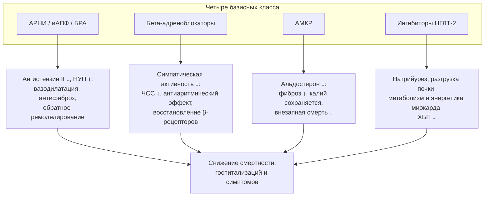
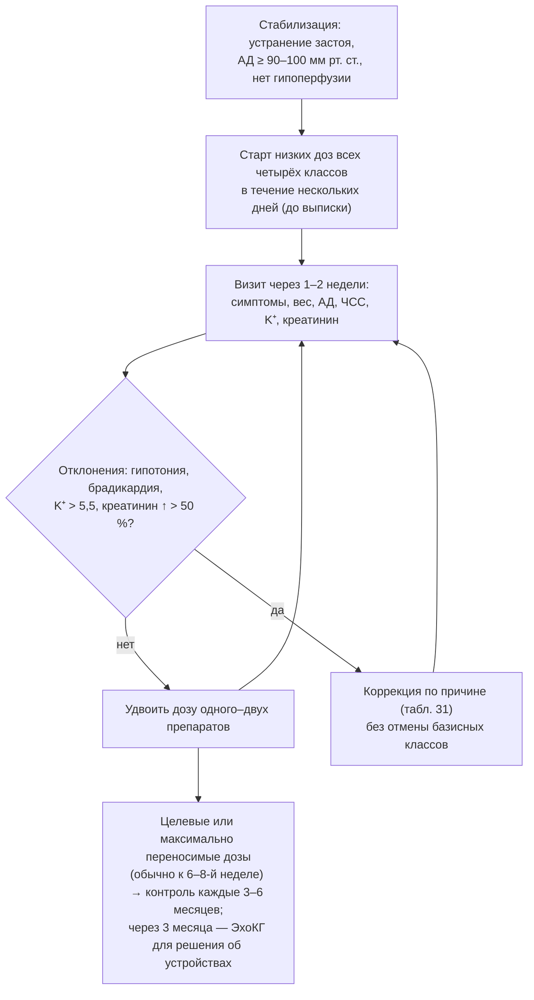

## 14. Базисная медикаментозная терапия ХСН со сниженной фракцией выброса

### 14.1. Концепция четырёхкомпонентной (фундаментальной) терапии

#### 14.1.1. Четыре класса и их мишени

Базисную терапию ХСНснФВ составляют четыре класса, каждый из которых снижает смертность и госпитализации независимо от остальных: (1) ингибиторы РААС — ангиотензиновых рецепторов и неприлизина ингибитор (АРНИ, предпочтительно) либо иАПФ, при непереносимости — БРА; (2) бета-адреноблокаторы; (3) антагонисты минералокортикоидных рецепторов (АМКР); (4) ингибиторы натрий-глюкозного котранспортёра 2-го типа (иНГЛТ-2). В ESC 2026 эта комбинация названа **фундаментальной медикаментозной терапией** (FMT), в РКО 2024 — четырёхкомпонентной (квадро-) терапией. Их патогенетические мишени различны и взаимодополняющи (рис. 17): они размыкают нейрогормональный, гемодинамический, кардиоренальный и метаболический порочные круги (п. 5.7.6).

**Рис. 17.** Патогенетические мишени четырёх базисных классов терапии ХСНснФВ. Схема читается сверху вниз: каждый класс воздействует на собственное звено патогенеза, а их эффекты аддитивны.

#### 14.1.2. Доказательная база

Ключевые исследования суммированы в табл. 29; подробно их дизайн обсуждается в разделе 27.

**Табл. 29.** Ключевые рандомизированные исследования базисной терапии ХСНснФВ.

| Класс | Исследование (год) | Препарат | Основной результат |
|---|---|---|---|
| иАПФ | CONSENSUS (1987) | Эналаприл | Снижение смертности на 40 % за 6 мес при ФК IV |
| иАПФ | SOLVD-Treatment (1991) | Эналаприл | Снижение смертности на 16 % |
| БРА | CHARM-Alternative (2003), Val-HeFT (2001) | Кандесартан, валсартан | Снижение СС-смерти/госпитализаций при непереносимости иАПФ |
| АРНИ | PARADIGM-HF (2014) | Сакубитрил/валсартан vs эналаприл | Снижение СС-смерти/госпитализаций на 20 %, общей смертности на 16 % |
| β-АБ | CIBIS-II (1999) | Бисопролол | Снижение смертности на 34 % |
| β-АБ | MERIT-HF (1999) | Метопролол сукцинат | Снижение смертности на 34 % |
| β-АБ | COPERNICUS (2001) | Карведилол | Снижение смертности на 35 % при тяжёлой ХСН |
| β-АБ | SENIORS (2005) | Небиволол | Снижение смерти/СС-госпитализаций у пациентов ≥ 70 лет на 14 % |
| АМКР | RALES (1999) | Спиронолактон | Снижение смертности на 30 % при ФК III–IV |
| АМКР | EMPHASIS-HF (2011) | Эплеренон | Снижение СС-смерти/госпитализаций на 37 % при ФК II |
| иНГЛТ-2 | DAPA-HF (2019) | Дапаглифлозин | Снижение ухудшения ХСН/СС-смерти на 26 % |
| иНГЛТ-2 | EMPEROR-Reduced (2020) | Эмпаглифлозин | Снижение СС-смерти/госпитализаций на 25 % |

### 14.2. Ингибиторы ренин-ангиотензин-альдостероновой системы

#### 14.2.1. Ингибиторы АПФ и блокаторы рецепторов ангиотензина II

иАПФ снижают образование ангиотензина II и деградацию брадикинина, уменьшая вазоконстрикцию, задержку натрия, гипертрофию и фиброз. Они показаны всем пациентам с ХСНснФВ, если не назначен АРНИ; БРА — при непереносимости иАПФ (кашель, ангионевротический отёк) и АРНИ. Начинают с низких доз (табл. 30), удваивая каждые 1–2 недели до целевой или максимально переносимой; целевые дозы обеспечивают больший эффект на госпитализации (ATLAS). Противопоказания: ангионевротический отёк в анамнезе, двусторонний стеноз почечных артерий, беременность, калий > 5,5 ммоль/л, симптомная гипотония. Повышение креатинина до 50 % от исходного (или до 266 мкмоль/л) и калия до 5,5 ммоль/л допустимо.

#### 14.2.2. Ангиотензиновых рецепторов и неприлизина ингибитор (сакубитрил/валсартан)

Сакубитрил/валсартан сочетает блокаду АТ1-рецепторов с ингибированием неприлизина, повышая уровень натрийуретических пептидов, брадикинина и адреномедуллина (п. 5.3.3). В **PARADIGM-HF** он превзошёл эналаприл по снижению сердечно-сосудистой смерти и госпитализаций (на 20 %), общей смертности (на 16 %) и внезапной смерти; в **PIONEER-HF** инициация в стационаре после стабилизации была безопасной и снижала NT-proBNP быстрее. АРНИ рекомендован как предпочтительный ингибитор РААС, в том числе у пациентов, ранее не получавших иАПФ (de novo). Правила: отмена иАПФ за 36 часов до старта (риск ангионевротического отёка), стартовая доза 49/51 мг два раза в день (24/26 мг при систолическом АД 100–110 мм рт. ст., рСКФ < 30 мл/мин/1,73 м², у «наивных» и пожилых), целевая — 97/103 мг два раза в день; контроль BNP на фоне АРНИ не информативен (использовать NT-proBNP). Противопоказания — как для иАПФ, плюс совместное применение с иАПФ.

### 14.3. Бета-адреноблокаторы

Доказательства получены для четырёх препаратов: бисопролола, карведилола, метопролола сукцината замедленного высвобождения и небиволола (у пожилых); другие бета-адреноблокаторы (атенолол, метопролол тартрат) не доказали эффекта при ХСН и не должны использоваться как замена. Назначаются всем стабильным пациентам с ХСНснФВ, начиная с минимальной дозы с удвоением каждые 1–2 недели («начинать с малого, идти медленно»); в начале титрования возможно временное ухудшение самочувствия, которое не является основанием для отмены. Старт при декомпенсации с застоем откладывают до её устранения, но пациентам, уже получающим препарат, при декомпенсации без гипоперфузии терапию продолжают, при необходимости снизив дозу (отмена ухудшает прогноз). Противопоказания: кардиогенный шок, атриовентрикулярная блокада II–III степени без кардиостимулятора, синдром слабости синусового узла, симптомная брадикардия < 50 в минуту, тяжёлая бронхиальная астма (ХОБЛ не является противопоказанием; предпочтительны β1-селективные препараты). Польза не зависит от исходной ЧСС, но достигнутая ЧСС < 70 в минуту при синусовом ритме ассоциирована с лучшим прогнозом.

### 14.4. Антагонисты минералокортикоидных рецепторов

Спиронолактон (RALES) и эплеренон (EMPHASIS-HF, EPHESUS после инфаркта) снижают смертность, включая внезапную, и госпитализации; рекомендованы всем пациентам с ХСНснФВ при калии ≤ 5,0 ммоль/л и рСКФ ≥ 30 мл/мин/1,73 м². Начинают с 12,5–25 мг спиронолактона или 25 мг эплеренона, повышая до 25–50 мг через 4–8 недель; калий и креатинин контролируют через 1 и 4 недели после старта и каждого повышения дозы, затем через 8 и 12 недель, 6, 9 и 12 месяцев и далее каждые 4 месяца. При калии 5,5–5,9 ммоль/л дозу уменьшают вдвое, при ≥ 6,0 — отменяют до нормализации; калийсвязывающие препараты (патиромер, циркония циклосиликат натрия) позволяют продолжать АМКР при склонности к гиперкалиемии (DIAMOND). Гинекомастия и мастодиния (около 10 % при спиронолактоне) — повод для перехода на эплеренон. Финеренон (нестероидный АМКР) исследован при ХСН с ФВ ≥ 40 % (п. 17.3).

### 14.5. Ингибиторы натрий-глюкозного котранспортёра 2-го типа

Дапаглифлозин 10 мг и эмпаглифлозин 10 мг один раз в день снижали в **DAPA-HF** и **EMPEROR-Reduced** сердечно-сосудистую смерть и госпитализации примерно на 25 % независимо от наличия диабета, с эффектом уже в первый месяц; эффективны при рСКФ до 20–25 мл/мин/1,73 м² и замедляют снижение функции почек. Механизмы многокомпонентны: натрийурез и осмотический диурез с преимущественным уменьшением интерстициального объёма, снижение внутриклубочкового давления (тубулогломерулярная обратная связь), повышение гематокрита, улучшение энергетики миокарда (кетоны), снижение симпатической активности, воспаления, фиброза и активности Na⁺/H⁺-обменника. Титрования не требуется, что делает класс удобным для раннего старта, в том числе в стационаре (EMPULSE). Безопасность: обратимое начальное снижение рСКФ на 3–5 мл/мин, генитальные микотические инфекции, редко — эугликемический кетоацидоз (отменять при острых заболеваниях, голодании, перед операциями — «правила больного дня»), гиповолемия (при эуволемии уменьшить дозу петлевого диуретика); не применяются при диабете 1-го типа. Сотаглифлозин (ингибитор НГЛТ-1/2) показал эффективность при старте вскоре после декомпенсации у пациентов с диабетом (SOLOIST-WHF).

**Табл. 30.** Стартовые и целевые дозы базисных препаратов при ХСНснФВ (для взрослых; по данным РКО 2024 и ESC).

| Препарат | Стартовая доза | Целевая доза |
|---|---|---|
| Сакубитрил/валсартан | 49/51 мг × 2 (24/26 мг × 2 при АД 100–110, рСКФ < 30, у «наивных») | 97/103 мг × 2 |
| Эналаприл | 2,5 мг × 2 | 10–20 мг × 2 |
| Лизиноприл | 2,5–5 мг × 1 | 20–35 мг × 1 |
| Рамиприл | 2,5 мг × 1 | 10 мг × 1 (или 5 мг × 2) |
| Периндоприл | 2 мг × 1 | 8 мг × 1 |
| Каптоприл | 6,25 мг × 3 | 50 мг × 3 |
| Кандесартан | 4–8 мг × 1 | 32 мг × 1 |
| Валсартан | 40 мг × 2 | 160 мг × 2 |
| Лозартан | 50 мг × 1 | 150 мг × 1 |
| Бисопролол | 1,25 мг × 1 | 10 мг × 1 |
| Карведилол | 3,125 мг × 2 | 25 мг × 2 (50 мг × 2 при массе > 85 кг) |
| Метопролол сукцинат (CR/XL) | 12,5–25 мг × 1 | 200 мг × 1 |
| Небиволол | 1,25 мг × 1 | 10 мг × 1 |
| Спиронолактон | 12,5–25 мг × 1 | 25–50 мг × 1 |
| Эплеренон | 25 мг × 1 | 50 мг × 1 |
| Дапаглифлозин | 10 мг × 1 | 10 мг × 1 |
| Эмпаглифлозин | 10 мг × 1 | 10 мг × 1 |

### 14.6. Инициация, титрование и мониторинг

#### 14.6.1. Стратегия одновременного старта и быстрого титрования

Все четыре класса начинают в низких дозах в течение нескольких дней (в стационаре — после стабилизации гемодинамики и до выписки), затем титруют до целевых доз с визитами каждые 1–2 недели в течение первых 6–8 недель (рис. 18). Предложенная McMurray и Packer (2021) последовательность — бета-адреноблокатор и иНГЛТ-2, затем АРНИ, затем АМКР в течение четырёх недель — одна из возможных; порядок определяется профилем пациента: при гипотонии первыми назначают препараты с минимальным влиянием на АД (иНГЛТ-2, АМКР), при тахикардии — бета-адреноблокатор, при гиперкалиемии откладывают АМКР, при застое начинают с иНГЛТ-2 и диуретика. Стратегия быстрого титрования с контролем клиники и NT-proBNP подтверждена STRONG-HF (п. 12.2.3).

**Рис. 18.** Алгоритм титрования базисной терапии ХСНснФВ. Схема читается сверху вниз: после стабилизации все классы начинают в низких дозах и повышают каждые 1–2 недели, а отклонения параметров корригируются без отмены терапии (табл. 31).

**Табл. 31.** Тактика при отклонениях показателей во время титрования базисной терапии.

| Отклонение | Тактика |
|---|---|
| Гипотония без симптомов (САД 90–100 мм рт. ст.) | Продолжать терапию; при эуволемии уменьшить дозу диуретика; отменить препараты без влияния на прогноз (нитраты, блокаторы кальциевых каналов, альфа-адреноблокаторы); разнести приём препаратов по времени суток |
| Симптомная гипотония, головокружение | Исключить гиповолемию; временно снизить дозу ингибитора РААС или β-АБ (не обоих сразу); титровать медленнее |
| Калий 5,5–5,9 ммоль/л | Уменьшить дозу АМКР вдвое; исключить НПВП, калиевые добавки и заменители соли; рассмотреть калийсвязывающие препараты; повторить анализ через 1–2 недели |
| Калий ≥ 6,0 ммоль/л | Временно отменить АМКР (и при необходимости ингибитор РААС), найти причину, возобновить после нормализации |
| Повышение креатинина до 50 % от исходного (или до 266 мкмоль/л) | Допустимо; контроль через 1–2 недели; исключить дегидратацию и нефротоксины |
| Повышение креатинина > 50 % (или > 266 мкмоль/л; рСКФ < 25) | Уменьшить дозу ингибитора РААС/АМКР вдвое, исключить стеноз почечных артерий, обструкцию, НПВП |
| Брадикардия < 50 в минуту или АВ-блокада II–III степени | Снизить дозу β-АБ; отменить дигоксин, ивабрадин, другие брадикардитические средства; при сохранении — ЭКС (п. 21.3) |
| Усиление одышки, прибавка массы тела после старта β-АБ | Временно увеличить дозу диуретика; не отменять β-АБ; при необходимости вернуться к предыдущей дозе |
| Утомляемость в начале титрования β-АБ | Как правило, преходяща; разъяснить пациенту, титровать медленнее |

#### 14.6.2. Мониторинг

На каждом визите оценивают симптомы, массу тела, АД (в том числе ортостатически), ЧСС, калий, натрий, креатинин/рСКФ; NT-proBNP — при выписке и через 1–3 месяца. Через 3–6 месяцев оптимальной терапии повторяют ЭхоКГ: сохранение ФВ ≤ 35 % определяет показания к ИКД и СРТ (раздел 21), улучшение ФВ > 40 % переводит пациента в категорию улучшенной ФВ с продолжением терапии.

#### 14.6.3. Терапия в особых клинических ситуациях

При систолическом АД 90–100 мм рт. ст. без симптомов терапию продолжают, отдавая приоритет классам с меньшим гипотензивным эффектом; при ХБП С3б–4 используют иНГЛТ-2 (рСКФ ≥ 20), АРНИ (≥ 30, с осторожностью ниже), АМКР (≥ 30), бета-адреноблокаторы без ограничений; у пожилых титруют медленнее, но целевые дозы не менее важны; при декомпенсации базисную терапию продолжают (кроме случаев шока, тяжёлой гипотонии, гиперкалиемии и острого повреждения почек), а иНГЛТ-2 можно начинать в стационаре. Пациентам с ХСНунФВ назначение этих же классов можно рассмотреть (раздел 17), а в ESC 2026 они рекомендованы как FMT при любой ФВ < 50 %.

### 14.7. Примеры и иллюстрации

#### 14.7.1. Пример титрования

Мужчина 62 лет, ФВ 28 %, после устранения застоя: АД 118/74 мм рт. ст., ЧСС 92, калий 4,4 ммоль/л, рСКФ 62. День 1–3: дапаглифлозин 10 мг, бисопролол 1,25 мг, сакубитрил/валсартан 49/51 мг × 2, спиронолактон 12,5 мг; фуросемид 40 мг. Неделя 2: АД 108/70, ЧСС 80, калий 4,7 — бисопролол 2,5 мг, спиронолактон 25 мг. Неделя 4: АД 104/68, креатинин +15 % — сакубитрил/валсартан 97/103 мг × 2, фуросемид снижен до 20 мг. Неделя 6: ЧСС 72 — бисопролол 5 мг; неделя 8: бисопролол 7,5 мг. К 3 месяцам достигнуты целевые или максимально переносимые дозы; ЭхоКГ: ФВ 36 % — обсуждение ИКД при сохранении ФВ ≤ 35 % при повторной оценке.

#### 14.7.2. Пример решения проблемы гиперкалиемии

Пациентка с ХСНснФВ и ХБП С3б, калий 5,7 ммоль/л на фоне АРНИ и спиронолактона 25 мг: исключён приём НПВП и калийсодержащих заменителей соли, доза спиронолактона снижена до 12,5 мг, добавлен патиромер, продолжен иНГЛТ-2 (снижает риск гиперкалиемии); через 2 недели калий 4,9 ммоль/л — АМКР возвращён к 25 мг.

> 💡 **Интересный факт:** исследование CONSENSUS (1987) включило всего 253 пациента с ХСН IV класса и было остановлено досрочно: смертность за 6 месяцев в группе эналаприла была ниже на 40 %, а абсолютное снижение составило 18 процентных пунктов — один из крупнейших эффектов, когда-либо зарегистрированных для лекарственного препарата, что положило начало эпохе доказательной терапии ХСН.

> ❗ **Типичная ошибка:** отмена бета-адреноблокатора или ингибитора РААС при бессимптомной гипотонии (например, 95/60 мм рт. ст.) или при повышении креатинина на 20–30 %. Эти изменения ожидаемы и не ухудшают прогноз, тогда как отмена препаратов, снижающих смертность, его ухудшает; правильная тактика — уменьшить дозу диуретика при эуволемии, отменить препараты без прогностической пользы (нитраты, блокаторы кальциевых каналов, альфа-адреноблокаторы) и продолжить титрование.

> 🔬 **Углубление:** одной из гипотез эффекта иНГЛТ-2, не связанных с гликемией, является модуляция почечной обратной связи: восстановление доставки натрия к плотному пятну повышает тонус приносящей артериолы и снижает внутриклубочковую гипертензию, что проявляется начальным «провалом» рСКФ и долгосрочной нефропротекцией (DAPA-CKD, EMPA-KIDNEY). Кроме того, иНГЛТ-2 вызывают сдвиг к окислению кетоновых тел, повышают гематокрит (вероятно, за счёт восстановления продукции эритропоэтина перитубулярными клетками) и снижают активность кардиального Na⁺/H⁺-обменника, что уменьшает перегрузку кардиомиоцитов натрием и кальцием; суммарный эффект не воспроизводится ни одним другим диуретиком.

> 📝 **Обобщение.** Базисная терапия ХСНснФВ — четыре класса: АРНИ (предпочтительно) или иАПФ/БРА, бета-адреноблокатор (бисопролол, карведилол, метопролол сукцинат, небиволол), АМКР (спиронолактон, эплеренон) и иНГЛТ-2 (дапаглифлозин, эмпаглифлозин), каждый из которых снижает смертность и госпитализации; их начинают одновременно в низких дозах и быстро титруют до целевых с контролем АД, ЧСС, калия и креатинина, не отменяя при ожидаемых бессимптомных отклонениях. Главный вывод: полнота и дозы базисной терапии — главный модифицируемый детерминант прогноза при ХСНснФВ.

> ❓ **Контрольные вопросы**
>
> 1. Назовите четыре базисных класса терапии ХСНснФВ, по одному ключевому исследованию и ориентировочный эффект каждого.
> 2. Какие правила следует соблюдать при переводе пациента с иАПФ на сакубитрил/валсартан и почему?
> 3. Какие бета-адреноблокаторы доказали эффективность при ХСН, с каких доз их начинают и как титруют?
> 4. Опишите схему мониторинга калия и креатинина при назначении АМКР и тактику при калии 5,7 ммоль/л.
> 5. Перечислите механизмы действия ингибиторов НГЛТ-2 при ХСН и основные меры безопасности при их назначении.
