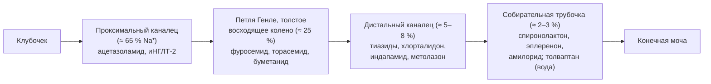
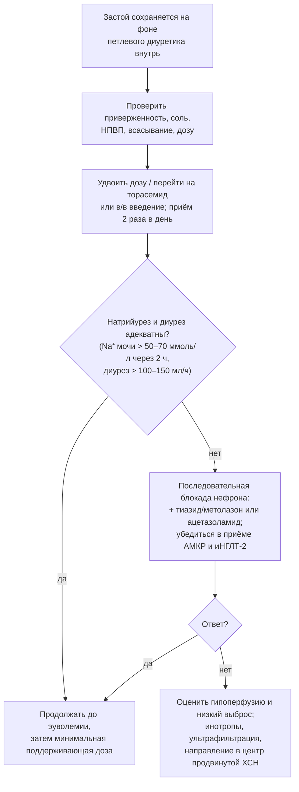

## 15. Диуретическая терапия

### 15.1. Место диуретиков в лечении ХСН

Диуретики — единственный класс, быстро устраняющий симптомы и признаки застоя; они рекомендованы (класс I) всем пациентам с признаками задержки жидкости при любой ФВ. Их влияние на смертность в рандомизированных исследованиях не изучалось (отказ от диуретиков при застое неэтичен); сравнение торасемида и фуросемида (**TRANSFORM-HF**, 2023) не выявило различий в смертности. Цель — достичь и поддерживать **эуволемию** минимально эффективной дозой: избыточная дегидратация активирует нейрогормональные системы, снижает АД и функцию почек и препятствует титрованию базисной терапии, а недостаточная оставляет застой — главный предиктор повторных госпитализаций.

### 15.2. Классы диуретиков и точки их действия

Точки приложения диуретиков в нефроне представлены на рис. 19, характеристики — в табл. 32. **Петлевые диуретики** (фуросемид, торасемид, буметанид) блокируют котранспортёр Na⁺-K⁺-2Cl⁻ в толстом восходящем колене петли Генле, где реабсорбируется 20–25 % профильтрованного натрия, — это основа терапии застоя. **Тиазидные и тиазидоподобные** (гидрохлоротиазид, хлорталидон, индапамид, метолазон) блокируют Na⁺-Cl⁻-котранспортёр дистального канальца (5–8 % натрия); самостоятельно слабы при ХСН и сниженной СКФ, но потенцируют петлевые. **АМКР** и **амилорид** действуют в собирательных трубочках (2–3 % натрия), сберегая калий. **Ацетазоламид** ингибирует карбоангидразу проксимального канальца; **иНГЛТ-2** блокируют реабсорбцию натрия и глюкозы там же; **антагонисты вазопрессина** (толваптан) вызывают акварез без натрийуреза.

**Рис. 19.** Точки действия диуретиков в нефроне и доля реабсорбируемого натрия в каждом сегменте. Схема читается слева направо по ходу канальца: блокада нескольких сегментов одновременно («последовательная блокада нефрона») преодолевает компенсаторное усиление реабсорбции в нижележащих отделах.

**Табл. 32.** Основные диуретики при ХСН: дозы и фармакокинетические особенности.

| Препарат | Стартовая доза внутрь | Обычная поддерживающая/максимальная доза | Биодоступность, длительность действия | Примечания |
|---|---|---|---|---|
| Фуросемид | 20–40 мг | 40–240 мг/сут (в 1–2 приёма); при ХБП выше | 10–90 % (вариабельна, снижается при отёке кишечника); 4–6 ч | Эквивалент: 40 мг внутрь ≈ 20 мг в/в |
| Торасемид | 5–10 мг | 10–40 мг/сут (до 200 мг) | 80–100 %; 12–16 ч | 20 мг ≈ 40 мг фуросемида; антиальдостероновый эффект |
| Буметанид | 0,5–1 мг | 1–5 мг/сут | 80–100 %; 4–6 ч | 1 мг ≈ 40 мг фуросемида |
| Гидрохлоротиазид | 12,5–25 мг | 25–100 мг | Малоэффективен при рСКФ < 30 | Потенцирование петлевых |
| Хлорталидон | 12,5–25 мг | 25–100 мг | Длительное действие (24–72 ч) | Риск гипокалиемии, гипонатриемии |
| Индапамид | 1,5–2,5 мг | 2,5–5 мг | — | Метаболически нейтрален |
| Метолазон | 2,5 мг | 2,5–10 мг | Эффективен при низкой СКФ | Выраженные электролитные нарушения (в РФ не зарегистрирован) |
| Ацетазоламид | 250–500 мг (в/в в ADVOR) | 250–500 мг/сут, короткие курсы | — | Метаболический ацидоз; эффективен при алкалозе |
| Толваптан | 7,5–15 мг | 15–30 мг | — | Гипонатриемия; контроль скорости коррекции натрия |

### 15.3. Фармакология петлевых диуретиков

Петлевые диуретики — «пороговые» препараты: натрийурез начинается только при достижении пороговой концентрации в канальцевой жидкости (куда они секретируются органическими анионными транспортёрами), после чего эффект быстро достигает «потолка»; при ХСН и ХБП кривая доза–эффект смещена вправо и вниз, поэтому требуются большие дозы, а увеличение частоты приёма эффективнее, чем кратности превышения потолка. После окончания действия наступает **постдиуретическая задержка натрия** (ретенция), и при высоком потреблении соли суточный баланс остаётся положительным; при длительном применении развивается **феномен торможения** — гипертрофия дистальных канальцев с усиленной реабсорбцией. Отсюда вытекают правила: приём 2 раза в день для фуросемида при высоких дозах, ограничение соли, добавление тиазида при резистентности. Пероральная биодоступность фуросемида непостоянна и снижается при отёке стенки кишечника, что объясняет преимущество внутривенного введения при декомпенсации и торасемида при амбулаторной терапии.

### 15.4. Принципы дозирования и амбулаторного ведения

Дозу подбирают до достижения «сухого веса», затем снижают до минимальной, поддерживающей эуволемию; у части пациентов с улучшением на базисной терапии (особенно иНГЛТ-2 и АРНИ) диуретик удаётся отменить. Пациент обучается гибкому режиму по весу и симптомам (п. 13.1.2). Контроль электролитов и креатинина проводится через 1–2 недели после изменения дозы. Хроническое назначение высоких доз без переоценки застоя — частая причина гиповолемии, гипотонии и преренального повреждения почек.

### 15.5. Резистентность к диуретикам

#### 15.5.1. Определение и причины

> 📌 **Определение:** **резистентность к диуретикам** — неспособность достичь адекватной деконгестии несмотря на применение возрастающих доз петлевого диуретика (ориентир — отсутствие ответа на ≥ 80 мг фуросемида внутрь в сутки или эквивалент).

Причины и способы их устранения приведены в табл. 33. Среди них — неприверженность и избыток соли, НПВП, нарушение всасывания при застое в кишечнике, гипоальбуминемия, снижение СКФ и почечного кровотока, гипотония и низкий выброс, нейрогормональная активация, адаптация дистального нефрона, гипохлоремия (хлорид необходим для работы котранспортёров и регуляции ренина).

**Табл. 33.** Причины резистентности к диуретикам и подходы к их устранению.

| Причина | Решение |
|---|---|
| Неприверженность, избыточное потребление соли | Обучение, оценка суточной экскреции натрия, ограничение соли до < 5 г |
| НПВП, другие препараты, задерживающие натрий | Отмена |
| Нарушение всасывания (отёк кишечника) | Переход на в/в введение или торасемид |
| Недостаточная доза/частота | Удвоение дозы до достижения эффекта; приём 2 раза в день; в/в болюсы или инфузия |
| Снижение СКФ | Увеличение дозы петлевого диуретика (эффект требует более высокой концентрации в канальце) |
| Адаптация дистального нефрона | Добавление тиазида/метолазона или ацетазоламида (последовательная блокада) |
| Гипоальбуминемия, нефротический синдром | Коррекция причины; альбумин — ограниченные данные |
| Гипотония, низкий выброс | Инотропная поддержка, коррекция доз вазодилататоров |
| Гипохлоремический алкалоз | Ацетазоламид; восполнение хлорида |
| Истинно рефрактерный застой | Ультрафильтрация; оценка для продвинутых методов |

#### 15.5.2. Последовательная блокада нефрона и доказательные подходы

При недостаточном ответе на петлевой диуретик добавляют препарат с другой точкой действия. В **ADVOR** (2022) добавление ацетазоламида 500 мг в/в к петлевому диуретику при декомпенсации увеличило частоту успешной деконгестии на 3-й день (42 против 31 %) без влияния на смертность; в **CLOROTIC** (2023) добавление гидрохлоротиазида усиливало диурез и снижение веса ценой большей частоты ухудшения функции почек и гипокалиемии. иНГЛТ-2 усиливают натрийурез и позволяют снизить дозу петлевых диуретиков. Гипертонический раствор натрия хлорида в сочетании с высокими дозами фуросемида и ультрафильтрация остаются резервными методами (п. 22.6). Алгоритм ведения резистентного застоя представлен на рис. 20.

**Рис. 20.** Алгоритм действий при резистентности к диуретикам. Схема читается сверху вниз: сначала устраняются устранимые причины и оптимизируется петлевой диуретик, затем добавляются препараты с иной точкой действия, и лишь при неэффективности применяются резервные методы.

### 15.6. Контроль эффективности и безопасности

Эффективность оценивают по массе тела, диурезу, динамике симптомов и признаков застоя (яремное давление, отёки, B-линии), а при декомпенсации — по раннему натрийуретическому ответу: концентрация натрия в разовой порции мочи через 2 часа после введения диуретика > 50–70 ммоль/л и диурез > 100–150 мл/ч за первые 6 часов предсказывают успешную деконгестию (алгоритм HFA/ESC 2021). Побочные эффекты: гипокалиемия и гипомагниемия (аритмогенны; требуют восполнения), гипонатриемия (чаще тиазиды), гиперурикемия и подагра, метаболический алкалоз, гипотония, преренальное повышение креатинина, ототоксичность при быстром внутривенном введении высоких доз фуросемида, дислипидемия и гипергликемия при тиазидах. Небольшое повышение креатинина при эффективной деконгестии («псевдоухудшение») не ухудшает прогноз, в отличие от сохраняющегося застоя.

### 15.7. Примеры и иллюстрации

#### 15.7.1. Пример амбулаторной коррекции

Пациент с ХСНснФВ и прибавкой 3 кг за 4 дня, одышкой при малой нагрузке, отёками: фуросемид увеличен с 40 до 80 мг (в два приёма) на 3 дня, ограничена соль, через 3 дня вес вернулся к «сухому», доза снижена до 40 мг; калий 3,6 ммоль/л — назначен калий и проверена доза АМКР. Госпитализация предотвращена.

#### 15.7.2. Пример резистентности к диуретикам

Пациентка с ХСНсФВ, ХБП С3б, принимает ибупрофен по поводу артроза; фуросемид 120 мг внутрь без эффекта. Шаги: отмена ибупрофена, переход на торасемид 40 мг, добавление гидрохлоротиазида 25 мг под контролем электролитов, дапаглифлозин; через неделю вес снизился на 4 кг, креатинин вырос на 15 % при исчезновении отёков — расценено как допустимое, терапия продолжена с переходом на поддерживающие дозы.

> 💡 **Интересный факт:** торасемид, в отличие от фуросемида, частично блокирует эффекты альдостерона и в небольших исследованиях (TORIC) снижал фиброз миокарда и госпитализации, что породило многолетние ожидания его прогностического превосходства; однако прагматичное рандомизированное исследование TRANSFORM-HF (2 859 пациентов, 2023) не выявило различий в смертности между препаратами, подтвердив, что выбор петлевого диуретика определяется фармакокинетикой и удобством, а не влиянием на прогноз.

> ❗ **Типичная ошибка:** добавлять тиазид «для усиления» без увеличения дозы петлевого диуретика при сниженной СКФ или, наоборот, многократно повышать дозу фуросемида, не проверив приверженность, потребление соли и приём НПВП. Последовательная блокада нефрона эффективна лишь после достижения адекватной дозы петлевого диуретика и требует контроля калия и натрия каждые 1–3 дня.

> 🔬 **Углубление:** концепция «ранней оценки натрийуретического ответа» основана на том, что концентрация натрия в моче через 1–2 часа после болюса петлевого диуретика отражает достигнутую канальцевую концентрацию препарата и состояние нефрона: значение < 50–70 ммоль/л предсказывает недостаточный суточный натрийурез (< 100 ммоль) и неблагоприятные исходы (ter Maaten et al., 2015; Verbrugge). В исследовании **PUSH-AHF** (2023) стратегия, управляемая натрием мочи, увеличила натрийурез и диурез в первые сутки, хотя не повлияла на клинические исходы к 180 дню, что отражает сложность перевода физиологического маркёра в прогностическую пользу.

> 📝 **Обобщение.** Диуретики устраняют застой и улучшают симптомы при любой ФВ, но не влияют на смертность; основа терапии — петлевые диуретики (фуросемид, торасемид) в минимальной дозе, поддерживающей эуволемию, с гибким режимом по весу. Резистентность требует последовательного устранения причин (приверженность, соль, НПВП, всасывание, доза), затем последовательной блокады нефрона (тиазид, ацетазоламид) при обязательном приёме АМКР и иНГЛТ-2, а контроль эффективности строится на массе тела, клинике и раннем натрийуретическом ответе. Главный вывод: цель диуретической терапии — эуволемия, а не «максимальный диурез».

> ❓ **Контрольные вопросы**
>
> 1. Объясните понятия «пороговый препарат», «потолок эффекта», «постдиуретическая задержка натрия» и их практические следствия.
> 2. Сравните фуросемид и торасемид по биодоступности, длительности действия и влиянию на прогноз.
> 3. Перечислите причины резистентности к диуретикам и предложите последовательность действий при её выявлении.
> 4. Что такое последовательная блокада нефрона и какие исследования поддерживают применение ацетазоламида и гидрохлоротиазида?
> 5. По каким показателям оценивают эффективность диуретической терапии при декомпенсации и когда повышение креатинина не требует прекращения деконгестии?
