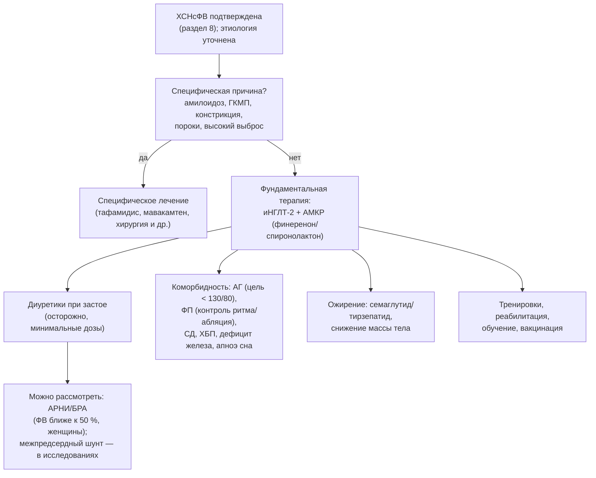

## 17. Лечение ХСН с умеренно сниженной, сохранённой и улучшенной фракцией выброса

### 17.1. ХСН с умеренно сниженной фракцией выброса

#### 17.1.1. Доказательная база

Специально спланированных исследований для ФВ 41–49 % не проводилось; данные получены из подгрупп и вторичных анализов: кандесартан в CHARM-Preserved, спиронолактон в TOPCAT (особенно у пациентов, включённых в Америке), сакубитрил/валсартан в PARAGON-HF (польза при ФВ ниже медианы 57 %), бета-адреноблокаторы в метаанализе индивидуальных данных (Cleland et al., 2018) при синусовом ритме снижали смертность у пациентов с ФВ 40–49 %. Ингибиторы НГЛТ-2 изучались проспективно в DELIVER и EMPEROR-Preserved (ФВ > 40 %) с эффектом, не зависящим от ФВ.

#### 17.1.2. Рекомендации

РКО 2024: иНГЛТ-2 рекомендованы (класс I); иАПФ/БРА/АРНИ, бета-адреноблокаторы и АМКР можно рассмотреть (IIb); диуретики — при застое. ESC 2026 устранили категорию, включив ФВ 41–49 % в HFrEF с полной фундаментальной терапией; ESC 2023 присвоили иНГЛТ-2 класс I, остальным классам — IIb. Практически пациенты с ХСНунФВ, большинство из которых имеют ИБС и ранее сниженную ФВ, лечатся как ХСНснФВ (рис. 15).

### 17.2. ХСН с сохранённой фракцией выброса

#### 17.2.1. История неудач и её причины

До 2021 года ни одно исследование не достигло первичной конечной точки: PEP-CHF (периндоприл), CHARM-Preserved (кандесартан), I-PRESERVE (ирбесартан), DIG-PEF (дигоксин), TOPCAT (спиронолактон), PARAGON-HF (сакубитрил/валсартан; граница статистической значимости), RELAX (силденафил), NEAT-HFpEF (изосорбида мононитрат — снижение активности) (табл. 36). Причины — неоднородность популяции, включение пациентов без истинной ХСН, преобладание некардиальных исходов, региональные различия качества исследований (в TOPCAT в России и Грузии частота событий и признаки приёма спиронолактона были аномально низкими).

**Табл. 36.** Ключевые исследования терапии ХСНсФВ.

| Исследование (год) | Препарат | Популяция | Результат |
|---|---|---|---|
| CHARM-Preserved (2003) | Кандесартан | ФВ > 40 % | Первичная точка не достигнута; меньше госпитализаций |
| PEP-CHF (2006) | Периндоприл | ≥ 70 лет, ФВ ≥ 40 % | Нейтральный |
| I-PRESERVE (2008) | Ирбесартан | ФВ ≥ 45 % | Нейтральный |
| TOPCAT (2014) | Спиронолактон | ФВ ≥ 45 % | Нейтральный в целом; польза в Америке и по госпитализациям |
| PARAGON-HF (2019) | Сакубитрил/валсартан vs валсартан | ФВ ≥ 45 % | Снижение на 13 % (p = 0,06); польза при ФВ ≤ 57 % и у женщин |
| EMPEROR-Preserved (2021) | Эмпаглифлозин | ФВ > 40 % | Снижение СС-смерти/госпитализаций на 21 % |
| DELIVER (2022) | Дапаглифлозин | ФВ > 40 % (включая улучшенную) | Снижение на 18 % |
| STEP-HFpEF (2023) | Семаглутид | ФВ ≥ 45 % + ожирение | Улучшение KCCQ, снижение массы тела, 6MWT, НУП |
| FINEARTS-HF (2024) | Финеренон | ФВ ≥ 40 % | Снижение СС-смерти и событий ухудшения ХСН на 16 % |
| SUMMIT (2024) | Тирзепатид | ФВ ≥ 50 % + ожирение | Снижение ухудшений ХСН/СС-смерти, улучшение KCCQ |
| SPIRRIT-HFpEF (2025) | Спиронолактон (регистровое РКИ) | ФВ ≥ 40 % | [⚠️ Требуется верификация: результаты по первичной конечной точке] |

#### 17.2.2. Современная фундаментальная терапия ХСНсФВ

Ингибиторы НГЛТ-2 (эмпаглифлозин, дапаглифлозин) — первый класс с доказанным снижением сердечно-сосудистой смерти или госпитализаций (класс I в ESC 2023, РКО 2024, ESC 2026), эффект реализуется преимущественно за счёт госпитализаций и проявляется в первые недели. АМКР: после FINEARTS-HF (финеренон) и анализа TOPCAT в ESC 2026 АМКР получили класс I при любой ФВ; в РКО 2024 спиронолактон можно рассмотреть для снижения госпитализаций. Сакубитрил/валсартан и БРА можно рассмотреть при ФВ ближе к 50 % и у женщин (IIb; одобрение FDA для ФВ «ниже нормы»). Семаглутид и тирзепатид рекомендованы (IIa в ESC 2026) при ХСНсФВ с ожирением для улучшения симптомов и снижения событий. Диуретики — при застое, с осторожностью: жёсткий малый желудочек чувствителен к гиповолемии. Схема терапии показана на рис. 21.

**Рис. 21.** Алгоритм лечения ХСН с сохранённой фракцией выброса. Схема читается сверху вниз: после исключения причин, требующих специфической терапии, назначается фундаментальная терапия (иНГЛТ-2 и АМКР), дополняемая лечением застоя, коморбидности и ожирения.

#### 17.2.3. Лечение коморбидности как часть терапии ХСНсФВ

Контроль АД (целевое < 130/80 мм рт. ст. при переносимости; предпочтительны иНГЛТ-2, АМКР, БРА/АРНИ, диуретики), стратегия контроля ритма при ФП (катетерная абляция улучшает симптомы и, по данным наблюдений, исходы), лечение ИБС (реваскуляризация при стенокардии), коррекция дефицита железа (данные менее убедительны, чем при снФВ; FAIR-HFpEF — малое исследование с улучшением дистанции ходьбы), CPAP при апноэ сна, оптимальное лечение диабета (иНГЛТ-2, агонисты ГПП-1) и ХБП (иНГЛТ-2, финеренон) — неотъемлемые элементы терапии.

#### 17.2.4. Чего следует избегать

Избыточная диуретическая терапия и нитраты ухудшают переносимость нагрузки; бета-адреноблокаторы без отдельных показаний (ИБС, ФП) не улучшают исходов и могут снижать хронотропный резерв (их рутинное назначение при ХСНсФВ не рекомендовано); ингибиторы ФДЭ-5 неэффективны; верапамил/дилтиазем допустимы для контроля ЧСС при ФП, но без доказательств пользы.

### 17.3. ХСН с улучшенной фракцией выброса

#### 17.3.1. Принципы ведения

Улучшение ФВ — результат терапии, а не повод для её прекращения: в **TRED-HF** (2019) постепенная отмена терапии у пациентов с ДКМП и восстановленной ФВ привела к рецидиву у 44 % в течение 6 месяцев; ESC 2026 рекомендуют продолжать фундаментальную терапию после улучшения ФВ. Исключения — обратимые причины, устранённые радикально (например, тахикардиомиопатия после абляции, перипартальная кардиомиопатия через длительный срок), где допустима осторожная деэскалация под контролем ЭхоКГ и НУП; при генетических кардиомиопатиях отмена противопоказана.

#### 17.3.2. Устройства и наблюдение

Вопрос об ИКД у пациентов с улучшенной ФВ до имплантации решается индивидуально: при ФВ > 35 % первичная профилактика, как правило, не показана, если нет иных факторов риска (рубец, ламинопатия); при подошедшей замене генератора ИКД у пациентов с восстановленной ФВ риск сохраняется, и замена обычно рекомендуется. Наблюдение — клинический осмотр и НУП каждые 6 месяцев, ЭхоКГ ежегодно или при ухудшении; пациент информируется о характере ремиссии и необходимости приверженности.

### 17.4. Примеры и иллюстрации

#### 17.4.1. Пример лечения ХСНсФВ

Женщина 72 лет, ХСНсФВ (HFA-PEFF 6 баллов), АГ, ожирение (ИМТ 36), пароксизмальная ФП, СД 2-го типа, рСКФ 55: назначены эмпаглифлозин 10 мг, финеренон (или спиронолактон 25 мг), торасемид 5 мг при отёках, валсартан для контроля АД, апиксабан, семаглутид для снижения массы тела, программа тренировок; обсуждена абляция ФП. Через 6 месяцев: масса тела −9 кг, KCCQ +15 баллов, госпитализаций нет.

#### 17.4.2. Пример ведения улучшенной ФВ

Мужчина 50 лет с ДКМП: ФВ 25 % → 50 % через 18 месяцев на АРНИ, карведилоле, эплереноне, дапаглифлозине; просит отменить «лишние таблетки». Разъяснено понятие ремиссии, терапия продолжена в полном объёме; при желании уменьшить нагрузку препаратами возможна лишь отмена диуретика при эуволемии.

> 💡 **Интересный факт:** в TOPCAT пациенты, включённые в России и Грузии (почти половина выборки), имели частоту событий в несколько раз ниже, чем в Северной и Южной Америке, а у многих из них в крови не обнаруживался метаболит спиронолактона канренон, — этот эпизод стал хрестоматийным примером влияния качества проведения многоцентрового исследования на его результат и во многом определил современный интерес к регистровым рандомизированным исследованиям.

> ❗ **Типичная ошибка:** назначать при ХСНсФВ «стандартную тройку» — иАПФ, бета-адреноблокатор и спиронолактон — по аналогии с ХСНснФВ, не назначая иНГЛТ-2. Единственный класс с убедительными доказательствами снижения исходов при ХСНсФВ — ингибиторы НГЛТ-2 (с 2024–2026 годов — также АМКР), тогда как бета-адреноблокаторы без ИБС и ФП не улучшают, а иногда ухудшают переносимость нагрузки.

> 🔬 **Углубление:** объединённый анализ DELIVER и DAPA-HF (Jhund et al., 2022; более 11 000 пациентов) показал, что дапаглифлозин снижает сердечно-сосудистую смерть и госпитализации по поводу ХСН во всём диапазоне ФВ без значимой гетерогенности, а аналогичный анализ EMPEROR-Pooled выявил ослабление эффекта на госпитализации лишь при ФВ ≥ 65 %. Эти данные вместе с FINEARTS-HF стали основанием для парадигмы ESC 2026, в которой фундаментальная терапия определяется не столько порогом ФВ, сколько наличием синдрома ХСН; открытым остаётся вопрос, применимо ли это к бета-адреноблокаторам и АРНИ, для которых зависимость эффекта от ФВ выражена сильнее.

> 📝 **Обобщение.** При ХСНунФВ, большинство случаев которой близки по природе к ХСНснФВ, показаны иНГЛТ-2 (класс I) и могут применяться остальные базисные классы (ESC 2026 — полная фундаментальная терапия). При ХСНсФВ фундаментальную терапию составляют иНГЛТ-2 и АМКР, дополняемые диуретиками при застое, лечением гипертензии, ФП, диабета, ХБП, дефицита железа и ожирения (семаглутид, тирзепатид), тренировками и исключением специфических причин (амилоидоз, ГКМП). При улучшенной ФВ терапия продолжается пожизненно, поскольку речь идёт о ремиссии. Главный вывод: лечение ХСНсФВ стало доказательным, и его основа — метаболические и почечные механизмы, а не классическая нейрогормональная блокада.

> ❓ **Контрольные вопросы**
>
> 1. Почему рекомендации по ХСНунФВ опираются на вторичные анализы и как это отразилось в ESC 2026?
> 2. Перечислите исследования при ХСНсФВ, не достигшие первичной конечной точки, и назовите причины неудач.
> 3. Какие два класса составляют фундаментальную терапию ХСНсФВ по ESC 2026 и на каких исследованиях это основано?
> 4. Какие вмешательства при ХСНсФВ следует избегать и почему?
> 5. Что показало исследование TRED-HF и как оно определяет ведение пациентов с улучшенной ФВ?
