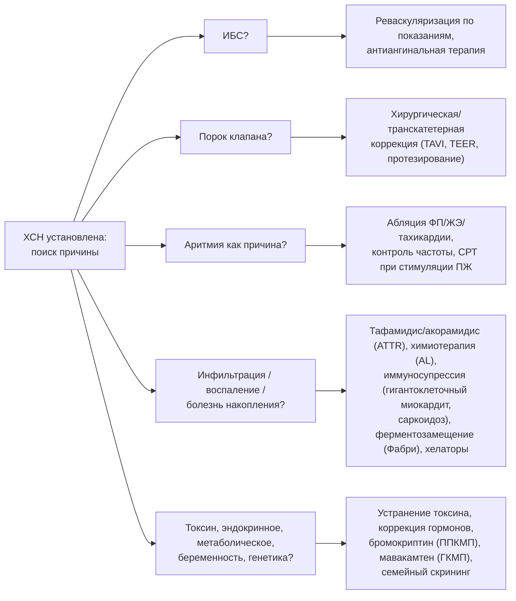

## 18. Этиотропные и специфические подходы к лечению

### 18.1. Принцип этиологического поиска и лечения

Этиотропное лечение — единственная возможность не только замедлить, но и обратить ХСН; поэтому у каждого пациента причина должна быть установлена или аргументированно признана неустановленной (рис. 22). Диагностический поиск описан в разделе 8 (МРТ, коронарография или КТ, сцинтиграфия, генетика, биопсия); специфические вмешательства обобщены в табл. 37. Этиотропная терапия дополняет, а не заменяет базисную.

**Рис. 22.** Схема этиологического поиска и соответствующих этиотропных вмешательств. Схема читается слева направо: пять групп причин проверяются параллельно, и для каждой существует специфическое лечение, добавляемое к базисной терапии.

**Табл. 37.** Этиотропные и специфические вмешательства при ХСН.

| Причина | Вмешательство | Ключевые доказательства |
|---|---|---|
| Ишемическая кардиомиопатия | АКШ при многососудистом поражении и ФВ ≤ 35 %; ЧКВ — симптоматически | STICH/STICHES (АКШ: снижение смертности за 10 лет); REVIVED-BCIS2 (ЧКВ: без влияния на исходы) |
| Аортальный стеноз | TAVI/протезирование | Рекомендации по клапанным порокам; TAVI у пожилых и высокого риска |
| Вторичная митральная регургитация | Транскатетерная «край-в-край» пластика (TEER) при ФВ 20–50 %, тяжёлой МР на оптимальной терапии | COAPT (снижение госпитализаций и смертности); MITRA-FR (нейтрально; значение отбора) |
| ФП с ХСНснФВ | Катетерная абляция | CASTLE-AF (снижение смерти/госпитализаций), CASTLE-HTx |
| Частая желудочковая экстрасистолия (> 10–20 %) | Абляция | Наблюдательные серии: восстановление ФВ |
| Транстиретиновый амилоидоз | Тафамидис; акорамидис; вутрисиран/патисиран | ATTR-ACT (снижение смертности на 30 %); ATTRibute-CM; HELIOS-B |
| AL-амилоидоз | Химиотерапия (даратумумаб + CyBorD) | ANDROMEDA |
| Обструктивная ГКМП | Мавакамтен, афикамтен; септальная редукция | EXPLORER-HCM; SEQUOIA-HCM |
| Гигантоклеточный миокардит, саркоидоз | Иммуносупрессия (глюкокортикоиды ± цитостатики) | Регистры, консенсусы |
| Болезнь Фабри | Ферментозаместительная терапия, мигаластат | Наблюдательные исследования |
| Гемохроматоз | Кровопускания, хелаторы | Наблюдательные исследования |
| Алкогольная, кокаиновая, медикаментозная КМП | Отказ от воздействия | Наблюдательные исследования |
| Перипартальная кардиомиопатия | Стандартная терапия ХСН; бромокриптин (IIb) | Малые РКИ (Германия), регистр EURObservational |
| Тиреотоксикоз, феохромоцитома, акромегалия | Коррекция эндокринного нарушения | Клинические серии |
| Болезнь Шагаса | Антипаразитарная терапия при кардиомиопатии не улучшает исходов | BENEFIT |

### 18.2. Ишемическая болезнь сердца

У пациентов с ХСНснФВ и многососудистым поражением коронарных артерий аортокоронарное шунтирование в дополнение к медикаментозной терапии снизило общую смертность за 10 лет наблюдения (**STICHES**, 2016), тогда как плановое ЧКВ при стабильной ишемической кардиомиопатии не улучшило исходов (**REVIVED-BCIS2**, 2022); оценка жизнеспособности миокарда не предсказывала пользу реваскуляризации в подисследованиях. Решение принимает «сердечная команда» с учётом анатомии, диабета, сопутствующей патологии и ожидаемой продолжительности жизни; при стенокардии ЧКВ обосновано симптоматически (п. 21.6). Антиангинальная терапия: бета-адреноблокаторы, ивабрадин, нитраты, амлодипин, триметазидин, ранолазин (п. 19.5).

### 18.3. Клапанные пороки

При тяжёлом аортальном стенозе с дисфункцией ЛЖ вмешательство (TAVI или хирургическое протезирование) показано даже при низкопоточном низкоградиентном варианте после подтверждения тяжести стрессовой ЭхоКГ или кальциевым индексом; при первичной митральной регургитации — хирургическая пластика; при вторичной (функциональной) — сначала оптимальная медикаментозная и ресинхронизирующая терапия, затем TEER при сохранении тяжёлой регургитации у пациентов, отвечающих критериям COAPT (п. 21.5). Трикуспидальная регургитация всё чаще лечится транскатетерно (TRILUMINATE).

### 18.4. Аритмии как причина ХСН

**Тахикардиомиопатия** развивается при длительной тахисистолии (ФП, трепетание, предсердные тахикардии, частая экстрасистолия) и обратима при контроле частоты или устранении аритмии: при ФП с ХСНснФВ катетерная абляция снижала смертность и госпитализации в **CASTLE-AF** (2018) и улучшала исходы у кандидатов на трансплантацию в CASTLE-HTx (2023); при желудочковой экстрасистолии с нагрузкой > 10–20 % абляция восстанавливает ФВ. **Кардиомиопатия, индуцированная стимуляцией ПЖ**, корригируется переходом на СРТ или стимуляцию проводящей системы (п. 21.3).

### 18.5. Воспалительные и инфильтративные заболевания

При **гигантоклеточном миокардите** комбинированная иммуносупрессия (глюкокортикоиды, циклоспорин, при необходимости антитимоцитарный глобулин) изменила естественное течение, при котором без лечения большинство пациентов умирало или нуждалось в трансплантации в течение года; при **саркоидозе сердца** применяют глюкокортикоиды и стероидсберегающие препараты с контролем по ПЭТ; при **эозинофильном миокардите** — глюкокортикоиды и лечение причины; при лимфоцитарном миокардите иммуносупрессия показана лишь при вирус-негативной хронической воспалительной кардиомиопатии по данным биопсии. При **транстиретиновом амилоидозе** тафамидис (ATTR-ACT, 2018) снизил смертность и госпитализации, акорамидис (ATTRibute-CM, 2023) и вутрисиран (HELIOS-B, 2024) расширили выбор; при **AL-амилоидозе** основой является быстрая противоопухолевая терапия (даратумумаб с циклофосфамидом, бортезомибом и дексаметазоном). При амилоидозе бета-адреноблокаторы, иАПФ и блокаторы кальциевых каналов часто плохо переносятся, дигоксин требует осторожности, а основа симптоматического лечения — диуретики и АМКР; иНГЛТ-2 по наблюдательным данным безопасны.

### 18.6. Гипертрофическая кардиомиопатия

При обструктивной ГКМП с симптомами ингибиторы миозина (мавакамтен — EXPLORER-HCM, 2020; афикамтен — SEQUOIA-HCM, 2024) уменьшают градиент и улучшают переносимость нагрузки; при неэффективности — септальная миэктомия или алкогольная аблация в опытных центрах. Вазодилататоры, дегидратация и высокие дозы диуретиков усугубляют обструкцию. При ГКМП с «выгоранием» (переход к дилатации и снижению ФВ) лечение проводится как при ХСНснФВ.

### 18.7. Токсические, эндокринные, метаболические и перипартальная кардиомиопатии

Отказ от алкоголя при алкогольной кардиомиопатии приводит к улучшению ФВ более чем у половины пациентов; та же логика применима к кокаину, амфетаминам, анаболическим стероидам. Кардиотоксичность противоопухолевой терапии требует совместного ведения с онкологом (п. 20.5). Тиреотоксикоз, гипотиреоз, феохромоцитома, акромегалия, дефицит тиамина — обратимые причины, диагностируемые лабораторно. При болезни Фабри ферментозаместительная терапия и шапероны (мигаластат) замедляют прогрессирование при раннем начале; при гемохроматозе — кровопускания и хелаторы. При **перипартальной кардиомиопатии** наряду со стандартной терапией (с учётом беременности и лактации — п. 20.3) рассматривается бромокриптин (блокада пролактина, малые РКИ с улучшением ФВ) при обязательной антикоагуляции; восстановление ФВ наступает у 50–70 % в течение 6–12 месяцев, а риск рецидива при последующей беременности высок, особенно при неполном восстановлении.

### 18.8. Генетические кардиомиопатии и семейный скрининг

При выявленном патогенном варианте (ламинопатии, FLNC, DSP, PLN, TTN и др.) ведение включает стратификацию аритмического риска (ИКД при ламинопатии по специальным калькуляторам, независимо от ФВ), ограничение интенсивных нагрузок при аритмогенной кардиомиопатии, каскадный скрининг родственников и генетическое консультирование; специфическая генная терапия находится на стадии клинических исследований (п. 27.7).

### 18.9. Примеры и иллюстрации

#### 18.9.1. Пример обратимой этиологии

Мужчина 48 лет с ФВ 30 %, постоянной ФП с частотой 120–140 в минуту, без ИБС по КТ-коронарографии. После катетерной абляции ФП и 4 месяцев базисной терапии — синусовый ритм, ФВ 55 %: тахикардиомиопатия. Терапия продолжается, но прогноз определяется удержанием ритма.

#### 18.9.2. Пример специфической терапии

Мужчина 76 лет с ХСНсФВ, толщиной стенок 17 мм, низким вольтажом, синдромом запястного канала: сцинтиграфия с пирофосфатом — захват 3 степени, моноклональный белок не выявлен — ATTR-амилоидоз дикого типа. Отменены бета-адреноблокатор и амлодипин (гипотония), оставлены торасемид и спиронолактон, назначен тафамидис 61 мг; переносимость нагрузки улучшилась, госпитализаций за год не было.

> 💡 **Интересный факт:** исследование ATTR-ACT (2018) стало первым рандомизированным исследованием, показавшим снижение смертности при амилоидозе сердца; при этом кривые выживаемости расходились лишь через 18 месяцев, что отражает медленную природу заболевания и необходимость ранней диагностики — у пациентов с ФК III польза тафамидиса была существенно меньше, чем при ФК I–II.

> ❗ **Типичная ошибка:** назначать пациенту с «гипертонической» гипертрофией ЛЖ и ХСНсФВ стандартную терапию, не исключив амилоидоз, и годами наращивать дозы бета-адреноблокаторов и иАПФ при нарастающей гипотонии; непереносимость этих препаратов у пожилого пациента с гипертрофией — само по себе «красный флаг» инфильтративной кардиомиопатии.

> 🔬 **Углубление:** результаты REVIVED-BCIS2 (700 пациентов с ФВ ≤ 35 %, обширным поражением коронарных артерий и доказанной жизнеспособностью миокарда) не выявили пользы ЧКВ по сравнению с оптимальной медикаментозной терапией ни по смертности и госпитализациям, ни по ФВ через 12 месяцев, а подисследование показало, что объём жизнеспособного миокарда не предсказывал ответ на реваскуляризацию, тогда как объём рубца предсказывал прогноз. В сочетании с данными STICH, где виабилити-тестирование также не выделило пациентов, выигрывающих от АКШ, это подорвало парадигму «гибернирующего миокарда» как главного обоснования реваскуляризации при ишемической кардиомиопатии и сместило акцент на полноту медикаментозной терапии, прогностическую роль рубца и симптоматические показания.

> 📝 **Обобщение.** Этиотропное лечение добавляется к базисной терапии и способно обратить ХСН: АКШ при многососудистой ИБС, коррекция пороков (включая TAVI и TEER), абляция ФП и экстрасистолии при тахикардиомиопатии, иммуносупрессия при гигантоклеточном миокардите и саркоидозе, тафамидис/акорамидис/вутрисиран при ATTR-амилоидозе и химиотерапия при AL, ингибиторы миозина при обструктивной ГКМП, устранение токсинов и эндокринных причин, бромокриптин при перипартальной кардиомиопатии, стратификация риска и семейный скрининг при генетических формах. Главный вывод: отсутствие этиологического диагноза лишает пациента самых эффективных вмешательств.

> ❓ **Контрольные вопросы**
>
> 1. Сопоставьте результаты STICHES и REVIVED-BCIS2 и сформулируйте показания к реваскуляризации при ишемической кардиомиопатии.
> 2. При каких аритмиях ХСН обратима и какие вмешательства применяются?
> 3. Какие препараты доказали пользу при транстиретиновом амилоидозе сердца и какие стандартные препараты при нём плохо переносятся?
> 4. В каких формах миокардита показана иммуносупрессия?
> 5. Какие особенности имеет лечение перипартальной кардиомиопатии и как консультировать пациентку о последующих беременностях?
