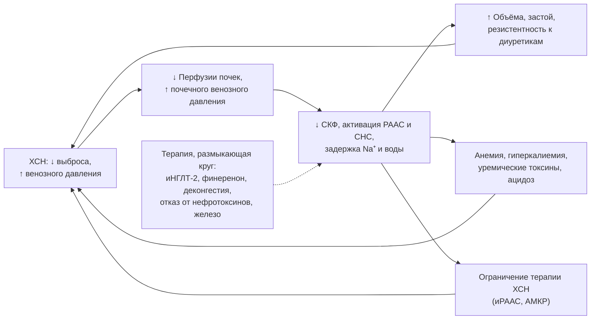

## 19. Коморбидность при ХСН

### 19.1. Сахарный диабет и ожирение

Диабет 2-го типа есть у 30–40 % пациентов с ХСН и ухудшает прогноз. Препараты выбора — ингибиторы НГЛТ-2 (снижают госпитализации и смерть при любой ФВ и являются одновременно базисной терапией ХСН); метформин безопасен при рСКФ ≥ 30 мл/мин/1,73 м² и не противопоказан при стабильной ХСН; агонисты рецепторов ГПП-1 нейтральны или полезны (при ХСНсФВ с ожирением — семаглутид, тирзепатид), но при ХСНснФВ малые исследования (FIGHT, LIVE) выявили тенденцию к увеличению событий, что требует осторожности; инсулин нейтрален; тиазолидиндионы и саксаглиптин противопоказаны (п. 11.3). Целевой HbA1c индивидуален (7–8 % у пожилых). Ожирение рассматривается как причинный фактор ХСНсФВ (п. 5.6.1) и мишень терапии (п. 13.4).

### 19.2. Хроническая болезнь почек и кардиоренальный синдром

ХБП (рСКФ < 60) имеется у 40–50 % пациентов; сердце и почки связаны взаимно усиливающимися механизмами (рис. 23; классификация Ronco — п. 2.4.5). Принципы: базисная терапия сохраняет пользу при ХБП и замедляет её прогрессирование (иНГЛТ-2 до рСКФ 20, финеренон при диабетической ХБП, АРНИ/иАПФ с контролем); «псевдоухудшение» функции почек при деконгестии не является поводом для прекращения терапии (п. 15.6); следует избегать НПВП, контрастов без подготовки, нефротоксичных антибиотиков; при рСКФ < 30 решения принимаются совместно с нефрологом (АМКР — осторожно или отмена, иНГЛТ-2 — продолжать, диуретики — высокие дозы); при диализе ХСН — ведущая причина смерти, а ультрафильтрация заменяет диуретики. Альбуминурия (UACR) — независимый маркер риска и мишень терапии (ESC 2026 включили её в первичное обследование).

**Рис. 23.** Кардиоренальный порочный круг. Схема читается слева направо: гемодинамические, нейрогормональные и метаболические связи между сердцем и почками взаимно усиливают друг друга, а ряд вмешательств размыкает круг одновременно с обеих сторон.

### 19.3. Анемия и дефицит железа

Дефицит железа и анемия ухудшают симптомы и прогноз; диагностика и внутривенное железо описаны в п. 16.2. Поиск причины анемии (кровопотеря, ХБП, дефицит B12/фолата, гемодилюция при застое, воспаление) обязателен; эритропоэз-стимулирующие препараты применяются только при ХБП по нефрологическим показаниям; трансфузии — при тяжёлой симптомной анемии.

### 19.4. Фибрилляция предсердий

ФП и ХСН взаимно провоцируют друг друга; ведение включает: (1) антикоагуляцию — прямые пероральные антикоагулянты предпочтительнее варфарина (кроме механических протезов и умеренного/тяжёлого митрального стеноза) при CHA₂DS₂-VASc ≥ 1 у мужчин и ≥ 2 у женщин (ХСН сама даёт 1 балл); (2) контроль частоты — бета-адреноблокаторы (при ХСНснФВ не снижают смертность при ФП по данным метаанализа, но остаются препаратами выбора для контроля ЧСС), дигоксин, при ХСНсФВ допустимы верапамил/дилтиазем; целевая ЧСС в покое < 100–110 в минуту; (3) контроль ритма — амиодарон (единственный безопасный антиаритмик при ХСНснФВ), электрическая кардиоверсия, катетерная абляция, которая у пациентов с ХСНснФВ снижала смертность и госпитализации (CASTLE-AF) и рекомендована при симптомной ФП и подозрении на тахикардиомиопатию (класс I/IIa); ранний контроль ритма улучшал исходы в EAST-AFNET 4; (4) абляцию АВ-узла с СРТ при невозможности контроля (APAF-CRT). Поиск триггеров (тиреотоксикоз, апноэ сна, алкоголь) обязателен.

### 19.5. Ишемическая болезнь сердца и стенокардия

При стенокардии первая линия — бета-адреноблокаторы; далее ивабрадин (синусовый ритм), нитраты короткого и длительного действия, амлодипин/фелодипин, триметазидин, ранолазин (с осторожностью); дилтиазем и верапамил противопоказаны при ХСНснФВ. Реваскуляризация — симптоматически при рефрактерной стенокардии и прогностически — АКШ при многососудистом поражении (п. 18.2). Антиагреганты и статины — по показаниям ИБС; при сочетании с ФП предпочтительна монотерапия антикоагулянтом после периода комбинированной терапии.

### 19.6. Артериальная гипертензия

Контроль АД — профилактика и часть лечения ХСН; при ХСНснФВ гипертензия редко сохраняется на фоне базисной терапии, при необходимости добавляют амлодипин или фелодипин (альфа-адреноблокаторы, моксонидин — MOXCON — и дилтиазем/верапамил не рекомендованы). При ХСНсФВ целевое АД < 130/80 мм рт. ст.; препараты выбора — иНГЛТ-2, АМКР, БРА/АРНИ, диуретики, при необходимости — амлодипин.

### 19.7. Заболевания лёгких

ХОБЛ встречается у 20–30 % пациентов и не является противопоказанием к кардиоселективным бета-адреноблокаторам (бисопролол, метопролол сукцинат, небиволол); при бронхиальной астме их назначение возможно под наблюдением с низких доз. Ингаляционные бронхолитики и глюкокортикоиды безопасны, пероральные глюкокортикоиды и теофиллин требуют осторожности. Спирометрия должна выполняться при эуволемии, поскольку застой даёт рестриктивные изменения. Лёгочная реабилитация и кардиореабилитация объединяются.

### 19.8. Нарушения дыхания во сне

Обструктивное апноэ встречается у трети пациентов и лечится CPAP (улучшение симптомов и АД, без доказанного влияния на смертность); центральное апноэ с дыханием Чейна–Стокса — маркер тяжести ХСН, при котором адаптивная сервовентиляция противопоказана при ФВ ≤ 45 % (SERVE-HF — повышение смертности), а стимуляция диафрагмального нерва улучшает показатели сна. Оптимизация терапии ХСН сама уменьшает центральное апноэ.

### 19.9. Депрессия, тревога и когнитивные нарушения

Депрессия выявляется у 20–40 % пациентов и независимо ухудшает прогноз и приверженность. Скрининг (PHQ-2/PHQ-9, HADS) должен быть рутинным; психотерапия (когнитивно-поведенческая) эффективна; СИОЗС (сертралин, эсциталопрам) безопасны, но в SADHART-CHF и MOOD-HF не улучшали прогноз; трициклические антидепрессанты противопоказаны. Когнитивные нарушения (у 25–50 %) требуют упрощения схем, вовлечения родственников и оценки дееспособности принимать решения.

### 19.10. Онкологические заболевания

ХСН и рак разделяют факторы риска и механизмы (воспаление, клональный гемопоэз); противоопухолевая терапия вызывает кардиотоксичность, а ХСН ограничивает онкологическое лечение. Кардиоонкологическое сопровождение (п. 20.5) включает оценку риска до терапии, мониторинг и раннюю кардиопротекцию; наличие ХСН не является абсолютным противопоказанием к противоопухолевому лечению.

### 19.11. Подагра, артриты и болевой синдром

Гиперурикемия и подагра часты (диуретики, ХБП); НПВП противопоказаны; при остром приступе — колхицин в низких дозах или короткие курсы глюкокортикоидов (с учётом задержки жидкости), для профилактики — аллопуринол (фебуксостат — с осторожностью после CARES). Для хронической боли — парацетамол, местные средства, физические методы; опиоиды и габапентиноиды — с осторожностью (задержка жидкости при прегабалине).

### 19.12. Старческая астения, саркопения и кахексия

Старческая астения (frailty) выявляется у 30–50 % пациентов и предсказывает исходы лучше возраста; её оценка (шкалы Fried, Clinical Frailty Scale) влияет на цели и интенсивность терапии. Саркопения и кахексия требуют нутритивной поддержки (белок 1,2–1,5 г/кг), силовых тренировок, коррекции депрессии и дефицитов; специфической фармакотерапии кахексии нет (п. 25.8).

### 19.13. Другие состояния

**Эректильная дисфункция** встречается у большинства мужчин с ХСН; ингибиторы ФДЭ-5 допустимы при отсутствии нитратов и гипотонии. **Заболевания щитовидной железы** (включая амиодарон-индуцированные) корригируются. **Заболевания печени** требуют коррекции доз и исключения застойного генеза. **Инфекции** — важнейший триггер декомпенсации; показана вакцинация (п. 13.5). Ключевые позиции обобщены в табл. 38.

**Табл. 38.** Ведение основных коморбидных состояний при ХСН: что предпочтительно и чего избегать.

| Коморбидность | Предпочтительно | Избегать |
|---|---|---|
| Сахарный диабет 2-го типа | иНГЛТ-2, метформин (рСКФ ≥ 30), агонисты ГПП-1 (особенно при ХСНсФВ с ожирением) | Пиоглитазон, саксаглиптин; агонисты ГПП-1 при ХСНснФВ — с осторожностью |
| ХБП | иНГЛТ-2, финеренон, продолжение иРААС под контролем, деконгестия | НПВП, контрасты без подготовки, отмена терапии при «псевдоухудшении» |
| ФП | ПОАК, β-АБ/дигоксин для контроля ЧСС, амиодарон, абляция | Антиаритмики I класса, дронедарон, верапамил/дилтиазем при снФВ |
| Стенокардия | β-АБ, ивабрадин, нитраты, амлодипин, триметазидин, АКШ по показаниям | Дилтиазем, верапамил |
| АГ | иНГЛТ-2, АМКР, АРНИ/БРА/иАПФ, диуретики, амлодипин | Альфа-адреноблокаторы, моксонидин, миноксидил |
| ХОБЛ/астма | Кардиоселективные β-АБ, ингаляционная терапия | Отказ от β-АБ из-за ХОБЛ; системные стероиды |
| Апноэ сна | CPAP при обструктивном | Адаптивная сервовентиляция при центральном апноэ и ФВ ≤ 45 % |
| Депрессия | Психотерапия, СИОЗС | Трициклические антидепрессанты |
| Подагра/боль | Колхицин, аллопуринол, парацетамол | НПВП, коксибы |
| Анемия/дефицит железа | Внутривенное железо, поиск причины | Эритропоэтины вне ХБП, пероральное железо как основа |

### 19.14. Примеры и иллюстрации

#### 19.14.1. Пример кардиоренального синдрома

Пациент с ХСНснФВ и ХБП С3б госпитализирован с анасаркой; на фоне внутривенного фуросемида креатинин вырос с 180 до 215 мкмоль/л при снижении веса на 6 кг и исчезновении застоя. Повышение креатинина на 19 % при эффективной деконгестии расценено как гемодинамическое; диуретики переведены на поддерживающую дозу, продолжены иНГЛТ-2 и АРНИ, через 2 недели креатинин — 190 мкмоль/л.

#### 19.14.2. Пример ведения ФП при ХСН

Женщина 66 лет с ХСНснФВ (ФВ 33 %) и персистирующей симптомной ФП: апиксабан 5 мг × 2, бисопролол, кардиоверсия после 3 недель антикоагуляции с удержанием ритма амиодароном; через 3 месяца рецидив — выполнена катетерная абляция, синусовый ритм удерживается, ФВ 45 %.

> 💡 **Интересный факт:** в исследовании CASTLE-AF (363 пациента с ХСНснФВ и ФП, 2018) катетерная абляция снизила комбинированную точку смерти или госпитализации по поводу ХСН на 38 %, а общую смертность — на 47 %, что сделало ФП одной из немногих коморбидностей, инвазивное лечение которой улучшает выживаемость при ХСН; результаты позже были поддержаны CASTLE-HTx у пациентов, направленных на трансплантацию сердца.

> ❗ **Типичная ошибка:** отменять бета-адреноблокатор у пациента с ХСНснФВ из-за диагноза ХОБЛ. Кардиоселективные бета-адреноблокаторы не ухудшают течение ХОБЛ и снижают смертность; отказ от них лишает пациента одного из наиболее эффективных классов терапии. Другая ошибка — прекращать иНГЛТ-2 и ингибиторы РААС при снижении рСКФ до 40–50 мл/мин/1,73 м², хотя именно при ХБП их нефро- и кардиопротективный эффект наиболее значим.

> 🔬 **Углубление:** концепция кардиоренального синдрома эволюционировала от «гипоперфузионной» модели к «венозной»: в исследовании ESCAPE и работах Mullens и соавт. (2009) центральное венозное давление предсказывало ухудшение функции почек лучше, чем сердечный индекс. Повышение венозного давления увеличивает давление в почечном интерстиции, окружённом ригидной капсулой, снижает трансгломерулярный градиент и активирует внутрипочечную РААС; одновременно застой в кишечнике усиливает воспаление и эндотоксинемию. Эта модель объясняет, почему адекватная деконгестия улучшает функцию почек в долгосрочной перспективе, несмотря на транзиторный рост креатинина, и почему интраабдоминальная гипертензия при асците — самостоятельная причина почечной дисфункции.

> 📝 **Обобщение.** Коморбидность — правило, а не исключение при ХСН: диабет (иНГЛТ-2, отказ от тиазолидиндионов), ХБП (продолжение терапии, нефропротекция, понимание «псевдоухудшения»), дефицит железа (внутривенное железо), ФП (антикоагуляция, контроль частоты, абляция), ИБС, гипертензия, ХОБЛ (кардиоселективные бета-адреноблокаторы), апноэ сна (CPAP, но не адаптивная сервовентиляция), депрессия и когнитивные нарушения, онкология, подагра, старческая астения и кахексия требуют интегрированного ведения, при котором терапия ХСН не отменяется из-за сопутствующей патологии, а адаптируется к ней. Главный вывод: лечение коморбидности — часть лечения ХСН, а не конкурирующая задача.

> ❓ **Контрольные вопросы**
>
> 1. Какие сахароснижающие препараты предпочтительны и какие противопоказаны при ХСН и почему?
> 2. Опишите механизмы кардиоренального порочного круга и назовите вмешательства, размыкающие его.
> 3. Какие стратегии контроля ритма и частоты при ФП у пациентов с ХСНснФВ имеют доказательства улучшения исходов?
> 4. Почему ХОБЛ не является противопоказанием к бета-адреноблокаторам, и какие препараты следует выбирать?
> 5. Какие особенности лечения депрессии, подагры и апноэ сна при ХСН вы знаете?
