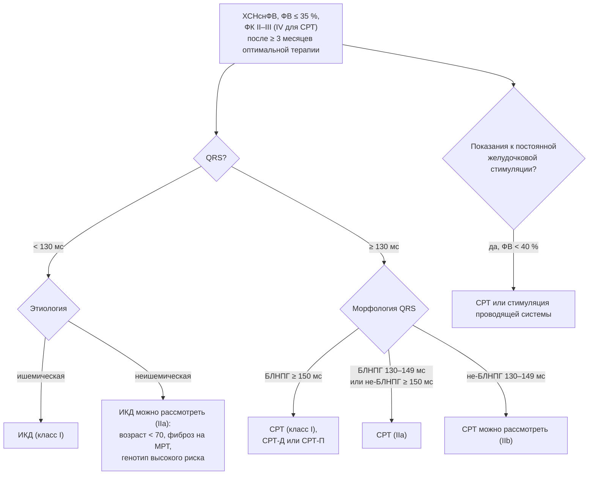

## 21. Имплантируемые устройства, интервенционное и хирургическое лечение

### 21.1. Имплантируемый кардиовертер-дефибриллятор

#### 21.1.1. Вторичная профилактика

ИКД рекомендован (класс I) пациентам, пережившим остановку кровообращения или гемодинамически значимую желудочковую тахикардию вне обратимой причины и первых 48 часов инфаркта, при ожидаемой продолжительности жизни с хорошим функциональным статусом более года (AVID, CIDS, CASH).

#### 21.1.2. Первичная профилактика

При ишемической кардиомиопатии с ФВ ≤ 35 % и ФК II–III, сохраняющимися после ≥ 3 месяцев оптимальной терапии, ИКД снижает смертность (MADIT-II, SCD-HeFT; класс I); имплантация не ранее 40 дней после инфаркта и 90 дней после реваскуляризации (DINAMIT, IRIS — ранняя имплантация без пользы). При неишемической кардиомиопатии после **DANISH** (2016; снижение внезапной смерти без влияния на общую смертность, польза у пациентов моложе 70 лет) класс рекомендации — IIa, с индивидуальной оценкой риска (фиброз на МРТ, генотип — ламинопатии, FLNC, DSP, синкопе). ИКД не показан при ФК IV без перспективы СРТ, трансплантации или LVAD. Носимый дефибриллятор (жилет) можно рассмотреть в период ожидания решения (VEST — нейтрально по первичной точке; IIb). Подкожный ИКД — альтернатива при отсутствии потребности в стимуляции и антитахикардитической терапии. Современная базисная терапия снизила частоту внезапной смерти, что оживило дискуссию о показаниях к ИКД (п. 28.9; исследование PROFID).

### 21.2. Сердечная ресинхронизирующая терапия

СРТ (бивентрикулярная стимуляция) устраняет механическую диссинхронию при нарушении внутрижелудочкового проведения, улучшая ФВ, симптомы и выживаемость (COMPANION, CARE-HF, MADIT-CRT, RAFT). Показания при синусовом ритме, ФВ ≤ 35 %, ФК II–IV на оптимальной терапии: блокада левой ножки с QRS ≥ 150 мс — класс I; блокада левой ножки с QRS 130–149 мс — IIa; морфология не блокады левой ножки с QRS ≥ 150 мс — IIa; 130–149 мс — IIb; QRS < 130 мс — противопоказана (EchoCRT — вред). При ФП СРТ показана при ФВ ≤ 35 %, QRS ≥ 130 мс и обеспечении почти 100 % бивентрикулярной стимуляции (при необходимости — абляция АВ-узла). При показаниях к постоянной желудочковой стимуляции и ФВ < 40 % предпочтительна СРТ (BLOCK-HF); при развитии дисфункции ЛЖ на фоне стимуляции ПЖ выполняют «апгрейд» (BUDAPEST-CRT). Выбор СРТ-Д или СРТ-П определяется показаниями к дефибрилляции, возрастом и коморбидностью. Предикторы ответа: блокада левой ножки, широкий QRS, женский пол, неишемическая этиология; около 30 % пациентов — «неответчики». Алгоритм выбора устройства показан на рис. 24, показания — в табл. 40.

**Рис. 24.** Алгоритм выбора имплантируемого устройства при ХСНснФВ. Схема читается сверху вниз: после подтверждения сохранения ФВ ≤ 35 % на оптимальной терапии ширина и морфология QRS определяют выбор между ИКД и СРТ, а потребность в стимуляции — показание к СРТ независимо от QRS.

**Табл. 40.** Основные показания к ИКД и СРТ (ESC 2021/2023, РКО 2024).

| Ситуация | Устройство | Класс |
|---|---|---|
| Перенесённая остановка кровообращения/устойчивая ЖТ без обратимой причины | ИКД | I |
| Ишемическая КМП, ФВ ≤ 35 %, ФК II–III, ≥ 3 мес терапии, ≥ 40 дней после ИМ | ИКД | I |
| Неишемическая КМП, ФВ ≤ 35 %, ФК II–III | ИКД | IIa |
| Синусовый ритм, ФВ ≤ 35 %, БЛНПГ, QRS ≥ 150 мс | СРТ | I |
| Синусовый ритм, ФВ ≤ 35 %, БЛНПГ 130–149 мс или не-БЛНПГ ≥ 150 мс | СРТ | IIa |
| Не-БЛНПГ 130–149 мс | СРТ | IIb |
| QRS < 130 мс | СРТ | III (вред) |
| ФП, ФВ ≤ 35 %, QRS ≥ 130 мс, обеспечение бивентрикулярной стимуляции | СРТ | IIa |
| Показания к стимуляции при АВ-блокаде и ФВ < 40 % | СРТ | I |
| «Апгрейд» при дисфункции ЛЖ на фоне стимуляции ПЖ | СРТ | IIa |

### 21.3. Стимуляция проводящей системы сердца

Стимуляция пучка Гиса и области левой ножки (LBBAP) обеспечивает физиологическую активацию желудочков и рассматривается как альтернатива СРТ при неудаче имплантации коронарного синусового электрода и при показаниях к стимуляции с риском индуцированной кардиомиопатии; рандомизированные сравнения с бивентрикулярной стимуляцией (LBBP-RESYNC, малые исследования) показали сопоставимое или большее улучшение ФВ, крупные исследования исходов продолжаются (класс IIb). Брадиаритмии при ХСН лечатся по общим показаниям с предпочтением систем, минимизирующих стимуляцию ПЖ.

### 21.4. Катетерная абляция

Абляция ФП при ХСНснФВ улучшает исходы (CASTLE-AF; п. 19.4); абляция желудочковой тахикардии показана при рецидивирующих устойчивых ЖТ и частых разрядах ИКД, не контролируемых антиаритмиками (VANISH — абляция превосходила эскалацию антиаритмиков), и при «электрическом шторме»; абляция частой желудочковой экстрасистолии восстанавливает ФВ при экстрасистолической кардиомиопатии (п. 18.4). Абляция АВ-узла с СРТ — вариант при неконтролируемой ФП (APAF-CRT: снижение смертности у пациентов с узким QRS и постоянной ФП).

### 21.5. Транскатетерные клапанные вмешательства

**Транскатетерная пластика митрального клапана «край-в-край» (TEER)** при вторичной МР показана пациентам, соответствующим критериям COAPT (тяжёлая МР — эффективная площадь регургитации ≥ 30 мм²; ФВ 20–50 %; КСР ЛЖ ≤ 70 мм; ФК II–IV на оптимальной терапии и СРТ при показаниях; отсутствие тяжёлой ЛГ и дисфункции ПЖ): в COAPT (2018) снижались госпитализации (на 47 %) и смертность (на 38 %), тогда как в MITRA-FR с менее строгим отбором (меньшая регургитация при более дилатированном желудочке — «пропорциональная» МР) эффекта не было. ESC 2026 усилили рекомендации по TEER. **TAVI** при аортальном стенозе с дисфункцией ЛЖ выполняется в приоритетном порядке. **Транскатетерные вмешательства на трикуспидальном клапане** (TRILUMINATE, 2023) улучшают качество жизни при тяжёлой ТР.

### 21.6. Реваскуляризация и кардиохирургия

АКШ при многососудистом поражении и ФВ ≤ 35 % снижает смертность за 10 лет (STICHES) и рекомендовано (IIa–I в зависимости от анатомии и симптомов) при приемлемом хирургическом риске; ЧКВ — альтернатива при непригодности к операции и для симптоматического лечения (REVIVED-BCIS2 — без влияния на прогноз). Хирургическая реконструкция ЛЖ не улучшала исходов в STICH и выполняется лишь при больших аневризмах с тромбозом или аритмиями. Хирургия митрального клапана при вторичной МР изолированно не рекомендуется; при сочетании с АКШ — пластика при тяжёлой МР. Миэктомия при ГКМП, перикардэктомия при констрикции, коррекция врождённых пороков — этиотропные операции (раздел 18).

### 21.7. Имплантируемые системы мониторинга гемодинамики и другие устройства

**Мониторинг давления в лёгочной артерии** (CardioMEMS) позволяет корректировать терапию по давлению до появления симптомов: в CHAMPION (2011) госпитализации снизились на 37 %, в GUIDE-HF общий результат был нейтральным (с влиянием пандемии), в MONITOR-HF (2023) улучшились качество жизни и снизились госпитализации; в ESC — класс IIb при ФК III и недавней госпитализации. **Модуляция сердечной сократимости** (CCM; FIX-HF-5C) улучшает переносимость нагрузки при ФВ 25–45 % и узком QRS (IIb). **Активация барорефлекса** (BeAT-HF) улучшает симптомы и НУП (IIb). **Межпредсердные шунты** при ХСНсФВ не улучшили исходов в REDUCE LAP-HF II (возможная польза в подгруппе без латентной ЛГ) и остаются исследовательскими. **Стимуляция диафрагмального нерва** применяется при центральном апноэ. Сводка приведена в табл. 41.

**Табл. 41.** Устройства и вмешательства при ХСН: доказательная база и статус.

| Вмешательство | Ключевые исследования | Эффект | Статус |
|---|---|---|---|
| ИКД | MADIT-II, SCD-HeFT, DANISH | Снижение внезапной смерти; общей смертности — при ишемической КМП | I / IIa |
| СРТ | CARE-HF, COMPANION, MADIT-CRT, RAFT | Снижение смертности и госпитализаций, обратное ремоделирование | I–IIb по QRS |
| Абляция ФП | CASTLE-AF, CASTLE-HTx | Снижение смертности/госпитализаций | I/IIa |
| TEER при вторичной МР | COAPT (положительно), MITRA-FR (нейтрально) | Снижение госпитализаций и смертности при строгом отборе | I/IIa (усилено в ESC 2026) |
| АКШ при ишемической КМП | STICH/STICHES | Снижение смертности за 10 лет | I/IIa |
| ЧКВ при ишемической КМП | REVIVED-BCIS2 | Без влияния на исходы | Симптоматически |
| Мониторинг давления в ЛА | CHAMPION, GUIDE-HF, MONITOR-HF | Снижение госпитализаций (не во всех исследованиях) | IIb |
| Модуляция сократимости | FIX-HF-5, FIX-HF-5C | Улучшение переносимости нагрузки | IIb |
| Барорефлекторная активация | BeAT-HF | Улучшение симптомов, качества жизни | IIb |
| Межпредсердный шунт | REDUCE LAP-HF II | Нейтрально | Исследования |
| Стимуляция проводящей системы | LBBP-RESYNC, регистры | Сопоставимо с СРТ по ФВ | IIb; исследования исходов |

### 21.8. Примеры и иллюстрации

#### 21.8.1. Пример выбора устройства

Женщина 64 лет с неишемической ДКМП, ФВ 27 % после 4 месяцев четырёхкомпонентной терапии, ФК III, синусовый ритм, блокада левой ножки с QRS 162 мс, МРТ — срединно-стеночный фиброз. Решение: СРТ-Д (класс I для СРТ; дефибриллятор обоснован фиброзом и возрастом < 70 лет). Через 6 месяцев: ФВ 42 %, ФК II — «ответчик».

#### 21.8.2. Пример транскатетерного лечения клапана

Мужчина 71 года с ишемической КМП, ФВ 32 %, тяжёлой вторичной МР (эффективная площадь регургитации 40 мм², КСР ЛЖ 58 мм), ФК III на оптимальной терапии и СРТ, две госпитализации за год: соответствует критериям COAPT — выполнена TEER с уменьшением МР до лёгкой, ФК II, госпитализаций в течение года нет.

> 💡 **Интересный факт:** противоположные результаты COAPT и MITRA-FR, опубликованные в 2018 году с интервалом в несколько недель, породили концепцию «пропорциональной и непропорциональной митральной регургитации» (Grayburn, Packer): польза вмешательства ожидаема, когда тяжесть регургитации непропорционально велика относительно объёма ЛЖ (как в COAPT), и отсутствует, когда регургитация — лишь следствие дилатации желудочка (как в MITRA-FR), — редкий случай, когда расхождение двух исследований привело к появлению нового патофизиологического понятия.

> ❗ **Типичная ошибка:** имплантировать ИКД или СРТ сразу после установления диагноза ХСНснФВ, не дождавшись эффекта 3 месяцев оптимальной терапии, либо, напротив, годами откладывать решение у пациента, у которого ФВ остаётся ≤ 35 % при широкой блокаде левой ножки. У значительной части пациентов ФВ улучшается на терапии, что устраняет показания; при сохранении показаний отсрочка увеличивает риск внезапной смерти и упускает окно для обратного ремоделирования при СРТ.

> 🔬 **Углубление:** исследование DANISH (1 116 пациентов с неишемической ХСНснФВ, 58 % с СРТ) не выявило снижения общей смертности при ИКД (HR 0,87; p = 0,28) при снижении внезапной смерти вдвое; эффект зависел от возраста — у пациентов моложе 70 лет смертность снижалась, у более старших нет, поскольку конкурирующие некардиальные причины смерти уменьшали потенциальную пользу. Долгосрочное наблюдение (медиана 9,5 года) подтвердило эти результаты. В сочетании со снижением частоты внезапной смерти на фоне современной терапии (с ≈ 2,5 % в год в 1990-е до ≈ 1 % при четырёхкомпонентной терапии) это обосновывает индивидуализированный отбор на ИКД с учётом МРТ-фиброза, генетики и конкурирующих рисков, который проверяется в исследовании PROFID.

> 📝 **Обобщение.** Устройства и вмешательства применяются поверх оптимальной медикаментозной терапии после переоценки ФВ через ≥ 3 месяца: ИКД — для вторичной профилактики и первичной при ФВ ≤ 35 % (класс I при ишемической, IIa при неишемической КМП); СРТ — при ФВ ≤ 35 % и QRS ≥ 130 мс с максимальной пользой при блокаде левой ножки ≥ 150 мс и при показаниях к стимуляции; абляция ФП и ЖТ, TEER при непропорциональной вторичной МР (критерии COAPT), АКШ при многососудистой ИБС; мониторинг давления в лёгочной артерии, модуляция сократимости и барорефлекторная активация — дополнительные опции с ограниченными доказательствами. Главный вывод: правильный отбор пациентов определяет пользу устройств не меньше, чем сама технология.

> ❓ **Контрольные вопросы**
>
> 1. Сформулируйте показания к ИКД для первичной профилактики и объясните влияние исследования DANISH на рекомендации при неишемической КМП.
> 2. Как ширина и морфология QRS определяют класс рекомендации СРТ?
> 3. Перечислите критерии отбора на TEER по COAPT и объясните различие результатов COAPT и MITRA-FR.
> 4. Какие доказательства поддерживают АКШ, а какие ставят под сомнение ЧКВ при ишемической кардиомиопатии?
> 5. Какие устройства с классом IIb существуют для ХСН и каков механизм действия каждого?
