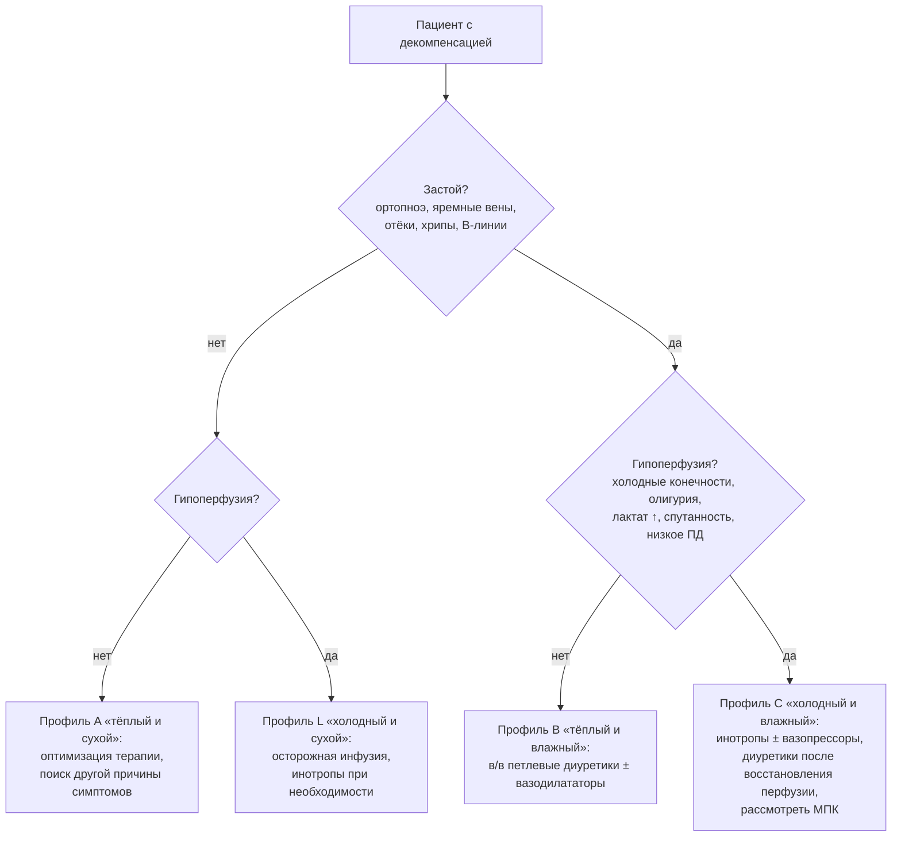
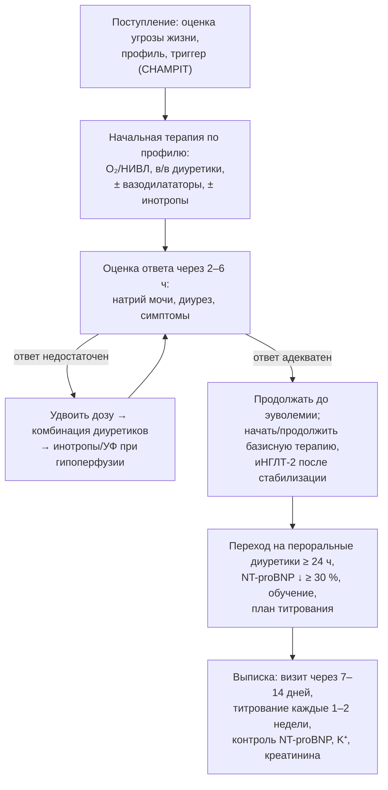

## 22. Декомпенсация ХСН: диагностика и лечение

### 22.1. Терминология и клинические формы

> 📌 **Определение:** **острая декомпенсация ХСН (ОДХСН; в ESC 2026 — декомпенсированная сердечная недостаточность, ДСН)** — быстрое (часы–дни) или постепенное (недели) нарастание симптомов и признаков ХСН, требующее неотложной помощи, госпитализации или внутривенной терапии.

Выделяют впервые возникшую (де ново) острую СН и декомпенсацию хронической (70–80 % госпитализаций); по клинической картине — четыре формы: собственно декомпенсированная ХСН (постепенное нарастание застоя), острый отёк лёгких (быстрое развитие, часто при гипертензии и ХСНсФВ), изолированная правожелудочковая недостаточность и кардиогенный шок. Госпитальная летальность составляет 4–10 %, летальность в течение года после госпитализации — 20–30 %.

### 22.2. Триггеры и их устранение

Поиск триггера (п. 4.4, табл. 5) ведётся параллельно с лечением: острый коронарный синдром, гипертонический криз, аритмии (ФП с высокой частотой, ЖТ, брадиаритмии), механические причины (разрыв хорды, папиллярной мышцы, дисфункция протеза), ТЭЛА, инфекции, тампонада (мнемоника CHAMPIT), а также неприверженность, соль, НПВП, анемия, тиреотоксикоз, почечная недостаточность. Устранение триггера — часть лечения (реваскуляризация при ОКС, кардиоверсия при нестабильности, антибиотики при инфекции).

### 22.3. Оценка при поступлении

Последовательность: (1) оценка угрозы жизни — дыхательная недостаточность (SpO₂, частота дыхания, участие вспомогательных мышц), гипоперфузия/шок (АД, лактат, конечности, сознание, диурез), жизнеугрожающие аритмии; (2) клинический профиль по застою и перфузии (рис. 25); (3) подтверждение диагноза и триггера — ЭКГ, НУП (при остром начале NT-proBNP < 300 / BNP < 100 пг/мл делают диагноз маловероятным), тропонин, креатинин, электролиты, печёночные тесты, газы крови и лактат при тяжести, ТТГ, ферритин; рентгенография или УЗИ лёгких; ЭхоКГ — немедленно при нестабильности и подозрении на механическую причину, в остальных случаях в первые 48 часов.

**Рис. 25.** Гемодинамические профили при декомпенсации и стартовая тактика. Схема читается сверху вниз: последовательная оценка застоя и перфузии относит пациента к одному из четырёх профилей, каждому из которых соответствует своя начальная терапия.

### 22.4. Начальная терапия

#### 22.4.1. Кислород и респираторная поддержка

Кислород показан при SpO₂ < 90 % (гипероксия вредна); неинвазивная вентиляция (CPAP или BiPAP) — при дыхательной недостаточности с частотой дыхания > 25 в минуту и SpO₂ < 90 %, особенно при отёке лёгких (снижает потребность в интубации); интубация — при неэффективности и нарушении сознания. Положение сидя облегчает дыхание.

#### 22.4.2. Диуретики

Внутривенные петлевые диуретики — основа лечения застоя: стартовая доза — 20–40 мг фуросемида в/в у не получавших диуретики и не менее 1–2 суточных пероральных доз (в/в эквивалент) у получающих; болюсы и непрерывная инфузия эквивалентны (DOSE); через 2 и 6 часов оценивают ответ (натрий мочи > 50–70 ммоль/л, диурез > 100–150 мл/ч) и при недостаточном ответе удваивают дозу, затем добавляют второй диуретик (ацетазоламид — ADVOR, тиазид — CLOROTIC; п. 15.5.2). Целевой темп снижения веса — 0,5–1,5 кг/сут при условии стабильной гемодинамики; продолжают до эуволемии, после чего переходят на пероральный приём. Основные препараты и дозы приведены в табл. 42.

#### 22.4.3. Вазодилататоры

Нитроглицерин (в/в инфузия 10–200 мкг/мин) или изосорбида динитрат уменьшают пред- и постнагрузку и быстро облегчают симптомы при систолическом АД > 110 мм рт. ст., особенно при гипертоническом отёке лёгких; влияние на исходы не доказано (GALACTIC), противопоказаны при гипотонии, тяжёлом аортальном стенозе и после ингибиторов ФДЭ-5. Нитропруссид — при гипертензии с тяжёлой МР под инвазивным контролем.

#### 22.4.4. Инотропы и вазопрессоры

Показаны только при гипоперфузии (профили C и L), поскольку увеличивают потребление кислорода и аритмии: добутамин (2–20 мкг/кг/мин), левосимендан (0,05–0,2 мкг/кг/мин; предпочтителен на фоне бета-адреноблокаторов, вызывает гипотонию), милринон (0,375–0,75 мкг/кг/мин; ингибитор ФДЭ-3, не зависит от β-рецепторов; осторожно при ишемической КМП — OPTIME-CHF). Норадреналин — вазопрессор выбора при шоке (превосходит дофамин — SOAP II). Инотропы — «мост» к устранению причины, стабилизации или механической поддержке, не рутинная терапия (п. 25.7).

#### 22.4.5. Другие меры

Опиоиды рутинно не рекомендуются (угнетение дыхания, тошнота, возможное увеличение смертности); профилактика венозных тромбоэмболий — всем госпитализированным; базисная терапия продолжается (отмена или снижение — лишь при шоке, тяжёлой гипотонии, гиперкалиемии, остром повреждении почек), а иНГЛТ-2 можно начинать после стабилизации (EMPULSE — улучшение клинических исходов при старте в стационаре); контроль калия и магния; лечение триггера; ограничение натрия и жидкости при гипонатриемии; дигоксин — для контроля частоты при ФП.

**Табл. 42.** Основные препараты при декомпенсации ХСН.

| Препарат | Доза | Показание | Примечания |
|---|---|---|---|
| Фуросемид в/в | 20–40 мг болюс (или ≥ суточной пероральной дозы); далее по ответу; инфузия 5–40 мг/ч | Застой | Оценка натрия мочи через 2 ч и диуреза через 6 ч |
| Торасемид в/в | 10–20 мг и более | Застой | Эквивалент: 10 мг ≈ 20–40 мг фуросемида в/в [⚠️ Требуется верификация: точное соотношение для в/в форм] |
| Ацетазоламид в/в | 500 мг 1 раз в сутки до 3 дней | Недостаточный ответ на петлевой диуретик | ADVOR; контроль бикарбоната |
| Гидрохлоротиазид | 25–50 мг внутрь | Резистентность | Контроль калия, натрия |
| Нитроглицерин в/в | 10–20 мкг/мин, титрация до 200 мкг/мин | Застой при САД > 110 мм рт. ст., отёк лёгких | Головная боль, тахифилаксия |
| Добутамин | 2–20 мкг/кг/мин | Гипоперфузия | Тахикардия, аритмии; ослаблен на фоне β-АБ |
| Левосимендан | 0,05–0,2 мкг/кг/мин (24 ч), болюс обычно не вводят | Гипоперфузия, особенно на β-АБ | Гипотония; эффект до 7–10 дней |
| Милринон | 0,375–0,75 мкг/кг/мин | Гипоперфузия, ЛГ | Гипотония, аритмии; снижать дозу при ХБП |
| Норадреналин | 0,05–1 мкг/кг/мин | Кардиогенный шок | Вазопрессор выбора |
| Морфин | 2–4 мг в/в | Рефрактерная одышка, боль, паллиативно | Рутинно не рекомендован |

### 22.5. Кардиогенный шок

> 📌 **Определение:** **кардиогенный шок** — состояние критической гипоперфузии органов вследствие первичной дисфункции сердца: систолическое АД < 90 мм рт. ст. (или потребность в вазопрессорах) при адекватном объёме в сочетании с клиническими (холодные конечности, олигурия < 30 мл/ч, спутанность) и лабораторными (лактат > 2 ммоль/л) признаками гипоперфузии.

Тяжесть стадируют по SCAI (A — риск, B — начальная гипотония без гипоперфузии, C — классический шок, D — ухудшение на терапии, E — рефрактерный). Ведение: немедленная реваскуляризация инфаркт-связанной артерии при ОКС (без рутинного многососудистого ЧКВ — CULPRIT-SHOCK); норадреналин для поддержания перфузионного давления, добутамин/левосимендан для выброса; инвазивный мониторинг (артериальная линия, при неясности — катетеризация лёгочной артерии); механическая поддержка кровообращения по решению «шоковой команды»: внутриаортальная баллонная контрпульсация не улучшает выживаемость при инфаркте (IABP-SHOCK II), микроаксиальный насос Impella снизил смертность при шоке на фоне инфаркта с подъёмом ST (DanGer Shock, 2024) ценой осложнений, вено-артериальная ЭКМО при рутинном применении не улучшала исходы (ECLS-SHOCK), но остаётся опцией при рефрактерном шоке и остановке кровообращения как «мост» к решению. Ранняя оценка кандидатуры на долгосрочную поддержку и трансплантацию обязательна (раздел 25).

### 22.6. Ультрафильтрация и экстракорпоральные методы

Изолированная ультрафильтрация удаляет изотоническую жидкость без нейрогормональной активации, но в CARRESS-HF (2012) при кардиоренальном синдроме уступала ступенчатой фармакотерапии по функции почек при равном снижении веса и давала больше осложнений; в AVOID-HF (досрочно остановлено) отмечалась тенденция к меньшему числу повторных госпитализаций. Применяется при истинной рефрактерности к диуретикам, при неотложной необходимости удаления объёма (анурия, тяжёлая гиперкалиемия, уремия) и у диализных пациентов.

### 22.7. Критерии стабилизации, выписка и уязвимый период

Пациент готов к выписке при: достижении эуволемии (нет ортопноэ, яремное давление в норме, вес стабилен) и стабильной гемодинамике на пероральных диуретиках не менее 24 часов; начатой базисной терапии (все переносимые классы в стартовых дозах); снижении NT-proBNP ≥ 30 % от поступления (как ориентир); стабильной функции почек и калии; обучении пациента и семьи; назначенном визите через 7–14 дней (рис. 26). Период 1–3 месяца после выписки («уязвимый») требует интенсивного титрования и наблюдения (STRONG-HF; п. 12.2.3, 24.3). Сохраняющийся при выписке застой («остаточный застой») — главный предиктор повторной госпитализации.

**Рис. 26.** Алгоритм ведения пациента с декомпенсацией ХСН от поступления до выписки. Схема читается сверху вниз: ранняя оценка ответа на диуретик определяет эскалацию терапии, а выписка допускается только при достижении эуволемии и организованном раннем наблюдении.

### 22.8. Примеры и иллюстрации

#### 22.8.1. Пример «тёплого и влажного» профиля

Пациентка 74 лет с ХСНсФВ и ФП поступает с ортопноэ, отёками, АД 165/95, SpO₂ 91 %, NT-proBNP 4 800 пг/мл: кислород, фуросемид 80 мг в/в (дома принимала 40 мг внутрь), нитроглицерин в/в, контроль частоты ФП бисопрололом; натрий мочи через 2 часа — 95 ммоль/л, диурез 1,2 л за 6 часов; на 3-й день — эуволемия, перевод на торасемид 10 мг, начат эмпаглифлозин, визит через 10 дней.

#### 22.8.2. Пример кардиогенного шока

Мужчина 58 лет с передним ИМ с подъёмом ST, АД 80/50, лактат 4,5 ммоль/л, холодные конечности, олигурия (SCAI C): норадреналин, экстренное ЧКВ инфаркт-связанной артерии, добутамин, решение шоковой команды об имплантации микроаксиального насоса при отсутствии улучшения; после стабилизации — поэтапное начало базисной терапии и оценка ФВ через 40 дней.

> 💡 **Интересный факт:** исследование DOSE (2011) — одно из немногих рандомизированных исследований диуретиков — не выявило различий между болюсным и инфузионным введением фуросемида и между низкой и высокой дозой по глобальной оценке симптомов и функции почек, однако высокие дозы давали большее облегчение одышки и снижение веса при транзиторном повышении креатинина, что легло в основу рекомендации стартовать с дозы не ниже домашней пероральной.

> ❗ **Типичная ошибка:** отменять при декомпенсации всю базисную терапию «до стабилизации». Отмена бета-адреноблокаторов у пациентов без шока и гипоперфузии ассоциирована с повышением смертности (B-CONVINCED, регистры), а неназначение базисных классов до выписки — с их отсутствием и через год; при декомпенсации без гипотонии и гипоперфузии базисная терапия продолжается, а иНГЛТ-2 начинается в стационаре.

> 🔬 **Углубление:** исследование DanGer Shock (2024; 355 пациентов с инфарктом с подъёмом ST и кардиогенным шоком) стало первым, показавшим снижение 180-дневной смертности при механической поддержке микроаксиальным насосом (45,8 против 58,5 %) — ценой удвоения частоты тяжёлых кровотечений, ишемии конечностей и заместительной почечной терапии. Строгие критерии включения (исключены пациенты после остановки кровообращения с комой и с механическими осложнениями) ограничивают обобщение, а нейтральные результаты ECLS-SHOCK для ЭКМО подчёркивают, что выбор устройства, сроки и отбор пациентов важнее самого факта поддержки; концепция «шоковой команды» с протоколом ранней эскалации и оценкой по SCAI стала стандартом организации помощи.

> 📝 **Обобщение.** Декомпенсация ХСН требует последовательности: оценка угрозы жизни → профиль по застою и перфузии → поиск и устранение триггера (CHAMPIT) → терапия по профилю (кислород/НИВЛ, внутривенные петлевые диуретики с ранней оценкой натрийуретического ответа и эскалацией, вазодилататоры при гипертензии, инотропы и вазопрессоры только при гипоперфузии) → продолжение и начало базисной терапии → выписка при эуволемии с ранним визитом и быстрым титрованием. Кардиогенный шок ведётся шоковой командой с реваскуляризацией при ОКС и избирательным применением механической поддержки. Главный вывод: госпитализация — не только лечение эпизода, но и возможность перестроить долгосрочную терапию.

> ❓ **Контрольные вопросы**
>
> 1. Расшифруйте мнемонику CHAMPIT и укажите, какие триггеры требуют немедленного специфического лечения.
> 2. Как выбрать стартовую дозу внутривенного диуретика и по каким критериям оценить ответ через 2 и 6 часов?
> 3. При каких профилях показаны вазодилататоры, а при каких — инотропы, и почему инотропы не применяются рутинно?
> 4. Дайте определение кардиогенного шока, назовите стадии SCAI и сопоставьте результаты IABP-SHOCK II, DanGer Shock и ECLS-SHOCK.
> 5. Сформулируйте критерии готовности к выписке и план ведения в уязвимый период.
