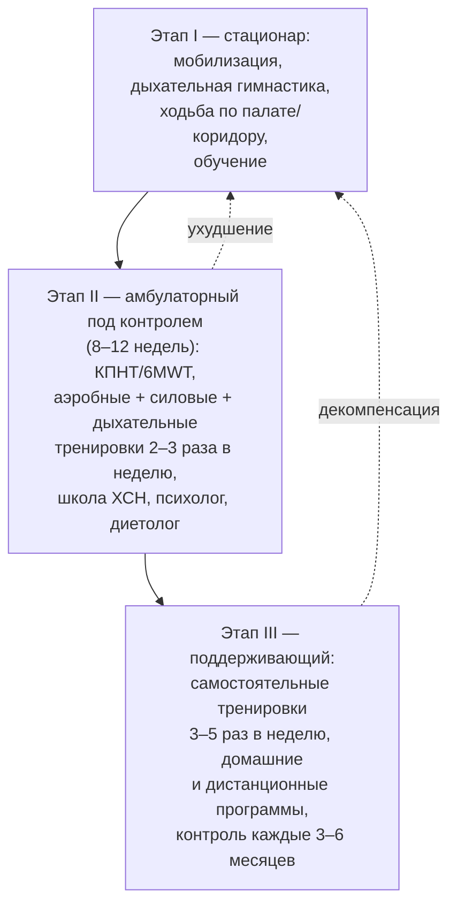

## 23. Реабилитация при ХСН

### 23.1. Определение, компоненты и цели

> 📌 **Определение:** **кардиореабилитация при ХСН** — комплексная мультидисциплинарная программа, включающая дозированные физические тренировки, обучение, психологическую поддержку, коррекцию факторов риска и питания, направленная на восстановление и поддержание функционального состояния, качества жизни и социальной активности пациента, а также на снижение частоты госпитализаций.

Физические тренировки — её ядро, но изолированные тренировки без обучения и коррекции терапии менее эффективны, чем комплексная программа. Цели: повышение переносимости нагрузки (пиковое VO₂, дистанция 6-минутной ходьбы), уменьшение симптомов, депрессии и тревоги, улучшение приверженности, возвращение к труду и социальной жизни.

### 23.2. Доказательная база

Тренировки при ХСНснФВ снижали риск госпитализаций и улучшали качество жизни в HF-ACTION (п. 13.3), метаанализ ExTraMATCH II и Кокрановский обзор (2019, более 5 000 пациентов) подтвердили снижение госпитализаций и улучшение качества жизни при любой ФВ без увеличения риска; при ХСНсФВ тренировки улучшают пиковое VO₂ и диастолическую функцию (Ex-DHF). Исследование **REHAB-HF** (2021) показало, что ранняя индивидуализированная программа физической реабилитации у пожилых пациентов, госпитализированных с декомпенсацией (средний возраст 73 года, высокая доля астении), значимо улучшает физическую функцию (шкала SPPB) и качество жизни, не увеличивая осложнений. Механизмы пользы — периферические (мышечная, эндотелиальная, вентиляционная адаптация), снижение симпатического тонуса и воспаления, частично — улучшение функции сердца (п. 5.5.7).

### 23.3. Показания и противопоказания

Реабилитация показана всем пациентам со стабильной ХСН любой ФВ и ФК I–III (при ФК IV — индивидуальные программы низкой интенсивности), после декомпенсации (начиная со стационарного этапа), после имплантации устройств, кардиохирургических вмешательств, LVAD и трансплантации. Абсолютные противопоказания к тренировкам: прогрессирующее ухудшение в последние 3–5 дней, нестабильная стенокардия, неконтролируемые аритмии, активный миокардит, тяжёлый аортальный стеноз, внутрисердечный тромб с риском эмболии, острые заболевания; относительные: прибавка веса > 1,8 кг за 1–3 дня, инотропная поддержка, тяжёлая ЛГ, сложные желудочковые аритмии при нагрузке.

### 23.4. Структура программы

Программа строится по принципу FITT (частота, интенсивность, время, тип) с индивидуальным подбором по результатам КПНТ или теста 6-минутной ходьбы (табл. 43; рис. 27). Аэробные тренировки умеренной интенсивности (40–60 % резерва VO₂ или ЧСС, 11–14 баллов по шкале Борга) — основа; высокоинтенсивные интервальные протоколы эффективны у отобранных пациентов (SMARTEX-HF — сопоставимо с умеренными); силовые тренировки (40–60 % одного максимального повторения, 10–15 повторений) предотвращают саркопению; тренировка дыхательных мышц (30 % максимального инспираторного давления) полезна при их слабости. Этапы: I — стационарный (мобилизация, дыхательные упражнения, ходьба), II — ранний амбулаторный под контролем (8–12 недель, 2–3 занятия в неделю), III — длительный самостоятельный с периодическим контролем.

**Табл. 43.** Параметры физических тренировок при ХСН (принцип FITT).

| Параметр | Аэробные тренировки | Силовые тренировки | Дыхательные тренировки |
|---|---|---|---|
| Частота | 3–5 раз в неделю | 2–3 раза в неделю | Ежедневно |
| Интенсивность | 40–60 % резерва VO₂/ЧСС (начало — 40 %), Борг 11–14; интервальные — до 85–95 % у отобранных | 30–40 % → 50–60 % одного максимального повторения | 30 % максимального инспираторного давления |
| Длительность | 10–15 мин → 30–45 мин (плюс разминка и заминка) | 1–3 подхода по 10–15 повторений, 8–10 групп мышц | 20–30 мин |
| Тип | Ходьба, велоэргометр, тредмил, плавание (при компенсации) | Эспандеры, тренажёры, собственный вес | Дыхательный тренажёр |
| Прогрессия | Сначала длительность, затем частота, затем интенсивность | Постепенное увеличение сопротивления | По переносимости |

**Рис. 27.** Этапы программы кардиореабилитации при ХСН. Схема читается сверху вниз: от стационарной мобилизации через контролируемый амбулаторный этап к длительным самостоятельным тренировкам; при ухудшении пациент возвращается на предыдущий этап.

### 23.5. Особые формы и организация

Домашние и дистанционные (телереабилитация) программы с носимыми датчиками сопоставимы по эффективности с центровыми у стабильных пациентов и повышают охват, который в большинстве стран не превышает 10–20 % нуждающихся. У пациентов со старческой астенией программа начинается с тренировки равновесия, силы и мобильности (REHAB-HF), у пациентов с LVAD и после трансплантации — по специальным протоколам. В России реабилитация организована в три этапа (стационарный, стационарный/дневной стационар реабилитационного отделения, амбулаторный) в системе ОМС; пациенты с ХСН включены в профиль «кардиореабилитация», однако доступность программ неравномерна.

### 23.6. Примеры и иллюстрации

#### 23.6.1. Пример программы

Мужчина 59 лет с ХСНснФВ (ФВ 33 %), ФК II после 3 месяцев терапии; КПНТ: VO₂ peak 15 мл/кг/мин, ЧСС на анаэробном пороге 105. Программа: велоэргометр 3 раза в неделю с ЧСС 95–110 (Борг 12–13) по 30 минут 12 недель, силовые упражнения 2 раза в неделю, дыхательный тренажёр ежедневно; через 12 недель VO₂ peak 18,5 мл/кг/мин, KCCQ +14 баллов; переход на самостоятельные тренировки с контролем через 3 месяца.

#### 23.6.2. Пример реабилитации пожилого пациента

Женщина 81 года после госпитализации с декомпенсацией ХСНсФВ, астения (SPPB 5 баллов): программа начата в стационаре с упражнений на равновесие и силу ног, продолжена дома с визитами инструктора; через 3 месяца SPPB 8 баллов, самостоятельная ходьба без опоры, повторных госпитализаций нет.

> 💡 **Интересный факт:** до 1980-х годов пациентам с сердечной недостаточностью предписывался постельный режим и запрет нагрузок; первые контролируемые исследования тренировок при ХСН (Sullivan и соавт., 1988; Coats и соавт., 1990) показали прирост пикового потребления кислорода на 20–25 % преимущественно за счёт периферических механизмов при неизменной функции сердца, что радикально изменило представления о роли мышц в формировании симптомов.

> ❗ **Типичная ошибка:** откладывать реабилитацию до «полного восстановления» и ограничивать пожилых пациентов постельным режимом в стационаре. Исследование REHAB-HF показало безопасность и пользу ранней мобилизации даже у пациентов с выраженной астенией; длительная иммобилизация ведёт к быстрой потере мышечной массы и функциональной зависимости.

> 🔬 **Углубление:** центральный парадокс тренировок при ХСН — их эффективность при минимальном влиянии на ФВ — объясняется эргорефлексом: метаболические рецепторы скелетных мышц (группа III/IV афферентов) при накоплении продуктов анаэробного метаболизма усиливают вентиляцию и симпатический тонус; детренированная мышца с низкой окислительной способностью активирует рефлекс при малых нагрузках, формируя одышку и утомляемость. Тренировки повышают плотность митохондрий и капилляров, долю медленных волокон и снижают активность эргорефлекса, что уменьшает наклон VE/VCO₂ и симпатическую активность; этим же объясняется польза локальных тренировок малых мышечных групп у пациентов с крайне низким резервом.

> 📝 **Обобщение.** Реабилитация — доказанный компонент лечения ХСН при любой ФВ: комплексная программа с аэробными, силовыми и дыхательными тренировками, обучением и психологической поддержкой повышает переносимость нагрузки и качество жизни и снижает госпитализации (HF-ACTION, ExTraMATCH II, REHAB-HF). Она начинается в стационаре, продолжается под контролем 8–12 недель и переходит в пожизненные самостоятельные тренировки; противопоказания ограничены нестабильными состояниями. Главный вывод: движение — лекарство, которое недодозируется чаще всего.

> ❓ **Контрольные вопросы**
>
> 1. Какие компоненты, помимо физических тренировок, входят в программу кардиореабилитации при ХСН?
> 2. Что показали исследования HF-ACTION и REHAB-HF?
> 3. Перечислите абсолютные противопоказания к физическим тренировкам при ХСН.
> 4. Опишите параметры FITT для аэробных тренировок у пациента с ФК II.
> 5. Почему тренировки улучшают симптомы при минимальном изменении ФВ?
