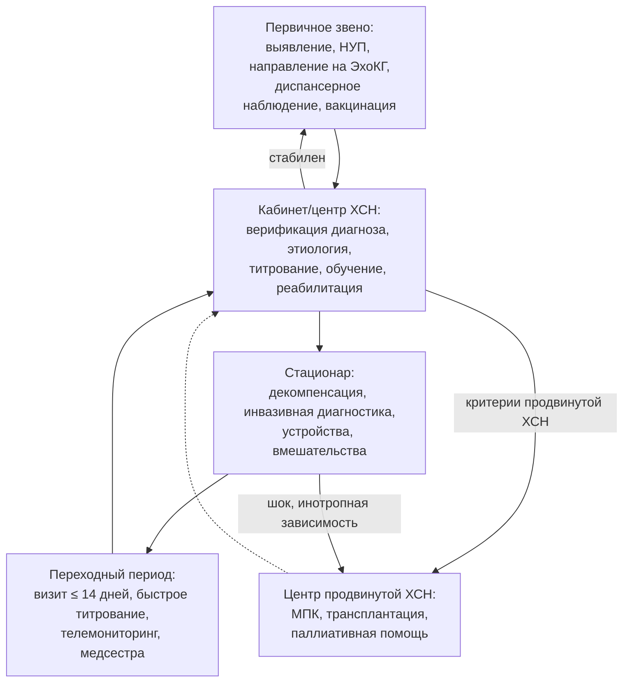

## 24. Длительное наблюдение и организация помощи

### 24.1. Принципы длительного наблюдения

ХСН — хроническое заболевание с переменным течением, поэтому наблюдение должно быть непрерывным, структурированным и многоуровневым. Задачи: контроль симптомов и объёмного статуса, титрование и поддержание базисной терапии, мониторинг безопасности (калий, креатинин, АД, ЧСС), своевременное выявление ухудшения и показаний к устройствам или продвинутым методам, лечение коморбидности, поддержание приверженности и самоконтроля, оценка потребности в реабилитации и паллиативной помощи. Частота визитов: в фазе титрования — каждые 1–2 недели; у стабильных пациентов — каждые 3–6 месяцев (при ФК III–IV чаще); после госпитализации — визит в течение 7–14 дней.

### 24.2. Содержание планового визита

Стандартный визит включает: оценку симптомов (ФК, ШОКС), массы тела, АД (включая ортостатическое), ЧСС и ритма, признаков застоя, дневника самоконтроля и приверженности; сверку назначений и доз с целевыми; лабораторный контроль (калий, натрий, креатинин/рСКФ — не реже 1 раза в 6 месяцев у стабильных, чаще при изменении терапии; общий анализ крови, ферритин и насыщение трансферрина ежегодно; NT-proBNP при ухудшении или для стратификации); ЭКГ ежегодно и при изменениях; ЭхоКГ через 3–6 месяцев после начала терапии, при ухудшении, перед решением об устройствах и затем по показаниям (рутинно каждые 1–2 года); опрос устройства; обновление плана самоконтроля, вакцинацию, оценку депрессии, когнитивных функций и социальной поддержки; обсуждение целей помощи (табл. 44).

**Табл. 44.** Ориентировочный график мониторинга при стабильной ХСН.

| Параметр | Частота |
|---|---|
| Клинический осмотр, вес, АД, ЧСС, ФК, ШОКС | Каждые 3–6 месяцев; каждые 1–2 недели при титровании; через 7–14 дней после выписки |
| Калий, натрий, креатинин/рСКФ | Через 1–2 недели после изменения доз иРААС/АМКР/диуретиков; далее каждые 4–6 месяцев |
| Общий анализ крови, ферритин, насыщение трансферрина, ТТГ, печёночные тесты, HbA1c, UACR | Ежегодно (чаще по показаниям) |
| NT-proBNP | При выписке, через 1–3 месяца, при ухудшении, для стратификации риска |
| ЭКГ | Ежегодно; при изменении симптомов, сердцебиениях, перед назначением препаратов, влияющих на проводимость |
| ЭхоКГ | Через 3–6 месяцев после оптимизации терапии; при ухудшении; перед решением об устройствах; при улучшенной ФВ — ежегодно |
| Опрос ИКД/СРТ | Каждые 3–6 месяцев, удалённый мониторинг |
| Оценка депрессии, когнитивных функций, астении | Ежегодно и при подозрении |
| Пересмотр листа назначений, вакцинация, обучение | Каждый визит; вакцинация против гриппа ежегодно |

### 24.3. Переходный период после госпитализации

Первые 30–90 дней после выписки — период максимального риска повторной госпитализации и смерти (п. 10.1.2). Эффективные элементы переходной помощи: визит или телефонный контакт в первую неделю, визит к кардиологу/в кабинет ХСН в течение 14 дней, сверка лекарств при выписке и на визите, быстрое титрование базисной терапии (STRONG-HF), обеспечение препаратами до первого визита, письменный план и обучение, участие медицинской сестры и телемониторинг. В программах переходной помощи частота повторных госпитализаций снижается на 20–30 %.

### 24.4. Мультидисциплинарные программы и специализированные структуры

Мультидисциплинарные программы ведения ХСН (специализированные клиники/кабинеты ХСН с кардиологом и обученной медсестрой, патронаж на дому, программы для первичного звена) снижают смертность и госпитализации на 20–30 % по данным метаанализов и рекомендованы с классом I. Трёхуровневая модель: первичное звено (терапевт/врач общей практики — выявление, базовое ведение, диспансеризация), специализированный уровень (кабинеты и центры ХСН, стационары с отделениями кардиологии — диагностика, оптимизация терапии, устройства), экспертный уровень (центры продвинутой ХСН — МПК, трансплантация). Маршрут пациента показан на рис. 28. В России с 2018–2020 годов в ряде регионов развёрнута сеть кабинетов и центров ХСН («бесшовная» модель Нижегородской области и др.), а ведение ХСН включено в федеральный проект по борьбе с сердечно-сосудистыми заболеваниями; пациенты с ХСН подлежат диспансерному наблюдению по приказам Минздрава России.

**Рис. 28.** Маршрут пациента с ХСН между уровнями медицинской помощи. Схема читается сверху вниз: первичное звено выявляет и наблюдает, специализированный кабинет оптимизирует терапию, стационар лечит декомпенсации, а экспертный центр принимает пациентов с продвинутой ХСН; переходный период после госпитализации организуется отдельно.

### 24.5. Телемониторинг и цифровые технологии

Структурированный телефонный контакт и неинвазивный телемониторинг (вес, АД, ЧСС, симптомы, сатурация) снижают смертность и госпитализации по данным метаанализов (Кокрановский обзор 2015) и исследования TIM-HF2 (2018; снижение дней, потерянных из-за госпитализаций и смерти), хотя не все исследования положительны (Tele-HF, BEAT-HF); эффективность зависит от наличия команды, реагирующей на сигналы. Удалённый мониторинг имплантированных устройств (импеданс, активность, аритмии; алгоритм HeartLogic, TriageHF) и имплантируемые датчики давления в лёгочной артерии (п. 21.7) дополняют систему. Мобильные приложения, напоминания, электронные дневники и алгоритмы искусственного интеллекта для прогнозирования декомпенсации изучаются (п. 28.26).

### 24.6. Экспертиза трудоспособности и социальные аспекты

Трудоспособность определяется ФК, этиологией, характером труда: при ФК I–II возможна работа без тяжёлых физических нагрузок, ночных смен и экстремальных условий; при ФК III — существенные ограничения; ФК IV — нетрудоспособность. Пациенты с ХСН могут быть направлены на медико-социальную экспертизу для установления инвалидности в соответствии с действующими критериями (п. 29.21); водителям с ИКД и синкопе устанавливаются ограничения. Социальная поддержка, доступность препаратов (льготное обеспечение) и обучение ухаживающих входят в план ведения.

### 24.7. Примеры и иллюстрации

#### 24.7.1. Пример организации наблюдения после выписки

Пациент выписан после декомпенсации на четырёх базисных классах в стартовых дозах: звонок медсестры на 3-й день (вес, симптомы, приём препаратов), визит в кабинет ХСН на 10-й день (титрование, калий, креатинин, NT-proBNP), далее визиты каждые 2 недели до 8-й недели, затем каждые 3 месяца; подключён телемониторинг веса и АД; через 3 месяца — ЭхоКГ и решение об устройствах.

#### 24.7.2. Пример выявления ухудшения при наблюдении

На плановом визите у стабильной пациентки отмечены прибавка 2,5 кг, снижение дистанции ходьбы и рост NT-proBNP с 600 до 1 500 пг/мл при отсутствии жалоб: усилена диуретическая терапия, проверена приверженность (пропускала АМКР из-за гинекомастии — переведена на эплеренон), выявлен приём НПВП; через 2 недели вес и NT-proBNP вернулись к исходным.

> 💡 **Интересный факт:** первое рандомизированное исследование специализированной клиники ХСН (Cline и соавт., Швеция, 1998) и метаанализ McAlister и соавт. (2004) показали, что организационные вмешательства — обученная медсестра, структурированное наблюдение и обучение — снижают госпитализации на четверть и смертность примерно на 20 %, то есть не уступают по величине эффекта многим лекарственным классам; тем не менее доступ к таким программам в большинстве стран остаётся ограниченным.

> ❗ **Типичная ошибка:** назначать первый амбулаторный визит после выписки через 1–3 месяца «по графику диспансеризации». Уязвимый период — первые недели, когда титрование и выявление остаточного застоя максимально влияют на исход; визит в течение 7–14 дней и контакт в первую неделю — стандарт качества.

> 🔬 **Углубление:** исследование TIM-HF2 (1 571 пациент, Германия) показало пользу телемониторинга при условии круглосуточного телемедицинского центра, принимающего решения по данным ежедневных измерений (вес, АД, ЭКГ, сатурация, самочувствие): доля дней, потерянных из-за незапланированных госпитализаций и смерти, снизилась с 6,6 до 4,9 %, а общая смертность — с 11,3 до 7,9 %. Напротив, в Tele-HF (США) пациенты лишь передавали данные по телефону без структурированного реагирования, и эффекта не было. Урок: технология мониторинга бесполезна без организационного контура ответных действий; тот же принцип подтверждён для имплантируемых датчиков давления (CHAMPION против GUIDE-HF).

> 📝 **Обобщение.** Длительное наблюдение при ХСН — структурированный процесс: визиты каждые 1–2 недели при титровании и каждые 3–6 месяцев при стабильности, лабораторный и инструментальный мониторинг по графику, обязательный визит в течение 14 дней после выписки с быстрым титрованием, мультидисциплинарные программы и кабинеты ХСН (снижение смертности и госпитализаций на 20–30 %), трёхуровневый маршрут с центрами продвинутой ХСН, телемониторинг с командой реагирования и социальная поддержка. Главный вывод: организация помощи — самостоятельное лечебное вмешательство с доказанной эффективностью.

> ❓ **Контрольные вопросы**
>
> 1. Какова рекомендуемая частота визитов при титровании, у стабильных пациентов и после выписки?
> 2. Какие лабораторные и инструментальные исследования и с какой периодичностью входят в наблюдение пациента с ХСН?
> 3. Перечислите элементы эффективной переходной помощи после госпитализации.
> 4. Опишите трёхуровневый маршрут пациента с ХСН и функции каждого уровня.
> 5. Почему результаты исследований телемониторинга противоречивы и от чего зависит его эффективность?
