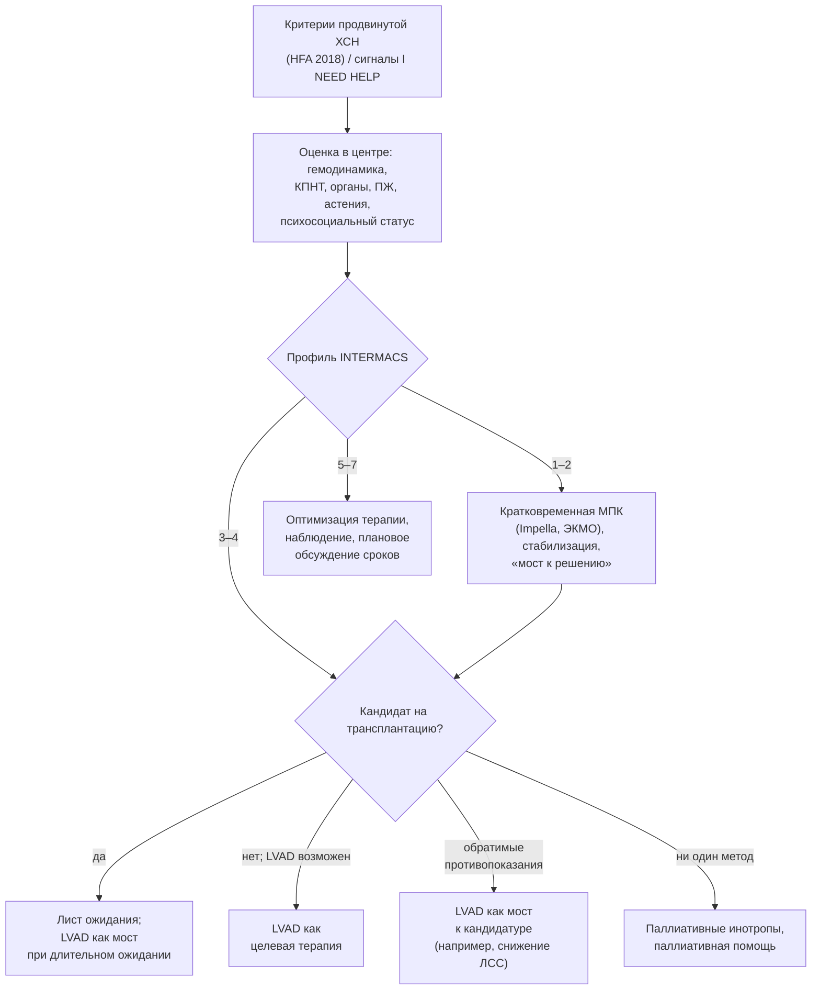

## 25. Продвинутая (терминальная) ХСН: механическая поддержка и трансплантация

### 25.1. Определение и критерии

Критерии продвинутой ХСН (HFA/ESC 2018; п. 2.1.7) требуют одновременного наличия, несмотря на оптимальную терапию: (1) тяжёлых стойких симптомов (ФК III–IV); (2) тяжёлой дисфункции сердца — ФВ ≤ 30 %, изолированной недостаточности ПЖ, неоперабельного тяжёлого порока, стойко высоких НУП или тяжёлой диастолической дисфункции при сохранённой ФВ; (3) эпизодов застоя, требовавших внутривенных диуретиков, или низкого выброса, требовавшего инотропов/вазопрессоров, или злокачественных аритмий — более одного незапланированного визита/госпитализации за 12 месяцев; (4) тяжёлого снижения переносимости нагрузки (6MWT < 300 м или VO₂ peak < 12–14 мл/кг/мин) кардиального генеза. Это соответствует стадии D (ACC/AHA) и стадии 2 по РКО 2023. Распространённость — 1–10 % всех пациентов с ХСН, годовая смертность без продвинутых методов — 25–75 % в зависимости от профиля.

### 25.2. Своевременное направление в специализированный центр

Главная проблема — позднее направление, когда необратимая органная дисфункция, кахексия и фиксированная ЛГ исключают радикальные методы. Мнемоника **I NEED HELP** (табл. 45) перечисляет сигналы для направления: даже одного-двух достаточно для консультации центра продвинутой ХСН.

**Табл. 45.** Сигналы для направления в центр продвинутой ХСН (мнемоника I NEED HELP).

| Буква | Признак |
|---|---|
| I — Inotropes | Потребность в инотропах (в прошлом или постоянная) |
| N — NYHA/NP | ФК IIIb–IV или стойко высокие натрийуретические пептиды |
| E — End-organ dysfunction | Дисфункция органов: нарастание креатинина, печёночные нарушения |
| E — Ejection fraction | ФВ ≤ 20–25 % |
| D — Defibrillator shocks | Повторные разряды ИКД |
| H — Hospitalizations | Более одной госпитализации за 12 месяцев |
| E — Edema/escalating diuretics | Застой несмотря на возрастающие дозы диуретиков |
| L — Low blood pressure | Систолическое АД < 90 мм рт. ст., высокая ЧСС |
| P — Prognostic medication | Непереносимость или необходимость снижения доз базисной терапии |

### 25.3. Профили INTERMACS

Профили INTERMACS (Interagency Registry for Mechanically Assisted Circulatory Support) описывают тяжесть продвинутой ХСН и определяют срочность механической поддержки (табл. 46): профили 1–2 требуют немедленных мер (кратковременная МПК), профили 3–4 — плановой имплантации долговременного устройства или трансплантации, профили 5–7 — наблюдения и обсуждения сроков.

**Табл. 46.** Профили INTERMACS.

| Профиль | Описание | Ориентировочная срочность |
|---|---|---|
| 1 | «Критический кардиогенный шок»: жизнеугрожающая гипотония несмотря на нарастающие дозы инотропов, гипоперфузия | Часы |
| 2 | «Прогрессирующее ухудшение» на инотропах: нарастание дисфункции органов | Дни |
| 3 | «Стабилен, но зависим от инотропов» | Недели |
| 4 | «Частые декомпенсации» в покое или при минимальной активности на пероральной терапии | Недели–месяцы |
| 5 | «Непереносимость нагрузки»: комфортно в покое, симптомы при любой активности | Переменная |
| 6 | «Ограничение при нагрузке»: симптомы после нескольких минут активности | Переменная |
| 7 | «Продвинутый ФК III»: клинически стабилен, ограничения при умеренной нагрузке | Наблюдение |

### 25.4. Оценка кандидата и выбор стратегии

Оценка в центре включает: инвазивную гемодинамику (давление заклинивания, сердечный индекс, лёгочное сосудистое сопротивление и его обратимость), КПНТ, функцию органов (почки, печень — MELD-XI), функцию ПЖ, питание и астению, коморбидность (онкология, диабет с осложнениями, сосудистая патология), психосоциальный статус и приверженность, инфекции, аллоиммунизацию. Решение принимает мультидисциплинарный консилиум. Варианты: трансплантация сердца; долговременная МПК как «мост к трансплантации» (BTT), «мост к кандидатуре» (BTC — устранение обратимых противопоказаний, например ЛГ) или «целевая терапия» (DT) при противопоказаниях к трансплантации; паллиативная инотропная поддержка; паллиативная помощь (рис. 29).

**Рис. 29.** Маршрутизация пациента с продвинутой ХСН. Схема читается сверху вниз: после подтверждения критериев и оценки в центре профиль INTERMACS определяет срочность, а кандидатура на трансплантацию и LVAD — стратегию.

### 25.5. Трансплантация сердца

Трансплантация — метод выбора при продвинутой ХСН у пациентов без противопоказаний: медиана выживаемости после трансплантации превышает 12 лет, годичная выживаемость — около 85–90 % (регистр ISHLT). Показания: рефрактерная ХСН с VO₂ peak ≤ 12 мл/кг/мин (на бета-адреноблокаторе) или ≤ 14 (без), инотропная зависимость, рефрактерные аритмии, рефрактерная стенокардия без возможности реваскуляризации. Противопоказания: фиксированная ЛГ (лёгочное сосудистое сопротивление > 4–5 ед. Вуда или транспульмональный градиент > 15 мм рт. ст., не снижающиеся при вазодилататорах), активная инфекция, злокачественное новообразование с недостаточным сроком ремиссии, тяжёлая необратимая дисфункция почек, печени или лёгких, тяжёлое поражение периферических и мозговых сосудов, ИМТ > 35 кг/м², активная зависимость от алкоголя и наркотиков, неприверженность и отсутствие социальной поддержки, тяжёлые психические расстройства, возраст старше 70 лет (относительно). После трансплантации: пожизненная иммуносупрессия (такролимус, микофенолат, глюкокортикоиды с последующей отменой; ингибиторы mTOR по показаниям), мониторинг отторжения (биопсии, свободная донорская ДНК), профилактика инфекций, контроль васкулопатии трансплантата, почечной функции, онкологического риска. В России трансплантации сердца выполняются в нескольких центрах, большинство — в НМИЦ трансплантологии и искусственных органов им. ак. В. И. Шумакова [⚠️ Требуется верификация: актуальное число трансплантаций в год].

### 25.6. Механическая поддержка кровообращения

#### 25.6.1. Кратковременная поддержка

Внутриаортальная баллонная контрпульсация, микроаксиальные насосы (Impella), вено-артериальная ЭКМО и экстракорпоральные центрифужные насосы используются при кардиогенном шоке и профилях INTERMACS 1–2 как «мост к восстановлению», «к решению», «к мосту» (к долговременному устройству) или «к трансплантации» (п. 22.5); продолжительность — дни–недели.

#### 25.6.2. Долговременная поддержка левого желудочка (LVAD)

Современные центрифужные насосы с магнитной левитацией ротора (HeartMate 3) обеспечивают двухлетнюю выживаемость около 80 % (MOMENTUM 3: выживаемость без инвалидизирующего инсульта и реоперации 77 % против 65 % при HeartMate II) и пятилетнюю — около 60 %, что сопоставимо с трансплантацией в первые годы. Показания: продвинутая ХСНснФВ (INTERMACS 2–4, реже 5–6) с ФВ ≤ 25 %, VO₂ peak < 12 мл/кг/мин или инотропной зависимостью, при отсутствии тяжёлой дисфункции ПЖ, необратимой органной недостаточности, активной инфекции, невозможности антикоагуляции, тяжёлых психосоциальных ограничений. Осложнения: кровотечения (включая желудочно-кишечные из-за ангиодисплазий и приобретённого синдрома Виллебранда), инфекции драйвлайна, инсульт, правожелудочковая недостаточность, тромбоз насоса (редок при HeartMate 3), аортальная регургитация, аритмии. Полностью искусственное сердце применяется при бивентрикулярной недостаточности как мост к трансплантации. В России имеется опыт имплантации зарубежных систем и отечественного устройства «Спутник»; доступность ограничена. Устройства для ПЖ и полностью имплантируемые системы без драйвлайна разрабатываются (п. 27.8).

### 25.7. Инотропная поддержка в продвинутой стадии

Непрерывная домашняя инфузия добутамина или милринона применяется как мост к трансплантации/LVAD или паллиативно у пациентов, не являющихся кандидатами: она улучшает симптомы, но увеличивает смертность и аритмии (FIRST — милринон), поэтому требует информированного согласия и обсуждения целей. Интермиттирующий левосимендан (LION-HEART, LevoRep, LAICA) уменьшает НУП, улучшает качество жизни и, по некоторым данным, снижает госпитализации; в ESC — класс IIb, в РКО 2024 можно рассмотреть при продвинутой ХСН.

### 25.8. Особые проблемы: правожелудочковая недостаточность, кахексия, аритмии

Дисфункция ПЖ — главный предиктор неудачи LVAD и смертности после трансплантации; оценивается по ЭхоКГ (TAPSE, деформация), гемодинамике (давление в правом предсердии > 15 мм рт. ст., индекс пульсативности лёгочной артерии < 1,5–2), печёночным и почечным тестам. Кахексия и саркопения ухудшают исходы любого вмешательства и требуют преабилитации (нутритивной поддержки, тренировок). Рецидивирующие ЖТ и «электрический шторм» требуют абляции, седации, блокады звёздчатого узла, иногда МПК.

### 25.9. Лёгочная гипертензия и трансплантация

Фиксированная прекапиллярная ЛГ повышает риск острой правожелудочковой недостаточности донорского сердца; её обратимость проверяют вазодилататорами (нитропруссид, милринон, оксид азота) и, при неэффективности, разгрузкой ЛЖ с помощью LVAD в течение 3–6 месяцев («мост к кандидатуре»), после чего ЛСС у большинства пациентов снижается до приемлемого уровня.

### 25.10. Примеры и иллюстрации

#### 25.10.1. Пример своевременного направления

Мужчина 54 лет с ДКМП, ФВ 20 %, ФК IIIb, три госпитализации за год, непереносимость АРНИ из-за гипотонии (САД 85–90), креатинин 150 мкмоль/л, два разряда ИКД — пять сигналов I NEED HELP. Направлен в центр: VO₂ peak 10,5 мл/кг/мин, ЛСС 3,2 ед. Вуда, INTERMACS 4; включён в лист ожидания трансплантации, через 7 месяцев успешно трансплантирован.

#### 25.10.2. Пример LVAD как целевой терапии

Женщина 69 лет с ишемической КМП, ФВ 18 %, инотропная зависимость (INTERMACS 3), сахарный диабет с нефропатией (рСКФ 38) — не кандидат на трансплантацию; функция ПЖ сохранна, поддержка семьи есть. Имплантирован HeartMate 3; через 1 год — ФК II, самостоятельная активность, одно желудочно-кишечное кровотечение, скорректированное снижением интенсивности антикоагуляции.

> 💡 **Интересный факт:** первую в мире трансплантацию сердца выполнил К. Барнард в Кейптауне 3 декабря 1967 года; первую успешную трансплантацию в СССР — В. И. Шумаков 12 марта 1987 года. Выживаемость в 1960–1970-е годы измерялась неделями, а современный рекорд продолжительности жизни с пересаженным сердцем превышает 35 лет; переломным стало внедрение циклоспорина в начале 1980-х годов.

> ❗ **Типичная ошибка:** направлять пациента в центр продвинутой ХСН только после развития кахексии, рефрактерной ЛГ или полиорганной недостаточности, когда ни трансплантация, ни LVAD уже невозможны. Направление показано при появлении первых сигналов I NEED HELP; консультация центра не означает немедленного вмешательства, но позволяет спланировать его своевременно.

> 🔬 **Углубление:** концепция «моста к восстановлению» (bridge to recovery) основана на наблюдениях обратного ремоделирования при длительной механической разгрузке: у части пациентов с неишемической КМП (по данным программ Harefield и RESTAGE-HF — до 40 % отобранных пациентов при агрессивной медикаментозной терапии на фоне LVAD) функция ЛЖ восстанавливается настолько, что устройство удаётся эксплантировать; молекулярно это сопровождается нормализацией кальциевого цикла, геометрии кардиомиоцитов и частично — внеклеточного матрикса, однако фиброз сохраняется, и рецидивы нередки. Этот феномен подтверждает обратимость ХСН на клеточном уровне даже в терминальной стадии и стимулирует поиск фармакологических «имитаторов разгрузки».

> 📝 **Обобщение.** Продвинутая ХСН определяется критериями HFA 2018 (тяжёлые симптомы, тяжёлая дисфункция, повторные эпизоды застоя/низкого выброса, резко сниженная переносимость нагрузки на оптимальной терапии); сигналы I NEED HELP требуют раннего направления в центр, где профиль INTERMACS определяет срочность, а оценка кандидатуры — стратегию: трансплантация (медиана выживаемости > 12 лет), долговременная LVAD как мост или целевая терапия (двухлетняя выживаемость ≈ 80 % с HeartMate 3), кратковременная МПК при шоке, паллиативные инотропы и паллиативная помощь при невозможности радикальных методов. Главный вывод: исход продвинутой ХСН определяется своевременностью направления.

> ❓ **Контрольные вопросы**
>
> 1. Перечислите четыре критерия продвинутой ХСН по HFA 2018.
> 2. Расшифруйте мнемонику I NEED HELP и объясните её назначение.
> 3. Опишите профили INTERMACS 1–4 и соответствующую срочность вмешательств.
> 4. Назовите показания и основные противопоказания к трансплантации сердца.
> 5. Какие стратегии применения LVAD существуют, каковы их результаты и основные осложнения?
