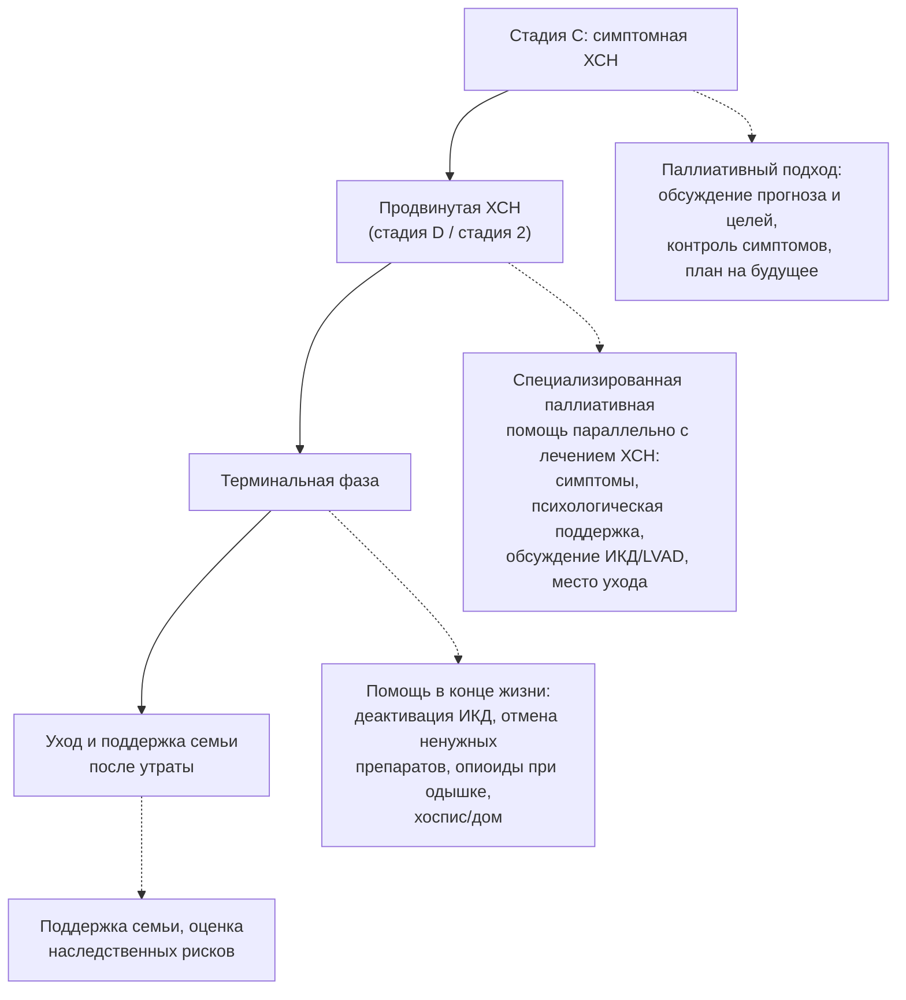

## 26. Паллиативная помощь при ХСН

### 26.1. Определение и принципы

> 📌 **Определение:** **паллиативная помощь при ХСН** — подход, направленный на улучшение качества жизни пациентов и их семей посредством предупреждения и облегчения страданий (физических симптомов, психологических, социальных и духовных проблем) на всех стадиях заболевания, интегрированный с активным лечением ХСН, а не заменяющий его.

Ключевые принципы: ранняя интеграция (с момента установления продвинутой стадии или даже раньше — при тяжёлой симптоматике), параллельность с кардиологическим лечением (диуретики, базисная терапия, устройства продолжаются, пока приносят пользу), ориентация на цели и ценности пациента, вовлечение семьи, мультидисциплинарность (кардиолог, врач паллиативной помощи, медсестра, психолог, социальный работник, духовное сопровождение), преемственность между стационаром, домом и хосписом. Траектория ХСН с её непредсказуемыми ухудшениями и возможностью внезапной смерти отличается от онкологической, поэтому паллиативная помощь при ХСН начинается не «когда лечить уже нечем», а параллельно с лечением (рис. 30).

**Рис. 30.** Интеграция паллиативной помощи в траекторию ХСН. Схема читается сверху вниз: паллиативный подход начинается на симптомной стадии и усиливается по мере прогрессирования, не прерывая кардиологического лечения.

### 26.2. Показания и триггеры для подключения паллиативной помощи

Поводы: продвинутая ХСН у пациента, не являющегося кандидатом на трансплантацию и LVAD; ФК IV с тяжёлыми симптомами несмотря на оптимальную терапию; повторные госпитализации (≥ 2–3 за год); кахексия, зависимость в повседневной активности; инотропная зависимость; частые разряды ИКД; тяжёлая коморбидность (деменция, онкология, терминальная ХБП); отрицательный ответ на «вопрос-сюрприз» («Удивлюсь ли я, если этот пациент умрёт в течение года?»); желание пациента. Инструменты оценки потребностей — шкалы NAT:PD-HF, IPOS; симптомы оцениваются систематически (одышка, боль, утомляемость, депрессия, тревога, бессонница, тошнота, запоры, отёки, когнитивные нарушения).

### 26.3. Контроль симптомов

**Одышка**: оптимизация терапии ХСН и деконгестии остаётся основой до конца жизни; при рефрактерной одышке — низкие дозы опиоидов (морфин 2,5–5 мг внутрь каждые 4 часа или в/в по потребности; доказательства при ХСН ограничены, но соответствуют практике паллиативной медицины), поток воздуха на лицо (вентилятор), положение, дыхательные техники, кислород только при гипоксемии, бензодиазепины при тревоге; паллиативные инотропы — при соответствии целям. **Боль** (у 50–80 % пациентов — суставная, ишемическая, нейропатическая): парацетамол, местные средства, опиоиды в низких дозах; НПВП противопоказаны. **Утомляемость**: коррекция анемии, дефицита железа, депрессии, дозированная активность. **Депрессия и тревога**: психотерапия, СИОЗС, миртазапин (при анорексии и бессоннице). **Тошнота и анорексия**: пересмотр препаратов (дигоксин), застой печени и кишечника, малые порции, прокинетики. **Отёки и асцит**: диуретики продолжаются, парацентез при напряжённом асците; при невозможности перорального приёма — подкожный фуросемид. **Бессонница, зуд, запоры, сухость во рту** — симптоматически. Ненужные препараты (статины, аспирин без показаний, антигипертензивные при гипотонии) отменяются, что улучшает качество жизни.

### 26.4. Планирование помощи и обсуждение устройств

**Заблаговременное планирование помощи** (advance care planning) включает обсуждение прогноза в понятной форме, предпочтений относительно реанимации, госпитализаций, места ухода (дом, хоспис, стационар), назначение доверенного лица и документирование решений с их регулярным пересмотром. **ИКД**: деактивация антитахикардитической функции обсуждается при переходе к помощи в конце жизни (разряды в агональном периоде причиняют страдания и не продлевают жизнь) — предпочтительно обсуждать это ещё при имплантации; функция кардиостимуляции и СРТ, как правило, сохраняется. **LVAD**: отключение устройства по просьбе пациента при терминальном состоянии этически допустимо и требует протокола седации и присутствия команды. Юридические и этические рамки (в России — Федеральный закон № 323-ФЗ, положения о паллиативной медицинской помощи) определяют порядок принятия решений; эвтаназия в России запрещена.

### 26.5. Доказательная база

Исследование **PAL-HF** (2017; 150 пациентов с продвинутой ХСН) показало, что интегрированная паллиативная помощь в дополнение к стандартному ведению улучшает качество жизни (KCCQ, FACIT-Pal), уменьшает тревогу и депрессию и повышает духовное благополучие без влияния на смертность; программы на дому (например, ENABLE CHF-PC) и консультации паллиативных команд в стационаре снижают число госпитализаций и инвазивных вмешательств в конце жизни. Рекомендации ESC и РКО относят паллиативную помощь к обязательным компонентам ведения продвинутой ХСН (класс I/IIa).

### 26.6. Организация и поддержка семьи

Паллиативная помощь оказывается амбулаторно (кабинеты и выездные патронажные службы), в стационарах (отделения паллиативной помощи, хосписы) и на дому; при ХСН предпочтительна модель совместного ведения кардиологом и паллиативной службой с единым планом. Ухаживающие родственники испытывают высокую нагрузку и нуждаются в обучении (симптомы, препараты, подкожные инъекции), психологической поддержке и помощи после утраты; при наследственных кардиомиопатиях после смерти пациента следует обеспечить скрининг родственников.

### 26.7. Примеры и иллюстрации

#### 26.7.1. Пример интеграции паллиативной помощи

Мужчина 79 лет с ишемической КМП, ФВ 20 %, ФК IV, ХБП С4, четыре госпитализации за год, не кандидат на LVAD/трансплантацию. Совместно с паллиативной службой: обсуждены прогноз и цели (остаться дома, избегать реанимации), продолжены торасемид, низкая доза бисопролола и иНГЛТ-2, отменены статин и аспирин, назначен морфин 2,5 мг при одышке, деактивирована шоковая функция ИКД при сохранении СРТ, организован патронаж на дому; пациент умер дома через 5 месяцев без повторных госпитализаций.

#### 26.7.2. Пример обсуждения ИКД

Женщина 72 лет с продвинутой ХСН и терминальной онкологической патологией: после разговора о целях помощи она выбрала деактивацию дефибриллятора, поскольку хотела избежать болезненных разрядов; решение задокументировано и выполнено амбулаторно программатором.

> 💡 **Интересный факт:** по данным исследований в США и Европе, до трети пациентов с ИКД в последние дни жизни получают один или несколько разрядов, часто повторных, при этом разговор о возможности деактивации устройства состоялся лишь с меньшинством из них; включение этого обсуждения в процесс информированного согласия при имплантации стало одной из рекомендаций экспертных обществ по электрофизиологии.

> ❗ **Типичная ошибка:** откладывать разговор о прогнозе и предпочтениях до декомпенсации в реанимации, когда пациент не способен участвовать в решениях, или, напротив, прекращать всю кардиологическую терапию при подключении паллиативной помощи. Диуретики и переносимые базисные препараты облегчают симптомы до конца жизни, а планирование помощи должно происходить в стабильный период.

> 🔬 **Углубление:** прогностическая неопределённость — главное препятствие паллиативной помощи при ХСН: в отличие от онкологии, где функциональное снижение в последние месяцы предсказуемо, при ХСН до 30–50 % смертей наступают внезапно, а эпизоды декомпенсации обратимы. Поэтому современные рекомендации заменяют критерий «ожидаемая продолжительность жизни менее 6–12 месяцев» критерием потребности: оценка симптомов и нужд (IPOS, NAT:PD-HF), «вопрос-сюрприз» и триггерные события (госпитализации, разряды ИКД, отказ от продвинутых методов). Исследования показывают, что параллельная модель («одновременная помощь») не снижает выживаемость и уменьшает число неоправданных вмешательств в конце жизни.

> 📝 **Обобщение.** Паллиативная помощь при ХСН — не альтернатива лечению, а его компонент на всех стадиях, усиливающийся при продвинутой ХСН: систематический контроль одышки (оптимизация терапии, опиоиды в низких дозах), боли, депрессии и других симптомов; заблаговременное планирование помощи с обсуждением реанимации, деактивации ИКД и места ухода; продолжение приносящих облегчение препаратов и отмена ненужных; поддержка семьи. Доказательства (PAL-HF) подтверждают улучшение качества жизни и психологического состояния. Главный вывод: разговор о целях помощи должен состояться раньше, чем он станет невозможным.

> ❓ **Контрольные вопросы**
>
> 1. Чем траектория ХСН отличается от онкологической и как это влияет на сроки подключения паллиативной помощи?
> 2. Перечислите триггеры для направления пациента с ХСН на паллиативную помощь.
> 3. Какие методы применяются при рефрактерной одышке в конце жизни и какие препараты при этом продолжаются?
> 4. Когда и как следует обсуждать деактивацию ИКД?
> 5. Что показало исследование PAL-HF?
