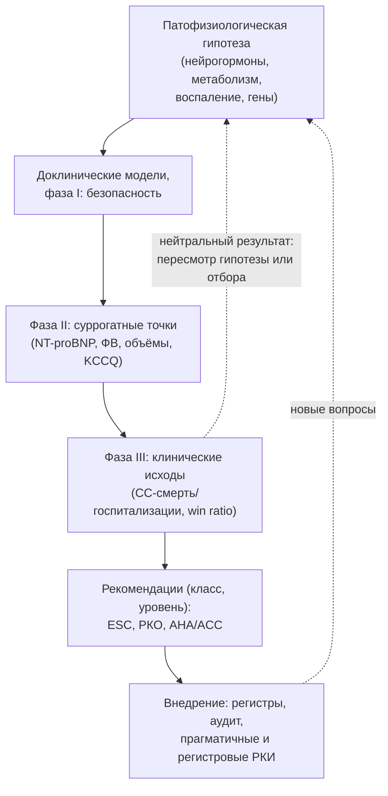

## 27. Доказательная база и направления развития

### 27.1. Эволюция доказательной базы

Лечение ХСН — одна из наиболее доказательных областей медицины: с 1987 года проведено более сотни крупных рандомизированных исследований, последовательно сформировавших четыре базисных класса, устройства, стратегии ведения декомпенсации и, с 2021 года, терапию ХСНсФВ. Эволюцию можно разделить на эры: гемодинамическую (вазодилататоры, инотропы — V-HeFT I, PROMISE), нейрогормональную (иАПФ, бета-адреноблокаторы, АМКР — 1987–2011), эру устройств (ИКД, СРТ — 2002–2009), эру новых классов (АРНИ 2014, иНГЛТ-2 2019–2022) и эру ХСНсФВ и метаболической терапии (2021–2026). Ключевые исследования, упомянутые в лекции, систематизированы в табл. 47 по областям.

**Табл. 47.** Ключевые рандомизированные исследования при ХСН по областям (упрощённо; эффекты приведены ориентировочно).

| Область | Исследования (год) | Главный вывод |
|---|---|---|
| иАПФ/БРА | CONSENSUS (1987), SOLVD (1991), ATLAS (1999), Val-HeFT (2001), CHARM (2003) | Снижение смертности и госпитализаций при ХСНснФВ; БРА — при непереносимости иАПФ |
| АРНИ | PARADIGM-HF (2014), PIONEER-HF (2019), PARAGON-HF (2019), LIFE (2021) | Превосходство над эналаприлом; безопасный старт в стационаре; при ХСНсФВ — граница значимости; при продвинутой ХСН — без преимуществ |
| Бета-адреноблокаторы | CIBIS-II, MERIT-HF (1999), COPERNICUS (2001), COMET (2003), SENIORS (2005) | Снижение смертности на ≈ 34 %; карведилол > метопролол тартрат; небиволол у пожилых |
| АМКР | RALES (1999), EPHESUS (2003), EMPHASIS-HF (2011), TOPCAT (2014), FINEARTS-HF (2024) | Снижение смертности при снФВ; при ФВ ≥ 40 % — финеренон снижает события |
| иНГЛТ-2 | DAPA-HF (2019), EMPEROR-Reduced (2020), SOLOIST-WHF (2021), EMPEROR-Preserved (2021), DELIVER (2022), EMPULSE (2022) | Снижение событий во всём диапазоне ФВ и при старте после декомпенсации |
| Другие препараты | SHIFT (2010), DIG (1997), VICTORIA (2020), A-HeFT (2004), GALACTIC-HF (2021), IRONMAN/AFFIRM-AHF/HEART-FID (2020–2023) | Ивабрадин, дигоксин, верицигуат, гидралазин/нитраты — госпитализации/симптомы; омекамтив мекарбил — небольшой эффект; железо — симптомы и госпитализации |
| ХСНсФВ и ожирение | STEP-HFpEF (2023), SUMMIT (2024) | Семаглутид/тирзепатид улучшают симптомы и снижают события |
| Устройства | MADIT-II (2002), SCD-HeFT (2005), DANISH (2016), CARE-HF (2005), COMPANION (2004), MADIT-CRT (2009), RAFT (2010), EchoCRT (2013) | ИКД снижает внезапную смерть; СРТ — смертность при широком QRS; СРТ при узком QRS вредна |
| Вмешательства | STICH/STICHES (2011/2016), REVIVED-BCIS2 (2022), COAPT (2018), MITRA-FR (2018), CASTLE-AF (2018), TRILUMINATE (2023) | АКШ — польза; ЧКВ — нет; TEER — при строгом отборе; абляция ФП — польза |
| Декомпенсация и шок | DOSE (2011), CARRESS-HF (2012), ADVOR (2022), CLOROTIC (2023), STRONG-HF (2022), IABP-SHOCK II (2012), CULPRIT-SHOCK (2017), ECLS-SHOCK (2023), DanGer Shock (2024) | Стратегии диуретиков, быстрое титрование после выписки, избирательная МПК |
| Немедикаментозные и организационные | HF-ACTION (2009), REHAB-HF (2021), SODIUM-HF (2022), TIM-HF2 (2018), CHAMPION (2011), MONITOR-HF (2023), PAL-HF (2017) | Тренировки, реабилитация, разумное ограничение соли, телемониторинг с реагированием, паллиативная помощь |
| Продвинутая ХСН | REMATCH (2001), MOMENTUM 3 (2017–2019), CASTLE-HTx (2023) | LVAD — выживаемость при терминальной ХСН; HeartMate 3 — меньше тромбозов и инсультов |

### 27.2. Методология исследований при ХСН

Первичные конечные точки эволюционировали от общей смертности (CONSENSUS, SOLVD) к комбинации «сердечно-сосудистая смерть или госпитализация по поводу ХСН», затем — к повторным событиям, расширенным определениям «ухудшения ХСН» (включая внутривенные диуретики амбулаторно) и иерархическим композитным показателям (win ratio), а также к пациент-ориентированным исходам (KCCQ) как самостоятельным точкам. Дизайн-особенности, влияющие на интерпретацию: вводный период (run-in), исключающий непереносимость (PARADIGM-HF); активный контроль (эналаприл) против плацебо поверх стандартной терапии; региональная гетерогенность (TOPCAT); досрочное прекращение (переоценка эффекта); открытые прагматичные и регистровые рандомизированные исследования (TRANSFORM-HF, SPIRRIT-HFpEF, DANHEART), повышающие обобщаемость ценой контроля смещений. Метаанализы индивидуальных данных и сетевые метаанализы позволяют оценить эффекты в подгруппах (ФВ, пол, возраст) и сравнить стратегии; суррогатные маркёры (NT-proBNP, ФВ, объёмы) используются в фазе II и не заменяют клинические исходы (пример — омекамтив мекарбил и оральные инотропы).

### 27.3. Ограничения доказательной базы

Участники исследований моложе (на 10–15 лет), реже женщины (25–30 %), с меньшей коморбидностью и лучшей функцией почек, чем пациенты в практике; пациенты с рСКФ < 30, старческой астенией, деменцией, из стран с низким доходом почти не представлены; ХСНунФВ, ХСН с улучшенной ФВ, правожелудочковая недостаточность, ХСН при врождённых пороках и у детей изучены фрагментарно; длительность наблюдения (2–3 года) не отражает пожизненную терапию. Эффекты, оцениваемые в испытаниях (эффективность), в реальной практике снижаются из-за неполного назначения и дозирования («разрыв внедрения»): по регистрам, все четыре базисных класса получают 20–30 % подходящих пациентов, целевые дозы — существенно меньше.

### 27.4. Уроки нейтральных и отрицательных исследований

Отрицательные исследования сформировали терапию не меньше положительных (табл. 48): они закрыли классы (оральные инотропы, антагонисты эндотелина и TNF, вазопрессина как прогностическая терапия), опровергли догмы (жёсткое ограничение соли, виабилити-ориентированная реваскуляризация, рутинная ультрафильтрация, адаптивная сервовентиляция) и подчеркнули роль отбора пациентов (COAPT против MITRA-FR, DanGer Shock против ECLS-SHOCK).

**Табл. 48.** Избранные нейтральные и отрицательные исследования и их уроки.

| Исследование | Вмешательство | Урок |
|---|---|---|
| PROMISE (1991), PROFILE | Милринон, флосекинан внутрь | Гемодинамическое улучшение ≠ прогноз; инотропы повышают смертность |
| ENABLE, EARTH | Антагонисты эндотелина | Блокада «ещё одной» нейрогормональной системы не всегда полезна |
| RENEWAL, ATTACH | Этанерцепт, инфликсимаб | Антицитокиновая терапия при ХСНснФВ не работает (инфликсимаб вреден) |
| EVEREST (2007) | Толваптан | Коррекция натрия без влияния на смертность |
| ASCEND-HF, TRUE-AHF, RELAX-AHF-2 | Несиритид, уларитид, серелаксин при ОСН | Краткосрочные вазоактивные вмешательства не меняют исходы декомпенсации |
| ASTRONAUT, ATMOSPHERE | Алискирен | Прямые ингибиторы ренина не добавляют пользы, повышают риски |
| PARADISE-MI (2021) | АРНИ после ИМ | Польза АРНИ не распространяется автоматически на все популяции |
| EchoCRT (2013) | СРТ при QRS < 130 мс | Механическая диссинхрония без электрической — не показание; вред |
| CARRESS-HF (2012) | Ультрафильтрация | Не лучше ступенчатой фармакотерапии, больше осложнений |
| SERVE-HF (2015) | Адаптивная сервовентиляция | Устранение центрального апноэ может повысить смертность при ХСНснФВ |
| RED-HF (2013) | Дарбэпоэтин | Коррекция анемии эритропоэтином — тромбозы без пользы |
| IRONOUT-HF (2017) | Пероральное железо | Путь введения имеет значение |
| GUIDE-IT (2017) | Терапия под контролем NT-proBNP | Биомаркер-ориентированная стратегия не превосходит хорошую стандартную |
| Tele-HF (2010), BEAT-HF | Телемониторинг без контура реагирования | Технология без организации не работает |
| SODIUM-HF (2022) | Натрий < 1,5 г | Жёсткое ограничение соли не улучшает исходы |
| STICH (гипотеза 2), REVIVED-BCIS2 | Реконструкция ЛЖ; ЧКВ при ишемической КМП | Анатомическая коррекция без влияния на прогноз |
| TRANSFORM-HF (2023) | Торасемид vs фуросемид | Выбор петлевого диуретика не влияет на смертность |
| DREAM-HF (2021) | Мезенхимальные клетки | Клеточная терапия: первичная точка не достигнута |
| CUPID 2 (2016) | Генная терапия SERCA2a | Доставка и доза гена — нерешённые проблемы |

### 27.5. Направления развития: фармакотерапия

Исследуются и внедряются: нестероидные АМКР (финеренон при ХСНсФВ и, в комбинации с иНГЛТ-2, — балцинренон/дапаглифлозин), ингибиторы альдостеронсинтазы (баксдростат, лороденстат), новые инкретиновые и амилиновые препараты при кардиометаболической ХСНсФВ, активаторы миозина (омекамтив мекарбил — умеренный эффект в GALACTIC-HF; дальнейшие исследования при тяжёлой систолической дисфункции), ингибиторы миозина при ГКМП (мавакамтен, афикамтен), препараты против ATTR-амилоидоза (стабилизаторы, РНК-интерференция, CRISPR-редактирование гена TTR — NTLA-2001 в фазе III, антитела для удаления амилоида), противовоспалительные стратегии (анти-IL-6 зилтивекимаб — HERMES при ХСНсФВ; колхицин), митохондриально-направленные препараты (элямипретид), модуляторы метаболизма и кетоновые эфиры, стимуляторы гуанилатциклазы и новые натрийуретические подходы, антифибротические препараты [⚠️ Требуется верификация: статус перечисленных программ (балцинренон, баксдростат, лороденстат, NTLA-2001, HERMES) по состоянию на 2026 год — часть исследований может быть завершена или прекращена]. Концепция «пятого столпа» обсуждается, однако планка доказательств высока: добавочный эффект оценивается поверх четырёх классов.

### 27.6. Направления развития: устройства, вмешательства и организация

Стимуляция проводящей системы против СРТ (крупные исследования исходов), ИКД с индивидуализированным отбором (PROFID), транскатетерные вмешательства на митральном и трикуспидальном клапанах с расширением показаний и заменой клапанов, межпредсердные шунты у отобранных фенотипов, нейромодуляция (барорефлекс, блуждающий нерв, ренальная денервация — п. 28.17), полностью имплантируемые LVAD без драйвлайна и устройства для ПЖ, ксенотрансплантация генетически модифицированных свиных сердец (первые клинические случаи 2022–2024 годов с выживанием до нескольких недель–месяцев), имплантируемые и носимые сенсоры с алгоритмами раннего предупреждения, цифровые платформы титрования и виртуальные клиники ХСН, модели интегрированной помощи и регистровые рандомизированные исследования для оценки организационных вмешательств.

### 27.7. Генная, РНК- и клеточная терапия

После неудачи CUPID 2 (AAV1/SERCA2a) генная терапия ХСН сосредоточилась на моногенных кардиомиопатиях: редактирование и замещение генов при ламинопатиях, десмосомных (PKP2 — AAV-терапия в фазе I/II), саркомерных (MYBPC3) кардиомиопатиях, болезни Данона (LAMP2), транстиретиновом амилоидозе (CRISPR-Cas9 in vivo), а также на улучшении векторов и целевой доставке. Клеточная терапия (DREAM-HF — нейтральная по первичной точке с сигналом по сердечно-сосудистым событиям) уступает место бесклеточным подходам (экзосомы, микроРНК, стимуляция эндогенной регенерации — факторы пролиферации кардиомиоцитов). Персонализированная медицина опирается на генотипирование, полигенные шкалы риска, протеомные и метаболомные профили и фенотипирование с помощью машинного обучения; клиническая реализация пока ограничена (п. 28.1).

### 27.8. Отечественные исследования и регистры

Российские эпидемиологические программы (ЭПОХА-ХСН, ЭПОХА-О-ХСН, ЭПОХА-Д-ХСН) определили распространённость, структуру и прогноз ХСН в стране (раздел 3); региональные регистры и программы («бесшовная» модель помощи, регистры кабинетов ХСН) оценивают внедрение рекомендаций и организационных моделей; российские центры участвуют в международных рандомизированных исследованиях (PARADIGM-HF, DAPA-HF, EMPEROR, DELIVER и др.). Задачи — национальный регистр ХСН, исследования внедрения, фармакоэкономические оценки для системы льготного обеспечения и отечественные разработки устройств (п. 25.6.2). Общий цикл формирования доказательств показан на рис. 31.

**Рис. 31.** Цикл формирования доказательств при ХСН: от гипотезы до внедрения. Схема читается сверху вниз: суррогатные маркёры фазы II не заменяют исходов фазы III, а внедрение и нейтральные результаты порождают новые гипотезы.

### 27.9. Примеры и иллюстрации

#### 27.9.1. Пример «пути» класса препаратов

иНГЛТ-2: гипотеза о сердечно-сосудистой безопасности сахароснижающих препаратов → неожиданное снижение госпитализаций по поводу ХСН в EMPA-REG OUTCOME (2015) → исследования при ХСНснФВ без диабета (DAPA-HF, 2019; EMPEROR-Reduced, 2020) → при ХСНсФВ (EMPEROR-Preserved, 2021; DELIVER, 2022) → при декомпенсации (EMPULSE, SOLOIST-WHF) → класс I при любой ФВ в ESC 2023 и РКО 2024 — за 7 лет от сигнала до универсальной рекомендации.

#### 27.9.2. Пример влияния отрицательного исследования

После SERVE-HF (2015) адаптивная сервовентиляция, широко применявшаяся при центральном апноэ у пациентов с ХСНснФВ, была противопоказана при ФВ ≤ 45 %: вмешательство, эффективно устранявшее «суррогат» (индекс апноэ-гипопноэ), повышало сердечно-сосудистую смертность — вероятно, из-за устранения компенсаторной роли периодического дыхания или гемодинамических эффектов положительного давления.

> 💡 **Интересный факт:** эффект иНГЛТ-2 при ХСН был обнаружен случайно: исследования EMPA-REG OUTCOME и CANVAS планировались как испытания сердечно-сосудистой безопасности сахароснижающих препаратов по требованию регуляторов после истории с росиглитазоном, а снижение госпитализаций по поводу ХСН на треть стало неожиданной находкой, которая за несколько лет превратила «диабетические» препараты в базисную терапию ХСН независимо от гликемии.

> ❗ **Типичная ошибка:** экстраполировать результаты исследований за пределы изученной популяции — например, назначать верицигуат стабильным пациентам без недавнего ухудшения, применять СРТ при QRS < 130 мс по данным эхокардиографической диссинхронии или ожидать от АРНИ после инфаркта (PARADISE-MI) того же эффекта, что при ХСНснФВ. Класс рекомендации всегда привязан к конкретной популяции и критериям включения.

> 🔬 **Углубление:** иерархический композитный анализ (win ratio, Pocock 2012) сравнивает каждую пару «пациент опытной группы — пациент контрольной» последовательно по важности исходов: сначала смерть, затем госпитализации, затем изменение KCCQ; это позволяет учесть клиническую значимость событий и включить пациент-ориентированные показатели в первичную точку. Метод использован в исследованиях EMPULSE, STEP-HFpEF (вторично) и ряде устройств; его ограничения — зависимость от порядка иерархии и длительности наблюдения, а также трудность перевода win ratio в абсолютную пользу. Параллельно развивается методология «event-based» оценки с учётом повторных госпитализаций (LWYL-анализ, модели повторных событий), что увеличивает статистическую мощность при хронических заболеваниях с множественными эпизодами.

> 📝 **Обобщение.** Доказательная база ХСН сформирована крупными РКИ по классам препаратов (иАПФ/БРА/АРНИ, бета-адреноблокаторы, АМКР, иНГЛТ-2), устройствам (ИКД, СРТ), вмешательствам (АКШ, TEER, абляция ФП), стратегиям декомпенсации и организации помощи; её ограничения — недопредставленность пожилых, женщин, пациентов с ХБП и коморбидностью и «разрыв внедрения». Нейтральные исследования закрывали неэффективные направления и уточняли отбор. Развитие идёт по линиям новых фармакологических мишеней (нестероидные АМКР, ингибиторы альдостеронсинтазы, инкретины, противовоспалительные, митохондриальные препараты, активаторы миозина), генной и РНК-терапии, устройств и цифровых систем, персонализации. Главный вывод: доказательства — динамическая система, требующая от врача постоянного обновления знаний и критического чтения.

> ❓ **Контрольные вопросы**
>
> 1. Опишите эры развития доказательной базы ХСН и назовите по одному ключевому исследованию каждой.
> 2. Какие особенности дизайна (вводный период, активный контроль, региональная гетерогенность) следует учитывать при интерпретации PARADIGM-HF и TOPCAT?
> 3. Назовите пять отрицательных исследований и сформулируйте урок каждого.
> 4. Какие группы пациентов недопредставлены в исследованиях при ХСН и как это влияет на применение рекомендаций?
> 5. Перечислите перспективные направления фармакотерапии и генной терапии ХСН, находящиеся в клинических исследованиях.
