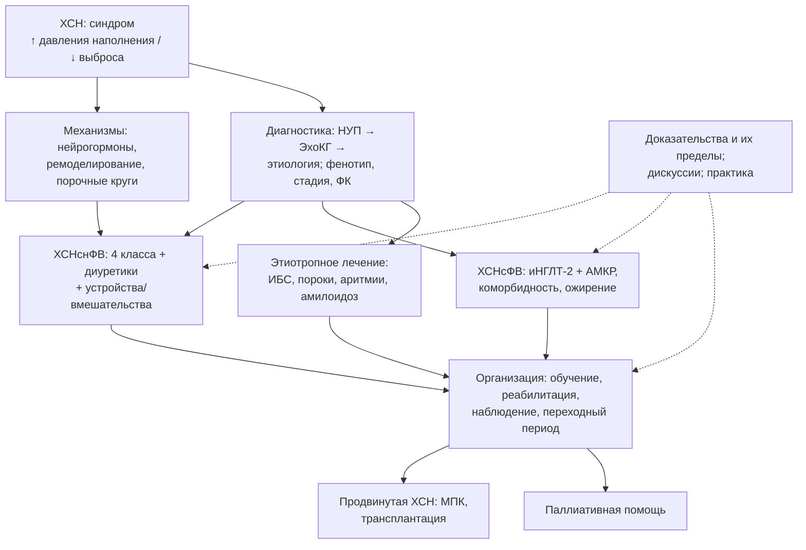

## 30. Заключение

### 30.1. Синтез: ХСН как единая система знаний

Хроническая сердечная недостаточность — клинический синдром, в котором структурное или функциональное поражение сердца приводит к повышению давления наполнения и/или снижению выброса, что проявляется одышкой, утомляемостью и застоем (раздел 2). Она поражает 1–3 % взрослых (в России — около 7–8 % по данным ЭПОХА), возникает преимущественно вследствие ИБС, гипертензии, кардиомиопатий, пороков и диабета (разделы 3–4) и прогрессирует через нейрогормональную активацию, ремоделирование, молекулярно-клеточные и системные порочные круги (раздел 5). Пациент характеризуется по трём осям — ФВ, стадия, функциональный класс (раздел 6), диагноз подтверждается натрийуретическими пептидами и визуализацией с обязательным этиологическим поиском (разделы 7–9), прогноз определяется течением с эпизодами ухудшения и оценивается шкалами и опросниками (раздел 10). Лечение стадийно: профилактика на стадиях A–B (раздел 11), при ХСНснФВ — четыре базисных класса с одновременным стартом и быстрым титрованием, диуретики до эуволемии, дополнительные препараты, устройства и вмешательства (разделы 12–16, 21), при ХСНсФВ — иНГЛТ-2 и АМКР с лечением коморбидности и ожирения (раздел 17), этиотропная терапия (раздел 18), коморбидность и особые группы (разделы 19–20), декомпенсация по профилям (раздел 22), реабилитация, структурированное наблюдение, продвинутые методы и паллиативная помощь (разделы 23–26) — всё на основе доказательств с их ограничениями и открытыми вопросами (разделы 27–29). Взаимосвязь компонентов показана на рис. 32.

**Рис. 32.** Итоговая схема лекции: от синдрома и механизмов через диагностику к стратифицированному лечению и организации помощи. Схема читается сверху вниз: диагностика определяет фенотип и этиологию, фенотип — состав терапии, а организация помощи связывает все элементы на протяжении жизни пациента.

### 30.2. Ответы на цели лекции

**Цель 1 — распознать проявления и «красные флаги».** Вы знаете чувствительные (одышка) и специфичные (ортопноэ, набухание яремных вен, III тон) проявления, атипичные маски у пожилых и при ХСНсФВ, сигналы декомпенсации («правило светофора») и признаки продвинутой ХСН (I NEED HELP).

**Цель 2 — спланировать обследование и интерпретировать результаты.** Вы владеете алгоритмом «НУП → ЭхоКГ → этиология», порогами NT-proBNP/BNP с поправками на возраст, ФП, ХБП и ожирение, критериями диастолической дисфункции, алгоритмами HFA-PEFF и H2FPEF, показаниями к МРТ, коронарографии, сцинтиграфии и генетическому тестированию.

**Цель 3 — определить фенотип, стадию, класс и сформулировать диагноз.** Вы различаете категории ФВ по РКО 2024 и ESC 2026, стадии ACC/AHA и РКО 2023, ФК NYHA с объективизацией (ШОКС, 6MWT, КПНТ), гемодинамические профили и профили INTERMACS, и можете построить диагноз по правилу «основное заболевание → ХСН с фенотипом, стадией, ФК → осложнения → устройства».

**Цель 4 — назначить и титровать терапию, спланировать мониторинг и направления.** Вы знаете четыре базисных класса с дозами и правилами титрования, тактику при гипотонии, гиперкалиемии и росте креатинина, принципы диуретической терапии и преодоления резистентности, показания к ивабрадину, дигоксину, верицигуату, железу, к ИКД, СРТ, TEER, реваскуляризации, критерии госпитализации, выписки и направления в центр продвинутой ХСН.

**Цель 5 — организовать профилактику, реабилитацию, обучение, наблюдение и обсуждение целей.** Вы владеете стадийной профилактикой, содержанием обучения и самоконтроля, принципами реабилитации (FITT), графиком наблюдения, элементами переходного периода, маршрутизацией между уровнями помощи и принципами паллиативного подхода, включая планирование помощи и деактивацию ИКД.

### 30.3. Перспективы

Три сквозные идеи лекции заслуживают отдельного повторения. Первая — стадийность: ХСН начинается задолго до симптомов, и каждая стадия имеет собственные доказанные вмешательства, поэтому «лечение ХСН» включает контроль артериального давления у 50-летнего пациента с гипертонией так же, как подбор инотропной поддержки у кандидата на трансплантацию. Вторая — фенотипирование: фракция выброса остаётся главной осью выбора терапии, но решения всё чаще зависят от этиологии, коморбидности, биомаркеров и траектории заболевания, а классификации движутся в сторону многомерного описания пациента. Третья — внедрение: наибольший прирост выживаемости в популяции сегодня даёт не новая молекула, а полное и своевременное применение уже доказанных мер, что делает организацию помощи, обучение и измерение качества такими же инструментами лечения, как лекарства и устройства.

Ближайшее десятилетие, вероятно, принесёт: пересмотр классификаций в сторону фенотипов и траекторий, а не только ФВ; расширение фундаментальной терапии ХСНсФВ (нестероидные АМКР, инкретины, противовоспалительные препараты); персонализацию показаний к ИКД и TEER; стимуляцию проводящей системы как альтернативу СРТ; генную и РНК-терапию моногенных кардиомиопатий и амилоидоза; имплантируемые и носимые сенсоры с алгоритмами ИИ в системах с организованным реагированием; долговременные устройства без драйвлайна и, возможно, ксенотрансплантацию; и — самое важное для исходов в популяции — сокращение «разрыва внедрения» через кабинеты ХСН, индикаторы качества и обучение врачей первичного звена.

Для российского здравоохранения отдельные задачи — гармонизация отечественных рекомендаций с универсальным определением 2026 года и новыми порогами ФВ, расширение сети кабинетов и центров ХСН с единым маршрутом пациента, устойчивое льготное обеспечение четырёхкомпонентной терапией, развитие национального регистра и программ реабилитации, доступность трансплантации и долговременной механической поддержки в регионах, а также подготовка медицинских сестёр и врачей первичного звена к ведению ХСН по стандартизованным протоколам.

### 30.4. Заключительное слово

ХСН — заболевание, в котором знание напрямую конвертируется в годы жизни: четыре класса препаратов, назначенные вовремя и в полном объёме, визит через две недели после выписки, вопрос о весе и одышке на каждом приёме, своевременное направление в центр — простые действия с эффектом, сопоставимым с самыми сложными технологиями. Задача лекции выполнена, если после неё вы будете видеть в одышке пожилого пациента не «возраст», а повод измерить натрийуретические пептиды, а в формуле «четыре столпа» — не лозунг, а ежедневный стандарт.

> 📝 **Обобщение.** Лекция прошла путь от определения и эпидемиологии ХСН через патогенез, классификации, клинику и диагностику к стадийному лечению, ведению декомпенсации, реабилитации, организации помощи, продвинутой стадии и паллиативной помощи, завершившись анализом доказательств, дискуссий и практических следствий. Главный вывод всей лекции: ХСН — управляемый синдром, исход которого определяется полнотой и своевременностью применения доказанных мер на каждом уровне помощи.

### 30.5. Итоговые контрольные вопросы

> ❓ **Итоговые контрольные вопросы**
>
> 1. Дайте современное определение сердечной недостаточности и объясните, почему она является синдромом, а не нозологией.
> 2. Сопоставьте категории ФВ в РКО 2024, Универсальном определении 2021 и ESC 2026; что такое ХСН с улучшенной ФВ?
> 3. Опишите эпидемиологию ХСН в России и мире: распространённость, тенденции, прогноз.
> 4. Перечислите основные причины ХСН и укажите, какие из них потенциально обратимы.
> 5. Объясните механизм Франка–Старлинга и закон Лапласа применительно к ремоделированию желудочка.
> 6. Опишите нейрогормональный порочный круг и укажите точки его фармакологического размыкания.
> 7. В чём суть концепции Паулюса и Чёпе для ХСНсФВ?
> 8. Чем стадия ХСН отличается от функционального класса; какие системы стадирования применяются в России?
> 9. Какие признаки оцениваются по ШОКС и как соотносятся баллы с функциональным классом?
> 10. Назовите чувствительные и специфичные симптомы и признаки ХСН и объясните их диагностическую роль.
> 11. Опишите алгоритм диагностики ХСН при неостром начале и пороги натрийуретических пептидов.
> 12. Какие факторы искажают уровень NT-proBNP и BNP?
> 13. Перечислите эхокардиографические критерии диастолической дисфункции и объективные критерии ХСНсФВ по РКО 2024.
> 14. Как устроены алгоритмы HFA-PEFF и H2FPEF?
> 15. Какие «красные флаги» указывают на амилоидоз сердца и как его подтвердить без биопсии?
> 16. Сформулируйте полный диагноз пациента с ишемической кардиомиопатией, ФВ 30 %, ФК III, ФП и ХБП.
> 17. Назовите предикторы неблагоприятного прогноза и шкалы его оценки (MAGGIC, SHFM).
> 18. Какие вмешательства на стадиях A и B предотвращают развитие симптомной ХСН?
> 19. Перечислите четыре базисных класса терапии ХСНснФВ, стартовые и целевые дозы по одному представителю каждого.
> 20. Опишите стратегию одновременного старта и быстрого титрования и тактику при гипотонии, гиперкалиемии и повышении креатинина.
> 21. Каковы правила перевода с иАПФ на сакубитрил/валсартан?
> 22. Объясните принципы диуретической терапии и подходы к преодолению резистентности к диуретикам.
> 23. Каковы показания к ивабрадину, дигоксину, верицигуату, гидралазину/нитратам и внутривенному железу?
> 24. Какова современная фундаментальная терапия ХСНсФВ и на каких исследованиях она основана?
> 25. Почему терапию продолжают при улучшении ФВ?
> 26. Какие этиотропные вмешательства способны обратить ХСН? Приведите пять примеров с доказательствами.
> 27. Как вести пациента с ХСН и фибрилляцией предсердий, ХБП, ХОБЛ, диабетом?
> 28. Какие препараты противопоказаны при беременности и чем их заменить?
> 29. Сформулируйте показания к ИКД и СРТ и роль ширины и морфологии QRS.
> 30. Опишите гемодинамические профили декомпенсации и стартовую терапию при каждом из них.
> 31. Дайте определение кардиогенного шока, стадии SCAI и принципы его ведения, включая механическую поддержку.
> 32. Какие элементы входят в обучение пациента, «правило светофора» и программу реабилитации?
> 33. Как организовать переходный период после госпитализации и длительное наблюдение?
> 34. Назовите критерии продвинутой ХСН, сигналы I NEED HELP и варианты лечения (трансплантация, LVAD, паллиативная помощь).
> 35. Перечислите пять дискуссионных вопросов современной кардиологии ХСН и аргументы сторон по одному из них.
